# 纳米抗体制备技术

> 视频来源：[纳米抗体制备技术（Bilibili）](https://www.bilibili.com/video/BV1Fz4y1A7nr/)，时长约 29 分钟（纳米抗体养驼人）。本文基于视频演说图文稿整理，时间戳可跳转到对应讲解。

## 本讲要解决的核心问题（SCQA）

**背景**：纳米抗体（VHH）只有传统抗体 1/10 大小，却要经历"动物免疫 → 文库构建 → 筛选 → 表达纯化 → 改造"的完整研发链路。

**冲突**：链条上每一步都有大量细节决策——免疫动物选鲨鱼还是羊驼？文库用噬菌体展示还是酵母展示？原核还是酵母表达？人源化后亲和力掉了怎么办？

**疑问**：一条合格的纳米抗体是怎样从一头羊驼"走"到 12~15 kDa 蛋白序列的？

**回答（中心思想）**：本文按 CRO 服务的时间顺序拆解纳米抗体制备的**六步流程**——羊驼免疫、文库构建、筛选验证、表达纯化、性能测试、人源化/亲和力成熟——每一步给出关键参数与取舍标准，并以一个"人源/鼠源/猴源交叉反应"定制案例贯穿实操。

## 一、纳米抗体是什么：缺了轻链和 CH1 的"迷你抗体"

来自人源、鼠源或兔源的传统抗体由两条重链 + 两条轻链组成四聚体，约 150 kDa；而驼科动物和鲨鱼等软骨鱼体内天然存在**纯重链抗体** [【跳转到 01:44】](https://www.bilibili.com/video/BV1Fz4y1A7nr/?t=104)。驼科的重链抗体不仅没有轻链，重链还缺失 CH1 区域，每条重链只由 VHH、CH2、CH3 三部分组成 [【跳转到 02:09】](https://www.bilibili.com/video/BV1Fz4y1A7nr/?t=129)。

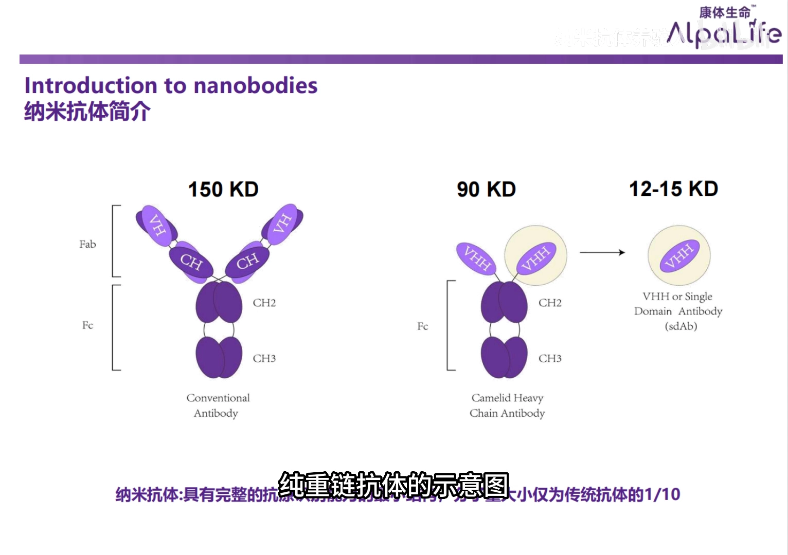

把重链可变区（VHH）单独表达出来就是纳米抗体，通常 12~15 kDa——只有传统抗体的十分之一左右；同时它的 CDR3 通常更长，对抗原的嵌合更深 [【跳转到 02:34】](https://www.bilibili.com/video/BV1Fz4y1A7nr/?t=154)。

## 二、免疫动物怎么选：鲨鱼 VS 驼科

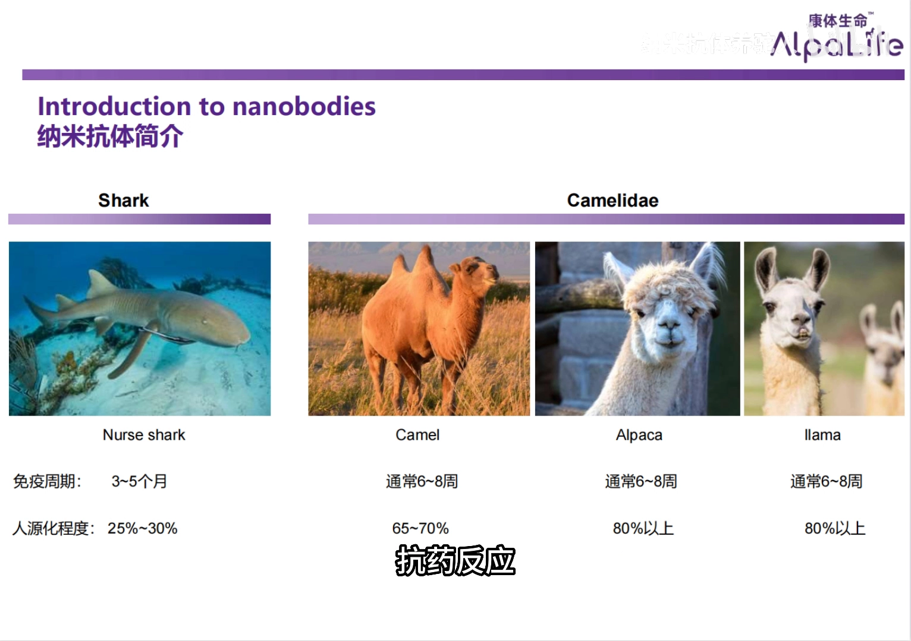

- **鲨鱼**：国外约三家公司使用。免疫周期 3~5 个月、饲养难度高（状态差时表现不明显、易死亡）、成本高；与人重链抗体相似度仅 25%~30%，免疫原性高、成药性差 [【跳转到 02:54】](https://www.bilibili.com/video/BV1Fz4y1A7nr/?t=174)。
- **驼科**：分双峰驼（骆驼）、小羊驼、大羊驼。双峰驼重链抗体丰度高（少量血即可得较多单域抗体），但与人抗体同源度约 65%~70%；小羊驼/大羊驼人源化更高 [【跳转到 03:44】](https://www.bilibili.com/video/BV1Fz4y1A7nr/?t=224)。**要做药进人体，更推荐小羊驼**（人源化 80% 以上，后期改造容易）[【跳转到 04:34】](https://www.bilibili.com/video/BV1Fz4y1A7nr/?t=274)。

## 三、优势由结构决定：小 + 长环 + 亲水

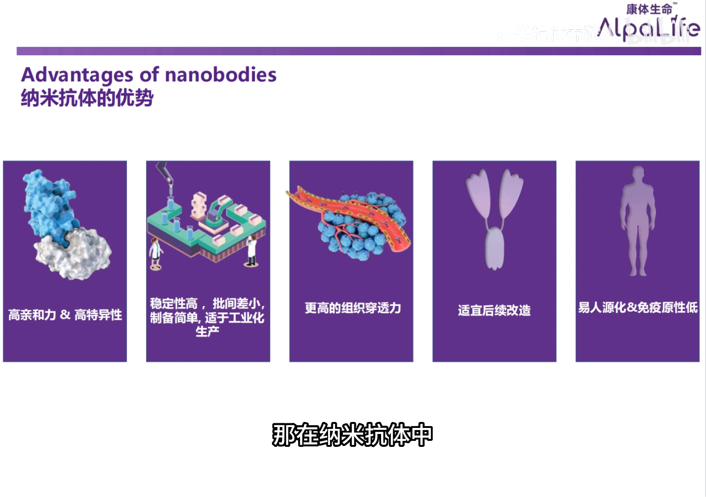

纳米抗体的优势本质由两点决定：**分子量小**、**CDR3 长** [【跳转到 04:57】](https://www.bilibili.com/video/BV1Fz4y1A7nr/?t=297)。CDR3 长带来高亲和力/高特异性；人类抗体中疏水的氨基酸在纳米抗体中是亲水的，水溶性好；内部二硫键带来稳定性 [【跳转到 05:22】](https://www.bilibili.com/video/BV1Fz4y1A7nr/?t=322)。落到工业上就是：表达容易、成本低、无需严格冷链、批间差异小（IVD 行业友好）。而传统抗体血浆滞留率高达 90% 以上、难以深层递送，纳米抗体凭小体积可深入肿瘤 [【跳转到 05:47】](https://www.bilibili.com/video/BV1Fz4y1A7nr/?t=347)。

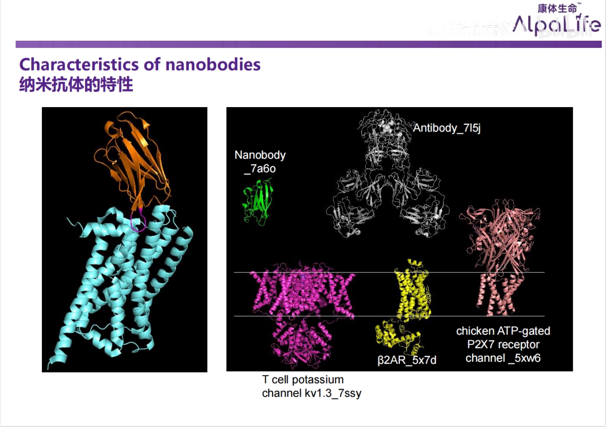

## 四、八大应用与四个已上市药物

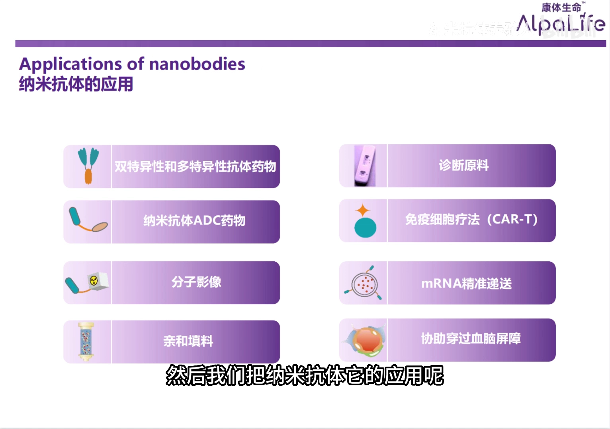

应用可归纳为八块 [【跳转到 07:24】](https://www.bilibili.com/video/BV1Fz4y1A7nr/?t=444)：单/多特异性药物、ADC（小分子偶联）、分子影像（核素偶联）、亲和填料（替代抗 FLAG 抗体/Protein A）、诊断原料、免疫细胞疗法（CAR 识别分子）、mRNA 精准递送、借血脑屏障受体转运入脑。

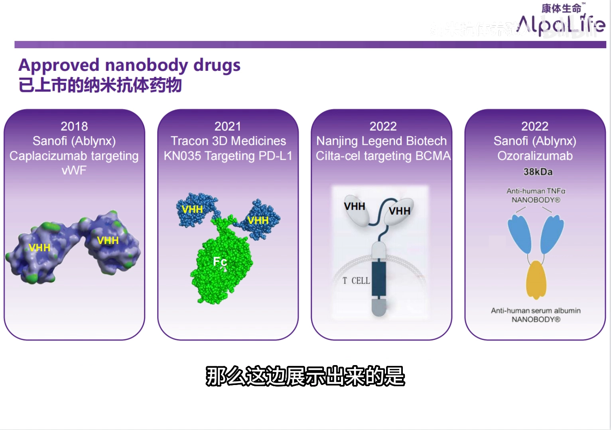

已上市药物的两个经典结构 [【跳转到 08:33】](https://www.bilibili.com/video/BV1Fz4y1A7nr/?t=513)：Ablynx 用两个相同 VHH 经刚性 linker 做成二价；另一个把两个靶向 TNF-α 不同位点的 VHH 与一个靶向 HSA 的 VHH 串联——HSA 桥把半衰期从几十分钟拉长到 18.2 天 [【跳转到 08:58】](https://www.bilibili.com/video/BV1Fz4y1A7nr/?t=538)。纳米抗体的半衰期"天生短、可调长"，长短皆可控，这是传统抗体做不到的 [【跳转到 09:23】](https://www.bilibili.com/video/BV1Fz4y1A7nr/?t=563)。

## 五、全流程总览：六步把序列"养"出来

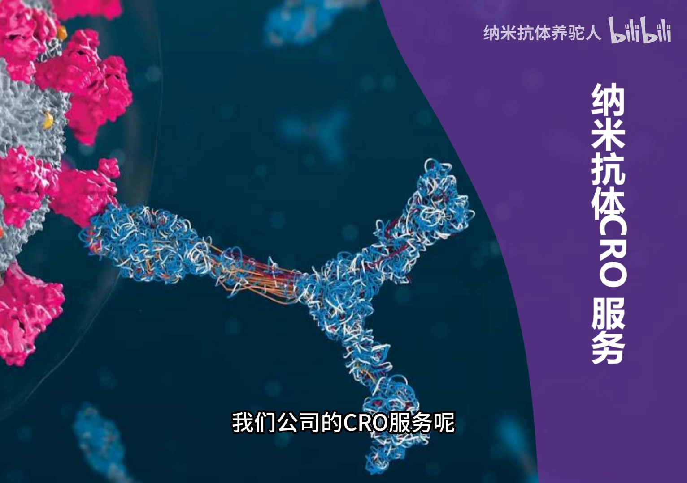

完整 CRO 服务分六块：**羊驼免疫 → 文库构建 → 筛选验证、表达纯化 → 性能测试 → 人源化改造 → 亲和力成熟**，可按客户需求分阶段提供 [【跳转到 12:00】](https://www.bilibili.com/video/BV1Fz4y1A7nr/?t=720)。支撑这套流程的是团队与基地：首席科学家杜阳教授是斯坦福博士后，其导师科比尔卡教授（2012 年诺贝尔化学奖）正是借助一个稳定 β2AR 构象的纳米抗体拿到 GPCR 结构而获奖 [【跳转到 10:29】](https://www.bilibili.com/video/BV1Fz4y1A7nr/?t=629)；羊驼基地位于广东惠州、离实验室约一小时车程，羊驼均为国外进口且不重复使用，保证免疫背景干净 [【跳转到 12:30】](https://www.bilibili.com/video/BV1Fz4y1A7nr/?t=750)。公司已完成的靶点覆盖 PD-L1/PD-L2/PD-1、CLDN18.2、CTLA-4、HSA 及多次跨膜蛋白等热门方向，免疫原形式也很灵活（蛋白、细胞、膜碎片、mRNA、灭活病毒、Nanodisc）[【跳转到 00:05】](https://www.bilibili.com/video/BV1Fz4y1A7nr/?t=5)。

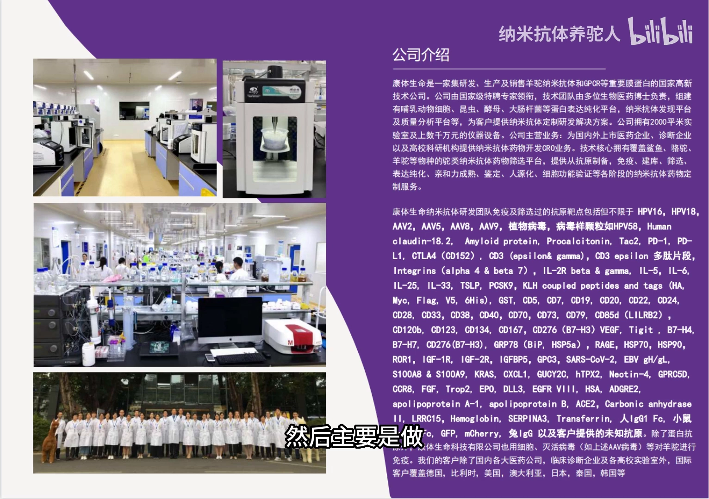

## 六、第一步 羊驼免疫：从抗原到效价

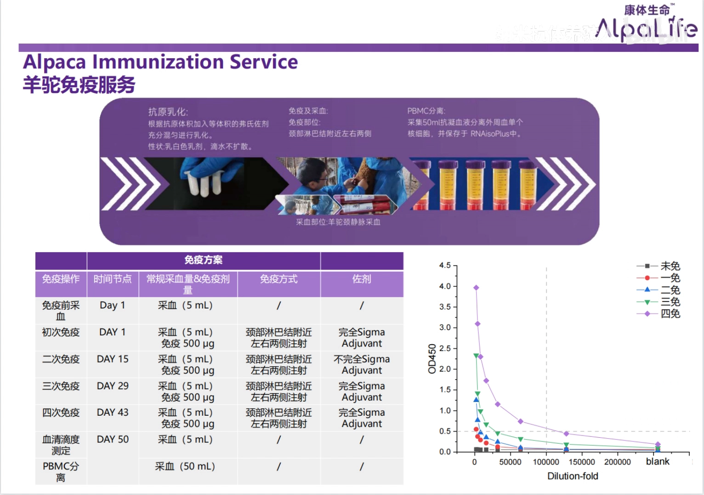

拿到经过活性验证的抗原后，先乳化；每次免疫剂量约 500 μg，注射位置在**颈部淋巴结两侧**；每次免疫前采血留血清用于效价检测 [【跳转到 13:26】](https://www.bilibili.com/video/BV1Fz4y1A7nr/?t=806)。以一个多次跨膜蛋白为例：四次免疫后效价持续攀升，第四次达到 10⁵ 以上，即符合免疫合格标准，随后提取血液中的 PBMC 与 RNA 进入下一步 [【跳转到 13:51】](https://www.bilibili.com/video/BV1Fz4y1A7nr/?t=831)。

## 七、第二步 文库构建：两轮 PCR 与"电转完立即测库容"

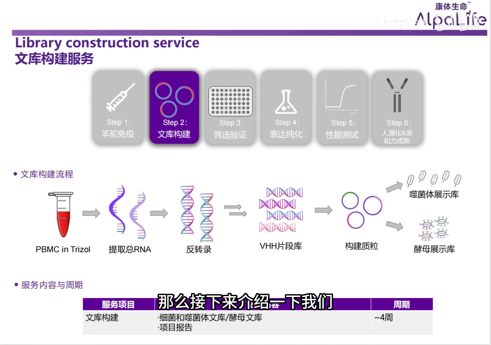

效价合格后：PBMC → 总 RNA → 反转录 → **两轮 PCR** 拿到 VHH 片段库 [【跳转到 14:23】](https://www.bilibili.com/video/BV1Fz4y1A7nr/?t=863)。两轮引物不同，第二轮引物做过**简并处理**以覆盖羊驼 VHH 的全部多样性；建库方法还需避免引入背景质粒。片段库与载体连接成质粒库后，可按需构建噬菌体展示库或酵母展示库，整体约四周 [【跳转到 15:13】](https://www.bilibili.com/video/BV1Fz4y1A7nr/?t=913)。

实战里还有几个容易踩坑的细节（来自文末定制案例）：RNA 质量要跑胶验证——28S 条带约为 18S 的两倍才算合格；第一轮 PCR 前要用 1~4 μL 梯度 cDNA 摸出最亮条带的模板体积 [【跳转到 22:34】](https://www.bilibili.com/video/BV1Fz4y1A7nr/?t=1354)；第一轮 PCR 后切下**下面那条 VHH 条带**胶回收再做第二轮，两轮合计约四五百个反应。质粒库电转进自制 TG1 超级感受态后要**立刻测库容**——若先摇菌再测，菌已扩增繁殖，数值会虚高；电转完立即测得 10⁸ 的库才足额可信，随后随机挑 48 个克隆测阳性率并测序，确认没有空载、双峰 [【跳转到 23:49】](https://www.bilibili.com/video/BV1Fz4y1A7nr/?t=1429)。

## 八、第三步 筛选：噬菌体 VS 酵母

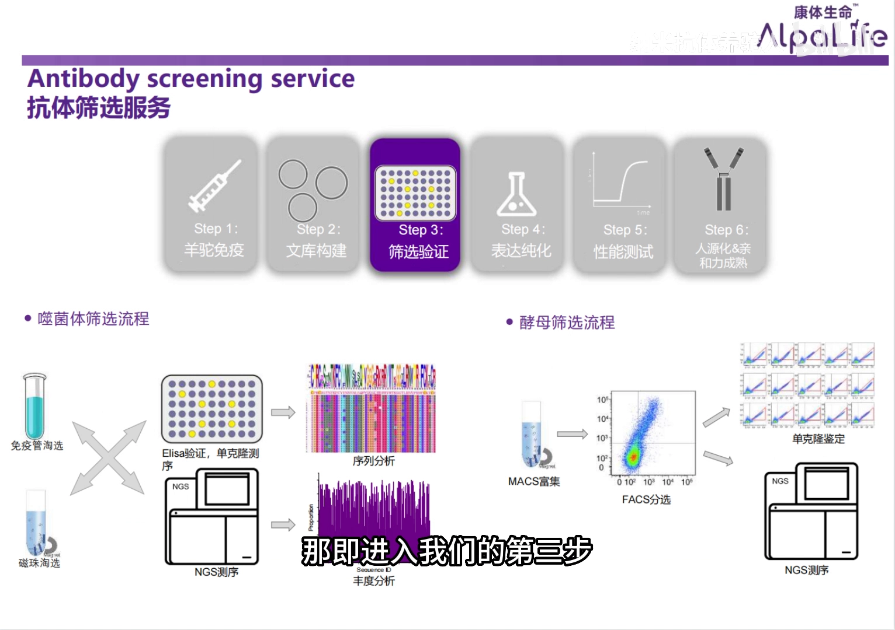

- **噬菌体展示**：固体/液体筛选各 2~3 轮淘选富集后，用 ELISA 挑单克隆拿阳性序列；也可送 NGS 测序用丰度分析获取更全面的序列 [【跳转到 15:28】](https://www.bilibili.com/video/BV1Fz4y1A7nr/?t=928)。
- **酵母展示**：先 MACS（磁珠分选）富集阳性酵母，再 FACS 分选；之后可挑单克隆做阳性鉴定，或把分选后的库整体送 NGS（可拿几百条序列再做丰度分析）[【跳转到 16:18】](https://www.bilibili.com/video/BV1Fz4y1A7nr/?t=978)。

## 九、第四步 表达纯化：四种体系怎么选

可选原核、酵母、昆虫、哺乳动物四种体系 [【跳转到 16:48】](https://www.bilibili.com/video/BV1Fz4y1A7nr/?t=1008)：赶时间、要便宜选原核（拿到序列约一周出结果）；酵母则是"量与质"的平衡——构建稳转株后蛋白分泌到培养液，直接取上清做 ELISA，阳性克隆再放大纯化，通常可交付约 5 mg 蛋白，且兼具快速量产与糖基化修饰的优势 [【跳转到 17:38】](https://www.bilibili.com/video/BV1Fz4y1A7nr/?t=1058)。

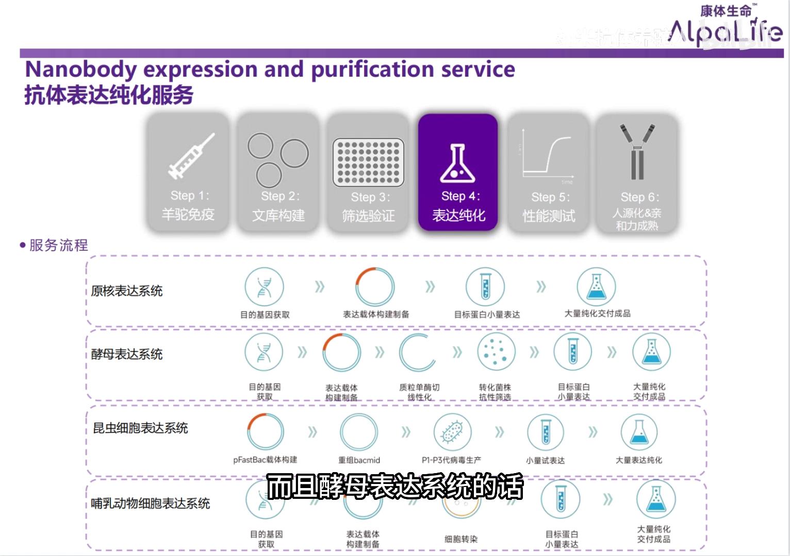

视频团队做过同型对照：同一种 VHH 分别用原核与酵母表达，酵母产物的性能确实更好 [【跳转到 18:03】](https://www.bilibili.com/video/BV1Fz4y1A7nr/?t=1083)。

## 十、BLI 表征：上细胞、上动物前的最后一道关

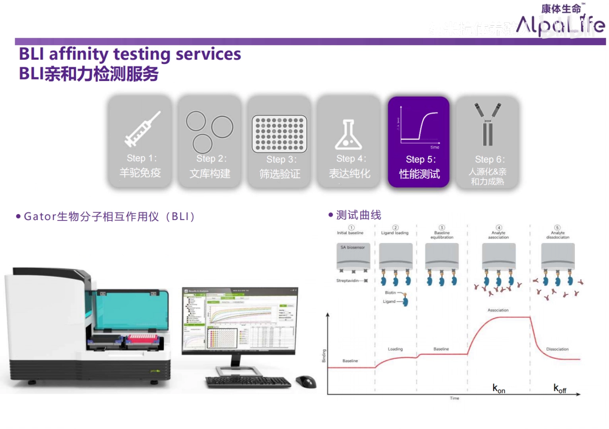

初步 ELISA 验证后，用 **BLI（生物膜干涉技术）**测结合常数、解离常数、亲和力，以及**表位分箱**——判断两个纳米抗体是否结合同一位置 [【跳转到 18:17】](https://www.bilibili.com/video/BV1Fz4y1A7nr/?t=1097)。这是很多客户在上细胞/上动物实验之前必须要的数据。

## 十一、第五步 改造：人源化与亲和力成熟

**人源化**：先做序列分析，需要改造的人源化位点通常不超过 10 个；针对这些位点设计约 20 多条序列，分别构建质粒，用酵母（或按需用 HEK293）表达，经 ELISA 初筛 + BLI 动力学验证 [【跳转到 18:57】](https://www.bilibili.com/video/BV1Fz4y1A7nr/?t=1137)。验收标准很明确：改造后与亲本序列的亲和力相差**不超过两倍**；通常交付 3 条人源化程度 ≥90% 且亲和力相当的序列 [【跳转到 19:47】](https://www.bilibili.com/video/BV1Fz4y1A7nr/?t=1187)。

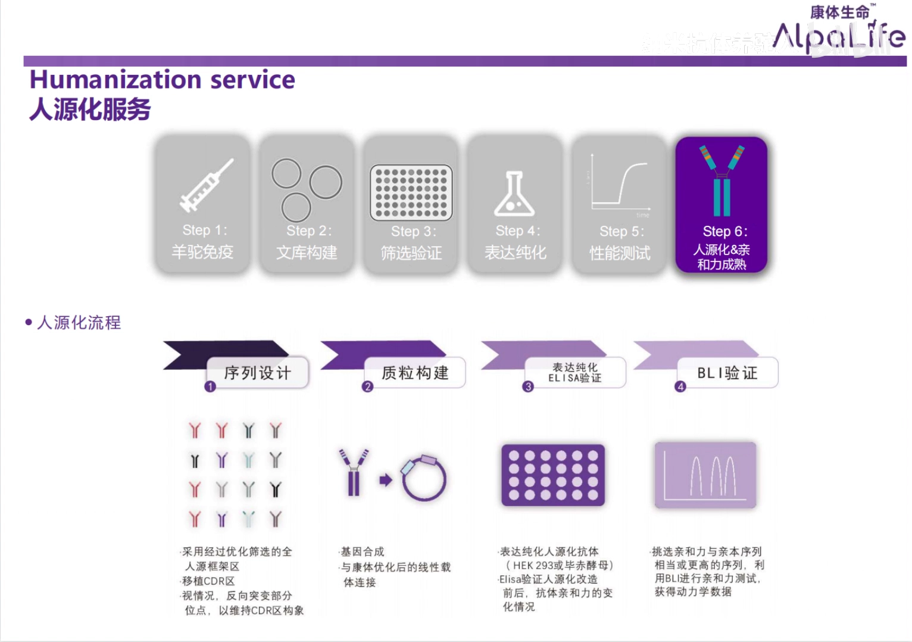

**亲和力成熟**难度更高：针对 CDR3 做单点及组合突变（非常依赖设计经验），建成 10⁴~10⁵ 的小容量突变库，用酵母/噬菌体展示筛出亲和力提升的克隆，测序、表达纯化后再用 BLI 对比成熟前后 [【跳转到 20:37】](https://www.bilibili.com/video/BV1Fz4y1A7nr/?t=1237)。视频给出的案例从 3.01×10⁸ 提升到 1.26×10¹⁰，约提升 239 倍 [【跳转到 21:02】](https://www.bilibili.com/video/BV1Fz4y1A7nr/?t=1262)。

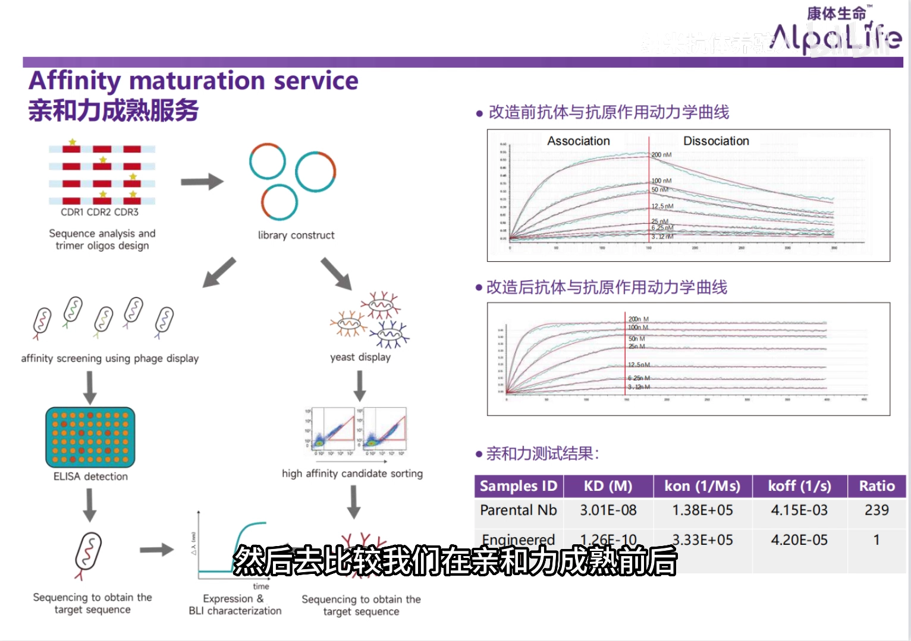

## 十二、实战案例：人/鼠/猴交叉反应纳米抗体定制

一个完整案例把上述流程串起来 [【跳转到 21:25】](https://www.bilibili.com/video/BV1Fz4y1A7nr/?t=1285)：目标抗原需要同时识别人源、鼠源、猴源。序列分析发现人源与鼠源相似度不足 70%、与猴源超过 90%，于是采用**人源蛋白 + 鼠源蛋白共同免疫**。四次免疫后人/鼠/猴效价均达 10⁵ 以上，取 50 mL 血提取 PBMC 与 RNA，经"跑胶质检 → 反转录 → 梯度 cDNA PCR → 切胶回收 → 第二轮 PCR → 连接载体 → TG1 电转"建出质粒库，库容 10⁸、48 克隆质控合格 [【跳转到 23:24】](https://www.bilibili.com/video/BV1Fz4y1A7nr/?t=1404)。

随后用三种抗原同时做一轮筛选，富集后挑单克隆，得到 28 条序列不同、与人源和猴源抗原交叉反应的纳米抗体，其中 10 条人/猴双交叉 [【跳转到 24:35】](https://www.bilibili.com/video/BV1Fz4y1A7nr/?t=1475)。这十条经表达纯化、ELISA 验证后，再与客户商量挑出几条做针对人/鼠/猴的蛋白互作动力学（BLI）测试 [【跳转到 25:00】](https://www.bilibili.com/video/BV1Fz4y1A7nr/?t=1500)。

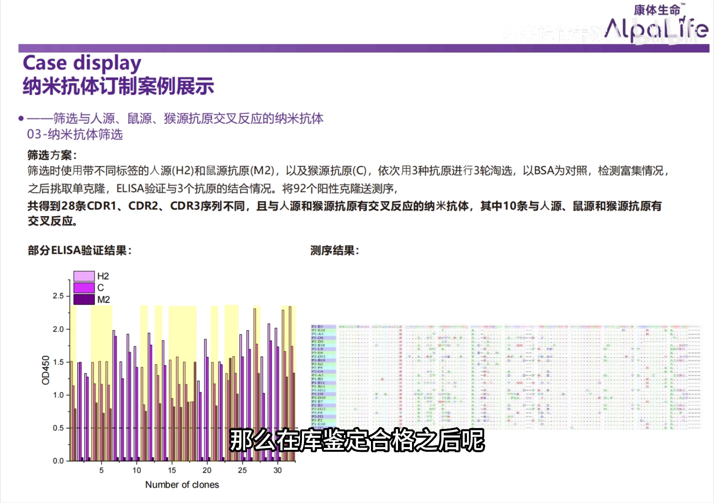

## 十三、谁在用这套流程

视频最后列举了合作方，可作为行业生态参考 [【跳转到 25:18】](https://www.bilibili.com/video/BV1Fz4y1A7nr/?t=1518)：药企如上海医药、江苏先声药业、恒瑞医药、康诺亚及辉瑞旗下子公司；有意思的是武汉三鹰生物（Proteintech）2020 年全资收购德国康泰（ChromoTek）——其主打商品正是纳米抗体标签试剂（如各类 -Trap）；CAR-T 企业（深圳普瑞金、上海吉凯基因、斯丹赛等）；科研院所与医院（上海药物所 6 个项目，深圳人民医院一位老师合作 60 多个项目）。科研单位项目通常一两个起做，门槛并不高。

## 小结

- 纳米抗体制备 = 六步链路：**羊驼免疫 → 文库构建 → 筛选验证 → 表达纯化 → 性能测试（BLI）→ 人源化/亲和力成熟**。
- 宿主选择：治疗向首选小羊驼（人源化 80%+）；鲨鱼免疫周期 3~5 个月、人源化仅 25%~30%，应用面窄。
- 文库质量三道闸：简并引物覆盖多样性、电转后立即测库容（避免摇菌后虚高）、48 克隆阳性率 + 测序 QC（无空载/双峰）。
- 筛选双路线：噬菌体（2~3 轮淘选 + ELISA/NGS）与酵母（MACS+FACS + 单克隆/NGS），按需选择。
- 表达体系：原核求快求省，酵母兼顾产量与糖基化（同型对照显示性能更好）。
- 改造验收量化：人源化交付 ≥90% 且亲和力在亲本 2 倍以内；亲和力成熟靠 CDR3 突变库 + 展示筛选，案例提升 239 倍。

## 关键术语速查

| 术语 | 一句话解释 |
| --- | --- |
| VHH | 驼科重链抗体的重链可变区，即纳米抗体（12~15 kDa） |
| PBMC | 外周血单个核细胞，淋巴细胞来源，是构建免疫文库的原料 |
| 简并引物 | 混合碱基设计的 PCR 引物，用于覆盖羊驼 VHH 基因的多样性 |
| 胶回收 | 电泳后切下目标条带（VHH）并纯化 DNA 的操作 |
| TG1 感受态 | 噬菌体展示建库常用的大肠杆菌菌株，电转效率决定库容 |
| MACS / FACS | 磁珠分选 / 流式分选，酵母展示筛选的两级富集手段 |
| ELISA | 酶联免疫吸附测定，筛选阶段最常用的结合验证方法 |
| BLI | 生物膜干涉技术，测结合/解离常数、亲和力与表位分箱 |
| 表位分箱 | 判断不同抗体是否识别同一（重叠）表位的聚类分析 |
| 人源化 | 把 VHH 框架区残基替换为人源序列以降低免疫原性，同时保持亲和力 |
| 亲和力成熟 | 针对 CDR3 建突变库并筛选，提升抗体亲和力的迭代过程 |
