# 纳米抗体的发现与应用

> 视频来源：[纳米抗体的发现与应用（Bilibili）](https://www.bilibili.com/video/BV1boMezDEXc/)，时长约 39 分钟（临界点生物）。本文基于视频演说图文稿整理，时间戳可跳转到对应讲解。

## 本讲要解决的核心问题（SCQA）

**背景**：上一节我们已知，传统抗体是两条重链 + 两条轻链组成的 Y 形分子（约 150 kDa），靠 6 个 CDR 组成的结合部位识别抗原。

**冲突**：传统抗体又大又"娇气"——生产难、怕热怕变性、难以深入组织，很多小口袋靶点（离子通道、酶活性中心）根本够不着。

**疑问**：自然界有没有一种天然存在的、更小更皮实的"迷你抗体"？

**回答（中心思想）**：有。骆驼科动物体内天然存在**缺失轻链的重链抗体**，把它的重链可变区单独克隆出来，就是只有 15 kDa 的 **VHH（纳米抗体）**——它以「小、稳、易改造」三个结构特点，撑起了从抗体药、PET-CT 成像、亲和纯化填料到饲料添加剂的七大应用版图。

## 一、发现史：羊驼外周血里的意外收获

纳米抗体的故事始于 1989 年：比利时科学家 Hamers 的学生在羊驼的外周血里，发现了一类**天然缺失轻链**的功能性抗体 [【跳转到 00:43】](https://www.bilibili.com/video/BV1boMezDEXc/?t=43)；1993 年他们在 Nature 上发表第一篇文章，正式报道了骆驼科动物中的这类"重链抗体"。

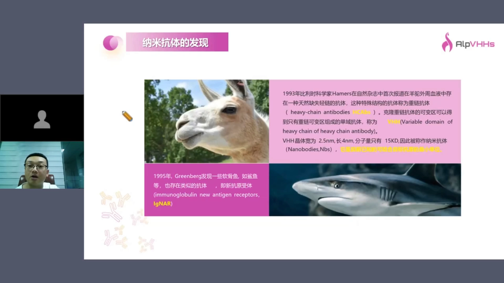

把重链抗体的重链可变区单独克隆出来，得到的只含重链可变区的单域抗体，称为 **VHH** [【跳转到 01:08】](https://www.bilibili.com/video/BV1boMezDEXc/?t=68)。它宽约 2.5 nm、长约 4 nm、分子量仅 15 kDa，是已知天然存在的、可结合抗原的最小单位——"纳米抗体"因此得名 [【跳转到 01:33】](https://www.bilibili.com/video/BV1boMezDEXc/?t=93)。1995 年，Greenberg 又在软骨鱼（鲨鱼）中发现了类似的单域抗体，称为新抗原受体（VNAR）[【跳转到 01:58】](https://www.bilibili.com/video/BV1boMezDEXc/?t=118)。

## 二、结构对比：从 150 kDa 到 15 kDa，缺了什么、换了什么

传统抗体约 150 kDa，由两条重链 + 两条轻链组成；骆驼科体内的重链抗体只有 75 kDa [【跳转到 02:16】](https://www.bilibili.com/video/BV1boMezDEXc/?t=136)。

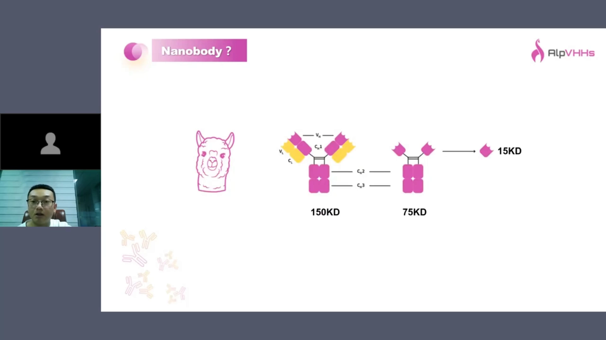

从结构上看，重链抗体没有轻链，重链还缺少 CH1 恒定区；我们通常拿到的纳米抗体，就是其中重链可变域（VHH）这一段，约 15 kDa [【跳转到 02:41】](https://www.bilibili.com/video/BV1boMezDEXc/?t=161)。

与轻链"分手"后，VHH 在进化上做了三件事来弥补 [【跳转到 03:06】](https://www.bilibili.com/video/BV1boMezDEXc/?t=186)：

1. **FR2 由疏水变亲水**。传统抗体的 FR2 有四个疏水氨基酸，负责与轻链相互作用；骆驼科不需要了，这四个位置突变成亲水氨基酸，使整个分子更容易在大肠杆菌、酵母中高水平表达 [【跳转到 03:31】](https://www.bilibili.com/video/BV1boMezDEXc/?t=211)。
2. **CDR3 变长**：约 16~18 个氨基酸（人/鼠约 9 个），用更长的环保住亲和力。
3. **多一对额外二硫键**：骆驼在 CDR1–CDR3 之间，羊驼在 FR2–CDR3 之间，用于稳定整体结构与 CDR3 构象 [【跳转到 03:56】](https://www.bilibili.com/video/BV1boMezDEXc/?t=236)。

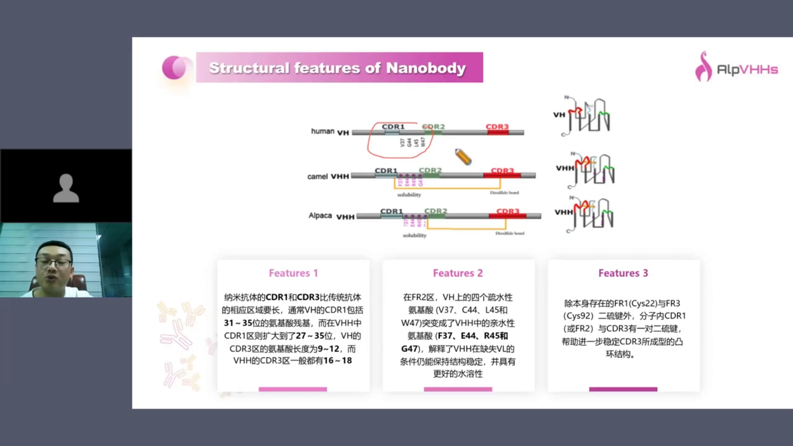

## 三、四个亚型与"免标签纯化"

纳米抗体人源化程度非常高，整体归属人的 **VH3 家族**；按 CDR3 长短与有无额外二硫键，可细分为 **VHH1–VHH4** 四个亚型 [【跳转到 04:46】](https://www.bilibili.com/video/BV1boMezDEXc/?t=286)：VHH1/2 短 CDR3、无额外二硫键；VHH3 长 CDR3 + FR2–CDR3 二硫键（羊驼主流）；VHH4 见于骆驼（CDR1–CDR3 二硫键，11 位亮氨酸→丝氨酸）[【跳转到 05:11】](https://www.bilibili.com/video/BV1boMezDEXc/?t=311)。

一个实用冷知识：Protein A 能结合 VH3 家族，而纳米抗体恰属 VH3——所以很多纳米抗体**不带标签也能用 Protein A 纯化** [【跳转到 06:01】](https://www.bilibili.com/video/BV1boMezDEXc/?t=361)。

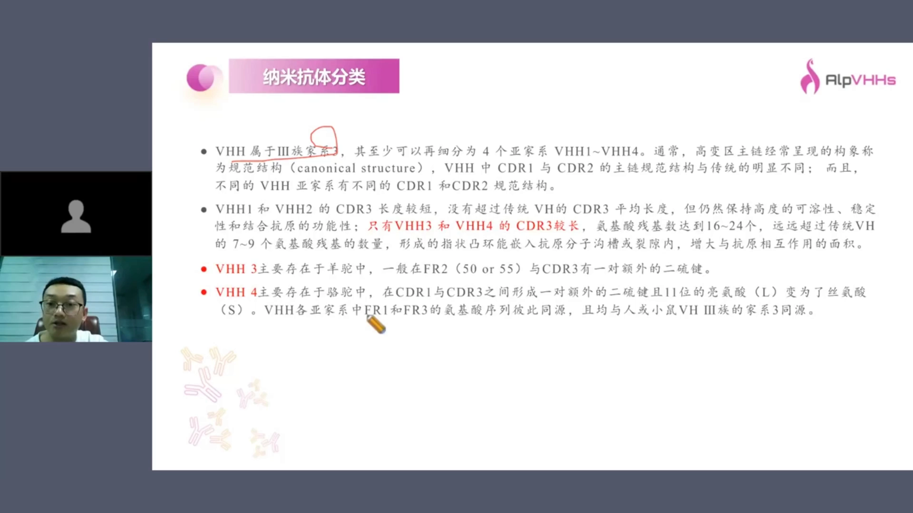

## 四、结构决定的六大优势

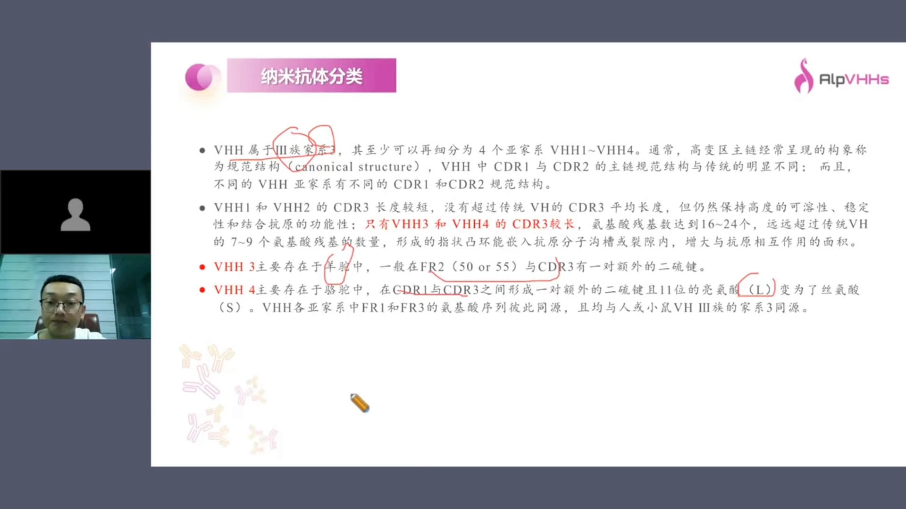

- **亲和力高**：CDR3 长，与抗原嵌合更深 [【跳转到 06:26】](https://www.bilibili.com/video/BV1boMezDEXc/?t=386)。
- **稳定性/耐受性极强**：室温放置一周、37℃ 放一周、加热，甚至盐酸胍、尿素等强变性剂处理，都能耐受 [【跳转到 06:51】](https://www.bilibili.com/video/BV1boMezDEXc/?t=411)。
- **易于改造**：单域、水溶性高，可串联双表位，可加非天然氨基酸/半胱氨酸做定点偶联（核素、毒素、荧光分子）[【跳转到 07:16】](https://www.bilibili.com/video/BV1boMezDEXc/?t=436)。
- **免疫原性低**：与人抗体同源性高。
- **组织渗透强**：分子量小，免疫荧光/免疫组化穿透更好。
- **制备简单**：大肠杆菌、酵母、各类真核系统乃至乳酸菌都能高效表达 [【跳转到 07:41】](https://www.bilibili.com/video/BV1boMezDEXc/?t=461)。

## 五、骆驼、羊驼、大羊驼，到底选哪个？

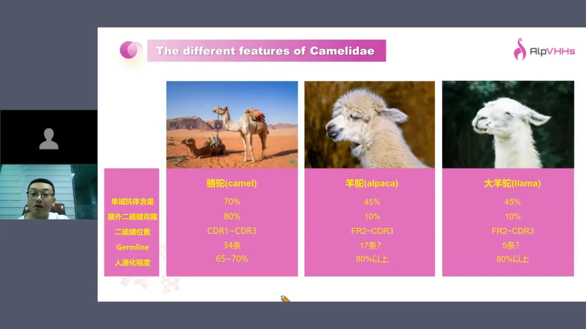

骆驼科主要有骆驼、羊驼、大羊驼三个物种，差异可以归纳成一张表 [【跳转到 08:06】](https://www.bilibili.com/video/BV1boMezDEXc/?t=486)：

| 特征 | 骆驼 | 羊驼 / 大羊驼 |
| --- | --- | --- |
| IgG 中重链抗体占比 | 约 70% | 约 45% |
| 含额外二硫键的克隆比例 | 约 70%（结构更稳，适合诊断试剂常温保存） | 约 10% |
| 胚系基因丰度 | 约 34 条（数据库滞后，IMGT 约 2004 年才更新；羊驼约 17 条、大羊驼约 5 条） | 较少 |
| 人源化程度 | 约 65%~70% | 80% 以上 |

结论：**做诊断抗体一般选骆驼**（天然多、结构稳），**做治疗性抗体一般选羊驼/大羊驼**（人源化高、后续改造容易）[【跳转到 10:11】](https://www.bilibili.com/video/BV1boMezDEXc/?t=611)。另外提醒：如果想做**胞内抗体**（intrabody），胞内是还原环境，二硫键难以正确形成，含很多二硫键的骆驼克隆可能没有活性，此时一般也不选骆驼开发 [【跳转到 10:36】](https://www.bilibili.com/video/BV1boMezDEXc/?t=636)。

## 六、鲨鱼 VNAR：更小，但更难用

鲨鱼抗体的 Fc 由五个结构域组成；可变域更小，一般不超过 110 个氨基酸 [【跳转到 10:56】](https://www.bilibili.com/video/BV1boMezDEXc/?t=656)。

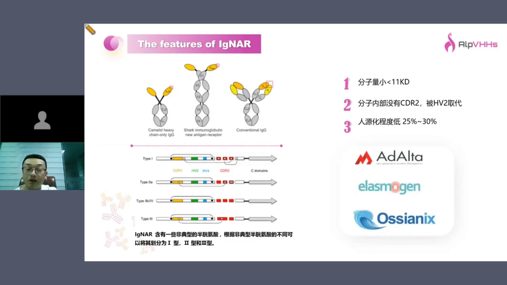

它**没有 CDR2**，只有一个起连接/稳定作用的 HV2 区域 [【跳转到 11:21】](https://www.bilibili.com/video/BV1boMezDEXc/?t=681)。按二硫键数目与位置分几个亚型——未成年鲨鱼以一型为主，成年后以二型为主，三型比例很低（类似小鼠 IgG3），所以开发时一般选成年鲨鱼 [【跳转到 11:46】](https://www.bilibili.com/video/BV1boMezDEXc/?t=706)。但它的短板明显：免疫周期长达 3~5 个月 [【跳转到 12:11】](https://www.bilibili.com/video/BV1boMezDEXc/?t=731)；亲和力较难达到纳摩尔水平（好的也就几十 nM）；人源化程度只有 25%~30%，成药性不佳 [【跳转到 12:36】](https://www.bilibili.com/video/BV1boMezDEXc/?t=756)。

国际上基于鲨鱼抗体的公司有三家：AdAlta、Alchemab 和 Ossianix，其中只有澳大利亚 AdAlta 将项目推进到了临床 [【跳转到 13:01】](https://www.bilibili.com/video/BV1boMezDEXc/?t=781)。它的 **i-body 平台**用人的神经细胞黏附分子（NCAM）作骨架——其结构与鲨鱼抗体类似——把 CDR1/CDR3 嫁接上去构建合成文库，并引入一对额外二硫键增加稳定性 [【跳转到 13:26】](https://www.bilibili.com/video/BV1boMezDEXc/?t=806)。

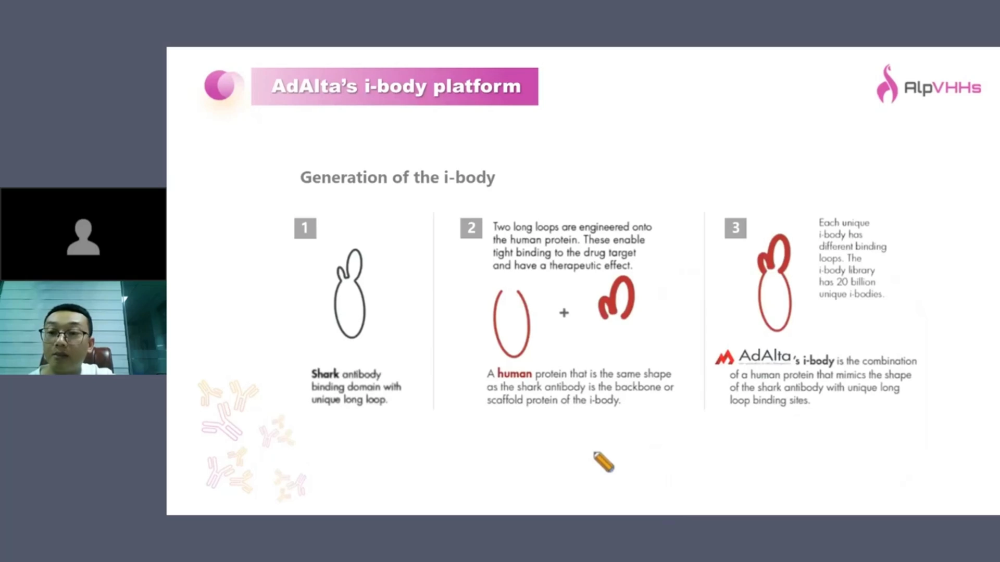

首个进入临床的分子针对趋化因子受体 CXCR4：研发代码 AD114 因小于 11 kDa 半衰期太短，与人的 Fc 融合成 AD214，目前处于一期临床 [【跳转到 13:51】](https://www.bilibili.com/video/BV1boMezDEXc/?t=831)。

## 七、七大应用方向：小分子做不到的，它都能

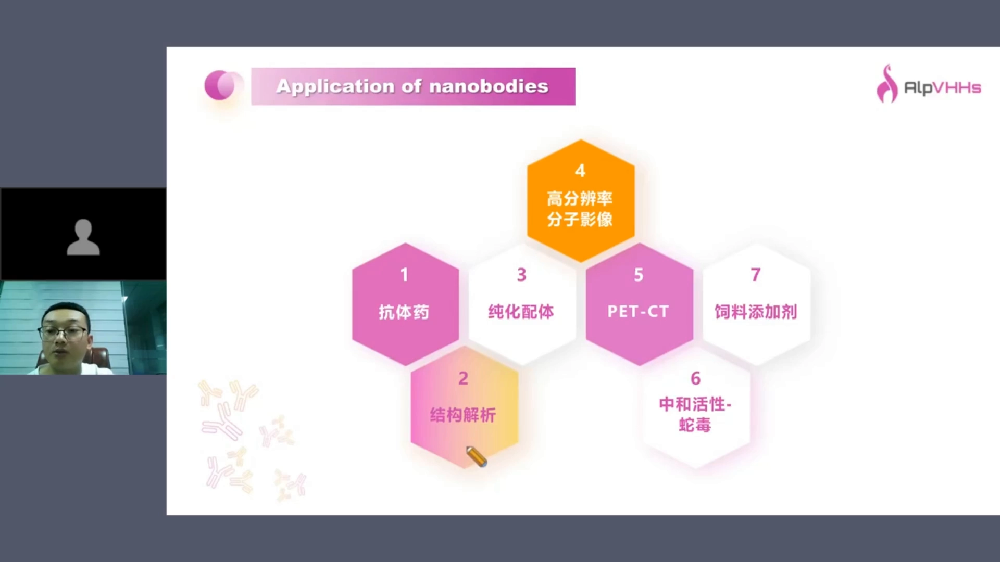

利用「小」和「稳」，纳米抗体有七大应用 [【跳转到 15:31】](https://www.bilibili.com/video/BV1boMezDEXc/?t=931)：①抗体药；②结构解析（冷冻电镜/结晶伴侣，把蛋白稳定在特定构象）；③亲和纯化配体；④高分辨率分子影像；⑤核医学 PET-CT；⑥中和抗体（蛇毒、新冠）；⑦饲料添加剂。

**诊断**分体内、体外。体外靠"可串联放大信号 + 耐受严酷环境"：GFP trap 类产品（nanoselector）泡在 20% 乙醇里 4 年，活性几乎不降 [【跳转到 16:15】](https://www.bilibili.com/video/BV1boMezDEXc/?t=975)。体内成像则给纳米抗体连一个短半衰期核素：快去快回——迅速到达肿瘤靶部位，又经肾脏（清除阈值约 50~60 kDa）很快代谢 [【跳转到 16:40】](https://www.bilibili.com/video/BV1boMezDEXc/?t=1000)。

一个真实案例：与北大肿瘤医院合作的 **CLDN18.2（胃癌靶点）纳米抗体 + 镓-68 标记**项目，注射后定位病人胃部肿瘤，成果发表于核医学领域顶刊 [【跳转到 17:05】](https://www.bilibili.com/video/BV1boMezDEXc/?t=1025)。

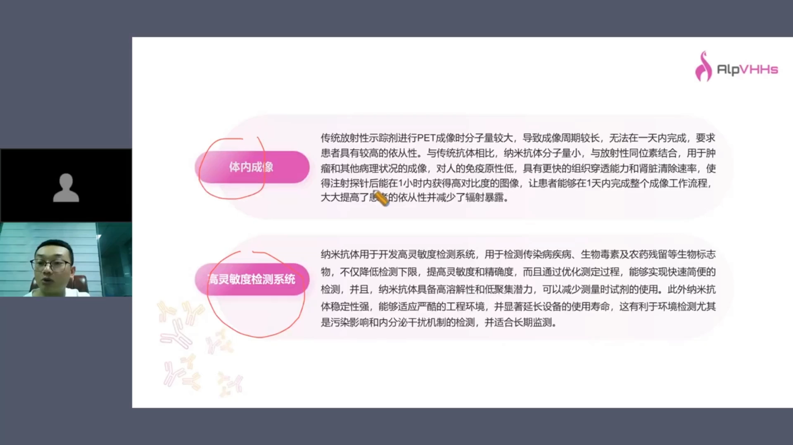

## 八、获批药物与细胞治疗：scFv 的"接班人"

治疗端已有四个项目完全获批，证明纳米抗体的成药性 [【跳转到 18:50】](https://www.bilibili.com/video/BV1boMezDEXc/?t=1130)：癌症方向有 caplacizumab（卡普赛珠单抗）与国内康宁杰瑞的 KN035（恩沃利单抗，PD-L1）；自身免疫方向有一个靶向 TNF-α 的双抗在日本获批。

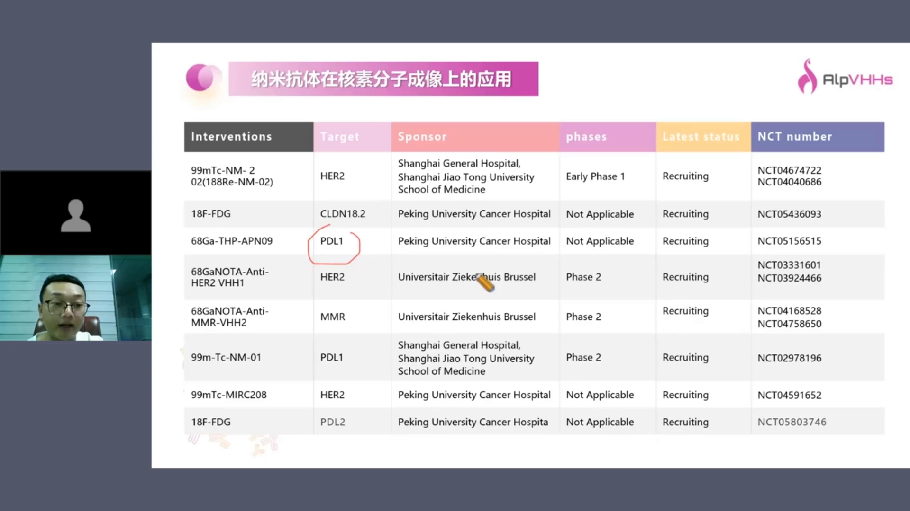

**细胞治疗**是纳米抗体的高光场景 [【跳转到 21:20】](https://www.bilibili.com/video/BV1boMezDEXc/?t=1280)：传统 CAR 用 scFv 识别抗原，但 scFv 把 VH/VL 用柔性 linker 硬拉在一起，VH/VL 会与旁边的 VH/VL 相互作用，在细胞表面沉积，进而引发 T 细胞耗竭；而双表位 CAR 用两个 scFv 又很难实现。纳米抗体两个都解决——最成功的就是传奇生物针对 BCMA 的双表位 CAR-T，已获批且销量很好 [【跳转到 21:45】](https://www.bilibili.com/video/BV1boMezDEXc/?t=1305)。

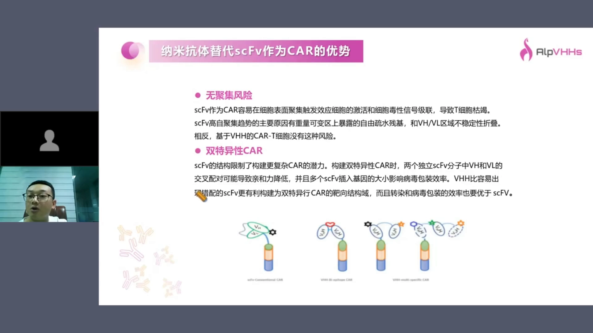

在**双抗**上，纳米抗体结构简单、形式灵活：两个 VHH 串联、VHH+TCR、三个 VHH、或与 Fc 融合都可行，方便工艺开发还能避开部分双抗专利 [【跳转到 20:30】](https://www.bilibili.com/video/BV1boMezDEXc/?t=1230)；也有研究把传统抗体的 VL/VH 同时换成两个不同纳米抗体，得到类似 IgG 的双抗结构 [【跳转到 20:55】](https://www.bilibili.com/video/BV1boMezDEXc/?t=1255)。

## 九、给药方式革新：皮下、吸入、口服、入脑

- **皮下注射**：要求蛋白浓度高达 100~200 mg/mL，只有高水溶性的纳米抗体能满足 [【跳转到 23:00】](https://www.bilibili.com/video/BV1boMezDEXc/?t=1380)。
- **可吸入**：新冠期间多个科研单位做了肺部可吸入制剂，国内洛启生物亦有布局 [【跳转到 23:25】](https://www.bilibili.com/video/BV1boMezDEXc/?t=1405)。
- **口服**：VHsquared 的 V565（靶向 TNF-α）从"蛋白本身改造 + 制剂设计"两端入手，实现大分子难以做到的口服递送 [【跳转到 23:50】](https://www.bilibili.com/video/BV1boMezDEXc/?t=1430)。
- **跨血脑屏障**：纳米抗体 15 kDa 并不能直接穿越血脑屏障，需要"搭车"——借助转铁蛋白受体、胰岛素受体等转运受体介导入脑 [【跳转到 24:15】](https://www.bilibili.com/video/BV1boMezDEXc/?t=1455)。

感染性疾病方面，纳米抗体可结合细菌毒素或黏附菌膜阻止其迁移 [【跳转到 24:40】](https://www.bilibili.com/video/BV1boMezDEXc/?t=1480)。更有意思的是**饲料添加剂**：酵母属食品安全级，抗弯曲菌的中和纳米抗体可在酵母中表达，经发酵、干燥后**无需纯化**直接拌入饲料 [【跳转到 25:05】](https://www.bilibili.com/video/BV1boMezDEXc/?t=1505)；其结构融合了可黏附肠壁上皮细胞的 IgA，可中和肠道致病菌。已见加拿大公司在开发此类产品——用"绿色方法"替代易导致耐药的抗生素 [【跳转到 25:55】](https://www.bilibili.com/video/BV1boMezDEXc/?t=1555)。

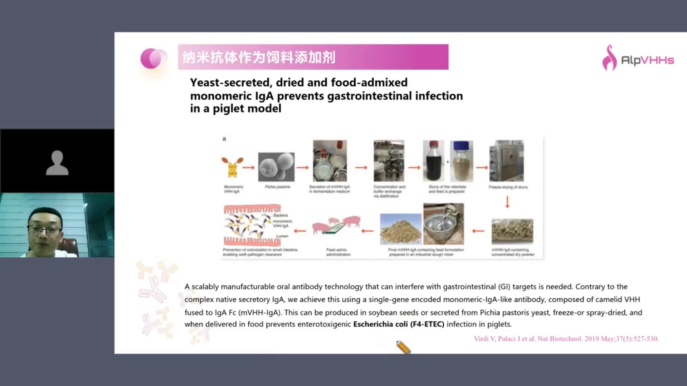

## 十、亲和纯化填料：载量十倍于传统抗体磁珠

传统抗体做亲和纯化填料有两大硬伤：分子量大（150 kDa）导致**载量低**；轻重链靠二硫键相连，容易脱落造成二次污染——做 IP 时常见的轻重链干扰就是这么来的 [【跳转到 26:15】](https://www.bilibili.com/video/BV1boMezDEXc/?t=1575)。纳米抗体则具备高特异性（可区分乙肝抗原 ad/ay 亚型、β-HCG 的 α/β 链）、高亲和力与强耐受 [【跳转到 26:40】](https://www.bilibili.com/video/BV1boMezDEXc/?t=1600)。

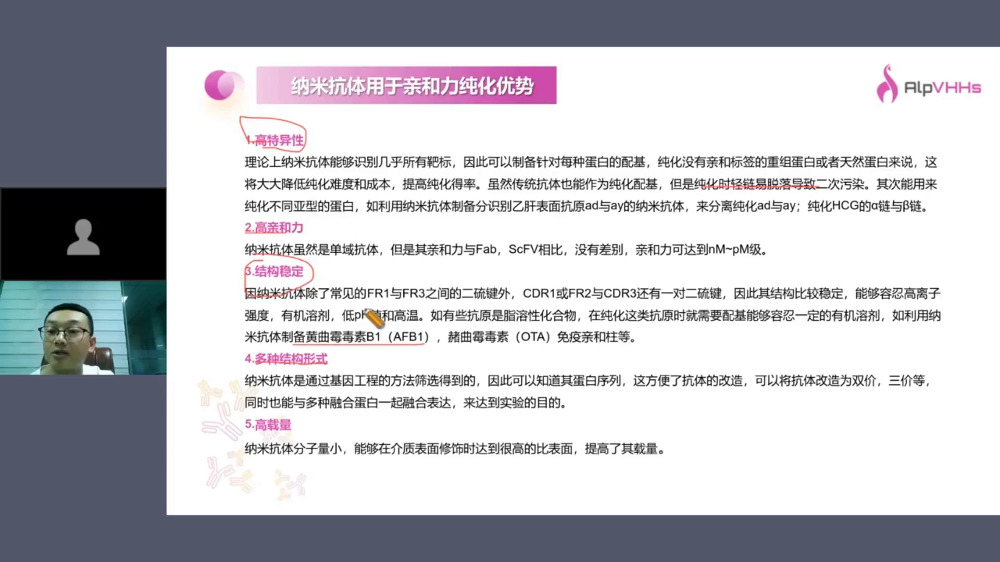

实用技巧：若单抗体亲和力太高导致洗脱困难，可将两个识别不同表位的纳米抗体串联，用**多价效应（avidity）**提高抓取效率，同时洗脱 pH 可放宽到 3.3~3.5 [【跳转到 27:55】](https://www.bilibili.com/video/BV1boMezDEXc/?t=1675)。载量上，抗 FLAG 抗体磁珠约 0.6 mg/mL，换成纳米抗体可提升十倍到 6 mg/mL [【跳转到 28:20】](https://www.bilibili.com/video/BV1boMezDEXc/?t=1700)。业界还有针对 AAV 的纳米抗体亲和填料，250 mL 售价约 23 万元且供不应求 [【跳转到 30:55】](https://www.bilibili.com/video/BV1boMezDEXc/?t=1855)。视频团队自研的 nanoselector（GFP/His/Myc 标签磁珠）则能耐受高盐、3 M 盐酸胍、8 M 尿素洗涤 [【跳转到 30:25】](https://www.bilibili.com/video/BV1boMezDEXc/?t=1825)。

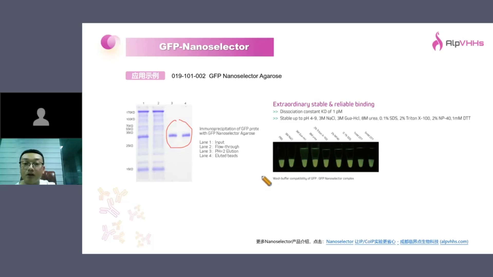

## 十一、隐发表位、胞内抗体与超分辨成像

纳米抗体中和病原还有一个"独门绝技"：CDR3 向外伸出，可以**深入酶的活性中心或病毒的凹陷部位**，打到传统抗体够不着的隐发表位——2022 年与清华大学团队合作的广谱新冠中和克隆 NB70 即为例证 [【跳转到 31:20】](https://www.bilibili.com/video/BV1boMezDEXc/?t=1880)。胞内抗体（intrabody）在细胞内表达、封闭特定蛋白功能，已有项目进入临床；注意胞内是还原环境，二硫键难以形成，选型时要避开多二硫键的骆驼克隆 [【跳转到 32:35】](https://www.bilibili.com/video/BV1boMezDEXc/?t=1955)。

分子量小还带来**高分辨率分子影像**三大优势：标记密度更高、抗原抗体距离更近（分辨率更高）、共定位时双标干扰更小 [【跳转到 34:38】](https://www.bilibili.com/video/BV1boMezDEXc/?t=2078)。在 iDISCO 等组织透明化技术中，纳米抗体偶联荧光可深入组织追踪神经纤维与神经细胞 [【跳转到 35:33】](https://www.bilibili.com/video/BV1boMezDEXc/?t=2133)。

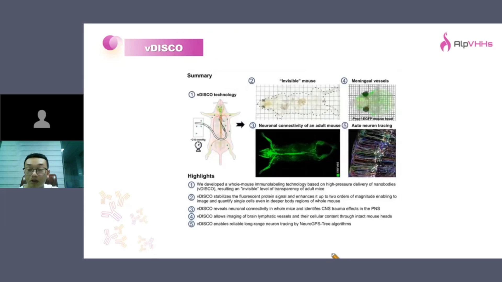

针对 STORM 等超分辨成像，把纳米抗体与荧光偶联的 SmartBooster 类产品可替代传统二抗，同时提高分辨率与信号密度 [【跳转到 35:58】](https://www.bilibili.com/video/BV1boMezDEXc/?t=2158)。

## 小结

- 纳米抗体 = 骆驼科重链抗体（缺轻链、缺 CH1）的重链可变区 VHH，仅约 15 kDa，是天然存在的最小抗原结合单位；鲨鱼 VNAR 是另一支（更小但更难用）。
- 三个结构改变换来三大能力：FR2 亲水化（好表达）、CDR3 变长（高亲和力）、额外二硫键（高稳定）。
- 物种选择：诊断用骆驼、治疗用羊驼/大羊驼；胞内抗体避开多二硫键克隆。
- 应用端凭"小而稳"通吃：抗体药（4 个已获批）、CAR-T（替代 scFv）、双抗、PET-CT 影像、亲和填料（载量十倍）、隐发表位中和、乃至饲料添加剂。
- 给药方式可皮下（高浓度）、可吸入、可口服，入脑需借助受体介导转运。

## 关键术语速查

| 术语 | 一句话解释 |
| --- | --- |
| VHH | 重链抗体的重链可变区（Variable domain of Heavy chain of Heavy-chain antibody），即纳米抗体本身 |
| 重链抗体（HCAb） | 骆驼科天然缺失轻链、重链缺 CH1 的抗体，约 75 kDa |
| FR2 | 可变区第 2 框架区；纳米抗体在此由疏水变为亲水，无需轻链也能稳定 |
| 额外二硫键 | VHH3（羊驼 FR2–CDR3）与 VHH4（骆驼 CDR1–CDR3）内多出的一对稳定性二硫键 |
| VNAR | 鲨鱼来源的新抗原受体单域抗体，无 CDR2，可变域 <110 aa |
| 肾清除阈值 | 分子量约 50~60 kDa 以下可快速经肾滤过代谢，是 PET 影像"快进快出"的基础 |
| 胞内抗体（intrabody） | 在细胞内表达、封闭蛋白功能的抗体；因还原环境需少二硫键 |
| avidity | 多价结合效应：多个低亲和力结合位点串联后整体抓取力大增 |
| nanoselector | 偶联标签识别纳米抗体的磁珠试剂（GFP/His/Myc 等），无轻重链干扰 |
