# 成药性抗体开发：从抗原设计到功能活性评价的全流程解析

> 视频来源：[成药性抗体开发--从抗原设计到功能活性评价的全流程解析（Bilibili）](https://www.bilibili.com/video/BV1HhJ4z1Ep2/)
>
> 本讲是义翘神州的在线课堂分享，主讲人任为负责分子生物学和抗体开发相关工作。

## 本讲要解决的核心问题（SCQA）

**背景**：抗体药物的核心是持续获得高亲和力、可开发的候选抗体，而抗体发现是一条多环节流水线。

**冲突**：这条流水线上坑很多：好抗原难制备（膜蛋白、复合物）、杂交瘤亚克隆周期长、人源化会掉亲和力、筛选平台众多不知道怎么选。

**疑问**：把"抗原制备 → 抗体筛选 → 工程化改造 → 功能评价"串起来的完整流程长什么样？每个环节有哪些提速与提质的做法？

**回答（中心思想）**：成药性抗体开发 = 四个环节 + 一个原则。四个环节是**抗原制备与免疫、抗体筛选（四大技术平台）、生产与工程化改造（人源化 / 亲和力成熟 / 高通量表达）、功能活性评价（亲和力 + 体外活性）**；一个原则是**在筛选的每个早期阶段就"介入"功能与竞争检测**（种属交叉、流式、ELISA 竞争等），尽早缩小范围、降低下游工作量。

---

## 一、总览：抗体发现的四个环节

[【跳转到 00:37】](https://www.bilibili.com/video/BV1HhJ4z1Ep2/?t=37)

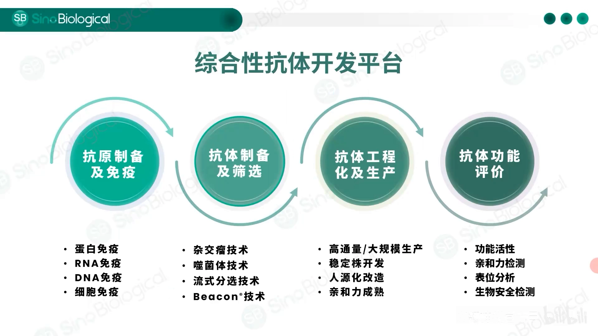

抗体发现主要包括四个环节：

1. **抗原的制备和免疫**：重组蛋白的表达生产，以及蛋白免疫、核酸免疫、细胞免疫等；
2. **抗体的制备和筛选**：目前应用最多的是三种抗体制备技术平台——杂交瘤技术、噬菌体展示技术和单个 B 细胞技术（加上本讲介绍的 Beacon 光导系统共四个平台）；
3. **抗体的生产和工程化改造**：高通量抗体表达、scFv/Fab/双抗的生产，以及人源化改造、亲和力成熟等服务；
4. **抗体的功能评价**：针对理化性质、功能活性、作用表位、亲和力，对成药性做全面评价。

贯穿四个环节的是"早期介入"：在每个筛选阶段都插入功能检测，而不是只依赖重组表达之后的质控。

## 二、抗原的制备和免疫：成功的一半

### 2.1 重组蛋白库：从原核到多次跨膜

[【跳转到 02:22】](https://www.bilibili.com/video/BV1HhJ4z1Ep2/?t=142)

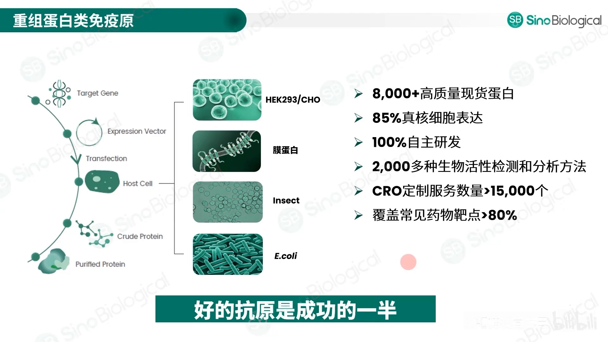

对于抗体开发来说，有好的抗原意味着成功了一半——免疫、筛选、质控都需要抗原。义翘神州拥有全球最大的重组蛋白库：从原核到真核表达系统、从分泌蛋白到胞内蛋白、从单次跨膜到多次跨膜蛋白；现货高质量蛋白 8000 多种（85% 以上真核表达，全部自主研发），建立了 2000 多种生物活性检测方法；CRO 定制服务超过 15000 个，覆盖 80% 以上的常见药物靶点。

针对成药性相关的靶点，一般会制备**人、鼠、猴等多个种属**的蛋白用于下游检测评估；激酶、多次跨膜蛋白等有难度的蛋白也会做，并从纯度、活性、亲和力多方面评价质量。

### 2.2 核酸免疫：打不出来的蛋白换个思路

[【跳转到 04:27】](https://www.bilibili.com/video/BV1HhJ4z1Ep2/?t=267)

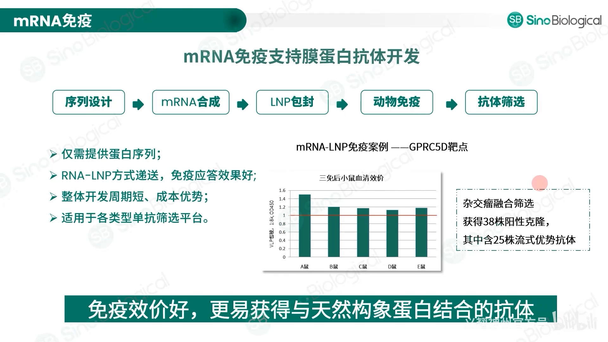

免疫原除了重组蛋白、多肽，还有**核酸免疫**。当重组蛋白很难制备——比如多次跨膜蛋白单独表达没有活性或表达量很低、或以复合物形式出现的蛋白——而我们又希望筛到与天然构象相结合的抗体时，可以换 mRNA 免疫：

- 案例一：mRNA 免疫小鼠，三免后血清效价普遍高于"蛋白免疫合格"的红线；
- 案例二：一个 GPCR 靶点用 mRNA 免疫、杂交瘤筛选，最终获得 38 株阳性抗体，其中 25 株是流式结合（天然细胞）的强阳性。

用 mRNA 免疫不仅效价好，而且更容易获得与天然构象蛋白结合的抗体。

### 2.3 免疫方案与动物选择

免疫方案可以个性化：调整免疫周期、更换免疫途径、优化剂量、改变佐剂等，提升筛选成功率。免疫动物根据抗原情况和应用需求（亲和力、特殊结合表位等）选择——小鼠、兔子还是羊驼；小鼠和兔子也各有不同品系。义翘神州已有 17000 多种不同类型抗原的免疫经验，涵盖 200 多种常见药物靶点。

## 三、抗体的制备和筛选：四大技术平台

### 3.0 平台总览与"早期介入"原则

[【跳转到 07:02】](https://www.bilibili.com/video/BV1HhJ4z1Ep2/?t=422)

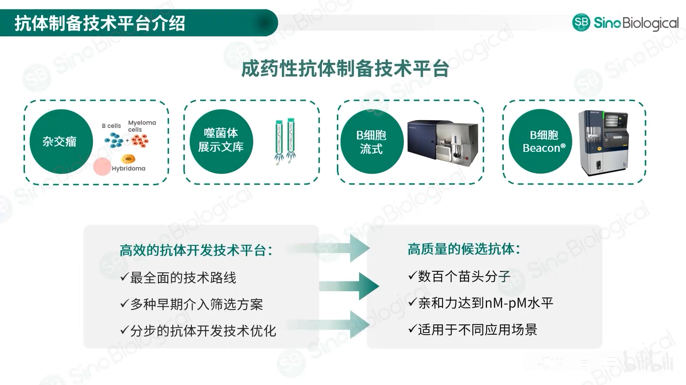

四个平台几乎覆盖了市场上所有的抗体开发技术路线，每个平台都支持在早期做介入筛选实验（种属交叉筛选、流式筛选、竞争检测等）。理念是：**在每个平台都重视早期介入检测和分步技术优化**，降低下游工作量、成本与周期。目前已筛到数百个功能活性较好的苗头分子，亲和力在纳摩到皮摩水平；开发的抗体包括抑制剂、激动剂、内吞抗体、多次跨膜靶点抗体以及 CAR-T 应用等。

### 3.1 杂交瘤：经典路线的提速改造

[【跳转到 09:37】](https://www.bilibili.com/video/BV1HhJ4z1Ep2/?t=577)

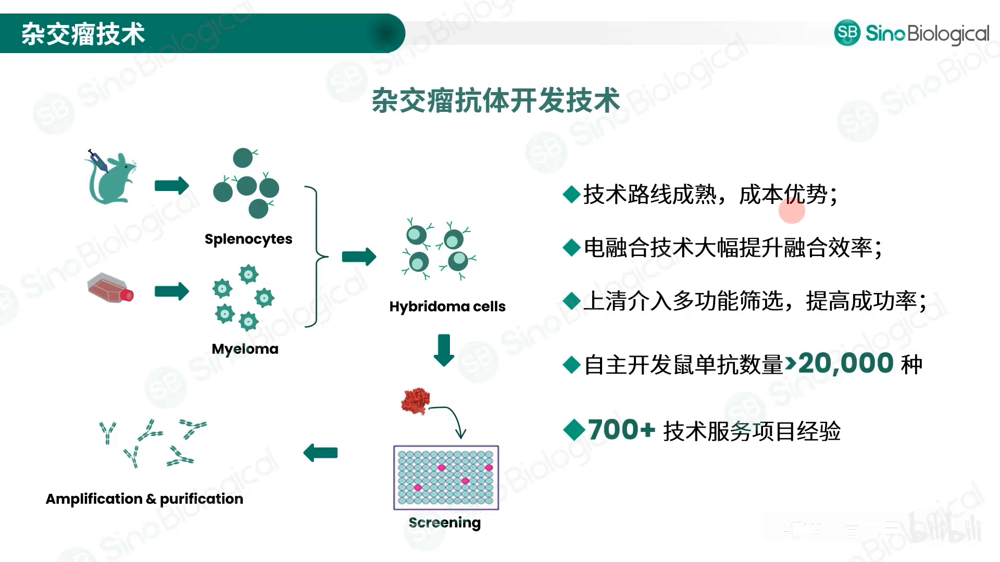

杂交瘤是最早诞生、也是目前应用最多的单抗制备技术：技术门槛较低、操作简便、路线成熟、有成本优势。目前用**电融合替代传统 PEG 融合**，对细胞伤害更小、融合效率更高，铺板数量可达 100 万以上、细胞活率约 90%。筛选时从免疫血清、主克隆上清到亚克隆上清，各阶段都可以介入功能筛选（流式、ELISA、细胞活性等），提高成功率。经验数据：针对 2000 多个靶点筛到 2 万多株阳性抗体，成功率 90% 以上。

**白介素 15（IL-15）案例**：用细胞活性最佳的蛋白免疫 Balb/c 和 C57 两种小鼠，挑效价最高的一只做电融合；单次融合铺 42 块 96 孔板，获得 800 多株阳性主克隆；在主克隆上做 ELISA 竞争检测，筛到 102 株能阻断靶蛋白与受体结合的主克隆；抽检 20 株测细胞活性，6 株有抑制增殖作用——差异主要因为杂交瘤上清抗体浓度偏低造成假阴性，但 ELISA 竞争与细胞活性有一定符合度，能帮助缩小范围。再对 40 株做 2~3 轮有限稀释，得到 15 株有结合与竞争活性的单克隆，最终 13 株亚克隆培养。

[【跳转到 13:36】](https://www.bilibili.com/video/BV1HhJ4z1Ep2/?t=816)

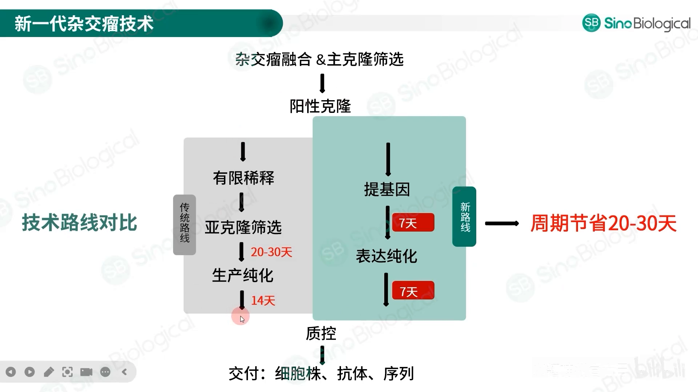

**提速关键：主克隆直接提取基因测序**。常规路线（有限稀释 → 亚克隆筛选 → 纯化）需要 30~40 天且取决于稀释轮数；在主克隆鉴定阳性后直接测序、重组表达，可缩短 20~30 天。一个 44 株阳性主克隆的案例：拿到 40 株序列（4 株未获得），去重后 33 株重组表达，31 株与主克隆结果一致，两株结合阴性；连同重复序列一起统计，44 株里 38 株最终确定与主克隆一致，**一致性 86%**。通量比有限稀释高数倍（可整版测序），避免传代中基因丢失，阳性率更高。统计显示：80%~90% 亚克隆阶段转阴或与主克隆不一致的杂交瘤细胞，都能通过主克隆基因测序找回正确的阳性抗体序列。

### 3.2 噬菌体展示：免疫库与天然库

[【跳转到 18:03】](https://www.bilibili.com/video/BV1HhJ4z1Ep2/?t=1083)

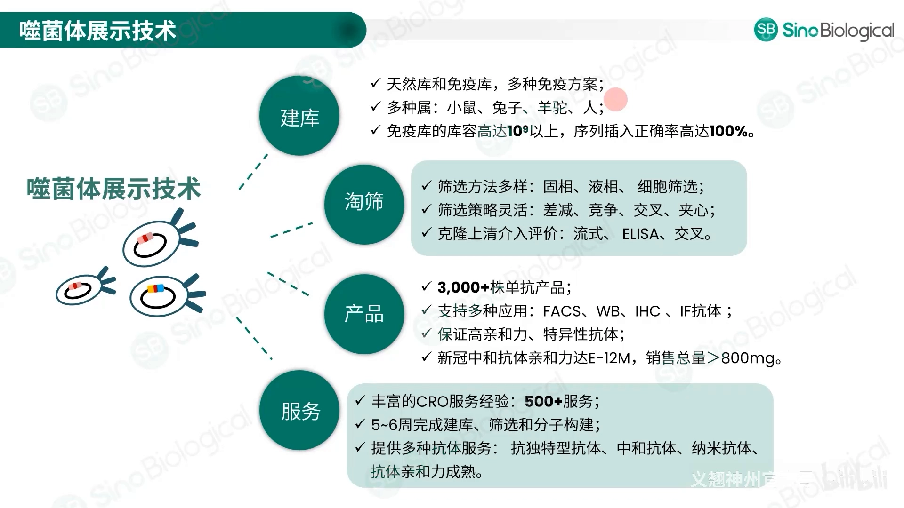

依托先进的蛋白表达技术提供高品质、低成本活性重组蛋白用于免疫，可在小鼠、兔、羊驼、鸡、人等多种属上建**免疫库和天然库**：免疫库库容可达 10⁹ 以上，天然库可达 10¹¹，序列正确插入率 100%。淘洗策略灵活：常规固相筛选，为得到更多结合表位可用液相筛选、细胞淘洗（筛与天然表位结合的抗体），按特异性、广谱性、竞争活性等需求组合差减、竞争、交叉、洗涤等手段。筛选阶段还能用噬菌体上清做介入评价（ELISA、流式、竞争），提前判断阳性克隆。

经验数据：超过 3000 株单抗产品来自噬菌体展示筛选，支持流式、组化、免疫荧光等检测，已为多家知名体外诊断公司开发生产高灵敏度单抗（满足酶联免疫、胶体金、化学发光、快速检测、微流控等场景）；新冠期间筛选的中和抗体亲和力达皮摩水平、累计交付超 800 毫克；500 多个外包项目 5~6 周即可完成建库筛选、克隆鉴定与构建表达。服务涵盖抗独特型抗体、中和抗体、纳米抗体开发及亲和力成熟。

**CAR-T 案例**：靶点在细胞上，采用"蛋白结合细胞"的免疫方式，用细胞淘洗；ELISA 阳性 127 株，流式强阳（天然细胞结合）48 株；重组表达后与过表达细胞、天然细胞都很好结合，但与无关肿瘤细胞、血液中的肿瘤细胞或正常细胞不结合，特异性良好。

**PD-L1 纳米抗体案例**：竞争筛选方式，在库上和克隆上都做介入竞争检测；最终两株能有效阻断 PD-L1 与 PD-1 结合的纳米抗体，其中 394 号克隆在蛋白竞争和细胞活性检测上都优于两株上市（抗体）药物，亲和力达纳摩水平。

### 3.3 流式分选单 B 细胞：兔单抗的高配对率

[【跳转到 22:34】](https://www.bilibili.com/video/BV1HhJ4z1Ep2/?t=1354)

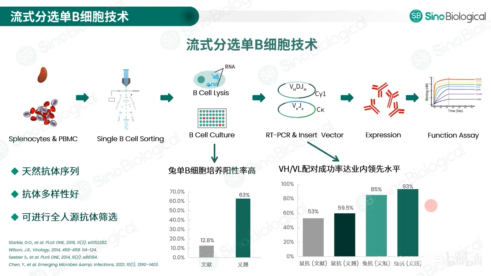

流式分选主要针对**记忆 B 细胞**，一次可分选 10~50 板抗原特异性记忆 B 细胞（小鼠、兔、人多个种属）；B 细胞培养上清可以做 ELISA、流式、WB、组化等多种介入筛选。关键优化数据：兔单抗的单 B 细胞体外培养阳性率 50%~70%；单 B 细胞 PCR 的重轻链配对率，小鼠 50%~70%、兔子 90%~100%——均优于文献报道水平。

**三通路六细胞因子案例**：靶点参与三个信号通路，与六个细胞因子相互作用，目标是筛到能同时阻断三通路、活性好于临床对照药的抗体。做法要点：

- 抗原：靶点是单次跨膜蛋白，只表达 ECD（胞外区）即可；同步制备对照抗体、细胞系并建立细胞活性方法，先做质控；
- 免疫：选兔（亲和力高）。组合拳包括足底淋巴结免疫、弗氏/铝佐剂、人鼠猴三种蛋白混合免疫、人鼠交叉免疫、三种蛋白长周期交叉免疫（拉长免疫间隔以提升亲和力）；
- 分选：IgG 阳性、IgM 阴性、抗原双荧光标记的特异性记忆 B 细胞；多支动物血清效价至少 62 万以上；
- 检测：培养上清测抗原结合、细胞结合、种属交叉；符合要求的克隆测序、表达、质控（抗原结合、细胞结合、细胞活性、亲和力）。

结果：多株抗体细胞活性与对照药相当或更好，亲和力基本都达到 10⁻¹¹ 摩尔水平，个别比对手高几倍；最终筛到三通路、六细胞因子均有阻断活性、好于或相当于对照的候选分子（也有单通路更优的）。

### 3.4 Beacon 单细胞光导：8~12 周缩短到 1 天

[【跳转到 28:58】](https://www.bilibili.com/video/BV1HhJ4z1Ep2/?t=1738)

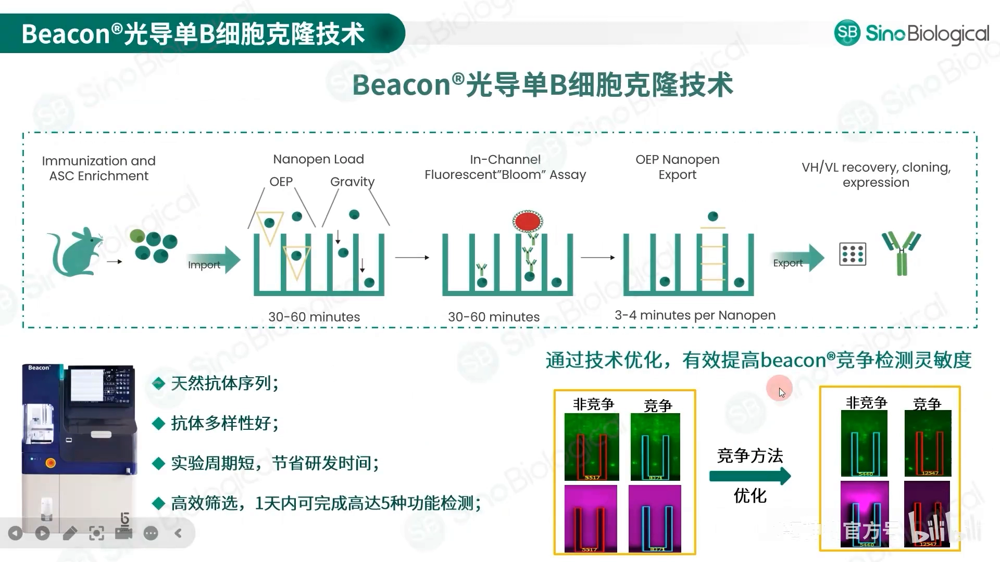

与流式分选记忆 B 细胞不同，Beacon 主要筛选**浆细胞**。系统结合微流控、纳升级反应器（NanoPen）、光电定位与计算机系统，完成单细胞的导入、培养、分析评价与导出。相比杂交瘤把融合、培养、鉴定原本 8~12 周的工作缩短到一天，且同一天内最多可做五种功能检测：抗原结合、细胞结合、识别不同表位、抗独特型结合、竞争活性等。通过优化荧光标记配体/受体的上样模式，还提高了竞争实验的灵敏度。

**多次跨膜（GPCR）案例**：约 50% 的药物靶向膜蛋白；G 蛋白偶联受体是七次跨膜蛋白、体内广泛分布，但表达量低、体外不溶、纯化不稳定、难保持天然构象。义翘神州建立三种膜蛋白制备平台：**VLP 平台、Nanodisc 平台、去污剂平台**，解决制备问题。在 Beacon 上筛与细胞结合的阳性克隆，测序表达后，M0165、M0173 两株抗体在 VLP、Nanodisc 及细胞结合检测上均优于对照药物，ADCC 杀伤活性也明显更优；亲和力上 M0173 与对照相当（纳摩），M0165 比对照高近一个数量级。

## 四、抗体的生产和工程化改造

[【跳转到 33:05】](https://www.bilibili.com/video/BV1HhJ4z1Ep2/?t=1985)

### 4.1 人源化：CDR 移植是主流

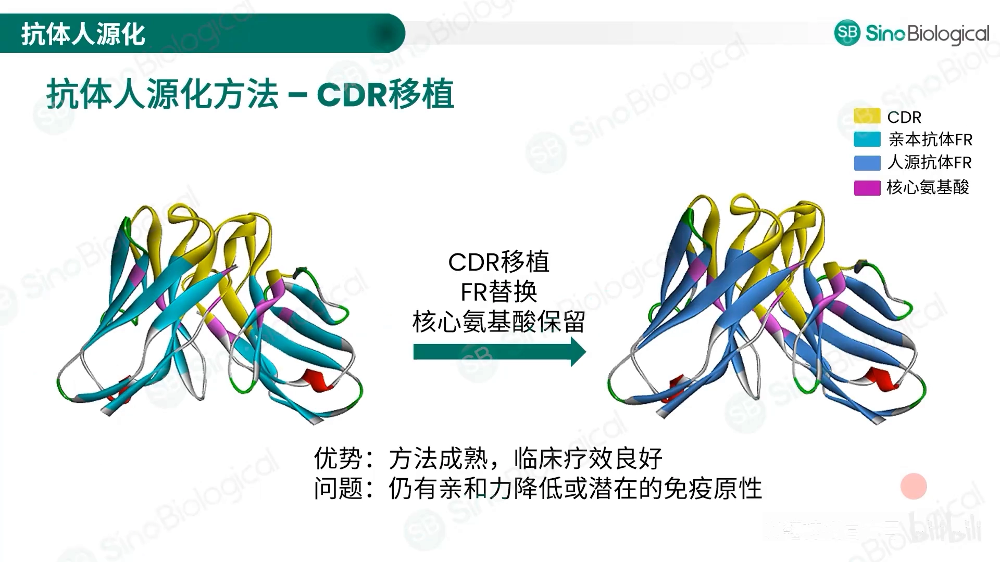

抗体工程化改造中，人源化技术应用最多，其中 **CDR 移植**使用最广：把非人源 CDR 移植到人抗体框架上，同时保留亲本抗体的关键氨基酸残基。已上市的鼠源人源化抗体大部分采用此技术（成熟、疗效好）；不足是少数抗体人源化后亲和力降低或有潜在免疫原性，但比例不高。

**新冠中和抗体人源化案例**（对照：鼠抗亲本、嵌合抗体）：大部分人源化抗体表达量相当或更高；轻链和重链（与人的）同源程度提升普遍达 95% 以上；中和活性（抑制率、IC50）与对照相当或更好；因 CDR 移植可能降低亲和力，把它当作成败的重要参考——所有人源化抗体亲和力都有明显提升（1 倍到 20 多倍）。纳米抗体的人源化同样适用：多株人源化纳米抗体在 ELISA 和流式结合活性上 IC50 均好于对照。

### 4.2 亲和力成熟：AI 预测 + 突变组合

[【跳转到 37:25】](https://www.bilibili.com/video/BV1HhJ4z1Ep2/?t=2245)

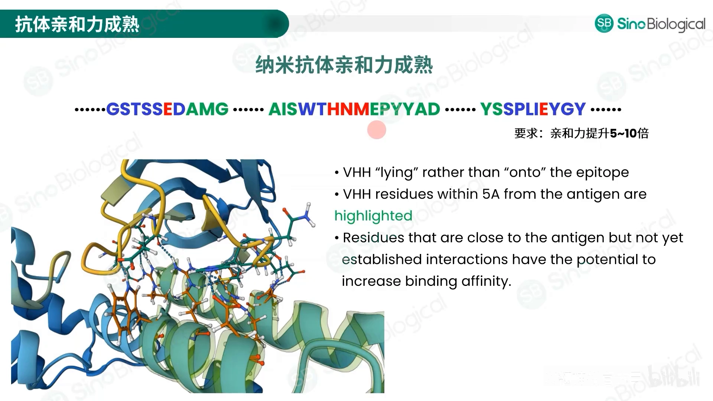

工程化改造中另一常用技术是**亲和力成熟**：先预测分析抗体与抗原的结合表位，再对抗体做突变，筛选亲和力提高的克隆。纳米抗体案例：AI 预测 CDR 上与抗原相互作用的表位（红色）、与抗原距离 5 Å 内可能通过突变提升亲和力的残基（绿色）；先做单点突变筛选，再把有帮助的单点组合成突变库；对筛出的抗体测亲和力并排序——最好的一株亲和力提升近 10 倍。

### 4.3 高通量表达：从两周到三小时

[【跳转到 39:04】](https://www.bilibili.com/video/BV1HhJ4z1Ep2/?t=2344)

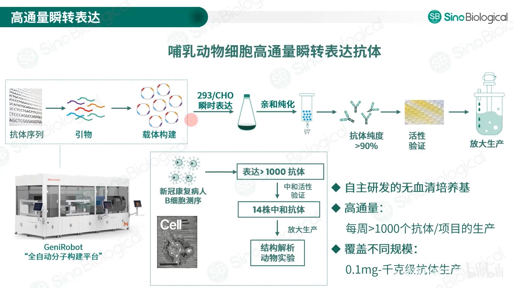

大量候选需要快速验证，义翘神州的高通量表达纯化服务包括：

- **全自动分子构建平台**：无人化、高通量；自研全套培养基、转染试剂、表达载体、加料液与添加剂；
- **定向驯化的 CHO 和 293 细胞**，无血清悬浮或贴壁培养；健全的纯化体系（亲和层析、离子交换、疏水层析、凝胶过滤）；
- **案例**：客户从新冠病人分离浆细胞、NGS 测序后挑出 1000 多个抗体瞬时表达，再从中筛出 14 株中和抗体做结构解析和动物实验——每个抗体交付 200 µg 并做 ELISA 与活性检测；从基因合成、载体构建、瞬时表达、ELISA 检测到交付，**两周完成全部实验**；
- **线性表达框取代质粒构建**：省去质粒构建、测序、提取时间，两天完成分子试验用于转染；表达产物与质粒转染一致，适合高通量初筛；
- **无细胞表达系统**：几天缩短到 3 小时，活性与哺乳动物细胞相当，可表达细胞中难表达的抗体片段，成功率 99% 以上；
- **工艺放大**：瞬转/稳转工艺开发，小试到中试放大；5000 多平米洁净车间可提供 GMP 级别生产。

## 五、功能活性评价：亲和力 + 体外活性

### 5.1 亲和力平台：SPR 与 BLI

[【跳转到 43:01】](https://www.bilibili.com/video/BV1HhJ4z1Ep2/?t=2581)

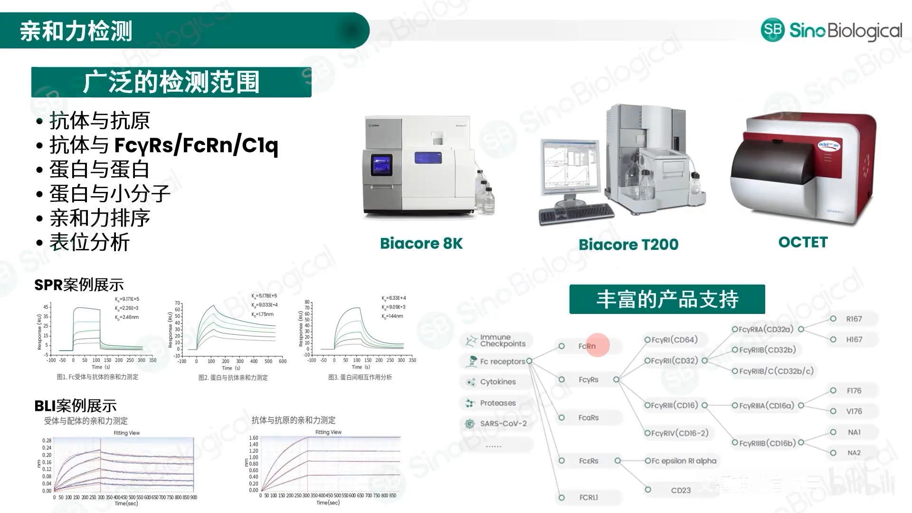

亲和力评价是成药性表征中非常重要的一项。两个主流平台：**SPR**（表面等离子共振，制药行业金标准，已收录进 2020 版中国药典）和 **BLI**（生物膜干涉，全球增长最快的非标记检测技术）。两者都提供实时、非标记的分子相互作用信息，计算亲和力（KD）、结合速率（kon）、解离速率（koff）。可检测抗体-抗原、抗体与 Fc 受体、补体的相互作用，蛋白-蛋白、蛋白-小分子相互作用，还能做亲和力排序与表位分析；Fc 受体产品线齐全，可全面表征抗体与 Fc 受体的亲和力。两个平台项目经验丰富，SPR 平台通过 CNAS 认证。

### 5.2 体外活性检测平台

[【跳转到 44:26】](https://www.bilibili.com/video/BV1HhJ4z1Ep2/?t=2666)

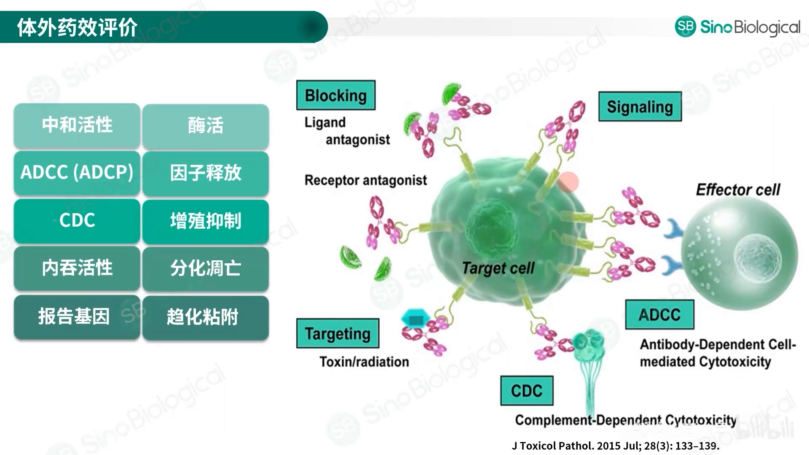

体外活性平台包括：ADCC、ADCP、CDC，细胞增殖抑制、细胞杀伤、中和活性、细胞凋亡、细胞因子释放、抗体内化等。示例：抗 CD38 抗体（相关）酶活检测、抗 Nectin-4 抗体内吞活性、OX40 激动剂诱导 CD4 T 细胞分泌白介素-2、针对 VEGF 的细胞迁移抑制与血管生成抑制实验等。

## 六、平台背后的公司

[【跳转到 45:21】](https://www.bilibili.com/video/BV1HhJ4z1Ep2/?t=2721)

北京义翘神州科技股份有限公司成立于 2007 年，拥有超过 2 万平米研发生产中心和 5000 多平米洁净生产车间，员工 900 多人（近 1/3 硕士以上），专注生命科学研究与创新药物研发领域：重组蛋白、抗体、基因产品库，ELISA 试剂盒、培养基、转染试剂、GMP 级核酸酶等产品的研发生产，现货产品超 6.7 万种；建立从基因克隆、蛋白表达、抗体开发与生产到质量控制的一站式 CRO 技术服务平台。

## 小结

- 抗体发现四环节：抗原制备与免疫 → 筛选（四大平台）→ 生产与工程化改造 → 功能评价；"早期介入检测"贯穿始终。
- 好的抗原是成功的一半：现货+定制重组蛋白库（8000+ 现货、定制超 15000 个、覆盖 80% 药物靶点）；难制备靶点用 mRNA 免疫，效价与天然构象结合率都更好。
- 杂交瘤提速关键：电融合 + 主克隆直接基因测序（省去亚克隆，缩短 20~30 天，44 株案例 86% 一致，80~90% 转阴可挽回）。
- 噬菌体展示：多物种免疫库（10⁹）/天然库（10¹¹）、灵活淘洗；CAR-T、PD-L1 纳米抗体等案例显示可与上市药比肩。
- 流式单 B 细胞：兔单抗培养阳性率 50~70%、重轻链配对率 90~100%；多免疫组合 + IgG⁺IgM⁻ 双荧光分选筛出三通路六因子阻断抗体。
- Beacon：浆细胞 + 纳升级 NanoPen + 光电定位，8~12 周 → 1 天，同日 5 种功能检测；VLP/Nanodisc/去污剂平台攻克多次跨膜蛋白。
- 人源化以 CDR 移植为主流；案例显示同源程度提升 95%+、亲和力提升 1~20 倍、中和活性不降。
- 亲和力成熟：AI 预测表位 → 单点突变 → 组合突变，最好提升近 10 倍。
- 高通量表达：全自动分子构建 + 驯化 CHO/293 + 线性表达框 + 无细胞表达（3 小时、99%+），两周交付千级抗体。
- 功能评价双平台：SPR（金标准、入药典、CNAS 认证）+ BLI；活性检测覆盖 ADCC/ADCP/CDC、中和、内化等。

## 关键术语速查

| 术语 | 一句话解释 |
| --- | --- |
| 杂交瘤技术 | 脾细胞与骨髓瘤细胞融合，量产单克隆抗体的经典技术 |
| 主克隆（primary clone） | 融合后第一次筛选得到的阳性孔，可直接测序提取抗体基因 |
| 亚克隆 / 有限稀释 | 把主克隆稀释到单细胞再克隆，确保抗体单一来源的步骤 |
| 噬菌体展示 | 把抗体片段展示在噬菌体表面，用抗原"淘洗"筛选的体外进化技术 |
| 免疫库 / 天然库 | 用免疫动物构建 / 未经免疫个体构建的抗体基因库 |
| 细胞淘洗 | 用完整细胞做筛选靶，富集识别天然构象表位的抗体 |
| 记忆 B 细胞 / 浆细胞 | 免疫应答后存活的 B 细胞 / 大量分泌抗体的终末分化 B 细胞 |
| Beacon 光导系统 | 微流控 + 光电定位的单细胞筛选平台（NanoPen 纳升级反应器） |
| ECD | 胞外区（extracellular domain），单次跨膜蛋白做抗原通常只表达 ECD |
| VLP / Nanodisc | 病毒样颗粒 / 脂质纳米盘，两种保持膜蛋白天然构象的展示技术 |
| CDR 移植 | 把非人源抗体的 CDR 嫁接到人源框架上的人源化方法 |
| 回溯突变 / 关键残基 | 人源化时保留或改回鼠源的关键氨基酸，以保住亲和力 |
| 亲和力成熟 | 通过表位预测与突变组合提高抗体亲和力的技术 |
| 线性表达框 | PCR 制备的线性表达片段，取代质粒构建以加速瞬时表达 |
| 无细胞表达系统 | 在试管中用细胞提取物进行蛋白表达，几小时出产物 |
| SPR / BLI | 表面等离子共振 / 生物膜干涉，两种实时非标记的亲和力检测技术 |
| ADCC / ADCP / CDC | 抗体依赖的细胞介导的细胞毒 / 吞噬 / 补体依赖的细胞毒效应 |
| scFv / Fab | 单链可变片段 / 抗原结合片段，两种小分子量抗体形式 |
