# 抗体人源化技术

> 视频来源：[【小药说药】抗体人源化技术（Bilibili）](https://www.bilibili.com/video/BV1u31yBXEGD/)

## 本讲要解决的核心问题（SCQA）

**背景**：1975 年科勒（Köhler）和米尔斯坦（Milstein）发明了杂交瘤技术，把能产生抗体的免疫细胞和能无限生长的骨髓瘤细胞融合在一起，从此能源源不断地生产只针对特定目标、纯度极高的单克隆抗体。抗体药物进入高速发展的黄金时代，目前全球已批准超过 200 个治疗性抗体药物。

**冲突**：最早的第一代抗体药物用的还是鼠源抗体。人体对"来自老鼠的蛋白质"非常敏感：一旦开始用药，很多患者的身体就会启动防御机制，产生 **HAMA 反应**（人抗鼠抗体反应）——这些 HAMA 抗体不仅会把正在工作的治疗性抗体中和掉、清除掉，还可能让病人对后续用药产生过敏；此外鼠源抗体本身效率也不高，很难激活人体自身的防御系统来清除靶细胞。

**疑问**：能不能把"老鼠的抗体"改造成"人的抗体"，同时不丢掉它识别抗原的本事？

**回答（中心思想）**：抗体人源化。主流技术是 **CDR 移植**——只把鼠源抗体里负责识别抗原的 6 个互补决定区（CDR）嫁接到人源抗体的框架支架上；再通过**回溯突变**找回因换框架而损失的亲和力；最终人源化是在人源性、亲和力、稳定性、表达水平之间反复权衡、不断优化的过程。

---

## 一、为什么必须人源化：从杂交瘤到 HAMA 反应

### 1.1 杂交瘤技术打开单抗时代

[【跳转到 00:07】](https://www.bilibili.com/video/BV1u31yBXEGD/?t=7)

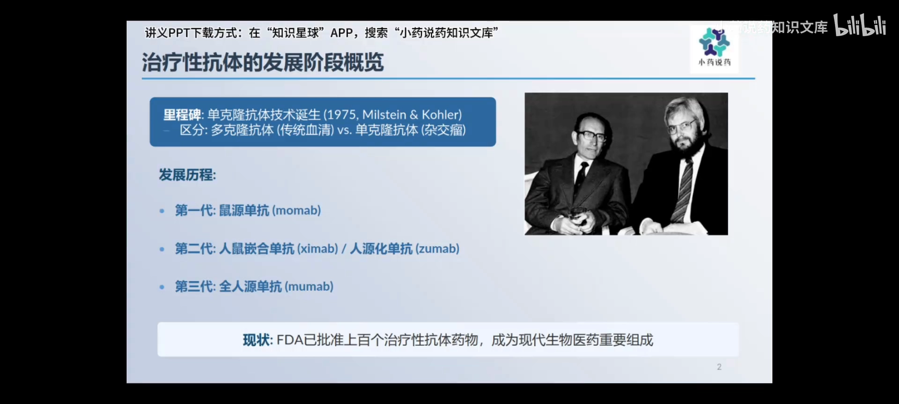

1975 年，科勒和米尔斯坦发明了**杂交瘤技术**：把能产生抗体的免疫细胞和能无限生长的骨髓瘤细胞融合在一起，得到的杂交瘤细胞既能无限增殖、又能持续分泌针对特定目标的纯度极高的单克隆抗体。从此抗体药物进入黄金时代。

### 1.2 鼠源抗体的三重困境

[【跳转到 00:42】](https://www.bilibili.com/video/BV1u31yBXEGD/?t=42)

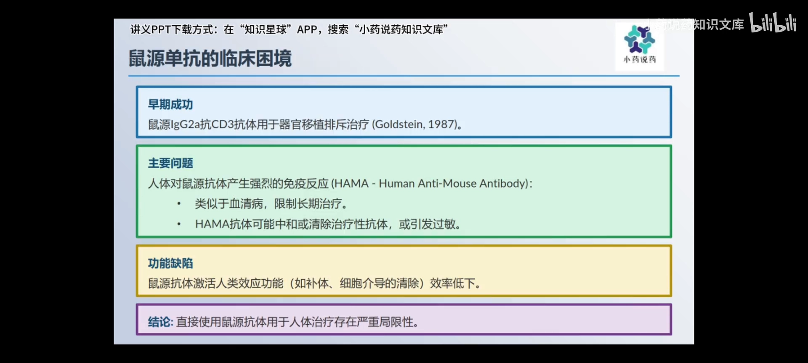

第一代抗体药物直接使用鼠源抗体，效果还不错，但问题很快出现：

- **被当作入侵者**：人体毕竟对老鼠来的蛋白质（尤其是抗体）非常敏感。很多患者用药后身体会启动防御机制，产生所谓的 HAMA 反应（人抗鼠抗体反应）。这些 HAMA 抗体会把正在工作的治疗性抗体中和掉或者清除掉，还可能让病人对后续用药产生过敏。
- **效力不足**：鼠源抗体本身效率也不高，很难激活人体自身的防御系统来清除靶细胞。

所以抗体药物要想进一步发展，必须进行人源化。

### 1.3 第一步妥协：嵌合抗体

[【跳转到 01:32】](https://www.bilibili.com/video/BV1u31yBXEGD/?t=92)

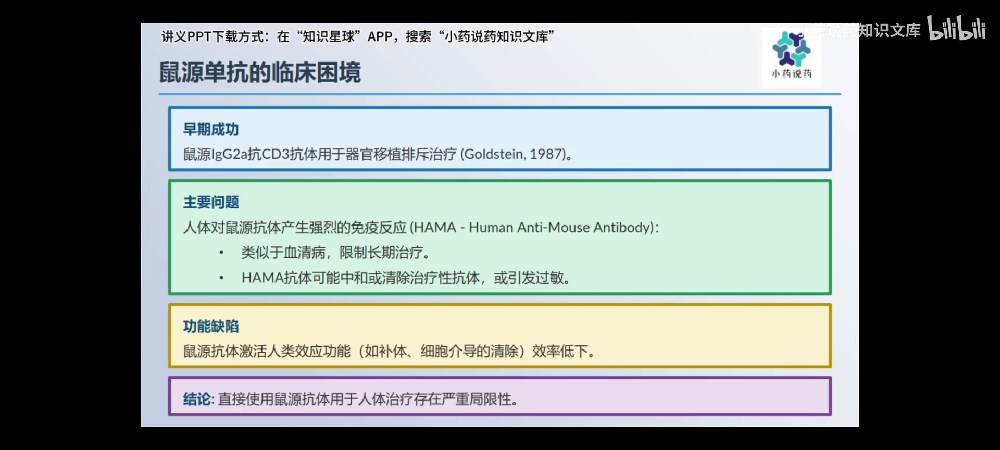

科学家们想到的第一个办法是**嵌合抗体**：用基因工程手段，把鼠源抗体负责识别目标的可变区 V 区，和人源抗体负责执行效应功能的恒定区 C 区连接到一起。这样一来：

- 新造出来的抗体既保留了鼠源识别靶标的部分，又大部分换上了人的序列，减少了被人体排斥的风险；
- 还可以根据需要选择不同类型的恒定区，让抗体具有不同的功能。

不过嵌合抗体虽然比鼠源抗体好多了，但可变区里仍保留大片鼠源序列，有些病人还是会针对鼠源部分产生免疫反应——嵌合抗体还不够完美。那我们能不能更进一步，只留下最核心的部分呢？

## 二、CDR 移植：只保留"钥匙的齿牙"

### 2.1 CDR 与框架：齿牙与锁座

[【跳转到 02:22】](https://www.bilibili.com/video/BV1u31yBXEGD/?t=142)

一个抗体之所以能识别特定的抗原，关键就在于可变区里的几个小环状结构——**互补决定区（CDR，Complementarity Determining Region）**。这些 CDR 就像一把钥匙上的齿牙，决定了它能开哪一把锁；而连接这些齿牙的支架就是**框架区（FR，Framework Region）**。

**CDR 移植**就是要把鼠源抗体里六个关键的 CDR 区，嫁接到一个人源抗体的框架支架上去。这样做的好处是最大限度地保留了识别能力，同时把大部分的鼠源成分都换掉了，大大降低了被人体排斥的可能性。

### 2.2 要移植哪些 CDR：Kabat 与 Chothia 两种定义

[【跳转到 03:12】](https://www.bilibili.com/video/BV1u31yBXEGD/?t=192)

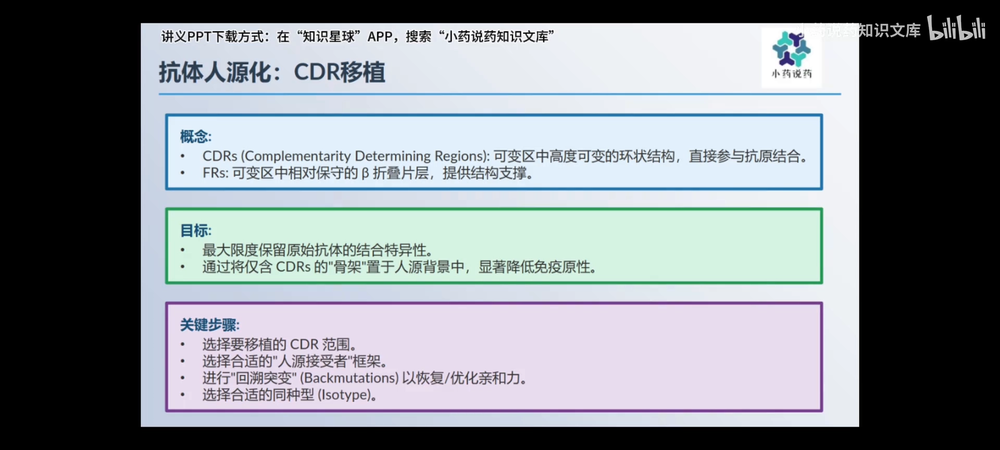

当然，怎么选 CDR、怎么选人源框架、如何做回溯突变以优化亲和力，这里面有很大的学问。第一步是定义 CDR 的边界，主流定义有两种：

- **Kabat 定义**：Kabat 最早在 1970 年就根据序列差异，把轻链和重链的可变区各分成了三个高度可变的区域，认为这就是抗原结合的关键。
- **Chothia 定义**：后来 Chothia 在 1989 年、有了更多抗体结构数据后，提出了更精细的定义。他更关注这些区域在三维结构中的实际位置和变异性，认为有些 Kabat 定义的区域可能并不直接参与结合。

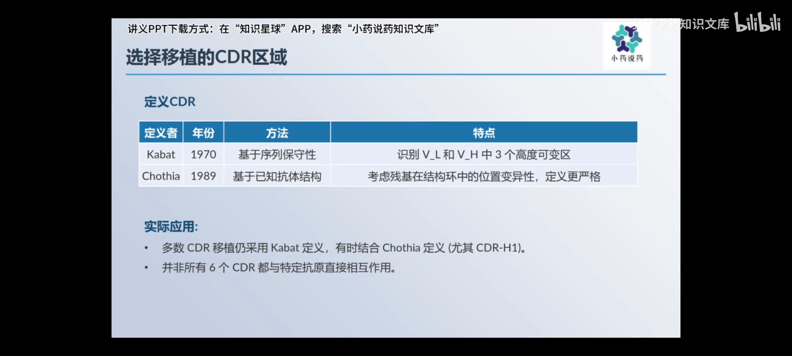

理论上 Chothia 的定义应该更准，能减少移植的非人源序列；但实际很多研究还是习惯用 Kabat 的定义，或者两者结合着用。而且就算移植了六个 CDR，也不一定每个残基都对结合至关重要。

## 三、人源框架怎么选：四种策略

[【跳转到 04:21】](https://www.bilibili.com/video/BV1u31yBXEGD/?t=261)

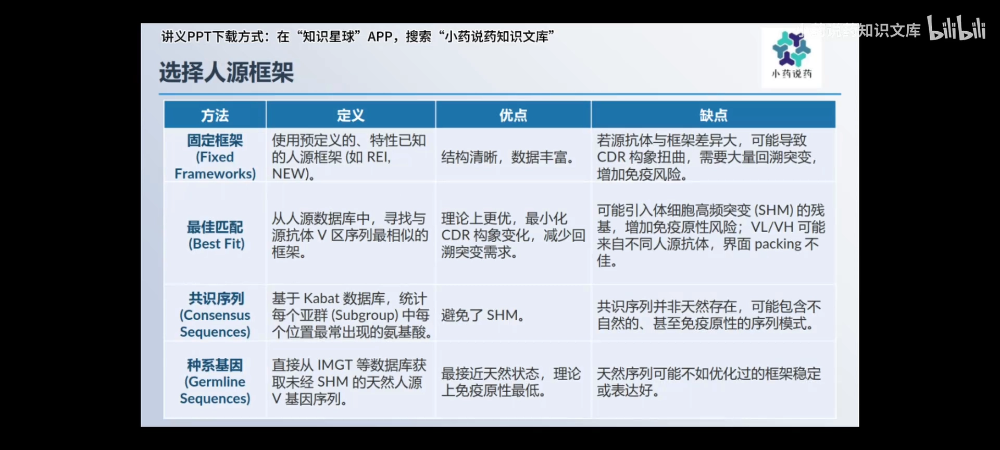

选好了要移植的 CDR，接下来就是找一个合适的人源框架——这个框架决定了 CDR 的最终形态和稳定性。视频归纳了四种思路：

| 策略 | 做法 | 好处 | 风险 |
| --- | --- | --- | --- |
| **固定框架** | 不管鼠源抗体如何，都用那几个经典标准件（如 REI、New 框架） | 研究得很透彻、结构稳定 | 鼠源框架与标准件差别大时，CDR 嫁接上去可能变形，需要大量回溯突变来修正，反而增加引入免疫原性的风险 |
| **最佳匹配** | 在数据库里找跟鼠源抗体框架序列最像的人源框架 | CDR 构象保持得比较好，需要的回溯突变少 | 数据库序列大多是经过体细胞高频突变的成熟 B 细胞序列，可能混杂罕见突变，本身成为免疫原性来源；为追求 VL/VH 高相似度选不同抗体来源的 VL 和 VH，可能不搭配、影响结合界面 |
| **共识序列** | 统计 Kabat 数据库里同一抗体亚群（如 kappa 轻链）每个位置最常见的氨基酸，组合成代表序列 | 能自动剔除体细胞高频突变产生的罕见突变，理论上更干净 | 共识序列并不真实存在于任何人体内，可能组合出自然界从未见过的、甚至引起免疫反应的奇怪序列模式 |
| **种系基因** | 从 IMGT 等专业数据库找与鼠源抗体最相似、未经任何突变的人源 V 基因作为框架 | 最接近天然状态、最大程度人源化，理论上免疫原性最低 | 原始序列在表达效率、稳定性方面可能不如经过进化优化的成熟序列 |

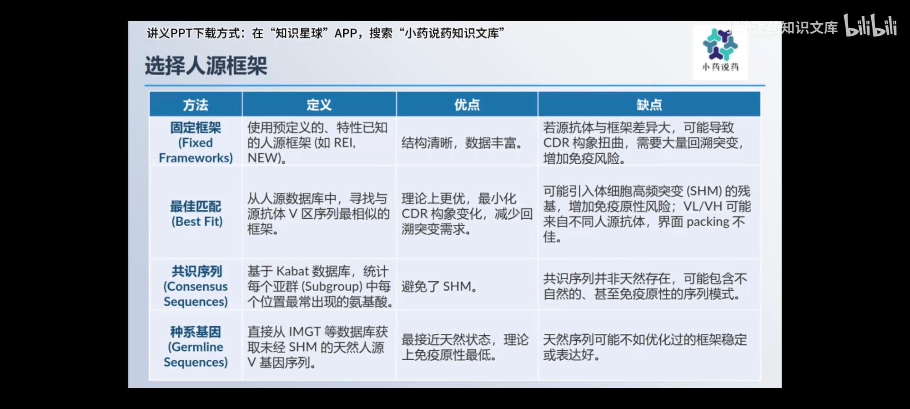

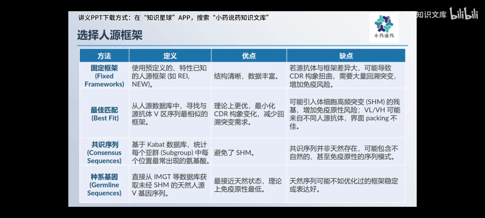

四种策略没有绝对优劣，共同点是都要回答：这个框架能不能让 CDR 保持识别抗原的"原样"。

## 四、回溯突变：把丢掉的亲和力找回来

### 4.1 为什么换框架会掉亲和力

[【跳转到 07:21】](https://www.bilibili.com/video/BV1u31yBXEGD/?t=441)

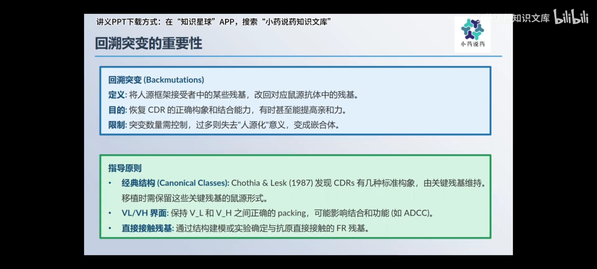

框架选好了、CDR 也嫁接上了，是不是就大功告成了呢？别急，还有一项重要的工作——**回溯突变**。这是 CDR 移植里最考验功力、也最充满不确定性的环节：很多时候，人源框架上的残基会破坏 CDR 原有的构象，导致它无法正确识别目标。仅仅把鼠源 CDR 嫁接到人源框架上，往往会导致亲和力下降甚至完全失效。所以就得进行回溯突变——把人源框架里那些影响结合的残基，再改回原来鼠源的版本。

### 4.2 改哪些残基：结构生物学 + 计算机建模

[【跳转到 08:11】](https://www.bilibili.com/video/BV1u31yBXEGD/?t=491)

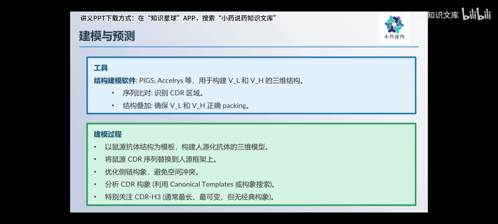

那怎么判断哪些残基该改呢？这就需要依赖结构生物学的知识，比如经典的 CDR 构象类型，或者分析 VL 和 VH 之间如何紧密贴合。实操中常常借助计算机建模：用专业软件根据已知抗体结构模板，构建目标人源化抗体的三维模型；在模型里清晰地看到鼠源 CDR 嫁接到人源框架后，哪些地方可能发生碰撞、哪些地方构象可能不对，找出潜在的免疫原性热点，优先考虑是否进行回溯突变。

### 4.3 改多少：改多了就变回嵌合体

[【跳转到 07:46】](https://www.bilibili.com/video/BV1u31yBXEGD/?t=466)

回溯突变的过程非常微妙：改多了，那就不是人源化了，又变回嵌合体了。所以得小心翼翼，既要恢复功能，又要尽可能保持人源性。尽管有了这些工具，但到底哪些残基需要改、怎么改才能最好，很多时候还是需要经验——每个抗体都是一个独特的挑战。

## 五、没有完美答案：四个指标反复权衡

[【跳转到 09:26】](https://www.bilibili.com/video/BV1u31yBXEGD/?t=566)

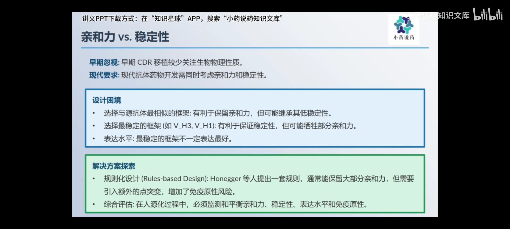

早期的 CDR 移植，大家比较关注它能不能识别目标、亲和力怎么样；但现在我们知道，一个好药光有疗效还不够，还得稳定、好生产、好储存。这就引出了另一个重要的平衡点——**亲和力和稳定性**：

- 如果选一个跟鼠源抗体框架最像的人源抗体，亲和力可能损失最小；但如果这个框架本身就不稳定呢？
- 反过来，选一个最稳定的框架，稳定性肯定没问题；但为了迁就这个框架，可能不得不牺牲一部分亲和力。此外，最稳定的框架也不一定是表达最好的。

所以抗体人源化、尤其是 CDR 移植，就是一个不断在**亲和力、稳定性、表达水平、免疫原性**之间反复权衡、不断优化的过程。没有哪个方法是完美的，只能根据具体情况做出最佳的妥协。

## 小结

- 杂交瘤技术（1975，科勒与米尔斯坦）让单克隆抗体成为药物，全球已批准超过 200 个治疗性抗体。
- 鼠源抗体引发 HAMA 反应（人抗鼠抗体反应），会被中和、清除并引起过敏，且激活人体防御的效率不高——必须人源化。
- 嵌合抗体（鼠源 V 区 + 人源 C 区）是第一步；CDR 移植只保留 6 个"钥匙齿牙"，人源化程度更高。
- CDR 边界有 Kabat 与 Chothia 两种定义；理论上 Chothia 更准，实践中常两者结合。
- 人源框架有四种选择策略：固定框架、最佳匹配、共识序列、种系基因，各有优劣。
- 换框架常导致亲和力下降，需要回溯突变找回功能；用结构生物学与计算机模型判断改哪些残基，改多了又变回嵌合体。
- 人源化的本质是在人源性、亲和力、稳定性、表达水平之间反复权衡，没有完美方案。

## 关键术语速查

| 术语 | 一句话解释 |
| --- | --- |
| 杂交瘤技术 | 把免疫 B 细胞与骨髓瘤细胞融合、从而无限生产单克隆抗体的技术（1975） |
| HAMA 反应 | 人抗鼠抗体反应：人体免疫系统对鼠源抗体药物的攻击 |
| 嵌合抗体 | 鼠源可变区 + 人源恒定区拼成的抗体 |
| CDR（互补决定区） | 可变区中直接结合抗原的 6 个环状结构，"钥匙的齿牙" |
| FR（框架区） | 支撑 CDR 的支架序列 |
| Kabat / Chothia 定义 | 两种界定 CDR 边界的经典方案（序列差异 vs 三维结构） |
| 体细胞高频突变 | B 细胞成熟过程中抗体基因发生的高频点突变 |
| 种系基因 | 未经体细胞突变的原始人源抗体 V 基因模板 |
| 回溯突变 | 人源化后把框架中影响结合的残基改回鼠源版本，以恢复亲和力 |
| IMGT | 国际免疫遗传学数据库，可查询种系抗体基因序列 |
