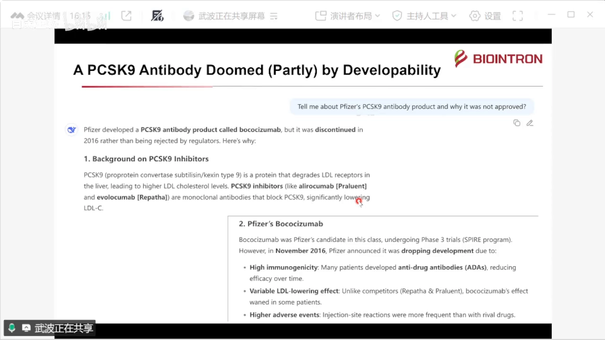
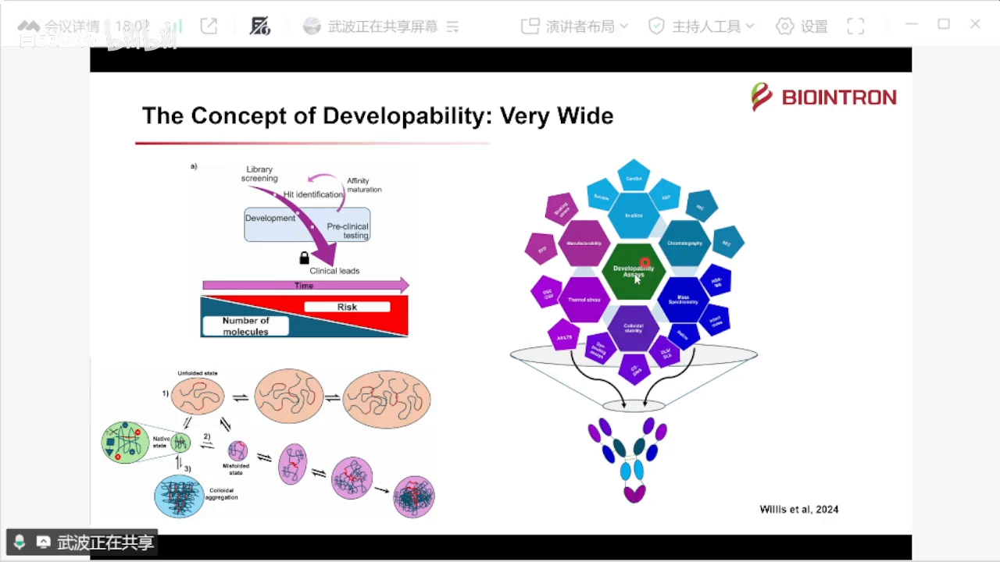
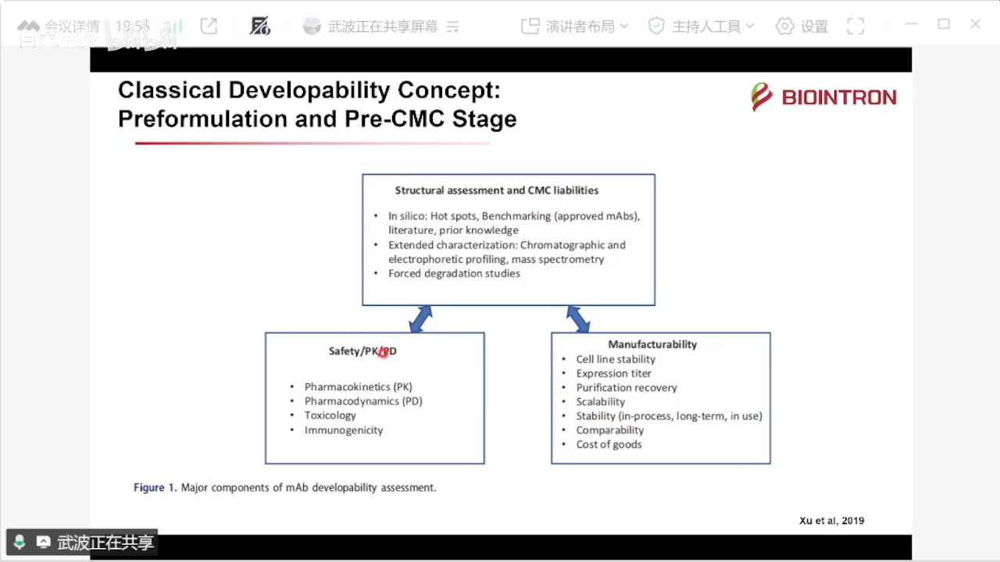
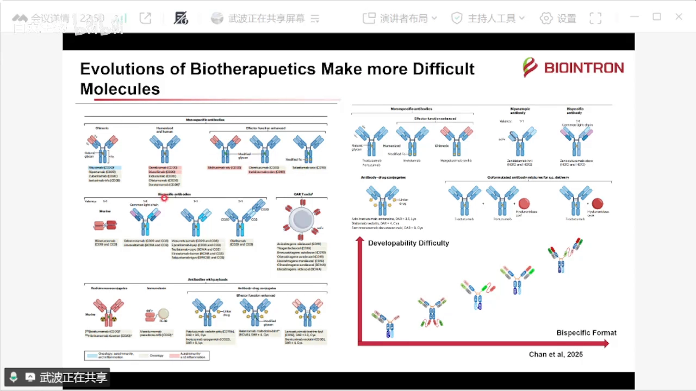
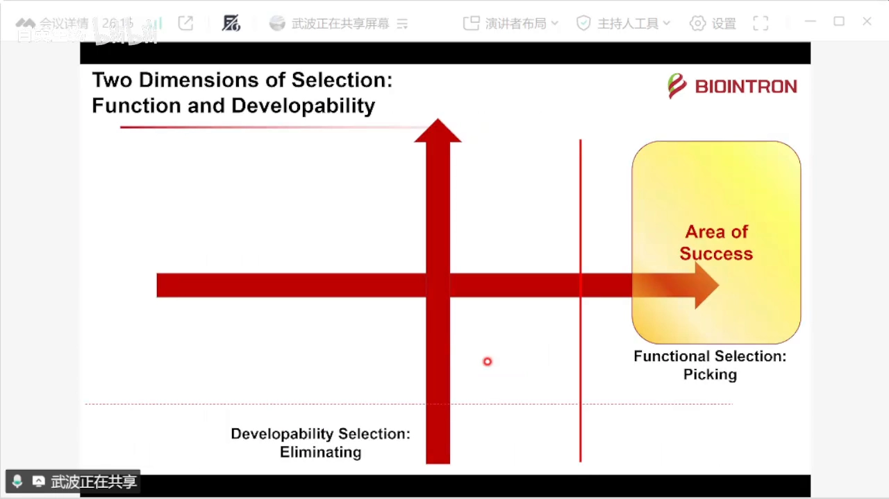
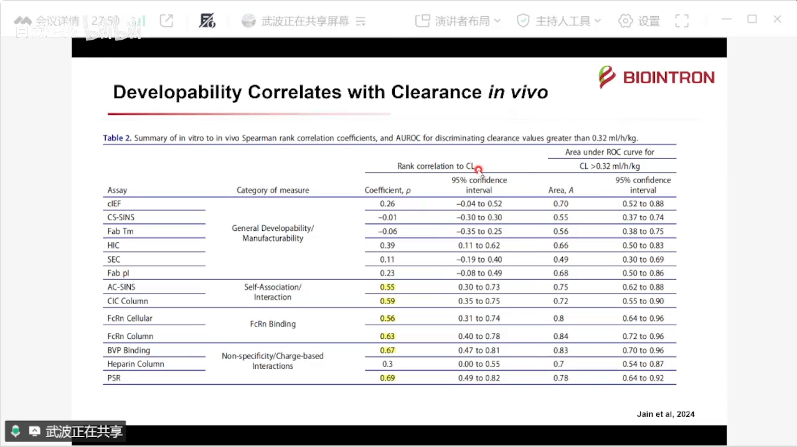
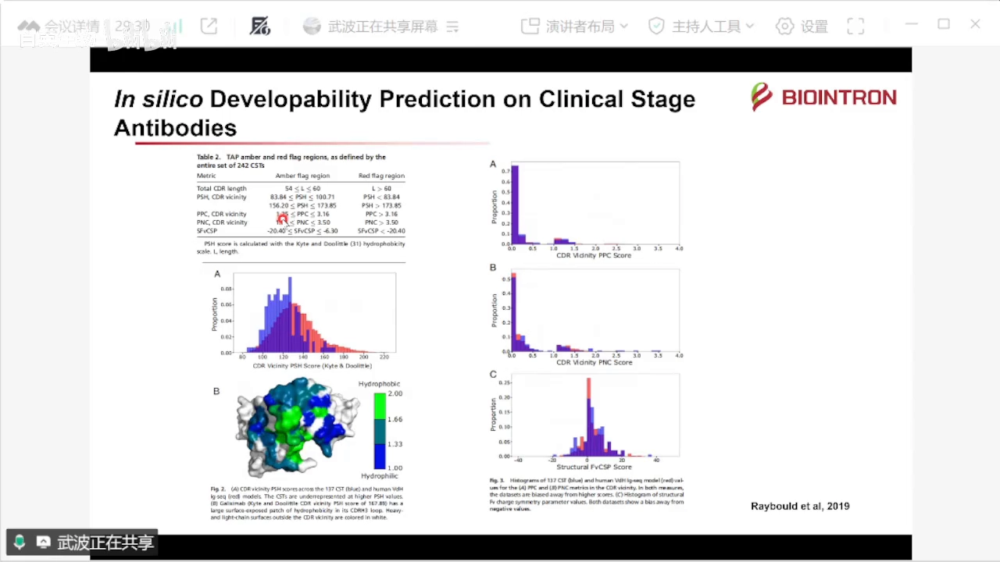
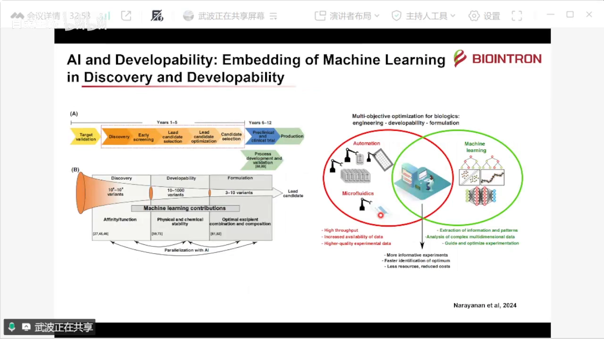
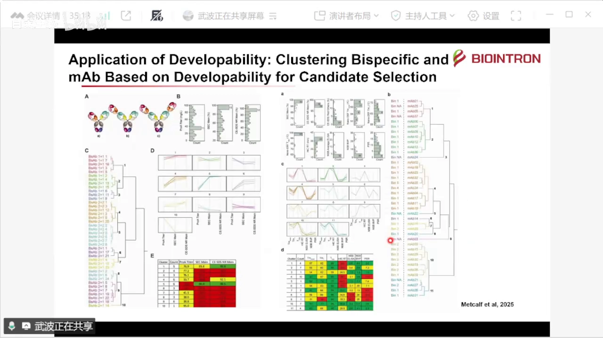
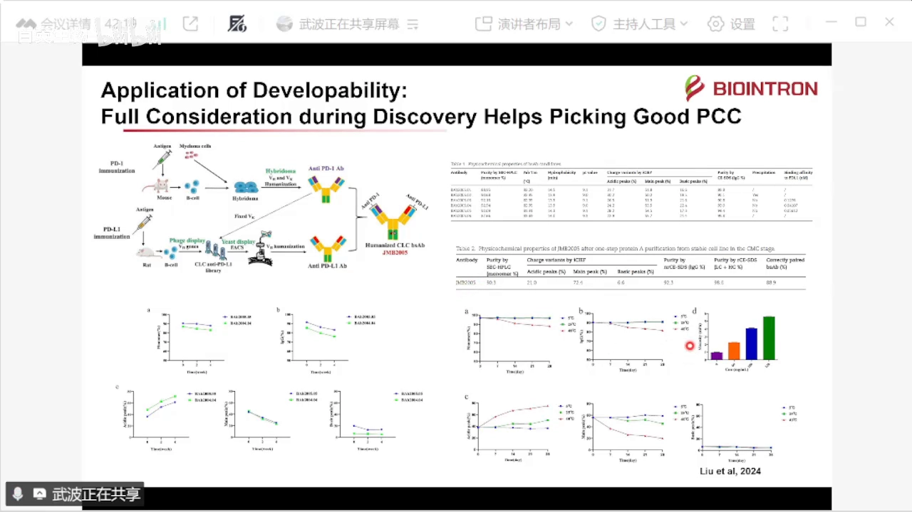

# 抗体药可开发性评估：Why, What, and How

> 视频来源：[抗体药可开发性评估：Why,What,andHow？（Bilibili）](https://www.bilibili.com/video/BV1zQytB4EoK/)

## 本讲要解决的核心问题（SCQA）

**背景**：新药研发是一个"去风险"的漏斗：不管分子来自文库、免疫、天然库还是 AI 设计，一开始都有很多分子，经过筛选验证出的先导分子叫 hit，再经过从先导（lead）到候选分子（candidate）的打磨、亲和力成熟，逐渐推向临床。分子数越来越少，每个分子的风险却越来越大。单抗时代，"成药性"概念已经比较成熟——单抗经过体内免疫筛选，能筛到的分子本身就是成药性较好的。

**冲突**：分子正在变得越来越复杂——ADC、双抗、抗体-细胞因子融合蛋白、小核酸……分子机制越复杂，评价越复杂，成药性的差别也可能非常大。一个现实的教训是：PCSK9 这个降血脂靶点上，安进、再生元/赛诺菲的抗体药都获批了，而辉瑞的抗体在临床试验中未完成三期就停止了——公开信息给出的答案是它免疫原性比较高、药效不够稳定、副作用比较强。

**疑问**：成药性（可开发性）到底是什么？为什么早期研发就要评估？具体怎么做？

**回答（中心思想）**：成药性是一个在"功能维度"之外、回答"这个分子能不能做成药"的**多维度评价系统**——包括分子本身的修饰热点与稳定性、体内的 PK/PD 与免疫原性、以及可制造性。它正在从"晚期表征"前移为"早期淘汰"：用序列分析、高通量实验和 AI，在大量候选分子中尽早划出红线（red flag），选优汰劣。

---

## 一、从一个失败案例说起：辉瑞的 PCSK9 抗体

[【跳转到 00:50】](https://www.bilibili.com/video/BV1zQytB4EoK/?t=50)

PCSK9 是降血脂靶点，国外有两家上市抗体药：安进（Amgen）公司、再生元和赛诺菲公司的。辉瑞公司也曾经有过这个靶点的药物，但从公开信息看，它三期实验没有做完就停止了临床，而竞品获批了。公开信息给出的答案是：它的免疫原性比较高、药效不是特别稳定、副作用比较强。

讲者的公司恰好有这个靶点的人源化单抗（作为对照品），在成药性检测中会被用作对照。通过后面的实验可以看到，这个分子在成药性上确实存在缺陷——以此论证：**早期研发就做成药性评估，是必要的**。

## 二、成药性是什么：一个非常广的概念

### 2.1 名字很多，本质是一个维度

[【跳转到 03:19】](https://www.bilibili.com/video/BV1zQytB4EoK/?t=199)

成药性有很多名字：成药性、可开发性、类药性；英文叫 Developability，也有人叫 Druggability（后者含义更广）。它的评估手段谱系非常宽：

- **计算机模拟**：在计算阶段就可以做；
- **色谱**：比如 HIC（疏水相互作用色谱）和 SEC（分子排阻色谱）；
- **质谱**：氢氘交换质谱（HDX-MS）、分子量测定，以及 native mass（天然质谱）；
- **稳定性**：碰撞稳定性、热稳定性；
- **可制造性**：细胞株、工艺、保存等。

具体到某一个分子，它有一个天然状态；但在溶液中，由于温度、高浓度等因素，分子之间或分子与溶剂之间会碰撞，导致去折叠、错误折叠或聚集——这些都是"非理想状态"。可开发性要回答的就是：这个分子离理想状态有多远。

### 2.2 晚期成药性：三块内容

[【跳转到 04:47】](https://www.bilibili.com/video/BV1zQytB4EoK/?t=287)

大家更容易接受的成药性概念是一个**比较后期的概念**：分子差不多定下来的时候，评估三块内容——

1. **分子本身**：看"热点"——工艺或保存过程中容易被修饰的位点。比如天冬酰胺容易脱氨、甲硫氨酸容易被氧化，还有容易异构化的位点，特别是 CDR 区域的（结合界面上的修饰会直接影响功能）。需要色谱、CE（毛细管电泳）、质谱鉴定这些位点是否存在，还要做强制降解实验。
2. **体内表现**：安全性指针、药代动力学（PK）与药效动力学（PD）指针、毒性——这些影响毒性和免疫原性，靠体内直接实验。
3. **可制造性**：抗体细胞株是否稳定、表达量是否稳定、纯化工艺如何、能否放大、保存是否稳定；做生物类似药时还要跟原研药可比。

[【跳转到 05:37】](https://www.bilibili.com/video/BV1zQytB4EoK/?t=337)

在晚期还要做跟储存有关的压力测试：氧化、低/高 pH、冻融、光照、加热等，用 SEC、HIC、cIEF 和质谱观察变化。单抗因为经过体内免疫筛选，进入临床的分子这些指针通常不会太差。

### 2.3 为什么指针在收紧：分子越来越复杂

[【跳转到 07:42】](https://www.bilibili.com/video/BV1zQytB4EoK/?t=462)

两个背景让晚期指针越来越严：

- **新适应症要求高浓度**：眼科、自免、代谢类疾病可能需要眼内注射、鞘内注射或皮下注射，不像抗癌药可以输液——眼内注射可能要求 100 mg/mL 以上，皮下最多也就打 2~5 mL，对浓度的要求很高。而高浓度下分子间相互作用更多，就没那么稳定。
- **药物形式在进化**：讲者引用 2025 年基因泰克（Genentech）科学家的文章，回顾了生物药的进化：血液瘤方向从 CD20（B 细胞肿瘤）靶点起步，实体瘤方向以 HER2 为靶点，从嵌合抗体到人源化单抗，再到双抗（不含 Fc 的双抗 / 含 Fc 的双抗 / 共同轻链 CrossMab / 2+1 形式）、CAR-T，以及核药、免疫毒素（细胞毒素与蛋白的融合分子）、ADC，实体瘤方向还有 Fc 修饰、不同表位双抗、与透明质酸酶复合的制剂等。

[【跳转到 08:32】](https://www.bilibili.com/video/BV1zQytB4EoK/?t=512)

双抗的结构有很多种，因为它要行使不同的生物学功能（作用机制 MOA）。**取决于抗体的结构以及它本身的 CDR 序列，成药性差别可能非常大**：从简单的 1+1，到 2+2，再到三特异性抗体，就算在早研阶段能被制造出来，难度也越来越大。我们现在的时代，已经跟单抗时代又进化了一层。

## 三、为什么早期就要评估：两个正交的维度

### 3.1 功能维度之外的另一个维度

[【跳转到 11:20】](https://www.bilibili.com/video/BV1zQytB4EoK/?t=680)

生物学家更熟悉在**功能维度**评价抗体：结合、细胞活性、体内活性、猴子体内的相关毒性等。这些实验做完，基本就有一个 PCC（临床前候选物）了。但在另一个维度上，还要考虑：溶解性、稳定性、是否有聚集倾向、是否有非特异性结合。这就是在功能维度之外，还需要评价的**成药性维度**。

### 3.2 两个维度基本正交，同时评估、选优汰劣

[【跳转到 11:57】](https://www.bilibili.com/video/BV1zQytB4EoK/?t=717)

画一张图比较直白：功能维度（对靶点的抑制、受体占用、对细胞的抑制、体内药效等）× 成药性维度（会不会跟非特异靶标结合、会不会自己相互作用、受热就 unstable……）。这两个维度基本**正交**——相关性不高，所以需要同时评估。选择时做"选优"（picking）：功能好但容易聚集的分子是"淘汰的压力"，只有第一象限（功能好 + 成药性好）的分子才值得往下推。

早期评价跟晚期评价的目的不同：**它不需要的抗体量比较少，不是为了评价某一个分子在生产中有什么风险，而是为了评价几十个、几百个候选中哪一个更好**。早期可评估的指标包括：基于序列的热点分析（一些网站就能提供）、是否有不可溶杂质、初始表达量（滴度）、纯度、热稳定性、可溶性（计算机预测 + 实验测量）、血清稳定性、特异性等。

[【跳转到 10:06】](https://www.bilibili.com/video/BV1zQytB4EoK/?t=606)

早期评估什么、晚期评估什么，要分好工：晚期看生产稳定性、细胞中的稳定性、储存稳定性；早期看序列分析等轻量指标。

## 四、证据：什么决定抗体在体内的存留

[【跳转到 13:07】](https://www.bilibili.com/video/BV1zQytB4EoK/?t=787)

早期评估成药性有没有证据支持？美国著名的抗体药开发公司 Adimab 做了一个研究：CL 是 clearance（清除率），我们希望抗体在体内循环时间长一点——抗体有 Fc，可以跟 FcRn（新生 Fc 受体）结合，这是它半衰期长的重要原因。研究发现跟抗体清除相关的指标有：

- **自相互作用**：通过 AC-SINS 或 CIC 柱（cross-interaction chromatography）测量，相关性约 0.6；
- **与 FcRn 的结合**：结合越强 PK 越好，可用 SPR 或 BLI 测量；
- **非特异性结合**："很脏"的抗体会跟肝素、白蛋白、膜、DNA、胰岛素等结合，容易被清除。

其中相关性最强的是**疏水性**：疏水性强的抗体在体内容易跟疏水区域结合。也就是说，成药性（特别是早期）评价的理化性质和非特异性生化结合，直接影响抗体在体内的留存程度。

## 五、早期怎么评估：序列分析 + 高通量实验

### 5.1 只凭序列也能初筛：阿斯利康的 242 个抗体

[【跳转到 15:12】](https://www.bilibili.com/video/BV1zQytB4EoK/?t=912)

晚期用计算机预测热点，早期怎么做？2019 年阿斯利康发了一篇文章，总结了 242 个临床阶段治疗性抗体（clinical stage therapeutics），跟 pipeline 里能找到的抗体比较，总结出几个重要指标：

- CDR 长度；
- 疏水区域的面积；
- 正电荷面积、负电荷面积；
- 两个可变区（VL/VH）之间的电荷差异——差异大容易产生电荷相互作用，导致抗体之间聚集。

[【跳转到 15:37】](https://www.bilibili.com/video/BV1zQytB4EoK/?t=937)

作者为每个指标设置了 comfortable zone（舒适区）和 red flag（红旗警示）。**成药性最重要的就是看 red flag 设在哪里**。结论：假如什么实验都不做，只凭序列也能看出哪些序列更好、哪些更差；如果这些序列功能上都相似，也许通过计算机就可以淘汰掉一些抗体。

### 5.2 高通量实验面板：PSR、BVP、HIC、SEC

[【跳转到 16:37】](https://www.bilibili.com/video/BV1zQytB4EoK/?t=997)

2017 年 Adimab 文章备注里有一组很有意思的数据：PSR 和 BVP 可以认为是同类指标（非特异性结合），HIC 测疏水，还有分析型 SEC 的纯度。分数可能越低越好。一个观察是：临床二三期的门槛还是挺高的，但已经获批的药物门槛就降低了——可以认为对获批药物来说，非特异性结合的要求其实更严格、纯度要求也更高。所以早期要自己划定 window（阈值范围）。PSR、BVP、HIC 这些方法都可以在早期很方便地评估风险。

Adimab 做过大概几十种不同的 assay，而且列表还在增加；他们论证了这些 assay 之间的相关性——比如 AC-SINS 与另一项实验的相关性接近 1，两个实验都能指证自相互作用时，选一个就够了，毕竟做实验也有成本。

## 六、AI 时代的成药性评估

[【跳转到 18:34】](https://www.bilibili.com/video/BV1zQytB4EoK/?t=1114)

能否用 AI 从头设计出跟自然筛选一样好的序列，还存在商榷，但应用已经在发生：

- **方向一：把机器学习嵌入发现与成药性评估。** 文库级别拿到上千个 variants，通过机器学习建立相关性，配合自动化设计、微孔实验、高通量实验设计和有质量的数据，减少工作量。
- **方向二：从 AI 生成开始，把成药性数据作为输入。** 算法从头生成抗体序列（AIGC），输入蛋白结构、蛋白-抗体相互作用等信息；知道靶标能否直接生成抗体、生成工程化突变抗体；再用亲和力、免疫原性、稳定性、活度等成药性数据去预测功能。

这些文章都很新（2024/2025 年），真正落地估计还要很久，但在小维度上已有聚焦应用：比如对 130 多个待测抗体做热稳定性评估、用机器学习做回归，下次再来一个纳米抗体就能估算它的 Tm（熔解温度）范围。

[【跳转到 19:24】](https://www.bilibili.com/video/BV1zQytB4EoK/?t=1164)

## 七、实际案例：成药性如何指导选择

### 7.1 默沙东：给双抗做"聚类画像"

[【跳转到 21:00】](https://www.bilibili.com/video/BV1zQytB4EoK/?t=1260)

2025 年默沙东科学家的工作：做了几种不同结构的双抗，测三个成药性指标——Protein A 一步的 titer、Protein A 一步后的 SEC 纯度、非还原 CE-SDS 纯度。发现虽然只有三种结构，却能分出十种不同的双抗（跟可变区和结构有关），于是按绿色（相对较好）/红色（相对较差）分组，从中挑出比较好的 cluster。

类似的还有突变库单抗：测七个指标（Tm onset、Tm1、Tm2、HIC 保留时间、BVP-ELISA、非特异 ELISA；PSR 做了三个实验），把单抗做 cluster 排布——十一种 cluster 里有一个里有七个成药性非常好的抗体，直接从这里挑候选。

### 7.2 高浓度与黏度：先便宜筛、后贵验证

[【跳转到 23:05】](https://www.bilibili.com/video/BV1zQytB4EoK/?t=1385)

2024 年的案例：某个后期的抗体要在 100 mg/mL 下使用，浓度太高黏度就控制不住，对制剂有风险。研究者先用氢氘交换（HDX）找到分子间的自相互作用位点，设计了约 70 个突变。黏度测试太耗样品（百毫克级），不可能 70 个都测，于是用省样品的实验先筛：AC-SINS（自相互作用）、DSC（热稳定性）、BVP（非特异结合）、HIC（疏水）、DLS（碰撞/聚集）。结果发现 DLS 测的 KD 与黏度强相关，AC-SINS 的红移（表示自相互作用强弱）也与黏度相关——**前期用便宜的实验先筛掉一批，后期再用黏度验证**。

### 7.3 in silico 与虚拟筛选

[【跳转到 25:06】](https://www.bilibili.com/video/BV1zQytB4EoK/?t=1506)

阿斯利康 2019 年那套 therapeutic antibody property profiling（只看可变区、不做实验的序列画像）被反过来用：有团队用它给 AI 生成的 3000 个虚拟抗体做过滤器——符合那五个原则的分数就高，证明生成的抗体成药性都不错（当然还没做 in vivo 验证）。还有团队生成 Fab library，经噬菌体展示、转换成 IgG、先筛 binder 再放大，测活性和成药性——AC-SINS 画一条 flag 线，线以上就是警戒。

### 7.4 中国企业的落地应用

[【跳转到 26:46】](https://www.bilibili.com/video/BV1zQytB4EoK/?t=1606)

2024 年一个实际应用：国内一家企业做双抗——先杂交瘤、再噬菌体展示，做的是抗 PD-1 × 抗 PD-L1 的双抗。对 6 个抗体测了很多成药性指标：纯度、Tm 和疏水、等电点、酸碱稳定、CE-SDS、是否有沉淀，加上亲和力（功能指标）。其中一个有沉淀、不太理想；整体成药性都很好，其中亲和力最高的一个被推进到下一步（5 号克隆）。

## 八、回到那个失败案例：后视镜里的成药性

[【跳转到 28:01】](https://www.bilibili.com/video/BV1zQytB4EoK/?t=1681)

最后回到开头的辉瑞 PCSK9 抗体，用成药性视角做一次"后视镜"解读（当然，一个临床结果是由很多维度共同导致的，这里只从成药性一个维度解释——大量临床证据表明它免疫原性很高，而另外两个获批抗体是用全人源转基因小鼠做的，它是人源化改造的）：

- **非特异性结合**：用 BVP、双链 DNA（dsDNA）、胰岛素三个替代检测物，设了三个正对照——gantenerumab、solanezumab、bapineuzumab（罗氏的 gantenerumab 就是 Aβ 抗体）。这个抗体的分数不如 gantenerumab 高，但也很高；
- **自相互作用**：也很强，排名前列（在这个实验里 gantenerumab 反而没那么高——每个实验能显示的证据不一样）；
- **热稳定性**：Tm1 为 67 ℃（一般 >65 ℃ 算 OK），不算差；
- **疏水性**：与曲妥珠单抗（trastuzumab，相对亲水的对照）相比保留时间约 1.17，还算不错。

结论：热稳定性和疏水性都不错，但**聚集倾向严重（自相互作用强）、非特异性结合强（正对照级别）**。体内浓度一高，自相互作用就会很强，又容易跟体内复杂环境中的非特异靶点结合——这可能是它最终没能获批的因素之一。

## 九、小结：成药性正在从晚期走向早期

[【跳转到 31:41】](https://www.bilibili.com/video/BV1zQytB4EoK/?t=1901)

- 成药性/可开发性最初与制剂、稳定性、CMC 关系更多；2015 年以后双抗、ADC 多起来，概念被泛化。
- 早期评估的定位：不需要太多样品，不是评价一个分子的生产风险，而是**从几十上百个候选里选优汰劣**。
- 评估时机：人源化之后、序列基本可以认定为（将来）PCC 的序列时，就可以评估了。
- 除功能之外，成药性提供了一个**多维度评价系统**，帮助更好地选择 PCC。
- AI 驱动越来越强：成药性评价生成的数据也可以用来训练模型，加速抗体发现——但落地还在早期，大家仍在学习怎么让 AI 与大分子制药结合。
- 讲者所在公司（百英生物，专注抗体的临床前 CRO，生产基地在江苏泰州）把成药性评价做成了服务：热稳定性、疏水、自相互作用、基于高通量 SPR/BLI 的方法、PSR ELISA 排序（score > 20 分即视为不太好）以及 AC-SINS 红移对比（对照 infliximab）等。

## 小结

- 新药研发是去风险漏斗：分子越筛越少、单位分子风险越大；成药性是功能之外的第二维度。
- 晚期成药性三块：分子本身（修饰热点 + 强制降解）、体内（PK/PD + 免疫原性）、可制造性（细胞株/工艺/保存）。
- 高浓度给药（眼科/皮下）和分子复杂化（双抗/ADC）让成药性要求越来越严。
- 功能维度与成药性维度基本正交，必须同时评估；早期评估的目的是"几百选优"，不是"单个放行"。
- 证据：自相互作用（AC-SINS/CIC）、FcRn 结合（SPR/BLI）、非特异结合（肝素/白蛋白/膜/DNA/胰岛素）直接影响抗体清除；疏水性是强相关因素。
- 序列层面即可初筛：CDR 长度、疏水面积、电荷面积、VL/VH 电荷差异，设 comfortable zone 与 red flag。
- AI 两个方向：机器学习嵌入评估流程；AI 生成序列 + 成药性数据预测功能。小切口（如 Tm 回归）已可用。
- 实战模式：多指标聚类（cluster）挑优；便宜实验（AC-SINS/DLS/BVP/HIC）先筛、昂贵验证（黏度）后做；in silico 过滤器前置。
- 失败案例的后视镜解读：热稳定性、疏水尚可，但自相互作用与非特异结合"正对照级"，可能是未获批的成药性因素。

## 关键术语速查

| 术语 | 一句话解释 |
| --- | --- |
| 成药性 / 可开发性（Developability） | 分子能不能被开发成药的多维度评价：分子本身、体内表现、可制造性 |
| 修饰热点 | 工艺或保存中容易被修饰的位点（如天冬酰胺脱氨、甲硫氨酸氧化），CDR 区域最要紧 |
| 强制降解 | 加速条件（氧化、pH、冻融、光、热）下考察分子变化的实验 |
| HIC / SEC | 疏水相互作用色谱 / 分子排阻色谱，测疏水性与聚集/纯度的经典方法 |
| CE-SDS / cIEF | 毛细管电泳 SDS（纯度/片段）与毛细管等电聚焦（电荷异质性） |
| AC-SINS | 用金纳米粒子测抗体自相互作用的光谱方法，红移越大自相互作用越强 |
| CIC 柱 | 交叉相互作用色谱柱，测抗体在柱上的滞留（自相互作用的色谱版） |
| BVP / PSR | 杆状病毒颗粒 / 多特异性试剂，两类测非特异性结合的通用试剂（含肝素、DNA、胰岛素等） |
| FcRn（新生 Fc 受体） | 与抗体 Fc 结合、决定抗体半衰期与 PK 的受体 |
| Tm（熔解温度）/ Tm onset | 蛋白热去折叠温度 / 起始去折叠温度，越高越稳定 |
| PCC | 临床前候选物（preclinical candidate） |
| HDX（氢氘交换） | 用氢氘交换质谱定位分子间相互作用界面 |
| cluster（聚类） | 按多项指标把候选抗体分组，从中挑成药性最好的组 |
| red flag / comfortable zone | 序列或实验指标上的警戒线 / 可接受区间 |
| in silico | 纯计算机（不做事宜实验）的预测与筛选 |
