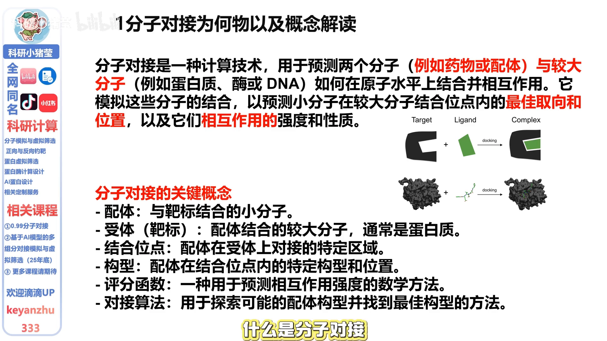
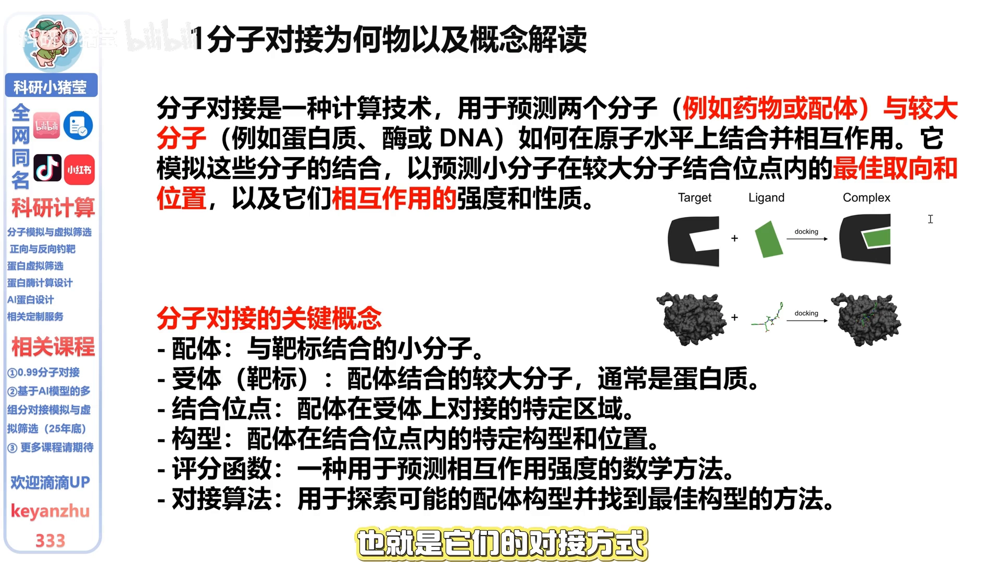
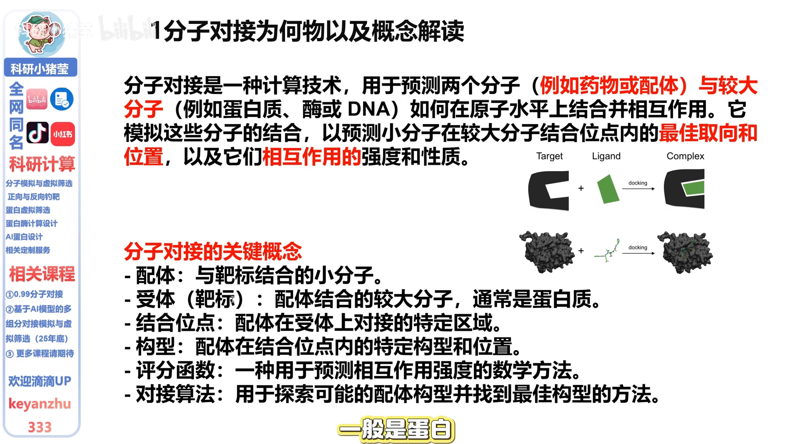
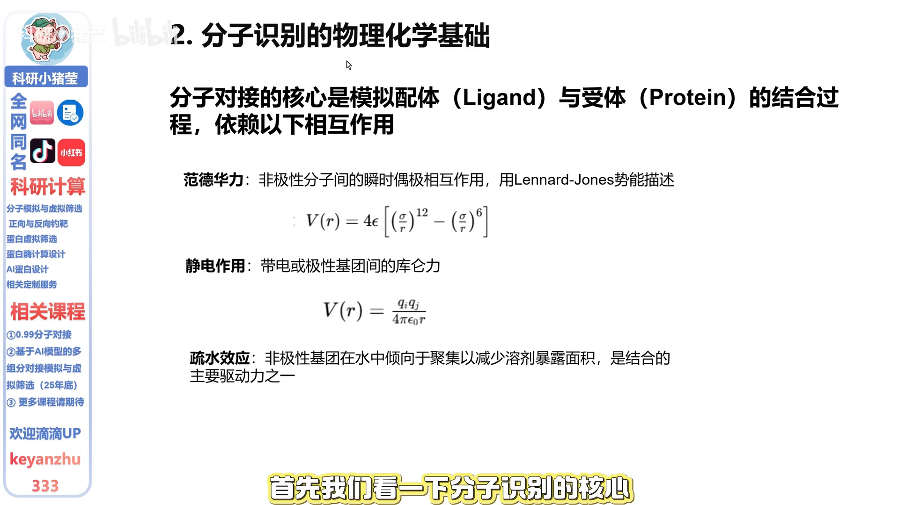
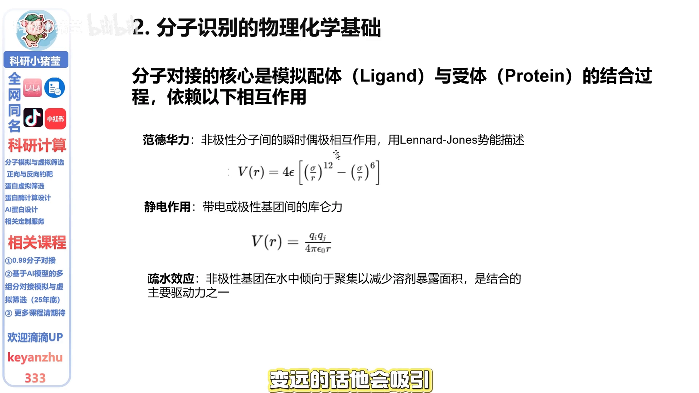
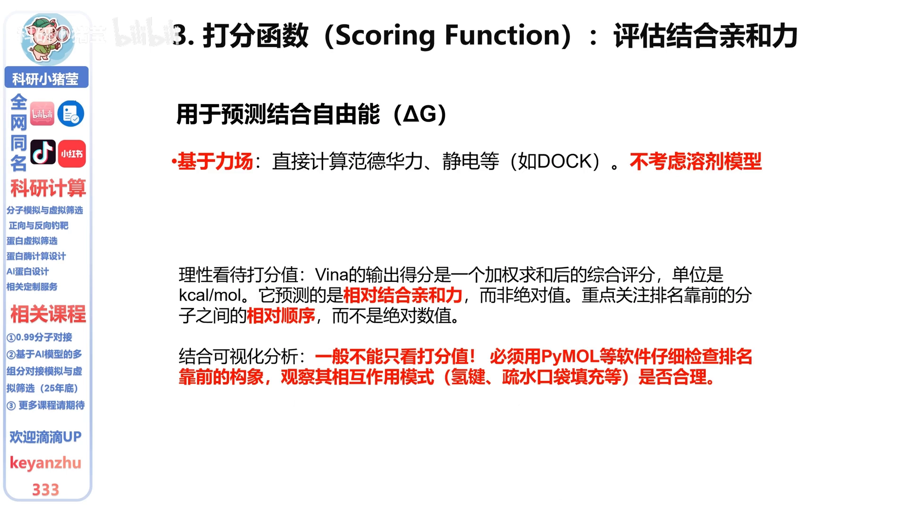

# 五分钟搞清分子对接底层原理

> 视频来源：[五分钟搞清分子对接底层原理（B站，4:33）](https://www.bilibili.com/video/BV1ops7zoErY/?t=0)，本博客基于视频字幕与画面整理。

## 本讲要解决的核心问题（SCQA）

**背景**：很多同学已经会用工具跑分子对接，也知道它大概是在"把小分子放进蛋白里"。

**冲突**：但对底层原理并不清楚——实际分析时不知道从何入手，拿到一堆对接结果也不知道该选哪个。

**疑问**：分子对接到底在计算什么？结果上的数字和位姿应该怎么理解？

**回答（中心思想）**：分子对接就是在**结合口袋里搜索配体的摆放构型（pose），并给每个构型打一个结合能分数**。理解了"搜索 + 打分"这两步，就能理性看待对接结果：看排名、看构象合理性，而不是迷信绝对分数。

## 一、分子对接在算什么：两个关键点

分子对接用来预测两个分子——比如常见的药物小分子与蛋白等大分子——如何在**原子水平**上结合并发生相互作用。"原子水平"指的是原子之间如何相互吸引：模拟分子的结合过程，预测两个东西：

- **取向和位置**：配体以什么姿态、放在哪个位置，这就是对接方式，也就是 **pose（构型）**；
- **相互作用的强度**：一般用**结合能**来表示。

## 二、开始对接前，先分清六个关键概念

**对象类：**

1. **配体（ligand）**：与靶标结合的小分子；
2. **受体（receptor）**：一般指靶标，通常是蛋白；
3. **结合位点（binding site）**：配体在受体上对接的特定区域。

**计算类：**

4. **构型（pose）**：配体在结合位点内以什么姿态摆放——比如苯环朝右还是朝左；
5. **评分函数（scoring function）**：给每个构型打分的函数；
6. **对接算法**：探索配体构型如何在口袋内检索。

一个重要提醒：**对接要对接到结合位点上，不要做盲对接**，否则对接出来的结果意义不大。

## 三、分子靠什么相互识别：三类弱相互作用

分子识别模拟的是配体与受体的结合过程，主要依赖以下几类相互作用：

- **范德华力**（细分还有诱导力、色散力等）：简单说就是原子靠太近会排斥、拉远会吸引，表现为图中那条先降后升的能量曲线 [【跳转到 01:56】](https://www.bilibili.com/video/BV1ops7zoErY/?t=116)；
- **静电作用**：即大家熟悉的库仑力；
- **疏水作用**。

要特别搞清楚：分子间的结合**不是通过化学键**，而是通过这些**比化学键更弱的相互作用** [【跳转到 02:21】](https://www.bilibili.com/video/BV1ops7zoErY/?t=141)。

## 四、搜索算法：确定配体位置

已知结合口袋后，怎么在口袋里搜索配体的位置？一般分两种：

- **刚性对接**：配体和受体都不动，只调整体摆放；
- **柔性对接**：强调配体更灵活——比如后续的**分子动力学模拟**其实就是一种柔性方法。

常规对接一般采用**半柔性或刚性**即可；如果后续还要做分子动力学模拟，前面的处理就相对不那么关键 [【跳转到 02:41】](https://www.bilibili.com/video/BV1ops7zoErY/?t=161)。

## 五、打分函数：怎么理性看待那个分数

打分函数用于评估亲和力，也就是所谓结合能。使用时有两点必须记住 [【跳转到 03:17】](https://www.bilibili.com/video/BV1ops7zoErY/?t=197)：

1. **它基于力场，基本不考虑溶剂**——对接时基本在真空中进行，最多用隐式溶剂模型。所以它是一个综合评分，单位是 kcal/mol，预测的是**相对亲和力而非绝对值**：应重点关注**排名先后**，而不是绝对数值 [【跳转到 03:42】](https://www.bilibili.com/video/BV1ops7zoErY/?t=222)；
2. **不能只看打分值**：必须用 PyMOL 等工具仔细检查排名靠前的构象，观察相互作用模式是否合理。比如某个构象结合能很低，但明显不在结合口袋上——那它也不会起作用，这种"结合能低"没有意义。

## 小结

- 分子对接 = 在结合口袋里**搜索**配体构型（pose）+ 给构型**打分**（结合能）；
- 六个关键概念：配体、受体、结合位点、构型、评分函数、对接算法；
- 对接要对接到**结合位点**上，不要盲对接，否则结果意义不大；
- 分子间结合靠的是**弱相互作用**（范德华力、静电、疏水作用），不是化学键；
- 搜索分刚性与柔性，常规对接用半柔性或刚性即可；
- 打分基于力场、基本无溶剂，**看排名不看绝对值**，还必须人工检查构象合理性。

## 关键术语速查

| 术语 | 一句话解释 |
| --- | --- |
| 配体（ligand） | 与靶标结合的小分子 |
| 受体（receptor） | 结合的靶标，通常是蛋白 |
| 结合位点（binding site） | 配体在受体上对接的特定区域 |
| 构型 / pose | 配体在结合位点内的摆放姿态 |
| 评分函数 | 给构型打结合能分的函数，单位 kcal/mol |
| 盲对接（blind docking） | 不指定结合位点、全蛋白表面搜索的对接；常规对接应避免 |
| 柔性 / 刚性对接 | 搜索时配体是否允许改变构象 |
