# 【公开课】基于 AI 预测蛋白质复合体的三维空间结构——AlphaFold-Multimer 原理及使用

> 来源：[水木未来 × 赛默飞联合公开课](https://www.bilibili.com/video/BV1aF411b76x/)（BV1aF411b76x，时长约 71 分钟）。本文基于视频逐句字幕整理，所有时间戳可跳转到原视频对应位置。

## 本讲要解决的核心问题（SCQA）

**背景**：AlphaFold 2（下称 AF2）已经把"一条序列 → 一个结构"的单体预测做到了接近实验解析的精度；但生物学功能大多发生在**多条链的界面上**——抗体识别抗原、酶结合底物、信号通路里的蛋白组装，都离不开"谁和谁、以什么姿态结合"。

**冲突**：直接拿 AF2 预测复合物却经常失败：把两条链拼在一起去搜同源序列，得到的 MSA 充满 gap、没有跨链共变信号；AF2 也没有为"界面"设计的置信度指标；更麻烦的是，AF2 论文明确写了它**无法预测抗原-抗体的结合**。

**疑问**：复合物结构预测到底该怎么做？预测出来的界面又该如何判断可信不可信？

**回答（中心思想）**：AlphaFold-Multimer 给出了三件套答案——**配对 MSA**（把同物种序列按规则拼接，恢复跨链共变）、**链感知编码**（residue index + 三种链索引 + 裁剪策略），以及**界面专属评分 ipTM**（最终排序 = 0.8×ipTM + 0.2×pTM）。落到使用层面，界面可信度看两点：**PAE 矩阵的链间块是否足够深**、**ipTM 是否 ≥ 0.5**。

---

## 一、背景：复合物预测难在哪

### 1.1 从四级结构与界面条件说起

蛋白质结构分四级：一级是序列，二级是 α 螺旋 / β 折叠这类主链氢键模式，三级是侧链相互作用撑起的三维结构，**四级就是多条链通过相互作用形成的复合结构** [【跳转到 01:07】](https://www.bilibili.com/video/BV1aF411b76x/?t=67)。

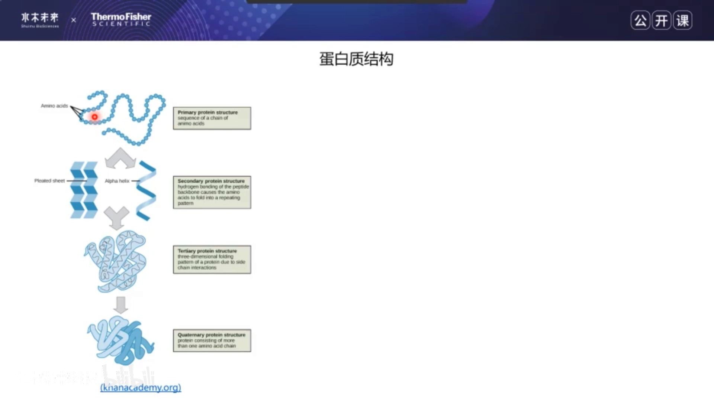

两条链要稳定结合，需要满足两个条件 [【跳转到 01:32】](https://www.bilibili.com/video/BV1aF411b76x/?t=92)：

- **形状互补**：界面在几何上要"咬合"得起来；
- **界面作用力**：疏水相互作用、盐桥、氢键等把相互作用推得更强。

### 1.2 共变与 MSA：从进化里"读出"相互作用

AF2 预测结构的核心信息来自**多序列比对（MSA）里的共变**：如果两个残基在结构上相互作用，那么收集它们的同源序列后，一侧发生突变时另一侧往往也会联动突变 [【跳转到 02:02】](https://www.bilibili.com/video/BV1aF411b76x/?t=122)。

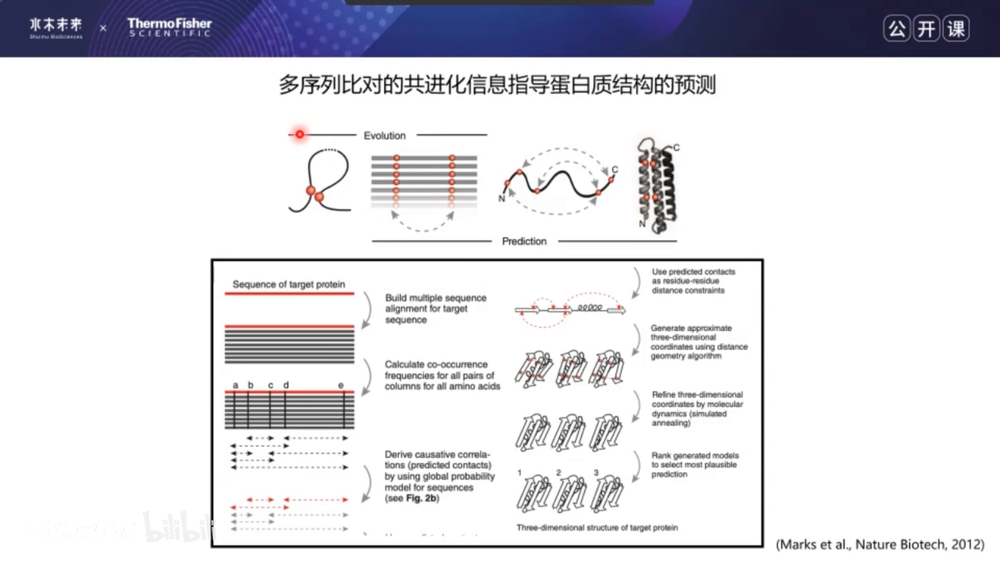

这个思想最著名的应用是 David Baker 组 2019 年的 Science 论文：对 E. coli 全部 4000 多个蛋白做两两组合，共约 900 万个候选 pair，其中 540 万个有足够同源序列 [【跳转到 03:12】](https://www.bilibili.com/video/BV1aF411b76x/?t=192)。筛选分两步 [【跳转到 03:37】](https://www.bilibili.com/video/BV1aF411b76x/?t=217)：

1. **快速粗筛**：互信息（mutual information），只看两对残基的共变，快但不准；
2. **精细复筛**：DCA + greedy（贪心）方法，考虑残基周围更全的信息——先得到 2 万多个对，再精选出 800 多个相互作用。

结果是这批计算筛选出的 PPI 比高通量实验还准。

---

## 二、给"界面预测对不对"打分：DockQ

要评价复合物（尤其是界面）预测得准不准，公开课引入了 **DockQ** 指标 [【跳转到 04:32】](https://www.bilibili.com/video/BV1aF411b76x/?t=272)。它由三个成分平均而来，取值 0~1：

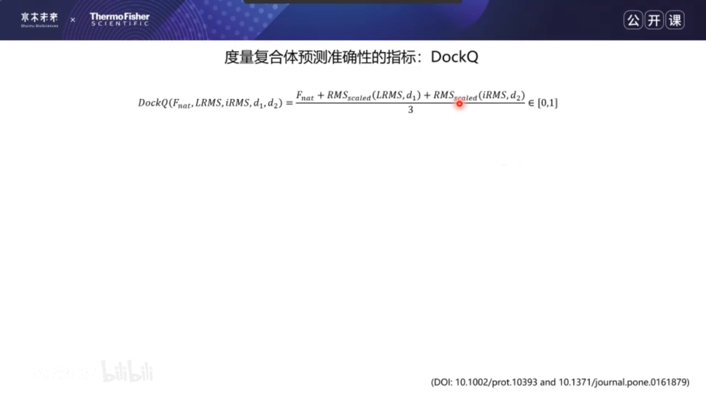

- **F_NAT**：预测出的界面接触（contact）在真实复合物中所占的恢复比例；
- **L-RMSD**：把预测复合体和真实复合体中较长的链叠合后，较短那条链的 RMSD；
- **i-RMSD**：只看**界面区域**（定义为相距 10 Å 以内的原子附近残基）的一致性 [【跳转到 05:22】](https://www.bilibili.com/video/BV1aF411b76x/?t=322)。

后两个 RMSD 通过 RMSD scale 公式归一化到 0~1，所以 DockQ 还是 0~1 [【跳转到 05:47】](https://www.bilibili.com/video/BV1aF411b76x/?t=347)。经验阈值：

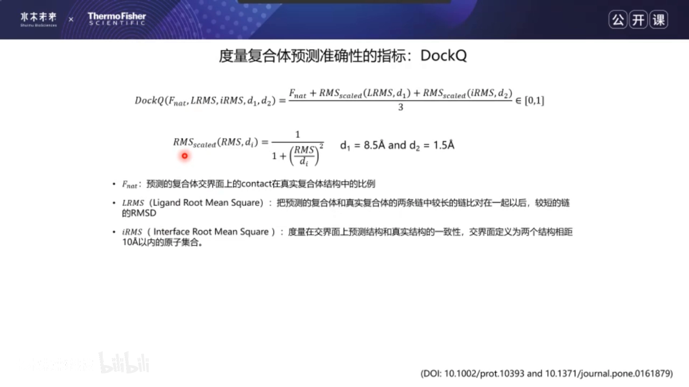

- **> 0.23**：算一次成功的预测；
- **0.49**：中等精度（medium accuracy）；
- **> 0.8**：高精度（high accuracy）。

直观感受：DockQ = 0.061 时预测链完全偏离真实结构；0.478 时预测（红色）已与真实结构（灰色）基本重合。

---

## 三、AF2 流程回顾，以及四种"土办法"

### 3.1 AF2 基本流程（60 秒版）

AF2 的标准流程 [【跳转到 07:23】](https://www.bilibili.com/video/BV1aF411b76x/?t=443)：

1. CPU 上用 HHblits / JackHMMER 到 BFD、UniRef、UniProt 等数据库搜同源序列与模板；
2. 构造特征作为网络输入；
3. GPU 上跑 JAX 深度学习模型：**Evoformer × 48**（提取 MSA 表示 + pair 表示）→ **structure module × 8**（用 pair 表示搭出三维结构），整个过程 **recycling 迭代 3 次**；
4. DeepMind 训练了 **5 个模型**，各跑一遍得 5 个 PDB 结构；
5. OpenMM relax 去掉 clash、补氢原子，最后**按 pLDDT 置信度排序**。

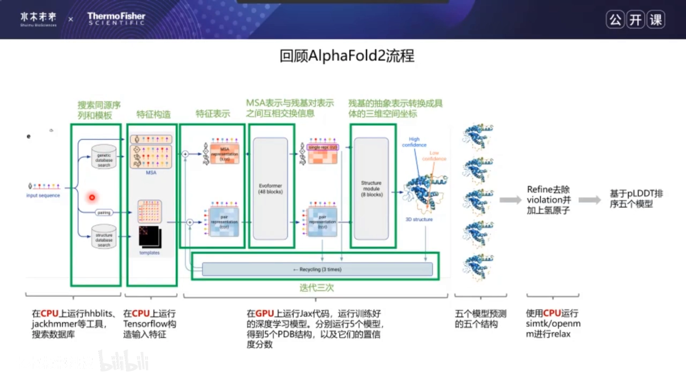

CASP14 上 AF2 的 GDT-TS 比上一代高了 30 分，骨架碳原子 RMSD95 达 0.96 Å、全原子 1.5 Å [【跳转到 06:28】](https://www.bilibili.com/video/BV1aF411b76x/?t=388)。

### 3.2 在 Multimer 出现之前的四种"土办法"

AF2 单体预测准，大家就想用它预测 PPI，主流有四类改造 [【跳转到 09:12】](https://www.bilibili.com/video/BV1aF411b76x/?t=552)：

1. **加 linker**：两条序列中间接一段 poly-glycine linker 直接跑 AF2，事后手动去掉 linker [【跳转到 09:37】](https://www.bilibili.com/video/BV1aF411b76x/?t=577)；

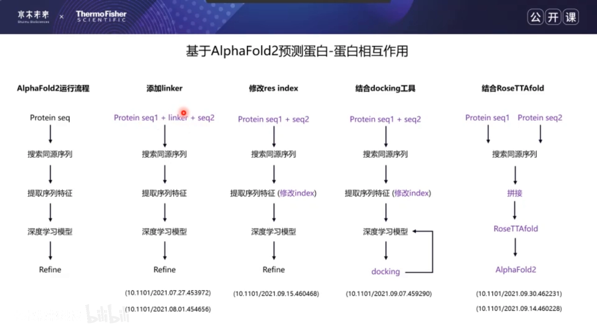

2. **改 residue index**：让 AF2 把输入"当成"两条链；
3. **结合 docking**：AF2 首选结构交给 ClusPro 对接，把靠前结果再当模板喂回 AF2，凑 15 个结构后**用 ipTM-PAE 排序**取最优 [【跳转到 16:18】](https://www.bilibili.com/video/BV1aF411b76x/?t=978)；
4. **结合 RoseTTAFold 做大规模筛选**：酵母全蛋白两两配对，轻量版 RoseTTAFold（速度是 AF2 的 100 倍）粗筛 + AF2 精筛，最终留下 1506 个 PPI；768 个 gold standard 中 717 个被成功识别 [【跳转到 19:25】](https://www.bilibili.com/video/BV1aF411b76x/?t=1165)。

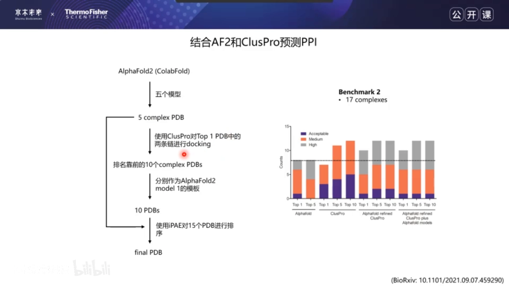

---

## 四、真正的钥匙：配对 MSA

### 4.1 直接链接的问题：gap 吞掉了共变信号

把两条序列用 linker 连起来再搜同源序列，会出现大量**只匹配到其中一条链**的序列——黑色区域是匹配到残基的区域，浅色区域是 gap [【跳转到 10:50】](https://www.bilibili.com/video/BV1aF411b76x/?t=650)。gap 区域提供不了残基共变信息，网络自然学不到跨链怎么结合。

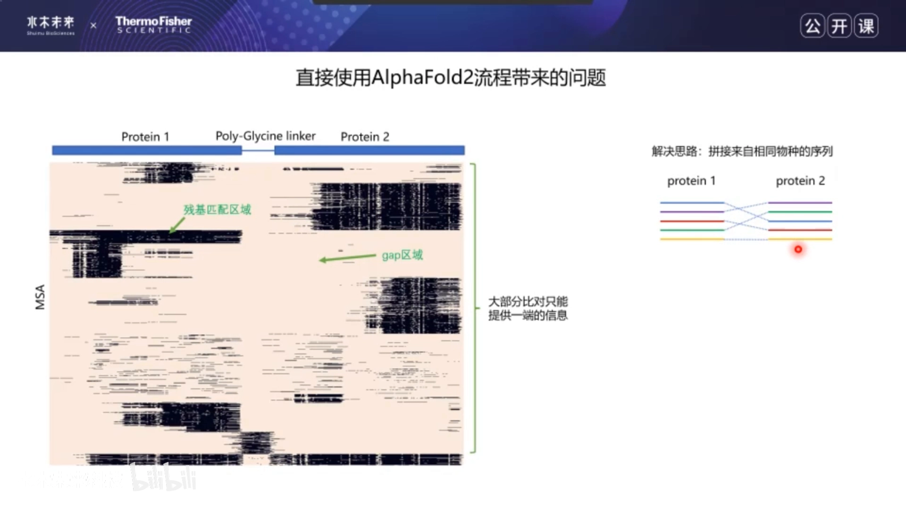

### 4.2 拼接策略：把"同物种"的序列缝起来

解法很直觉：**手动把来自相同物种的片段拼起来**，构造带共变信息的 MSA [【跳转到 11:40】](https://www.bilibili.com/video/BV1aF411b76x/?t=700)。难点是同一物种常有多条候选序列，怎么配对？已有工作按生物分成两派 [【跳转到 12:21】](https://www.bilibili.com/video/BV1aF411b76x/?t=741)：

- **原核生物**：基于基因组邻近——相互作用的蛋白基因往往共定位，基因组上挨得近的就配成一对；
- **真核生物**：有旁系同源干扰、基因距离也不可靠，改用"同物种序列按与查询序列的相似度排序，靠前的一一配对"[【跳转到 13:36】](https://www.bilibili.com/video/BV1aF411b76x/?t=816)。

### 4.3 效果：0.01/0.02 → 0.9

一个直观例子：只用 linker 直接跑，DockQ 是 0.01；只拼接同物种序列，0.02；**拼接与非拼接序列合并后喂给 AF2，DockQ 直接到 0.9**——基本预测准了 [【跳转到 14:25】](https://www.bilibili.com/video/BV1aF411b76x/?t=865)。在 1480 个复合体上的系统实验同样显示：几种传统方法（RoseTTAFold、ClusPro 刚性对接、基于模板的 TMdock）和裸 AF2 都偏低；只喂配对序列略有提升；**配对 + 非配对合并**后，以 0.23 为成功线，一半以上的复合物可以被成功预测 [【跳转到 14:50】](https://www.bilibili.com/video/BV1aF411b76x/?t=890)。

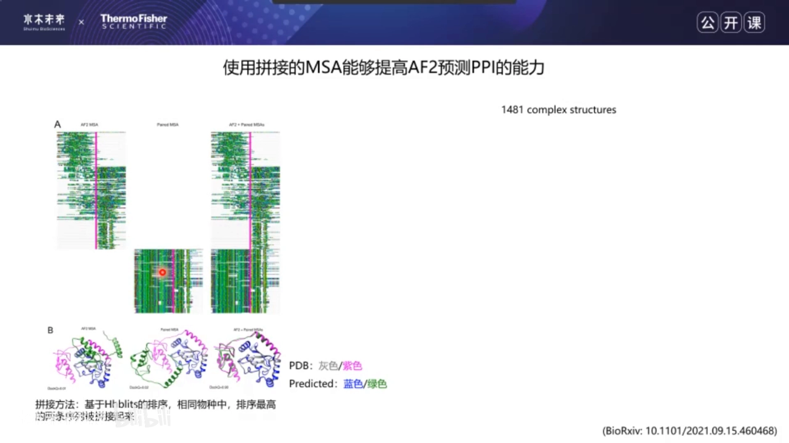

---

## 五、AlphaFold-Multimer：为复合物而生的六项改造

复合体预测模型要解决六个难点：数据少、跨链共变怎么拿、显存怎么省、loss 里同源多聚体的链怎么对齐、不同链的残基怎么区分、以及**用什么指标强调界面准确性** [【跳转到 20:32】](https://www.bilibili.com/video/BV1aF411b76x/?t=1232)。Multimer 的对应方案如下。

### 5.1 数据与自蒸馏

训练集用 PDB 数据库：2018-04-30 之前、分辨率优于 9 Å、氨基酸占比 < 80% 的结构 [【跳转到 23:02】](https://www.bilibili.com/video/BV1aF411b76x/?t=1382)。另外用 MAGNIFY 序列做**自蒸馏**——先用初版模型给每条序列预测一个结构，再拿这些"模型自产结构"回炉续训 [【跳转到 23:27】](https://www.bilibili.com/video/BV1aF411b76x/?t=1407)。注意：蒸馏集**只有单体**，没有多聚体（这是后文局限之一）。

### 5.2 数据库与模板：为"拼 MSA"服务

搜库在 UniRef90、MAGNIFY、UniClust30、BFD 之外**新增 UniProt**——它相当于 UniRef90 的全集，带有完整的物种信息，正是 MSA 拼接所需要的 [【跳转到 22:12】](https://www.bilibili.com/video/BV1aF411b76x/?t=1332)。模板搜索从 AF2 的 PDB70 换成 **pdb_seqres**（全部 PDB 模板序列），让模板覆盖更全。

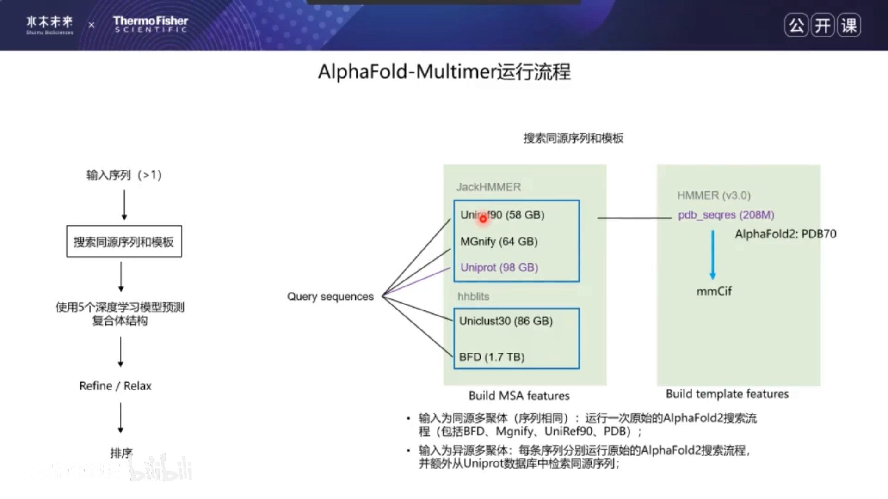

### 5.3 显存：两种裁剪各占一半

复合体大，直接训练会显存溢出，所以要做 cropping [【跳转到 24:42】](https://www.bilibili.com/video/BV1aF411b76x/?t=1482)：

- **contiguous cropping**：裁连续区域，尽量把整条链裁进去；
- **spatial cropping**：在**相互作用界面上选一个残基**，取它周围固定数量的最近残基作为输入——变相逼模型多看界面。

训练时两种方式各占 50% [【跳转到 25:32】](https://www.bilibili.com/video/BV1aF411b76x/?t=1532)。

### 5.4 链编码：residue index + 三种链索引

AF2 只有一条链，每个残基一个 residue index 就够；Multimer 每个残基还要带**链索引**，且链索引分三层 [【跳转到 25:57】](https://www.bilibili.com/video/BV1aF411b76x/?t=1557)：

1. **纯链索引**：第几条链就是几（1、2、3…）；
2. **去重链索引**：序列相同的链共用一个索引（同源多聚体场景）；
3. **相同序列链索引**：相同序列的链再组队编号。

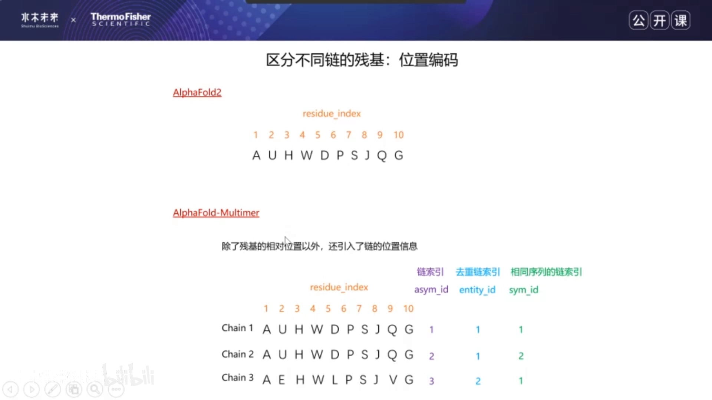

### 5.5 loss：同源多聚体的链匹配

预测同源多聚体（序列全相同的链）时，预测链与 ground truth 链怎么配对算 loss？Multimer 开发了一个**启发式匹配方法**，细节文中未展开 [【跳转到 26:42】](https://www.bilibili.com/video/BV1aF411b76x/?t=1602)。

### 5.6 置信度：从 pTM 到 ipTM（本讲核心）

置信度体系层层递进 [【跳转到 27:14】](https://www.bilibili.com/video/BV1aF411b76x/?t=1634)：

- **TM-score**：把预测结构与真实结构比对后算出的"归一化版 RMSD"，0~1；
- **pTM**（predicted TM-score）：AF2 提出，让模型**直接预测**一个 TM-score；
- **ipTM**（interface TM-score）：Multimer 提出，**只强调相互作用界面区域**的版本——ipTM 越高，说明界面预测得越准 [【跳转到 28:19】](https://www.bilibili.com/video/BV1aF411b76x/?t=1699)。

最终 5 个模型的排序公式就是：**0.8 × ipTM + 0.2 × pTM** [【跳转到 28:04】](https://www.bilibili.com/video/BV1aF411b76x/?t=1684)。

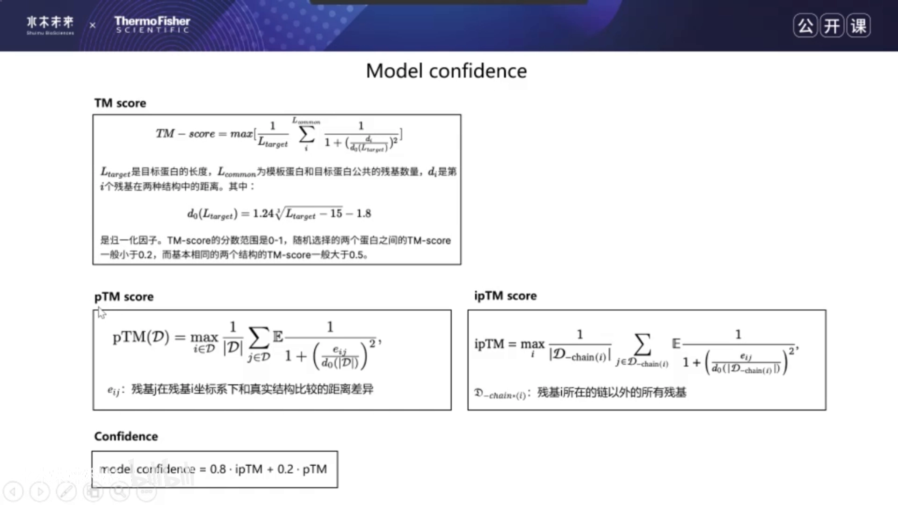

---

## 六、效果与局限

### 6.1 17 个异源多聚体上全面领先

在 17 个**无模板**异源多聚体上的对比 [【跳转到 28:29】](https://www.bilibili.com/video/BV1aF411b76x/?t=1709)：Multimer 的 DockQ 远超 AF2+linker、改 residue index、ClusPro 纯对接、以及"ClusPro refine 10 个 + AF2 原生 5 个"的 15 模型混合方案。分 homomer / heteromer 看，**异源多聚体上 Multimer 的优势最明显** [【跳转到 29:19】](https://www.bilibili.com/video/BV1aF411b76x/?t=1759)。

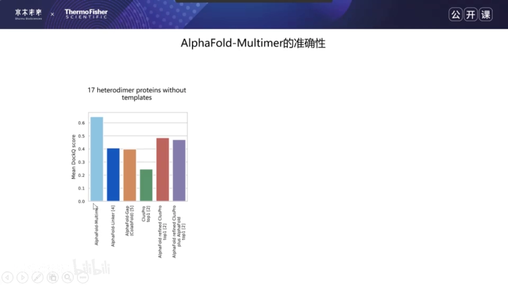

### 6.2 AF2 的"界面盲区"与拆链实验

AF2 论文自己承认：**异源多聚体（interface 相互作用占比 > 25% 的蛋白）预测得更差**——统计分析显示界面占比高的蛋白，AF2 预测出的 pLDDT 更低 [【跳转到 29:58】](https://www.bilibili.com/video/BV1aF411b76x/?t=1798)。Multimer 做了个拆链实验验证自己的价值：把复合体各链拆开分别预测 vs 联合预测。结论 [【跳转到 31:00】](https://www.bilibili.com/video/BV1aF411b76x/?t=1860)：

- 界面相互作用多的蛋白，用 Multimer **联合预测多条链**效果更好；
- 反过来，用 Multimer **只预测单条链**，效果反而比 AF2 差。

### 6.3 四条局限（论文原文口径）

[【跳转到 32:20】](https://www.bilibili.com/video/BV1aF411b76x/?t=1940)

1. **没有多聚体模板搜索**：模板只指导单体结构，不指导复合体；
2. **没有多聚体自蒸馏集**：蒸馏集全是单体；
3. **同源多聚体 > 异源多聚体**：同源的 MSA 容易拿，异源全靠拼接；
4. **无法预测抗原-抗体的结合**——论文写了这句话但没给数据。讲者的推测：抗原-抗体界面上**搜不到共变的同源序列，配不出有信号的 MSA**，所以预测不了 [【跳转到 32:56】](https://www.bilibili.com/video/BV1aF411b76x/?t=1976)。

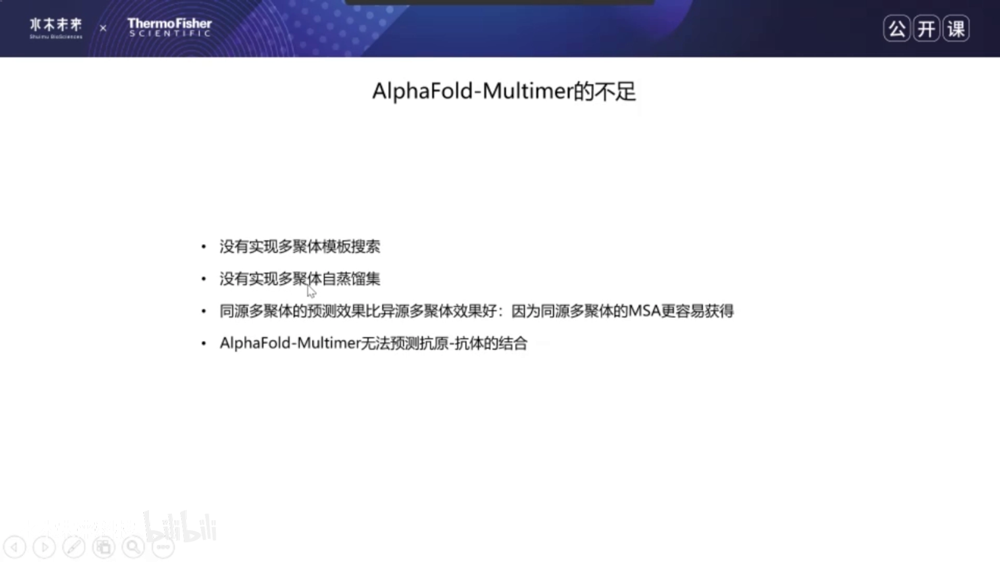

---

## 七、安装、使用与输出文件

### 7.1 安装三步

装过 AF2 的话很简单 [【跳转到 33:10】](https://www.bilibili.com/video/BV1aF411b76x/?t=1990)：

1. **更新代码**：git 拉最新代码，或下载后用 `export PYTHONPATH` 把 Multimer 代码加进环境；
2. **更新数据库**：新增 **UniProt**（要物种信息）；更新 **pdb_seqres** 模板序列，并让它与最新 **mmCIF** 目录对应统一 [【跳转到 33:55】](https://www.bilibili.com/video/BV1aF411b76x/?t=2035)；
3. **下载 Multimer 模型参数**。

### 7.2 运行与关键参数

docker 方式或直接跑 `run_alphafold.py` [【跳转到 34:42】](https://www.bilibili.com/video/BV1aF411b76x/?t=2082)。要点：

- 输入序列 **≥ 2 条**；
- 要指明复合体是否来自**原核生物**——这决定 MSA 用哪种拼接策略；
- `--max_template_date` 控制模板日期上限；
- 指定跑 Multimer 还是 AF2，以及数据库目录。

### 7.3 输出文件导读

[【跳转到 35:45】](https://www.bilibili.com/video/BV1aF411b76x/?t=2145)

| 文件 | 内容 |
| --- | --- |
| `features.pkl` | MSA 与模板搜索结果 |
| `timing.json` | 各阶段耗时 |
| `unrelaxed_model.pdb` | 深度学习直接输出（可能含 clash） |
| `relaxed_model.pdb` | relax 后的模型 |
| `ranked_*.pdb` | 按 **0.8×ipTM + 0.2×pTM** 排序后的 5 个结构 |
| `ranking_debug.json` | 排序对应关系 |
| `result_model.pkl` | 各种置信度等原始数据，适合二次分析 |
| `chain_id_map.json` | 链名重映射对照表（PDB 链名会变短） |

### 7.4 可视化与 ColabFold

比较预测结构与 PDB 真实结构：ChimeraX 里同时打开两个结构，Tools → Structure Comparison → **Matchmaker** 叠合 [【跳转到 38:22】](https://www.bilibili.com/video/BV1aF411b76x/?t=2302)；命令行可以逐链上色、显示 pLDDT。ColabFold 则是零安装用法（输序列 → 全部运行 → 等几小时），但它不搜模板、用缩减版 BFD、不用 UniClust30 [【跳转到 41:08】](https://www.bilibili.com/video/BV1aF411b76x/?t=2468)。

---

## 八、没有真结构，怎么判断界面可信（本讲核心）

有真实结构时叠一叠就知道准不准；**没有真结构时**，看这两个指标 [【跳转到 39:13】](https://www.bilibili.com/video/BV1aF411b76x/?t=2353)：

### 8.1 PAE 矩阵：重点看"链间块"

predicted aligned error（PAE）是 L×L 矩阵，元素 (i, j) 表示"以残基 i 的坐标系对齐两个结构时，残基 j 的距离误差"——越小越好，图上颜色越深越好 [【跳转到 39:38】](https://www.bilibili.com/video/BV1aF411b76x/?t=2378)。

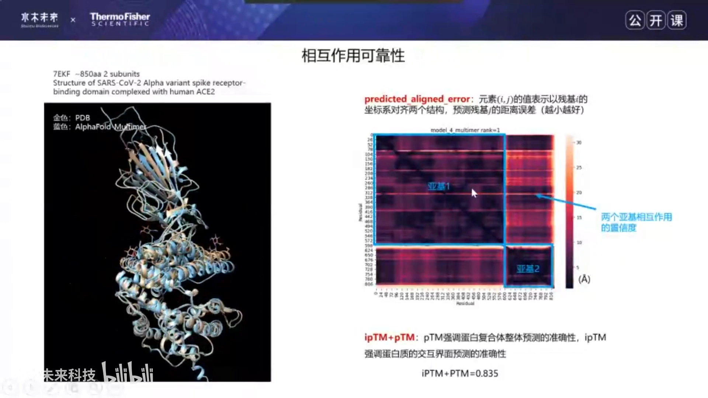

矩阵天然分块：左下、右上（或对角两侧）是**亚基间块**，对角块是亚基内部误差。**如果亚基间块的数值跟亚基内块接近，说明界面预测得准** [【跳转到 40:03】](https://www.bilibili.com/video/BV1aF411b76x/?t=2403)。

### 8.2 ipTM + pTM：越高越好，0.5 是经验线

另一个综合指标是 **ipTM + pTM**（或 0.8×ipTM + 0.2×pTM 的 confidence score），越高越好 [【跳转到 40:28】](https://www.bilibili.com/video/BV1aF411b76x/?t=2428)。TM-score 的经验分布 [【跳转到 55:36】](https://www.bilibili.com/video/BV1aF411b76x/?t=3336)：

- 随机挑两个蛋白，TM-score 一般 **< 0.2**；
- 两个基本相同的结构，TM-score 一般 **> 0.5**；
- 所以想预测得可信，**pTM / ipTM 尽量 ≥ 0.5**。

### 8.3 反面教材：3900 氨基酸的三聚体

序列太长时 Multimer 也会翻车：讲者测过一个 3900 AA 的同源三聚体，结构明显崩坏 [【跳转到 40:37】](https://www.bilibili.com/video/BV1aF411b76x/?t=2437)。但它自己"心里有数"——置信度分数很低。经验：**clash 严重且 relax 迭代也救不回来的预测，准确率大概率很低，直接放弃** [【跳转到 57:18】](https://www.bilibili.com/video/BV1aF411b76x/?t=3438)。

### 8.4 只关心界面？单独看 ipTM

输出的 confidence score 是 ipTM 与 pTM 的加权平均；想单独看界面准确率，可以**手动从输出里解析出 ipTM**——它就是为界面设计的分数 [【跳转到 61:13】](https://www.bilibili.com/video/BV1aF411b76x/?t=3673)。PAE 的链间块同样反映界面质量，两者配合使用。

---

## 九、答疑精华（多数与"界面怎么判"直接相关）

- **不知道几聚体？** 二、三、四聚体各跑一遍，比置信度分数和 PAE 矩阵，谁高信谁 [【跳转到 50:01】](https://www.bilibili.com/video/BV1aF411b76x/?t=3001)；
- **单体还是多聚体拿不准？** 看预测结果的 aligned error + ipTM，模型自己觉得准，相互作用更可能真发生 [【跳转到 51:30】](https://www.bilibili.com/video/BV1aF411b76x/?t=3090)；
- **二聚体/四聚体动态平衡？** 讲者猜测小聚体任务更简单、分数往往更高，需实验验证 [【跳转到 52:06】](https://www.bilibili.com/video/BV1aF411b76x/?t=3126)；
- **同源多聚体怎么输入？** 拷贝序列并改名 `-A`/`-B`/`-C`，几聚体就拷几份 [【跳转到 49:36】](https://www.bilibili.com/video/BV1aF411b76x/?t=2976)；
- **跨物种 PPI（如新冠蛋白-人蛋白）？** 违背"同物种拼接"假设，官方思路不支持但可试；已有实验数据（如 S 蛋白-受体）可纳入，难点仍在 MSA 拼接 [【跳转到 63:18】](https://www.bilibili.com/video/BV1aF411b76x/?t=3798)；
- **已有部分链的实验结构？** 可加入模板库当**软约束**——只会"偏向"，不能硬性限制原子间距离 [【跳转到 60:25】](https://www.bilibili.com/video/BV1aF411b76x/?t=3625)；
- **序列顺序影响结果吗？** 不影响，代码里用 Python set 去重 [【跳转到 61:15】](https://www.bilibili.com/video/BV1aF411b76x/?t=3675)；
- **多肽-蛋白（3~5 AA）？** 可以预测，无最短长度限制；AF2 时代的结论是 50% 以上多肽-蛋白相互作用能预测准 [【跳转到 66:54】](https://www.bilibili.com/video/BV1aF411b76x/?t=4014)；
- **挖表观遗传新复合物？** 可以学 Baker 组酵母全蛋白两两筛的思路，但高通量非常吃算力与时间 [【跳转到 68:24】](https://www.bilibili.com/video/BV1aF411b76x/?t=4104)；
- **蛋白-小分子？** **不可以**——AF2/Multimer 只做蛋白-蛋白 [【跳转到 69:14】](https://www.bilibili.com/video/BV1aF411b76x/?t=4154)；
- **链数上限？** 无硬限制，总长不超显存即可 [【跳转到 69:39】](https://www.bilibili.com/video/BV1aF411b76x/?t=4179)；
- **OOM？** 2800 AA 已偏长；实测 3600~3800 AA 需 A100 40G；改进思路是把"一次载入 5 个模型"改成逐个载入、逐个释放（需改代码）[【跳转到 48:21】](https://www.bilibili.com/video/BV1aF411b76x/?t=2901)。

---

## 小结

1. 复合物预测的瓶颈从来不只是网络结构，更是**配对 MSA**——没有跨链共变信号，再强的网络也"看不清"界面；
2. 界面好不好要用**几何指标**量化：有真结构用 **DockQ**（F_NAT / L-RMSD / i-RMSD，0.23 / 0.49 / 0.8 三条线），没真结构看 **PAE 链间块 + ipTM**（经验线 ≥ 0.5）；
3. AF-Multimer 的排序公式 **0.8×ipTM + 0.2×pTM** 把"界面"放在 C 位——这是它全面超越 AF2 土办法的根本原因；
4. 边界要记牢：AF2/Multimer **无法预测抗原-抗体结合**（推测：界面无共变 MSA 可配）、**不能预测蛋白-小分子**；
5. 工程细节决定成败：链索引三层编码、界面中心的 spatial cropping、链名重映射看 chain_id_map.json；
6. 长序列先想显存：2800 AA 已偏长，3800 AA 需 A100 40G，OOM 可改逐模型加载。

## 关键术语速查

| 术语 | 一句话解释 |
| --- | --- |
| DockQ | 复合物预测准确性指标：F_NAT、L-RMSD、i-RMSD 归一化后取平均，0~1 |
| F_NAT | 预测的界面接触在真实复合物中的恢复比例 |
| i-RMSD | 界面区域（10 Å 内）残基比对得到的 RMSD |
| L-RMSD | 较长链叠合后，较短链的 RMSD |
| pTM | AF2 提出的"预测 TM-score"，模型直接输出整体折叠置信度 |
| ipTM | AF-Multimer 提出的界面版 TM-score，只强调相互作用界面 |
| PAE | predicted aligned error 矩阵：(i, j) = 以残基 i 对齐时残基 j 的距离误差；链间块反映界面质量 |
| 配对 MSA | 把同物种序列跨链拼接，恢复共变信号（原核按基因邻近，真核按相似度） |
| pLDDT | 逐残基局部置信度（0~100），AF2 时代用于结构排序 |
| spatial cropping | 以界面残基为中心裁剪邻域的训练策略，与连续裁剪各占 50% |
| ipTM-PAE | 早期"AF2+ClusPro"土办法里对 15 个模型排序所用的综合分数 |
