# 不用显卡，也能玩转 AlphaFold 3！20 分钟讲透原理＋Server 实战

> 来源：[B 站视频](https://www.bilibili.com/video/BV1S5ax66EoU/)（BV1S5ax66EoU，时长约 19 分 45 秒，上海科技大学生物科学专业同学的主讲）。本文基于视频逐句字幕整理，时间戳可跳转原视频。

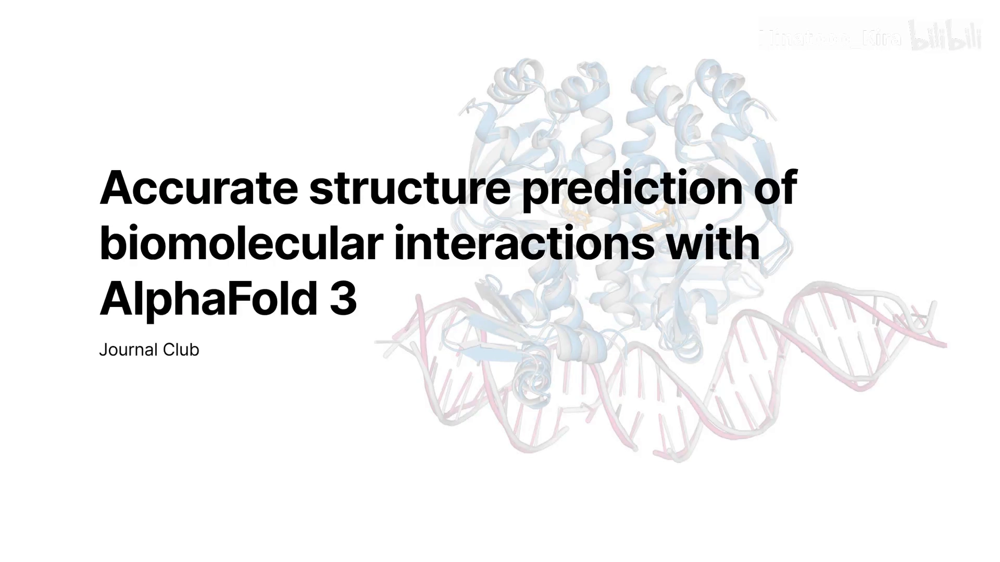

## 本讲要解决的核心问题（SCQA）

**背景**：结构决定功能。无论研究酶的催化机理、抗体如何结合抗原，还是小分子药物设计，都绕不开结构。X 射线、冷冻电镜、NMR 这些实验手段又贵又慢。

**冲突**：AlphaFold 3 号称能预测"蛋白质 + 核酸 + 小分子 + 离子"的全原子复合物；但视频里反复强调一个扎心的事实——**AF3 的高置信度分数不能当亲和力用**：上海科技大学 iGEM 团队拿 AF3 置信度打分去做强化学习生成 binder，命中率很高，湿实验测出来的亲和力却都很低。

**疑问**：AF3 到底强在哪？预测结果出来后，**界面到底怎么看才不被分数骗**？

**回答（中心思想）**：AF3 的判读是三层递进的——**pLDDT** 只保证"局部折叠"，复合物要再看 **ipTM**（界面置信度）和 **PAE 图**（不同部分相对位置的确定性，尤其看链间区域）；记住口诀：**ipTM=0.93 不代表有 93% 概率结合，更不是亲和力**。

---

## 一、为什么需要预测结构：主讲人抛出的五个问题

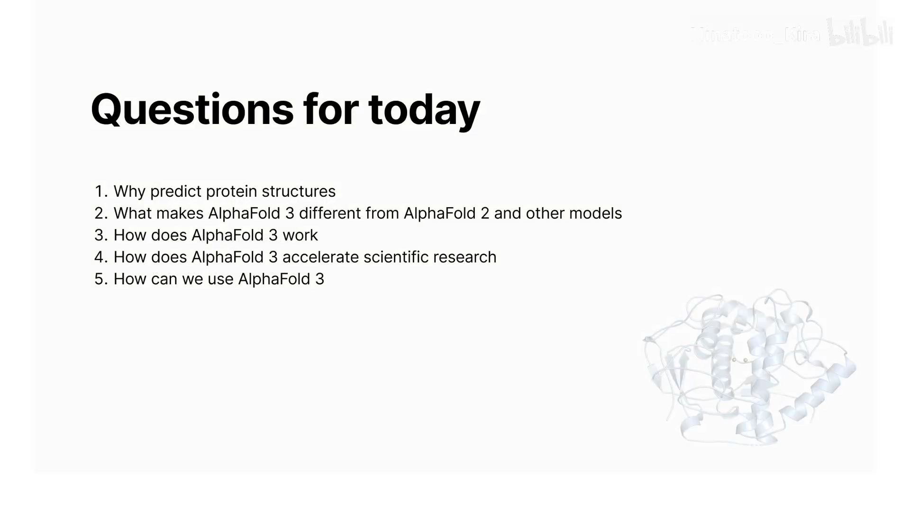

开场把 AF3 拆成五个问题 [【跳转到 01:08】](https://www.bilibili.com/video/BV1S5ax66EoU/?t=68)：

1. 为什么需要预测蛋白质结构？
2. AF3 有什么特殊之处，比 AF2 和同期模型强在哪？
3. AF3 的原理是什么？
4. AF3 如何加速和辅助现在的科学研究？
5. 学生现在怎么能用上 AF3？

先答第一问：**结构决定功能**。理解酶催化、抗体-抗原结合，全都离不开结构 [【跳转到 01:38】](https://www.bilibili.com/video/BV1S5ax66EoU/?t=98)。而实验解析（X 射线 / 冷冻电镜 / NMR）成本高、周期长，所以预测结构可以在实验前**初筛**，提高效率、降低成本——但最终仍要以实验结构为准 [【跳转到 02:03】](https://www.bilibili.com/video/BV1S5ax66EoU/?t=123)。

---

## 二、AF2 vs AF3 实测：单体打平，复合物略优

主讲人在本地部署了 AF2 和 AF3，选了 7 个 CASP 比赛的蛋白，用预测结构与真实结构的 RMSD 对比 [【跳转到 02:22】](https://www.bilibili.com/video/BV1S5ax66EoU/?t=142)：

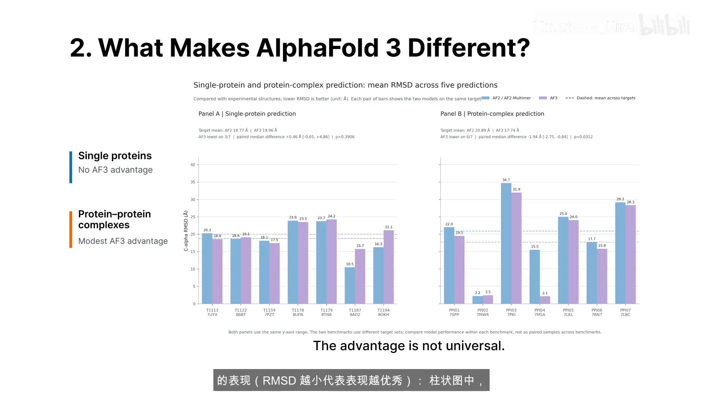

- **单体预测**：AF3 完全没有明显优势，个别蛋白上甚至弱于 AF2；
- **蛋白-蛋白复合物**：AF3 大部分情况占优，但优势也不算碾压。

这与 AF3 论文自己的结论一致 [【跳转到 11:42】](https://www.bilibili.com/video/BV1S5ax66EoU/?t=702)。

---

## 三、AF3 的独门能力：三种"AF2 做不到"

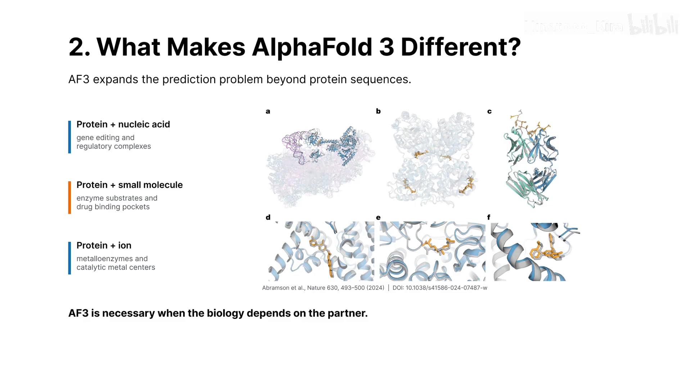

AF3 真正的划时代之处在于三类复合体系 [【跳转到 03:42】](https://www.bilibili.com/video/BV1S5ax66EoU/?t=222)：

1. **蛋白质 + 核酸**：研究基因编辑等工作的基础；
2. **蛋白质 + 小分子**：小分子药物设计、酶活性位点与底物结合研究的利器；
3. **蛋白质 + 金属离子**：金属酶作用机理研究的帮手。

这些都是 AF2 与同期大多数模型做不到的。

---

## 四、原理一图流：从序列到全原子结构

### 4.1 tokenize：三种 token，一个状态空间

AF3 拿到输入后先做 **tokenize（分词）**[【跳转到 05:27】](https://www.bilibili.com/video/BV1S5ax66EoU/?t=327)：

- 蛋白质 → 氨基酸残基 tokens；
- 小分子 / 金属离子 → **原子级** tokens；
- RNA / DNA → 核苷酸级 tokens。

关键在于**所有 tokens 共享同一个状态空间**——这就是 AF3 能把蛋白、核酸、小分子放进同一个体系预测的原因（AF2 的最小单元只有氨基酸残基，所以天然做不了）。

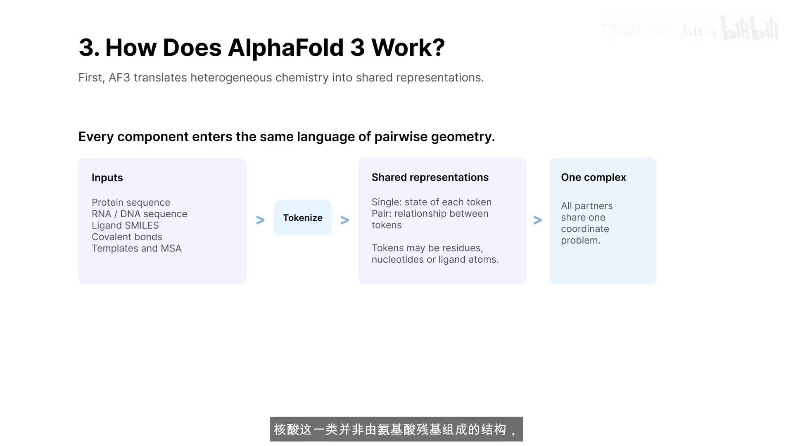

### 4.2 single / pair representation 与 Pairformer

每个 token 有一个 **single representation** 记录自身状态，还有 **pair representation** 记录任意两个 token 之间的关系 [【跳转到 06:17】](https://www.bilibili.com/video/BV1S5ax66EoU/?t=377)。刚初始化时这些表示是"空"的，需要 **Pairformer**（本质是 transformer）往里面灌注结构信息——它的训练数据一部分来自 PDB，很大一部分来自 DeepMind 从药厂买来的私人闭源数据 [【跳转到 07:07】](https://www.bilibili.com/video/BV1S5ax66EoU/?t=427)。

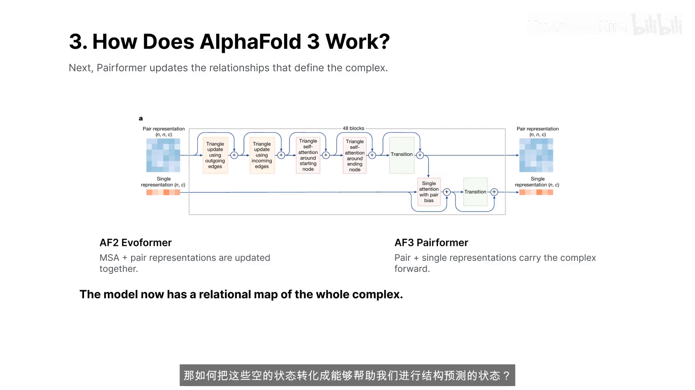

### 4.3 diffusion：用"去噪"生成结构

AF2 靠预测每个残基的 φ/ψ 二面角来"折叠"结构，所以只能做蛋白；AF3 换成了 **diffusion model**，像图像生成一样通过**去噪**把全原子结构直接"恢复"出来 [【跳转到 08:22】](https://www.bilibili.com/video/BV1S5ax66EoU/?t=502)。

一个好记的类比 [【跳转到 09:37】](https://www.bilibili.com/video/BV1S5ax66EoU/?t=577)：图像生成时我们会先用提示词生成器把需求转成 prompt，再交给扩散模型去噪出图——AF3 里**输入序列就是"想生成的那只狗"，Pairformer 输出的 single/pair representations 就是 prompt，diffusion model 输出的是全原子三维结构而不是图片**。

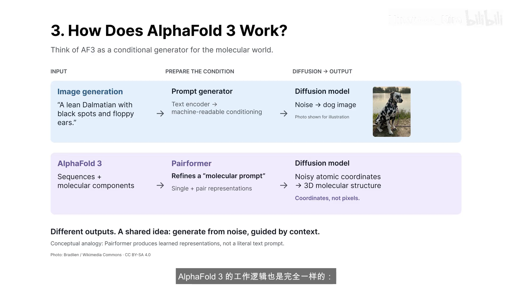

### 4.4 学习曲线：界面指标最难学

从不同指标的学习曲线看，配体内部、蛋白质内部的结构学得很快；而**蛋白-蛋白、蛋白-DNA/RNA 之间的界面指标需要更多轮次训练**——因为结合模式的不确定性和多样性远高于单链折叠 [【跳转到 10:27】](https://www.bilibili.com/video/BV1S5ax66EoU/?t=627)。

---

## 五、官方 benchmark：第四组就是抗体-抗原界面

AF3 论文的四组对比实验 [【跳转到 11:17】](https://www.bilibili.com/video/BV1S5ax66EoU/?t=677)：

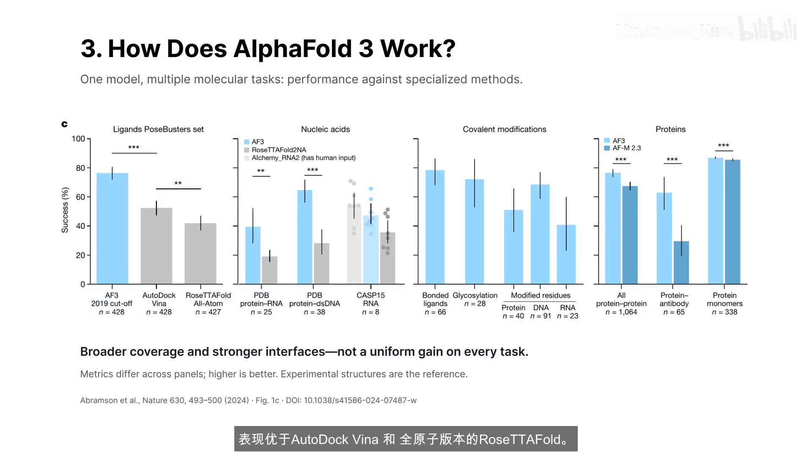

1. **小分子对接**：AF3 不依赖实验蛋白结构，仍优于 AutoDock Vina 和全原子版 Rosetta；
2. **蛋白-核酸界面**：高于 RoseTTAFold，但在 CASP15 RNA 任务上仍略逊于人工干预的方案；
3. **共价修饰**：能建模糖基化等多种修饰残基，但类别间成功率差异明显；
4. **蛋白复合物与抗体-抗原界面**：**AF3 相比 AlphaFold-Multimer v2.3 实现显著提升**——这正是上一课里"Multimer 预测不了抗原-抗体"的后续答案。

---

## 六、三篇应用文献，与一个昂贵的教训

### 6.1 三篇文献

[【跳转到 12:06】](https://www.bilibili.com/video/BV1S5ax66EoU/?t=726)

- **S2S2F**（上海科技大学）：提取 Pairformer 的内部表征 + 机器学习，预测荧光蛋白的光学性质——AF3 不只是结构预测器，内部表征里藏着功能信息；
- **光控酶改造**：利用 AF3 对蛋白-DNA 复合物的建模能力指导酶的结构优化，实验验证活性提升；
- **NTPN 抗体设计**：设计模型先提候选、**AF3 做结构检查**，把有限实验资源投给更有希望的候选 [【跳转到 12:56】](https://www.bilibili.com/video/BV1S5ax66EoU/?t=776)。

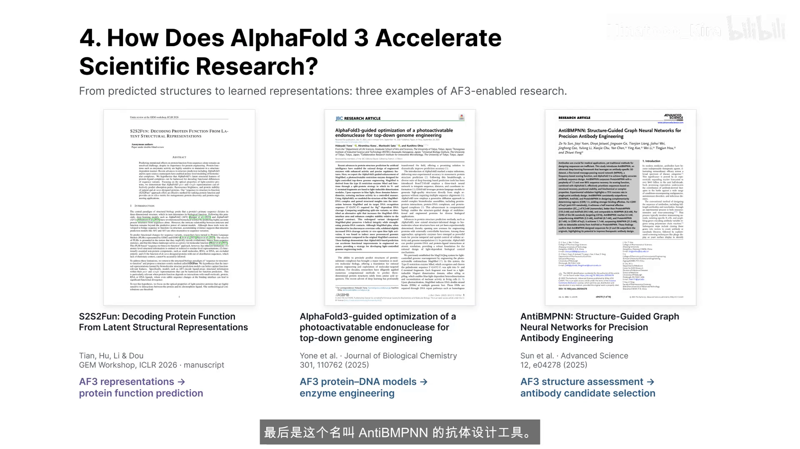

### 6.2 教训：高置信度 ≠ 亲和力

NTPN 论文明确提到：**AF3 的高置信度分数不能当亲和力预测值**。主讲人团队在 2025 年 iGEM 比赛中有切身体会 [【跳转到 13:21】](https://www.bilibili.com/video/BV1S5ax66EoU/?t=801)：他们用 AF3 置信度打分做强化学习、训练 ProteinMPNN 生成 protein binder，湿实验发现 **binder 命中率很高，但亲和力都很低**。

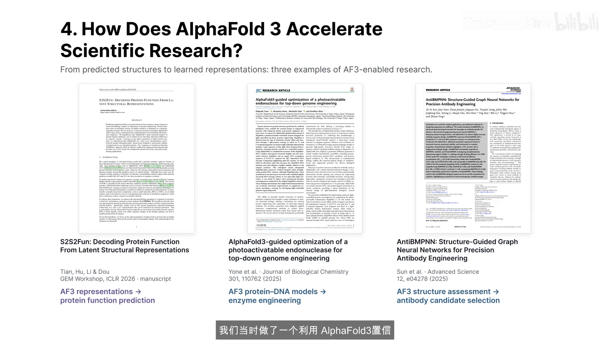

---

## 七、两条上手路径

[【跳转到 14:00】](https://www.bilibili.com/video/BV1S5ax66EoU/?t=840)

| 路径 | 适用 | 要点 |
| --- | --- | --- |
| **本地部署** | 有 GPU（如 5090）或可申请学校算力 | 显存、软件兼容性、内存硬盘都要提前考虑；好处是自由：蛋白、核酸、小分子、离子可放进一个体系，全新小分子也支持 |
| **AlphaFold Server** | 没有算力也能用 | Google 账号登录，非商业免费；**每天 30 个任务、每个任务最多 5000 tokens**；与本地版**同一套权重**，区别只在输入与运行控制的自由度 |

---

## 八、Server 实战：把体系"翻译"成输入

### 8.1 entity type 与 copies

每一行输入左边先选**分子类型**（protein / DNA / RNA / ion / ligand），右边填序列 [【跳转到 15:01】](https://www.bilibili.com/video/BV1S5ax66EoU/?t=901)：

- 支持 FASTA 格式粘贴；
- **copies** 表示同一种分子在体系里的拷贝数：预测同源二聚体就把 copies 改成 2；两条不同的蛋白则要用**不同的 entity** 分别输入。

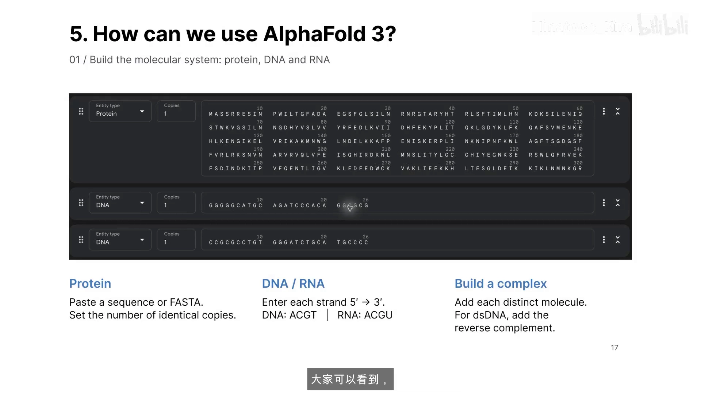

### 8.2 核酸的方向与互补链

DNA/RNA 都按 **5'→3'** 方向输入；要预测双链 DNA，必须把**互补链也作为单独一条输入**，而不是把同一条链的 copies 改成 2 [【跳转到 15:31】](https://www.bilibili.com/video/BV1S5ax66EoU/?t=931)。

### 8.3 离子与小分子（CCD code）

离子最简单：选 ion，菜单里挑（如 3 份 Ca²⁺ + 1 份 Na⁺）[【跳转到 15:56】](https://www.bilibili.com/video/BV1S5ax66EoU/?t=956)。小分子正好赶上好时代：**2024 年 8 月 19 日的更新让 Server 支持 CCD code 输入**——CCD 是 PDB 配套的化学组分字典，每种化学组分有唯一编号；注意页面限定的是 **2024-10-28 版 CCD**，更新的小分子未必能用，自设计的全新小分子仍需本地版 [【跳转到 16:21】](https://www.bilibili.com/video/BV1S5ax66EoU/?t=981)。

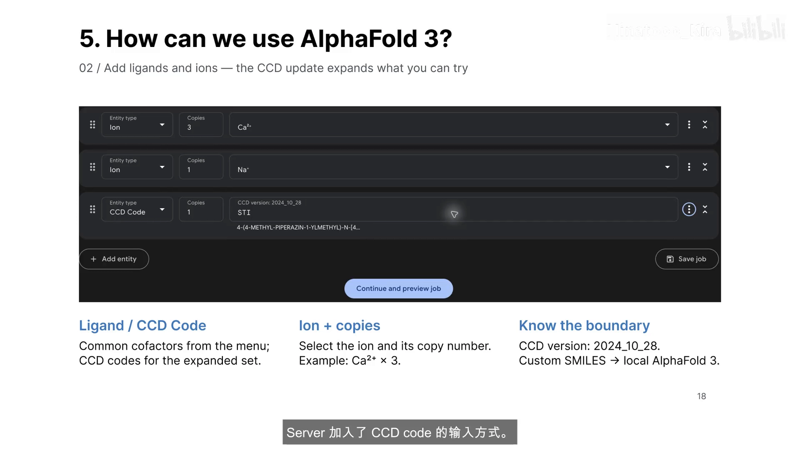

---

## 九、提交与结果：一个种子，五个样本

体系输入完，点 **Continue and preview job** 检查分子类型、序列、拷贝数，可改任务名、选随机种子（自动或指定），然后 **Confirm & submit job**，在 history 里等排队和预测完成 [【跳转到 16:57】](https://www.bilibili.com/video/BV1S5ax66EoU/?t=1017)。

注意：**一个随机种子会生成 5 个预测样本**，按模型内部评分排序，网页默认展示第一名。但"排名第一"只代表模型更有信心，**不等于最接近实验结构**——5 个样本都值得下载比较。

---

## 十、结果判读（本条目核心）：pLDDT → ipTM → PAE

预测完成后的官方蛋白+DNA+离子示例 [【跳转到 17:46】](https://www.bilibili.com/video/BV1S5ax66EoU/?t=1066)：

### 10.1 第一层：pLDDT（局部折叠置信度）

结构上的颜色就是 pLDDT：**蓝色 = 模型有把握，黄/橙色 = 谨慎看待**。但局部折叠有把握 ≠ 几个分子之间的相对位置正确。

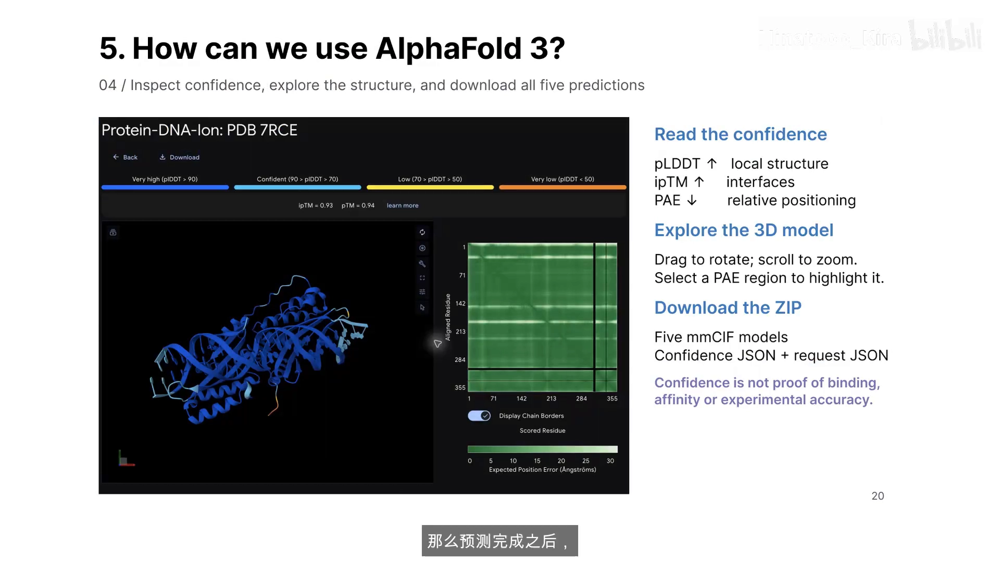

### 10.2 第二层：ipTM（界面置信度）

研究**复合物**时，还要看 **ipTM 和旁边的 PAE 图**：ipTM 主要反映**界面的置信度** [【跳转到 18:11】](https://www.bilibili.com/video/BV1S5ax66EoU/?t=1091)。

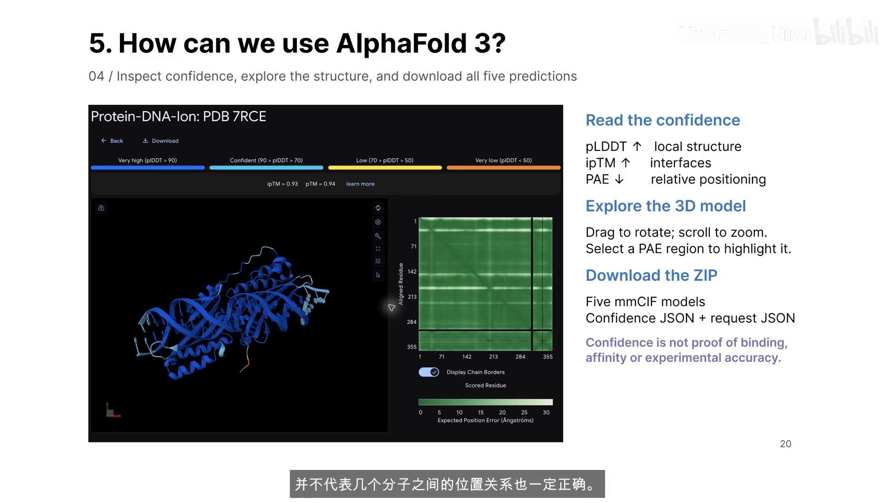

### 10.3 第三层：PAE（相对位置确定性）

**PAE 告诉你不同部分之间的相对位置模型有多确定**：颜色越深、预测误差越低，越有把握；尤其要关注**不同链之间的区域**。PAE 图里框选一个区域，三维结构里会高亮对应位置。

### 10.4 最重要的提醒：ipTM=0.93 ≠ 93% 结合概率

示例的 ipTM 是 0.93，看起来很高，但它**不是说有 93% 的概率会结合，更不是亲和力数值** [【跳转到 18:36】](https://www.bilibili.com/video/BV1S5ax66EoU/?t=1116)——呼应第六节的教训：高置信度 ≠ 真实结合效果。

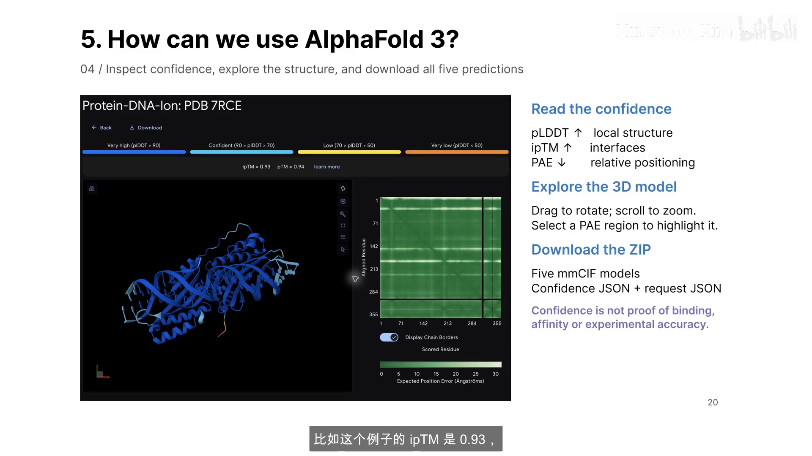

### 10.5 下载与深挖

点 download 可拿到**五个预测结构的 mmCIF 文件 + 置信度与输入信息的 JSON**；把结构放进 PyMOL，可以继续观察口袋、界面和分子间接触 [【跳转到 19:01】](https://www.bilibili.com/video/BV1S5ax66EoU/?t=1141)。Server 最有价值的用法，是把"序列层面的想法"变成**可观察、可分析的结构假设**，帮你更快提出问题、设计实验——假设是否成立，最终仍要靠真实实验回答 [【跳转到 19:26】](https://www.bilibili.com/video/BV1S5ax66EoU/?t=1166)。

---

## 小结

1. AF3 的核心价值是**一个统一模型覆盖全原子复合物**：蛋白-核酸、蛋白-小分子、金属离子都能预测，抗体-抗原界面相比 AF-Multimer v2.3 显著提升；
2. 原理三步记：**tokenize（残基/原子/核苷酸，共享状态空间）→ Pairformer 注入结构信息 → diffusion 去噪出全原子结构**；
3. 判读三层递进：**pLDDT 看局部 → ipTM 看界面 → PAE 看相对位置（重点链间区域）**；
4. 铁律：**高置信度 ≠ 结合概率 ≠ 亲和力**——iGEM 实战里命中率高的 binder 亲和力照样低；
5. Server 与本地同权重，每天 30 个任务、每个 5000 tokens；双链 DNA 要输入互补链，小分子用 CCD code（字典版本 2024-10-28）；
6. 每个种子 5 个样本，第一名只是"模型最有信心"的那个，值得全部下载比较。

## 关键术语速查

| 术语 | 一句话解释 |
| --- | --- |
| tokenize | 把输入的蛋白/核酸/小分子转成残基级、原子级、核苷酸级 token，共享同一状态空间 |
| single representation | 记录每个 token 自身状态的表示 |
| pair representation | 记录任意两个 token 之间关系的表示 |
| Pairformer | AF3 的主干了（transformer 类），给空表示注入结构信息；其表征还可二次利用 |
| diffusion model | 通过去噪直接生成全原子三维结构的生成模型 |
| pLDDT | 逐残基局部置信度（0~100），结构着色的依据 |
| ipTM | 界面 TM-score，反映复合物**界面**的预测置信度 |
| PAE | predicted aligned error 矩阵/热图，反映任意两部分**相对位置**的确定性；颜色越深误差越低 |
| CCD code | PDB 化学组分字典的编号，Server 输入自定义小分子的入口 |
| entity / copies | Server 输入行：分子类型 / 该分子的拷贝数（同源多聚体用它，异源链另开 entity） |
