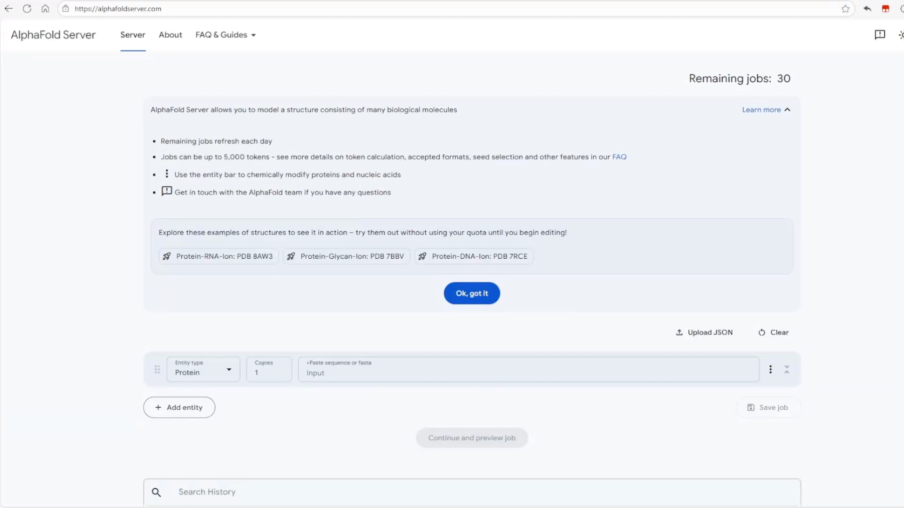
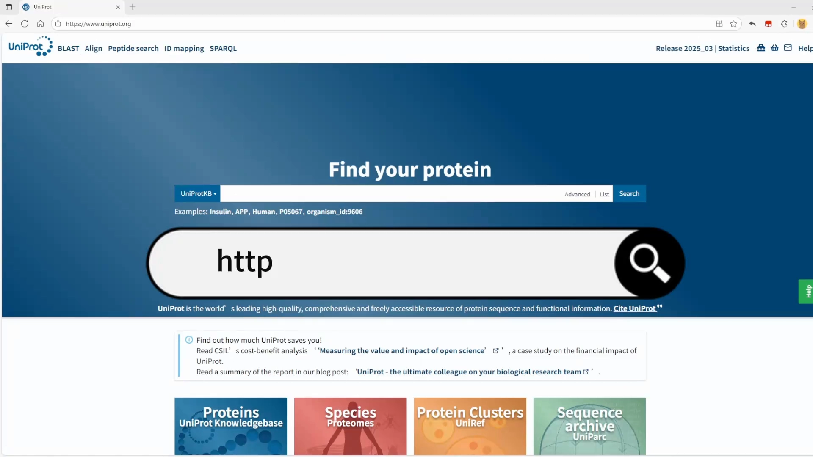
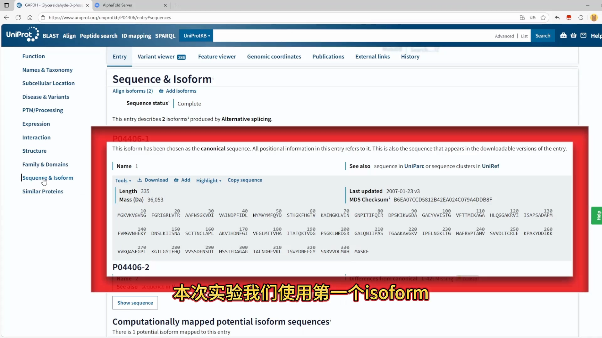
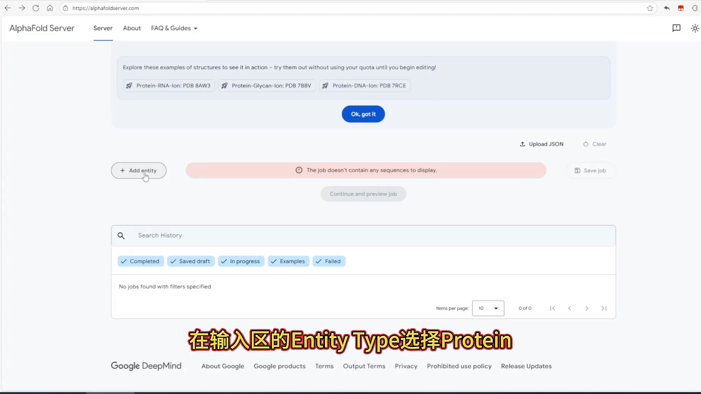
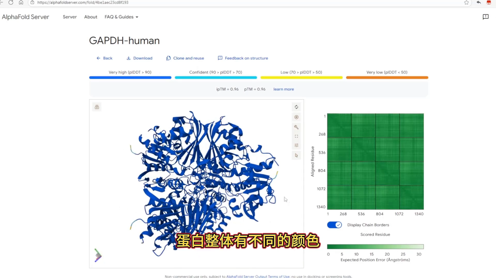
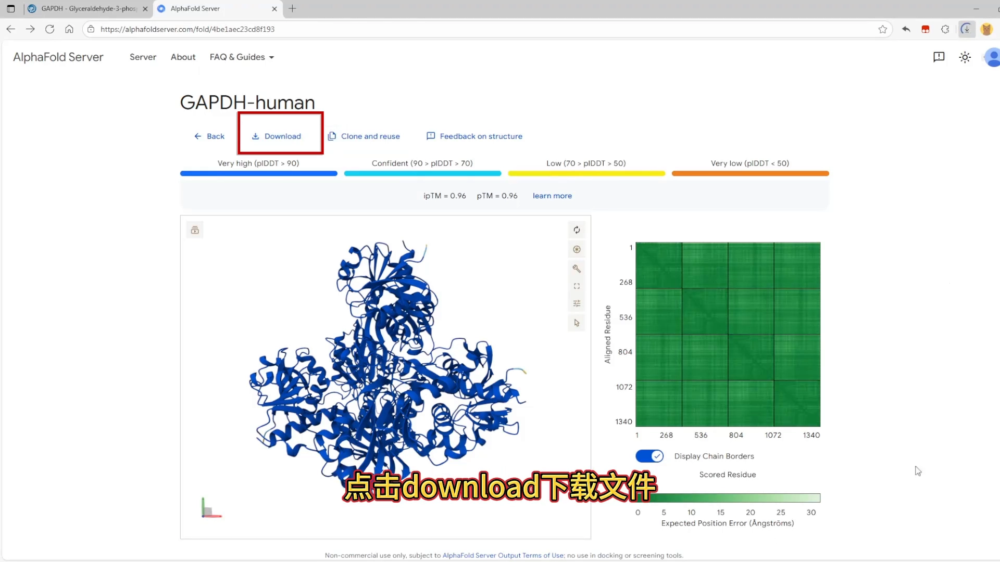
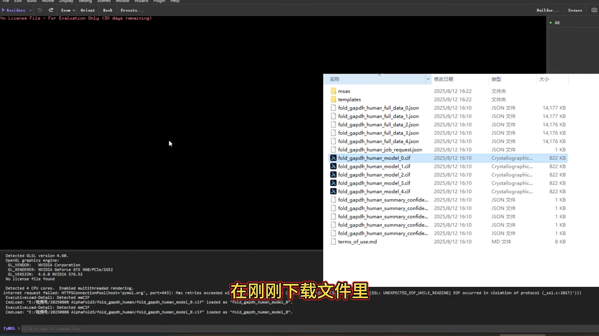

# 3分钟学会AlphaFold3预测蛋白

> 本篇是「多链序列输入」条目的界面实操篇：演示 AlphaFold Server 从拿到序列到提交预测的完整流程——重点是 Entity type 与 copies（出现次数）这两个输入约定。视频原题《3分钟学会AlphaFold3预测蛋白》。

## 本篇要解决的核心问题（SCQA）

**背景**：做蛋白相关研究，经常需要一条序列的三维结构，比如拿到一个 GAPDH 的氨基酸序列后想看它长什么样。

**冲突**：本地安装 AlphaFold 门槛不低；而它对输入有明确约定——是什么类型的分子、这条序列在复合物里出现几次，都要填对。

**疑问**：在网页版的 AlphaFold Server 上，从序列到结构最快要走哪几步？预测结果又该怎么判断靠不靠谱？

**回答（中心思想）**：三步即可——**从 UniProt 拷贝序列 → 在 Server 里选 Entity type、按多聚体数目填 copies → 提交并用 pTM/ipTM 判断置信度**。GAPDH 是四聚体，copies 就填 4。

## 一、AlphaFold 3 能做什么

AlphaFold 3 是由谷歌 DeepMind 开发的人工智能模型，能够以**原子级精度**预测蛋白质、DNA、RNA、小分子、配体等生物分子的 3D 结构及其相互作用。

[【跳转到 00:00】](https://www.bilibili.com/video/BV1Z7bJzCEZS/?t=0)

视频开头给了几个关键数字：该系统覆盖了蛋白质结构数据库（PDB）**95% 以上**的分子类型；复合物预测速度比传统实验方法**快数百倍**；目前在癌症靶点筛选、抗病毒药物开发等方向产生实际价值。

## 二、AlphaFold Server 界面速览

打开浏览器访问 AlphaFold Server，用谷歌账号登录。进入界面后：

- **右上角**：今日可使用的剩余次数（每日刷新）；
- **输入区**：左侧是不同的实体类型选项；中间是序列输入框，旁边可填这条序列的**出现次数（copies）**；
- **下方**：历史记录，可以看到之前提交的项目信息。

[【跳转到 00:43】](https://www.bilibili.com/video/BV1Z7bJzCEZS/?t=43)

## 三、实操：从 UniProt 拷贝序列到提交任务

### 3.1 去 UniProt 找序列

首先打开 **UniProt**（蛋白质序列与功能信息数据库）主页，搜索 **GAPDH**，在搜索结果页面左侧选择 human，选第一个结果。

[【跳转到 01:19】](https://www.bilibili.com/video/BV1Z7bJzCEZS/?t=79)

进入蛋白页面后，左侧菜单可以先暂停或截图查看。这次直接预测蛋白：选择左侧的 **Sequence**，使用第一个 isoform（同工型，同一基因剪接出的不同蛋白版本），点击 **Copy Sequence** 复制氨基酸序列。

[【跳转到 01:34】](https://www.bilibili.com/video/BV1Z7bJzCEZS/?t=94)

### 3.2 填 Entity type 与 copies，然后提交

回到 AlphaFold Server，在输入区把 **Entity type（实体类型）选 protein**，粘贴刚才复制的氨基酸序列。关键一步来了：

> **GAPDH 是四聚体（四条相同链组成的复合物），所以 copies 填 4。**

这就是"同源多拷贝"的输入约定：序列只粘贴一次，出现几次用 copies 说清楚。填好后点击 **Continue and preview job** 预览，修改 **Job name**，最后点击 **Confirm and submit job** 提交即可。

[【跳转到 01:51】](https://www.bilibili.com/video/BV1Z7bJzCEZS/?t=111)

提交后，页面下方的历史记录里可以看到正在处理的项目，稍等片刻。

## 四、结果判读：置信度颜色 + pTM / ipTM

点击进入项目可以查看预测情况，还能旋转视角观察蛋白。

### 4.1 颜色 = 置信度

蛋白整体会按置信度着色，**由深蓝、浅蓝、黄色、橘色递减**。视频里蛋白整体偏深蓝色，说明结构整体置信度较高；右侧是预测误差图，颜色越深误差越小。

[【跳转到 02:23】](https://www.bilibili.com/video/BV1Z7bJzCEZS/?t=143)

### 4.2 pTM 与 ipTM 两个分数

- **pTM**：复合物整体预测与真实结构的相似程度；
- **ipTM**：复合体内**亚基之间相对位置**预测的准确性——多链/多拷贝体系尤其要看它。

[【跳转到 02:45】](https://www.bilibili.com/video/BV1Z7bJzCEZS/?t=165)

本次实验 ipTM 和 pTM 都等于 **0.96**，意味着预测结果较为准确。这两个分数越接近 1 越可信，可以像本例一样先看分数再决定是否采用结构。

## 五、下载结果，用 PyMOL 查看

最后用 **PyMOL**（常用的分子结构可视化软件）查看结果：

1. 在 AlphaFold Server 结果页面点击 **Download** 下载文件；
2. 下载的文件里有 **CIF** 和 **JSON** 两种格式；
3. 默认选择 model 0 的 CIF 文件，直接把文件拖进 PyMOL，就能看到蛋白质分子结构。

[【跳转到 03:06】](https://www.bilibili.com/video/BV1Z7bJzCEZS/?t=186)

## 小结

- AlphaFold 3 能以原子级精度预测蛋白质、DNA、RNA、小分子、配体的结构与相互作用。
- Server 输入约定：**Entity type 选对分子类型；序列只填一次，出现几份用 copies 标注**（GAPDH 四聚体 → copies=4）。
- 序列来源：UniProt 蛋白页面 → Sequence → Copy Sequence。
- 结果判读先看两样：**置信度着色**（深蓝最好）与 **pTM / ipTM** 分数（越接近 1 越可信；多亚基体系重点看 ipTM）。
- 下载文件里选 model 0 的 CIF，拖入 PyMOL 即可查看。

## 关键术语速查

| 术语 | 一句话解释 |
| --- | --- |
| AlphaFold Server | DeepMind 提供的在线结构预测服务，谷歌账号登录即可用 |
| Entity type | 输入实体的分子类型（protein / DNA / RNA / 配体等） |
| copies | 这条序列在复合物中出现的份数，四聚体填 4 |
| UniProt | 蛋白质序列与功能数据库，可按物种检索并复制序列 |
| isoform（同工型） | 同一基因经不同剪接产生的蛋白版本 |
| pTM | 复合物整体预测与真实结构的相似度评分 |
| ipTM | 复合物内各亚基间相对位置预测的准确性评分 |
| CIF / JSON | AlphaFold 3 输出的结构文件与任务配置格式 |
| PyMOL | 分子三维结构可视化软件，拖入 CIF 即可查看 |
