# AlphaFold蛋白蛋白复合物预测及amber分子动力学模拟（一）

> 本篇是「多链序列输入」条目的实操篇：演示如何把抗体（重链 + 轻链）与抗原三条链一起输入 AlphaFold 做复合物预测，再用 amber 分子动力学（MD）验证复合物的稳定性。视频原题《AlphaFold蛋白蛋白复合物预测及amber分子动力学模拟（一）》。

## 本讲要解决的核心问题（SCQA）

**背景**：我们手上有一对抗体的重链、轻链序列，以及一段抗原蛋白序列，想知道它们组装成的复合物长什么样、结合得稳不稳。

**冲突**：单条链的结构预测已经不够用——抗体要发挥功能必须和抗原形成复合物；而且预测出的复合物只是"静态快照"，它到底稳不稳定，还需要动力学模拟来验证。

**疑问**：多条链怎么一起喂给 AlphaFold？预测出复合物之后，又怎么一步步搭建分子动力学体系、跑模拟、做分析？

**回答（中心思想）**：多链输入的约定是"**每条链单独粘贴成一个实体（entity）；同一序列出现多份就用 copies 标注拷贝数**"。本讲按"多链输入 → 复合物预测 → 按链识别与拆分 → MD 体系搭建 → 提交模拟 → 轨迹与结合能分析"的完整流程走一遍。

## 一、多链输入：逐链粘贴，二聚体用 copies 标注

### 1.1 准备序列

视频开头作者准备好了三段序列：抗体蛋白的**重链**序列、**轻链**序列，以及与抗体结合的**抗原蛋白**序列。

[【跳转到 00:00】](https://www.bilibili.com/video/BV11FDnYwE3u/?t=0)

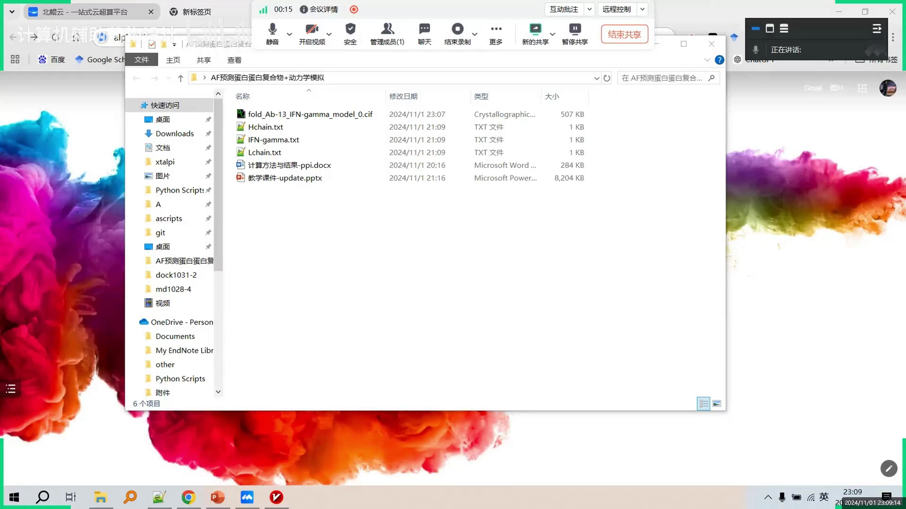

### 1.2 每条链一个实体，逐个粘贴

进入 AlphaFold 网站后，输入的约定非常朴素：

1. 先把**轻链**序列拷贝进第一个输入框；
2. 点"再添加一个"，把**重链**序列拷贝进第二个输入框；
3. 最后把**抗原蛋白**的序列拷贝进来。

[【跳转到 00:22】](https://www.bilibili.com/video/BV11FDnYwE3u/?t=22)

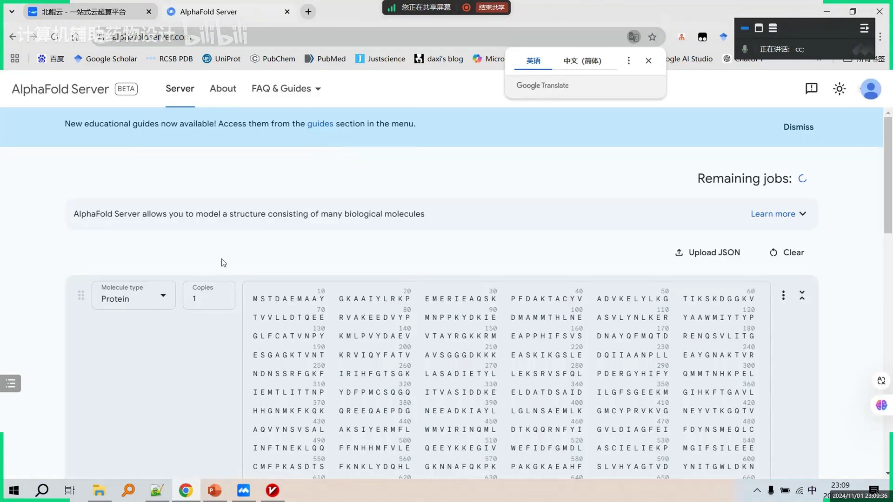

也就是说：**每条链对应一个独立的输入实体**，而不是把三条序列拼在一个框里。

### 1.3 同源多拷贝：copies 填几很关键

 抗原蛋白在体内是**二聚体**——两条完全相同的链一起工作。对这种"同一条序列出现多份"的情况，约定是：**序列只填一次，把 copies（出现次数）改成 2**。

[【跳转到 01:04】](https://www.bilibili.com/video/BV11FDnYwE3u/?t=64)

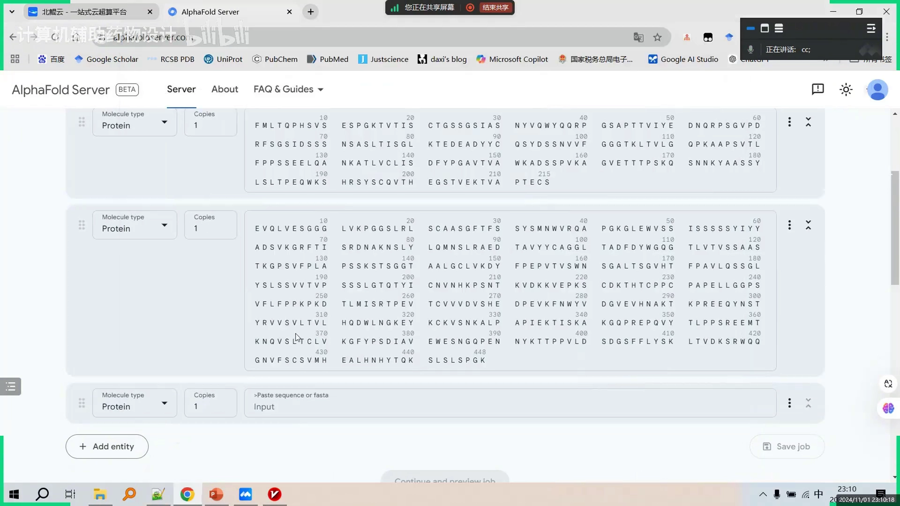

这样最终输入就是：轻链（1 份）+ 重链（1 份）+ 抗原（2 份拷贝），共四条链，一起预测复合物。填好任务名后直接提交。

> 小结一下多链输入的约定：**不同序列各占一个实体；相同序列只填一次，用 copies 标明有几份**。这与「同一条序列重复粘贴多次」效果等价，但更清晰、不易出错。

## 二、预测结果：按链着色识别每条链

结果运行完成后可以直接下载。解压后用 PyMOL（一款常用的分子三维结构可视化软件）打开，并**基于链进行着色**：

[【跳转到 01:58】](https://www.bilibili.com/video/BV11FDnYwE3u/?t=118)

- **品红色和黄色**：二聚体的抗原蛋白（C 链和 D 链，两条链序列完全一样）；
- **绿色和青色**：抗体的轻链和重链（A 链与 B 链）。

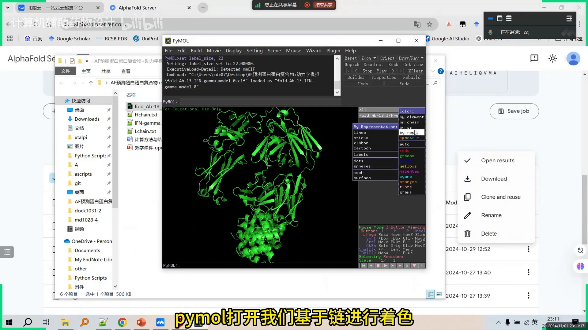

可以看到，之前"copies=2"的设定直接反映在结果里：抗原蛋白占了两条链。**多链输入写得对不对，看按链着色的结果就能核对**。

## 三、从复合物中拆出两条蛋白：P1 与 P2

做动力学模拟前，要把复合物拆成两个"蛋白对象"：

1. 鼠标移到 selecting 处，点击 Residue 切换到 chain（按整条链选择）；
2. 点选两条抗原链，把选中的部分提取（copy）出来——这就是抗原二聚体；
3. 先隐藏抗原，导出抗体蛋白，命名为 **P1**；再把二聚体的抗原蛋白导出，命名为 **P2**。

[【跳转到 02:28】](https://www.bilibili.com/video/BV11FDnYwE3u/?t=148)

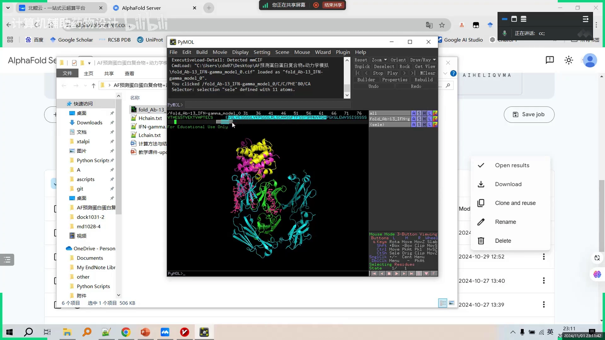

P1、P2 这两个文件，就是接下来动力学模拟的"原料"。

## 四、云平台上的 MD 体系搭建

### 4.1 上传材料，准备节点

视频使用北鲲云（其他云平台也可以）跑动力学模拟：准备一套动力学模拟脚本，连同 P1、P2 两个蛋白一起上传。

[【跳转到 03:38】](https://www.bilibili.com/video/BV11FDnYwE3u/?t=218)

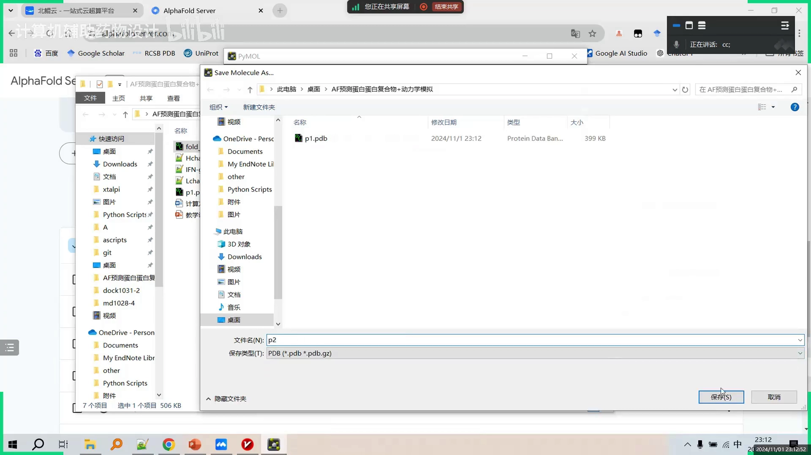

操作流程：登录账号 → 把通用计算区切成二区 → 新建一个计算节点（闲置释放默认勾选）→ 点连接，进入网页版服务器终端。

### 4.2 创建目录、上传文件、解压

在终端里：

- `mkdir MD1102` 创建一个文件夹（mkdir 是创建目录的命令，名字任意但不能是中文）；
- `ls` 查看目录内容，`cd MD1102` 进入文件夹；
- 点右上角文件传输图标，把两个蛋白和脚本压缩包上传上来；
- `unzip 压缩包名` 解压，得到很多参数文件和脚本。

[【跳转到 05:12】](https://www.bilibili.com/video/BV11FDnYwE3u/?t=312)

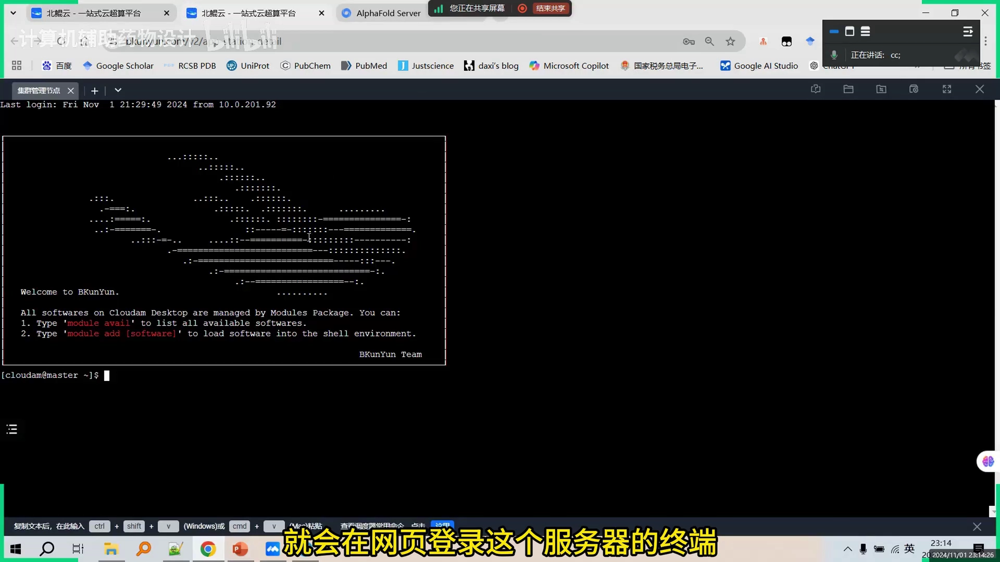

### 4.3 溶剂化：把两个蛋白装进水盒子

第一步要做的是**体系搭建**：把两个蛋白融进一个"水盒子"，添加盐离子，形成溶于水盒子中的复合物文件，供后续动力学模拟使用。方法是运行脚本：

```bash
bash submit_clip.sh 蛋白一名称 蛋白二名称
```

视频中的输入顺序是先 `P2.pdb`（抗原）再 `P1.pdb`（抗体）——作者强调顺序反着来对结果没有影响。

[【跳转到 06:50】](https://www.bilibili.com/video/BV11FDnYwE3u/?t=410)

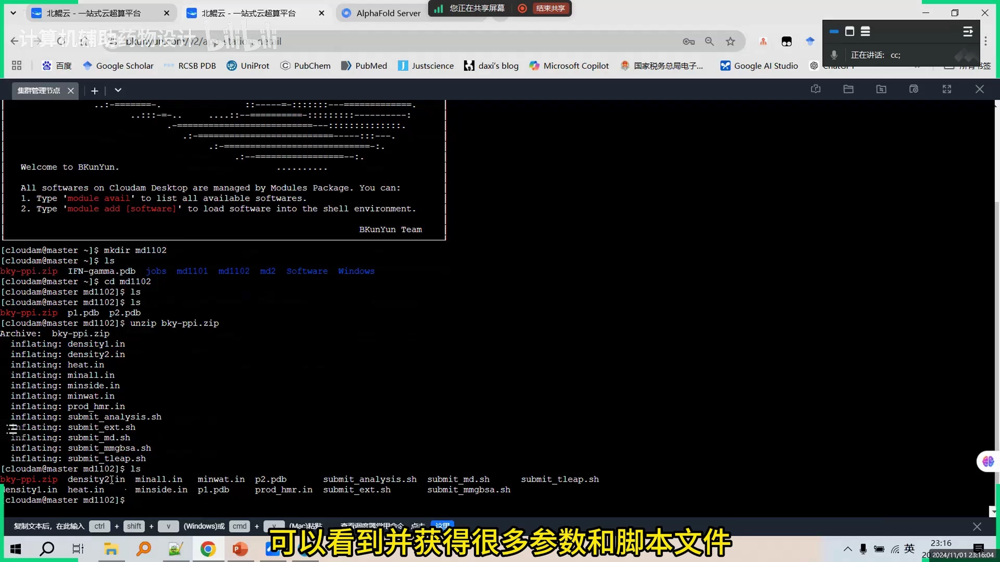

脚本会依次完成：**加氢原子 → 把蛋白溶于水盒子 → 加盐离子 → 形成复合物**。运行中报错数为 0、最后显示 done，就说明处理成功；文件传输里刷新可以看到生成的 `complex.pdb`——这就是"抗原-抗体复合物溶于水盒子"的完整体系。

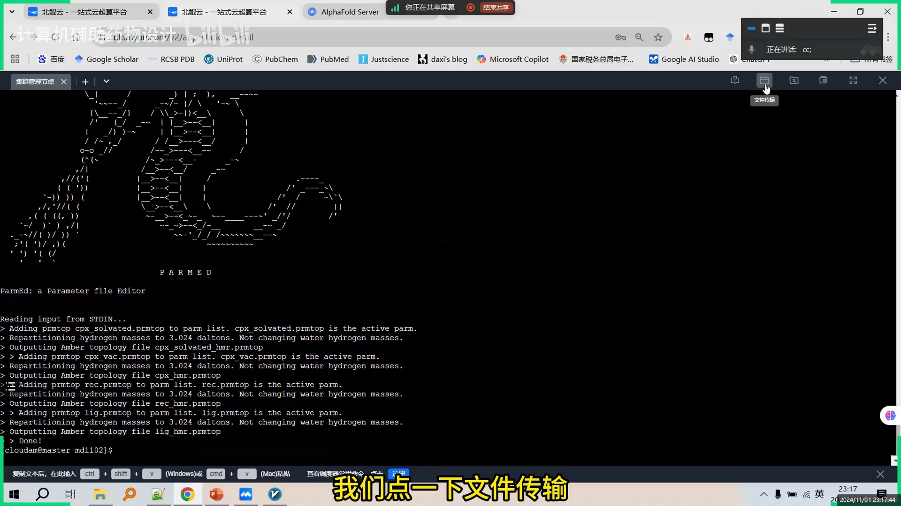

## 五、提交模拟：nsteps × dt = 模拟时长

### 5.1 提交任务

点集群管理节点，用 `sbatch` 提交 MD 模拟脚本，任务就进入队列了。用 `squeue` 可以看任务状态：刚提交时是排队状态，过一会儿变成 R（Running，运行中）。

[【跳转到 09:13】](https://www.bilibili.com/video/BV11FDnYwE3u/?t=553)

等个大约 5 分钟，用 `tail info` 之类的命令可以查看模拟还需要多久结束。

### 5.2 想跑多久，改一个数字

模拟时长由**参数文件（mdp 文件）**决定，它记录了模拟的步数、步长、温度等参数：

- **步数 × 步长 = 模拟时间**。视频中两者相乘约等于 10 纳秒；
- 想跑 100 纳秒？用 vim 打开 mdp 文件，按 `i` 进入编辑（左下角出现 insert），在步数上**添加一个 0**——步数提升十倍，10 纳秒就变成 100 纳秒；
- 按 `ESC` 退出编辑，再输入 `:wq` 保存并退出，重新 `sbatch` 提交即可。

[【跳转到 11:18】](https://www.bilibili.com/video/BV11FDnYwE3u/?t=678)

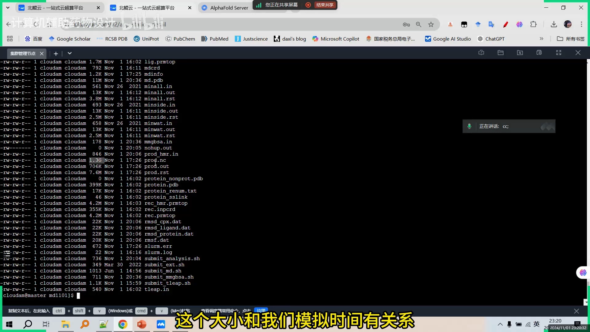

> 纳秒（ns）是分子动力学的时间单位。1 纳秒 = 10⁻⁹ 秒——别看数字小，对蛋白质来说已经够它"动"出有意义的构象变化了。

## 六、轨迹分析：RMSD、氢键、回旋半径

### 6.1 分析的原料：轨迹文件

模拟输出的**轨迹文件**（.xtc 格式）记录了体系每一帧的原子坐标。视频里的轨迹有 1.3 GB——大小和模拟时长直接相关。

[【跳转到 10:53】](https://www.bilibili.com/video/BV11FDnYwE3u/?t=653)

分析前先跑分析脚本（视频里是 `submit_analysis.sbash`）。用 vim 编辑它之前，要先搞清楚一件事：**两个蛋白在复合物里各占哪些氨基酸序号**。

### 6.2 确定氨基酸编号边界

把云端生成的 `complex.pdb` 下载后双击打开：文件里有一条**虚线**，连接的是两个蛋白的"一头一尾"（因为它们原本是分开的两条链，拼接进同一体系后用虚线表示断开处）。

点一下虚线一端并显示序列，可以定位到 663 号氨基酸是抗体链的末端；往后数到最后一位是 907。于是：

- **1–663 号氨基酸 = 抗体蛋白**；
- **664–907 号氨基酸 = 抗原蛋白**。

[【跳转到 14:29】](https://www.bilibili.com/video/BV11FDnYwE3u/?t=869)

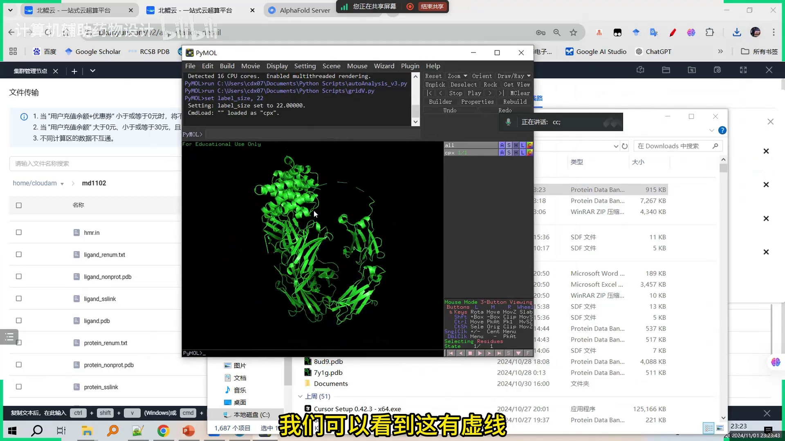

### 6.3 在脚本里填入区间

按自己体系的实际编号修改分析脚本：

- 蛋白一 = 抗体（1–663），蛋白二 = 抗原（664–907）；
- 复合物的 RMSD 也要算——即整个复合物蛋白的均方根偏差；
- **氢键**：分别以 664–907 为氢键供体、另一段为受体，以及反向（1–663 为供体）各算一次，观察两条蛋白之间的氢键发生情况；
- **回旋半径**（Rg，衡量分子整体有多"紧凑"）：不想算就把井号 `#` 加上注释掉；
- **溶剂可及表面积**（SASA）：把井号删掉即可开启，本次研究不计算；
- 输出的数据是 dat 格式的文件。

[【跳转到 16:54】](https://www.bilibili.com/video/BV11FDnYwE3u/?t=1014)

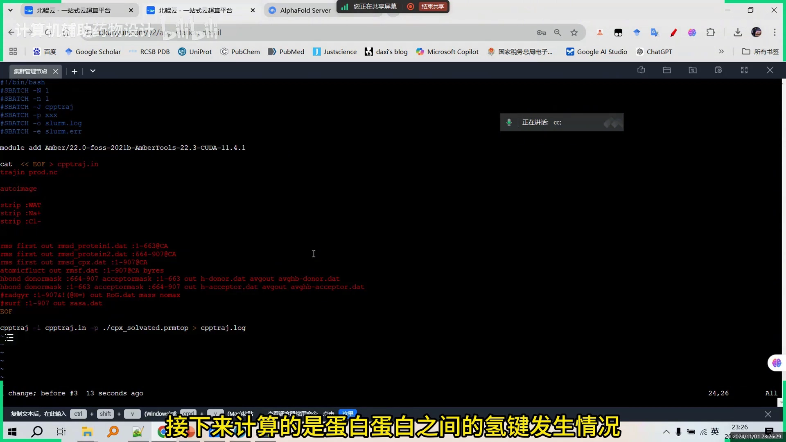

改完 `ESC`、`:wq` 保存退出，`sbatch` 提交分析脚本，后台大约三到五分钟算完。

> RMSD（均方根偏差）：衡量模拟过程中结构偏离初始构象的程度，是判断体系是否稳定的最常用指标。

## 七、结合能计算：MMPBSA 能量分解

除了构象稳定性，视频还演示了**结合能**的计算，用 `submit_mmpbsa.sbash` 脚本（基于 MM/GB 模型做能量分解）。编辑前要先弄清"**10 纳秒里有多少个构象（帧）**"：

- mdp 文件显示：总步数约 **250 万步**，每 **2500 步输出一帧**；
- 250 万 ÷ 2500 = **1000 帧**，对应 10 纳秒——即 **100 帧代表 1 纳秒**。

[【跳转到 19:34】](https://www.bilibili.com/video/BV11FDnYwE3u/?t=1174)

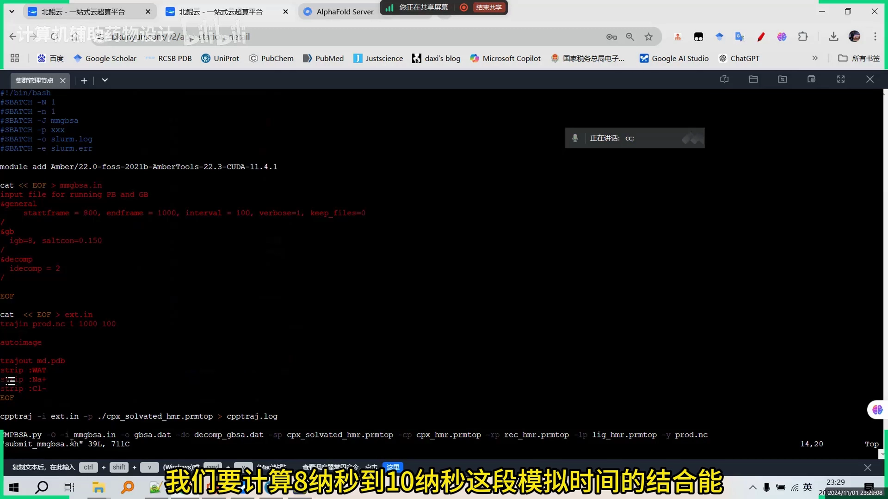

想算**第 8 到第 10 纳秒**这段平衡期的结合能：把帧间隔设为 100，脚本就会分别计算第 8、第 9、第 10 纳秒三帧的能量，然后用 **GB 模型**做能量分解。轨迹读取方面，脚本会读第一帧和最后一帧、每间隔 100 帧取一次构象，输出十个构象，分别代表 1 到 10 纳秒的构象变化——这样就能看到复合物随模拟时间怎么"动"。

最后 `ESC`、`:wq`，`sbatch` 提交 MMPBSA 计算，同样三到五分钟出结果。本讲结束时，上一个分析脚本已经算完，**下一讲继续作图与结果解读**。

## 小结

- 多链输入约定：**不同序列各占一个实体；相同序列只填一次，用 copies 标注拷贝数**（抗原二聚体 → copies=2）。
- 预测结果用 PyMOL **按链着色**核对：抗体两链 + 抗原两条相同拷贝，一共有四条链。
- 动力学前先**拆分导出**：P1（抗体）、P2（抗原二聚体）。
- MD 体系搭建三步：**加氢 → 溶于水盒子 → 加盐离子**，产出 `complex.pdb`。
- **步数 × 步长 = 模拟时长**；想跑 100 纳秒就把步数加一个零。
- 分析前先定**氨基酸编号边界**（1–663 抗体 / 664–907 抗原），再算 RMSD、氢键、回旋半径等。
- 结合能用 MMPBSA（GB 模型）分解；**帧数 = 总步数 ÷ 每帧步数**，本例 100 帧 = 1 纳秒。

## 关键术语速查

| 术语 | 一句话解释 |
| --- | --- |
| entity（实体） | AlphaFold 输入里的一条序列单位，每条链对应一个 |
| copies（拷贝数） | 同一序列在复合物中出现的份数，二聚体填 2 |
| PyMOL | 分子三维结构可视化软件，可按链着色、提取子结构 |
| MD（分子动力学） | 用物理力场模拟分子随时间运动的方法 |
| 水盒子 / 盐离子 | 把蛋白泡进水分子盒并加生理浓度离子，模拟真实环境 |
| .xtc 轨迹 | 记录每一帧原子坐标的轨迹文件，体积与模拟时长成正比 |
| mdp 参数文件 | 记录步数、步长、温度等模拟参数，步数 × 步长 = 模拟时长 |
| RMSD | 均方根偏差，结构随时间偏离初始构象的程度，越小越稳 |
| 回旋半径（Rg） | 衡量分子整体紧凑程度的指标 |
| 溶剂可及表面积（SASA） | 分子表面能与溶剂接触的面积 |
| MM/GBSA（GB 模型） | 从 MD 轨迹估算结合自由能并做能量分解的方法 |
