# fasta格式：一行 `>名字` 加序列，生信几乎所有模型的标准输入

> 视频来源：[fasta格式](https://www.bilibili.com/video/BV1dA411S73q)（B 站，7 分 46 秒）。本文基于视频演说图文稿整理，文内时间戳可直接跳转原视频对应位置。

## 本讲要解决的核心问题（SCQA）

**背景**：生信处理的对象——DNA、RNA、蛋白质序列——必须先变成计算机能读的文本文件，才能进入比对、注释、建模这些下游流程。

**冲突**：这些序列来自不同数据库、由不同工具产出，如果每个软件都有一套自己的存法，数据就没法互相流通；初学者也常常被 `.fasta`、`.fa`、`.fa.gz` 这些后缀，以及头行里一长串注释搞得晕头转向。

**疑问**：有没有一种足够简单、所有工具都认识的统一序列格式？

**回答（中心思想）**：有，就是 **FASTA 格式**。它只用「一行以 `>` 开头的头行 + 从下一行开始到文件结尾的序列」这两段，就完整定义了一条序列；一个文件里还能放下任意多条这样的记录。掌握了这个两段式结构，你就掌握了生信几乎所有工具与序列模型的基础输入。

## 一、FASTA 是什么：生信界的标准文本格式

FASTA 是一种表示**核苷酸**（DNA/RNA）或**氨基酸**（蛋白质）序列的格式，也是生物信息学里的**标准格式**——见到这类后缀的文件，它没有别的含义，装的就是 FASTA 序列。[【跳转到 00:00】](https://www.bilibili.com/video/BV1dA411S73q/?t=0)

它的后缀是一个小家族，常见的有三种：

| 后缀 | 含义 |
| --- | --- |
| `.fasta` | 标准后缀 |
| `.fa` | 同样表示 FASTA 的简写 |
| `.fa.gz` | FASTA 文件再经 gzip 压缩 |

`.gz` 可以理解为序列文件界的 zip：只是给文件做了压缩，内容不变，解压后就是普通 FASTA——`.fa` 说明它是 FASTA，`.gz` 说明它是用 gzip 压过的。[【跳转到 00:25】](https://www.bilibili.com/video/BV1dA411S73q/?t=25)

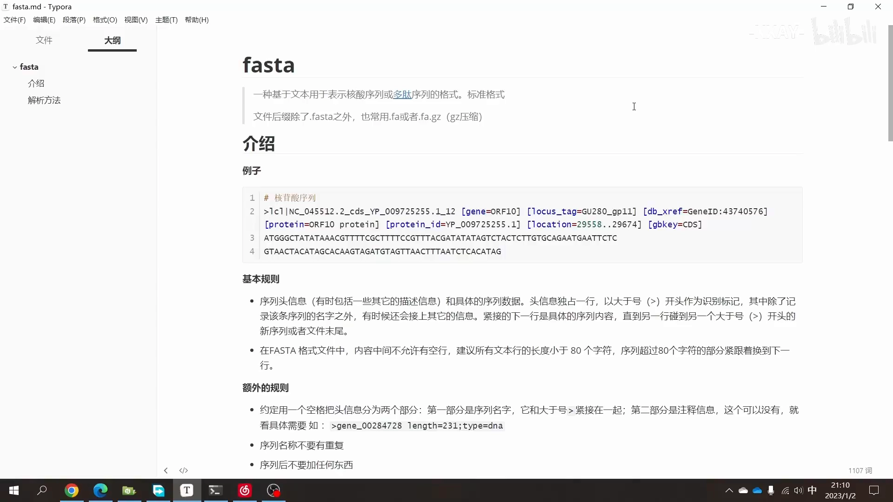

## 二、一条 FASTA 记录 = 头行 + 序列，两段式

视频里用一条**已经注释好的新冠序列**做例子，拆解 FASTA 的样子。一条 FASTA 记录只有两段：头行和序列区。[【跳转到 00:50】](https://www.bilibili.com/video/BV1dA411S73q/?t=50)

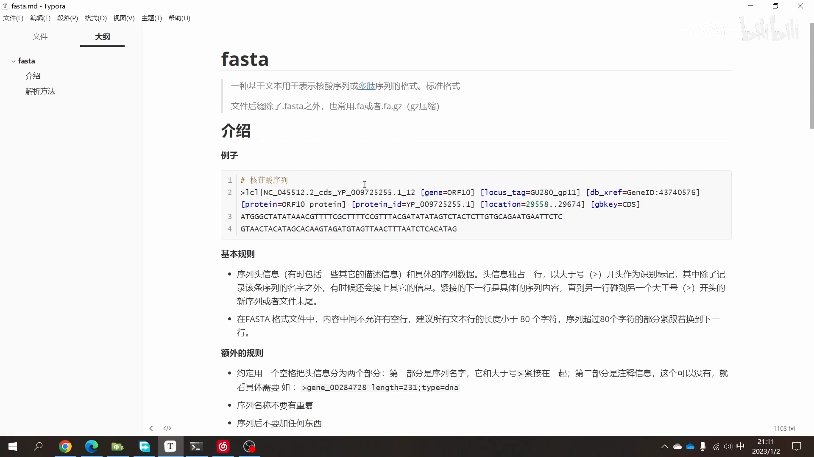

### 2.1 头行：`>` 开头、独占一行

- 头行**独占一行**，以大于号 `>` 开头；[【跳转到 01:40】](https://www.bilibili.com/video/BV1dA411S73q/?t=100)
- `>` 后面首先是这条序列的**名称**，名称之后用一个**空格**隔开，再往后全部是这条序列的**注释信息**——比如它来自哪个基因、类型是什么（比如 CDS 编码区）等；[【跳转到 01:15】](https://www.bilibili.com/video/BV1dA411S73q/?t=75)
- 除了标记序列名字之外接上的这些信息，就是刚才说的注释部分。

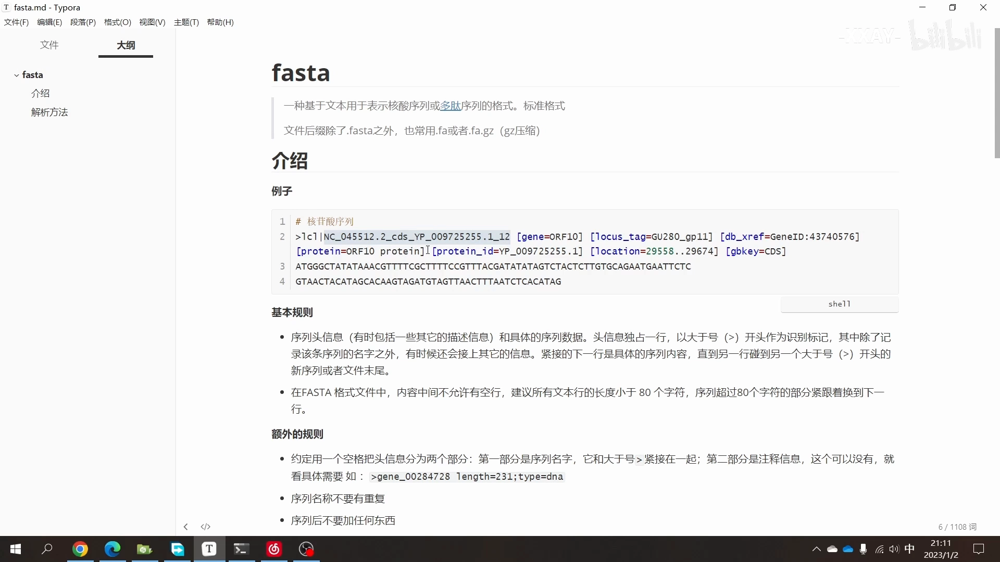

### 2.2 序列区：从头行的下一行到文件结尾

头行**换行之后**，从下一行开始一直到文件结尾，全部都是这条序列本身的内容，中间不再混入别的信息。[【跳转到 02:05】](https://www.bilibili.com/video/BV1dA411S73q/?t=125)

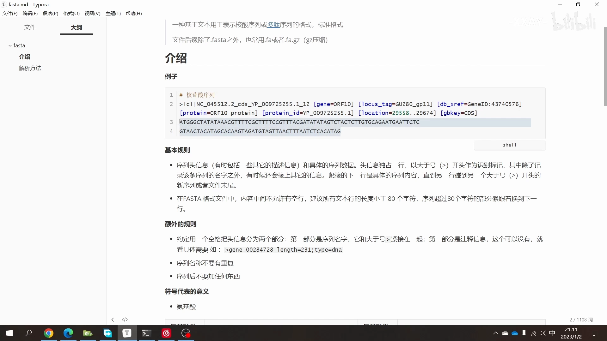

## 三、两条硬规则与一条建议

FASTA 本体的规则很少，核心是「两条硬规则 + 一条建议」：

1. **中间不允许有空行**：不管在记录中间哪里空一行，都不允许；[【跳转到 02:30】](https://www.bilibili.com/video/BV1dA411S73q/?t=150)
2. **行长建议 < 80 字符**：这是建议而非强制，视频里的示例一行 70 个字符，没有超；[【跳转到 02:55】](https://www.bilibili.com/video/BV1dA411S73q/?t=175)
3. 头行以 `>` 开头、序列从头行的下一行开始（见第二节）。

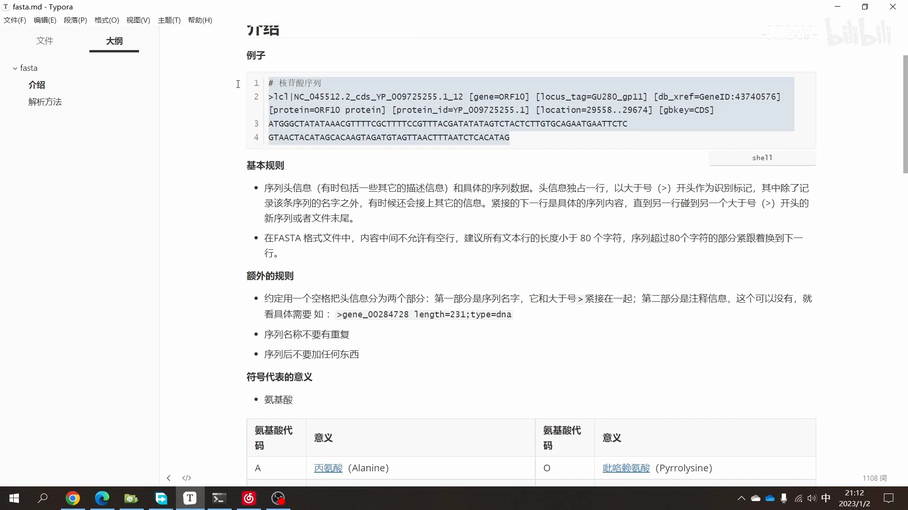

## 四、约定俗成的细节：格式没写死的部分

这个格式刚定义的时候定义得比较草率，边边角角的东西没有都定上，所以后来形成了一批**约定俗成**的规则，主要集中在头行：[【跳转到 02:55】](https://www.bilibili.com/video/BV1dA411S73q/?t=175)

### 4.1 名称段：规定死、不能重复

- 从 `>` 之后到**空格之前**的这一段，一定是这条序列的**名称**——这是规定死的；[【跳转到 03:45】](https://www.bilibili.com/video/BV1dA411S73q/?t=225)
- 正因为它是序列名称，所以**名称不能重复**：同一个文件里的两条记录不能重名。

### 4.2 注释段：写什么都行

- 空格之后全是注释信息，**你写什么都行**；
- 视频示例里用**中括号**来分割字段，但你用顿号、分号、怎么分割都可以——格式对注释段没有具体明确的要求。[【跳转到 03:20】](https://www.bilibili.com/video/BV1dA411S73q/?t=200)

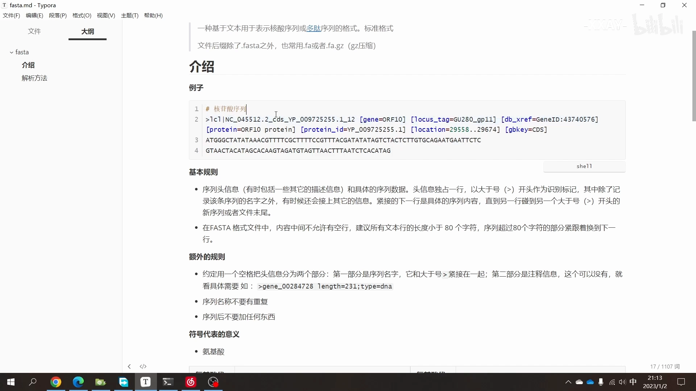

### 4.3 序列后别加多余符号：`*` 可有可无，最好不加

你经常会看到有些序列的末尾带一个星号 `*`，代表这条序列到此结束。为什么有人加呢？如果加了，提取序列的时候用正则去匹配会更简单一点——这是这么用的理由。但实际**加不加都行**：这个星号并没有什么用，反正到文件结尾序列自然就结束了。**最好就是不要加**，干干净净地只放序列。[【跳转到 04:10】](https://www.bilibili.com/video/BV1dA411S73q/?t=250)

## 五、序列里的字母：单字母代码与特殊符号

序列内容用的是**单字母代码**：[【跳转到 04:35】](https://www.bilibili.com/video/BV1dA411S73q/?t=275)

- **氨基酸**：20 种常见残基各对应一个字母（大家都背过的那些）；
- **核苷酸**：A/T/G/C 等常见碱基字母；
- 要注意：像 **D、H 这些属于简并码**——表示这个位置具体是哪种碱基**并不确定**，是"可能是其中几种之一"的编码含义。

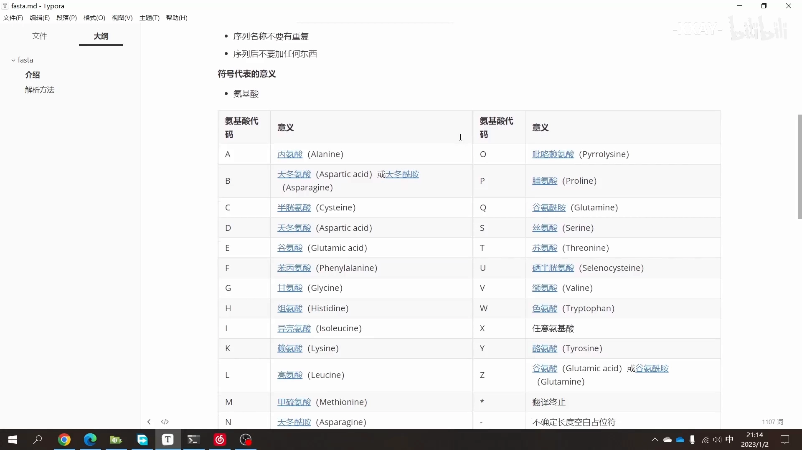

还有两个特殊符号：[【跳转到 05:00】](https://www.bilibili.com/video/BV1dA411S73q/?t=300)

| 符号 | 含义 |
| --- | --- |
| `*` | 翻译终止（可以不加，见 4.3） |
| `-` | 空位（gap）：中间缺了一段时用来占位 |

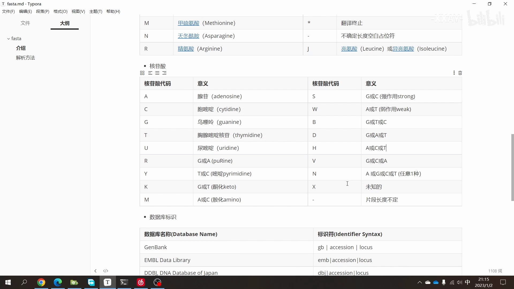

头行注释里还可能出现**数据库的标识**，比如示例里的 `lcl`，代表的就是数据库——告诉你这条数据是来自哪个数据库的。视频最后还给出了一张常见标识的对照表格，可以截图备查。[【跳转到 05:25】](https://www.bilibili.com/video/BV1dA411S73q/?t=325)

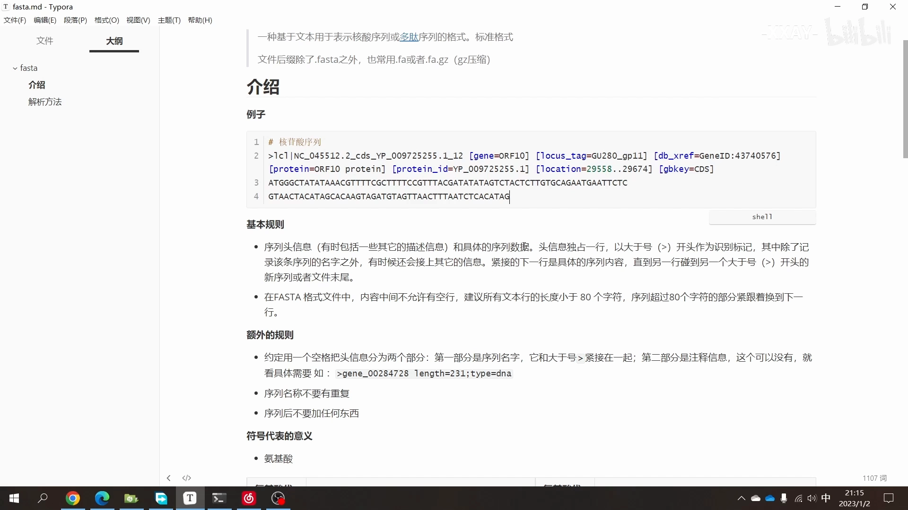

## 六、从文件到程序：把 FASTA 解析成字典

FASTA 是个比较简单的格式。工具和模型真正使用它之前，常见的做法是把文件**解析成字典**：key 是序列 id，value 是序列内容。视频演示了一段手写的示例函数：[【跳转到 05:50】](https://www.bilibili.com/video/BV1dA411S73q/?t=350)

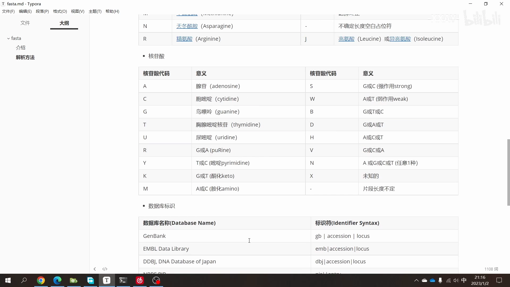

1. 函数按「`>` 头行开新记录」的规则读入 FASTA 文件，返回一个字典；
2. 示例用的数据来自 NCBI，文件里大约有**十条序列**；[【跳转到 06:11】](https://www.bilibili.com/video/BV1dA411S73q/?t=371)
3. 加载数据和函数之后，用一个 `for` 循环遍历：[【跳转到 06:36】](https://www.bilibili.com/video/BV1dA411S73q/?t=396)
4. 因为返回的是字典，可以直接按字典方式提取——先打印 **key（也就是这条序列的 id）**，再打印 **value**；序列很长，示例里只打印了**前十个字母**。[【跳转到 07:01】](https://www.bilibili.com/video/BV1dA411S73q/?t=421)

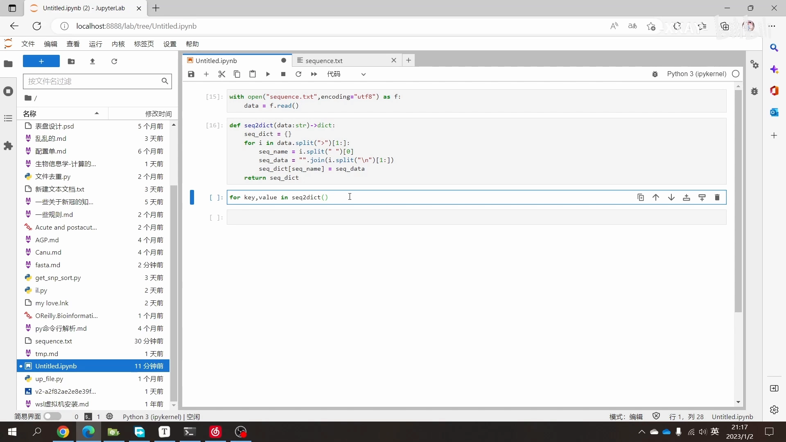

这样一条记录就被拆成了「id + 序列」两个干净的字段——而下游工具与序列模型真正"吃到"的，正是拆出来的一串纯序列文本。[【跳转到 07:26】](https://www.bilibili.com/video/BV1dA411S73q/?t=446)

## 小结

- FASTA 是生信的**标准序列格式**，表示核苷酸或氨基酸序列；后缀 `.fasta` / `.fa` / `.fa.gz`（gzip 压缩，内容不变）。
- 一条记录两段式：**头行**（`>` 开头、独占一行 = 名称 + 空格 + 注释）+ **序列区**（头行下一行到文件结尾）。
- 硬规则：记录中间**不允许空行**；建议**每行 < 80 字符**。
- 约定俗成：`>` 到空格前是**名称且不能重复**；空格后的**注释随便写**；序列末尾的 `*` **最好不加**。
- 字母表：氨基酸/核苷酸单字母代码；**D、H 等是简并码**（该位置碱基不确定）；`*` 翻译终止、`-` 空位占位。
- 头行注释可含**数据库标识**（如 `lcl`），说明序列来源。
- 使用前的标准动作：把 FASTA **解析成字典** `{id: 序列}`，下游拿到的就是纯序列文本——这也是它作为"几乎所有模型的基础输入"的原因。

## 关键术语速查

| 术语 | 一句话解释 |
| --- | --- |
| FASTA | 用「`>` 头行 + 序列」两段式存核苷酸/氨基酸序列的文本格式 |
| 头行 | `>` 开头独占一行：序列名称（规定死、不重复）+ 空格 + 注释（随意写） |
| `.fa.gz` | 经 gzip 压缩的 FASTA 文件，解压后与 `.fa` 内容相同 |
| 简并码 | D、H 等字母，表示该位置的碱基不确定，是某几种可能之一 |
| `*` / `-` | 翻译终止符 / 空位（gap）占位符 |
| lcl | 头行注释中的数据库标识，说明这条序列来自哪个数据库 |
