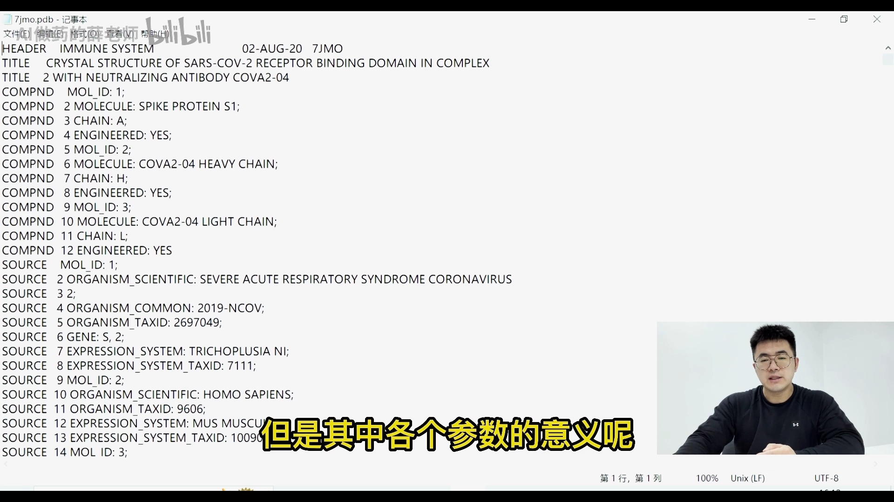
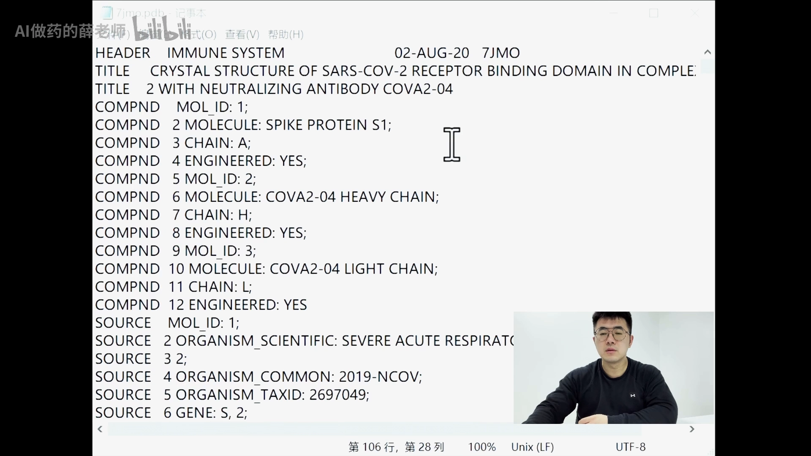
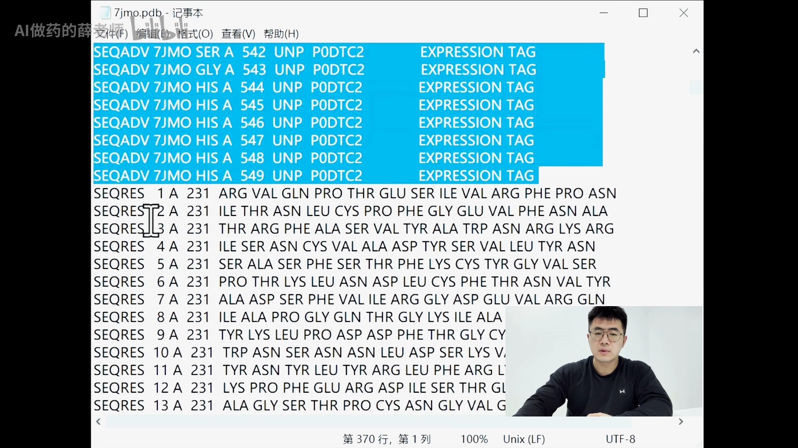
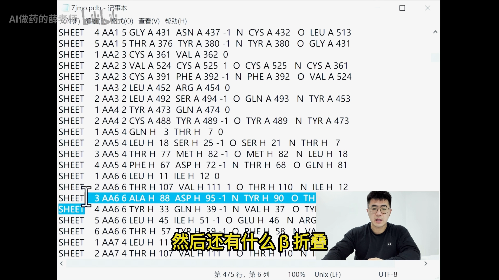
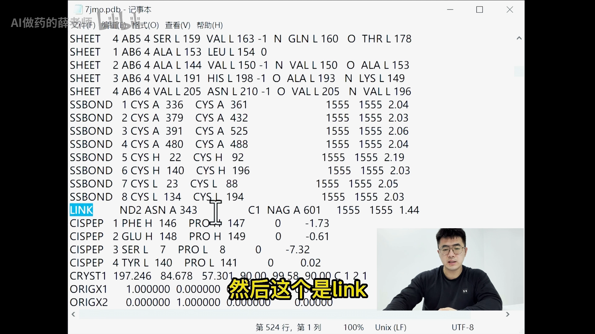
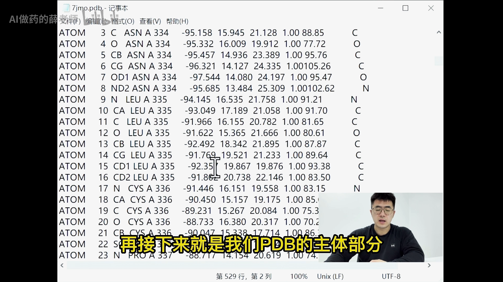
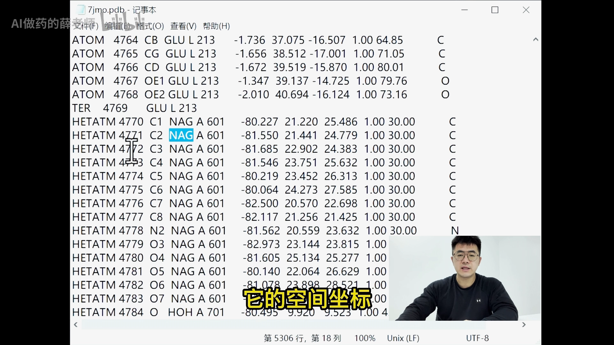
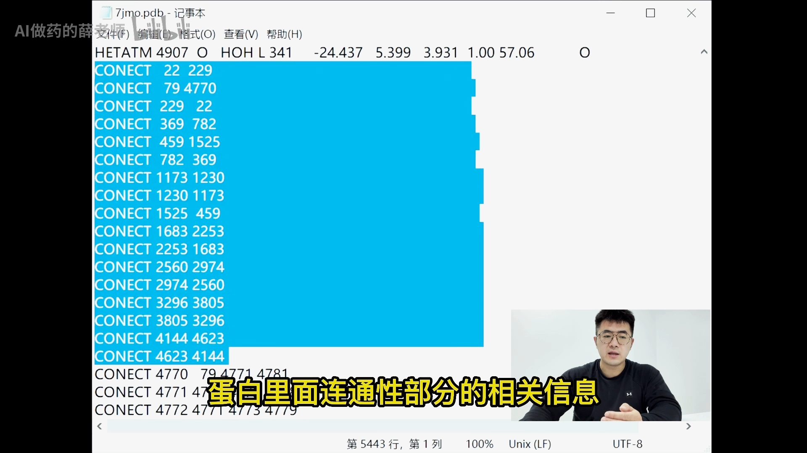

# 如何快速读懂蛋白PDB文件

> 本篇是「2.2.1 PDB：逐原子文本格式（老标准）」条目的**快速通读篇**：不逐列抠字段定义，而是从文件顶部一路划到底部，把一份 PDB 文件按四大块走一遍——适合第一次打开 PDB 文件的你。视频原题《如何快速读懂蛋白PDB文件》。想系统了解每类记录的逐列定义，见姊妹篇 [蛋白质结构文件PDB解读](蛋白质结构文件PDB解读.md)。

## 本篇要解决的核心问题（SCQA）

**背景**：之前的视频教会了大家如何获取蛋白的初始结构——文件也下载好了。

**冲突**：打开一看，满屏都是看不懂的文本，跟天书一样，不少同学立马关掉页面、合上电脑继续摆烂。其实 PDB 文件对做模拟和计算的人来说确实很熟悉，但其中**各个参数的意义**很多人也不了解——所以完全不必从心理上畏惧它。

**疑问**：怎么从头到尾快速读懂一份 PDB 文件？

**回答（中心思想）**：按四大部分通读即可——**标题部分**（这是什么蛋白）→ **结构信息部分**（氨基酸组成与空间结构）→ **坐标部分**（文件主体，每个原子的空间直角坐标）→ **其他部分**（不是每个文件都有）。视频末尾还附了一份详细的攻克指南，可以 copy 下来反复对照。

## 一、四段式结构：先建立整体地图

[【跳转到 01:02】](https://www.bilibili.com/video/BV1ye4y1x7LR/?t=62)

视频以一个随手下载的蛋白为例，从文件顶部划到底部。先把这张地图记在心里，再逐块填充细节：

1. **标题部分**：对这个蛋白的解释性说明；
2. **结构信息部分**：具体的氨基酸组成和空间结构信息；
3. **坐标部分**：PDB 文件的**主体**；
4. **其他部分**：不是每个文件中都会出现。

[【跳转到 00:37】](https://www.bilibili.com/video/BV1ye4y1x7LR/?t=37)

## 二、标题部分：读出「这是什么蛋白」

[【跳转到 01:41】](https://www.bilibili.com/video/BV1ye4y1x7LR/?t=101)

- **头部（HEADER）**：这份 PDB 文件的**公布日期**与 **id 号**；实验方法类型（如 X 射线衍射）；
- **compound**：化合物名称、**分子组成**以及化合物的**来源**（物种）；
- 再往下是**关键词**、结构获取方法、**结构测定者**、修订日期与相关内容；

[【跳转到 02:08】](https://www.bilibili.com/video/BV1ye4y1x7LR/?t=128)

- 接下来是**文献记录（JRNL）**：发表该结构的相关文献。

[【跳转到 02:26】](https://www.bilibili.com/video/BV1ye4y1x7LR/?t=146)

## 三、结构信息部分：从上到下认识各类记录

### 3.1 REMARK：备注与统计数据

[【跳转到 02:31】](https://www.bilibili.com/video/BV1ye4y1x7LR/?t=151)

`REMARK` 在文件里数量很多，主要用来**记录结构优化的方法和相关统计数据**（也就是解析质量一类的信息）。

[【跳转到 02:43】](https://www.bilibili.com/video/BV1ye4y1x7LR/?t=163)

### 3.2 从 DBREF 到 SEQRES：序列信息

[【跳转到 03:06】](https://www.bilibili.com/video/BV1ye4y1x7LR/?t=186)

- **DBREF**：通常可以理解为**序列库的有关记录**（这份蛋白的序列与数据库条目的对应）；
- 再接下来是与其他记录**有出入的地方**——与序列库存在差异的残基（SEQADV 类差异记录）也在这里体现；
- **SEQRES**：比较重要——**氨基酸残基的序列**。

[【跳转到 03:23】](https://www.bilibili.com/video/BV1ye4y1x7LR/?t=203)

### 3.3 非标准残基与二级结构

[【跳转到 03:28】](https://www.bilibili.com/video/BV1ye4y1x7LR/?t=208)

- **HET**：**非标准氨基酸残基**的信息；
- **HELIX / SHEET**：蛋白的**二级结构**——α 螺旋、β 折叠。

[【跳转到 03:38】](https://www.bilibili.com/video/BV1ye4y1x7LR/?t=218)

### 3.4 化学键与晶体学参数

[【跳转到 03:44】](https://www.bilibili.com/video/BV1ye4y1x7LR/?t=224)

- **SSBOND**：**二硫键**相关的信息；
- **LINK**：残基间的一些**化学键**信息；
- 还有**顺式肽键（CISPEP）**等记录；
- **CRYST1**：**晶胞参数**；此外还有**直角坐标**与**部分结晶学坐标（分数坐标）**的记录。

[【跳转到 03:57】](https://www.bilibili.com/video/BV1ye4y1x7LR/?t=237)

## 四、坐标部分：文件的主体

[【跳转到 04:18】](https://www.bilibili.com/video/BV1ye4y1x7LR/?t=258)

- **ATOM**：PDB 的主体部分——**每个原子都对应一个空间直角坐标**，这是很庞大的数据；

[【跳转到 04:23】](https://www.bilibili.com/video/BV1ye4y1x7LR/?t=263)

- **HETATM**：蛋白上结合的**小分子配体**，它的空间坐标也在这里体现；
- 再往后还能找到**水分子（HOH）**。

[【跳转到 04:48】](https://www.bilibili.com/video/BV1ye4y1x7LR/?t=288)

## 五、其他部分：CONECT 与文件尾

[【跳转到 05:06】](https://www.bilibili.com/video/BV1ye4y1x7LR/?t=306)

- **CONECT**：蛋白里面**连通性**部分的相关信息（哪个原子与哪个原子相连）；
- 最后是**版权拥有者**等文件尾信息——到这里已经到底部了。

[【跳转到 05:11】](https://www.bilibili.com/video/BV1ye4y1x7LR/?t=311)

一份 PDB 文件大致就分为这几个部分，其实并不难。

## 小结

- PDB 文件没那么可怕：按**标题 → 结构信息 → 坐标 → 其他**四块通读即可；
- **标题部分**回答「这是什么蛋白、来源是什么、谁测的、怎么测的、发在哪篇文献」；
- **结构信息部分**是各类记录的清单：REMARK（优化方法与统计数据）、DBREF/SEQRES（序列）、HET（非标准残基）、HELIX/SHEET（二级结构）、SSBOND/LINK/CISPEP（化学键）、CRYST1（晶胞参数）；
- **坐标部分**是主体：每个原子一行空间直角坐标，包括蛋白原子（ATOM）、小分子配体与水分子（HETATM）；
- **其他部分**收尾：CONECT 连接信息与版权信息；
- 想逐列抠字段定义（列号、数据类型、mandatory/optional），继续读系统篇 [蛋白质结构文件PDB解读](蛋白质结构文件PDB解读.md)。

## 关键术语速查

| 术语 | 一句话解释 |
| --- | --- |
| HEADER | 文件头：公布日期、id 号、分类、实验方法 |
| REMARK | 备注：结构优化的方法与相关统计数据 |
| DBREF / SEQADV / SEQRES | 序列库对应记录 / 与序列库的差异记录 / 氨基酸残基序列 |
| HET | 非标准氨基酸残基（不属于 20 种标准氨基酸的基团） |
| HELIX / SHEET | α 螺旋 / β 折叠的区间记录 |
| SSBOND / LINK / CISPEP | 二硫键 / 残基间化学键 / 顺式肽键 |
| CRYST1 | 晶胞参数（晶体学信息） |
| ATOM / HETATM | 标准残基原子 / 小分子配体、水等非标准残基原子的坐标 |
| HOH | 水分子（以 HETATM 形式记录） |
| CONECT | 原子间连通（连接关系）记录 |
