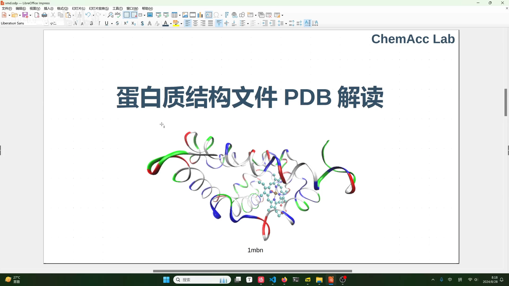
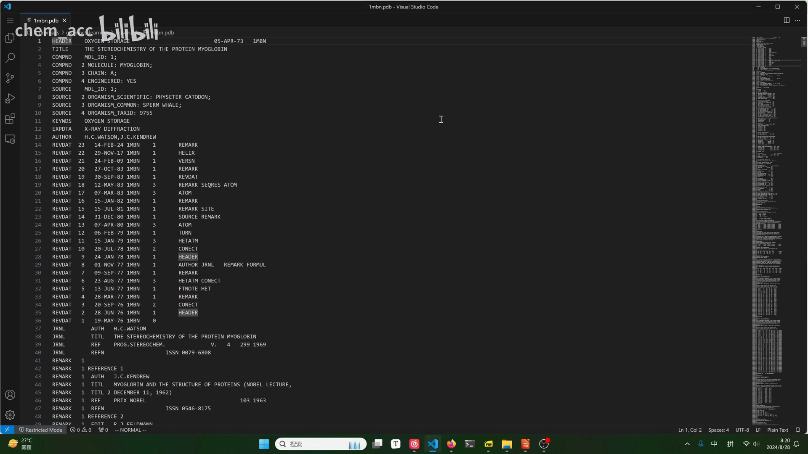
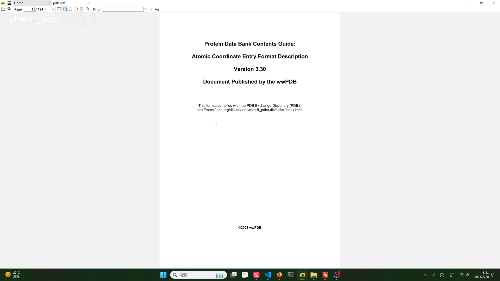
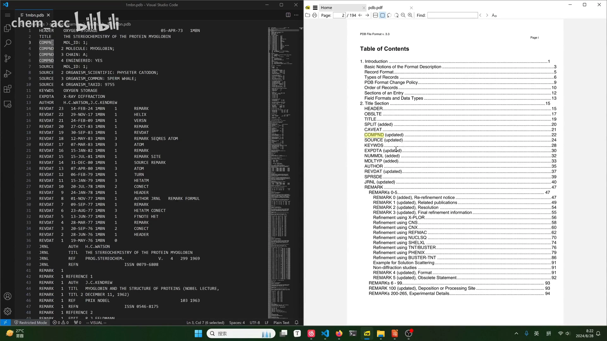
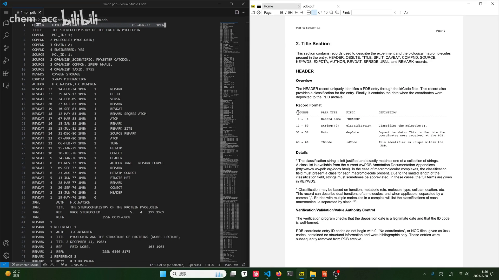
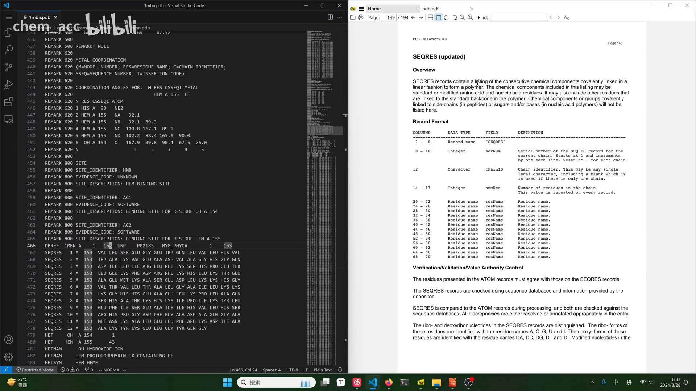
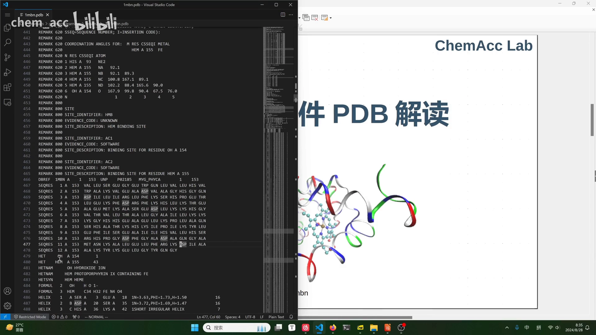
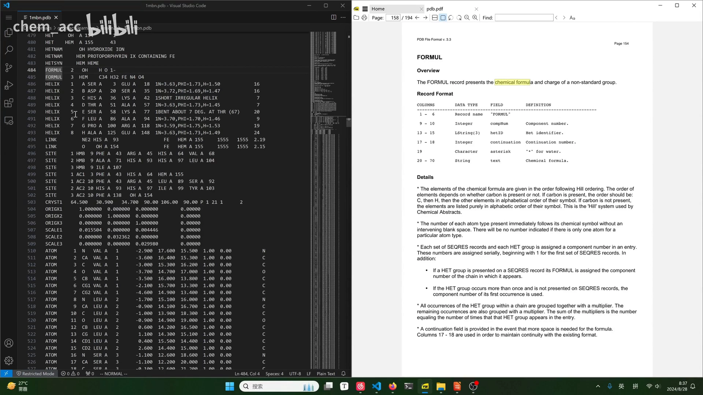
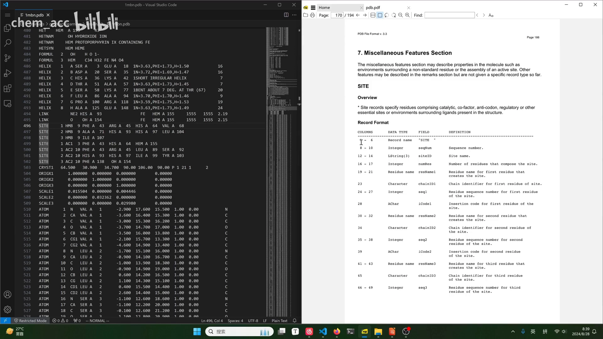

# 蛋白质结构文件PDB解读

> 本篇是「2.2.1 PDB：逐原子文本格式（老标准）」条目的**系统讲解篇**：以肌红蛋白 1MBN 为例，从格式规范、结构信息到原子坐标，逐类记录讲清 PDB 文件的读法。视频原题《蛋白质结构文件PDB解读》。若只想快速通读一遍文件，可先看姊妹篇 [如何快速读懂蛋白PDB文件](如何快速读懂蛋白PDB文件.md)。

## 本讲要解决的核心问题（SCQA）

**背景**：做结构预测或分子模拟，输入往往就是一个 PDB 文件——从 RCSB 蛋白质结构数据库下载的、可以用记事本直接打开的纯文本。

**冲突**：打开文件，扑面而来的是上万行「天书」一样的字符：不知道每行是什么、字段怎么分列，更不知道去哪里查定义。

**疑问**：有没有一套统一的读法，让任何一份 PDB 文件都能逐行读懂？

**回答（中心思想）**：有——PDB 格式每一行都以**行首 6 列的关键字（record name）**开头，整份文件按「**标题区 → 结构信息区 → 原子坐标区**」组织；拿着 wwPDB 官方格式规范（视频所示为 v3.20），按关键字查对应的 record format，就能逐列解读任何一行。视频以肌红蛋白 **1MBN**（153 个残基、含血红素 HEM）为例走完了整个流程。

## 一、PDB 文件从哪里来：RCSB 下载与格式选择

[【跳转到 00:00】](https://www.bilibili.com/video/BV1XGsKexEuc/?t=0)

到 RCSB（rcsb.org）搜索 `1MBN`，能下载多种格式：

- **mmCIF（PDBx）**：比较新的数据格式；
- **PDB**：更老，但**更广泛、更流行**的经典格式——本篇解读的就是它。

[【跳转到 00:59】](https://www.bilibili.com/video/BV1XGsKexEuc/?t=59)

下载得到的是一个**纯文本文件**，用记事本或 VSCode 都能直接打开。

[【跳转到 01:23】](https://www.bilibili.com/video/BV1XGsKexEuc/?t=83)

## 二、读懂 PDB 的总钥匙：行首关键字 + 官方格式规范

### 2.1 每一行开头都是关键字

PDB 文件每一行的开头都有一个**关键字（record name）**，比如 `HEADER`、`TITLE`、`ATOM`。想知道某一行的确切含义，就去查 wwPDB 的**格式规范文档**（v3.20）：每个关键字出现在哪些列、每列是什么含义，都在那里逐列写明。

### 2.2 在官方文档中查 record format

[【跳转到 02:39】](https://www.bilibili.com/video/BV1XGsKexEuc/?t=159)

规范文档的目录与文件里的关键字一一对应：`HEADER`、`TITLE` 归入 title 部分，序列相关记录归入 primary structure 部分……顺着目录就能找到某个关键字的说明页。

[【跳转到 03:32】](https://www.bilibili.com/video/BV1XGsKexEuc/?t=212)

总表里对每个关键字给出两类信息：

- **可能出现的字段全集**：比如 `REMARK` 这类编号式记录，编号从 0 开始，一般可以到 999；
- **mandatory / optional**：`HEADER`、`TITLE` 是**强制性**记录——PDB 文件里必须得有，否则文件无效；有些记录是可选的，并有备注说明什么情况下需要。

[【跳转到 04:47】](https://www.bilibili.com/video/BV1XGsKexEuc/?t=287)

### 2.3 关键字按内容分区

视频把常见关键字按内容归区，读文件时先判断「这一行属于哪个区」，再进对应章节查细节：

| 分区 | 内容 | 代表记录 |
| --- | --- | --- |
| 标题部分 | 描述性、备注性信息 | HEADER / TITLE / REMARK |
| 一级结构 | 序列及其与数据库的对应 | DBREF / SEQRES |
| 非标准残基 | 非标准基团及其命名、分子式 | HET / HETNAM / FORMUL |
| 二级结构 | α 螺旋、β 折叠区间 | HELIX / SHEET |
| 连接信息 | 残基间化学键 | SSBOND / LINK |
| 特征信息 | 活性位点等 | SITE |
| 晶体与坐标 | 晶胞参数、逐原子坐标 | CRYST1 / ATOM / HETATM |

## 三、HEADER：文件头逐列解读

### 3.1 HEADER 的逐列定义

[【跳转到 06:27】](https://www.bilibili.com/video/BV1XGsKexEuc/?t=387)

以 `HEADER` 为例（列号从 1 开始数）：

| 列号 | 数据类型 | 字段 | 含义 |
| --- | --- | --- | --- |
| 1–6 | string | record name | 固定为 `HEADER` |
| 11–50 | string（最长 40） | classification | 分子的分类，如 `OXYGEN STORAGE`（贮氧蛋白，类似血红蛋白） |
| 51–59 | date | depDate | 首次收录进 PDB 数据库的日期 |
| 63–66 | idCode | idCode | 该蛋白在数据库中的唯一 ID（如 `1MBN`） |

[【跳转到 07:42】](https://www.bilibili.com/video/BV1XGsKexEuc/?t=462)

### 3.2 可复用的数据类型约定

[【跳转到 09:22】](https://www.bilibili.com/video/BV1XGsKexEuc/?t=562)

规范还定义了一批可复用的数据类型，理解它们就能举一反三读懂任何记录的格式说明：

- **idCode**：只含 4 个字符，第一个是 0–9 的数字，其余是大写字母或数字；视频中提到，若以 `0` 开头，表示该文件不含坐标数据；
- **record name**：最多 6 个字符，按左对齐排列，不足 6 位用空格补齐；
- **EXPDTA**（实验方法记录）再看一个例子：9–10 列是空格（续行位），11–79 列是字符串列表——写明结构是用什么方法测的，如 X 射线衍射。

[【跳转到 11:02】](https://www.bilibili.com/video/BV1XGsKexEuc/?t=662)

到这里，「如何查规范、如何解释一行」的方法就掌握了。

## 四、一级结构信息：DBREF 与 SEQRES

### 4.1 DBREF：序列与数据库的对应

[【跳转到 12:51】](https://www.bilibili.com/video/BV1XGsKexEuc/?t=771)

REMARK 之后遇到 `DBREF`：它记录这份蛋白的序列与**序列数据库**中条目的对应关系。字段里最重要的是：1–6 列固定为记录名、蛋白的唯一 idCode（`1MBN`）、**链 ID**——蛋白可能有多条链，用 A、B、C 表示。

### 4.2 SEQRES：氨基酸序列本身

[【跳转到 14:31】](https://www.bilibili.com/video/BV1XGsKexEuc/?t=871)

`SEQRES` 给出每条链的氨基酸序列。1MBN 的 A 链共 **153 个残基**，按规范每行放一段，共 12 行：

- 1–6 列固定 `SEQRES`；
- 8–10 列 serNum：行号，从第 1 行、第 2 行一直到第 12 行；
- 随后是链 ID（`A`）；
- 14–17 列 numRes：该链残基总数（153）；
- 其余列是我们熟悉的三字母氨基酸名称（如 VAL、LEU）。

[【跳转到 14:56】](https://www.bilibili.com/video/BV1XGsKexEuc/?t=896)

## 五、非标准残基：HET / HETNAM / FORMUL

遇到关键字 `HET`，就进入了**非标准残基**部分——不属于 20 种标准氨基酸的基团。1MBN 的例子里有两个：`OH`（氢氧根离子，1 个原子）和 `HEM`（血红素——含铁的原卟啉，43 个原子）。

[【跳转到 16:14】](https://www.bilibili.com/video/BV1XGsKexEuc/?t=974)

HET 行的要点：

- 1–6 列固定 `HET`；
- hetID：非标准残基的标识（`OH` / `HEM`）；
- 链 ID：仍归入 `A` 链；
- seqNum：在 A 链中的序号（254 / 155）；
- numHetAtoms：该基团包含多少个原子（1 / 43）；
- hetName：从化学角度给 hetID 起的名字——`OH` 即氢氧根离子；`HEM` 即含铁的原卟啉（heme，血红素）。

[【跳转到 17:04】](https://www.bilibili.com/video/BV1XGsKexEuc/?t=1024)

`FORMUL` 记录非标准残基的**化学分子式**：`OH` 就是氢氧根负离子；`HEM` 是 `C34H32FeN4O4`（碳 34、氢 32、铁 1、氮 4、氧 4）。

[【跳转到 17:54】](https://www.bilibili.com/video/BV1XGsKexEuc/?t=1074)

## 六、二级结构与活性位点：HELIX 与 SITE

### 6.1 HELIX / SHEET：二级结构

遇到 `HELIX` 关键字，对应的正是**二级结构信息**（α 螺旋；相应地 `SHEET` 记录 β 折叠），每条记录给出螺旋的起止位置等字段。视频里快速带过，具体字段可回规范查 record format。

[【跳转到 18:19】](https://www.bilibili.com/video/BV1XGsKexEuc/?t=1099)

### 6.2 SITE：活性位点

[【跳转到 19:06】](https://www.bilibili.com/video/BV1XGsKexEuc/?t=1146)

`SITE` 记录蛋白中重要的位点（如与配体结合的活性位点）：

- 1–6 列固定 `SITE`；
- 8–10 列 seqNum：`1 2 3` 说明**这三行记录的是同一个位点**——例子中该蛋白共有 3 个活性位点，各占三行；
- 接着是位点的 id 与残基数目 numRes，然后逐个列出构成位点的**残基名、所属链与链内序号**——既包括标准残基，也包括非标准残基（如 `HEM`）。

[【跳转到 20:26】](https://www.bilibili.com/video/BV1XGsKexEuc/?t=1226)

某个位点在生物学上的具体意义，需要结合相关文献来读。

## 七、原子坐标：ATOM / TER / HETATM / CONECT

### 7.1 CRYST1：晶体信息（可跳过）

进入坐标部分之前还有一段**晶体信息**（`CRYST1`，晶胞参数）。不知道字段含义就回规范文档查；**如果做蛋白质模拟用不到，可以直接不看**。

[【跳转到 21:17】](https://www.bilibili.com/video/BV1XGsKexEuc/?t=1277)

### 7.2 ATOM：标准残基的原子坐标（最核心）

[【跳转到 22:18】](https://www.bilibili.com/video/BV1XGsKexEuc/?t=1338)

坐标区最核心的是两个关键字：**ATOM**（标准残基的原子）与 **HETATM**（非标准残基的原子）。

ATOM 的逐列含义：

| 列号 | 字段 | 含义 |
| --- | --- | --- |
| 1–6 | record name | 固定 `ATOM` |
| 7–11 | serial | 原子序号——整个体系从 1 开始一直连续往下计数 |
| 13–16 | atom name | 原子名。**不一定等于元素符号**，还带特殊标记，如 α 碳写作 `CA` |
| 17 | altLoc | 空格（备选位置标识位） |
| 18–20 | resName | 残基名，该原子属于哪个残基，如 `VAL`（缬氨酸） |
| 22 | chainID | 链 ID，如 `A` |
| 23–26 | resSeq | 残基在链中的序号——同一个残基的所有原子共享同一序号 |
| 31–54 | x, y, z | 三个直角坐标（正交坐标），单位 **Å（埃）** |
| 55–60 | occupancy | 占据率，取值 0~1 |
| 61–66 | tempFactor | 温度因子（B 因子）——衡量该原子在结构解析中的波动/质量信息 |
| 77–78 | element | 元素符号 |
| 79–80 | charge | 原子上标注的电荷（通常为空） |

[【跳转到 23:58】](https://www.bilibili.com/video/BV1XGsKexEuc/?t=1438)

### 7.3 TER 与 HETATM

[【跳转到 24:48】](https://www.bilibili.com/video/BV1XGsKexEuc/?t=1488)

- **TER**：遇到 TER 就表明**一条链结束了**——它之前的 ATOM 都属于同一条链，之后开始的是另一条链；
- **HETATM**：与 ATOM 格式大同小异，记录**非标准残基**的原子，残基名就对应前文 HET 记录里的 `OH`、`HEM`。

[【跳转到 25:38】](https://www.bilibili.com/video/BV1XGsKexEuc/?t=1538)

### 7.4 CONECT：原子间连接

[【跳转到 26:03】](https://www.bilibili.com/video/BV1XGsKexEuc/?t=1563)

`CONECT` 记录**哪个原子与哪个原子相连**（按原子序号相互引用）。至此，从格式规范、结构信息到原子坐标，PDB 文件的主要记录就过了一遍。

## 小结

- PDB 是**逐原子坐标的纯文本老标准**；mmCIF（PDBx）更新，但 PDB 仍最流行；
- 每行开头 1–6 列是**关键字（record name）**，整份文件按「标题区 → 结构信息区 → 原子坐标区」组织；
- 读懂任何记录的通用方法：在 wwPDB 格式规范中查该关键字的 **record format**（mandatory/optional + 逐列定义）；
- `HEADER` 逐列给出分类、收录日期与唯一 idCode；`DBREF`/`SEQRES` 给出序列及其与数据库的对应；
- `HET`/`HETNAM`/`FORMUL` 描述非标准残基（如 `HEM`：分子式 C34H32FeN4O4 的含铁原卟啉）；`HELIX`/`SHEET`/`SITE` 描述二级结构与活性位点；
- 坐标区 `ATOM`/`HETATM` 逐原子给出残基名、链、残基序号、x/y/z（Å）、占据率与温度因子；`TER` 分链，`CONECT` 记录原子间连接。

## 关键术语速查

| 术语 | 一句话解释 |
| --- | --- |
| record name | 每行开头 1–6 列的关键字，决定这一行是什么记录 |
| record format | 官方规范中对每条记录的逐列定义（列号 / 类型 / 含义） |
| mandatory / optional | 强制性记录（如 HEADER、TITLE）/ 可选记录 |
| idCode | 蛋白在 PDB 数据库中的唯一 ID，如 1MBN |
| DBREF / SEQRES | 序列与数据库条目的对应 / 每条链的氨基酸序列（1MBN A 链 153 残基、12 行） |
| HET / HETNAM / FORMUL | 非标准残基的标识、化学名称与化学分子式 |
| HEM | 血红素：含铁原卟啉，C34H32FeN4O4，1MBN 中的非标准残基（43 个原子） |
| HELIX / SHEET | α 螺旋 / β 折叠的区间记录 |
| SITE | 活性位点记录：由若干标准+非标准残基构成，同一位点占多行 |
| ATOM / HETATM | 标准残基 / 非标准残基的逐原子坐标记录 |
| serial / resSeq | 原子序号（全文件连续计数）/ 残基在链内的序号 |
| occupancy / tempFactor | 占据率（0~1）/ 温度因子（B 因子，反映解析中的波动与质量） |
| Å（埃） | 坐标单位，1 Å = 10⁻¹⁰ m |
| TER / CONECT | 一条链结束的标记 / 原子间的连接关系 |
