# 杨建益教授，王文恺研究员：AI 赋能 RNA 结构预测——trRosettaRNA 与 trRosettaRNA2

> 视频来源：[杨建益教授，王文恺研究员-AI赋能RNA结构预测](https://www.bilibili.com/video/BV16u7pz4Eq3/?t=0)（Bilibili · 广州 RNA Club 讲座，时长约 113 分钟）
> 本文基于视频演说图文稿整理，配图截自视频。主讲人：杨建益（山东大学教授，曾连续两届获 CASP 蛋白结构预测第一名）、王文恺（其课题组博士后）。

## 本讲要解决的核心问题（SCQA）

**背景**：AlphaFold 系列把蛋白质结构预测做成了"接近解决"的问题，AlphaFold 更拿下 2024 年诺贝尔化学奖。

**冲突**：同样的 AI 方法搬到 RNA 上精度大幅回落——AlphaFold3 对 RNA 的预测依然不准。根本原因有三个：RNA 实验结构数据极少、RNA 的 MSA（多序列比对）质量差、RNA 结构柔性强。

**疑问**：AI 还能不能把 RNA 三维结构预测做好？路线是什么？

**回答（中心思想）**：能，但要"借力"。核心抓手是把 **L×L 的二维几何信息**——碱基对之间的接触图（contact map）、距离图、配对概率矩阵——作为神经网络可学习的中间表示，并用海量的 RNA **二级结构**数据弥补 3D 结构数据的不足。杨建益组的 trRosettaRNA（两步走版本）与 trRosettaRNA2（端到端版本）沿这条路线，做到了 **CASP16 自动组（server 组）第一、总榜第四，超过 AlphaFold3 server**。

[【跳转到 03:05 看开篇定位】](https://www.bilibili.com/video/BV16u7pz4Eq3/?t=185)

## 一、背景：蛋白质的成功与 RNA 的困境

### 1.1 AI 结构预测的基本配方

杨建益先用蛋白质结构预测作铺垫：AI 解决这个问题，输入是氨基酸序列，输出是三维坐标，中间是神经网络。由于直接从单条序列学太困难，通用做法是先从蛋白质序列数据库、宏基因组数据库中搜索，生成中间变量——**MSA（多序列比对）**；早期还要用 MSA 去 PDB 找同源模板，但现在这一步已无关紧要。 [【跳转到 06:25】](https://www.bilibili.com/video/BV16u7pz4Eq3/?t=385)

### 1.2 两代方法演进：从两步走到端到端

**第一代（两步走，2018 年前）**：神经网络不直接预测三维结构，而是预测**任何两个氨基酸之间的几何信息**——最早是二元（0/1）的接触（contact）预测，得到一张 **L×L 的 0/1 矩阵**（接触图）；后来推广到距离分布（如 RaptorX），杨建益组再把距离推广到朝向（orientation）。不管怎么推广，网络学的都是**二维**几何信息，这降低了学习难度，让 AI 在有限数据与算力下"可学习"。第二步再用能量最小化等传统物理方法，把二维几何限制折叠成三维结构。AlphaFold1 与 RaptorX 都属于这一代。 [【跳转到 06:50】](https://www.bilibili.com/video/BV16u7pz4Eq3/?t=410)

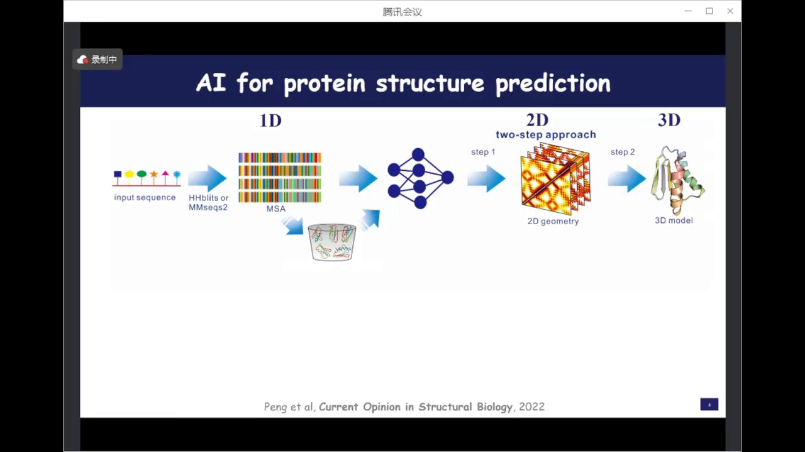

**第二代（端到端）**：直接从 MSA 到三维坐标，代表是 AlphaFold2 与 RoseTTAFold——也就是拿诺贝尔奖的那一代。

**第三代（泛化）**：方法仍是端到端，但预测对象从蛋白质扩展到核酸、小分子、蛋白-小分子与蛋白-蛋白复合物（AlphaFold3、RoseTTAFold-All-Atom）。应用范围更广，但精度提升只是增量性的。对 RNA 而言，AF3 的精度依然非常有限，尤其是对新颖的 RNA。 [【跳转到 10:10】](https://www.bilibili.com/video/BV16u7pz4Eq3/?t=610)

### 1.3 RNA 数据到底有多稀缺

AI 本质是数据驱动，而 PDB 里 92% 以上是蛋白质结构——接近 20 万个可用于训练；RNA 结构**不会超过 1 万个**，其中约 70% 还是蛋白复合物，纯 RNA 只有 2000 多个。再去除冗余（tRNA 长得都差不多，都是 L 形），**非冗余的 RNA 结构只有几百个**。用几百个结构训练深度学习模型，不确定性可想而知。 [【跳转到 14:58】](https://www.bilibili.com/video/BV16u7pz4Eq3/?t=898)

### 1.4 什么样的 RNA 才值得预测

讲座做了一个重要限定：预测对象是**能折叠成稳定三维结构的 RNA**。mRNA 这类编码 RNA 只是蛋白质合成的"中间状态"，整体不稳定；但非编码 RNA（tRNA、rRNA、miRNA、环状 RNA……）往往有稳定结构并以此执行功能——RNAcentral 数据库里已有约 3500 万条序列。人类测出的第一个 RNA 结构就是 L 形的 tRNA；结构决定功能（tRNA 靠特定构象精准识别密码子）。 [【跳转到 11:09】](https://www.bilibili.com/video/BV16u7pz4Eq3/?t=669)

## 二、L×L 矩阵：AI 结构预测的核心中间表示

### 2.1 从接触图到距离图：一张矩阵里的"结构信息"

两步走方法的第一步，本质就是把结构压缩成一张 **L×L 的矩阵**：最早每个格子只有 0/1（两个残基是否接触）；推广后，格子变成两个残基的距离分布、朝向分布。矩阵是"可能性"的载体——它不直接给出坐标，却编码了折叠所需的几何约束。 [【跳转到 06:50】](https://www.bilibili.com/video/BV16u7pz4Eq3/?t=410)

### 2.2 RNAcontact：第一个深度学习 RNA 接触图预测

沿蛋白的路线，杨建益组在 2019 年初开始探索、2020 年发表了 **RNAcontact**——第一个用深度学习预测 RNA 接触图（碱基对之间接触）的方法：序列 → MSA → 简单卷积网络 → L×L 接触图。与当时主流的共进化方法 PLMC 相比，在两个测试集上的 top-L 精度都更好，"很让人振奋"。 [【跳转到 17:36】](https://www.bilibili.com/video/BV16u7pz4Eq3/?t=1056)

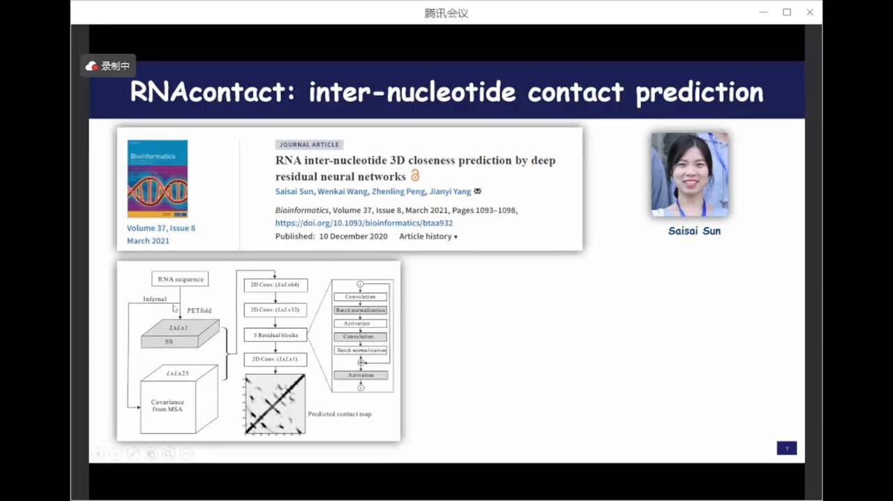

### 2.3 接触图救不了三维结构

但把预测的接触图交给当时的 RNA 三维结构服务器（华中科技大学肖老师团队的 3dRNA）作距离限制，改进有限：三个例子的 RMSD 从 20 多 Å 降到十多 Å、16→13、5.9→4.6——"有一点用，但更多的例子好像没什么用"。更关键的实验是：即使把 **top-L 的真实接触**给出去，三维折叠结果依然不对。这说明 **二维到三维的折叠本身就是难关**——蛋白质"二维好三维就好"，RNA 却是另一个故事。 [【跳转到 19:42】](https://www.bilibili.com/video/BV16u7pz4Eq3/?t=1182)

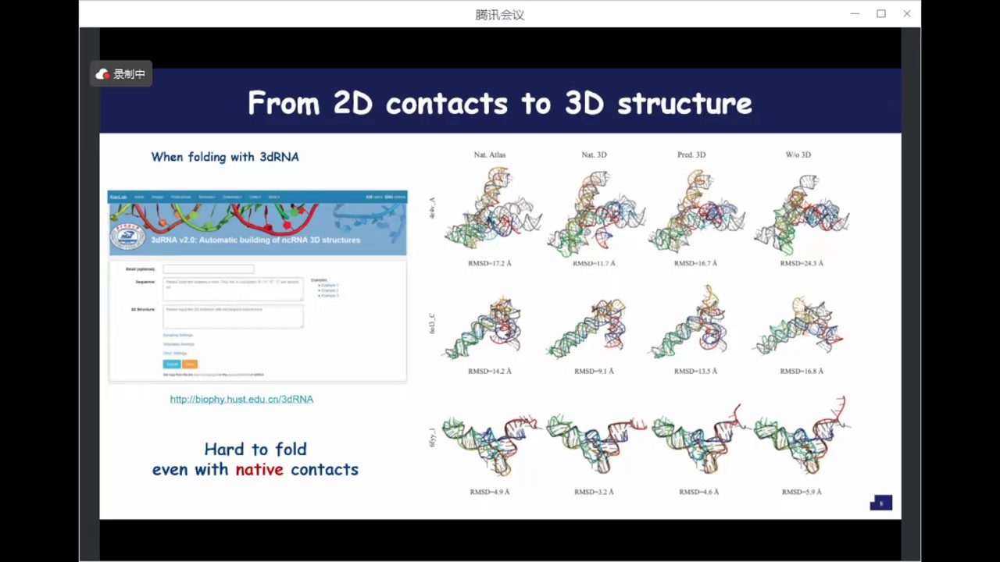

这直接启发了下一代的思路：与其"接触图→三维"两步走，不如让网络输出更丰富的二维几何（距离+朝向），并端到端地联合优化——这就是 trRosettaRNA。

## 三、trRosettaRNA（第一版）：RNA 版的两步走

### 3.1 方法流程：MSA + 二级结构 + Evoformer + Rosetta

trRosettaRNA 的起点是 2022 年 6 月（比它更早的同类工作有张阳组的 DeepFoldRNA，思路类似）。对熟悉 AlphaFold2 的人，流程图一目了然，但有两处 RNA 特有的改造： [【跳转到 23:27】](https://www.bilibili.com/video/BV16u7pz4Eq3/?t=1407)

- **输入侧**：MSA 保留，但额外引入**二级结构**作为输入——用的是周耀旗老师的 SPOT-RNA，从序列直接预测二级结构，给网络补充配对先验。这一步对 RNA 尤其重要，因为 RNA 的 MSA 很难做准：只有四类碱基，比对极易出错。
- **网络侧**：MSA 表征 + pair 表征送入 Evoformer（与 AlphaFold2 的 Evoformer 同类）反复更新。 [【跳转到 24:17】](https://www.bilibili.com/video/BV16u7pz4Eq3/?t=1457)
- **输出侧**：网络只负责输出二维几何——碱基对之间的**距离、朝向**，外加一个一维预测；三维结构交给 **Rosetta 能量最小化**折叠，把二维预测当作 Rosetta 的约束。 [【跳转到 25:07】](https://www.bilibili.com/video/BV16u7pz4Eq3/?t=1507)

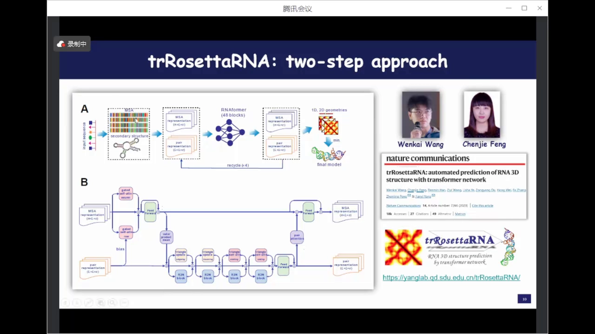

这个" hybrids"设计的好处：一是**训练容易**，不依赖庞大算力；二是**物理合理性强**——Rosetta 能量函数保证不会出现两个核苷酸堆在一起（clash）或链完全断裂的情况。速度上比端到端慢，但比传统 Rosetta 快很多倍。 [【跳转到 25:57】](https://www.bilibili.com/video/BV16u7pz4Eq3/?t=1557)

### 3.2 CASP15：天然 RNA 自动组第二，人工设计 RNA 全军覆没

CASP15（2022 年）首次设立 RNA 结构预测类别：12 个靶标，8 个天然、4 个人工设计。人工设计 RNA 更长（300-700 nt）且全新，数据库里找不到相似序列与结构。结果：天然 RNA 上 trRosettaRNA 按 RMSD 能排到第二（自动组）；4 个人工设计 RNA 上**所有 AI 方法都做得不好**，前几名全是人工组、用传统物理方法。 [【跳转到 28:01】](https://www.bilibili.com/video/BV16u7pz4Eq3/?t=1681)

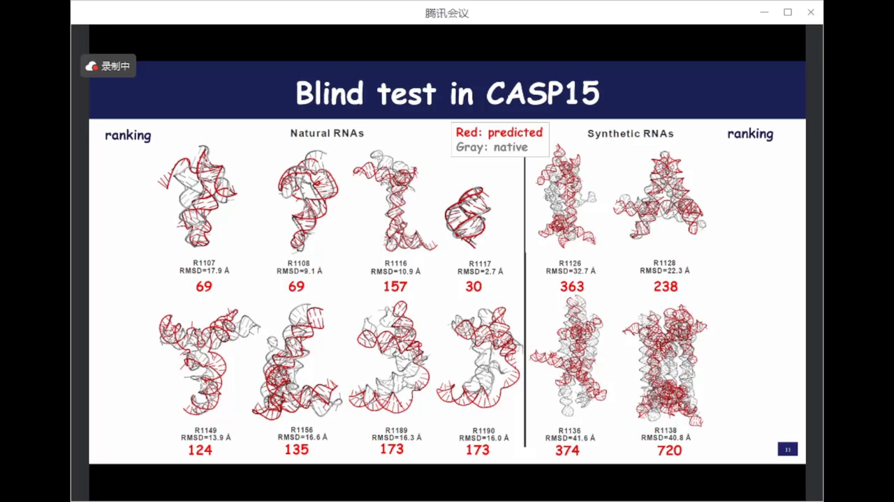

由此还引出一段"公案"：有人据此认为物理方法优于 AI。杨建益的回应是——不是物理方法好，是"人好"：公平对比时，让传统方法自动跑，不见得比 AI 好；到 CASP16 连前几名也都在用 AlphaFold3 等做参考了。

### 3.3 相似度决定成败：一张散点图讲清 AI 的边界

把全部测试 RNA 画成散点：横轴是测试 RNA 与训练集 RNA 的结构相似度（RNA 版 TM-score），纵轴是 RMSD。4 个人工设计 RNA 的 TM-score 接近 0.2（几乎随机），预测最差；能在训练集中找到相似结构的，预测相对靠谱。**序列不相似、结构不相似，就很难做好**——这不是 RNA 独有，全新蛋白（如某些病毒蛋白）同样难倒 AlphaFold2；只是 RNA 训练集更少，更容易"撞上"分布外样本。 [【跳转到 31:52】](https://www.bilibili.com/video/BV16u7pz4Eq3/?t=1912)

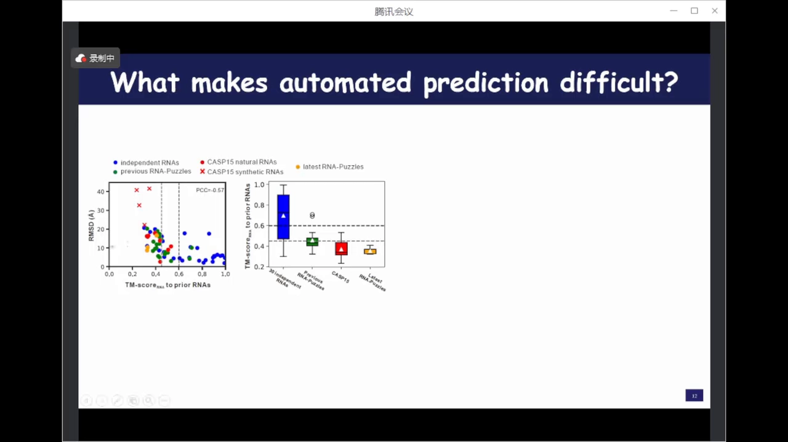

CASP15 前三名都在论文里写明做了人工干预（验证二级结构、查数据库等）。杨建益坦言：他们缺乏 RNA 领域知识，即使把结构都给出来也无法凭经验挑好坏，所以只能做纯自动的方法。 [【跳转到 33:32】](https://www.bilibili.com/video/BV16u7pz4Eq3/?t=2012)

## 四、trRosettaRNA2：端到端 + 全原子 + 二级结构先验

### 4.1 为什么不能照搬蛋白质的"单原子表示"

报告后半段由王文恺介绍第二代。核心观察：**核苷酸远比氨基酸复杂**。氨基酸主链只有 N、Cα、C 三个原子，侧链简单、对主链影响小，可以近似成"一个 Cβ 原子"来表示；核苷酸主链原子多、构象由 5 个扭转角控制，而且**碱基（侧链）配对决定整体拓扑**——所以训练时必须考虑侧链（碱基）信息，不能用单原子近似。 [【跳转到 35:08】](https://www.bilibili.com/video/BV16u7pz4Eq3/?t=2108)

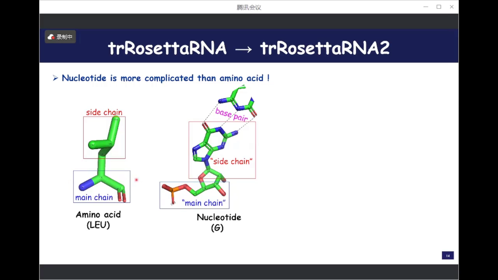

### 4.2 数据策略：用 10 万+ 二级结构弥补 3D 数据

PDB 里 RNA 3D 结构 7000 多（当时），70% 是蛋白复合物，去冗余后所剩无几。但 bpRNA 等数据库里有 **10 万多条 RNA 二级结构**。trRosettaRNA2 的核心设计就是把这些数据"用起来"：设计一个**预训练的二级结构模块**，从 MSA 中提取配对先验知识——这是其他端到端方法没有的。 [【跳转到 36:23】](https://www.bilibili.com/video/BV16u7pz4Eq3/?t=2183)

### 4.3 架构：端到端全原子预测

整体是端到端架构：MSA + 预训练二级结构模块提取的配对知识 → Evoformer → 结构模块直接输出**全原子**三维坐标（训练时带侧链监督）。网络 recycle 3 次（与 AlphaFold2 类似），最后接一个快速 refine 得到最终模型。 [【跳转到 37:13】](https://www.bilibili.com/video/BV16u7pz4Eq3/?t=2233)

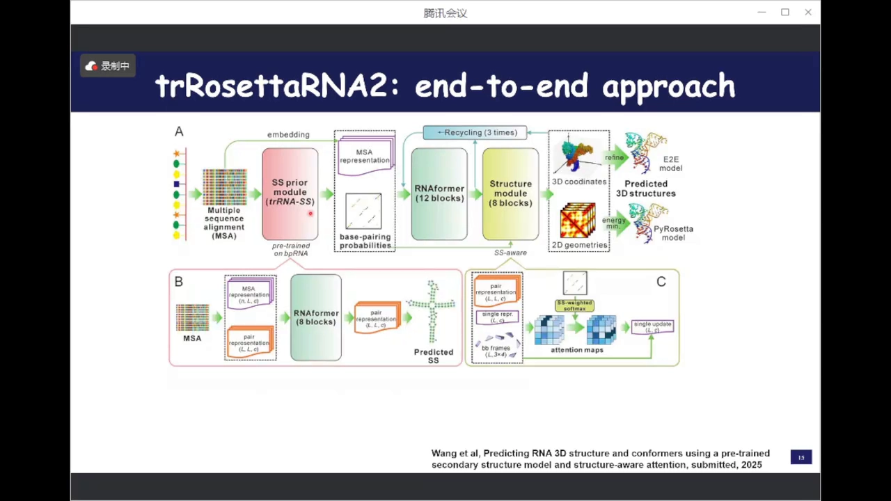

其中二级结构模块本身就是一个**独立的二级结构预测器**：基于 MSA，用 Evoformer 的 pair block 预测**碱基配对概率**（又一张 L×L 概率矩阵），先在 bpRNA 上预训练、再在 PDB 衍生的二级结构上微调，性能超过传统方法与基于语言模型的新方法。它预测的二级结构作为输入，能进一步提升 3D 预测精度。 [【跳转到 40:08】](https://www.bilibili.com/video/BV16u7pz4Eq3/?t=2408)

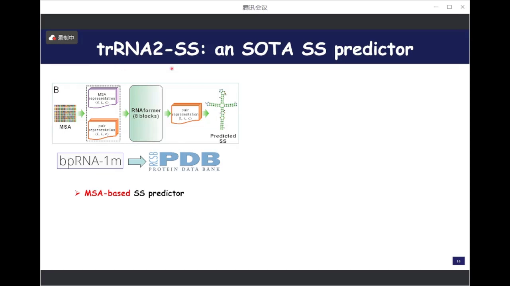

### 4.4 配对引导的注意力：把配对先验"焊"进网络

结构模块里做了一处关键改造：在 IPA（不变点注意力）计算注意力时，**用二级结构的配对概率对注意力再加权**——提升配对核苷酸之间的注意力权重、压制不配对的。另引入一个温度系数 T 控制加权强度：网络早期（还没形成结构时）加权激进，越靠近输出层越平滑——激励网络优先关注配对关系，对拓扑复杂、难度大的 RNA 帮助明显。 [【跳转到 41:48】](https://www.bilibili.com/video/BV16u7pz4Eq3/?t=2508)

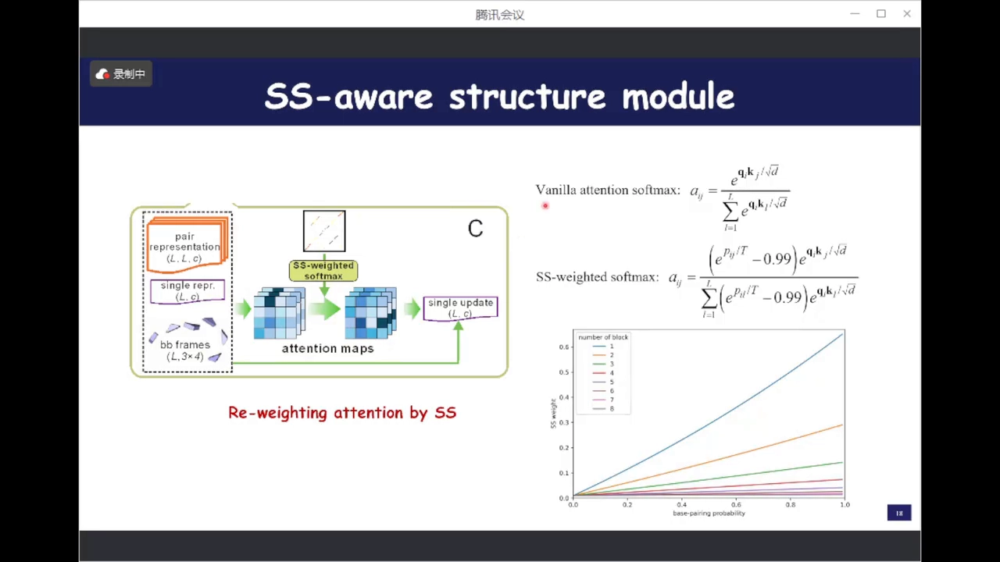

### 4.5 三阶段训练：从监督到物理合理再到难例

训练分三个阶段：第一阶段模仿 AlphaFold2 的 FAPE loss，加 2D 几何（距离）约束、扭转角（恢复全原子坐标）、pLDDT 置信度，以及针对 RNA 的**配对距离拉近**损失；第二阶段加入物理合理性惩罚——不合理的键长键角与 clash；第三阶段对 pLDDT 低的困难样本重采样。整个训练只用一张 A100/A800、12 天、world size 1，工程门槛相当友好。 [【跳转到 43:01】](https://www.bilibili.com/video/BV16u7pz4Eq3/?t=2581)

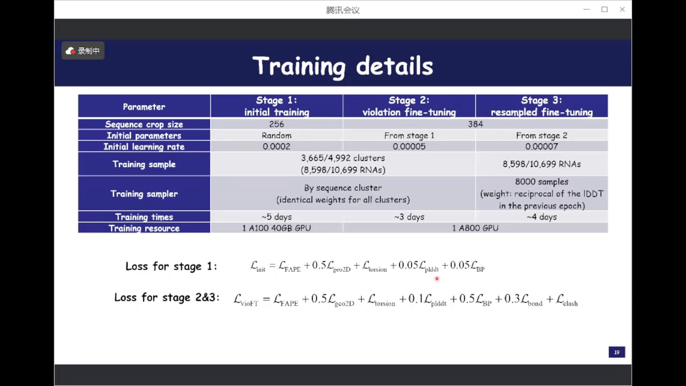

消融实验显示：二级结构先验、MSA 共进化信息、三阶段训练对性能一致地有帮助。一个含假结的例子最能说明问题：没有二级结构信息时假结区域几乎没配对；只有二级结构没有 MSA 时，配对有了但该弯的地方直伸出去；两者都有时局部正确但整体扭曲不对；再经后续阶段训练才得到更准的结构。

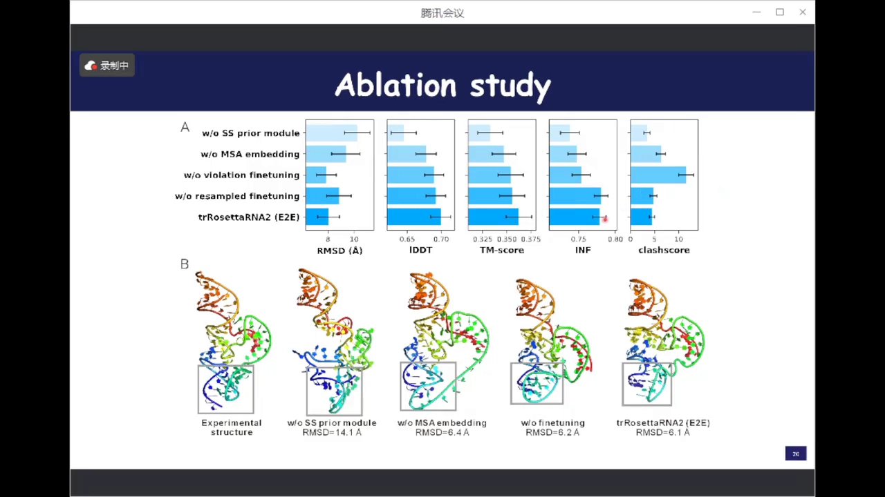

### 4.6 双出口：端到端与 two-step 兼备

由于端到端训练也提升了 2D 几何预测质量，trRosettaRNA2 保留了**双出口**：普通 RNA 直接走端到端；长度超过 400 nt 的 RNA，端到端模型容易出现难解的 clash，改走"2D 几何 → Rosetta 能量最小化"的 two-step 路线，还能带来一点精度提升。 [【跳转到 38:53】](https://www.bilibili.com/video/BV16u7pz4Eq3/?t=2333)

### 4.7 benchmark：39 个非冗余 RNA 上超过 AlphaFold3

在自己收集的 39 个 RNA 上（release date 与序列相似度都和训练集无冗余），以 RMSD 计，trRosettaRNA2 优于所有方法，包括来自 DeepMind 的 AlphaFold3；新的二级结构预测器带来额外提升；参数量与训练资源显著少于其他端到端方法。 [【跳转到 46:19】](https://www.bilibili.com/video/BV16u7pz4Eq3/?t=2779)

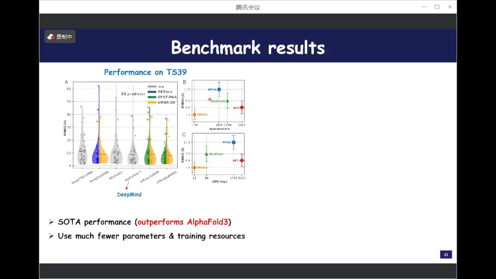

在 CASP15 的 6 个天然 RNA 上，精度与 AlphaFold3 相当；而第一版 trRosettaRNA 虽然全局 RMSD 尚可，lDDT、ipTM 这类**局部指标**与顶级人工组差距明显。新版则全局与局部一致提升。

### 4.8 pLDDT：既是置信度，也是模型挑选器

置信度分数与真实 RMSD 明显负相关（PCC 绝对值 0.773）。基于 pLDDT 挑选 top-1 模型能带来普遍提升、很少下降。于是它还派生出一种玩法：**喂多种不同的二级结构输入，再用 pLDDT 挑最好的模型**——这是 AF3 做不到的，它只支持 MSA 输入，而 MSA 对 RNA 的作用远不如二级结构直接。 [【跳转到 48:49】](https://www.bilibili.com/video/BV16u7pz4Eq3/?t=2929)

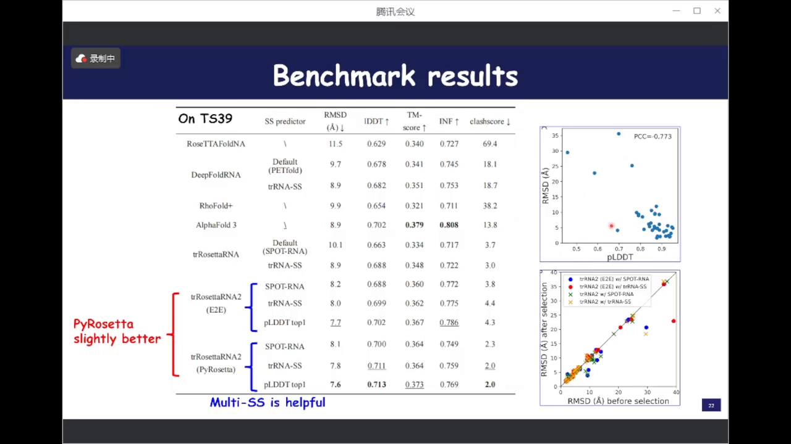

## 五、CASP16 实战：自动组第一、总榜第四

### 5.1 赛制升级与参赛策略

CASP16 把 RNA 靶标从 12 个扩到约 40 个，多样性大增：RNA 单体、寡聚体、RNA-小分子、RNA-蛋白、RNA-蛋白-DNA 复合物都有——是更好的 benchmark 平台。 [【跳转到 49:39】](https://www.bilibili.com/video/BV16u7pz4Eq3/?t=2979)

以 Yang-Server（自动服务器组）参赛，比标准版多了几招： [【跳转到 50:39】](https://www.bilibili.com/video/BV16u7pz4Eq3/?t=3039)

- 用多种算法预测**多种二级结构**，全部作为 trRosettaRNA2 的输入；
- 用课题组内部的 threading（穿线）方法检索同源模板——模板的二级结构可作为输入，也可直接做同源建模（CASP16 中 R1281 正是 CASP15 里最长人工设计 RNA R1238 的二聚体，靠模板辅助拿下了好结果）；
- 训练时 crop size 最大 384，对 400 nt 以上的长 RNA 改用 AlphaFold3（其 crop size 达 700+）；
- 生成备选模型池，再用 QA 挑出前 5 个提交。

### 5.2 官方结果：64 组中第四、server 组第一

最终官方排名：**全部 64 个参赛组中第四、server 组第一，显著超过 AlphaFold3 的 server**。前五名中其余都是人工组（如陈世杰老师的 Vfold 组），依靠人工经验干预建模；trRosettaRNA2 基本纯自动，却在所有自动算法里做得最好。公平对比实验（相同 MSA + 二级结构输入）中，它也在各指标上优于其他代表性深度学习方法。 [【跳转到 52:44】](https://www.bilibili.com/video/BV16u7pz4Eq3/?t=3164)

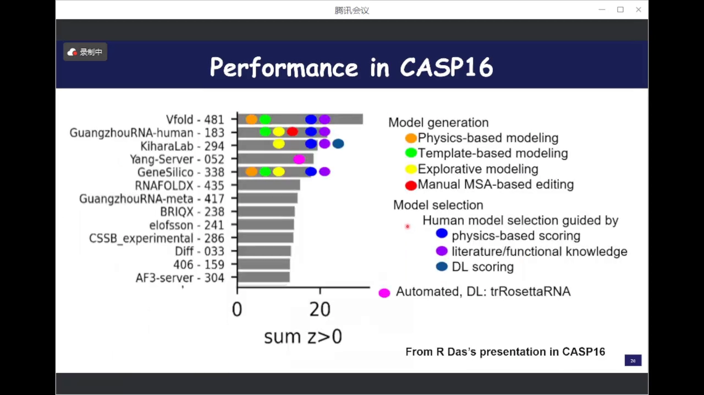

**赢在哪**：R1256（动态结构）上，两个模型组合是所有提交中最好的，AF3 只在中上游；R1288（RNA-小分子）上，方法没考虑小分子信息却仍超过 AF3——得益于二级结构输入；clash score 也比 AF3 的模型低不少。 [【跳转到 54:02】](https://www.bilibili.com/video/BV16u7pz4Eq3/?t=3242)

**输在哪**：R1255 上 pLDDT 挑出的模型反而变差（默认模型 5.3 Å，挑完十几 Å），说明 QA 鲁棒性有待加强；R1212、R1193 这类蛋白-RNA 复合物，纯 RNA 方法不占优，而 AF3 引入蛋白后 RNA 精度反而下降——蛋白-RNA 复合物建模是全行业难题。 [【跳转到 56:51】](https://www.bilibili.com/video/BV16u7pz4Eq3/?t=3411)

### 5.3 模板辅助的典型例：R1281

R1281 是 CASP15 最长人工设计 RNA R1238 的二聚体状态。用 R1238 做模板——无论是把它的二级结构作为网络输入，还是直接 threading 同源建模——都得到准确的模型，螺旋臂与实验结构吻合；AF3 没有模板利用机制，整体拓扑都没预测出来。 [【跳转到 55:47】](https://www.bilibili.com/video/BV16u7pz4Eq3/?t=3347)

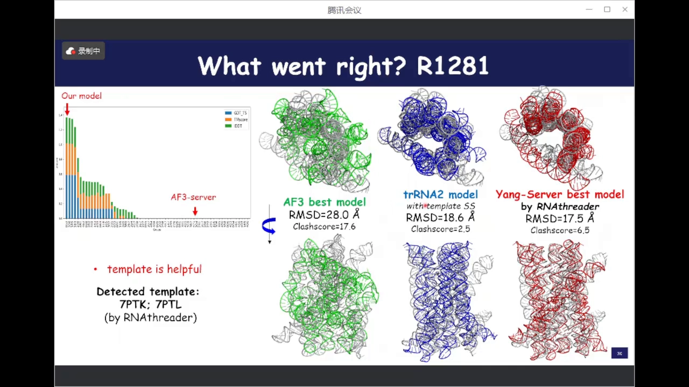

## 六、附加能力：多构象与动态结构预测

因为支持多种二级结构输入，trRosettaRNA2 天然适合**探索构象集合**。对一条 100 多个构象的核糖核酸酶 RNA（来自 Nature 文章，用深度学习从单分子实验数据解析构象），策略是：输入 11 种预测的二级结构 × 网络 4 次 recycle 的输出 = **44 个构象**；对照 AF3 用 20 个随机种子 × 5 模型 = 100 个构象。 [【跳转到 58:56】](https://www.bilibili.com/video/BV16u7pz4Eq3/?t=3536)

结果：这条 RNA 分为催化 domain（C domain）与特异性 domain（S domain），S domain 动态性明显更强。AF3 的 100 个构象几乎聚集在一起（探索不充分），而 44 个构象覆盖了大得多的构象空间，RMSF 曲线也更吻合实验推导值——**支持条件输入的模型，比堆随机种子更能捕捉动态性**。 [【跳转到 61:26】](https://www.bilibili.com/video/BV16u7pz4Eq3/?t=3686)

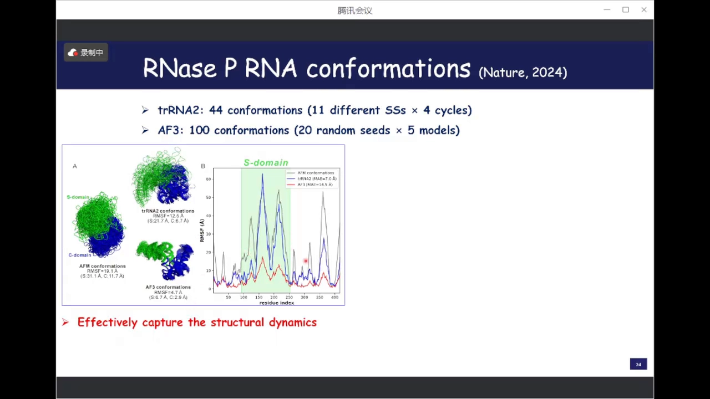

## 七、挑战与未来

王文恺总结三点不足：测试集 RMSD 平均仍有 7-8 Å，未达蛋白水平；CASP15 的 4 个人工设计 RNA 从头预测依然极难；尚不支持 RNA-蛋白复合物（AF3 支持但也做不好）。 [【跳转到 62:07】](https://www.bilibili.com/video/BV16u7pz4Eq3/?t=3727)

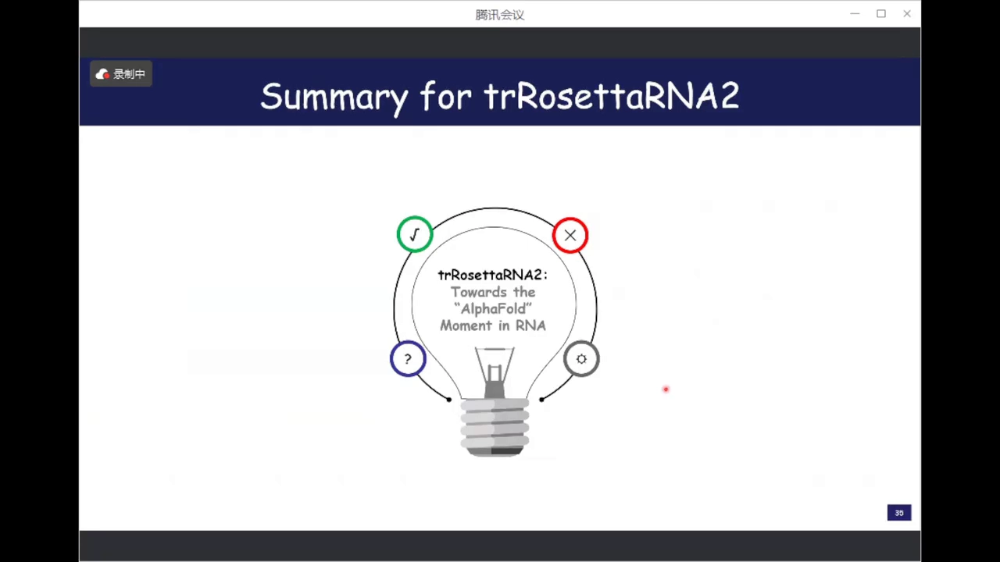

三大挑战：**数据**（数量与质量都远逊蛋白）、**MSA 质量**（帮助有限甚至带噪声）、**结构柔性**（环境依赖的构象变化，现有计算方法无法考虑）。未来方向：深度学习结合实验信息（如冷冻电镜 RNA 结构解析）、面向 RNA 的**条件生成模型**（用实验条件控制想要的构象）、以及推动下游实际应用。 [【跳转到 63:47】](https://www.bilibili.com/video/BV16u7pz4Eq3/?t=3827)

## 八、讨论精华：问答环节拾贝

讲座后半段是高密度讨论，以下按主题整理。

### 8.1 AI 能预测什么、不能预测什么

只有**本身可折叠成稳定结构**的 RNA 才可能被预测好——与蛋白的 disorder 区同理，动态明显的 RNA 现有框架很难预测准。也不存在百分之百：预测再准也需要实验验证，pLDDT 高不代表永远正确；计算始终是预测，理论不等于实践。 [【跳转到 88:55】](https://www.bilibili.com/video/BV16u7pz4Eq3/?t=5335)

现阶段的意义：做实验的科学家不需要高精度结构时，一个"还算靠谱"的预测就能辅助解释实验数据，省下不必要的实验成本。AlphaFold2 式的"跟实验基本一样"仍是愿景——现在处于慢速积累、量变到质变的阶段。

### 8.2 修饰、G4、环状 RNA、DNA

- **M6A 修饰**：目前加不进去；修饰引起结构变化，是更难的问题。
- **实验二级结构对 3D 预测的帮助大，但非万能**：CASP15/16 中人工干预的主要工作就是把二级结构弄准（尤其假结信息）。但即使给出正确的二级结构，也不保证得到正确的三维结构——RNA 的三维不只由二级结构决定，**碱基堆叠效应（stacking）同样关键**。
- **tRNA**：L 型高度保守，预测很准（无修饰时 trRosettaRNA 的预测与实验结构 RMSD 在 3 Å 内）；难点是修饰对细节的影响。
- **G4（G-四链体）**：构象类别不少（核磁、晶体都有），序列可能性有限，是值得单独建模的方向。
- **环状 RNA**：首尾相连，现有方法不适用；且当时还没有已发表的环状 RNA 实验结构可评测（PDB 里已有未发文章的 release 结构）。
- **DNA**：双链有明确碱基配对，理论上比 RNA 容易；但单链 DNA（DNAzyme、aptamer 一类）结构非冗余数据只有约 10 个，把 RNA 方法直接迁移过去效果并不好。

### 8.3 模板 vs 深度学习

深度学习训练集里"见过"同源结构，可算广义的自动找模板；但显式给定模板能让模型更"尊重"模板构象，归纳推理则会混入其他信息。经验佐证：蛋白方法里把模板特征加进网络仍能进一步提升——对 RNA 亦然。 [【跳转到 99:45】](https://www.bilibili.com/video/BV16u7pz4Eq3/?t=5985)

### 8.4 mRNA 稳定性与表达量（mRNA 疫苗之问）

"更稳定的 RNA 表达量更高"的机制解释：稳定的高级结构不易被切割，存在时间更久、被翻译几率更高；翻译时核糖体自带 ATP 可解旋，过程顺理成章。但翻译效率影响因素太多，不能只看结构。 [【跳转到 101:50】](https://www.bilibili.com/video/BV16u7pz4Eq3/?t=6110)

### 8.5 二级结构可以人为给定吗？

可以——而且形式灵活：**配对概率矩阵、dot-bracket 点括号、0/1 矩阵都能输入网络**；MSA 也可以不给，精度略降但不多。这个开放输入正是多构象探索与"人为假设检验"的入口。 [【跳转到 105:35】](https://www.bilibili.com/video/BV16u7pz4Eq3/?t=6335)

### 8.6 信息论极限：为什么 100% 正确的二级结构也不够

RNA-Puzzles 早期做过 benchmark：把实验测定的二级结构加进预测，常常反而变差。苗老师给出一个漂亮的解释：二级结构只定义 Watson-Crick 配对，而实际 RNA 三维结构中**约 2/3 是 Watson-Crick 配对、1/3 是 non-Watson-Crick 配对**；二级结构预测精度上限约 80%。用只含 2/3 信息的表示去恢复 100% 的三维信息，原则上不足——所以"从二级结构直接折叠三维"天然受限，网络需要学的是超越二级结构的约束（这也是 trRosettaRNA2 用全原子、堆叠与扭转角监督的原因）。 [【跳转到 110:34】](https://www.bilibili.com/video/BV16u7pz4Eq3/?t=6634)

杨建益补充的经历：他试过把实验二维结构用简单 Rosetta 能量最小化直接折叠三维——不可行，后来放弃；这也正是网络要学概率矩阵而非 0/1 矩阵的原因——**配对概率矩阵给出的是"可能性"而非"结论"，为探索留出空间**。

## 小结

- RNA 结构预测难在数据：PDB 中非冗余 RNA 结构只有几百个，AI 缺"教材"。
- L×L 二维几何（接触图/距离图/配对概率矩阵）是 AI 结构预测的核心中间表示：第一代两步走靠它+能量最小化折叠，端到端方法在网络内部学它。
- RNAcontact 是第一个深度学习 RNA 接触图方法，但接触图换不来好结构——二维到三维折叠是硬门槛。
- trRosettaRNA（v1）：MSA+二级结构 → Evoformer → 距离/朝向 → Rosetta 折叠；CASP15 天然 RNA 自动组第二。
- trRosettaRNA2：端到端全原子 + 预训练二级结构模块 + 配对引导注意力 + 三阶段训练；单卡可训，39 RNA benchmark 超 AF3。
- CASP16：server 组第一、总榜第四，超 AF3 server；模板辅助与多二级结构输入是关键战术。
- 附加能力：多构象/动态结构预测，比 AF3 的随机种子更有效。
- 硬约束：二级结构只含 2/3 的配对信息（Watson-Crick），100% 正确也不足以唯一决定三维结构——AI 必须学超越二级结构的规律。

## 关键术语速查

| 术语 | 一句话解释 |
| --- | --- |
| contact map（接触图） | L×L 矩阵，格子在两残基/碱基接触时为 1，否则为 0 |
| 距离图 / 朝向图 | 接触图的推广：L×L 格子存距离或朝向分布（trRosetta 系输出） |
| 配对概率矩阵 | L×L 格子存两碱基配对的概率（二级结构模块输出，可人为给定） |
| MSA | 多序列比对，从序列数据库搜索生成，承载共进化信号 |
| 二级结构 | RNA 碱基配对模式，常用 dot-bracket 记法表示 |
| Evoformer | AlphaFold2 的核心模块，交替更新 MSA 表征与 pair 表征 |
| IPA | 不变点注意力，AlphaFold2 结构模块的核心操作 |
| recycle | 把预测结果回填输入再跑一遍网络，迭代精化 |
| FAPE | AlphaFold2 的帧对齐点误差损失，训练坐标预测 |
| pLDDT | 逐残基置信度（0-100），与真实误差负相关，可用来挑模型 |
| ipTM / lDDT | 界面/局部结构指标，比全局 RMSD 更敏感 |
| RMSD | 均方根偏差，全局结构误差，单位 Å，越低越好 |
| TM-score | 结构相似度度量，衡量与训练集分布的距离 |
| CASP | 全球蛋白质/核酸结构预测竞赛，RNA 类别自 CASP15 设立 |
| RNA-Puzzles | RNA 结构预测的独立评估平台 |
| clash | 原子空间冲突，结构合理性的反面指标 |
| 假结（pseudoknot） | 配对弧线交叉的二级结构，预测与建模难点 |
| G4 / 环状 RNA | G-四链体与首尾相连的 circRNA，特殊结构类别 |
| two-step | 先预测 2D 几何、再能量最小化折叠的路线（vs 端到端） |
