# AlphaFold3 实操教程：从单链到蛋白-核酸复合物，官方 Server 全流程走一遍

> 视频来源：B 站《AlphaFold3实操教程来咯，全新结构预测神器，还不快来跟着教学视频操练一下？》（桃树小课堂），[BV1XL4neqEmL](https://www.bilibili.com/video/BV1XL4neqEmL/)。
> 本文基于该视频的「图-字幕」演说文稿整理，操作步骤与关键数字均可在原视频核查。

## 本讲要解决的核心问题（SCQA）

**背景**：AlphaFold3 论文（DeepMind 与 Isomorphic Labs 团队，2024 年 5 月 8 日发表于 Nature）已经开放算法，官方提供 AlphaFold Server 网页版。

**冲突**：网页入口看起来只是「贴个序列」，但真要做复合物预测——蛋白多聚体、蛋白 + 内源小分子、蛋白 + 核酸——从哪取序列、怎么设置拷贝数、结果分数怎么解读，新手一头雾水。

**疑问**：一条完整的实操路径长什么样？预测结果又该怎么判断可信不可信？

**回答（中心思想）**：本文用两个完整案例走通官方 Server 全流程：**DLD 二聚体**（成功案例，pTM/ipTM ≈ 0.91，与晶体结构 RMSD 仅 0.273 Å）和 **ADAR1 + dsRNA 复合物**（失败案例，pTM 0.48 / ipTM 0.32，提示亚基相对位置可能错误）。看完你会掌握：五类实体怎么输入、任务怎么提交、结果怎么读、不可信的分数长什么样。

## 一、AlphaFold3 能预测什么：分子类型的排列组合

AlphaFold3 可以预测：蛋白结构、蛋白-蛋白复合物结构、蛋白多聚体结构、蛋白和部分内源性小分子的结合模式、蛋白和核酸的复合物结构、核酸（DNA/RNA）结构，以及蛋白或核酸与常见离子的结合模式。

支持的分子种类：蛋白质支持 20 种天然氨基酸；配体支持 ATP、ADP 等；离子支持钙离子、镁离子等；同时还支持大量氨基酸残基的**翻译后修饰**。

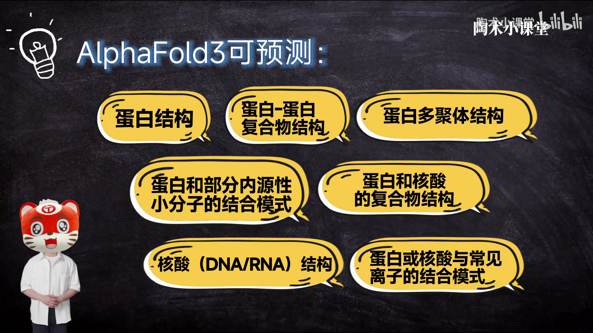

## 二、Server 界面速览：额度、实体输入区与历史记录

打开浏览器进入 AlphaFold Server（alphafoldserver.com），登录账户后可以看到：

- **页面右上角有剩余使用次数，每日刷新**；
- **序列输入区**：左侧是不同实体类型（蛋白链 / DNA / RNA / 配体 / 离子）的选项，中间的框可以设置当前序列的**出现次数（Copies）**；
- **历史记录**：下方可以看到之前提交的项目信息。

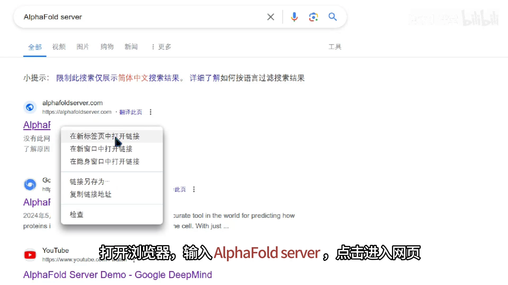

## 三、案例一：DLD 二聚体——从 UniProt 取序列到提交任务

### 3.1 在 UniProt 上找序列、认准异构体

本次实验以人源 **DLD**（dihydrolipoyl dehydrogenase，二氢硫辛酰脱氢酶）为靶点。进入 UniProt 官网搜索 DLD、选择 Human 种属，仔细核对后选择正确的蛋白。重点关注三个部分：**Structure**（结构）、**Family & Domains**（家族与结构域）、**Sequence & Isoforms**（序列与异构体）。

Sequence (Isoforms) 显示 DLD 有**三个异构体**（isoforms），注意确定自己需要的是哪个——页面解释写着 "This entry describes three isoforms produced by alternative splicing"，三种异构体部分序列不一样。本次选默认的第一个。可以点 Download 下载，也可以直接点 Copy Sequence，把序列贴进 AlphaFold3 的输入框；粘贴后记得**删掉换行符**。

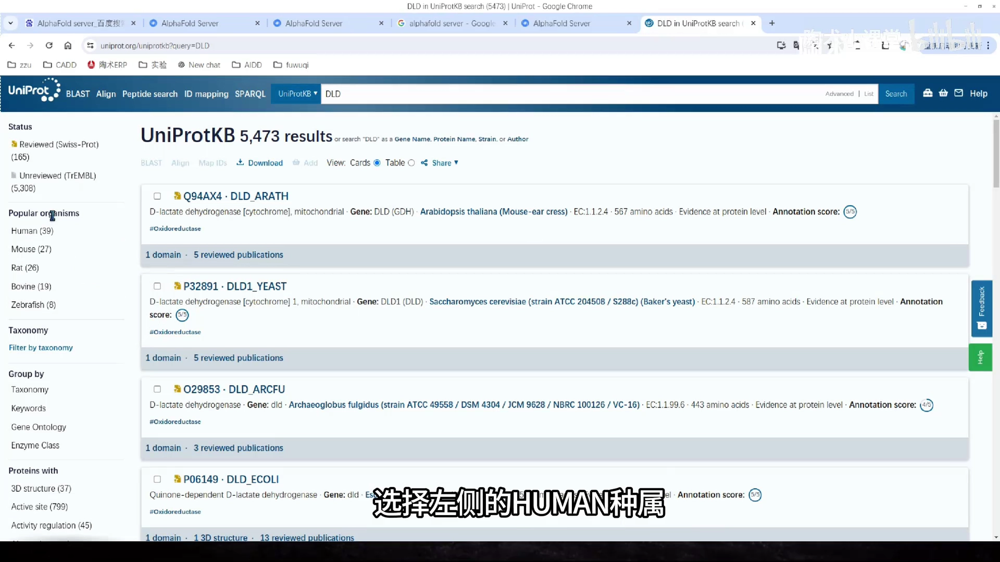

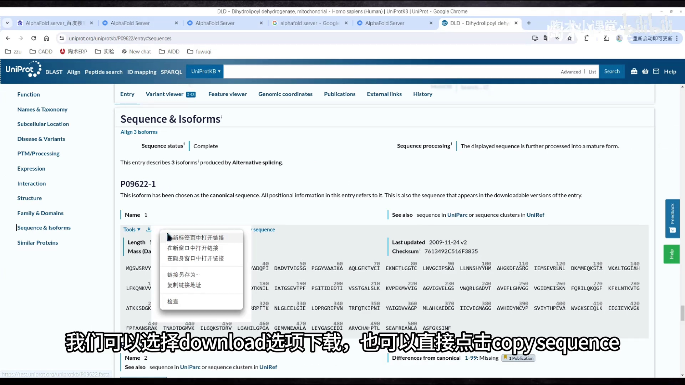

### 3.2 找对照结构：5J5Z 晶体、FAD 配体与 D444V 突变

在 UniProt 页面转动视角查看 DLD 的已知结构，可以发现 DLD 蛋白在生理上多以**多聚体**形式存在。本次选择以 **5J5Z** 为对照模板，进入 RCSB PDB 网站查看：这是「D444V 致病突变型人源二氢硫辛酰脱氢酶」的晶体结构，为二聚体，页面下方还能看到对应的蛋白信息与小分子信息——其中就有**内源性小分子 FAD**。

这里需要注意的是：**该晶体结构里有 D444V 氨基酸突变**。我们要回到刚输入的序列中，找到对应的氨基酸并改回突变前的残基（D），让预测对象与野生型一致。

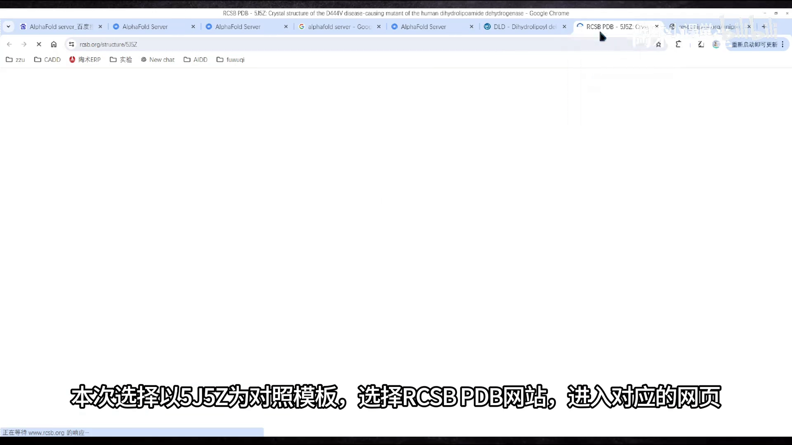

### 3.3 设置 Copies、命名任务并提交

这次实操采用默认设置，**Copies 设成 2（二聚体）**，然后点 Continue and Preview Job。预览页可以看到项目整体情况；按「名字 + 种属 + PDB ID + 备注」的规则修改 Job Name，点 Confirm and Submit Job 提交即可。项目之后可以在历史记录中找到。

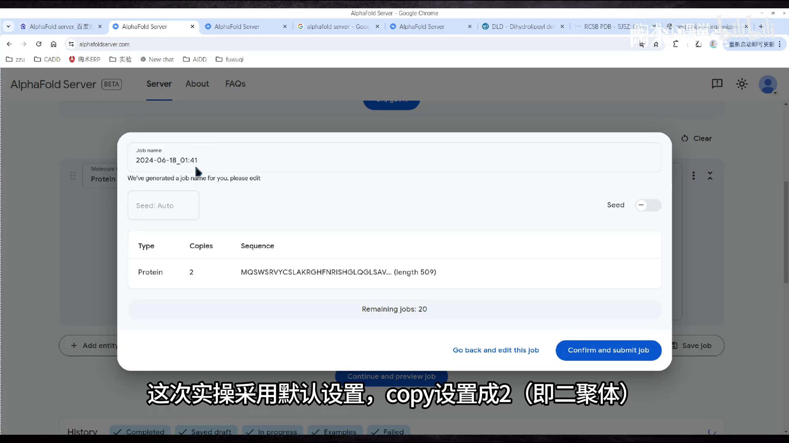

## 四、读懂结果：pLDDT 着色、pTM/ipTM 与 PAE

进入结果页，可以看到整体呈**二聚体**。旋转视角查看，蛋白整体有不同的颜色——不同颜色对应不同**置信度**，按深蓝、浅蓝、黄、橘依次递减。本次蛋白整体偏深蓝，说明结构整体置信度较好。

右侧的图是 **Expected Position Error（PAE，单位 Å）**，可以简单理解为预测误差，颜色越绿误差越小。

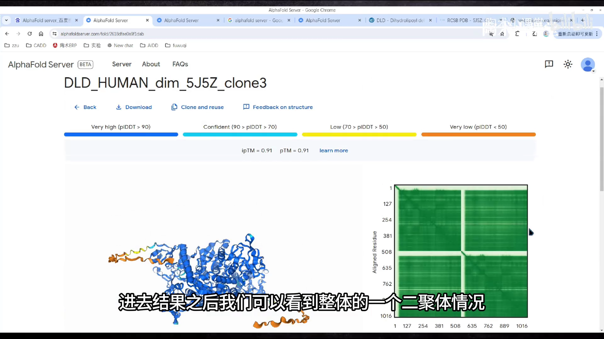

分数方面：本次 **pTM = 0.91**。pTM 评分高于 0.5，意味着复合物的整体预测与真实结构相似；**ipTM = 0.91**，它测量的是复合体内**亚基间相对位置**的准确性，0.91 说明亚基相对位置较为可靠。

> 术语提示：pTM 和 ipTM 都是从 **TM-score**（template modeling score）衍生出来的。TM-score 对小结构或短链非常严格，因此当残基数少于 20、pTM 值小于 0.05 时，**high pLDDT** 可能更能反映预测质量。

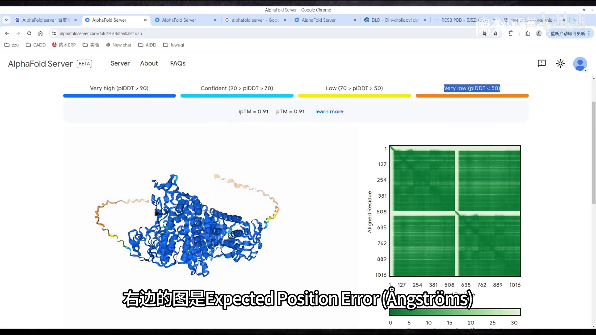

## 五、下载与验证：summary_confidences JSON + PyMOL 比对 RMSD

点左上角 Download 下载结果，解压后是 **JSON 格式的打分文件和 CIF 格式的结构文件**：默认选 `model_0.cif` 分析；如果 model_0 不是最优，可以换别的结构文件。对应打分都可以在 `summary_confidences_0.json` 中查看——里面有 `ranking_score`（AlphaFold 据此排序，分数越大推荐优先级越高）、`chain_iptm`、`chain_pair_iptm` 等字段。

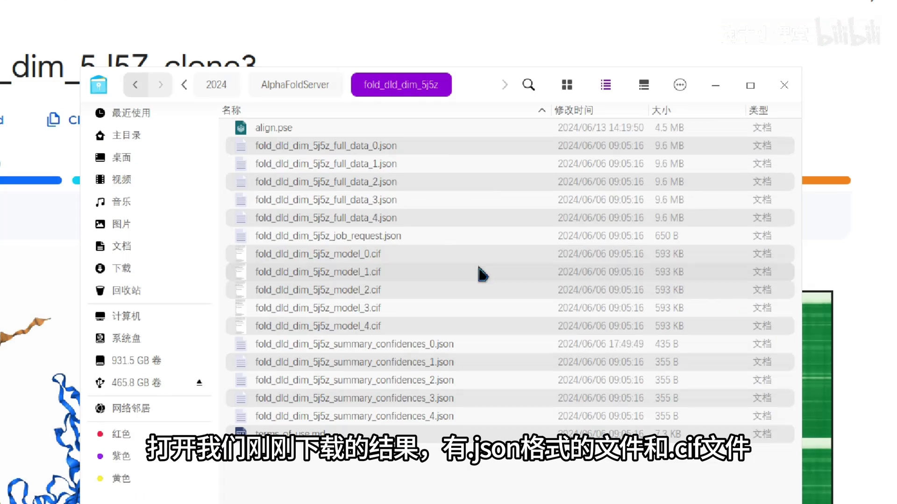

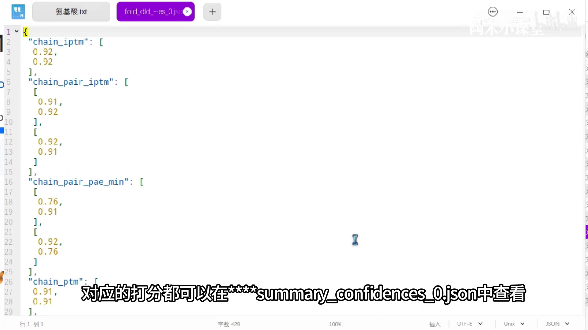

验证方法：把 DLD 晶体结构 5J5Z 和预测的 model_0.cif 一起拖进 PyMOL，晶体结构用白色 cartoon、model_0 用绿色显示，在 Action 中选择 Align 功能比对两个蛋白，得到 **RMSD = 0.273 Å**（对齐 959 个原子）——从不同角度看几乎没有差别，说明 AlphaFold3 此次预测的结构相当准确。

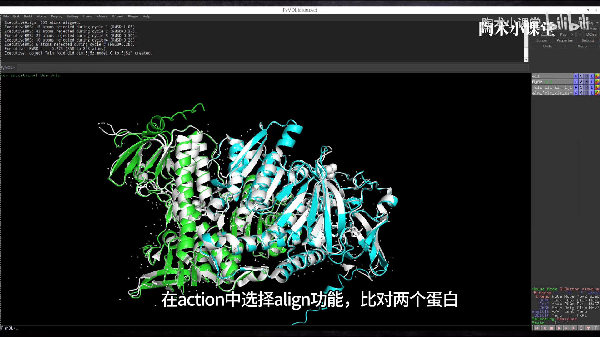

## 六、案例二：ADAR1 + dsRNA 复合物——当分数不及格时

第二个案例预测 **ADAR1 与核酸的复合物**。回到 UniProt 输入 ADAR1、种属选 Human（ID **P55265**），Sequence & Isoforms 显示有**五个异构体**，第一个有 **1226 AA**。查一下该蛋白是否有结构解析：本次选择 **7ZLQ** 做对照——RCSB 页面显示它是「ADAR1-dsRBD3 二聚体与 dsRNA 复合物」的晶体结构。为方便测试，从 Download Files 里下载 FASTA 序列（蛋白与 RNA 各取所需），复制对应的序列。

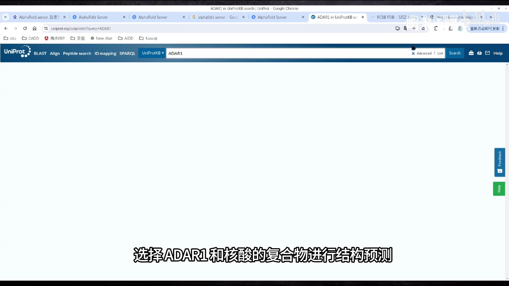

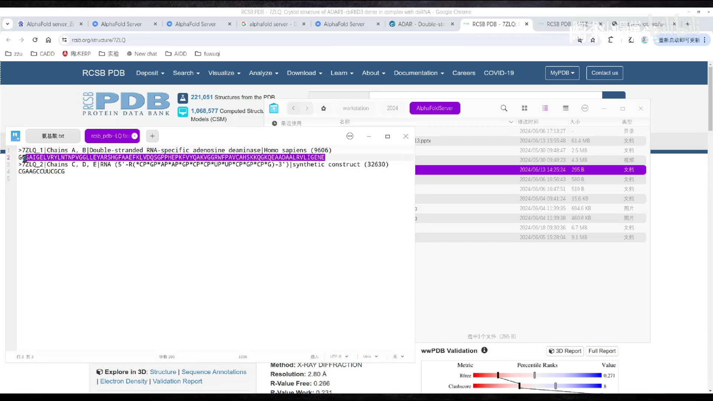

输入设置：蛋白序列贴到蛋白实体里，**Copies 选 2**（因为 PDB 显示该蛋白生理状态下是二聚体）；再点 Add Entity 添加 **RNA 实体，Copies 选 4**，从刚才的文件里复制对应序列。提交任务、命名、确认。

结果页中两个蛋白呈中心对称，四个 RNA 结合在两个蛋白中间。但与 PDB 数据库中 7ZLQ 的结构旋转比对后，**PDB 结构和预测结构相差较大**。分数也印证了这一点：**pTM = 0.48，小于 0.5**，结构整体可信度低；**ipTM = 0.32，小于 0.6**，复合物中亚基的相对位置也可能是错误的。

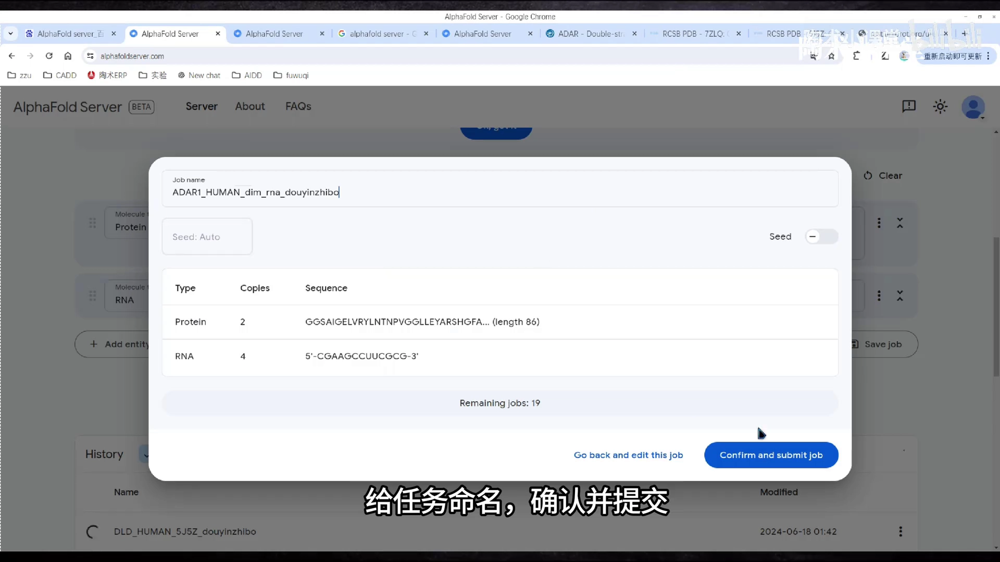

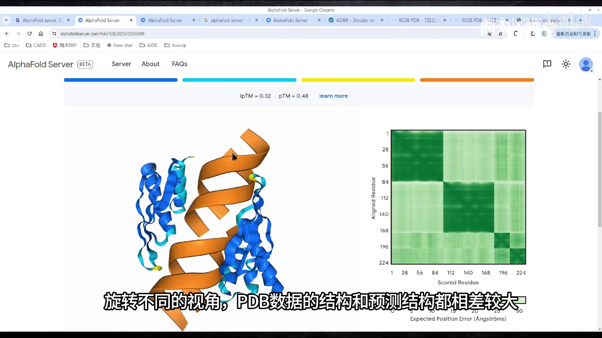

> 记住这组经验阈值：**pTM > 0.5** 整体可信，**ipTM > 0.6** 界面相对位置可信；两者同时不达标时，应对预测结果保持怀疑。

## 七、两个易被忽略的细节：随机种子与链顺序

- AlphaFold3 内部有**随机数**：提交两次一模一样的任务，可能得到不一样的结果；
- **蛋白的顺序不一样**，结果也可能不一样——输入实体时按一致的顺序填写，便于复现与对比。

## 小结

- AlphaFold3 支持**五类实体**（蛋白、DNA/RNA、配体、离子、翻译后修饰）的组合预测；Server 每日有额度限制；
- 序列从 **UniProt** 取，注意**异构体**（isoforms）选择；对照结构从 **RCSB PDB** 找，留意晶体中的**内源配体**（如 FAD）与**点突变**（如 D444V），提交前把序列改回野生型；
- **Copies** 按生理寡聚状态设置（DLD 二聚体设 2）；多实体复合物用 **Add Entity** 追加 RNA/DNA/配体/离子；
- 结果看三样：**pLDDT 着色**（深蓝好）、**pTM / ipTM**（>0.5 / >0.6 可信）、**PAE**（越绿误差越小）；
- 下载包里 `model_0.cif` 是结构、`summary_confidences_0.json` 是打分（含 ranking_score、chain_iptm、chain_pair_iptm）；用 PyMOL Align 对照晶体结构算 RMSD 验证；
- pTM/ipTM 不达标（如 ADAR1 案例 0.48/0.32）时，预测的亚基排布很可能不可信，需要谨慎解读。

## 关键术语速查

| 术语 | 一句话解释 |
| --- | --- |
| AlphaFold Server | DeepMind 官方网页版预测服务，每日额度刷新 |
| Isoforms（异构体） | 同一基因经可变剪接产生的不同序列变体，取序列时必须选对 |
| Copies | 实体的拷贝数，用于指定二聚体/多聚体等寡聚状态 |
| pTM / ipTM | 全局 / 界面的模板建模置信度（0–1），经验阈值 0.5 / 0.6 |
| pLDDT | 逐残基置信度，按深蓝→橘色递减着色 |
| PAE | Expected Position Error（Å），残基间相对位置误差，越绿越好 |
| model_0.cif | 默认输出的第一顺位结构文件 |
| summary_confidences_0.json | 打分文件，含 ranking_score、chain_iptm、chain_pair_iptm 等 |
| RMSD | 两结构对齐后的均方根偏差（Å），越小越相似 |
