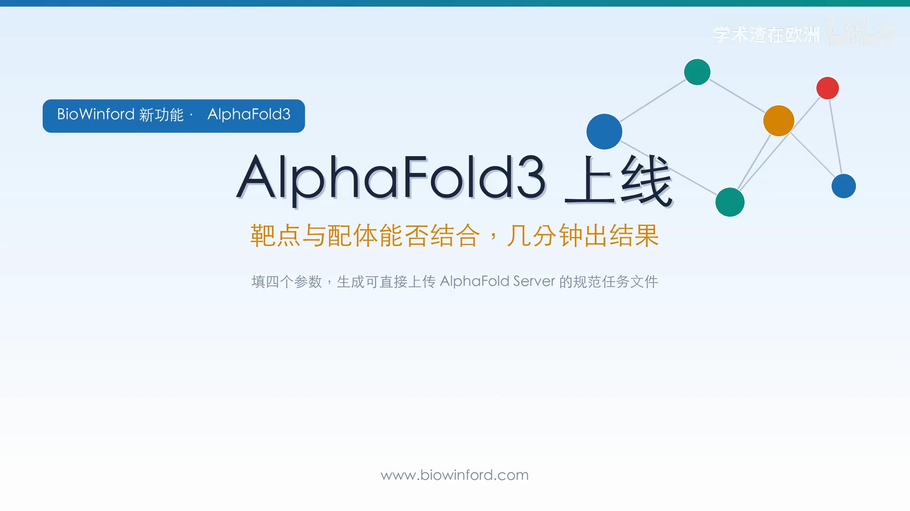
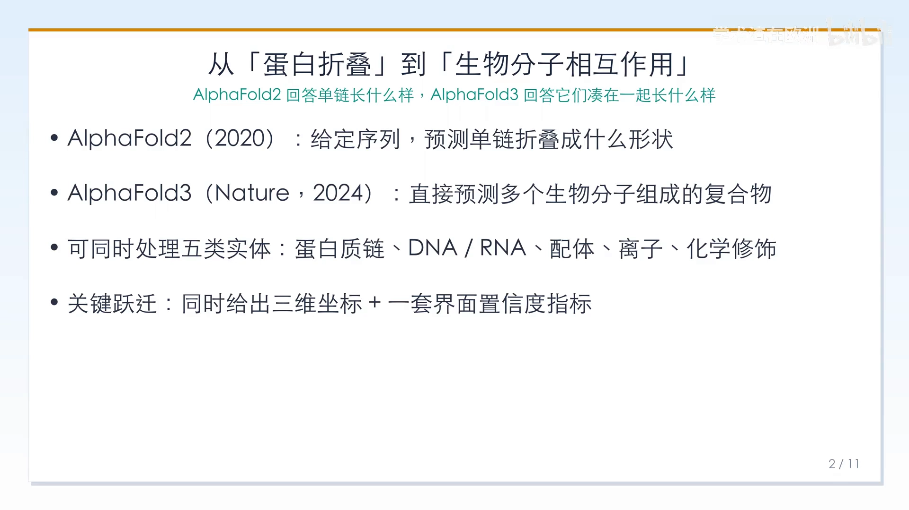
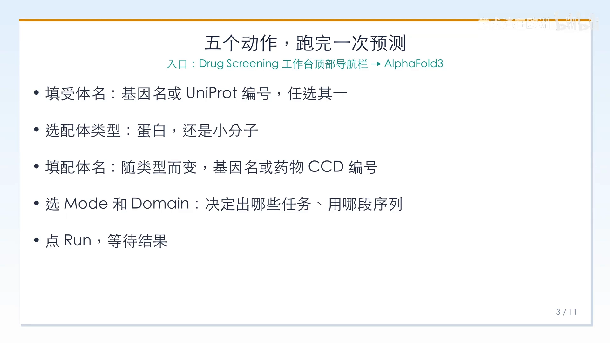
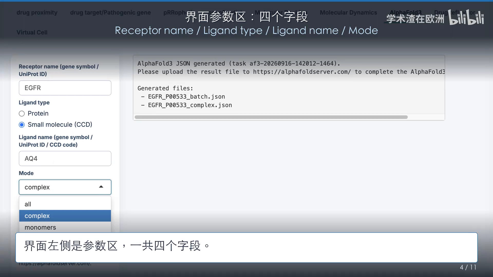
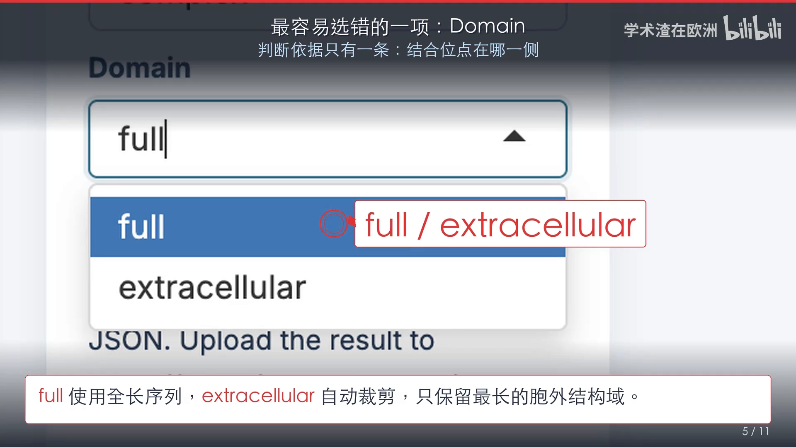
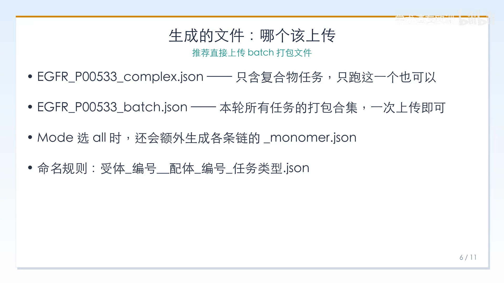
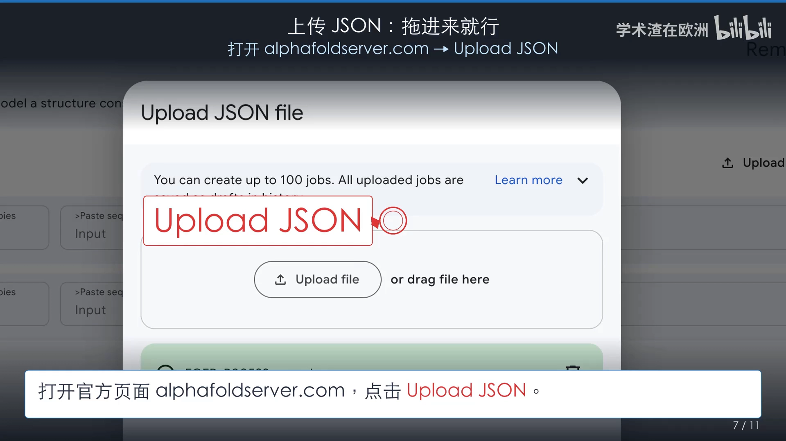
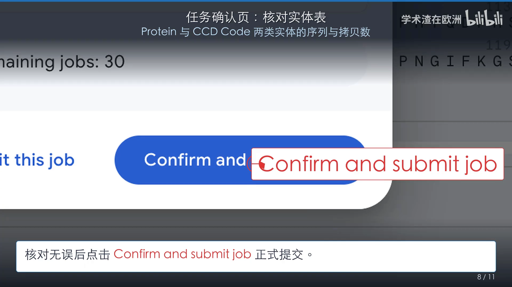
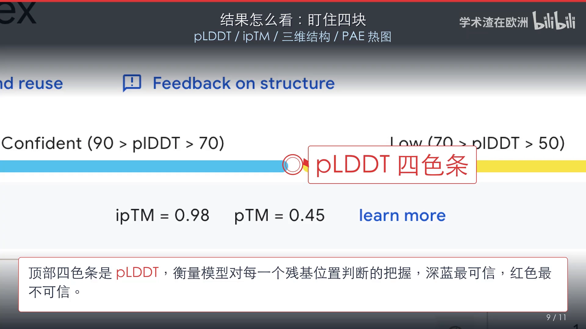
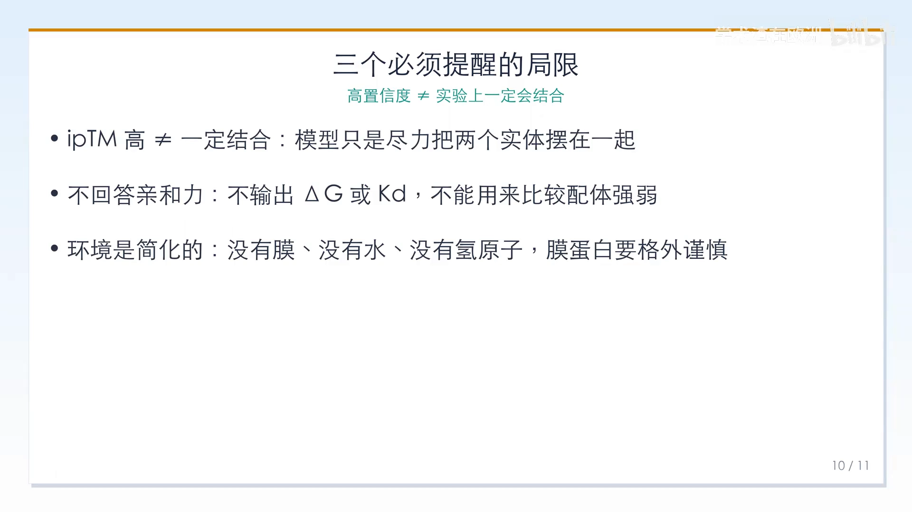

# AlphaFold3 零代码使用教程：填四个参数，生成一份符合 AlphaFold Server 规范的输入 JSON

> 视频来源：B 站《AlphaFold3零代码使用教程》（UP 主：学术渣在欧洲），[BV1CWew6PEQu](https://www.bilibili.com/video/BV1CWew6PEQu/)。
> 本文基于该视频的「图-字幕」演说文稿整理，所有关键操作与数字都可在原视频中核查。

## 本讲要解决的核心问题（SCQA）

**背景**：结构预测模型 AlphaFold3 已经开放使用，它能预测「多个生物分子组成的复合物」——比如一个靶点蛋白加一个小分子药物。

**冲突**：但想用官方 AlphaFold Server，你得按它的规范准备一份 JSON 输入文件；对不做生信的药物设计者来说，这道门槛很容易把人挡在门外。

**疑问**：有没有零代码的办法，把「受体 + 配体」快速变成一份规范的任务文件，几分钟内拿到结合预判？

**回答（中心思想）**：有。用 BioWinford 的 Drug Screening 工作台：填四个参数，自动生成符合 AlphaFold Server 规范的输入 JSON，上传官方服务器即可拿到复合物结构预测结果。整条链路是「**填参数 → 生成 JSON → 上传官方 Server → 读结果**」，全程不写一行代码。

## 一、从 AlphaFold2 到 AlphaFold3：预测对象从单链变成复合物

AlphaFold2（2020）解决的是「给定一条氨基酸序列，预测它折叠成什么形状」。但真实的生物学过程很少由孤零零的一条蛋白链完成：蛋白要和小分子药物结合，要和其他蛋白形成复合物，还常常带着糖基化、磷酸化这类修饰。

AlphaFold3（Nature，2024）把问题重新定义了一遍：不再逐个预测单链，而是直接预测多个生物分子组成的复合物。它能同时处理**五类实体**：蛋白质链、DNA 和 RNA、配体、离子，以及化学修饰。最关键的跃迁在于相互作用——它会同时给出复合物的三维坐标，和一套衡量「界面有多可信」的置信度指标，这正是药物设计最关心的部分。

## 二、关键分工：工作台只生成规范 JSON，预测由官方服务器完成

理解这套流程的核心是分清两件事：

- **BioWinford 本身不运行 AlphaFold3**。它做的是把你在界面上填的参数，转换成一份符合 AlphaFold Server 规范的输入 JSON——也就是「任务描述文件」。
- **真正的结构预测由 DeepMind 的官方服务器承担**。你拿到的是一份可以直接上传 alphafoldserver.com 的 JSON，而不是结构本身。

入口在 Drug Screening 工作台顶部导航栏的「AlphaFold3」标签页（Molecular Dynamics 右侧）。整个流程只有五个动作：

1. **填受体名**：基因名或 UniProt 编号任选其一；
2. **选配体类型**：决定第二个分子被当蛋白还是小分子处理；
3. **填配体名**：内容随类型而变，小分子填药物 CCD 编号；
4. **选 Mode 和 Domain**：决定生成哪些任务文件、用哪一段序列；
5. **点 Run，等待结果**。

## 三、四个字段与一个最容易选错的 Domain

界面左侧参数区一共四个字段。以「EGFR + 厄洛替尼」为例：

| 字段 | 填什么 | 本例 |
| --- | --- | --- |
| Receptor Name | 受体基因名或 UniProt 编号 | EGFR / P00533 |
| Ligand Type | 蛋白选 Protein，小分子选 Small Molecule | Small Molecule |
| Ligand Name | 小分子填 CCD 代码 | AQ4（厄洛替尼） |
| Mode | 只关心结合模式选 Complex | Complex |

> 术语提示：**CCD 编号**是 PDB 化学组分字典里给每个标准配体起的三字符代号，厄洛替尼的代号是 AQ4。填 CCD 而不是画 SMILES，是官方 Server 小分子输入的标准做法。

最后一项 **Domain 是最容易选错的**，判断依据只有一条：**结合位点在哪一侧**——

- **Full**：使用全长序列。小分子激酶抑制剂结合的是受体**胞内**的激酶域，必须选 Full；选 Extracellular 会把结合位点整段裁掉；
- **Extracellular**：自动裁剪，只保留最长的胞外结构域。抗体、细胞因子这类结合在**胞外域**的配体选它，能去掉跨膜段和胞内段，让模型聚焦在真正的结合区域。

## 四、生成的文件：complex、batch 与 monomer，该上传哪个？

运行完成后，右侧会给出任务编号和生成的文件列表。以 EGFR + 厄洛替尼、Mode 选 Complex 为例，会得到两个文件：

- `EGFR_P00533_complex.json`——只包含受体链和配体构成的**复合物任务**，只跑这一个也可以；
- `EGFR_P00533_batch.json`——本轮**所有任务的打包合集**，一次上传即可，**推荐用它**。

如果 Mode 选了 All，还会额外生成各条链的 `_monomer.json`，分别对应各条链的单体预测任务。文件命名规则：`受体_编号_配体_编号_任务类型.json`。

每个 JSON 内部是一个**数组**，包含任务名、随机种子、实体列表（对应官方 `sequences[]` 里的 proteinChain、ligand 等实体）等字段，用文本编辑器打开就能看懂。

## 五、上传与提交：官方 Server 的确认页要看「实体表」

打开官方页面 alphafoldserver.com，点 Upload JSON，选择文件或直接把文件拖进来。上传成功后会出现一条打了钩的绿色条目，确认无误再点 Submit Job as Draft。

接下来是任务确认页，这里可以检查任务名和随机种子，最关键的是**实体表**：Protein 1 一行显示长度为 1210 的受体序列，CCD Code 一行显示配体 AQ4 及其化学名称（4-[(3-乙炔基苯基)氨基]……，即厄洛替尼）。页脚还会显示当天剩余的任务配额（Remaining jobs）。核对无误后，点 Confirm and Submit Job 正式提交。

## 六、结果怎么看：盯住 pLDDT、ipTM、三维结构和 PAE 热图

结果页信息看似很多，实际上只需要盯住**四块**：pLDDT / ipTM / 三维结构 / PAE 热图。

- **pLDDT 四色条**：衡量模型对每一个残基位置判断的把握，深蓝最可信、红色最不可信；
- **ipTM** 才是判断「是否结合」真正要看的：本例 ipTM = 0.98，界面非常自洽；pTM = 0.45 偏低，通常意味着链内有柔性区拉低了全局分数，但界面本身是清楚的；
- **三维结构**：按 pLDDT 着色，也可以打开 Display Chain Borders 定位界面；
- **PAE 热图**：看误差落在哪一段——非对角线上的深绿色方块，说明模型对这条界面很有把握。

> 术语提示：pLDDT（0–100）逐残基衡量局部置信度；pTM / ipTM（0–1）分别衡量全局与界面的建模置信度，ipTM 是复合物界面可信度的核心指标；PAE（Expected Position Error，单位 Å）刻画残基间相对位置的预测误差。

## 七、三个必须记住的局限

1. **ipTM 高 ≠ 一定结合**。AlphaFold3 的任务是给出一个几何上合理的复合物构象，界面分数高只说明这个界面在几何上自洽，不代表实验上真有相互作用；
2. **它不回答亲和力**。不输出 ΔG 或 Kd，不能用来比较两个配体的强弱；做排序请回到对接打分与自由能计算；
3. **环境是简化的**。没有膜、没有水、没有氢原子，膜蛋白、金属酶这类强依赖环境的体系，结果要格外谨慎地解读。

最终的结论仍然需要实验验证。

## 小结

- AlphaFold3 直接预测**多实体复合物**：蛋白质链、DNA/RNA、配体、离子、化学修饰五类实体可自由组合；
- BioWinford 的 Drug Screening 工作台只做一件事：**把四个参数变成符合 AlphaFold Server 规范的输入 JSON**，预测由官方服务器完成；
- Domain 按「结合位点在哪一侧」选：胞内激酶抑制剂选 Full，胞外配体选 Extracellular；
- 文件优先上传 `batch.json` 打包合集；JSON 内部是含任务名、随机种子、实体列表的数组；
- 结果只盯四块：pLDDT、ipTM、三维结构、PAE 热图；ipTM 才是判断结合的关键；
- 记住三个局限：高置信度 ≠ 真结合、不输出亲和力、环境被简化——最终结论仍需实验验证。

## 关键术语速查

| 术语 | 一句话解释 |
| --- | --- |
| AlphaFold Server JSON | 官方 Server 规定的输入文件：一个任务数组，含任务名、随机种子与 `sequences[]` 实体列表 |
| sequences[] / 实体 | 输入 JSON 里描述每个分子的条目：proteinChain / dnaSequence / rnaSequence / ligand / ion |
| CCD 编号 | PDB 化学组分字典的三字符配体代号（如 AQ4 = 厄洛替尼） |
| Mode：complex / batch | complex 只含复合物任务；batch 打包本轮全部任务，一次上传 |
| Domain：Full / Extracellular | 用全长序列，还是只保留最长胞外结构域 |
| pLDDT | 0–100 的逐残基置信度，深蓝最高、红色最低 |
| ipTM / pTM | 0–1 的界面 / 全局置信度，判断结合主要看 ipTM |
| PAE | Expected Position Error（Å），残基间相对位置误差热图 |
