# 把 OpenFold3 跑起来：NVIDIA NIM 在 Brev 与 AWS EC2 上的部署实录

> 视频来源：[Deploying OpenFold3 with NVIDIA NIMs on Brev & AWS EC2](https://www.youtube.com/watch?v=7fVsDWfbr7w&t=0)（YouTube · Glòria Macià）
> 本文基于视频演说图文稿整理，配图截自视频。

## 本讲要解决的核心问题（SCQA）

**背景**：OpenFold3 是开源的蛋白复合物结构预测模型，而 NVIDIA 把它做成了 NIM——可以拉取的推理容器。想认真用它做预测，总得有一台真正跑得动的机器。 [【跳转到 00:00】](https://www.youtube.com/watch?v=7fVsDWfbr7w&t=0)

**冲突**：部署路上坑不少：NIM 挂在 NVIDIA AI Enterprise 的许可之下（90 天免费试用后需要企业许可）；对机器有硬性要求——至少 64 GB 内存、8 核 CPU、48 GB 显存；从裸系统装起还得自己配 Docker、GPU 驱动、NVIDIA toolkit。讲者第一次上手时"跑出一堆错误"，回头才发现文档里其实都写清楚了。 [【跳转到 00:46】](https://www.youtube.com/watch?v=7fVsDWfbr7w&t=46)

**疑问**：从零开始，到"端点可用、能发出预测请求、拿到带分数的结果"，到底要做对哪几步？

**回答（中心思想）**：两条可走的路，讲者都走了一遍——**路线 A：拉 NIM 容器起服务**，生成 API key → 登录 NGC → 拉镜像 → 服务起在本机 8000 端口 → 用 `examples/inference/inputs` 里的 ubiquitin 示例发起预测 → 从 `output.json` 里读结构坐标与分数；**路线 B：绕开 NIM 的许可限制，直接用开源项目**，`pip install openfold3` + 装比对工具 Kalign2 + 写一个 runner.yaml 榨干多 GPU。另外记住一个省事大杀器：EC2 直接选 **NVIDIA GPU-optimized AMI**，驱动、Docker、toolkit 全部预装。 [【跳转到 00:25】](https://www.youtube.com/watch?v=7fVsDWfbr7w&t=25)

---

## 一、从 NGC 注册表开始：模型就在目录里

讲者的第一个念头是 **NVIDIA container registry（NGC）**：它的模型目录里有专门的"生命科学"分区，OpenFold3 就在其中。要做的事只有一件：生成 API key，然后就能从注册表拉镜像。 [【跳转到 00:00】](https://www.youtube.com/watch?v=7fVsDWfbr7w&t=0)

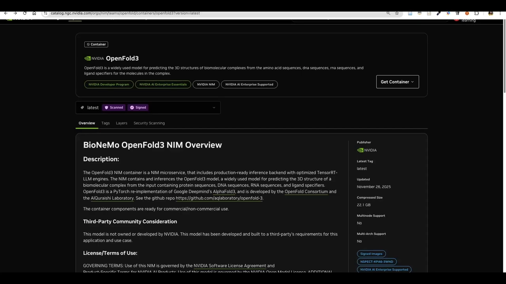

不过讲者特别提醒：**这一段不要跟着动手**。点开许可可以看到，它写的是 **NVIDIA AI Enterprise**，明确包含 NIMs；许可条款进一步说明 90 天免费试用之后需要 NVIDIA Enterprise AI 许可——试用与条款是一致的。 [【跳转到 00:46】](https://www.youtube.com/watch?v=7fVsDWfbr7w&t=46)

模型卡片页本身很友好：可以在线体验（和讲者自己要搭的东西很像）、有几个示例、还展示了**怎么在 shell 里跑（命令行）与怎么在 Python 里跑**；点 Deploy 则会引导到 NVIDIA AI Enterprise 的免费试用。流程概括起来就是：**生成 API key → 拉容器 → 跑起来**，页面甚至给了示例脚本。 [【跳转到 01:20】](https://www.youtube.com/watch?v=7fVsDWfbr7w&t=80)

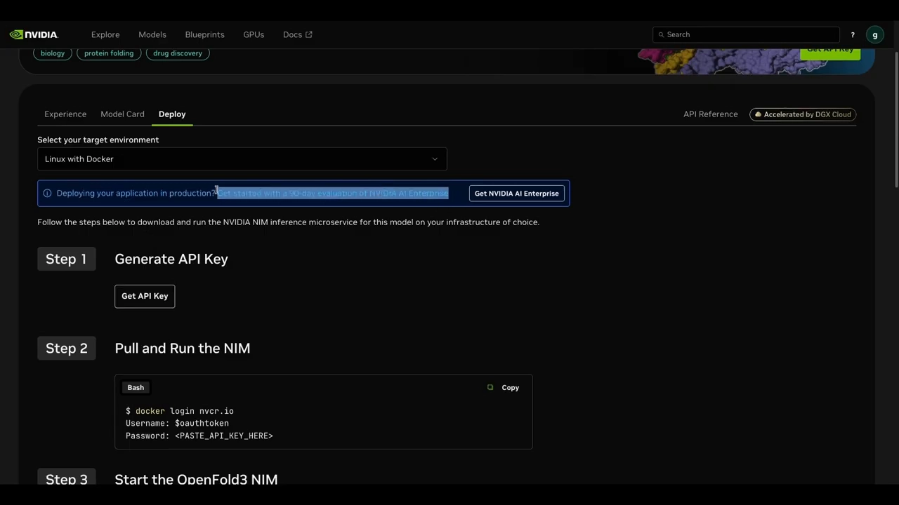

## 二、开跑前的硬性门槛：文档里都写了

打开文档先看 **prerequisites（前置条件）**： [【跳转到 01:57】](https://www.youtube.com/watch?v=7fVsDWfbr7w&t=117)

- **驱动**与 **NVIDIA toolkit** 必须装好——这一步后面在 EC2 上会再次变得关键；
- 机器要满足：**至少 64 GB CPU 内存、至少 8 核、至少 48 GB GPU 显存**，GPU 型号文档有指定（讲者用 L40 演示，其他符合条件的也行）。

讲者的亲身教训值得记住：一开始直接上手部署，错误不断；回到文档才发现全都写清楚了——**先读 prerequisites，再动手**。 [【跳转到 02:28】](https://www.youtube.com/watch?v=7fVsDWfbr7w&t=148)

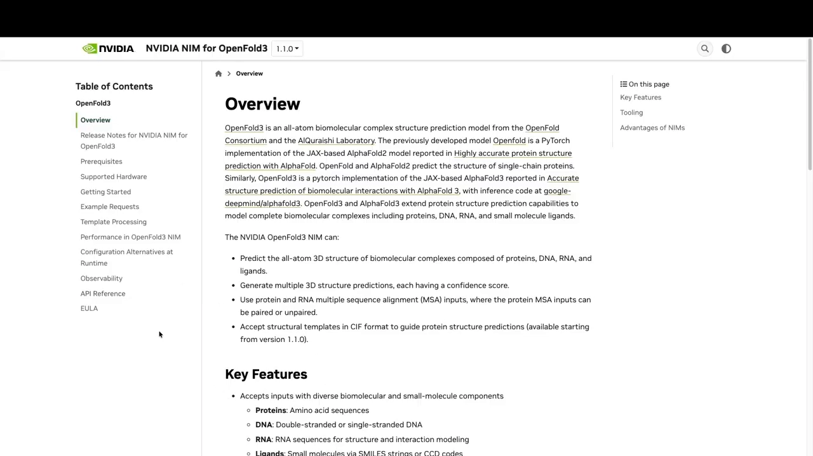

## 三、在 Brev 上开一台带 GPU 的机器

讲者选的第一条路是 **Brev**——NVIDIA 近期收购的公司，它给自己的定位类似"Google Colab 缺的那一块"。流程：登录 → 充了些额度 → 新建 GPU 实例。 [【跳转到 03:01】](https://www.youtube.com/watch?v=7fVsDWfbr7w&t=181)

配置按文档要求选：**L40 GPU、48 GB 显存、8 核、64 GB 内存、80 GB 磁盘**。选型时有几个实用细节： [【跳转到 03:42】](https://www.youtube.com/watch?v=7fVsDWfbr7w&t=222)

- 最便宜的档**不支持停止/启动**，会一直计费直到删除；讲者宁愿多花一点买灵活性；
- 实例模式选了自带 **Python、CUDA、Docker 和 JupyterLab** 的那一档——正好是跑 NIM 需要的家当。

几分钟后 VM 就绪：Python 3.12 虚拟环境已建好，JupyterLab 等依赖装齐。 [【跳转到 04:18】](https://www.youtube.com/watch?v=7fVsDWfbr7w&t=258)

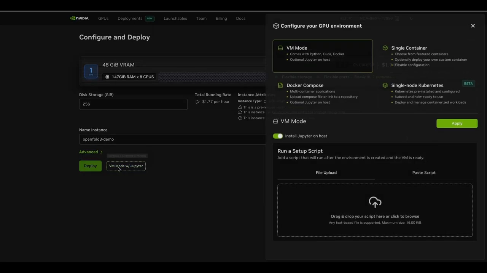

## 四、拉镜像、起端点：localhost:8000

进 JupyterLab 打开终端，按指引操作：粘贴 API key 登录成功、export 密钥后即可启动。第一次运行会比较久——镜像很大，要完整下载到本地；服务起来后监听 **8000 端口**。 [【跳转到 05:29】](https://www.youtube.com/watch?v=7fVsDWfbr7w&t=329)

之后所有预测都发往这个本地端点：`localhost:8000`。等镜像下载完（讲者中途暂停了录制），日志里能看到它在用 PyTorch、加载模型权重，端点就绪。 [【跳转到 06:34】](https://www.youtube.com/watch?v=7fVsDWfbr7w&t=394)

> **术语解释**：端点（endpoint）就是一个等待接收请求的服务地址。这里它跑在容器里的 8000 端口上，你把预测请求发给它，它返回预测结果。

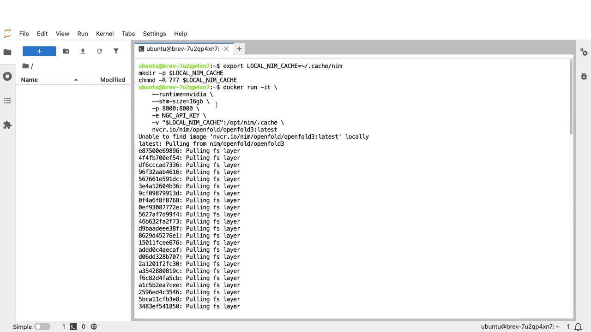

## 五、发出第一个预测请求：请求约定与 ubiquitin 示例

### 5.1 请求长什么样

文档给出了一份非常清晰的调用约定：请求打到 `localhost:8000`，内容包括**蛋白序列、比对（alignment）**，输出为 **PDB 格式**——与原始开源项目的约定差别不大。 [【跳转到 05:56】](https://www.youtube.com/watch?v=7fVsDWfbr7w&t=356)

更完整的内容在项目的 `examples/inference/inputs` 目录里。讲者选了 **ubiquitin（泛素）** 示例来演示：输入 JSON 里声明**分子类型是 protein**、**一条链（chain A）**、后面跟上序列。 [【跳转到 06:01】](https://www.youtube.com/watch?v=7fVsDWfbr7w&t=361)

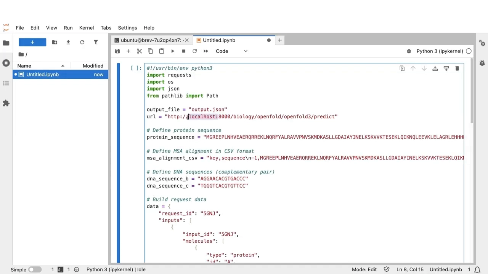

### 5.2 响应里有什么：output.json

运行 cell 之后端点返回了新的预测结果。讲者顺手看了眼 `nvidia-smi`，能看到模型正被加载进 GPU。响应落地为 **`output.json`**：里面有 **request ID（请求 ID）** 和 **outputs——structures with scores（带分数的结构）**：每个原子的坐标都在，各种分数也在。把这份文件下载到本地，就完成了从请求到结果的全流程。 [【跳转到 07:04】](https://www.youtube.com/watch?v=7fVsDWfbr7w&t=424)

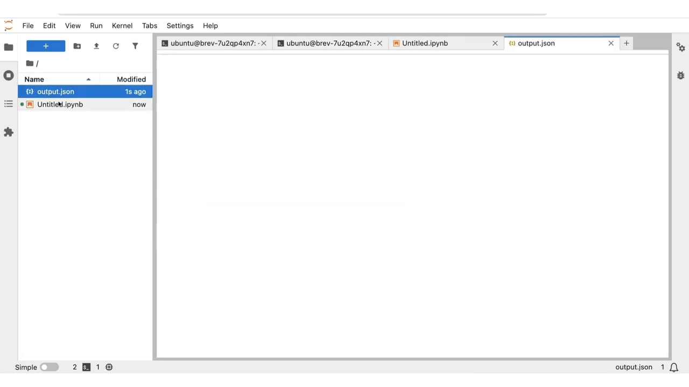

## 六、换 AWS EC2 再来一遍

Brev 的演示结束后，讲者把同样的流程在 **AWS EC2 实例**上重复了一遍，后端教程至此完整。几个要点： [【跳转到 07:46】](https://www.youtube.com/watch?v=7fVsDWfbr7w&t=466)

- **别忘了关机**：不删除实例的话会持续计费。讲者只是停止而非删除实例，因为还想继续研究 BioNeMo 框架（NVIDIA 的 NeMo 框架的生命科学版本，有很完善的用户指南；NIMs 就是 NVIDIA Inference Microservices）。 [【跳转到 08:00】](https://www.youtube.com/watch?v=7fVsDWfbr7w&t=480)
- 讲者选的实例是 **g5.12xlarge**，带 **4 块 GPU**；实例详情页能看到 GPU 型号、显存、vCPU 数与内存。 [【跳转到 09:02】](https://www.youtube.com/watch?v=7fVsDWfbr7w&t=542)

## 七、绕开许可限制：直接用开源项目跑

考虑到 NIM 的许可限制，讲者在 EC2 上换了一条路：**不跑 NIM 容器，直接用 OpenFold3 的开源项目**。步骤： [【跳转到 09:32】](https://www.youtube.com/watch?v=7fVsDWfbr7w&t=572)

1. 建虚拟环境；
2. `pip install` 安装 openfold3（Python 包）；
3. 安装 **Kalign2**——负责 MSA（多序列比对）这一步；
4. 跑预测：按项目给定的 predict 命令执行，用 GitHub 项目里自带的示例。 [【跳转到 10:09】](https://www.youtube.com/watch?v=7fVsDWfbr7w&t=609)

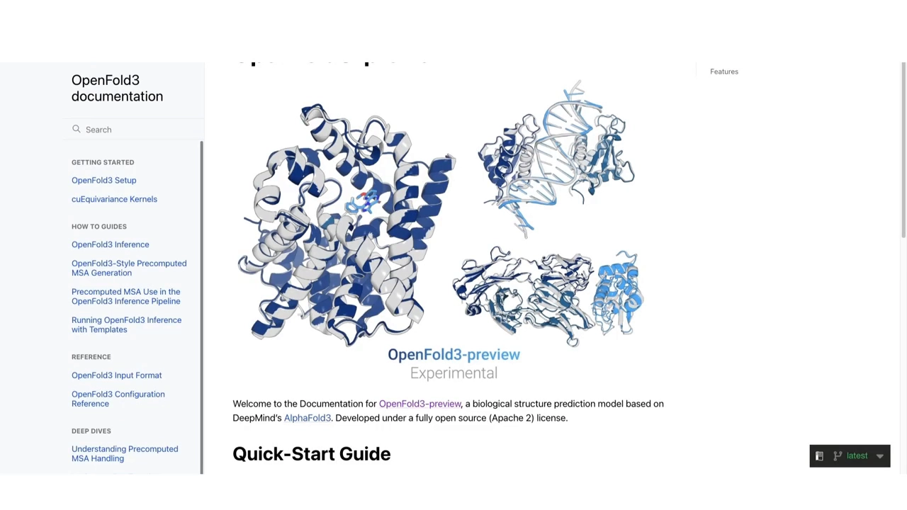

### 7.1 一个 runner.yaml，榨干四块 GPU

讲者对默认配置做了个小改动：**写一个 runner.yaml 文件**，让预测任务用满实例上的 4 块 GPU。predict 命令支持传额外参数（往上翻文档能看到全部参数），他传了 runner.yaml，还改了**输出格式**：默认输出 **CIF**，他改成 **PDB**——感觉更容易可视化。跑大示例遇到内存问题时，还可以用**低内存模式（low-memory mode）**。 [【跳转到 10:40】](https://www.youtube.com/watch?v=7fVsDWfbr7w&t=640)

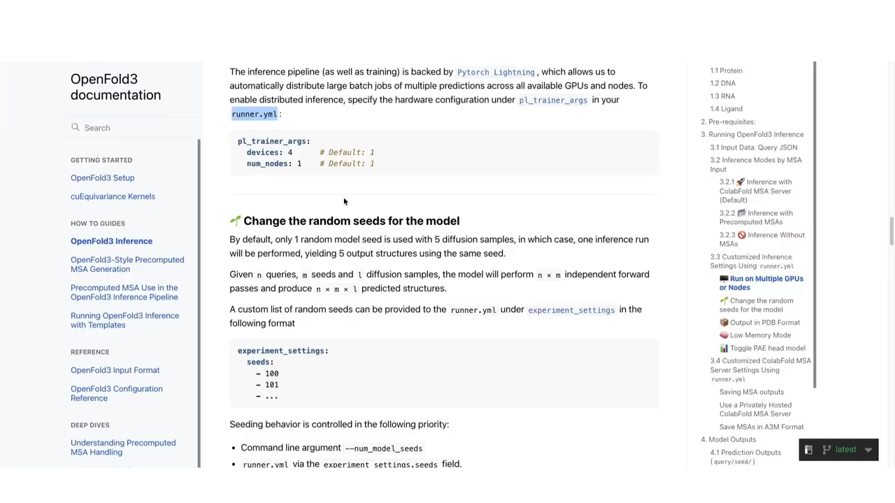

### 7.2 结果长什么样

跑完预测，结果目录里是**多个 PDB 模型**——模型会产出不同的样本（samples），每个都带**置信度分数**。下载到本地后，讲者把它导进一个免费的在线 PDB 查看网站，导入文件、点 apply，就能看到蛋白的三维结构。 [【跳转到 11:07】](https://www.youtube.com/watch?v=7fVsDWfbr7w&t=667)

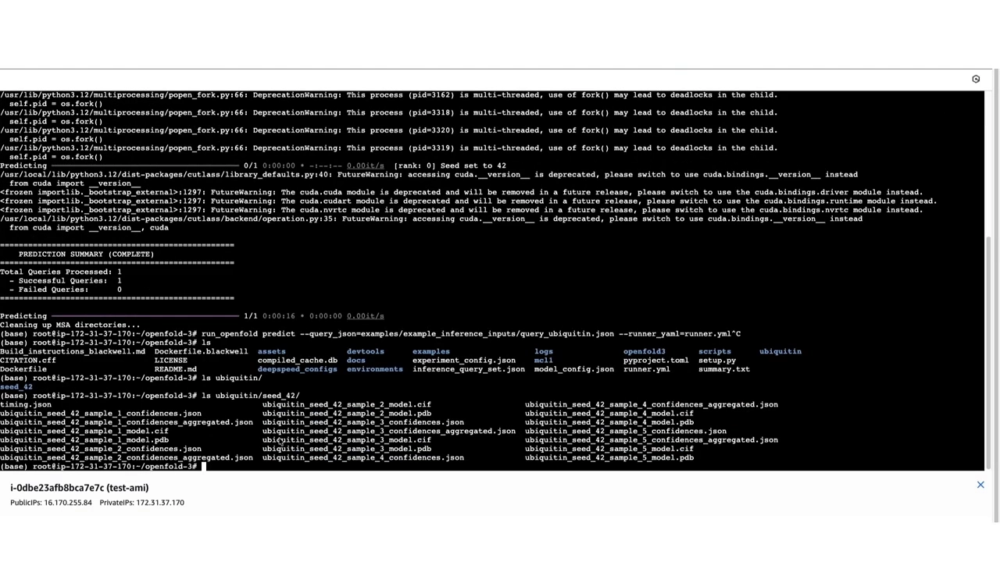

## 八、省事大杀器：NVIDIA GPU-optimized AMI

在 EC2 上开机器，一开始用 Amazon Linux 或 Ubuntu 都行，但那意味着自己装 Docker、toolkit、驱动——工作量不小。AWS marketplace 里有现成的 **NVIDIA GPU-optimized AMI**：镜像里**GPU 驱动、Docker、toolkit 全部预装**，而且**不额外收费**——计价页面里，同款实例带不带这个软件价格一样。 [【跳转到 12:23】](https://www.youtube.com/watch?v=7fVsDWfbr7w&t=743)

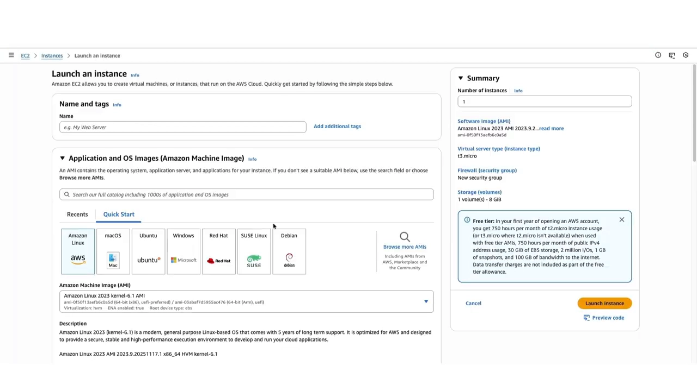

结尾还有个开源社区的小插曲：讲者发现入门命令里有一处错误，半小时前提了个 pull request 修复，坐等合并。 [【跳转到 13:14】](https://www.youtube.com/watch?v=7fVsDWfbr7w&t=794)

## 小结

- **NIM 路线**：NGC 注册表 → API key → 拉镜像 → 本机 8000 端口起服务 → 发预测请求 → 读 `output.json`（request ID + 原子坐标 + 分数）。
- **请求约定**：输入给蛋白序列与比对，输出 PDB；项目 `examples/inference/inputs` 里有现成示例（如 ubiquitin：protein、chain A、序列）。
- **硬门槛**：64 GB 内存、8 核、48 GB 显存；先读文档的 prerequisites 再动手。
- **许可提醒**：NIM 包含在 NVIDIA AI Enterprise 里，90 天试用后需企业许可——介意的话走开源项目路线：`pip install openfold3` + Kalign2 + runner.yaml（多 GPU、输出格式 PDB/CIF 可选）。
- **EC2 技巧**：直接选 NVIDIA GPU-optimized AMI，驱动/Docker/toolkit 免装；用完记得关机。

## 关键术语速查

| 术语 | 一句话解释 |
| --- | --- |
| NIM | NVIDIA Inference Microservices：把模型封装成可拉取、带 API 的推理容器 |
| NGC | NVIDIA container registry：NVIDIA 的容器/模型注册表，OpenFold3 镜像在生命科学分区 |
| Brev | NVIDIA 收购的云 GPU 平台，定位类似"Colab 缺的那一块" |
| API key | 访问 NGC/服务的密钥，拉镜像与调用端点都要用 |
| `examples/inference/inputs` | OpenFold3 项目自带的预测输入示例目录，含 ubiquitin 等 |
| `output.json` | 预测响应文件：request ID + 结构（原子坐标）+ 各项分数 |
| Kalign2 | 序列比对工具，OpenFold3 流程中负责 MSA 一步 |
| runner.yaml | 自定义运行配置：指定多 GPU、输出格式（PDB/CIF）等参数 |
| AMI | AWS 的机器镜像；NVIDIA GPU-optimized AMI 预装驱动/Docker/toolkit 且不额外收费 |
| BioNeMo | NVIDIA NeMo 框架的生命科学版本，NIM 是其推理微服务形态 |