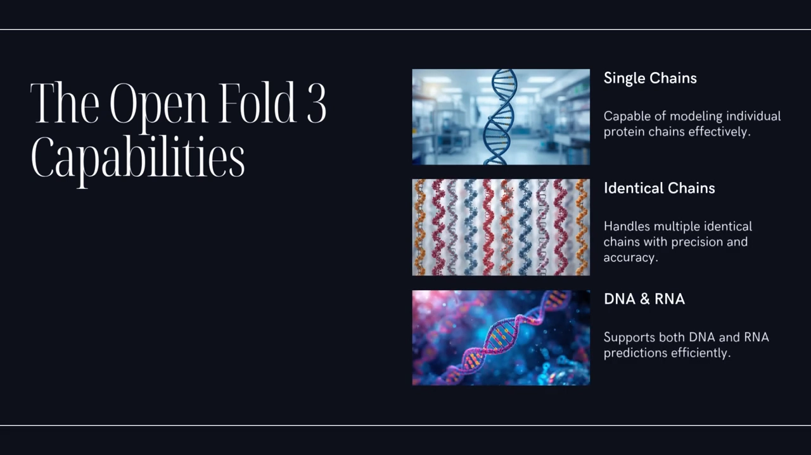
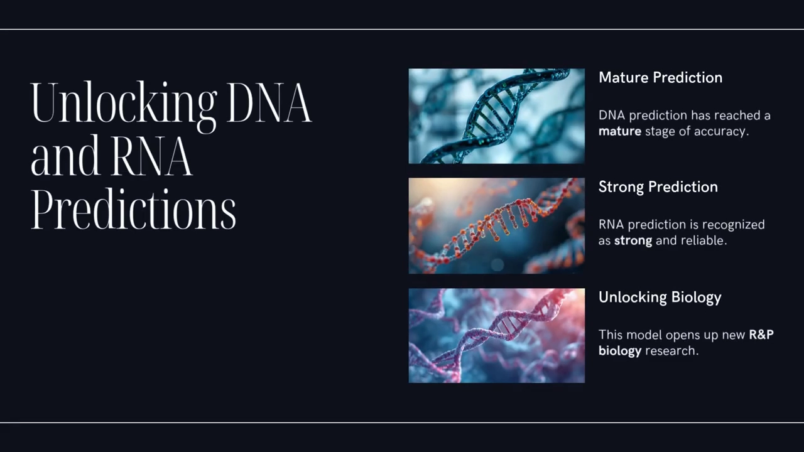
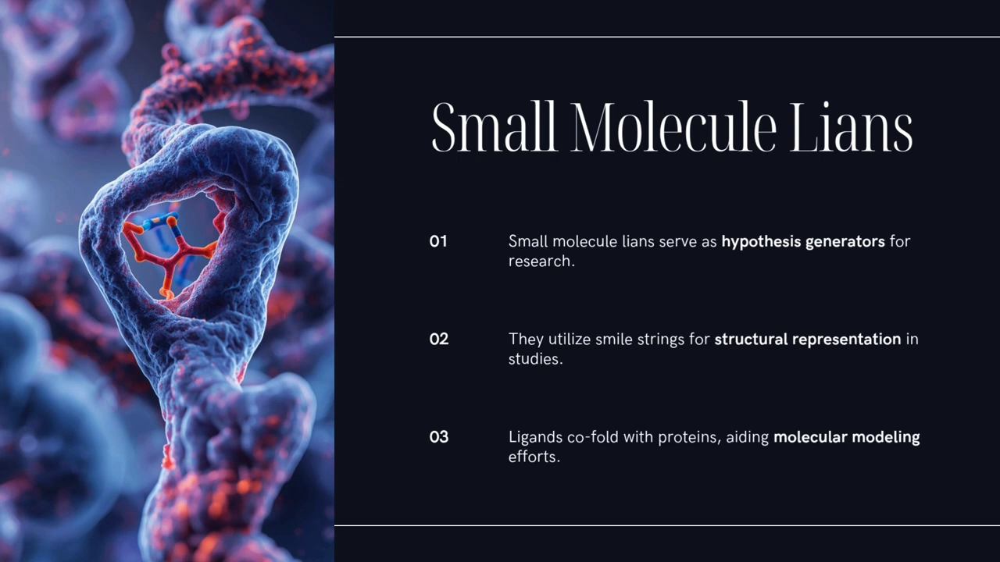
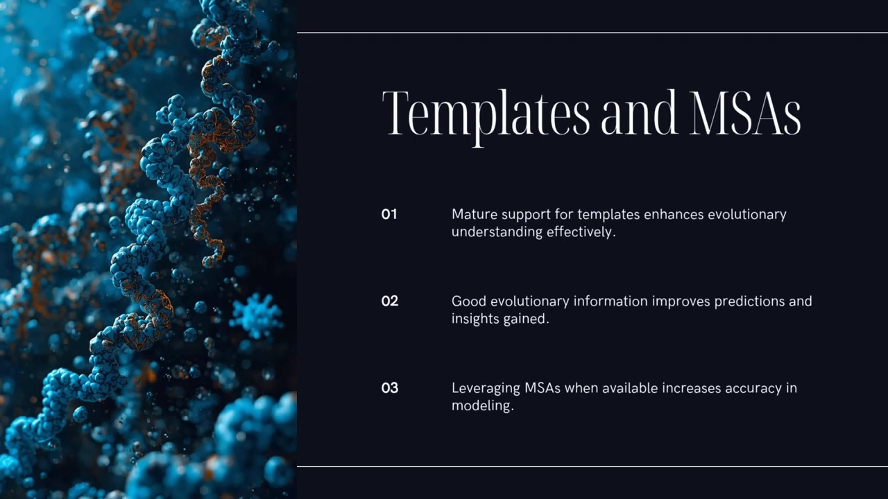
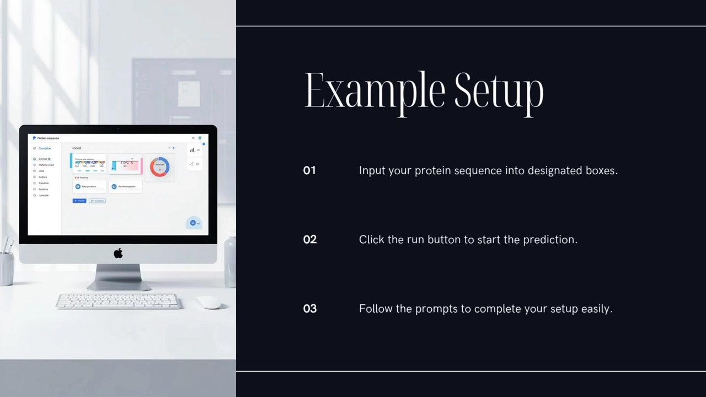
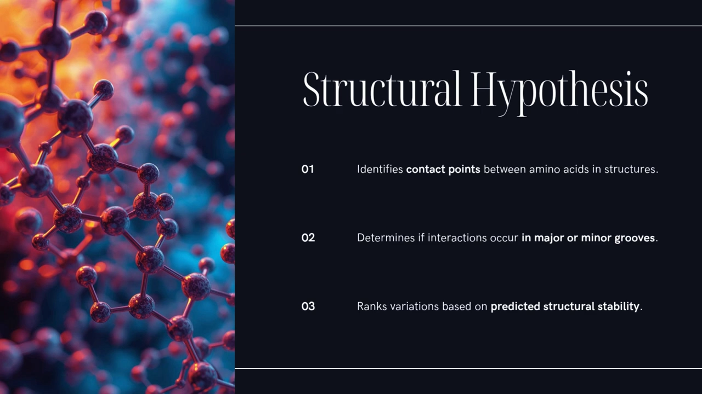
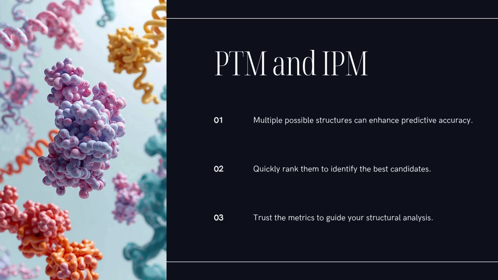
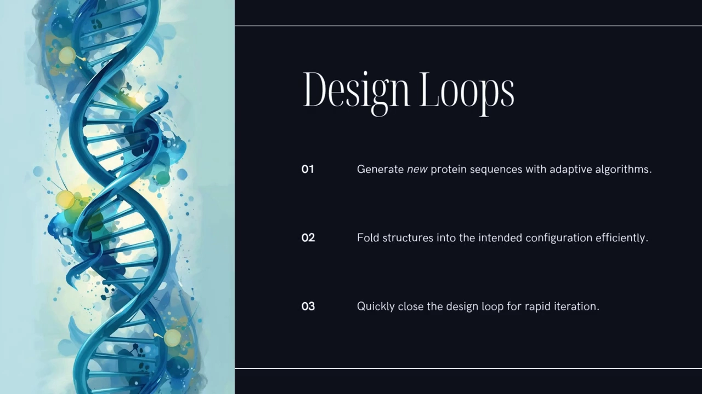

# OpenFold3 上手指南：在 NVIDIA NIM 上跑出你的第一个蛋白质结构预测

> 视频来源：[OpenFold3: A Researcher's Guide To Your First Protein Prediction](https://www.youtube.com/watch?v=ha01JcsSzaI&t=0)（YouTube · Binary Verse AI）
> 本文基于视频演说图文稿整理，配图截自视频。

## 本讲要解决的核心问题（SCQA）

**背景**：很长时间里，预测蛋白质三维结构是"大实验室的专利"——要么有海量算力，要么能用上受限的内部系统，普通研究者只能站在旁边看。 [【跳转到 00:00】](https://www.youtube.com/watch?v=ha01JcsSzaI&t=0)

**冲突**：现在事情正在起变化。出现了 OpenFold3——一个开源的复合物结构预测模型，能预测的不只是蛋白质，还包括 DNA、RNA 和小分子配体。但"能做"和"我能用上"之间还隔着一层：工具摆在那里，入口在哪里？输入怎么写？输出怎么读？ [【跳转到 00:05】](https://www.youtube.com/watch?v=ha01JcsSzaI&t=5)

**疑问**：一个研究者想跑出自己的第一个结构预测，最快的路径是什么？预测结果又该不该信？

**回答（中心思想）**：走 NVIDIA NIM 这条路——在网页版 playground 上选示例、填序列、点运行，几分钟拿到结构；输入端只需要想清楚三件事：**分子有哪些、每个分子给什么信息（序列 / SMILES / CCD 码）、有没有现成的 MSA 与模板**；输出端永远用 **pLDDT、PAE、pTM/ipTM** 这几个置信度指标来把关，"图好看"不算数，指标说话。 [【跳转到 00:22】](https://www.youtube.com/watch?v=ha01JcsSzaI&t=22)

---

## 一、OpenFold3 是什么：开源许可 + NIM 部署，把它变成"可用的替代品"

视频开头就点出两个对工业界和高校大实验室最要紧的字眼：**许可（license）**与**部署（deployment）**。 [【跳转到 00:46】](https://www.youtube.com/watch?v=ha01JcsSzaI&t=46)

- **Apache 2.0 许可**：很多预测模型对商用并不友好——IP 顾虑、数据使用的法律摩擦，常常让企业直接出局。Apache 2.0 基本免除了这些麻烦，让 OpenFold3 可以真正进入产业工作流。 [【跳转到 00:46】](https://www.youtube.com/watch?v=ha01JcsSzaI&t=46)
- **NVIDIA NIM 部署路径**：NIM（NVIDIA Inference Microservices，推理微服务）把模型打包成带稳定 API 的容器，让"跑起来"这件事简单很多。 [【跳转到 00:46】](https://www.youtube.com/watch?v=ha01JcsSzaI&t=46)

这两点合在一起，才让 OpenFold3 成为一个"不用跳火圈就能用上"的可行替代品，把门槛降下来，让人专注于科学问题本身。 [【跳转到 01:11】](https://www.youtube.com/watch?v=ha01JcsSzaI&t=71)

## 二、能预测什么：一张"能力与状态"表

理解模型能力，最好的起点是视频里反复提到的 **OpenFold3 capabilities and status table**（能力与状态表）——它像一张速查表（cheat sheet），列出模型开箱即用能给到什么。 [【跳转到 01:22】](https://www.youtube.com/watch?v=ha01JcsSzaI&t=82)

### 2.1 范围：不止蛋白质，而是"生物分子"

从表里读出的大图景是：OpenFold3 是一个 **biomolecular model（生物分子模型）**。它能处理：

- **蛋白质**：单链、多条相同链、不同链之间的相互作用；
- **DNA 与 RNA**；
- **可选的小分子配体（ligand）**。

> **术语解释**：ligand（配体）指与蛋白等大分子结合的小分子，比如药物分子、ATP 这类辅因子。 [【跳转到 01:52】](https://www.youtube.com/watch?v=ha01JcsSzaI&t=112)

### 2.2 状态列：mature / strong / preview 分别意味着什么

状态列用三档词描述可靠程度： [【跳转到 01:52】](https://www.youtube.com/watch?v=ha01JcsSzaI&t=112)

| 对象 | 状态 | 解读 |
| --- | --- | --- |
| 核心蛋白结构（含亚基界面） | **mature（成熟）** | 可高置信使用，与既有方法可比；因为训练数据覆盖了这些情形 |
| DNA | **mature（成熟）** | 同上 |
| RNA | **strong（强）** | 可用，可靠度略低于成熟档 |
| 小分子配体 | **preview（预览）** | 当作"假设生成器"用，不要当最终答案 |

蛋白质与核酸放进同一个模型，为什么是大事？因为它解锁了 **RNA 生物学 / 核糖核蛋白复合物（ribonucleoprotein complex）** 的建模——基因调控、RNA 加工这些重要生物机器，本质就是蛋白质结合着 RNA 或 DNA 在工作。能同时建模"蛋白部分 + 核酸部分"，是理解它们工作机制、乃至设计药物靶向的基础。 [【跳转到 02:20】](https://www.youtube.com/watch?v=ha01JcsSzaI&t=140)

## 三、输入怎么写：预测前的三件准备

这是把 OpenFold3 用起来的关键一环。视频把输入拆成三件事：**给哪些分子、每个分子给什么、要不要加进化信息**。

### 3.1 配体怎么给：SMILES 字符串或 CCD 码

对标记为 preview 的小分子配体，输入方式有两种： [【跳转到 02:48】](https://www.youtube.com/watch?v=ha01JcsSzaI&t=168)

- **SMILES 字符串**：把分子的结构写成一行文本编码，比如咖啡因这样简单的小分子可以，复杂分子也可以；
- **CCD 码**：PDB 数据库里的标准化学组件编号。视频举例：**ATP** 就是腺苷三磷酸（adenosine triphosphate）的 CCD 码。

模型随后把蛋白与配体**共同折叠（co-fold）**——不是严格意义上的分子对接（docking），但能给你口袋形状的样子、配体可能放在哪里。把它当**生成式先验（generative prior）**用：在投入更贵的、基于物理的方法之前，先快速筛掉一批不可能，留下值得深挖的候选。 [【跳转到 03:13】](https://www.youtube.com/watch?v=ha01JcsSzaI&t=193)

### 3.2 MSA 与模板：有就喂，没有也能跑

能力表还标注了对 **templates（模板）** 与 **MSA（multiple sequence alignment，多序列比对）** 的成熟支持。MSA 是一份"同源序列对照表"，携带进化信息。视频的说法是：如果你手上有好的 MSA——比如从 ColabFold 得到或预先算好的——喂进去通常能**提升精度**。 [【跳转到 03:43】](https://www.youtube.com/watch?v=ha01JcsSzaI&t=223)

但 OpenFold3 也被设计成在没有进化信号或信号很弱时照样合理工作——**工程化蛋白（engineered proteins）** 就是典型场景：自然界里没有多少同源序列可比。 [【跳转到 04:08】](https://www.youtube.com/watch?v=ha01JcsSzaI&t=248)

### 3.3 它还是个"基础模型"：可以拿自己的数据继续微调

视频强调 OpenFold3 是 **foundation model（基础模型）**：在海量数据上预训练，但**设计出来就是为了被微调（fine-tune）的**。如果你有专有数据——几千个测过活性的酶变体、某 RNA 家族的结合分子数据——可以把通用模型在你的数据上继续训练，把"通才"变成你那个具体问题的"专才"。再叠加开源许可，这是相当大的优势。 [【跳转到 04:20】](https://www.youtube.com/watch?v=ha01JcsSzaI&t=260)

## 四、最快的上手路径：NVIDIA NIM Playground

不想配环境？**NVIDIA 托管的 NIM playground 是最快的尝试方式**——本地什么都不用装，你这边也不需要强力 GPU。 [【跳转到 04:59】](https://www.youtube.com/watch?v=ha01JcsSzaI&t=299)

### 4.1 入口与示例输入

打开 **build.nvidia.com** 找到 OpenFold3 页面。页面直接给出**示例输入（example inputs）**——你不用从零摸索格式，选一个像"蛋白–DNA 复合物"或"蛋白–配体复合物"的示例，它会替你把输入框搭好： [【跳转到 05:23】](https://www.youtube.com/watch?v=ha01JcsSzaI&t=323)

- **蛋白–DNA 示例**：先贴蛋白序列，再贴第一条 DNA 链的序列，然后是第二条 DNA 链；
- **蛋白–配体示例**：贴蛋白序列，然后填配体的 SMILES 字符串或 CCD 码。

填完点 **Run**，计算在 NVIDIA 的后台基础设施上完成。 [【跳转到 05:51】](https://www.youtube.com/watch?v=ha01JcsSzaI&t=351)

### 4.2 跑完之后能看到什么

以转录因子结合 DNA 为例：你会立刻得到一张三维图——哪些氨基酸在接触 DNA 碱基？结合在**大沟（major groove）**还是**小沟（minor groove）**？这就是一个**初始结构假设（initial structural hypothesis）**。同时可以查置信度分数，比如 DNA 结合结构域的平均 pLDDT，看模型自己对这部分有多笃定。它让你非常快地把机理思路画出来。 [【跳转到 06:16】](https://www.youtube.com/watch?v=ha01JcsSzaI&t=376)

对做药物发现的团队，蛋白–配体示例是**快速筛选工具**：想象你有同一个候选药物分子的 10 个微小变体，对每个变体的 SMILES 跑一次 OpenFold3，然后比较预测结构——口袋形状怎么变？配体放得合理吗？用视觉加上置信度指标，很快把这 10 个变体排出先后；也许只有两三个配体位置看起来合理、分数也过硬，那就把昂贵的后续实验或模拟留给它们。**提前剪枝搜索空间**。 [【跳转到 06:44】](https://www.youtube.com/watch?v=ha01JcsSzaI&t=404)

## 五、输出怎么读：四个置信度指标，比"图好看"更重要

视频反复强调一个原则：**一张漂亮的图仍可能误导**。模型自己觉得"这段不准"时，图再好看也不能信——所以必须看指标。 [【跳转到 07:09】](https://www.youtube.com/watch?v=ha01JcsSzaI&t=429)

### 5.1 pLDDT：每个残基"自己站得多稳"

**pLDDT（predicted local distance difference test）** 估计的是**每个残基位置**的置信度。它通常以颜色画在结构上：蓝色代表有信心，红色代表没信心。残基 50 的 pLDDT 高，意味着模型对"残基 50 在三维空间中的位置"很有把握。它是检查松散 loop（环区）或不确定结构域的快速视觉手段。 [【跳转到 07:39】](https://www.youtube.com/watch?v=ha01JcsSzaI&t=459)

### 5.2 PAE：链与链之间"相对位置对不对"

pLDDT 回答不了"链 A 相对链 B 摆得对不对"，这要交给第二个指标 **PAE（predicted aligned error，预测对齐误差）**：估计**任意两个残基之间距离**的期望误差。看链 A 残基与链 B 残基之间的 PAE 值：低，说明模型对两条链的相对位置与朝向有信心。**界面上低 PAE 是复合物的好兆头**——它是判断"预测的分子间界面（蛋白–蛋白、蛋白–DNA 都算）是否稳定且被正确建模"的最佳代理。 [【跳转到 08:09】](https://www.youtube.com/watch?v=ha01JcsSzaI&t=489)

### 5.3 pTM 与 ipTM：给多个候选结构排序

有时（尤其这些模型的**扩散**部分）会生成多个可能结构，你需要一个单一分数来快速排序。这就是 **pTM** 与 **ipTM** 的用武之地： [【跳转到 08:37】](https://www.youtube.com/watch?v=ha01JcsSzaI&t=517)

- **pTM**：给"单条链或结构域的折叠整体准确度"打分；
- **ipTM**：专门给"相互作用分子/链之间预测界面"的置信度打分。

所以如果你对同一个蛋白–配体复合物跑了 5 次预测，就按 **ipTM 排序**——更高的 ipTM 意味着界面被更笃定地预测了。 [【跳转到 09:07】](https://www.youtube.com/watch?v=ha01JcsSzaI&t=547)

### 5.4 置信度数据要存下来：结构文件旁的 JSON

一个重要的实操习惯：**永远把置信度数据存下来**。它通常和 PDB 或 mmCIF 结构文件一起，装在一个 JSON 文件里。规则只有一条：**漂亮的图与糟糕的指标冲突时，信指标**。 [【跳转到 09:31】](https://www.youtube.com/watch?v=ha01JcsSzaI&t=571)

## 六、从 playground 到生产：本地部署怎么做

NIM 托管的 playground 适合起步、快测、小批量；但要做**高吞吐**工作、或把它接进自动化 pipeline，就需要更多控制权——本地安装。 [【跳转到 10:01】](https://www.youtube.com/watch?v=ha01JcsSzaI&t=601)

视频描述的路径已经相当顺滑（假设你有 Linux 和合适的 NVIDIA GPU，推荐 Ampere 或 Hopper 架构）：

1. `pip install` 安装 OpenFold3，再用 mamba 装做序列比对（MSA）的工具；
2. 一个一次性的 setup 命令，下载模型权重与参数；
3. 之后跑预测：**写一个简单的 JSON 文件，列出输入序列与路径**，然后用 openfold 的 predict 命令执行它。 [【跳转到 10:44】](https://www.youtube.com/watch?v=ha01JcsSzaI&t=644)

本地跑的好处是**完全的控制权**：可以指向预先算好的 MSA，对接自己的比对 pipeline；做几千次预测时，性能也可预期。

## 七、它在真实研究里怎么用：三个场景

### 7.1 药物发现的 hit triage（苗头化合物分诊）

不要把每个潜在苗头分子都丢进昂贵缓慢的对接或模拟——先用 OpenFold3 做快速初筛：给靶蛋白生成比如 50 个配体变体的结构，用 **ipTM 与界面 PAE** 排名，只把最靠前的几个往下推进。昂贵的计算与实验资源，留给快模型筛出的最有希望的候选——省下的是大量的时间与成本。 [【跳转到 11:34】](https://www.youtube.com/watch?v=ha01JcsSzaI&t=694)

### 7.2 酶 / binder 设计的验证闭环

如果你在用 AI 生成新的蛋白序列——改活性的酶、针对新靶点的 binder——逆折叠这类生成工具可能提出成百上千条序列。它们真的能折成目标结构吗？把 OpenFold3 放进设计循环里当**结构验证步骤**：生成序列 → 用 OpenFold3 预测结构 → 检查对不对 → 反馈给生成器。闭环被快速跑通。 [【跳转到 11:59】](https://www.youtube.com/watch?v=ha01JcsSzaI&t=719)

### 7.3 核酸复合物的机理草图

蛋白–DNA、蛋白–RNA 复合物的预测，即使原子级细节不完全准确，也能给出宝贵的**定性洞见**：比如"蛋白上这个 loop 似乎与 RNA 的这个碱基有紧密接触"——立刻就是一个可检验的假设："突变 loop 里的这个氨基酸，看看结合是否受影响？"哪怕只是草图，也给湿实验指了方向。 [【跳转到 12:24】](https://www.youtube.com/watch?v=ha01JcsSzaI&t=744)

最后把一切收拢：无论用 playground 快速起步，还是本地部署走向生产，**NVIDIA NIM 的封装都是关键**——优化过的容器、稳定的 API。demo 版本与你内部部署的版本用的是同一个底层优化引擎，协作与扩展都顺畅许多。 [【跳转到 12:49】](https://www.youtube.com/watch?v=ha01JcsSzaI&t=769)

## 小结

- OpenFold3 是开源的复合物结构预测模型，**Apache 2.0 许可 + NVIDIA NIM 部署**让它对产业界真正可用。
- 它是生物分子模型而非单纯的蛋白模型：蛋白（mature）、DNA（mature）、RNA（strong）、小分子配体（preview，当假设生成器用）。
- 输入三件事：**分子清单、每个分子的信息（序列 / SMILES / CCD 码）、可选的 MSA 与模板**；配体与蛋白共同折叠，先筛后深挖。
- NIM playground（build.nvidia.com）是零门槛入口：选示例 → 填输入 → Run；本地部署则用 JSON 输入文件 + predict 命令，换取控制权与吞吐。
- 输出必须过指标关：**pLDDT 看局部、PAE 看界面、pTM/ipTM 给候选排序**；图与指标冲突时，信指标。
- 三个落地场景：hit triage 初筛、设计闭环验证、核酸复合物机理草图。

## 关键术语速查

| 术语 | 一句话解释 |
| --- | --- |
| OpenFold3 | 开源的 AlphaFold3 类生物分子复合物结构预测模型，Apache 2.0 许可 |
| NVIDIA NIM | NVIDIA 推理微服务：把模型打包成带稳定 API 的优化容器 |
| ligand（配体） | 与蛋白等大分子结合的小分子，如药物分子、ATP |
| SMILES | 用一行文本描述分子结构的编码方式 |
| CCD 码 | PDB 数据库的标准化学组件编号（如 ATP） |
| MSA | 多序列比对：携带同源进化信息的"序列对照表"，喂入通常提升精度 |
| co-fold（共同折叠） | 把蛋白与配体放进同一次结构预测中一起折叠 |
| pLDDT | 逐残基位置置信度，颜色画在结构上（蓝高红低） |
| PAE | 任意两残基间距离的期望误差；界面低 PAE = 复合物可信 |
| pTM / ipTM | 全局折叠 / 分子间界面的置信度分数，用于多候选排序 |
