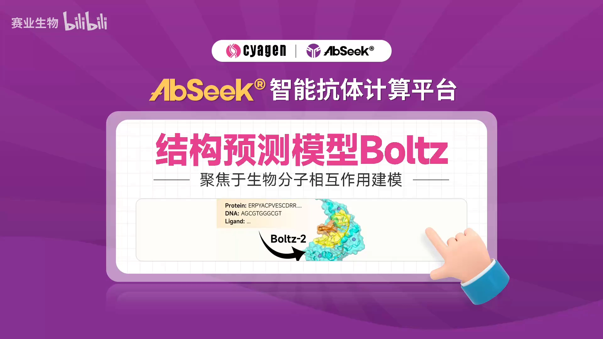
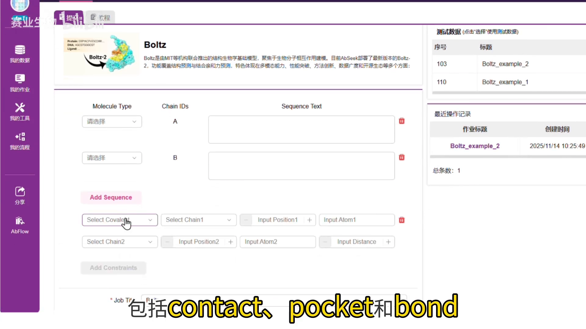
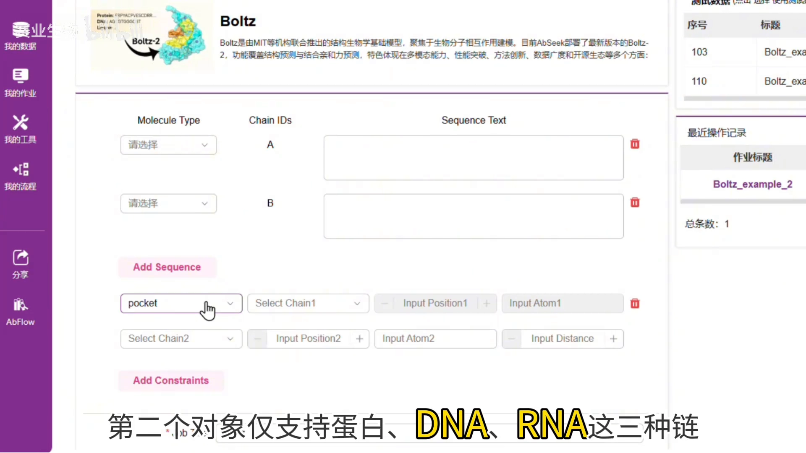
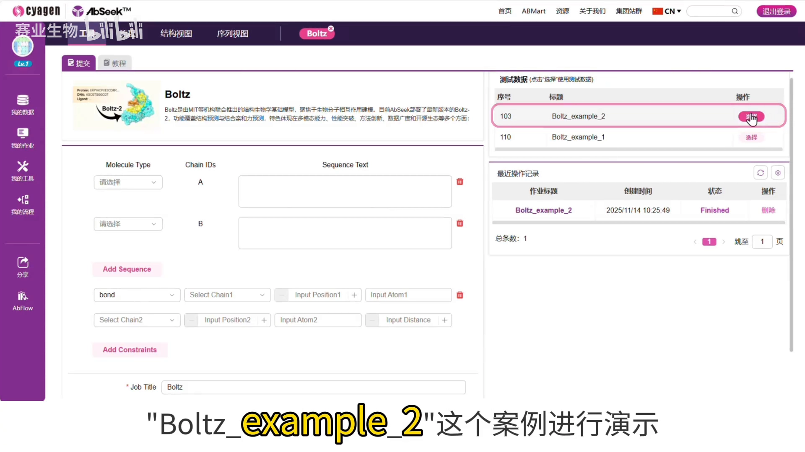
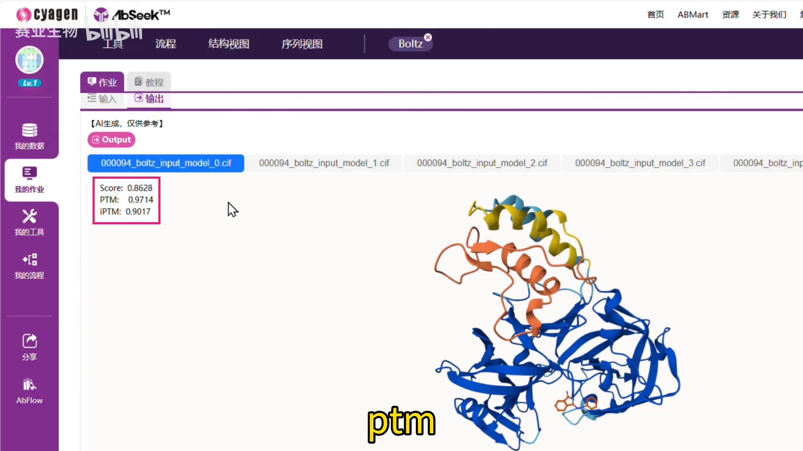

# Boltz-2 输入怎么填：四种链类型、三种约束、三份评分

> 视频来源：B 站《麻省理工Boltz-2模型：一键预测生物分子3D结构与相互作用》，[BV1DbiMBwENS](https://www.bilibili.com/video/BV1DbiMBwENS/)。
> 本文基于该视频的「图-字幕」演说文稿整理，所有关键操作与数字都可在原视频中核查。

## 本讲要解决的核心问题（SCQA）

**背景**：本章 2.5 汇总「分子输入打包格式」：AlphaFold Server 用 `sequences[]` 组织实体（2.5.1），OpenFold3 NIM 用 `inputs[].molecules[]`（2.5.2）。作为 AF3 类模型的又一主力，Boltz-2 也有自己的一套输入组织方式。

**冲突**：每个平台的规则都不一样——链怎么声明、小分子怎么给、残基级约束怎么写，换一个平台就要重学一遍。不看一遍真实操作，光看字段名很难对上号。

**疑问**：Boltz-2 的输入到底由哪几部分组成？提交之后，结果又该看哪几个数字？

**回答（中心思想）**：Boltz-2 的输入可以概括为「**四种链类型（蛋白/DNA/RNA/配体）+ 序列或 SMILES + 三种可选约束（contact/pocket/bond）**」；结果用 **score / pTM / ipTM** 三份 0~1 的置信度评分来读，分数越高越好。

## 一、Boltz-2 是什么：MIT 团队的开源多模态预测基础模型

视频开篇给出定位：**Boltz-2 是麻省理工学院（MIT）团队研发的多模态分子结构预测基础模型**，平台部署的是开源版本。它能**从序列信息与约束条件中，直接预测生物分子的三维结构与相互作用模式**——也就是把「链」和「链之间的关系」放进同一个预测任务里一起算 [【跳转到 00:15】](https://www.bilibili.com/video/BV1DbiMBwENS/?t=15)。

视频的演示环境是 AIC 平台：登录 AIC 官网，在工具页面搜索「波尔兹」（Boltz）即可找到并打开该工具 [【跳转到 00:05】](https://www.bilibili.com/video/BV1DbiMBwENS/?t=5)。

## 二、四种输入类型：蛋白、DNA、RNA、小分子配体

输入界面支持**四种输入类型** [【跳转到 00:34】](https://www.bilibili.com/video/BV1DbiMBwENS/?t=34)：

| 输入类型 | 填什么 |
| --- | --- |
| 蛋白（protein） | 氨基酸序列 |
| DNA / RNA | 核苷酸序列 |
| 小分子配体（ligand） | **仅支持 SMILES 表达式** |

界面下方有两个按钮：**Add Sequence**（添加新序列）和 **Add Constraint**（添加约束条件）。链是「主角」，约束是可选的「配角」——对照本章 1.3.1 的 SMILES 与 1.3.3 的 CCD 编码来理解：配体走 SMILES 文本输入，配体原子在约束里也按 SMILES 顺序定位（见下一节）。

## 三、三种约束条件：contact / pocket / bond

约束是 Boltz-2 输入里最「结构生物学」的部分，共三种 [【跳转到 00:58】](https://www.bilibili.com/video/BV1DbiMBwENS/?t=58)：

- **contact（接触）**：可以指定**两个特定残基之间的距离限制**；也可以指定**一条链与另一条链中某个特定残基之间的接触关系**。
- **pocket（口袋）**：用**两条不同的链**进行约束——第一个对象支持**任意类型**的链（可以是配体），第二个对象仅支持**蛋白、DNA、RNA** 这三种链。

- **bond（共价键）**：对两个原子之间做**共价键约束**；仅支持 **CCD 配体与标准残基之间**的成键 [【跳转到 01:23】](https://www.bilibili.com/video/BV1DbiMBwENS/?t=83)。

bond 有两个易错点，视频专门强调：

1. 若约束对象是 **ligand** 的原子，参数 **position 对应 SMILES 表达式中原子的顺序**——也就是数 SMILES 字符串里的第几个原子；
2. **标准残基中的原子名称需要用户正确填写**——原子命名要符合残基的标准命名，写错约束就不成立。

## 四、示例演示：一个 pocket 约束任务从提交到出结构

视频用示例框中的 **Boltz-2 Sample 2** 案例演示 [【跳转到 01:48】](https://www.bilibili.com/video/BV1DbiMBwENS/?t=108)：点击「选择」按钮，输入框自动填充序列与约束条件。这条约束的含义是 [【跳转到 01:53】](https://www.bilibili.com/video/BV1DbiMBwENS/?t=113)：

> B 链配体（ligand）与 A 链上 **311 号位点残基**进行 **pocket 约束**，距离为 **5 Å**。

点击提交后，AI 模型开始预测；等待一段时间，结果页展示**模型预测的五个三维结构** [【跳转到 02:14】](https://www.bilibili.com/video/BV1DbiMBwENS/?t=134)——一次预测多条构象，供后续比较与挑选。

## 五、读懂三种评分：score / pTM / ipTM

结果页左上角有三种评分 [【跳转到 02:19】](https://www.bilibili.com/video/BV1DbiMBwENS/?t=139)：

| 评分 | 含义 |
| --- | --- |
| **score** | 总体的置信度评分 |
| **pTM** | 模板建模得分（衡量整体结构） |
| **ipTM** | 结合界面上的 pTM 得分（衡量界面） |

三种得分的取值范围都是 **0~1，分数越高越好** [【跳转到 02:24】](https://www.bilibili.com/video/BV1DbiMBwENS/?t=144)。这与本章 3.1 的 pTM/ipTM 直觉一致：看单链折叠质量用 pTM，看复合物结合界面用 ipTM。更多内容可通过结果页上方的「教程」按钮查看。

## 小结

- Boltz-2 是 MIT 团队研发的**开源**多模态分子结构预测基础模型，从序列 + 约束直接预测三维结构与相互作用模式。
- 输入只有**四种类型**：蛋白、DNA、RNA、小分子配体；配体**只认 SMILES**。
- 可选约束三种：**contact**（残基距离 / 链间接触）、**pocket**（两条链，第二对象限蛋白/DNA/RNA）、**bond**（共价键，限 CCD 配体与标准残基）。
- bond 的两个易错点：ligand 原子的 **position = SMILES 中的原子顺序**；标准残基**原子名要按标准命名填写**。
- 结果一次给**五个构象**；读结果看三份 0~1 的评分：**score（总体）/ pTM（整体结构）/ ipTM（结合界面）**，越高越好。

## 关键术语速查

| 术语 | 一句话解释 |
| --- | --- |
| SMILES | 分子的线性文本表示，Boltz-2 中配体的唯一输入格式（见 1.3.1） |
| CCD 编码 | PDB 标准配体字典的编号（如 ATP、ZN），bond 约束中配体的身份（见 1.3.3） |
| ligand（配体） | 与蛋白等大分子结合的小分子，此处仅支持 SMILES 输入 |
| contact / pocket / bond | 三种约束：残基距离或链间接触 / 口袋约束 / 共价键约束 |
| score / pTM / ipTM | 三份置信度评分：总体 / 整体结构 / 结合界面，0~1 越高越好 |
