# Gromacs 入门讲解

> 来源视频：[Gromacs入门讲解（TasVeri）](https://www.bilibili.com/video/BV1Rc411o7Lz/) · 时长 101:42
> 本篇基于视频 AI 字幕与画面整理，时间戳可跳转回原视频对应位置。讲者声明资料为个人整理，仅供学习参考。

## 本讲要解决的核心问题（SCQA）

**背景**：想用分子动力学（MD）模拟开展研究，GROMACS 是最常用的引擎之一。很多同学装好了软件、跑过 tutorial，却仍不知道"一次完整的模拟到底由哪些东西组成"。

**冲突**：GROMACS 只是 MD 引擎——完整的研究需要建模、计算、可视化、后处理一整套工具；而模拟本身又由四类输入文件 + 两条命令驱动。初学者要么"跑得起来但看不懂报错"，要么对着 mdp/top 文件不知从何下手。

**疑问**：一次 GROMACS 模拟的完整工作流长什么样？四类输入文件各自装什么、谁生成谁？模拟跑不起来、中途崩掉又该怎么排查？

**回答（中心思想）**：**GROMACS 模拟 = 准备四类文本文件（gro 模型 / top 拓扑 / mdp 设置 / ndx 索引）→ `grompp` 把它们打包成二进制的 tpr → `mdrun` 吃进 tpr，输出轨迹与能量文件 → 后处理分析**。本讲按"工具链全景 → 学习路径 → 文件体系 → 两条命令 → 排错与进阶"的主线，把这条流水线讲透。

---

## 一、先看全景：分子动力学研究是一套工具链

讲者开篇即强调：用 MD 开展研究，**不是只学一个 GROMACS 或 LAMMPS，而是学一套"套餐"** [【跳转到 02:10】](https://www.bilibili.com/video/BV1Rc411o7Lz/?t=130)。GROMACS、LAMMPS 只是 **MD 引擎**——做 MD 模拟的软件包；前期的模型构建、后续的可视化与分析，都需要其他软件配合。研究走不远，往往就是因为工具链上的短板。

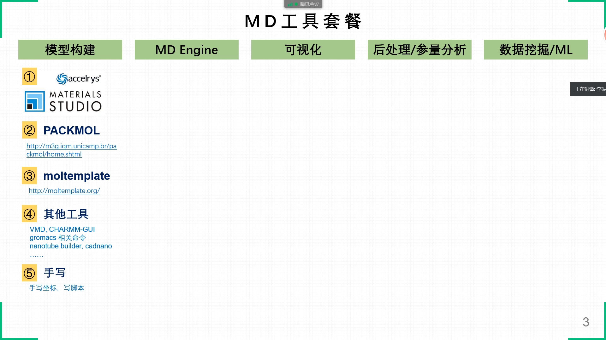

### 1.1 模型构建

模拟前要搭出分子模型——盒子里放好多分子，每个点是一个原子，模型文件就是一行行原子坐标。

- **Materials Studio（MS）**：课题组最熟悉的商业软件，功能全面；但自己做研究时**基本只用它建模**（计算效率等原因，后面的环节不用它），它的 Visualizer 建模模块非常好用；
- **PACKMOL**：MS 画出的是**单个分子**（无边界、无盒子），实际体系可能有几万、几十万个分子——用 PACKMOL 把它们"堆起来"。它基于 Linux，输入文件里定义盒子尺寸，可以把分子随机填充，也可以控制取向排列，甚至堆成球状、囊泡状；
- **moltemplate**：与 LAMMPS 结合使用较多；GROMACS 体系则用 Python 脚本更多；
- 还有 VMD 等其他建模工具，以及针对纳米管、DNA、聚合物的专门工具；
- 最"笨"也最可靠的方法：**手写原子坐标或写脚本批量生成**——MD 模型本来就是一行行原子坐标。

### 1.2 模拟引擎

MS 内置了模拟模块；独立引擎有 GROMACS、NAMD、AMBER 等，还包括基于第一性原理（量子化学计算）的 MD——可暂且归入 MD 家族。这些软件都跑在 Linux 命令行下，处理的就是一个个文件，输出的是轨迹文件。

### 1.3 可视化

MD 输出的轨迹文件要通过可视化软件才能直观看到模型的变化。常用 **VMD**（Windows/Linux 都有版本；一般流程是在 Linux 跑完模拟，把轨迹下载到 Windows 下可视化）和 **OVITO**。

### 1.4 后处理与分析

可视化之外，还要根据参量定义，从原子坐标、速度等动态变化中提取参量——这是后处理，工具更多、更灵活：

- **GROMACS 内置命令**：自带非常多的分析工具（后面详述）；
- **VMD + TCL 脚本**：VMD 除了可视化，还提供 TCL 脚本编程，从轨迹中提取数据；VMD 也支持 Python；VMD 和 OVITO 都集成了一些现成的插件；
- **自己编程**：Python、MATLAB、C/C++、Fortran 都可以；用 **Origin、Excel** 作图；
- **重点推荐 Python**：配合 MDTrajectory、MDAnalysis 等库把轨迹文件转成参量，再用 Matplotlib 作图，能做出非常精美的图。

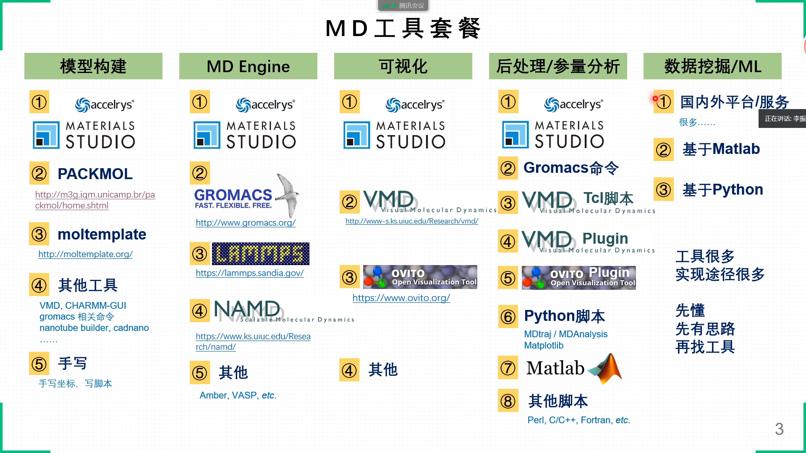

### 1.5 数据挖掘 / 机器学习：正在到来的趋势

讲者还专门加了一列——数据挖掘 / 机器学习。科研正在进入**数据驱动**的时代：一个参量与十几个变量的关系、哪个因素起主导作用、贡献率多少，肉眼和简单分析很难看出来，需要数据挖掘或机器学习算法。市场上的数据挖掘平台多面向电商、餐饮，不一定适合科研；完全可以基于 Python（或 MATLAB）的库，按自己的需求写算法。关键是**先懂概念、先有自己的思路，再去找工具实现**。

### 1.6 推荐组合（标六角星的必学）

- 建模：**MS + PACKMOL** 基本够用；
- 模拟：**GROMACS + LAMMPS** 基本够用；
- 可视化：**VMD + OVITO** 二选一或搭配；
- 后处理：基本盘是 **GROMACS 命令 + VMD 的 TCL 脚本**；升级是 Python / MATLAB 自编程。
- 必学清单：**MS、Python、GROMACS、VMD（含配套 TCL）**——有些分析参量 GROMACS 命令给不了，必须自己写脚本（Python 也可以替代 TCL）。

此外，模拟之前还要准备**力场文件、索引文件**等，也有专门的工具——更深入一些，等讲完 GROMACS 的基本使用方法再提。

---

## 二、零基础学习路径：Linux → 安装 → VMD → Tutorial

零基础学 GROMACS，讲者给了一条基于个人经验的学习顺序 [【跳转到 20:48】](https://www.bilibili.com/video/BV1Rc411o7Lz/?t=1248)。首先明确一点：**这些软件都装在 Linux 系统下**，不熟悉 Linux，直接学 GROMACS 绝对学不精——效率优化、并行处理、编译安装都要配套的 Linux 能力。

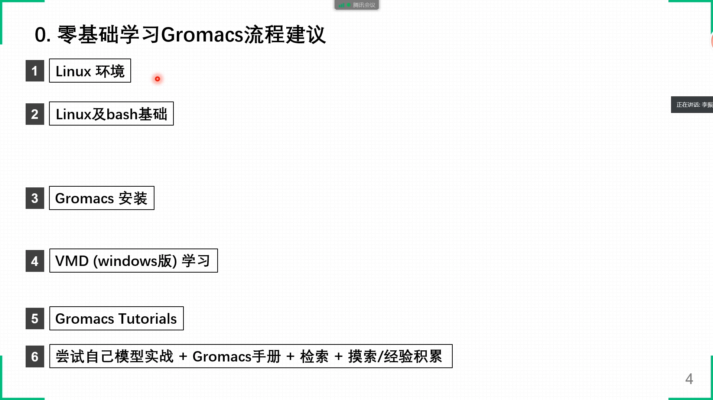

### 2.1 第一步：Linux 基本环境

知道 Linux 是什么、终端里的命令行（bash shell）是怎么回事；掌握基本命令：查看/删除/保存/复制文件、进入上下层路径、设置环境变量等。

**强烈建议用 VMware 装一个虚拟机**（如 Ubuntu 发行版）[【跳转到 23:43】](https://www.bilibili.com/video/BV1Rc411o7Lz/?t=1423)：相当于在自己的 Windows 电脑上搭了个可备份、可拷走的 Linux 环境；PACKMOL、后处理脚本等都可以放进自己的"工具箱"，永不丢失；虚拟机里还能设置**文件共享**，Linux 直接访问 Windows 硬盘上的文件，免去来回拷贝。

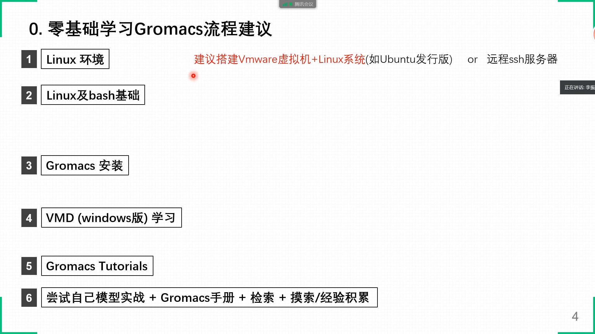

入门材料两份：

- **《鸟哥的 Linux 私房菜》**：非常细、非常庞大——**浅尝辄止**，了解 Linux 是什么即可，千万别想着全做完再往下走；
- **《The Linux Command Line》**（英文书，有中文翻译版网站）：非常简洁，覆盖新建/查看/删除/移动文件、路径切换，以及循环、判断等流程控制。

### 2.2 第二步：GROMACS 安装（了解即可，可跳过）

建议装好虚拟机后自己尝试编译安装一次，熟悉 Linux 软件的编译过程；安装基于 GROMACS 源码，不是一下子能学会的，特别困难可以暂时跳过——Ubuntu 下也有自动安装的命令，但同样有门槛。

### 2.3 第三步：VMD 教程（Windows 版即可）

学 GROMACS 之前先做 VMD 教程——因为一旦开始学 GROMACS，就不可避免要查看模型，**边可视化边学习**。教程以英文为主（个别章节有中文翻译），建议直接适应英文资料。建议学三章：**Introduction、用一个小分子做可视化、轨迹处理与视频制作**；进阶则是 VMD 中的 scripting（TCL 脚本，必须要学）。

### 2.4 第四步：GROMACS 教程 + 中文资料站

**学 GROMACS 最快的方法就是做官方 tutorial**。有老师带着一批学生把英文教程和英文手册翻译成了中文——李继存老师的站点整理了几乎能找到的全部 GROMACS 英文资料的中文版：中文教程、中文手册、程序文档、命令说明、编译安装方法 [【跳转到 29:33】](https://www.bilibili.com/video/BV1Rc411o7Lz/?t=1773)。教程有 0、1、2、3、4、5、6 多个，大部分不用做——**先把 0、1、2、4、5 做了就足够**；伞形采样、自由能计算等进阶教程，用到再学不迟。

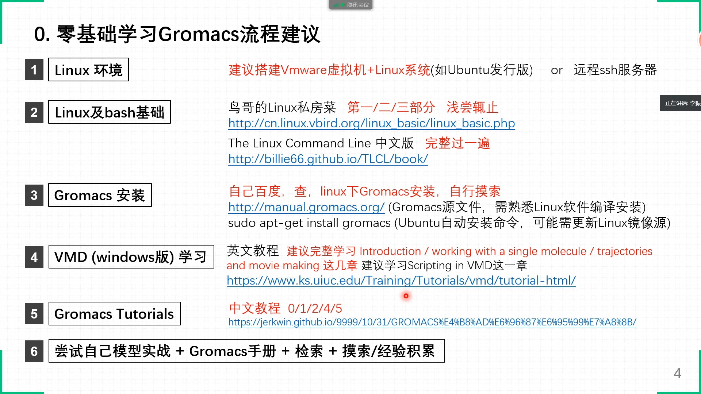

两个必做标签：**Linux 基础 + GROMACS 教程**——其他的（包括 GROMACS 安装）觉得拖延时间可以跳过，这两个跳过就很难用 GROMACS 开展工作了。

---

## 三、一次模拟的文件体系：四类输入 + 两条命令

### 3.1 四类输入文件

GROMACS 做分子动力学模拟，输入文件粗略分四类 [【跳转到 33:11】](https://www.bilibili.com/video/BV1Rc411o7Lz/?t=1991)：

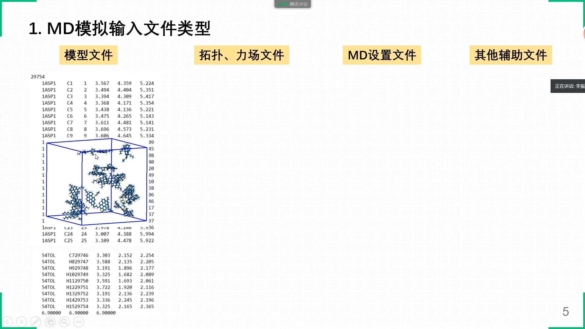

1. **模型文件（gro）**：一个盒子里放好多分子，每个点是一个原子。每行一个原子——坐标 XYZ、原子编号从 1 编到最后；最后一行列盒子 XYZ 三个方向的尺寸（单位纳米，示例 6.9）；最上面一行的数字是整个模型的原子总数（示例 2 万 9 千多个）；
2. **拓扑 + 力场文件（top）**：模拟要知道原子之间的相互作用——不同原子类型之间的相互作用、键合作用、非键作用等，都包含在拓扑文件和力场文件中；
3. **MD 设置文件（mdp）**：模拟参数——在多少温度、多大压强下进行，模拟多长时间、时间步长怎么设、积分类型等，各种控制；
4. **辅助文件（ndx 索引）**：给模型中的原子和分子分组，可以在 mdp 中对不同分组做有区别的控制。

**与 LAMMPS 的差别**：LAMMPS 可能是一个大文件，各种参数、模拟设置都在里面；GROMACS 则分得很清楚——模型、拓扑与力场、设置、索引各是独立的文件类型，分类更清晰。

### 3.2 第一步：grompp——把所有文件"打包"成 tpr

用 GROMACS 做一次模拟主要就两步。第一步是 `grompp`——`gmx` 总命令下分出来的一个子命令 [【跳转到 35:59】](https://www.bilibili.com/video/BV1Rc411o7Lz/?t=2159)：

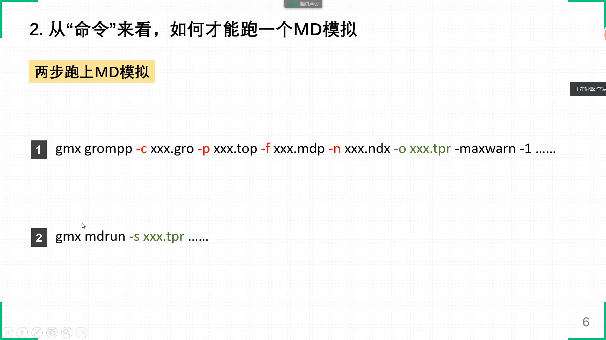

- 输入选项：`-c` 模型文件、`-p` top 文件（含力场参数）、`-f` mdp 文件（md parameter，MD 参数的意思）、`-n` 索引文件（index/ndx）；输出用 `-o` 指定；
- `grompp` 把这些文件**组合、压缩成一个二进制的 tpr 文件**——这是模拟的第一步；
- 如果模型文件有错误、或几个文件不匹配，第一条命令就无法成功、直接报错；只有顺利生成 tpr，才说明模型各方面没有太大问题（当然也可能在模拟时再出错）；
- **警告（warning）与错误（error）**：警告不是强制性的，可以忽略——比如版本不匹配时 grompp 自动修改了 mdp 里的某个参数，只是提醒一下；用 `-maxwarn -1`（负一即无限多个）放行所有警告；但出现 error，整个命令就执行不下去了。

### 3.3 第二步：mdrun——吃 tpr，吐轨迹和能量

拿到 tpr 后，第二步就是 `mdrun`：`-s xxx.tpr` 是它的输入文件；后面跟着**一系列输出文件**——轨迹、能量文件、记录文件等。不给名字就用默认名；也可以用 `-deffnm` 选项统一指定文件名前缀：所有输出文件都沿用同一个名字，只是后缀（文件类型）不同。

### 3.4 命令的历史与并行版本

GROMACS 更新很快（一两年一版）。4.x 时代命令叫 `g_grompp`、`g_mdrun`（g 下划线风格）；**从 5.5.0 之后全部集合到 `gmx` 大命令下作为子命令**，都以 `gmx` 开头。另外：串行版每条命令执行时只用一个 CPU 核；要用几十核甚至多节点并行，需要编译安装并行版本，命令总名是 `gmx_mpi`（MPI 即并行），用 `mpirun` 启动（第九节详述）。

### 3.5 重点中的重点

可以看出：做 MD 模拟，**人的重点工作就是准备上面这些输入文件**——模型、拓扑、设置、索引。这几个文件准备到位，通过两条命令，MD 就能成功，得到轨迹文件、能量文件等。

---

## 四、gro 模型文件：生成与检查

### 4.1 格式要点

gro 文件是 GROMACS 专属的模型文件 [【跳转到 42:14】](https://www.bilibili.com/video/BV1Rc411o7Lz/?t=2534)。MS 建模导出的是 PDB，PACKMOL 组合体系得到的也是 PDB——GROMACS 两种都认，且有内置命令实现互转。以 gro 为例：

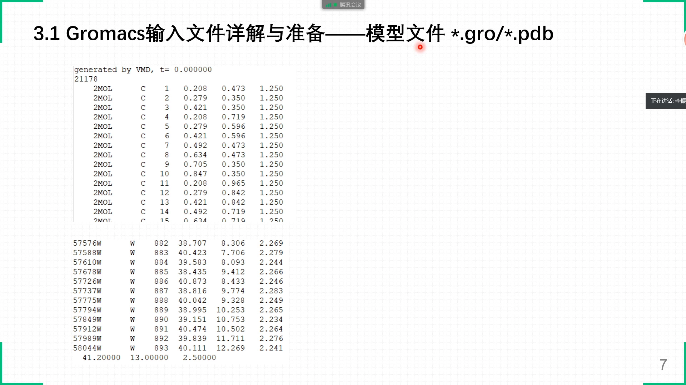

- **第一行是注释**，没有实际意义；
- **第二行是总原子数**，对应下面的行数；每行一个原子；
- 行内依次是：分子编号和分子名、原子编号（示例从 1 号编到 21178 号）、XYZ 坐标（单位纳米）；
- **名字和编号可以不对**，甚至可以忽略——后面会根据 top 文件自动重新生成一遍；真正重要的是**原子的顺序**，每一行的原子顺序必须与拓扑文件对应上；
- **下面的盒子尺寸行**（示例 41、13、32.5，即 XYZ 三个边长）——**这个一定要正确**。

### 4.2 生成流程与最后一行检查

1. 用 MS 画分子，导出 PDB——这是单分子模型（示例是一个沥青质分子）；
2. 用 PACKMOL 堆积：在 PACKMOL 输入文件中定义盒子尺寸，把分子随机堆进盒子，或控制取向排列，甚至堆成球状、囊泡状；
3. 或者用 GROMACS 的 **genconf** 命令：把单分子 PDB 用 `-f` 输入、`-o` 输出，`-nbox` 沿 XYZ 方向重复放置——像堆积木一样堆出取向规整的模型。

拿到的一般还是 PDB 文件，用 **gmx editconf** 转成 gro。**转换后一定要检查最后一行**：PDB 转 gro 后最后一行盒子尺寸经常全是 0，必须手动改过来——不改的话模型一跑就出错，因为默认都是周期性模拟（除非明确做非周期性），周期性盒子必须有边界尺寸。

---

## 五、top 拓扑文件：模拟的核心

第二个文件类型是 top 文件：它包括分子的拓扑 + 分子间相互作用的参数。参数一般放在以 **rtp** 结尾的文件上；通过 `#include` 方式把 itp 文件调用进 top，组合起来就是完整的拓扑 [【跳转到 48:04】](https://www.bilibili.com/video/BV1Rc411o7Lz/?t=2884)。

### 5.1 全局段：default 与 atomtypes——力场参数库

top 文件的开头是若干个**关键词段落**：

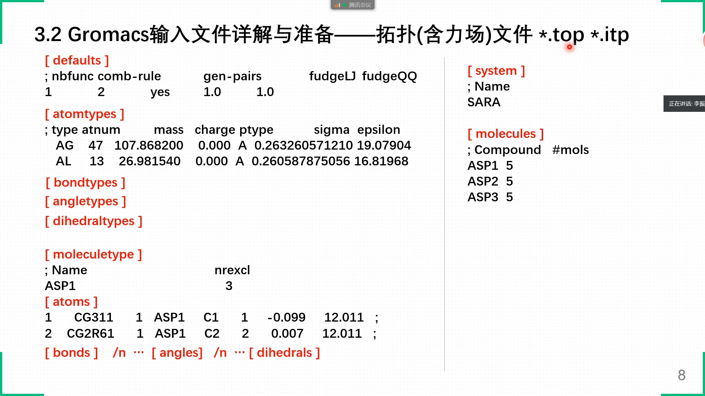

- **default 段**：定义非键相互作用的函数形式（1 号、2 号分别代表什么，查手册）；以及**混合规则**（示例用 2 号）——只要定义了 A-A、B-B 的参数，A-B 之间的参数就按混合规则自动生成；`generate` 选项为 yes 时 A-B 自动生成，no 则必须显式给出；
- **atomtypes 段**：原子类型——碳、氧、硫等，同一种元素还可以有多种类型（末端的碳和中间的碳不一样）。每种类型带质量、电荷、sigma 和 epsilon（Lennard-Jones 势的两个参量）；有了它们，按混合规则就能得到**所有原子类型两两之间**的相互作用参数；
- **bondtypes / angletypes / dihedraltypes 段**：键、键角、二面角的类型库——比如 A 和 L 两种原子成键，就列出 A-L 键型及其距离、力常数等参数。

这一部分定义的是**基本力场参数库**。

### 5.2 moleculetype 段：每一种分子的拓扑

往下是 **moleculetype**：每一种分子的拓扑。示例是一个沥青质分子 ASP1（名字后面的数字 3 先不管，感兴趣查手册）：

- **[ atoms ] 原子列表**：按顺序列出每个原子的原子名、电荷、质量。计算机拿原子名（如 cg311）到前面的 atomtypes 中去找对应的力场参数，赋给这个原子——**找不到就报错**，这就是 GROMACS 的运行机制；后面又单独给出电荷和质量时，**用后面的覆盖前面的**；
- **[ bonds ] / [ angles ] / [ dihedrals ]**：1 号原子和 2 号原子之间有键，就在 bonds 下加上这个编号对；键角、二面角同理。

每一类分子都有这么一块"分子拓扑"——模型里有十种分子，就要写十块：`moleculetype` ASP1 之外，再加 `moleculetype` ASP2……把另一种分子的拓扑连进来。

### 5.3 system 与 molecules：分子名 + 数目 [【跳转到 53:54】](https://www.bilibili.com/video/BV1Rc411o7Lz/?t=3234)

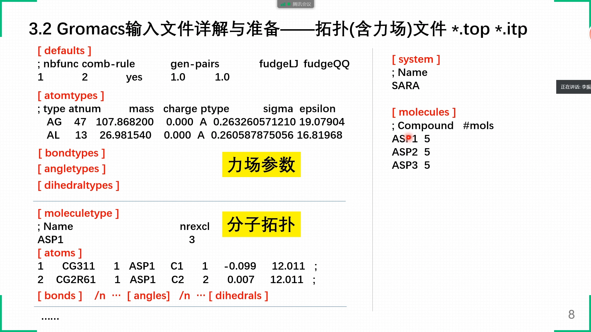

- 末尾的 **system**：整个模型的名字，叫什么都行，没有任何影响；
- 再往下的 **molecules**：整个体系中包含的分子——分子名 + 分子数目。GROMACS 拿到信息后的机制是：看到 ASP1，就到前面找 ASP1 的原子列表；体系里如果有 5 个 ASP1，就把这个列表**重复五遍**；找完 ASP1 再找 ASP2、ASP3……依次排下去。**分子名必须与 moleculetype 的 name 真正一致**。

由此得到一条**铁律**：molecules 展开后得到的完整原子列表，必须与 gro 模型文件中的原子**顺序一一对应**。模型文件里名称无所谓，但顺序是从上到下排死的：如果 1~100 号是第一个 ASP1 分子，那 ASP1 的拓扑就必须排在 molecules 最前面。讲者见过真实的翻车案例：拓扑里把水（WAT，1 万个）放在最前面，而模型的 gro 文件里水其实在最后——原子总数是对的，`grompp` 也能过，但**一跑模拟就出错**：不是水的原子被套上了水的参数、被设置了不该有的键。**这个一一对应一定不能出错。**

### 5.4 好消息：力场通常不用手写

上面这些力场参数看上去复杂，但**大部分情况下不需要自己准备**——有现成的工具。李继存老师的博客上有"力场与 top 文件"的介绍（共四部分），还有一个列表总结了各种力场生成工具（Amber、CGenFF、OPLS、UFF 等力场）：把 PDB/gro 喂给工具，它就导出整套力场参数文件，甚至包括分子的拓扑；用的时候**只需根据自己的体系调整分子的顺序和数目**，与模型文件对应上就能直接模拟。

细节学习看**手册第五章**（有中文链接；觉得翻译不准，建议到 GROMACS 官网查英文原版手册）。要提醒的是：top 是模拟的核心，准备 top 的过程也是整个模拟最核心的部分；这些工具大多是国外的英文网页，**不要怕麻烦**，仔细读说明——里面有很多坑，一个工具可能要调试好几天甚至一周才能搞通。没有现成工具覆盖的体系，就要**手写分子拓扑**（GROMACS 支持的质点类型比较有限，很多情况都得手写）。讲者自己搞通了 CGenFF（通用 CHARMM 力场）工具，大大小小的分子都可以用它生成拓扑。

---

## 六、mdp 参数文件与 ndx 索引文件

第三个文件类型是 **MD 控制文件 mdp**，大量细节看**手册第七章** [【跳转到 60:50】](https://www.bilibili.com/video/BV1Rc411o7Lz/?t=3650)。

### 6.1 mdp：等号前关键词 + 等号后参数

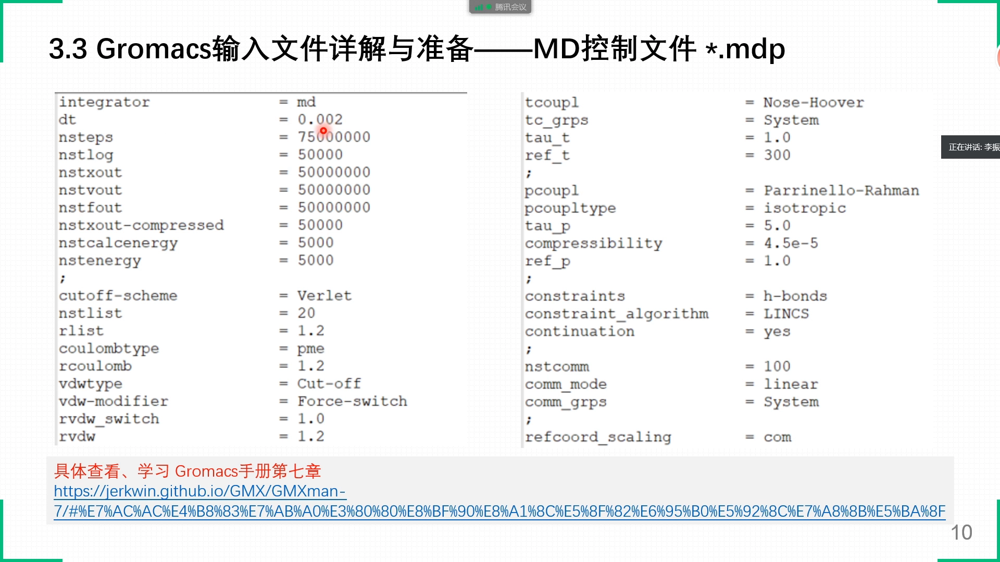

- `integrator`：做什么类型的模拟（MD 模拟）；
- `dt`：时间步长，示例 0.002 ps（两飞秒）；再加上模拟总步数；
- **nstlog / nstxout / nstvout**：日志、坐标文件、速度文件各隔多少步输出一次。**这三个数建议一定要设大**：它们控制的是信息最全的 **trr 轨迹文件**——这个文件非常占空间，输出 1000 帧可能就要几十个 GB；而且 Windows 下的 VMD 目前只有 32 位，能承受的轨迹文件大小有限、很难读取。**除非要原子的速度信息、原本的受力信息，否则一般不用 trr**；
- 坐标输出有 **compress（压缩）选项，对应 xtc 文件**：只含每一帧坐标的连续轨迹。讲者的经验：后续处理数据、做参量拟合、可视化，用 xtc 就足够了——把它设小一点，也避免硬盘塞满；
- 其他：各种算法、库仑相互作用的类型、截断半径等，看手册；**控温方法和控压方法**（isotropic 与 semi-isotropic 什么区别，看手册），这些都要明白含义，不然容易犯错；
- 模拟退火、牵引（steered）MD、伞形采样、自由能计算等其他模拟类型，都有各自的 mdp 关键词和参数设置，全在手册里。**mdp 的所有选项就代表了 GROMACS 的功能**：等号前面是关键词、等号后面是参数，写出关键词和对应参数就能实现相应功能。

### 6.2 tc-grps 与第四类文件：ndx 索引

mdp 里有个要注意的地方：**tc-grps（groups，分组）**。`System` 对应整个模型的所有原子；如果要对不同部分施加不同的控制——比如水和油**分别控温**——就要把 `System` 改成 index 文件中的分组名（oil、water 等自己起的名字）[【跳转到 65:50】](https://www.bilibili.com/video/BV1Rc411o7Lz/?t=3950)。

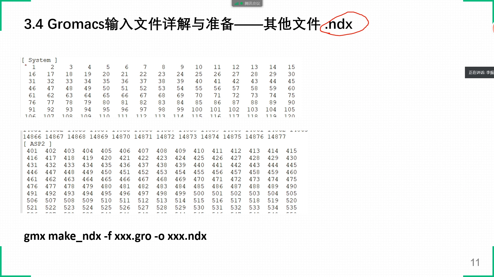

第四部分就是**索引文件 index（ndx）**，里面定义了很多分组：

- gro 模型文件里有原子列表，从 1 号排到最后（示例 2 万多个）；
- `System` 是**默认分组**：从 1 号到最后一个原子的完整列表；
- 自己定义分组：比如给 ASP2 这一类沥青质分子建组，就把属于它的原子编号排在组名下面；
- 生成命令是 **gmx make_ndx**，选项很多：按分子名建组、按原子名建组，不同分组之间还能做**布尔运算（与、或、非）**组合出新组——大家自己去试着做一下。

到这里，四类输入文件就介绍完了。

---

## 七、跑起来之后：输出、监控与判断成功

### 7.1 两条命令，一串输出

最后再总结一次：**grompp 吃四个文件，吐出一个 tpr；tpr 喂给 mdrun，得到一系列输出文件**——

- **log 日志文件**；
- **cpt**：断点文件，包含原子坐标、速度等信息；
- **edr** 能量文件；
- **gro**：最后一帧的模型；
- **trr 和 xtc**：分子动力学模拟轨迹文件。

顺利跑完就得到这些文件。后处理时：用能量文件分析相互作用能、温度、压强；用轨迹文件采集原子坐标、拟合参量（密度分布、轨迹的动态变化等）。

### 7.2 "模拟在跑吗？跑完了吗？成功了吗？" [【跳转到 68:55】](https://www.bilibili.com/video/BV1Rc411o7Lz/?t=4135)

这是初学者最直白的问题——命令行界面一关，模型到底在不在跑？

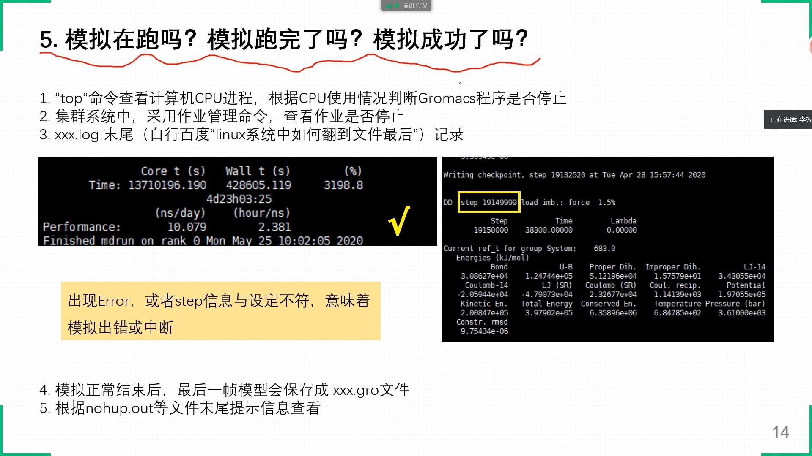

1. **Linux `top` 命令**：直接查看 CPU 进程与占用百分比，能看到是哪个程序在占——GROMACS 进程接近 100%（或按自己设置的线程数比例），就说明在跑；
2. **集群作业系统**：用作业管理的现成命令查作业状态；
3. **log 文件末尾**：mdp 里定义了输出频率，log 会定期更新。**成功结束的标志**是最后几行：占用了多少 CPU 核时、用了多长时间（比如四天 23 小时）、performance 每天算多少纳秒——出现这些信息基本就是成功结束了；如果最后是 error，就是失败；如果突然停在某一个中间 step、文件不再更新、CPU 也停了，就是异常中断；
4. **最后一帧的 gro 文件**：模拟正常结束时，最后一帧会自动保存成 gro 文件——用统一文件名时，看到"某某.gro"存在，这个模拟肯定成功了；没有它，要么没跑完，要么中断了；
5. **nohup 后台运行**：模拟结果、剩余时间倒计时等信息会写进 `nohup.out`；超算上还有其他输出文件，查看末尾即可判断成败与表现。

拿到输出文件后必须做后处理分析，才能得到定量的结论、才能发文章。

---

## 八、排错：九成的 error 是"原子重叠"

模拟过程中最苦恼的事就是跑着跑着突然停了、报 error。讲者的经验：**在四类模拟文件格式都没有错误的情况下，80% 甚至 90% 的 error 是模型造成的——原子重叠** [【跳转到 90:07】](https://www.bilibili.com/video/BV1Rc411o7Lz/?t=5407)。

### 8.1 原子重叠如何引爆 error

以 Lennard-Jones 势来解释：两个原子 m1、m2 的平衡距离对应势能最低点。如果初始模型中（尤其是形状建模的颗粒等）两个原子靠得非常近，它们之间的**排斥力就会非常大**；按牛顿运动方程求解，下一步（step/timestep，第 0 步到第 1 步）的位移 = v0·t + ½at²——a 太大，原子一步就跑得非常远，甚至跑出盒子边长的一半，于是报错："两个原子的 distance is larger than 三分之几的限值"或 domain decomposition（区域分解）错误——**基本都是原子瞬间崩开造成的**。

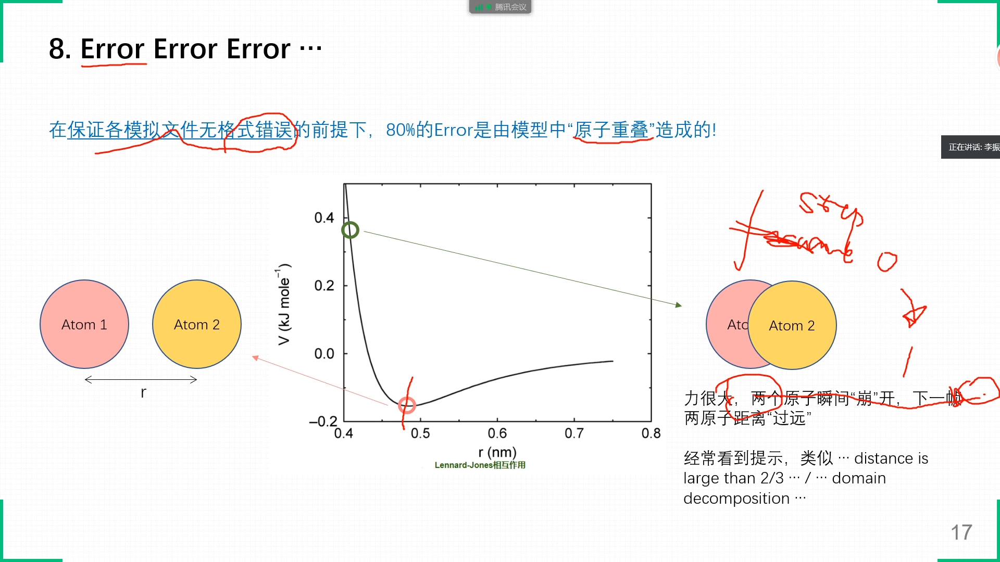

### 8.2 四个对策 + 分步升温

思路就是**让原子每步的运动距离不那么远**：

1. **降低温度**：温度低了动能小，v0 小，运动就慢；
2. **减小时间步长**：½at² 里的 dt 小了，一步跑不远；
3. **暂时不做压力缩放**：压力缩放时 XYZ 方向盒子尺寸在变、原子坐标也在缩放，容易出错；
4. **软势预优化**：不用 Lennard-Jones 势，允许原子靠得比较近而势能不会陡增——相当于表面很"柔软"，先用软势优化，非常有效（组会上同事在 LAMMPS 中的做法）。

具体操作可以**分多步优化**：比如目标是在 300 K 下做 NPT 模拟、时间步长 2 飞秒，但初始模型一跑就崩——那就先在 50 K 下用 NVT、时间步长 0.5 飞秒，**预先跑几百皮秒甚至几纳秒**；拿到轨迹最后一帧的模型，稍微升温再处理；再升温、时间步长稍微放大，再跑；最后达到预设条件（300 K、2 fs）再进行正式的 MD。总之：**逐渐升温、逐渐增大时间步长，先 NVT 再 NPT**——讲者长期遇到的错误，靠这三四种措施基本都能解决。

---

## 九、常用命令与并行续跑

讲者凭记忆列了几条**非常常用**的 GROMACS 命令（不全，但高频）[【跳转到 80:02】](https://www.bilibili.com/video/BV1Rc411o7Lz/?t=4802)：

1. **gmx editconf**：实现 PDB 与 gro 格式互转、模型平移旋转、设置盒子尺寸——比如想把模型整体往上移几纳米，就用它；
2. **gmx make_ndx**：制作 index 文件，基本上必须要用；
3. **gmx trjcat**：合并/剪切轨迹——两段 1000 帧合成一段 2000 帧，或一段拆成几段（不太常用，但续跑后会用到）；
4. **gmx trjconv**（trajectory convert）：**非常非常常用**。用 VMD 看轨迹时经常发现画面里横着竖着好多"乱线"——那不是线，是**键**：分子横跨了盒子边界，一边的原子和另一边的原子被连出一条横线。用 trjconv 处理周期性，把跨过边界的分子"拉回来"，模型就不乱了；也可以把跑到边界上的纳米颗粒**每一帧都居中到盒子中心**，做图更好看；
5. **gmx genconf**：周期性扩展模型——沿 X、Y 方向各扩大两倍之类的建模操作；
6. **gmx convert-tpr 与 cpt 续跑**：非常重要。100 ns 的模拟一次跑完风险很大——可能要跑一个星期，中途断电、出错，在 51 ns 停掉就只是"中断"，轨迹信息不全。可以在提交作业的脚本里写一个循环，把 100 ns **拆成十段、每段 10 ns**：第 51 ns 出错时前五段是完整的，在第六段上接着第五段续跑即可；最后用 trjcat 把十段轨迹合并，没有任何影响。cpt 断点文件也能用来续跑；
7. **gmx energy**：分析相互作用能、温度、压强等——具体用法看中文解析手册。

### 9.2 并行：mpirun 一定要会 [【跳转到 85:52】](https://www.bilibili.com/video/BV1Rc411o7Lz/?t=5152)

串行版 `gmx` 每条命令只能用一个核。并行要用**并行版可执行文件 `gmx_mpi` + `mpirun` 启动器**——**这个一定要会**！讲者遇到过同学把模型交上去却跑得极慢，登进节点一看：只有一个核在算，并行根本没用起来。按所装的 MPI 实现（Intel MPI、OpenMPI 等），典型写法是：

```
mpirun -np 4 gmx_mpi mdrun -ntomp 8
```

含义：把任务拆成 **4 个 MPI 进程**（相当于 4 个车间），每个 MPI 进程再分配 **8 个 OpenMP 线程**，4 × 8 = 32，正好是服务器的总线程数。前提：服务器必须安装并行版 gmx_mpi。

### 9.3 GPU 加速

新版本 GROMACS 把大量计算放在 GPU 上，效率大大提高。用法是 mdrun 的子项 **`-nb GPU`**——不写或写 CPU 就默认用 CPU。如果有两张显卡、任务拆成 4 个 MPI 进程，就把显卡也拆开（0 0 1 1）；一张显卡就 0 0 0 0。GPU 分配与提升 mdrun 效率的细节，看讲者列出的并行解析链接。

---

## 十、结尾：两个例子与进阶方向

### 10.1 两个现成的例子

讲者准备了两个 GROMACS example：一个是 **CHARMM 力场**做的，一个是**细胞膜模型** [【跳转到 97:41】](https://www.bilibili.com/video/BV1Rc411o7Lz/?t=5861)。里面 mdp 怎么设置、gro 模型、top 拓扑（这个例子没用 index 文件）都齐全；README 里是流程化处理——需要一些 Linux bash 基础才能看懂：gmx 命令嵌套在控制流里，按条件循环执行。重点看**文件之间怎么相互调用**——top 里 `#include` 了文件夹下的 itp 文件、格式怎么写——结合前面讲的内容消化，然后准备自己的文件。

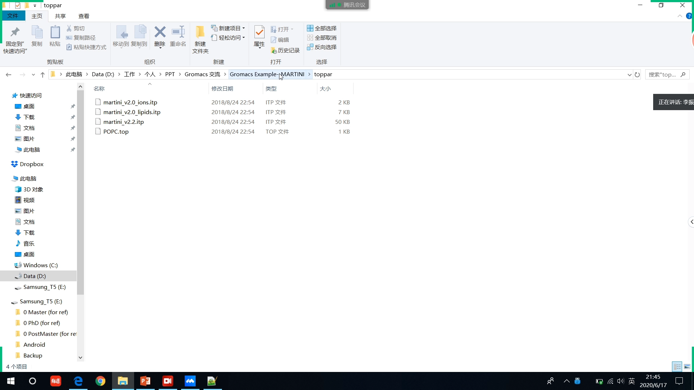

粗粒化（Martini）也给了一个例子——讲者自己做的模型模拟：**四类文件分四个文件夹**（index 放 ndx 文件夹、mdp 控制文件放 mdp 文件夹、模型文件放 model 文件夹、力场文件放 top 文件夹），提交作业的脚本分别到各文件夹调用文件。可以参照这个结构准备自己的文件。

### 10.2 进阶方向

分子动力学模拟还有很多进阶应用：**伞形采样**算自由能（PMF 平均力势/自由能曲线）、**自由能微扰（FEP）**、**拉伸分子动力学**（比如纳米孔道加平板去推的模型），以及**位置限制**（把某个原子或分子的位置限定住不让动）……这些都属于 GROMACS 的进阶用法，要用时看**手册第七章（mdp 控制）和第五章（拓扑控制）**，各种功能都能实现。

### 10.3 Martini 力场与最后的学习建议

粗粒化模型与 Martini 力场：它有专门的网站，各种资料都有——**不要等着别人来讲，得自己看**；先读 Martini 的原版论文（2004 年前后发表的那几篇），网站上也有例子和 tutorial 跟着做。不管什么体系，最简单的方式就是：**做 tutorial + 看手册 + 遇到问题检索英文资料 + 多总结、多记录**。接触新课题时，具体的模拟设置、力场选择、处理流程，还要去读文献、按文献设置——不要怕读英文材料。

讲者最后说：不要奢望听一两次讲座就能熟练掌握 GROMACS，这次讲解只是"戳破一层窗户纸"；多查英文资料（Google，不行就用 Bing 国际版）、多尝试、多交流、多总结、多记录，慢慢积累。

---

## 小结

- **工具链**：MD 研究是一套套餐——MS/PACKMOL 建模 → GROMACS/LAMMPS 引擎 → VMD/OVITO 可视化 → GROMACS 命令 + TCL/Python 后处理，数据挖掘/机器学习是长期趋势；
- **学习路径**：Linux 基础（鸟哥浅尝辄止、TLCL；VMware+Ubuntu 虚拟机 + 文件共享）→ GROMACS 安装（可跳过）→ VMD 教程 → GROMACS tutorial（李继存中文站，先做 0/1/2/4/5）；
- **文件体系**：四类输入（gro 模型 / top 拓扑 / mdp 设置 / ndx 索引）→ `grompp` 打包成二进制 tpr（警告可用 `-maxwarn -1` 忽略，error 必须解决）→ `mdrun` 输出 log/cpt/edr/gro/trr/xtc；
- **top 铁律**：molecules 的分子名必须与 moleculetype 一致；**top 的原子顺序必须与 gro 一一对应**——顺序错了 grompp 能过，一跑必崩；
- **mdp**：dt 与步数定模拟长度；nstlog/nstxout/nstvout 控制 trr 输出（巨大，一般用压缩的 xtc）；控温控压方法、tc-grps 分组；所有选项 = 关键词 + 参数；
- **判断成功**：top 查 CPU、集群作业命令、log 末尾（核时/时长/performance 纳秒每天）、最后一帧 .gro 是否存在；
- **排错**：九成 error 是原子重叠——降温、减小步长、暂不压力缩放、软势预优化，分步升温（先 NVT 后 NPT）；
- **常用命令**：editconf、make_ndx、trjcat、trjconv、genconf、convert-tpr + cpt 续跑、gmx energy；
- **并行**：`mpirun -np 4 gmx_mpi mdrun -ntomp 8`（4 进程 × 8 线程 = 32 核）；GPU 用 `-nb GPU`。

## 关键术语速查

| 术语 | 一句话解释 |
| --- | --- |
| tpr | grompp 打包生成的二进制运行输入：拓扑 + 参数 + 初始坐标速度 |
| `-maxwarn -1` | 放行全部警告；警告可忽略，error 必须解决 |
| `-deffnm` | 统一 mdrun 输出文件名前缀，只换后缀 |
| nstlog / nstxout / nstvout | 日志/坐标/速度的输出步频；trr 巨大，日常用压缩 xtc |
| tc-grps | 控温分组，默认 System，可改为 index 中的自定义组 |
| gmx make_ndx | 生成 index 分组文件（按分子/原子名、布尔运算组合） |
| gmx editconf | PDB↔gro 互转、平移旋转、设置盒子尺寸 |
| gmx trjconv | 轨迹转换：修复周期性跨界、把分子居中 |
| gmx trjcat | 合并多段轨迹（分段续跑后拼回） |
| convert-tpr / cpt | 延长模拟继续跑 / 断点续跑 |
| gmx energy | 从 edr 提取能量、温度、压强曲线 |
| gmx_mpi + mpirun | 并行版可执行文件 + 启动器；`-np 4 -ntomp 8` = 4 进程×8 线程 |
| `-nb GPU` | 把非键计算放到 GPU 上 |
| 原子重叠 | 初始模型两原子过近 → 排斥力巨大 → 一步飞出盒子 → error |
| PMF / FEP | 平均力势（伞形采样）/ 自由能微扰，进阶自由能计算方法 |
