# Gromacs 视频教程-文件格式-gro 文件

> 来源视频：[Gromacs视频教程-文件格式-gro文件（奕星模拟）](https://www.bilibili.com/video/BV1uZ6PBhE1R/) · 时长 30:37
> 本篇基于视频 AI 字幕与画面整理，时间戳可跳转回原视频对应位置。

## 本讲要解决的核心问题（SCQA）

**背景**：跑 GROMACS 分子动力学模拟，真正干活的命令只有两条——`grompp` 和 `mdrun`。上一讲的 `pdb2gmx` 已经能把 PDB 等格式文件转成拓扑（top/itp）。

**冲突**：可命令背后是一堆后缀各异的文件：mdp、gro、top、itp、rtp、ndx、tpr、trr、xtc、edr……初学者往往不知道每个文件里装了什么、谁生成谁、谁读谁。

**疑问**：这些文件各承载什么信息？一次模拟的完整文件流到底长什么样？

**回答（中心思想）**：一条主线就能串起来——**四类文本输入文件（mdp 参数、gro 坐标、top 拓扑、ndx 索引）由 grompp 打包成二进制的 tpr 运行输入；mdrun 吃进 tpr，产出轨迹文件（trr/xtc）与能量文件（edr）**。本讲先总览文件家族，再逐列精读 gro 格式，最后分清"原子名 / 原子类型 / 元素类型 / 粒子类型"四个最易混的概念。

---

## 一、文件家族总览：四类输入 + 一批输出

GROMACS 官方手册里有一个 file formats 页面，列出的文件格式多达几十种 [【跳转到 01:22】](https://www.bilibili.com/video/BV1uZ6PBhE1R/?t=82)：

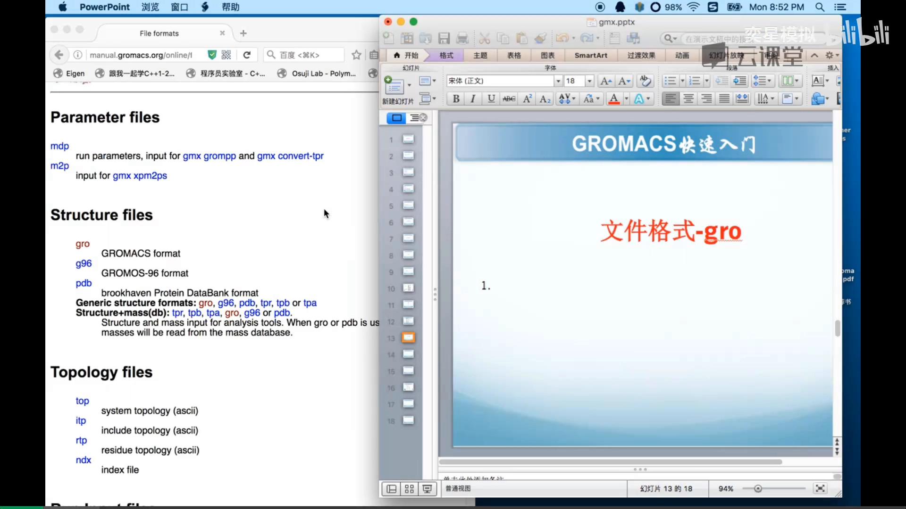

但日常高频使用的其实只有一行——下面按"输入 → 运行 → 输出"的顺序过一遍。

### 1.1 mdp：参数（控制）文件

mdp 文件里写的是**控制参量**，是"很重要很重要的一个文件"，后面会专门讲 [【跳转到 01:37】](https://www.bilibili.com/video/BV1uZ6PBhE1R/?t=97)。

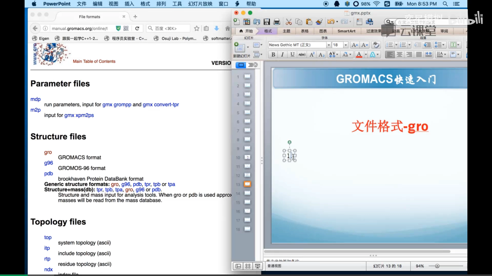

### 1.2 gro：坐标文件

gro 文件是 GROMACS 专属的**坐标文件**（GROMOS-96 格式；PDB 则是蛋白质数据库的通用格式）[【跳转到 00:47】](https://www.bilibili.com/video/BV1uZ6PBhE1R/?t=147)：

- 它不仅能装**坐标**，还可以装**速度**；
- 但一般情况下速度可以根据温度直接生成，所以 gro 里通常不放速度——除非它是作为轨迹、需要输入速度信息的时候；
- gro 是**文本文件**，可以直接打开查看——这是它和后面 tpr 这种二进制文件的关键区别。

### 1.3 top / itp / rtp / ndx：拓扑与辅助文件

**top 文件**包含整个体系的拓扑结构：体系里有多少个分子、分子之间的键连接是什么 [【跳转到 01:12】](https://www.bilibili.com/video/BV1uZ6PBhE1R/?t=172)：

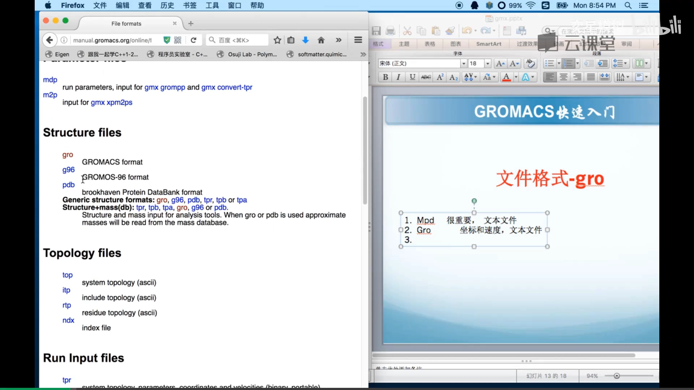

- 它是全局拓扑，力场信息和拓扑信息都可以直接写在里面；但体系一大、重复部分一多就很难维护，所以可以用 `#include` 把 **itp 文件**装进来——很多单分子的拓扑各自放在一个 itp 里，体系里有 100 个这种分子，load 进 top 后指定个数即可 [【跳转到 00:22】](https://www.bilibili.com/video/BV1uZ6PBhE1R/?t=222)；
- **rtp 文件**是残基文件（与力场相关）；
- **index（ndx）文件**用于后期数据处理，给原子/分子分组，后期再讲。

以上这些都是文本文件。

### 1.4 tpr：二进制的"运行输入"

**tpr 是最后交给 MD（mdrun）去跑的文件** [【跳转到 01:37】](https://www.bilibili.com/video/BV1uZ6PBhE1R/?t=297)：

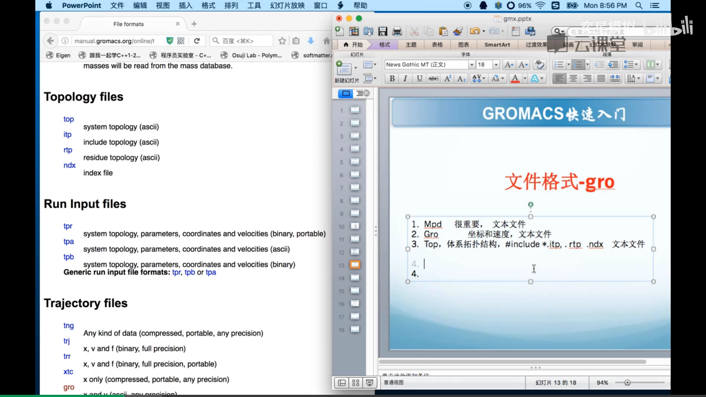

- 内容：拓扑（也就是力场）+ 控制参数 + 初始坐标、速度等——它是最后拿去模拟的**总装文件**；
- 形态：**二进制文件**，读写速度快，Linux 下也可以用命令查看；
- 同源参考：与它功能相同、内容一样的文本形式是 tpb 文件，平时基本不需要查看，但要知道里面装了什么。

### 1.5 轨迹与能量：模拟的两大产出

**轨迹文件 trr**：包含坐标、速度、相互作用力等信息，是可移植的二进制格式 [【跳转到 01:37】](https://www.bilibili.com/video/BV1uZ6PBhE1R/?t=397)。平台不变的话生成一种就行。其他轨迹形态：gro 也可以作为轨迹文件；**xtc 是压缩格式的轨迹文件**，精度没那么高，但省空间 [【跳转到 00:22】](https://www.bilibili.com/video/BV1uZ6PBhE1R/?t=422)：

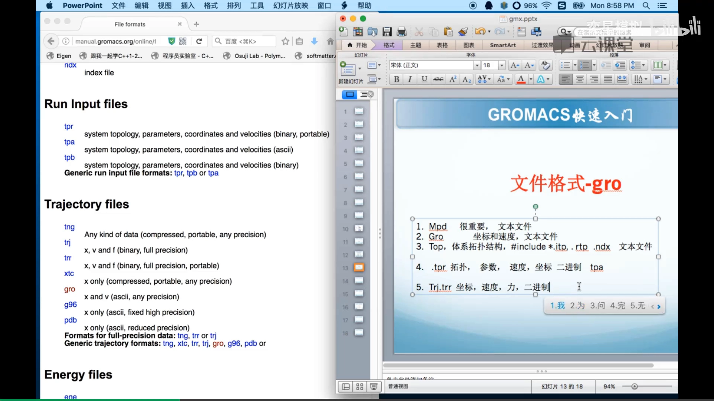

**能量文件 edr**：包含热力学信息，系统自动生成——温度、压力、盒子尺寸、密度、维里（virial）等都会写进去 [【跳转到 00:47】](https://www.bilibili.com/video/BV1uZ6PBhE1R/?t=447)：

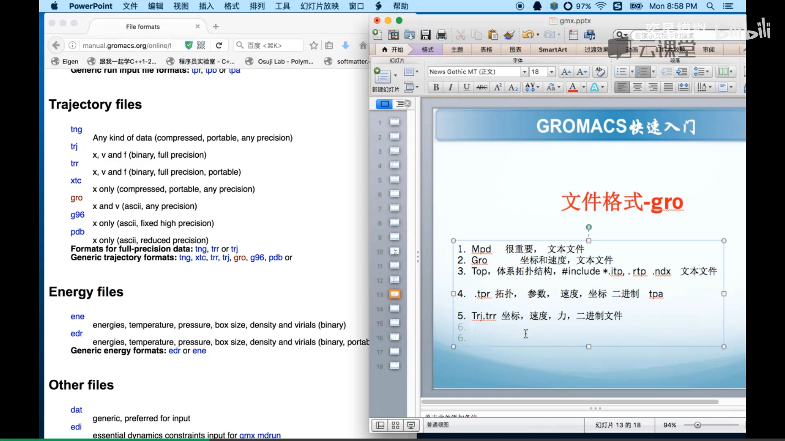

所以**模拟最后生成的文件主要就是两种：轨迹文件（结构信息）+ 能量文件（热力学信息），后处理数据就是从这两个文件里提取信息**。tpr 是 run 时用的文件（提交作业时用），前面那些都是建模时用的文件。此外还有 `.dat` 数据文件、edo/edi（约束力输出/输入所需，目前用不到）等。

---

## 二、gro 文件逐列精读

已经遇到的格式有拓扑格式和 gro 格式，mdp 还没讲到，所以先把 gro 文件——坐标（速度）文本文件——的格式讲清楚 [【跳转到 01:06】](https://www.bilibili.com/video/BV1uZ6PBhE1R/?t=566)。手册的 file formats 页面里点开 gro 条目，就有格式说明，可以对照实例逐列看 [【跳转到 01:33】](https://www.bilibili.com/video/BV1uZ6PBhE1R/?t=593)。

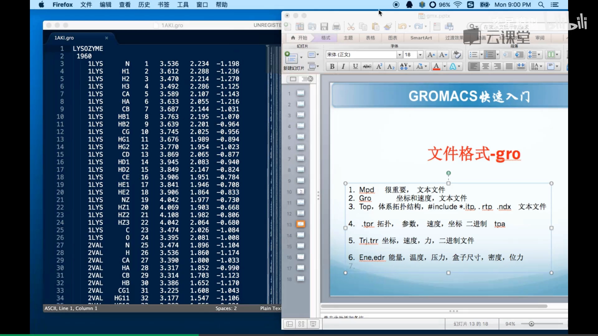

### 2.1 文件的三段式结构

对照编辑器里的 gro 实例（1960 个原子的体系）[【跳转到 01:05】](https://www.bilibili.com/video/BV1uZ6PBhE1R/?t=665)：

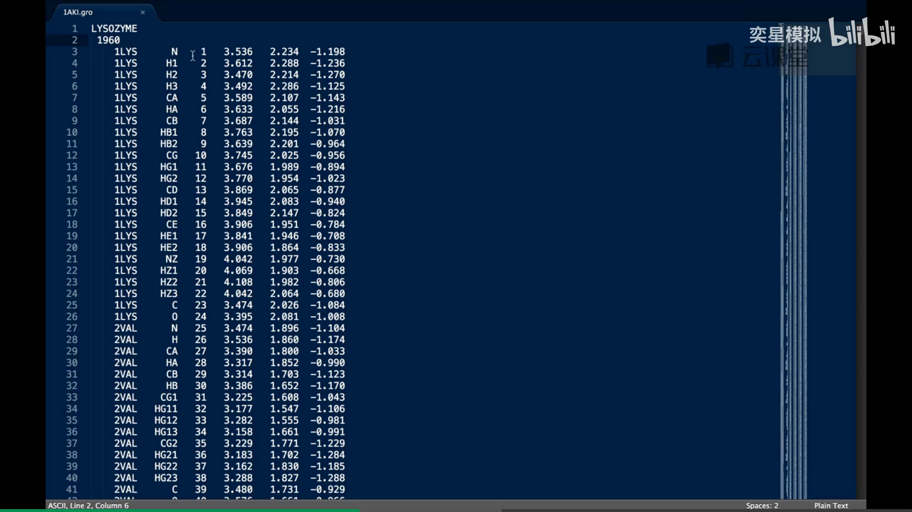

1. **第一行是标题**（残基名/说明文字）：意义不大，空着或随便写都行，比如写"第 100 步输出的坐标"；
2. **第二行是原子总数**：比如 1960，对应下面要有 1960 行原子坐标（文件共 1962 行，多出的两行就是头部）；
3. **最后是盒子行**：XYZ 三个方向的盒子尺寸。这一行还可以扩展成六项——满足一定向量关系的**非正交盒子**（比如十二面体盒子另有专门设置，严格情形下底下还会补 0 0 0 等分量行，遇到时查手册即可）。

### 2.2 原子行：十列与 C 格式串

把手册里的 **C 语言格式串**拷出来，与文件逐列对照看 [【跳转到 00:07】](https://www.bilibili.com/video/BV1uZ6PBhE1R/?t=807)：

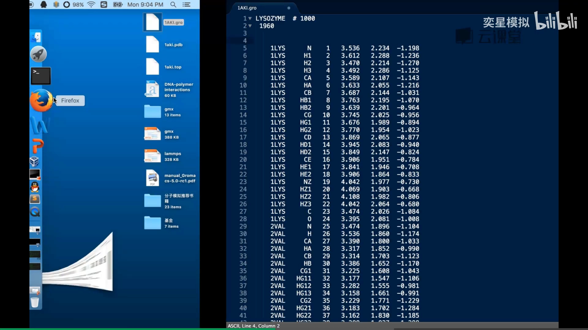

原子行一共约十列，对应格式（手册说明见下图）[【跳转到 00:12】](https://www.bilibili.com/video/BV1uZ6PBhE1R/?t=812)：

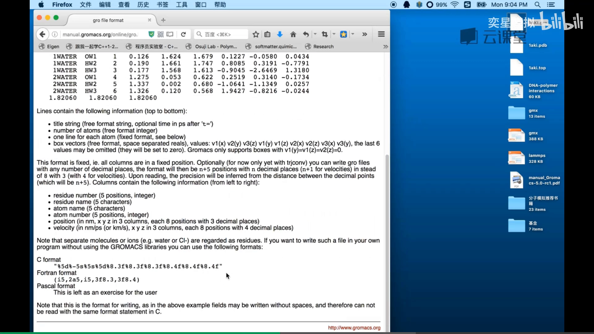

| 列 | 内容 | 格式 | 要点 |
| --- | --- | --- | --- |
| 1 | 残基编号 | `%5d` | 五位整数；超过五位只显示**后五位** |
| 2 | 残基名 | `%-5s` | 左对齐五个字符；超过五个字符**取左边五个** |
| 3 | 原子名 | `%5s` | 右对齐五个字符 |
| 4 | 原子编号 | `%5d` | 递增（1→1960），不可重复；超过五位同样只显示后五位 |
| 5–7 | X/Y/Z 坐标 | `%8.3f` | 浮点，8 列 3 位小数，**单位是纳米** |
| 8–10 | X/Y/Z 速度 | `%8.4f` | 可选，8 列 4 位小数；PDB 转来的文件里没有 |

编号列（原子编号递增、不可重复，逻辑关系由拓扑结构决定）[【跳转到 01:13】](https://www.bilibili.com/video/BV1uZ6PBhE1R/?t=1073)：

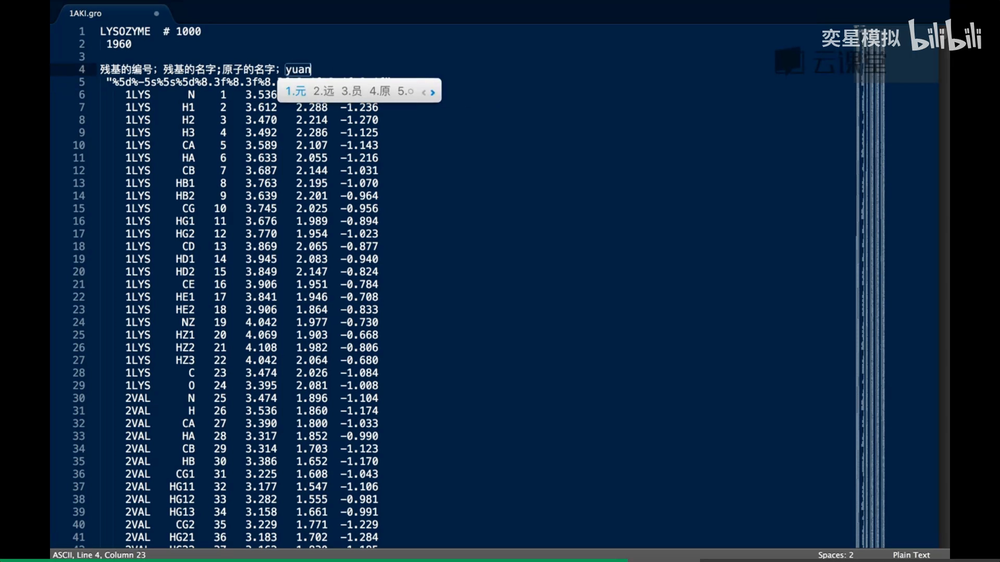

可选的速度列（8.4 格式、XYZ 三个方向）[【跳转到 01:13】](https://www.bilibili.com/video/BV1uZ6PBhE1R/?t=1173)：

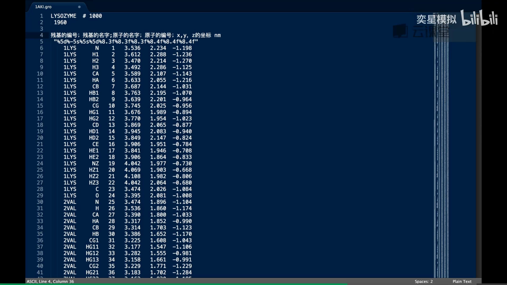

### 2.3 哪些能错、哪些不能错

- **名字可以"胡乱写"**：残基名、原子名等信息会根据拓扑信息被完全覆盖掉，不那么重要——处理时序列会严格按 top 文件里的编号重新给出；就算写错了，程序也会警告你与拓扑文件不对应；
- **坐标顺序绝对不能乱**：每一行的原子顺序必须与 top 拓扑里的原子顺序一一对应；顺序一打乱，残基归属就全错了，结构不再是初始结构，模拟必出问题。

---

## 三、四个易混概念：原子名 / 原子类型 / 元素类型 / 粒子类型

讲完 gro 格式，再补充一组理解力场绕不开的概念区分 [【跳转到 00:07】](https://www.bilibili.com/video/BV1uZ6PBhE1R/?t=1307)。

### 3.1 原子名：随便起，最好唯一

原子名就是给原子起的**名字**。任何残基上的原子（比如碳上连的氢）都可以有名字，而且**最好不要重名**。以水为例，两个氢可以分别命名为不同的名字 [【跳转到 00:57】](https://www.bilibili.com/video/BV1uZ6PBhE1R/?t=1357)：

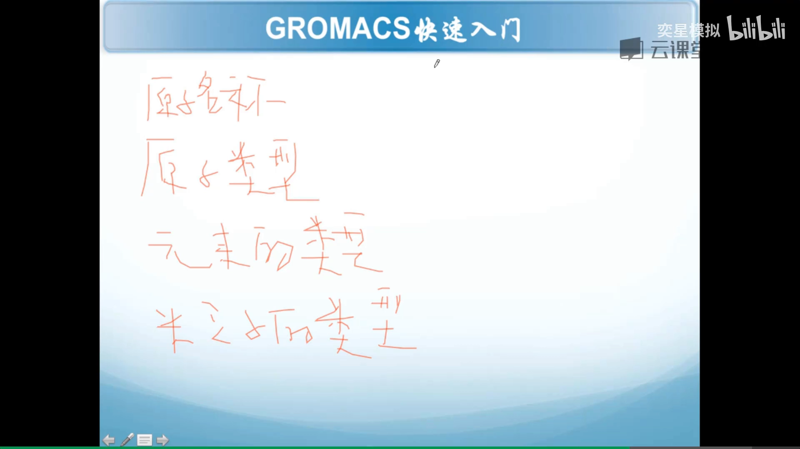

对蛋白质残基来说，每个原子的名字一般由力场规定好，与 PDB 结构连在一起。

### 3.2 原子类型：和力场一一对应

**原子类型是和力场绑定起来的**：比如水里两个氢虽然名字不同，但属于同一种力场类型（比如 OPLS 的某一类型）——名字可以不一样，力场一样则原子类型唯一。原子间相互作用参数都挂在原子类型上。

### 3.3 元素类型：查元素周期表

元素类型就是原子对应**元素周期表**里的哪个元素：两个氢不管叫什么名字、是什么力场类型，元素类型都是氢。

### 3.4 粒子类型：A / V(D) / S 三种

粒子类型是建模时**抽象粒子属性**的方式。GROMACS 只支持三种（相比之下 LAMMPS 支持十来种）[【跳转到 01:22】](https://www.bilibili.com/video/BV1uZ6PBhE1R/?t=1482)：

- **A（原子）**：最普通的粒子，记住 XYZ 坐标和电荷、质量就够了；
- **V/D（虚拟位点）**：这里没有一个真实原子。典型例子是 **TIP4P / TIP5P 水模型**——在两个氢之外多一个虚拟位点 [【跳转到 00:57】](https://www.bilibili.com/video/BV1uZ6PBhE1R/?t=1557)：

  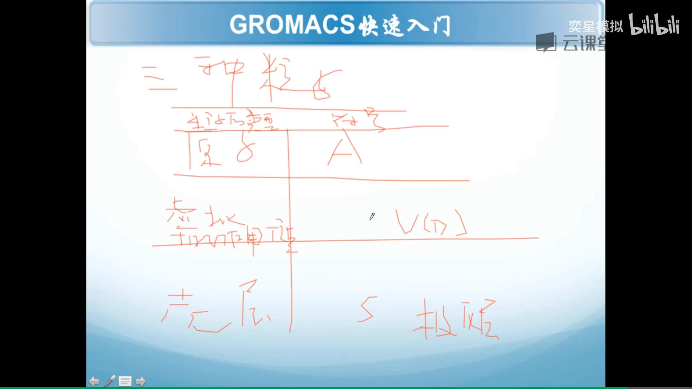

- **S（壳层，shell）**：做**极化力场**时才会用到，很少见。

再引申一步：粒子的属性决定了它的类型。比如建模**刚体**，除了 XYZ 坐标还要记录取向（theta 等内禀属性）；建模**偶极子**，除了坐标还要把偶极取向包含进去——属性不同，粒子类型就不同。GROMACS 的粒子类型集合很小，正好对应它的建模抽象范围：壳层对应极化力场，虚拟位点常见于水模型。

---

## 小结

- GROMACS 一次模拟 = 四类文本输入（**mdp 参数、gro 坐标、top 拓扑（含 itp）、ndx 索引**）+ 两条命令；`grompp` 把它们打包成二进制 **tpr**，`mdrun` 吃 tpr 吐出**轨迹（trr/xtc）与能量（edr）**文件，后处理就从这两类产出里提取数据；
- gro 文件三段式：标题行 + 原子数 + 原子行 + 盒子行；原子行十列（残基编号、残基名、原子名、原子编号、XYZ 坐标（纳米）、可选 XYZ 速度）；
- gro 里"名字可以错（会被拓扑覆盖），坐标顺序不能乱（必须与拓扑一一对应）"；
- 原子名是随便起的标签，原子类型绑力场，元素类型查周期表，粒子类型（A/V/S）决定建模抽象方式。

## 关键术语速查

| 术语 | 一句话解释 |
| --- | --- |
| mdp | 参数（控制）文件，写模拟的控制参量，文本格式 |
| gro | GROMACS 专属坐标文件（GROMOS-96 格式），文本，可含速度，也可作轨迹 |
| top / itp | 全局拓扑 / 被包含的单分子拓扑，`#include` 组织 |
| rtp | 残基文件（力场相关） |
| ndx | 索引文件，给原子/分子分组，供后期处理与分组控制 |
| tpr | grompp 打包生成的**二进制运行输入**：拓扑+参数+初始坐标速度 |
| tpb | 与 tpr 内容相同的文本形式，平时无需查看 |
| trr | 全精度轨迹（坐标/速度/力），二进制可移植 |
| xtc | 压缩轨迹，精度低但省空间 |
| edr | 能量文件：温度、压力、盒子尺寸、密度、维里等热力学量 |
| 原子名 | 原子的标签，可任意命名（最好唯一） |
| 原子类型 | 与力场一一对应的类型，决定相互作用参数 |
| 元素类型 | 元素周期表上的元素归属 |
| 粒子类型 | A 原子 / V(D) 虚拟位点 / S 壳层 三种 |
