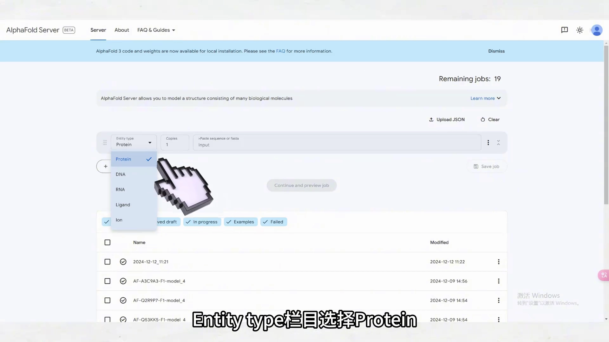
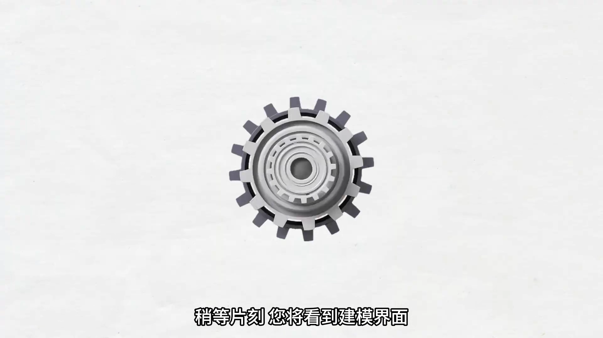
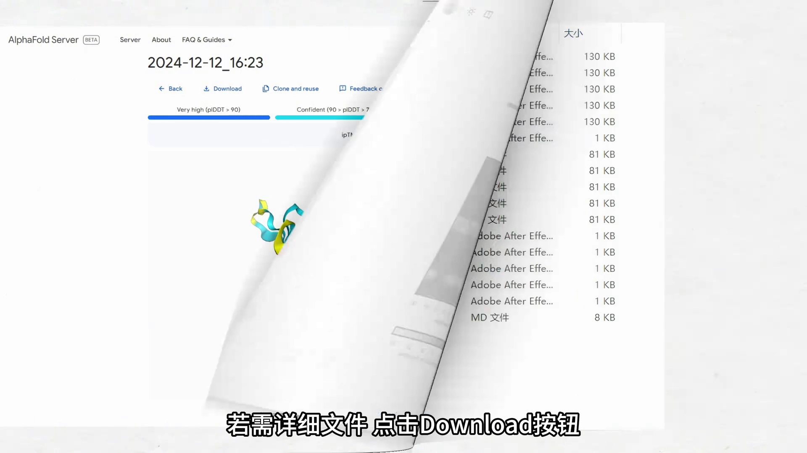
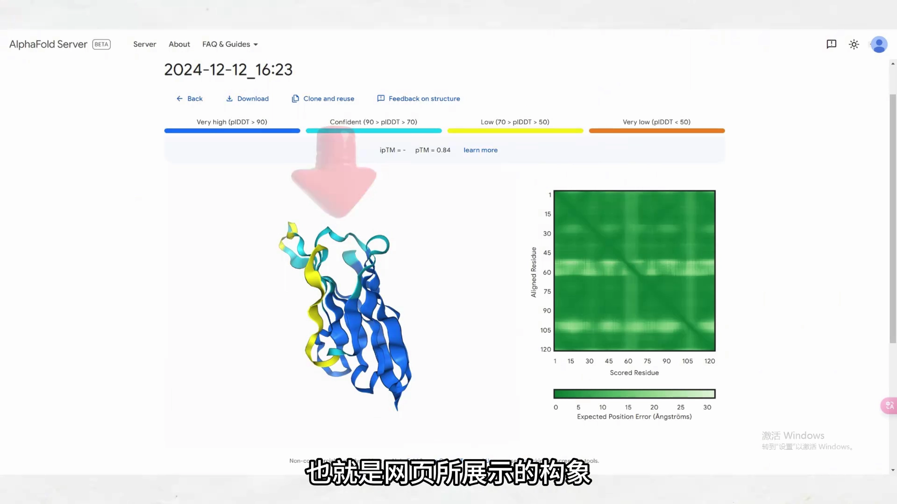
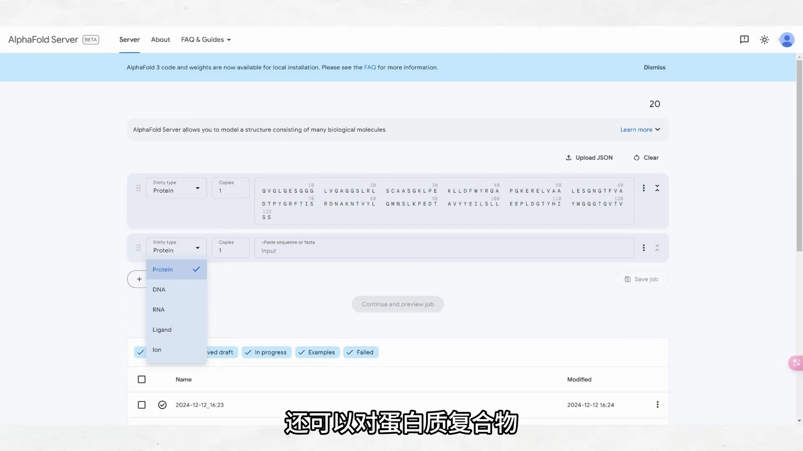
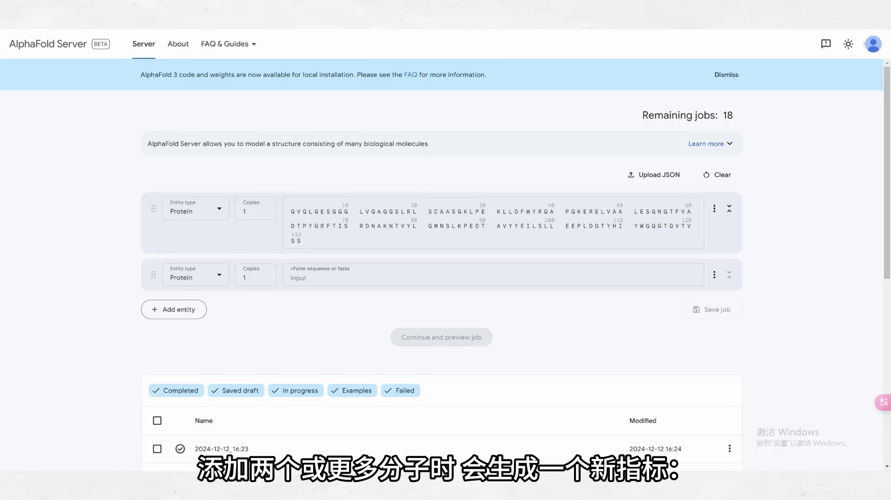

# AlphaFold3 输出结果解读：pLDDT / pTM / ipTM 从哪看、怎么读

> 来源视频：[Alphafold3输出的结果文件数据解读及复合体预测流程（科晶生物）](https://www.bilibili.com/video/BV1xEkiYREnM/) · 时长 1:49
> 本篇基于视频 AI 字幕与画面整理，时间戳可跳转回原视频对应位置。

## 本讲要解决的核心问题（SCQA）

**背景**：AlphaFold3 网页版零代码建模——选类型、贴序列、点提交，坐等结果即可（[零代码使用教程见此前整理](../../2.5_分子输入打包格式/2.5.1_AlphaFoldServerJSON/AlphaFold3零代码使用教程.md)）。

**冲突**：跑完建模，界面上出现 pLDDT、pTM、PAE 一排数字；点开 Download，压缩包里还有 CIF、JSON 一堆文件——初学者往往不知道**哪个数字在哪看、哪个文件装什么**。

**疑问**：AF3 的建模质量去哪儿看？输出的文件分别怎么读？

**回答（中心思想）**：**结果页直接看 pLDDT、pTM、PAE 三个数值；详细指标进下载包——CIF 文件装结构本体，JSON 文件的 `summary_confidences` 字段装 pTM 等得分；建模复合物时还会多出一个 ipTM 评估分子间质量**。

---

## 一、从提交到建模：网页操作一镜到底

在 AF3 网页上建模只有四步 [【跳转到 00:11】](https://www.bilibili.com/video/BV1xEkiYREnM/?t=11)：

1. 在 **Entity Type** 栏目选择 **Protein** [【跳转到 00:16】](https://www.bilibili.com/video/BV1xEkiYREnM/?t=16)；
2. 输入目标蛋白完整的 **FASTA 序列**，点击 **Continue and Preview Job**，自定义项目名称 [【跳转到 00:21】](https://www.bilibili.com/video/BV1xEkiYREnM/?t=21)；

3. 点击 **Confirm and Submit Job** 提交任务 [【跳转到 00:27】](https://www.bilibili.com/video/BV1xEkiYREnM/?t=27)；
4. 稍等片刻，进入建模结果页。

## 二、结果页：三个数值评估建模质量

结果页上直接给出三个质量指标：**pLDDT、pTM 和 PAE** [【跳转到 00:32】](https://www.bilibili.com/video/BV1xEkiYREnM/?t=32)。

- **pLDDT**：逐残基置信度（0–100），结构着色的依据——系统讲解见 [Interpreting AlphaFold predictions and confidence indicators](Interpreting%20AlphaFold%20predictions%20and%20confidence%20indicators.md)；
- **pTM**：整体结构置信度（0–1，越接近 1 越好）；
- **PAE**：残基对之间相对位置的误差热图。

若需要更详细的文件，点击 **Download** 按钮下载 [【跳转到 00:37】](https://www.bilibili.com/video/BV1xEkiYREnM/?t=37)。

## 三、下载包：CIF + JSON，5 个构象，model_0 最佳

解压后可获得 **CIF 文件**和 **JSON 文件**两类 [【跳转到 00:43】](https://www.bilibili.com/video/BV1xEkiYREnM/?t=43)：

- AlphaFold3 会生成**五个构象**，其中 **model_0 是最佳构象**——也就是网页上展示的那个 [【跳转到 00:49】](https://www.bilibili.com/video/BV1xEkiYREnM/?t=49)；
- 用 **PyMOL** 打开 CIF 文件，即可观察蛋白的三维结构 [【跳转到 00:54】](https://www.bilibili.com/video/BV1xEkiYREnM/?t=54)；

- 每个模型对应的 **JSON 文件**名称中带有 **`summary_confidences`** 字样；用记事本打开 JSON、拉到**最底部**，可查看模型的 **pTM 得分** [【跳转到 00:59】](https://www.bilibili.com/video/BV1xEkiYREnM/?t=59)。

> CIF 正是 [现代结构格式 mmCIF](../../2.2_结构类格式/2.2.2_mmCIF_CIF现代结构格式/Extended%20PDB%20IDs%20and%20PDBx／mmCIF%20files%20-%20Make%20the%20switch%20now!%20What%2C%20why%2C%20how.md) 一讲介绍的标准格式——AF 系列模型默认用它存结构。

## 四、复合物建模与 ipTM

AF3 的能力不止单体蛋白 [【跳转到 00:59】](https://www.bilibili.com/video/BV1xEkiYREnM/?t=59)：蛋白质**复合物**、**DNA / RNA** 等生物大分子都可以建模，还包括生物常见**配体、小分子和金属离子**。点击 **Add Entity** 按钮即可自由添加分子 [【跳转到 01:16】](https://www.bilibili.com/video/BV1xEkiYREnM/?t=76)，操作步骤与单体建模一致。

关键区别：**添加两个或更多分子时，会生成一个新指标 ipTM**，用于评估**分子之间**的建模质量 [【跳转到 01:27】](https://www.bilibili.com/video/BV1xEkiYREnM/?t=87)。

> ipTM 的直觉读法（界面置信度，越接近 1 越好）在 [Interpreting AlphaFold predictions and confidence indicators](Interpreting%20AlphaFold%20predictions%20and%20confidence%20indicators.md) 一篇有展开；它在抗体-抗原界面评分中的应用见 [1.5.3 一讲](../../1.5_分子相互作用/1.5.3_抗体-抗原界面ipTM与界面几何评分/【公开课】基于AI预测蛋白质复合体的三维空间结构---AlphaFold-Multimer原理及使用.md)。

---

## 小结

- 网页建模四步：**选 Protein → 贴 FASTA → Continue and Preview Job → Confirm and Submit Job**。
- 结果页看三个数：**pLDDT（逐残基）、pTM（整体）、PAE（残基对）**。
- 下载包两类文件：**CIF = 结构**（PyMOL 直接打开），**JSON = 指标**（文件名带 `summary_confidences`，拉到底部看 pTM）。
- **5 个构象，model_0 最佳**，即网页展示构象。
- **≥2 个分子**时新增 **ipTM**，专管分子间的建模质量。

## 关键术语速查

| 术语 | 一句话解释 |
| --- | --- |
| Entity Type | AF3 网页里的分子类型选择（Protein / DNA / RNA / Ligand…） |
| pLDDT | 逐残基置信度（0–100），结构着色依据 |
| pTM | 整体结构置信度（0–1，越接近 1 越好），藏在 JSON 的 `summary_confidences` 底部 |
| ipTM | 界面版 pTM，只在多分子复合物任务中出现，评估分子间建模质量 |
| PAE | 残基对相对位置误差热图 |
| CIF / JSON | 下载包里的两类文件：CIF 存结构坐标，JSON 存置信度指标 |
| model_0 | 5 个生成构象中的最佳构象，即网页默认展示的那个 |
