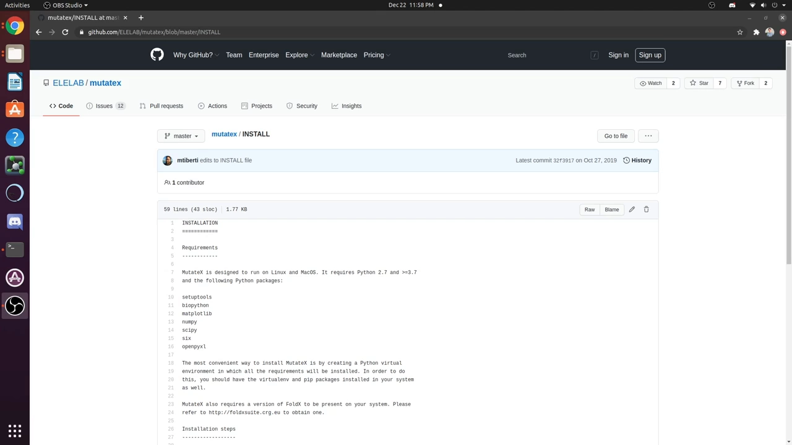
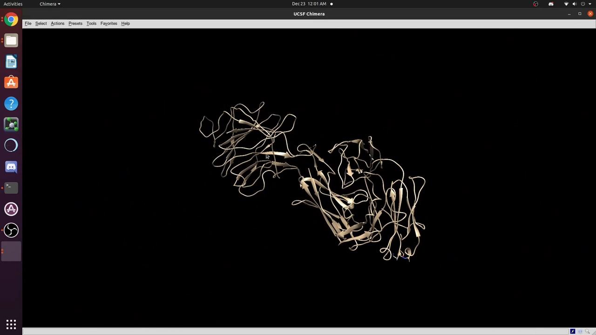
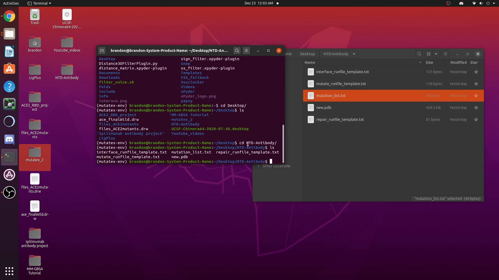
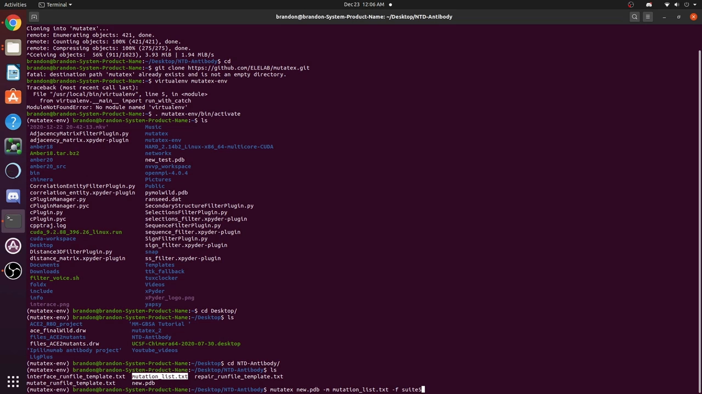
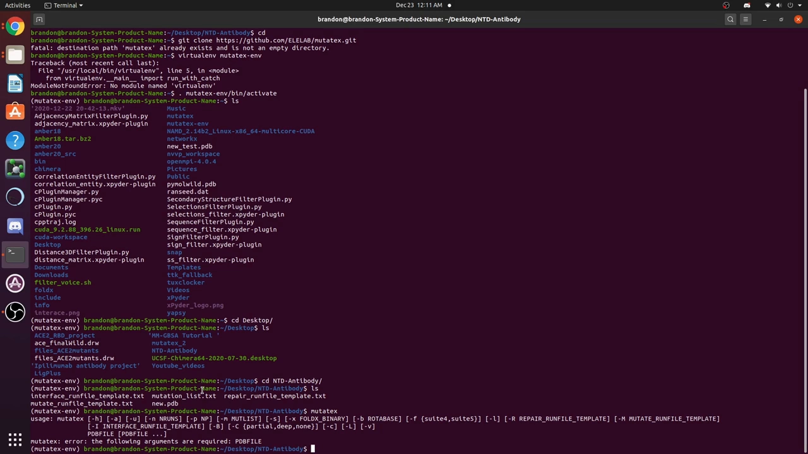
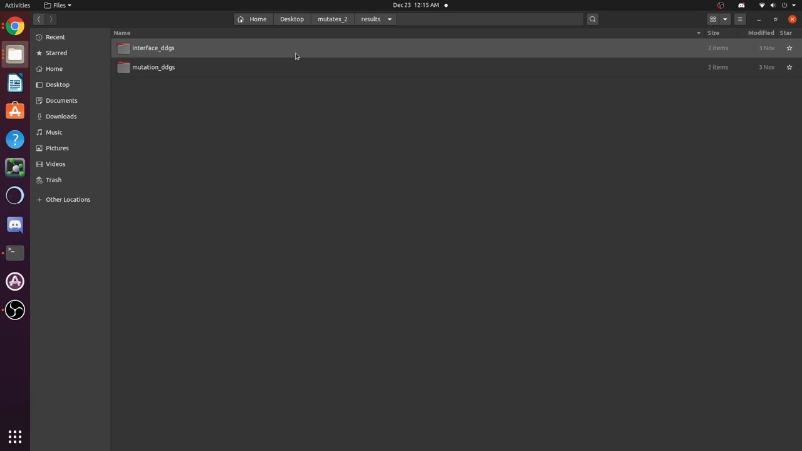
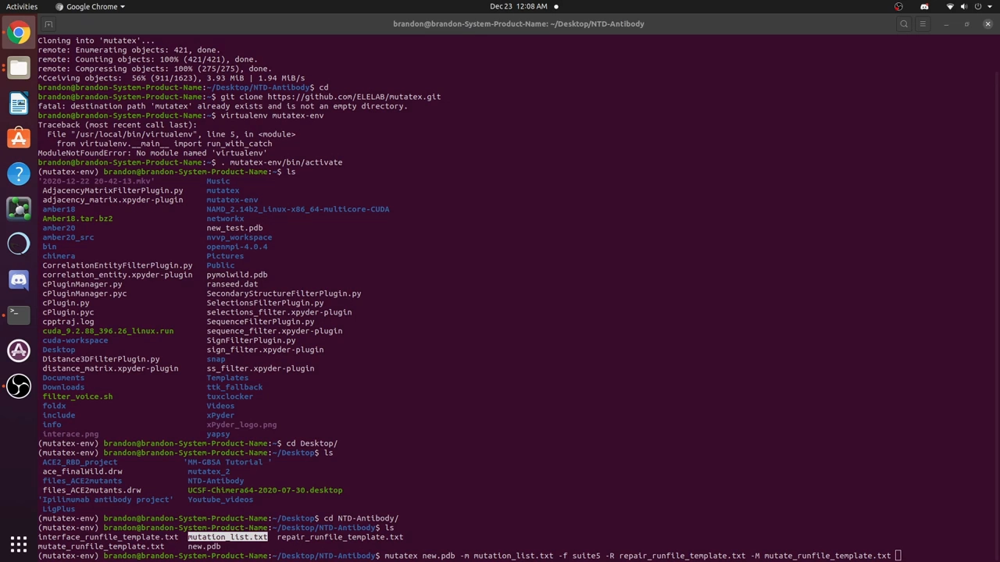
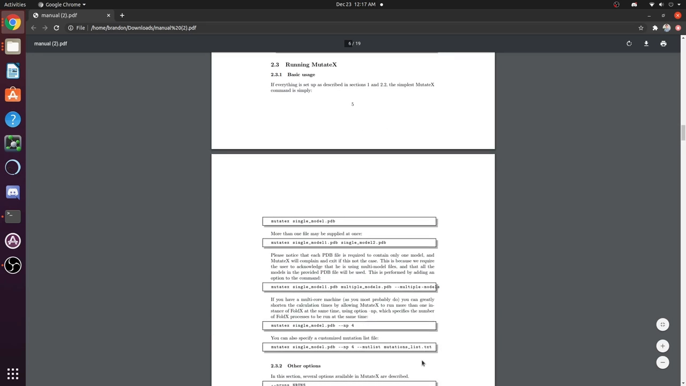
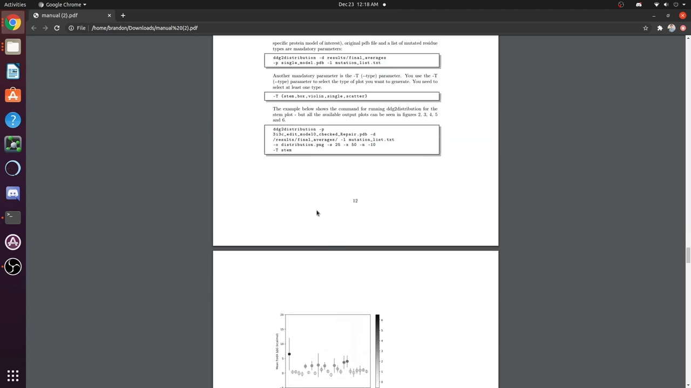

# Tutorial for Performing In Silico Protein Mutagenesis using Python Wrapper Mutatex employing Foldx

> 视频来源：[Tutorial for Performing In Silico Protein Mutagenesis using Python Wrapper Mutatex employing Foldx（YouTube）](https://www.youtube.com/watch?v=4Dj4YbX2wjU)，时长约 21 分钟（In-Silico by Brandon Havranek）。本文基于视频演说图文稿整理，时间戳可跳转到对应讲解。主题一句话：用 MutateX（Python 封装）驱动 FoldX 能量函数，对蛋白复合物做全残基饱和突变，批量计算每个突变的 ΔΔG 与界面作用能，用于亲和力优化。

## 本讲要解决的核心问题（SCQA）

**背景**：上一节我们知道，丙氨酸扫描/突变扫描能定位关键残基，其计算版本就是"虚拟突变 + 结合能计算"（ddG）。

**冲突**：要做**饱和突变**——每个残基 × 20 种氨基酸——手工逐个建模、跑能量、整理结果根本不现实；而且能量计算依赖可靠的能量函数与规范的结构预处理。

**疑问**：有没有一条开箱即用的流水线，输入一个 PDB 结构，就能自动完成"修结构 → 全残基突变 → 输出 ΔΔG"？

**回答（中心思想）**：有——**MutateX**（一个 Python 封装工具）调用 **FoldX** 能量函数：一条命令即可对复合物做饱和突变，输出每个突变的折叠稳定性 ΔΔG 和（对双链复合物）界面相互作用能，还自带热图等分析工具。视频以"抗体 × SARS-CoV-2 Spike NTD 结构域"为例完整走了一遍流程。

## 一、工具定位：MutateX 管流程，FoldX 管能量

- **FoldX** 是一个经验 free energy 计算套件（energy suite），能对蛋白结构做能量评估与突变 ΔΔG 预测 [【跳转到 00:25】](https://www.youtube.com/watch?v=4Dj4YbX2wjU&t=25)。
- **MutateX** 是它的 Python 封装（GitHub 可下载），把"修复结构 → 逐残基 × 20 氨基酸突变 → 收集 ΔΔG → 汇总平均"全部自动化 [【跳转到 00:00】](https://www.youtube.com/watch?v=4Dj4YbX2wjU&t=0)。



示例体系是一个**双链复合物**：抗体 + SARS-CoV-2 Spike 蛋白的 N-terminal domain（NTD）。因为是两条链，除了稳定性还能算**链间相互作用能**——这正是亲和力优化最关心的量 [【跳转到 02:20】](https://www.youtube.com/watch?v=4Dj4YbX2wjU&t=140)。



## 二、安装与前置准备

安装很简单（Linux/MacOS 类似）[【跳转到 00:50】](https://www.youtube.com/watch?v=4Dj4YbX2wjU&t=50)：

1. 从 GitHub 把仓库 clone 到 home 目录；
2. **激活虚拟环境**后，在任意目录都能运行 `mutatex` 命令（不必待在安装目录）；
3. **单独安装 FoldX**：MutateX 只负责流程，能量计算全靠 FoldX——去官网申请学术许可（注册用户名、邮箱、机构），下载后把路径配好即可 [【跳转到 00:55】](https://www.youtube.com/watch?v=4Dj4YbX2wjU&t=55)。

工作目录里需要放几样东西，全部由 MutateX 自带 [【跳转到 02:55】](https://www.youtube.com/watch?v=4Dj4YbX2wjU&t=175)：

- **mutation list**：突变列表，默认含全部 20 种氨基酸；
- **repair run file 模板**（修复步骤配置）；
- **mutate run file 模板**（突变步骤配置）；
- **interface run file 模板**（界面能量计算配置）。

这些模板按 FoldX 官方推荐参数写好，作者建议**不要改**，直接从安装目录拷到工作目录即可。

## 三、第一步：RepairPDB——先修结构，再算能量

MutateX 跑的第一步是用 FoldX 的 `RepairPDB` 模块优化晶体结构 [【跳转到 05:05】](https://www.youtube.com/watch?v=4Dj4YbX2wjU&t=305)：



- 修复能量差的残基：不利的扭转角、van der Waals 冲突等；
- **Asn/Gln/His 翻转 180°**：这三个酰胺/咪唑基团有"对称歧义"，翻转可防止错误的 rotamer（旋转异构体）指认；
- 对能量差的残基，把它**连同相邻残基一起重建**，穷举不同 rotamer 组合，找到新的能量极小。

一句话：修复是为了让后续所有 ΔΔG 站在同一张"干净的起点"上比较。

## 四、第二步：一条命令跑饱和突变

核心命令长这样 [【跳转到 07:32】](https://www.youtube.com/watch?v=4Dj4YbX2wjU&t=452)：

```
mutatex new.pdb -m mutation_list.txt --suite 5 \
  repair_runfile_template.txt mutate_runfile_template.txt \
  interface_runfile_template.txt -b -p 20
```



逐个拆解关键参数：

- **PDB 可传多个**：比如跑 100 ns MD 后取 3 个快照分别存成 PDB，MutateX 会对三种构象的结果**求平均**，以考虑蛋白柔性与局部构象变化 [【跳转到 06:17】](https://www.youtube.com/watch?v=4Dj4YbX2wjU&t=377)；
- `-m`：指定突变列表；
- `--suite 5`：指定 FoldX 套件版本（5 是最新版）；
- 三个 run file 模板：修复 / 突变 / 界面三个阶段的配置；
- `-b`：计算**双链间的结合界面相互作用能**（只适用于两条链的复合物）；
- `-p`：**处理器数**，非常重要——计算量 = 残基数 × 20 种氨基酸 × 默认 5 次重复 × PDB 数，单核会跑非常久（视频示例结果约需一天以上）[【跳转到 12:11】](https://www.youtube.com/watch?v=4Dj4YbX2wjU&t=731)；
- FoldX 的 rotabase 文件会自动定位，一般不用手动指定；如果没配好 FoldX 路径，可以用 `-dx` 显式指定二进制位置。



## 五、ΔΔG 与界面作用能：输出怎么读

运行完成后得到两个关键目录 [【跳转到 15:36】](https://www.youtube.com/watch?v=4Dj4YbX2wjU&t=936)：

- `repair/`：修复后的结构（后续流程的输入，一般不用再看）；
- `mutation/`：每个突变一个子目录，命名规则 = **突变后氨基酸字母 + 链名 + 残基编号**。

结果目录里有两份核心文件 [【跳转到 16:26】](https://www.youtube.com/watch?v=4Dj4YbX2wjU&t=986)：

- **mutation_ddGs**：每个突变的**折叠能/稳定性**变化；
- **interface_ddGs**：**界面相互作用能**变化——做亲和力优化（找结合更好的抗体残基）看这个。



ΔΔG 的定义（单链稳定性）：突变后折叠自由能 − 野生型折叠自由能；而界面能则是"突变后两链相互作用能相对野生型的变化" [【跳转到 08:47】](https://www.youtube.com/watch?v=4Dj4YbX2wjU&t=527)。举个具体例子：抗体界面上某个亮氨酸（Leu）残基，算法把它的 20 种候选氨基酸各试一遍，可能发现突变成苯丙氨酸或甘氨酸后，与 Spike NTD 的结合能**更有利**——这就是亲和力优化的直接线索 [【跳转到 09:37】](https://www.youtube.com/watch?v=4Dj4YbX2wjU&t=577)。



读结果表时注意三点：

1. 每个文件列 **20 种氨基酸**的数值，顺序与突变列表一致（如 Gly、Ala、Asn、Leu、Ile…）；
2. **野生型（WT）= 0**，是所有比较的基准；
3. 看 `average` 列；只跑单个结构时**没有标准差**列（多 PDB 才有）。

## 六、内置分析：热图与各种图

MutateX 自带结果分析脚本 [【跳转到 18:30】](https://www.youtube.com/watch?v=4Dj4YbX2wjU&t=1110)：

- **热图（heatmap）**：行=残基，列=20 种氨基酸，红色=让稳定性/结合变不利的突变，绿色/ favorable=有利突变；界面计算里，远离界面的残基数值基本为 0（它们本来就不参与结合）；
- **统计图**：stem plot、box plot、violin plot、scatter plot、直方图、sequence logo 等；比如直方图能直观显示"突变成 Proline 很不利，突变成 Leucine 比野生型（此处为 Q，值为 0）更有利"。





## 小结

- **MutateX + FoldX** = "流程自动化 + 经验能量函数"的饱和突变流水线；
- 流程三步：**安装（GitHub clone + 虚拟环境 + FoldX 学术许可）→ RepairPDB 修结构 → 一条命令跑饱和突变**；
- 双链复合物加 `-b` 可输出**界面相互作用能**，这是亲和力优化（找更强结合突变）的直接依据；
- 计算量 = 残基数 × 20 × 5 runs × PDB 数，用 `-p` 给足处理器；多 PDB（如 MD 快照）可平均，更稳；
- 结果看 `interface_ddGs`（结合）或 `mutation_ddGs`（稳定性），**WT=0**，数值按突变列表顺序排列；
- 自带热图/统计图分析，非界面残基在界面计算中≈0，可直接忽略。

## 关键术语速查

| 术语 | 一句话解释 |
| --- | --- |
| 饱和突变（saturated mutagenesis） | 把某个/每个残基依次突变成全部 20 种氨基酸，系统评估各替换的影响 |
| FoldX | 基于经验能量函数的蛋白结构能量计算套件，可预测突变 ΔΔG |
| MutateX | 封装 FoldX 的 Python 工具，自动化饱和突变流程与结果分析 |
| RepairPDB | FoldX 的结构优化模块：修扭转角、去原子冲突、翻转 Asn/Gln/His |
| rotamer | 侧链旋转异构体；侧链在空间中的几种稳定取向 |
| ΔΔG（ddG） | 突变体相对野生型的自由能变化；界面 ddG 衡量突变对链间结合的影响 |
| mutation_ddGs / interface_ddGs | MutateX 输出的两类结果文件：折叠稳定性 / 界面相互作用能 |
| suite | FoldX 的参数/能量函数版本套件（视频使用 suite 5） |
| rotabase | FoldX 运行所需的 rotamer 库文件，MutateX 会自动定位 |
