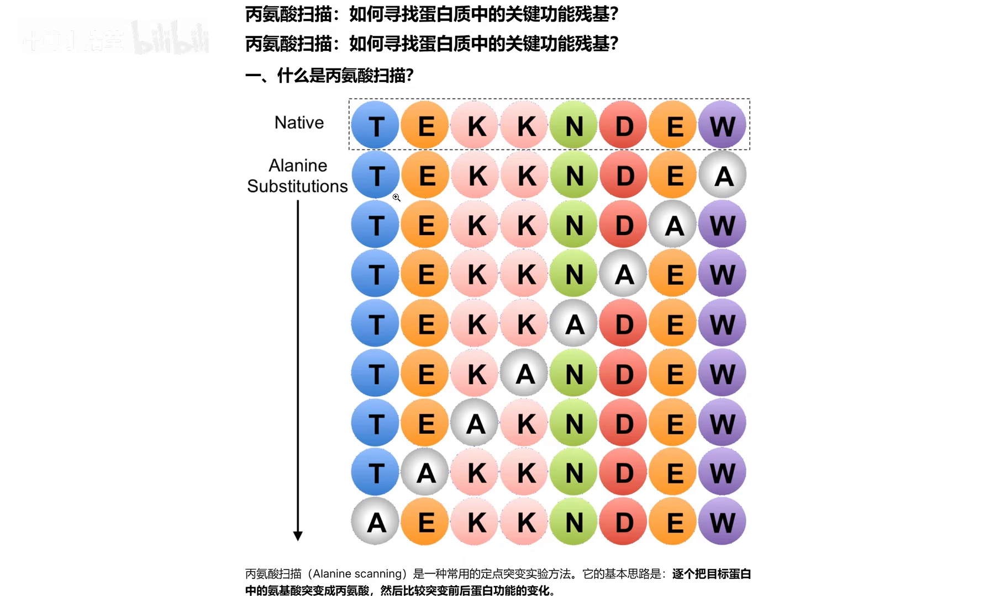
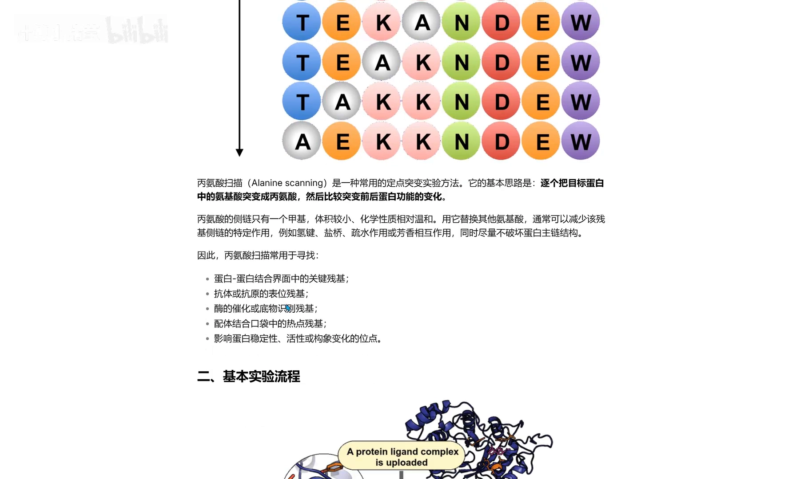
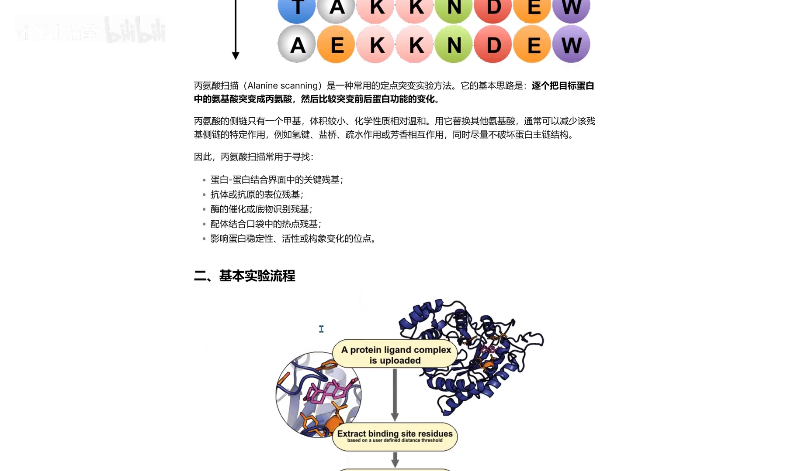
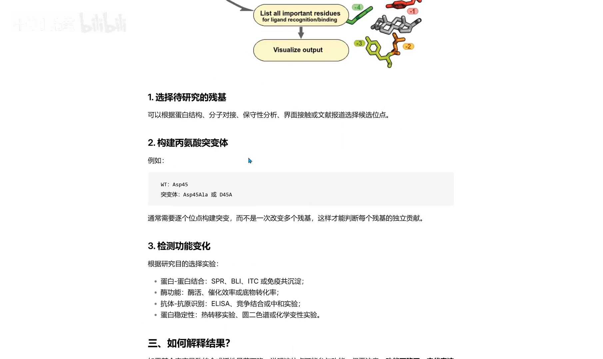
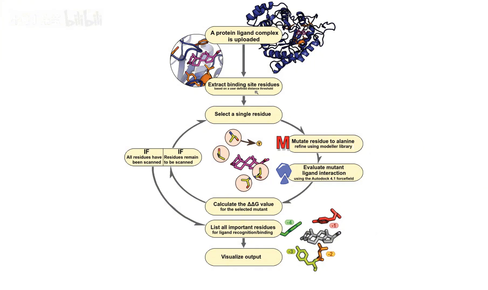
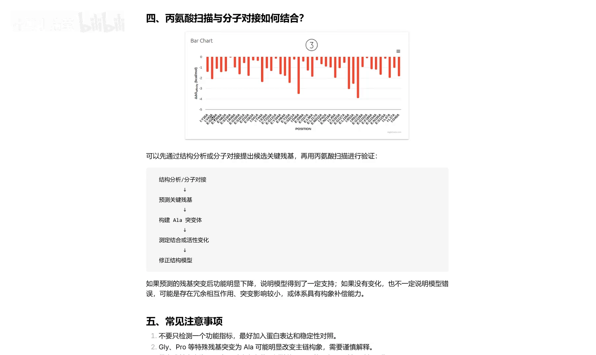
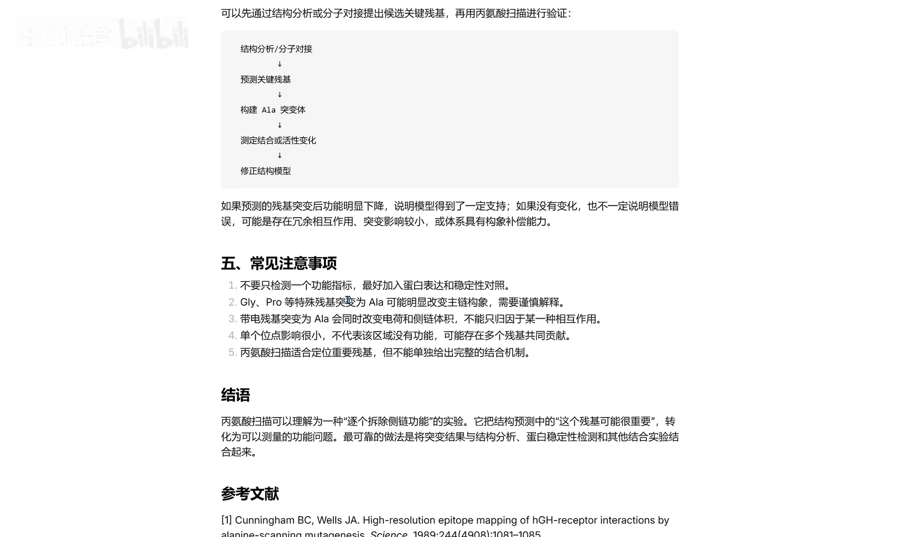

# 丙氨酸扫描：如何寻找蛋白质中的关键功能残基？

> 视频来源：[丙氨酸扫描：如何寻找蛋白质中的关键功能残基？（Bilibili）](https://www.bilibili.com/video/BV1ZjeA6ZEvK/)，时长约 4 分钟（计算小猪莹）。本文基于视频演说图文稿整理，时间戳可跳转到对应讲解。

## 本讲要解决的核心问题（SCQA）

**背景**：在蛋白质设计平台（如 dyMEAN 做抗体亲和力优化）里，模型会输出大量与"突变"有关的数字——ddG（突变引起的结合能变化）。要读懂这些数字，先得知道它们背后对应什么样的实验/计算手段。

**冲突**：一个结合界面上动辄几十个残基，逐个做实验测"哪个残基对结合贡献大"又贵又慢；只看模型输出的数字，又不知道它从何而来。

**疑问**：有没有一种简单、系统的方法，能快速定位"关键功能残基"，并让 ddG 这类数字有一个直观的物理图像？

**回答（中心思想）**：有——**丙氨酸扫描（alanine scanning）**。把目标残基逐个换成最小的丙氨酸（A），看结合能或功能的变化：变化大，这个残基就是关键残基；变化小，它多半不重要。它正是 ddG 指标最经典的"实验原型"。

## 一、什么是丙氨酸扫描：为什么偏偏换成丙氨酸

丙氨酸扫描，就是把一条序列中的氨基酸**逐个突变成丙氨酸 A**。比如一条正常序列 `TEKKADEW`，扫描时把 T 突变成 A、E 突变成 A、K 突变成 A…… [【跳转到 00:00】](https://www.bilibili.com/video/BV1ZjeA6ZEvK/?t=0)

为什么偏偏选丙氨酸？因为丙氨酸的**侧链只有一个甲基**，是除甘氨酸外最小、最"干净"的侧链 [【跳转到 00:25】](https://www.bilibili.com/video/BV1ZjeA6ZEvK/?t=25)：

- 用它替换其他氨基酸，可以**移除该残基侧链的特定相互作用**——疏水、盐桥、氢键等；
- 同时**不破坏蛋白的主链结构**（不会像甘氨酸那样引入过大的柔性，也不像脯氨酸那样掰折骨架）。

可以把它理解为一场"**逐步拆解侧链**"的实验：氨基酸之间的主要区别就在侧链，把某个侧链"拆掉"后功能还在，说明它不重要；功能塌了，说明这个侧链（也就是这个位点）很关键 [【跳转到 03:06】](https://www.bilibili.com/video/BV1ZjeA6ZEvK/?t=186)。

## 二、它能回答什么问题

丙氨酸扫描的用武之地很广 [【跳转到 00:48】](https://www.bilibili.com/video/BV1ZjeA6ZEvK/?t=48)：

- **结合界面分析**：找蛋白-蛋白、蛋白-小分子界面上的关键残基；
- **抗原-抗体表位**：定位抗体识别的表位残基；
- **酶催化**：找参与底物识别的残基；
- **蛋白稳定性 / 活性构象**：判断哪些残基在撑住结构。

## 三、标准工作流：从选点到解读

视频给出的基本流程分四步 [【跳转到 00:57】](https://www.bilibili.com/video/BV1ZjeA6ZEvK/?t=57)：

**第一步，选待研究的残基**。哪些位点值得做扫描？分子对接后蛋白-小分子结合的关键残基、蛋白-蛋白界面的关键残基、抗原-抗体的关键残基，以及文献中已报道的位点，都是优先候选 [【跳转到 01:26】](https://www.bilibili.com/video/BV1ZjeA6ZEvK/?t=86)。

**第二步，构建突变体**——既可以用计算虚拟构建，也可以用实验方法构建 [【跳转到 01:51】](https://www.bilibili.com/video/BV1ZjeA6ZEvK/?t=111)。

**第三步，检测功能变化**，实验与计算两条路线都行 [【跳转到 01:51】](https://www.bilibili.com/video/BV1ZjeA6ZEvK/?t=111)：

- 实验：蛋白结合测免疫共沉淀、SPR；酶催化功能测催化活性/酶活；抗原-抗体做 ELISA、竞争结合等；
- 计算：直接算结合能变化，以及结合模式、蛋白稳定性（稳定性还可以用圆二色谱、热迁移实验检测 [【跳转到 02:16】](https://www.bilibili.com/video/BV1ZjeA6ZEvK/?t=136)）。

**第四步，解读结果**：突变后若 ΔG（结合能等参数）**变化大**，说明该残基对结合很重要；若突变成丙氨酸后变化不大，说明这个位点可能并不重要 [【跳转到 01:02】](https://www.bilibili.com/video/BV1ZjeA6ZEvK/?t=62)。

## 四、和分子对接/蛋白对接联用：虚拟丙氨酸扫描

我们经常做分子对接、蛋白对接，丙氨酸扫描可以这样和它们串起来 [【跳转到 02:41】](https://www.bilibili.com/video/BV1ZjeA6ZEvK/?t=161)：

1. 先通过分子对接或蛋白对接，**找到关键的界面残基**；
2. 再通过**虚拟扫描**的方式——跑完分子动力学后用 MM/PBSA 构建虚拟突变体，测定它的结合能变化。

这条纯计算路线就是不依赖湿实验的 ddG 计算，也是抗体设计平台里"亲和力优化打分"的雏形。

## 五、五个解读陷阱（注意事项）

视频特别提醒了几点 [【跳转到 02:16】](https://www.bilibili.com/video/BV1ZjeA6ZEvK/?t=136)：

- **功能下降 ≠ 该残基直接参与结合**：它可能只是位于结合热点、稳定界面，突变间接影响了整体；
- **不要只检测一个指标**：多测几个功能读出，避免单一指标的误导；
- **单个位点影响小 ≠ 该区域没有功能**：冗余效应可能掩盖单点贡献；
- **带电残基要小心**：突变它会同时改变电荷和侧链性质，ΔΔG 的变化无法归因于某一种作用；
- **实操建议**：前期大量（虚拟）筛选，之后再挑几个候选做实验验证，性价比最高。

## 小结

- 丙氨酸扫描 = 把残基**逐个换成丙氨酸**，用"拆掉侧链"的方式探测每个残基的贡献；
- 丙氨酸侧链只有一个甲基：**去相互作用、不伤主链**，是理想的"探针"；
- 工作流：**选点（对接/文献）→ 构建突变体（虚拟或实验）→ 检测功能/能量变化 → 解读**；
- 判据：突变后能量/功能**变化大 → 关键残基**；变化小 → 可能不重要；
- 与对接联用（对接找界面 → MD + MM/PBSA 虚拟突变）就是纯计算版 ddG，也是 dyMEAN 等模型亲和力优化的概念源头；
- 解读要避免"单指标、单归因"陷阱。

## 关键术语速查

| 术语 | 一句话解释 |
| --- | --- |
| 丙氨酸扫描 | 把残基逐个突变成丙氨酸，用结合能/功能变化定位关键残基的方法 |
| ΔG | 结合（自由）能：衡量两个分子结合的强弱 |
| ΔΔG（ddG） | 突变前后 ΔG 的差值：正/-负表示结合变弱/变强（本文语境下按视频口径：变化幅度代表残基重要性） |
| 热点残基 | 对结合自由能贡献特别大的界面残基 |
| MM/PBSA | 分子动力学采样 + 隐式溶剂近似估算结合自由能的计算方法 |
| SPR | 表面等离子共振：实验测分子结合的常用技术 |
| 圆二色谱 / 热迁移实验 | 检测蛋白二级结构/稳定性的实验手段 |
