# 虚拟氨基酸突变指导抗体亲和力成熟（Discovery Studio 抗体药物设计与优化）

> 视频来源：[【第二期】虚拟氨基酸突变指导抗体亲和力成熟 | Discovery Studio 抗体药物设计与优化（Bilibili）](https://www.bilibili.com/video/BV1qH4y1X7Ur/)，时长约 19 分钟（源资科技）。视频开头约一分半为厂商与产品线简介（2008 年成立、约 130 人、累计服务 3000+ 客户，产品覆盖生命科学与材料科学模拟），本文聚焦技术内容。本文基于视频演说图文稿整理，时间戳可跳转到对应讲解。

## 本讲要解决的核心问题（SCQA）

**背景**：抗体药物早期发现有一条标准流水线：确立靶点 → 抗原制备与免疫 → 抗体筛选得到先导抗体 → **抗体优化**（亲和力成熟、成药性改造、人源化）→ 成药性评估 → 动物模型安全/有效验证 → 确定候选序列，后续还可延伸出 ADC、双抗、抗体融合蛋白等衍生药物 [【跳转到 01:50】](https://www.bilibili.com/video/BV1qH4y1X7Ur/?t=110)。计算模拟主要加速的就是"抗体优化"这一环，DS（Discovery Studio）定位为"从抗体序列出发，到结构和功能优化的全方位抗体模拟计算平台" [【跳转到 03:54】](https://www.bilibili.com/video/BV1qH4y1X7Ur/?t=234)。

**冲突**：实验端的亲和力成熟要构建大容量突变库再逐轮筛选，成本高、周期长；而计算机里"虚拟突变"动辄给出十几个"都能提高亲和力"的候选，不可能全部验证。

**疑问**：能不能在计算机里先把突变"做一遍"，再用可靠规则把候选缩到几个，让实验一击即中？

**回答（中心思想）**：可以。DS 给出一条完整链路：**抗体-抗原结构预测（ZDOCK + RDOCK 两步法对接）→ 界面残基识别与能量计算 → 虚拟氨基酸突变（丙氨酸扫描 / 单点饱和 / 多点组合）→ 按"能量 + 微环境互补"挑选 → 多 pose 交叉验证降风险**。这正是 dyMEAN 这类抗体设计模型中"亲和力优化"的软件原型。

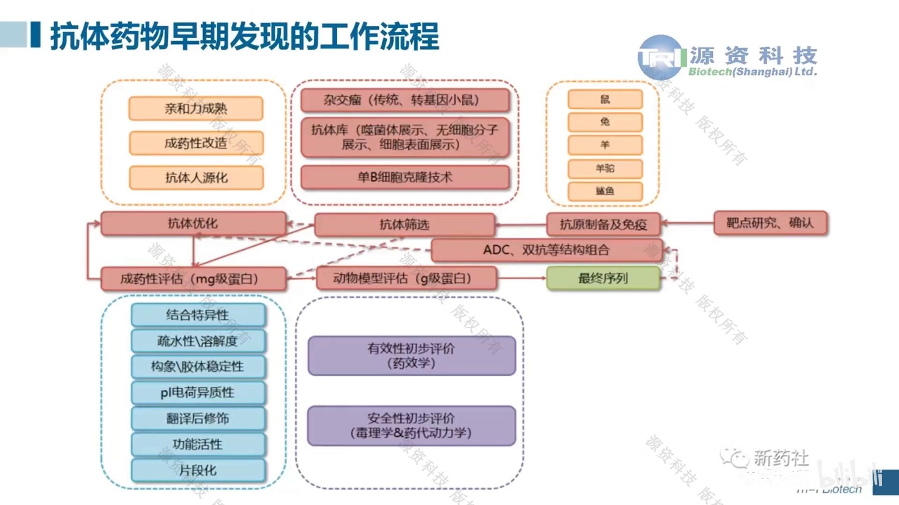

## 一、第一步：拿到抗体-抗原三维结构

虚拟突变的前提是一张靠谱的复合物"地图" [【跳转到 04:36】](https://www.bilibili.com/video/BV1qH4y1X7Ur/?t=276)：

- **抗体**：直接用 DS 预测结构（第一期报告内容）；
- **抗原**：有同源性高的模板或已报道晶体结构就直接用；没有的话，可以先用 AlphaFold 等方法预测，再导入 DS 做相互作用预测，效果更好。

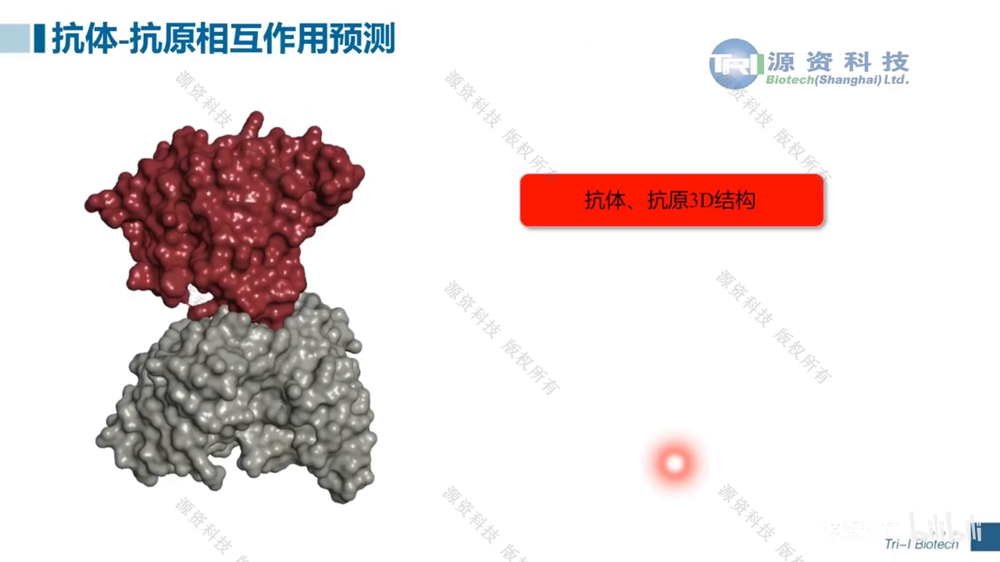

## 二、第二步：两步法对接——ZDOCK 刚性对接 + RDOCK 能量精修

**ZDOCK：刚性对接**。原理是基于表面互补的刚性对接；有文献评估认为它在速度与准确度上都是蛋白-蛋白对接中的佼佼者，也支持蛋白-DNA 相互作用预测 [【跳转到 05:01】](https://www.bilibili.com/video/BV1qH4y1X7Ur/?t=301)。

关键参数（ZDOCK 界面）[【跳转到 06:16】](https://www.bilibili.com/video/BV1qH4y1X7Ur/?t=376)：

- **受体 = 抗体、配体 = 抗原**；
- **步长**：有 6 和 15 两档。两个分子像两个球互相滚动找空间互补，步长越小越精细；现在普通计算机算力下设 6 也没问题，精密度、准确度比 15 更高；
- **block（屏蔽）**：通常认为抗体上与抗原作用的是 CDR 区，可以把 **CDR 及其附近范围以外**的氨基酸区域屏蔽掉；配体（抗原）一侧只有在有已知信息时才建议 block；filter（过滤）参数在没有确定信息时也不建议设置。

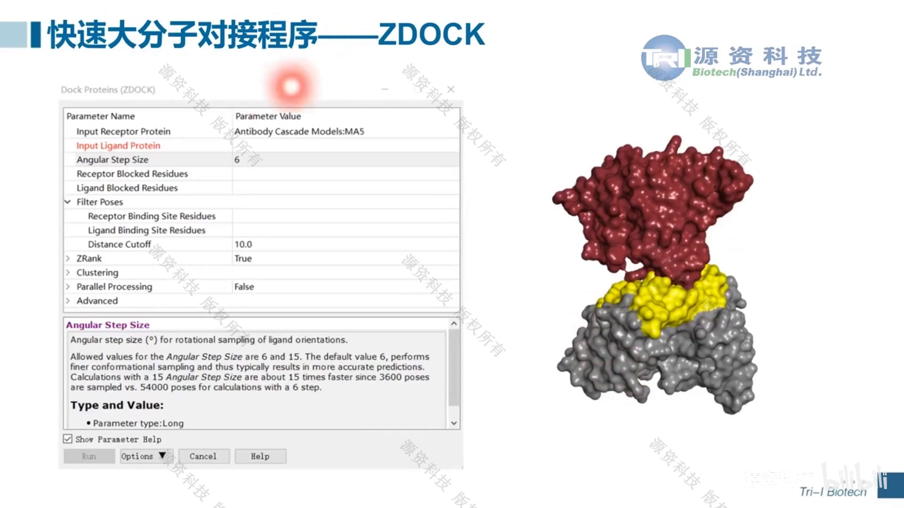

打分与取数 [【跳转到 08:31】](https://www.bilibili.com/video/BV1qH4y1X7Ur/?t=511)：

- **ZDOCK 打分越大越好**，**ZRank 打分越低越好**；
- 两个打分可以都做排序、都送优化对比；一般取打分**前 200 或前 500** 的 pose 进入下一步。

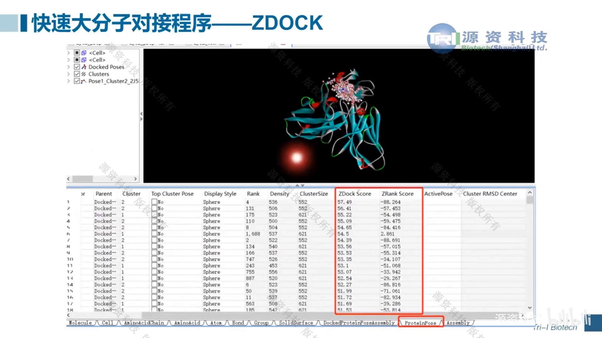

**RDOCK：能量精修**。基于 CHARMm 力场对 pose 做能量优化，打分越低越好（带负号）。视频用晶体复合物做了复现：打分前十中**九个**与真实抗原的空间排布、走势基本一致，只有一个偏差较大 [【跳转到 09:44】](https://www.bilibili.com/video/BV1qH4y1X7Ur/?t=584)。因此最终分析时要对**前十/前二十个构象做综合分析**，看哪些构象彼此靠近、哪些是"离群"。

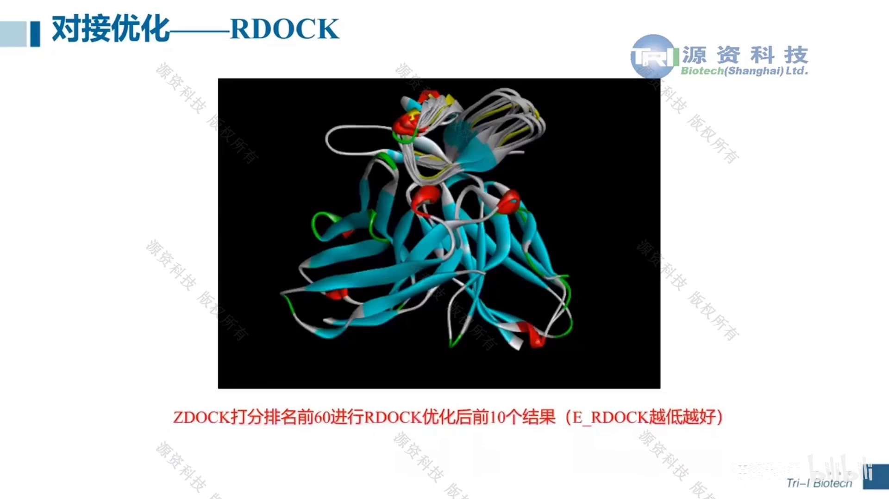

## 三、第三步：界面残基识别与能量计算

有了对接复合物，下一步是**识别相互作用界面的残基**：找到抗体中到底哪些氨基酸跟抗原产生了相互作用，后续就对它们做虚拟突变 [【跳转到 10:41】](https://www.bilibili.com/video/BV1qH4y1X7Ur/?t=641)。

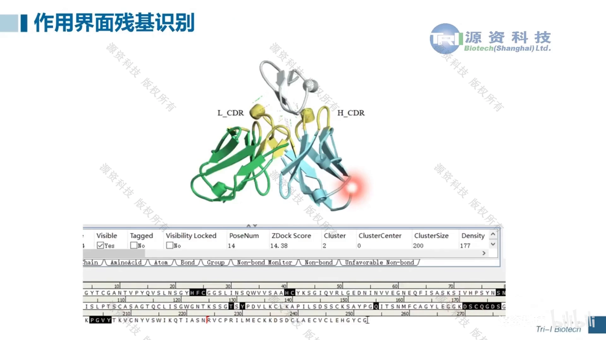

除残基识别外，DS 还有能量计算协议（protocol）：在界面识别基础上给出每个相互作用的能量 [【跳转到 11:03】](https://www.bilibili.com/video/BV1qH4y1X7Ur/?t=663)：

- **红色 = 正值 = 能量冲突**（不利）；
- **蓝色 = 负值 = 能量降低**（有利于亲和力的相互作用）；
- 红色冲突涉及的氨基酸要重点关注——如果后续突变位点恰好落在这些位置，需要考虑回复突变（back mutation）。

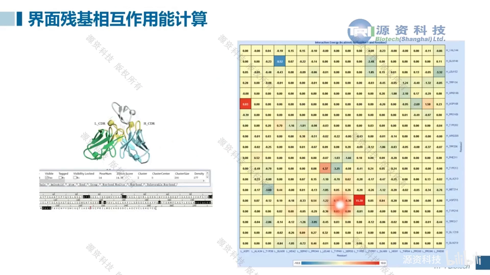

## 四、第四步：虚拟氨基酸突变的三种类型

视频把突变方式分成三类 [【跳转到 11:58】](https://www.bilibili.com/video/BV1qH4y1X7Ur/?t=718)：

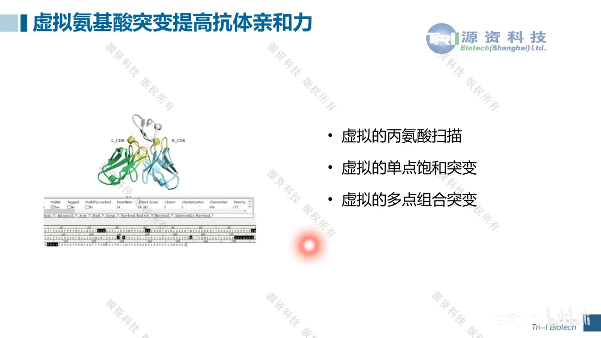

1. **虚拟丙氨酸扫描**：把界面残基逐个突变成丙氨酸。丙氨酸是除甘氨酸外最简单的氨基酸，侧链相互作用最少；如果突变后能量**升高**（不利于亲和力），说明原残基对亲和力贡献大；
2. **单点饱和突变**：把指定位点逐个突变成**其余 19 种氨基酸**。算力提升后可以跳过丙氨酸扫描直接做，"尽可能算无遗漏"；
3. **多点组合突变**：在单点基础上做双点、三点的排列组合（例如两个位点各有两种候选氨基酸 → 4 种组合）。

实操节奏建议：**先单点饱和突变 → 挑有潜力的点做实验验证 → 再做多点组合**，能大大加快亲和力优化流程 [【跳转到 13:28】](https://www.bilibili.com/video/BV1qH4y1X7Ur/?t=808)。

参数方面有个省算力的细节 [【跳转到 14:05】](https://www.bilibili.com/video/BV1qH4y1X7Ur/?t=845)：无论结构来自 DS 同源建模还是 PDB 晶体，准确性已经够好，**不需要提前做能量最小化**；力场可选用近似（忽略非极性效应）的形式缩短计算时间；每个参数在 demo 文件的 input 里都能查到。

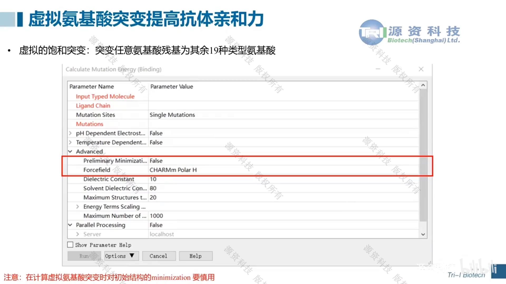

## 五、怎么挑突变：能量之外，还要看微环境

虚拟扫描常碰到这种情况：同一个位点，突变成十来种氨基酸**都能**降能量、提高亲和力——不可能全去做实验 [【跳转到 16:07】](https://www.bilibili.com/video/BV1qH4y1X7Ur/?t=967)。这时要按**突变位点周围的微环境**筛选：

- 抗原对应位置是**疏水区域** → 优先选疏水性突变（CDR 区本来就偏疏水，疏水相互作用是抗体-抗原结合的重要因素）；
- 附近多是**酸性/碱性氨基酸** → 优先选能形成离子互补的突变；
- 是**极性作用** → 优先选能形成极性相互作用的突变。

一句话：**让突变类型与抗原侧的化学性质互补**，而不只按计算能量排序。

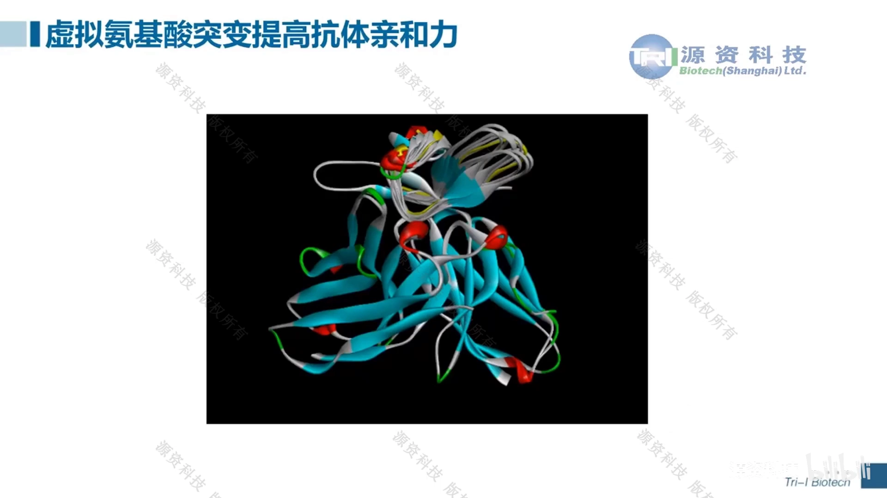

## 六、降低风险：多 pose 交叉验证

实际工作中没有晶体复合物当"标准答案"，无法知道前十的 pose 里哪个最接近真实构象 [【跳转到 16:07】](https://www.bilibili.com/video/BV1qH4y1X7Ur/?t=967)。视频的做法是：

1. 晶体复现显示前十 pose 中九个都接近真实 → 把这九个都当"可能的答案"；
2. **对九个 pose 分别做虚拟氨基酸突变**，得到九张结果表；
3. 综合分析：挑那些**在多数 pose 中都能降低能量**的突变拿去实验验证——成功率特别高。

## 七、延伸：虚拟突变也能提高抗体稳定性

亲和力指的是抗体-抗原相互作用的提升；**稳定性**则是对抗体本身的评估。DS 同样提供"虚拟氨基酸突变提高稳定性"的功能，突变类型与亲和力成熟一致：丙氨酸扫描、单点饱和突变、多点组合突变 [【跳转到 18:20】](https://www.bilibili.com/video/BV1qH4y1X7Ur/?t=1100)。

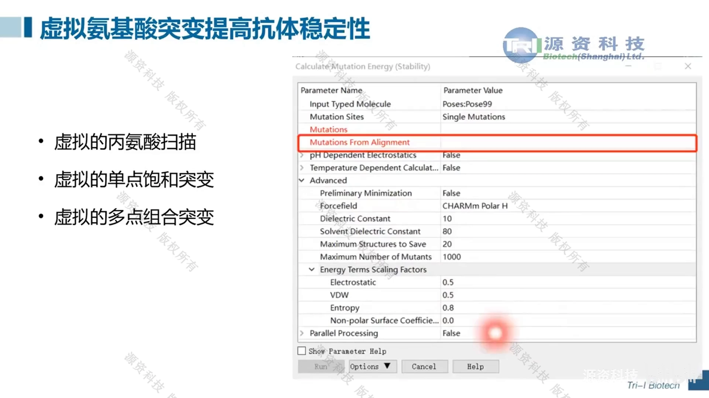

## 小结

- 抗体优化三件事：**亲和力成熟、成药性改造、人源化**；DS 用"结构 → 对接 → 界面分析 → 虚拟突变"一条龙加速；
- 复合物结构：抗体用 DS 预测，抗原用晶体/模板或 AlphaFold；
- 对接两步法：**ZDOCK**（刚性、表面互补；步长 6 优先；block 掉 CDR 以外区域）→ **RDOCK**（CHARMm 能量精修，分数越低越好）；打分取前 200/500，最终对前 10–20 综合分析；
- 界面分析两件套：**残基识别**（谁在接触）+ **能量着色**（红=冲突、蓝=有利）；
- 突变三型：**丙氨酸扫描 → 单点饱和（19 种）→ 多点组合**；先单点+实验验证，再组合；
- 挑突变双准则：**能量下降 + 与抗原微环境互补**（疏水/离子/极性）；
- 没有晶体参照时，**对多个 pose 交叉验证**，选在多数 pose 中都降能量的突变；
- 同一套突变手段也能用于**提高抗体本身稳定性**。

## 关键术语速查

| 术语 | 一句话解释 |
| --- | --- |
| 亲和力成熟 | 提高抗体与抗原结合强度的优化过程（实验或计算） |
| ZDOCK | 基于表面互补的刚性蛋白-蛋白对接程序（DS 内置） |
| ZRank | ZDOCK 输出的统计势打分，越低越好 |
| RDOCK | 基于 CHARMm 力场的对接后能量精修，打分越低越好 |
| block | 对接时屏蔽（不参与采样/打分）的区域，常用于 CDR 以外的抗体区 |
| 界面残基识别 | 找出复合物界面上发生相互作用的氨基酸 |
| 虚拟氨基酸突变 | 在计算机里把残基替换成其他氨基酸并评估能量/功能变化 |
| 单点饱和突变 | 把一个位点依次突变成其余 19 种氨基酸 |
| 多点组合突变 | 对两个及以上位点做排列组合突变 |
| 回复突变（back mutation） | 把突变恢复为原有氨基酸，常用于纠正在能量上有冲突的改动 |
