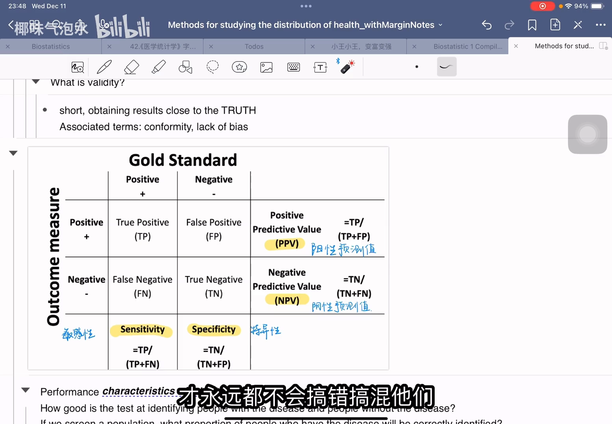
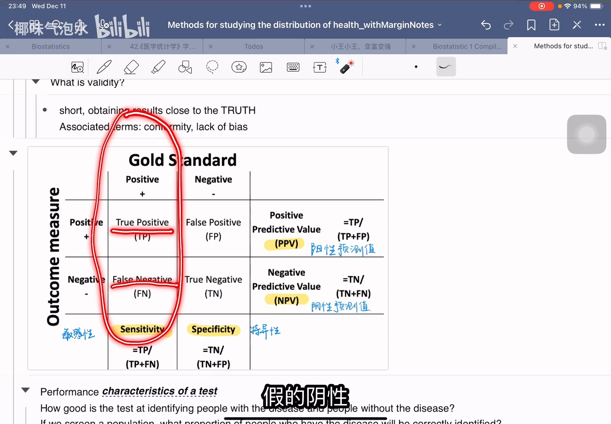
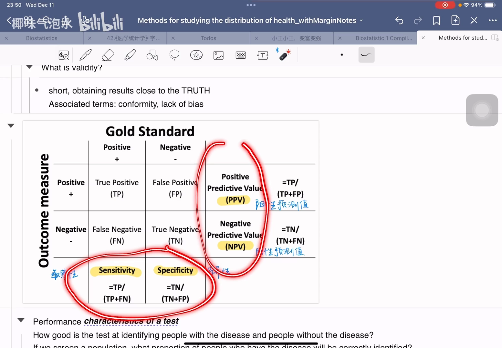
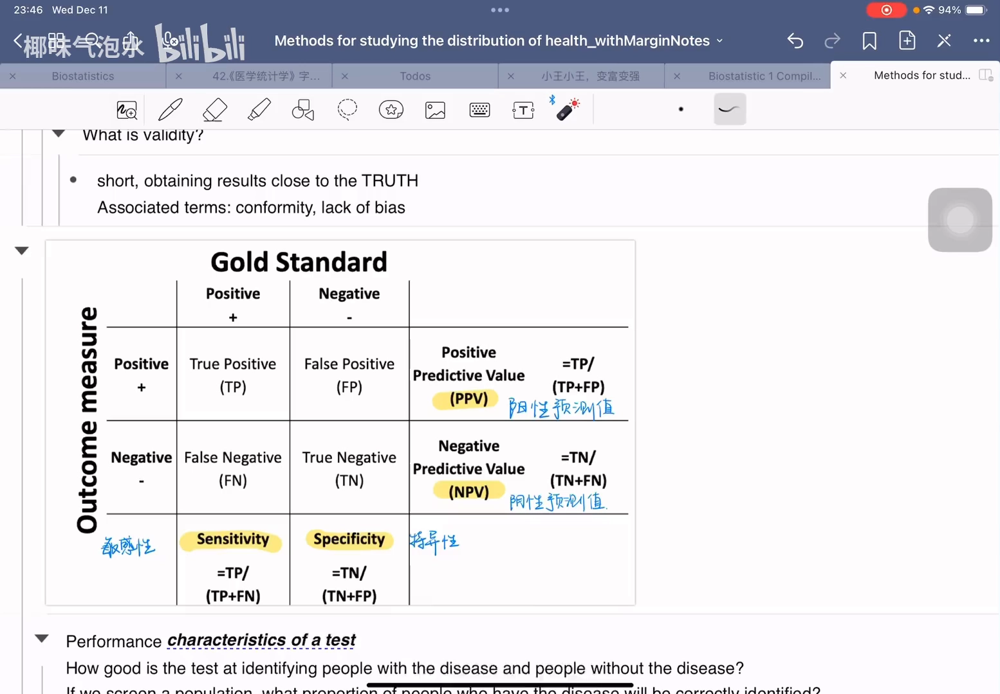
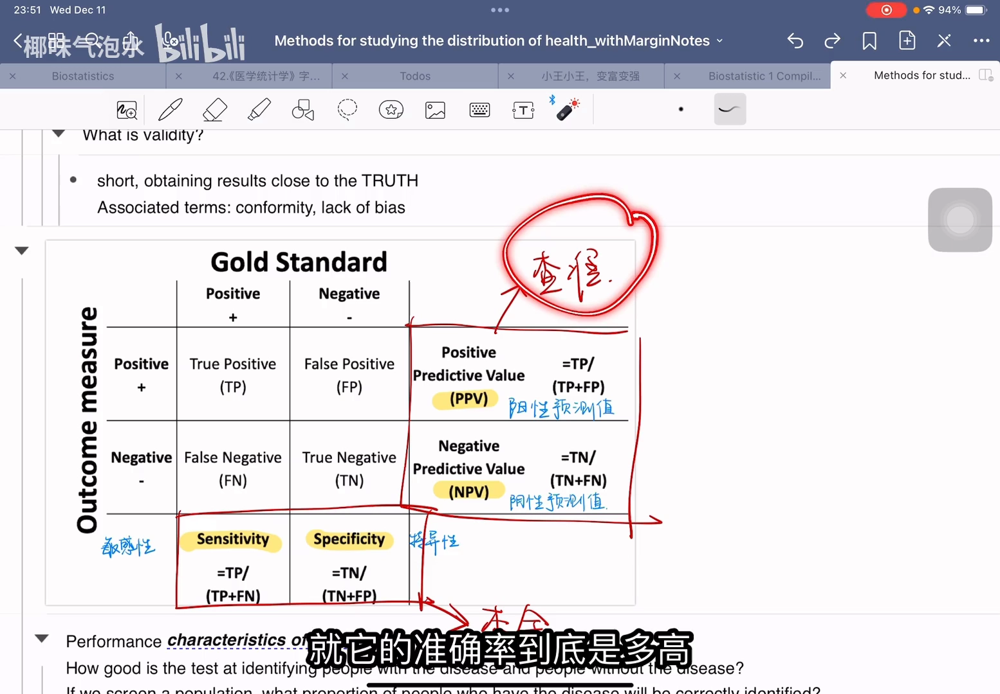
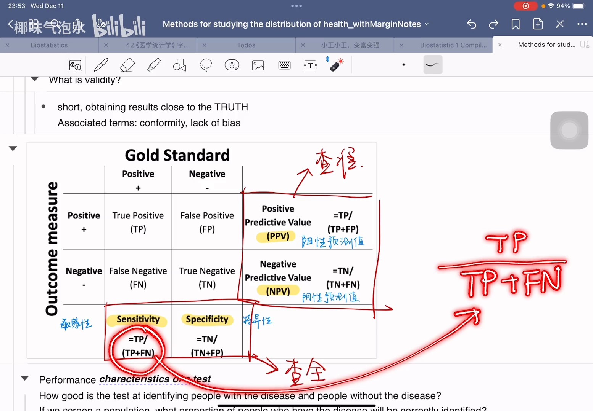
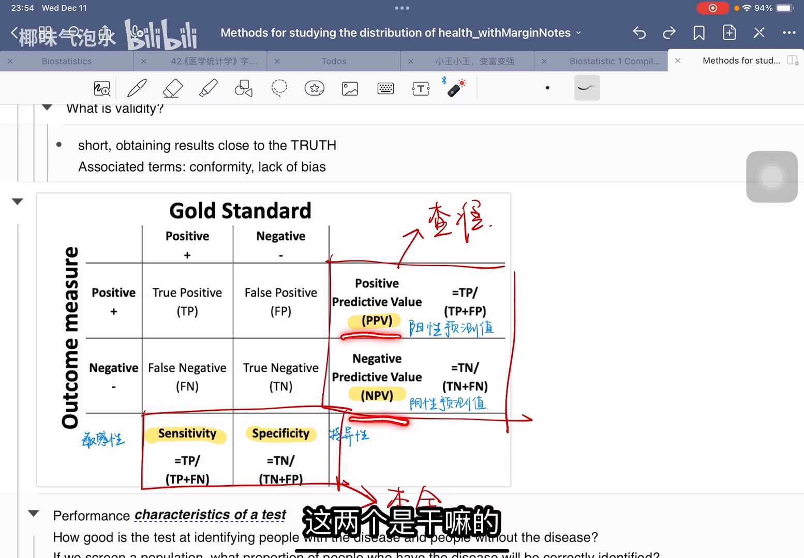
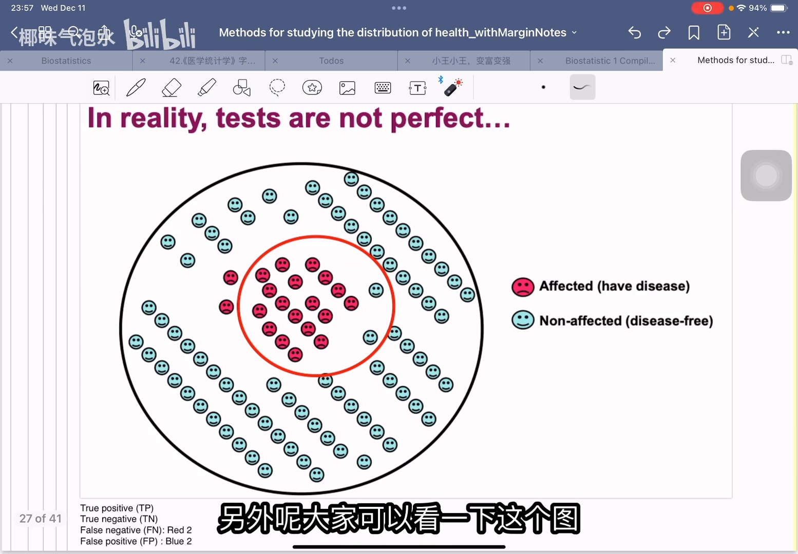
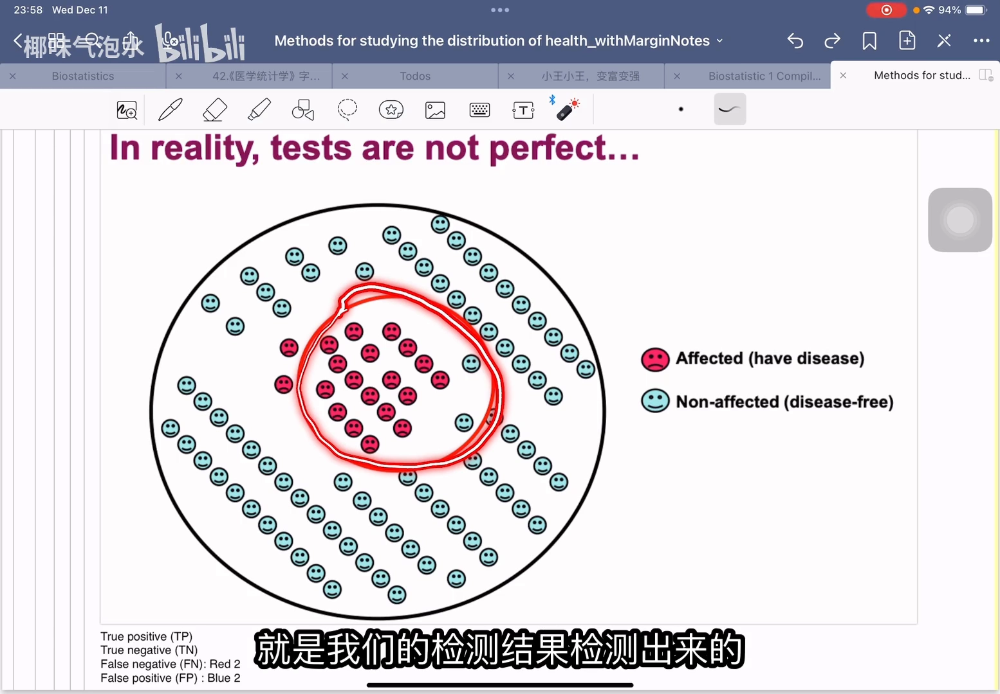
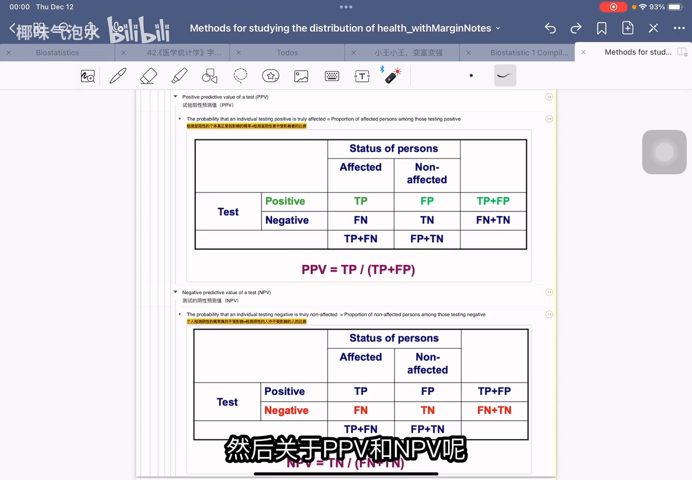

# 7分钟搞懂：敏感性、特异性、阳性预测值、阴性预测值！

> 视频来源：[7分钟搞懂：敏感性、特异性、阳性预测值、阴性预测值！（Bilibili）](https://www.bilibili.com/video/BV1MYq4YdERK/)，时长约 7 分钟（椰味气泡水）。本文基于视频演说图文稿整理，时间戳可跳转到对应讲解。

## 本讲要解决的核心问题（SCQA）

**背景**：分类模型的评估报告里经常出现 sensitivity（敏感性）、PPV（阳性预测值）、MCC、F1 这些指标（参见本目录另外两篇）。这些名字都源自**诊断试验**——医学里"用一种检测方法去判断人有没有病"的场景。

**冲突**：这四个公式的分子分母只差一两个格子，长得非常像；靠背公式，几乎人人都会写混。

**疑问**：有没有一种办法，不背公式也能永远写对？

**回答（中心思想）**：有——先分清两个视角：**敏感性回答"查全"**（分母是金标准认定的阳性人群），**PPV 回答"查准"**（分母是你的检测查出的阳性人群）。写公式前先问一句"分母是谁"，四个指标自然各归各位。

## 一、一切的起点：金标准与 2×2 混淆矩阵

### 1.1 金标准（gold standard）：什么是"真相"

判断一个人"到底有病还是没病"，需要一个**标准答案**，这就是金标准 [【跳转到 00:25】](https://www.bilibili.com/video/BV1MYq4YdERK/?t=25)。比如查癌症，金标准是活检（biopsy）：活检说你是阳性，你就是有癌症；说你是阴性，就是没癌症。

而实际做筛查时，我们用的往往不是金标准，而是另一种更便宜、更快、适合大规模筛查的方法（视频里叫 Outcome measure，结局测量）。**它不是金标准，所以可能出错**——把没病的查成有病，把有病的查成没病 [【跳转到 00:50】](https://www.bilibili.com/video/BV1MYq4YdERK/?t=50)。混淆矩阵记录的就是这两种"真相 × 判断"的交叉结果。

### 1.2 四个格子：TP / FP / TN / FN

把"金标准说有没有病"和"检测说有没有病"交叉起来，就得到 2×2 的四个格子 [【跳转到 01:40】](https://www.bilibili.com/video/BV1MYq4YdERK/?t=100)：

- **TP（true positive，真阳性）**：查出来是阳性，人也确实有病；
- **FP（false positive，假阳性）**：查出来是阳性，但人其实没病；
- **TN（true negative，真阴性）**：查出来是阴性，人也确实没病；
- **FN（false negative，假阴性）**：查出来是阴性，但人其实有病 [【跳转到 02:05】](https://www.bilibili.com/video/BV1MYq4YdERK/?t=125)。

注意一个容易绕晕的点：**假阴性 FN 名义上叫"阴性"，但人是有病的**——从金标准那一列看，他和真阳性一样都属于"真有病的人" [【跳转到 01:15】](https://www.bilibili.com/video/BV1MYq4YdERK/?t=75)。同理，假阳性 FP 其实是"没病的人"。

## 二、两组指标，两种视角：查全 vs 查准

视频把 2×2 表按行列划分成两组概念 [【跳转到 02:30】](https://www.bilibili.com/video/BV1MYq4YdERK/?t=150)：

- **敏感性 + 特异性**：看这个检查能不能**查全**——分母是金标准认定的人群（真有病的、真没病的）；
- **PPV + NPV**：看这个检查能不能**查准**——分母是你的检测查出来的人群（查出阳性的、查出阴性的）。

**分母不同，是这四个指标最本质的区别。**视频开头把这四个公式摆在同一页，它们长得几乎一样，正应了那句话：一定要理解含义，才永远不写混 [【跳转到 00:00】](https://www.bilibili.com/video/BV1MYq4YdERK/?t=0)。

## 三、敏感性（sensitivity）：能把多少"真有病的人"查出来

敏感性问的是"查全" [【跳转到 02:55】](https://www.bilibili.com/video/BV1MYq4YdERK/?t=175)：金标准认定的所有病人构成"大圈"，你的检测从中查出来的构成"小圈"——

**敏感性 = TP / (TP + FN)**，即"查出来的真病人"除以"所有真病人"。它的含义是：一百个真病人里，我的检测能抓住多少。

## 四、特异性（specificity）：反过来看"没病的人"

特异性和敏感性是**反着来**的 [【跳转到 03:45】](https://www.bilibili.com/video/BV1MYq4YdERK/?t=225)：刚才是"生病的人有多少能被查出来"，现在是"**没生病的人有多少能被我准确查出来**"。分母换成了金标准认定的健康人群，分子是其中被正确判为阴性的人：

**特异性 = TN / (TN + FP)**，即"查对的健康人"除以"所有健康人"。

## 五、PPV 与 NPV：检测结果的"可信度"

PPV（阳性预测值）和 NPV（阴性预测值）回答的是"查准" [【跳转到 04:35】](https://www.bilibili.com/video/BV1MYq4YdERK/?t=275)。这次分母换成了**你的检测结果**：

- **PPV = TP / (TP + FP)**：我查出的一批"阳性"里，有多少是真的阳性？——阳性结果的**可信度**；
- **NPV = TN / (TN + FN)**：我查出的"阴性"里，有多少是真的阴性？——阴性结果的可信度 [【跳转到 05:00】](https://www.bilibili.com/video/BV1MYq4YdERK/?t=300)。

视频给了一个非常好用的换位描述：敏感性的分母在**人**（真有病的人），PPV 的分母在**结果**（查出阳性的报告单）。一个是"病人的覆盖率"，一个是"报告单的命中率"。

## 六、一张图把四个格子钉进脑子里

视频最后用"哭脸笑脸"图把四个格子画到了人群圈里 [【跳转到 05:33】](https://www.bilibili.com/video/BV1MYq4YdERK/?t=333)：

红色哭脸是真正生病的人，蓝色笑脸是确实没生病的人——这两类由金标准确定。红色圈是检测结果判为"有病"的人群：圈里既有哭脸（TP）也有笑脸（FP）；红圈之外的部分是判为"没病"的人，里面同样混着笑脸（TN）和哭脸（FN）[【跳转到 05:58】](https://www.bilibili.com/video/BV1MYq4YdERK/?t=358)：

对着这张图看四个公式：从"哭脸全体"出发看红圈盖住了多少 → 敏感性；从"笑脸全体"出发看红圈外占多少 → 特异性；从"红圈内部"出发看哭脸占多少 → PPV；从"红圈外部"出发看笑脸占多少 → NPV。视频作者从课件里另找了两张更清晰的图，可暂停细看 [【跳转到 06:43】](https://www.bilibili.com/video/BV1MYq4YdERK/?t=403)。

## 小结

- 一切从**金标准**出发：金标准给"真相"（有病/没病），检测给"判断"（阳性/阴性），交叉出 TP / FP / TN / FN 四个格子。
- **敏感性和特异性**看"查全"，分母是金标准人群：敏感性 = TP/(TP+FN)，特异性 = TN/(TN+FP)。
- **PPV 和 NPV** 看"查准"（结果可信度），分母是检测结果：PPV = TP/(TP+FP)，NPV = TN/(TN+FN)。
- 写公式前先问"分母是谁"：分母在人 → 敏感性/特异性；分母在报告单 → PPV/NPV。
- 假阴性 FN 的人其实有病，假阳性 FP 的人其实没病——格子名字里的"阴/阳"说的是**检测结果**，不是真相。

## 关键术语速查

| 术语 | 一句话解释 |
| --- | --- |
| 金标准（gold standard） | 判定真病的标准答案，如活检 |
| TP / 真阳性 | 检出阳性且真有病 |
| FP / 假阳性 | 检出阳性但其实没病 |
| TN / 真阴性 | 检出阴性且真没病 |
| FN / 假阴性 | 检出阴性但其实有病 |
| 敏感性 sensitivity | TP/(TP+FN)，真病人被查出的比例（查全） |
| 特异性 specificity | TN/(TN+FP)，健康人被正确放过的比例 |
| PPV / 阳性预测值 | TP/(TP+FP)，阳性报告的可信度（查准） |
| NPV / 阴性预测值 | TN/(TN+FN)，阴性报告的可信度 |
