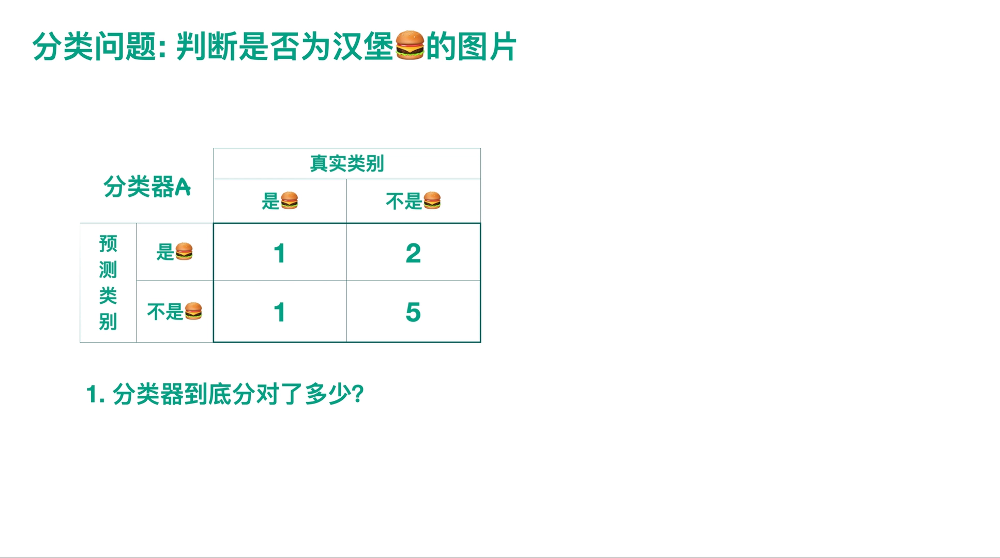
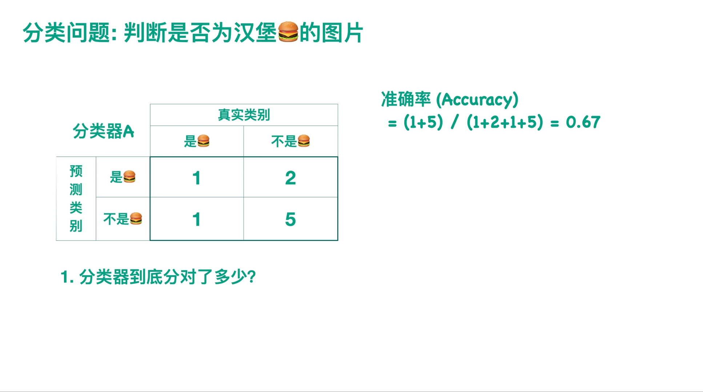
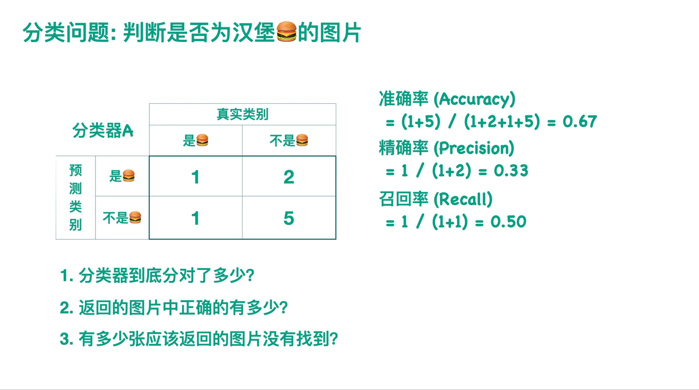
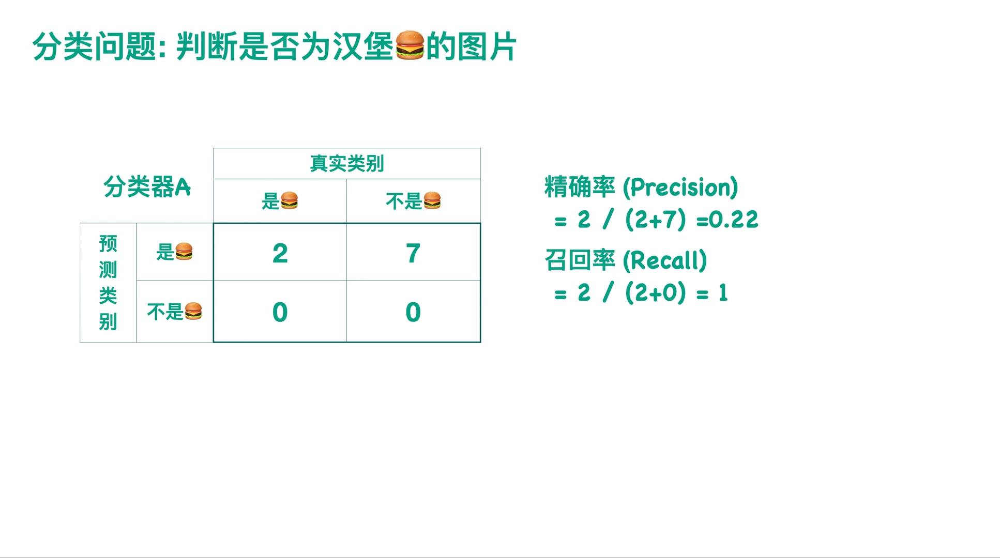
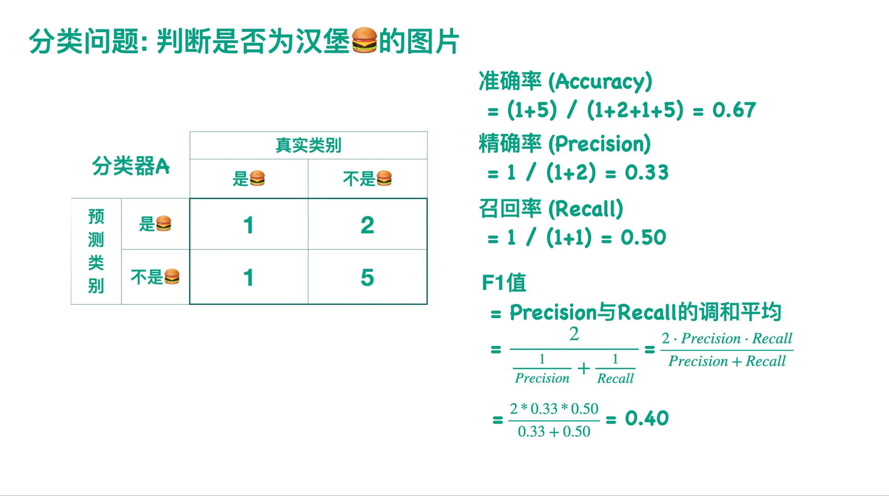
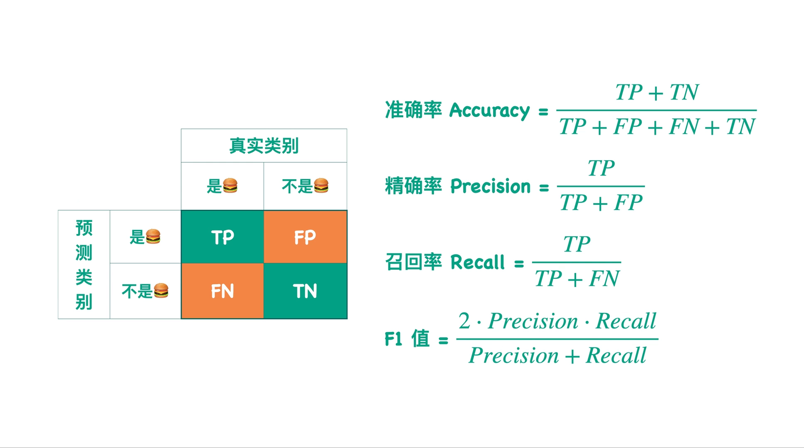
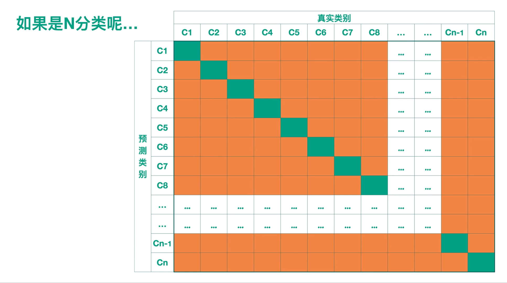
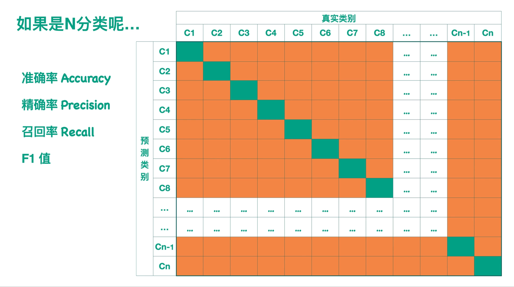
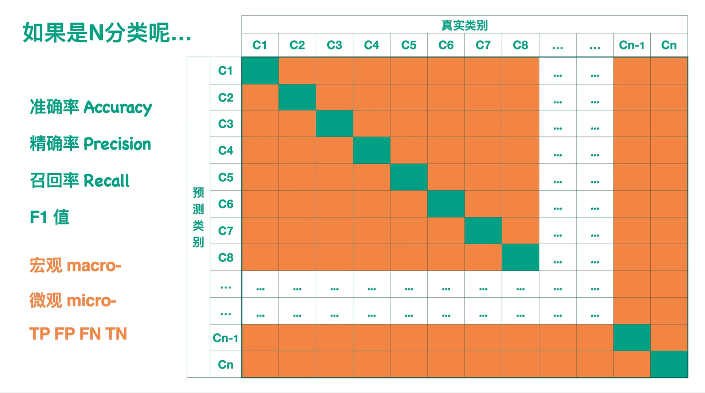

# 【小萌五分钟】机器学习｜模型评估：准确率 Accuracy 精确率 Precision 召回率 Recall F1值

> 视频来源：[【小萌五分钟】机器学习 | 模型评估: 准确率 Accuracy 精确率 Precision 召回率 Recall F1值（Bilibili）](https://www.bilibili.com/video/BV1vt4y117Zz/)，时长约 6 分钟（小萌Annie）。本文基于视频演说图文稿整理，时间戳可跳转到对应讲解。

## 本讲要解决的核心问题（SCQA）

**背景**：有了混淆矩阵，分类器的所有判断结果就能摆进一张 2×2 表（TP / FP / TN / FN，见同目录上一篇）。

**冲突**：两个分类器 A、B 在同一个测试集上各有一张混淆矩阵——光盯着八个数，看不出到底谁更好。

**疑问**：有没有能把混淆矩阵"压缩"成可比较分数的评估指标？

**回答（中心思想）**：有——准确率、精确率、召回率，以及把后两者绑在一起的 F1 值。它们各自从混淆矩阵里挑不同的分子分母；F1 用**调和平均**惩罚偏科；多分类时沿"每类先算，再 macro 平均或 micro 累加"两条路线推广。

## 一、最直观的指标：准确率（Accuracy）

接着上一讲的例子：分类器 A 判断图片是不是汉堡，在测试集上得到一张混淆矩阵；分类器 B 在同一测试集上也有一张 [【跳转到 00:12】](https://www.bilibili.com/video/BV1vt4y117Zz/?t=12)。

比较两者的第一个念头，就是看"分类对了多少" [【跳转到 00:42】](https://www.bilibili.com/video/BV1vt4y117Zz/?t=42)：

**准确率 = (TP + TN) / 样本总数**，即真实类别与预测类别一致的样本，除以测试集总样本数。

## 二、换个场景理解精确率与召回率：图片搜索引擎

假设你有一个图片搜索引擎，搜索"汉堡"时它返回一批图片。这时你关心两件事 [【跳转到 01:07】](https://www.bilibili.com/video/BV1vt4y117Zz/?t=67)：

- **返回的图片里，正确的有多少？**——精确率（Precision）= 返回的汉堡图片数 ÷ 返回的所有图片数 = TP / (TP + FP)；
- **该返回的图片里，找到了多少？**——召回率（Recall）= 返回的汉堡图片数 ÷ 测试集中所有汉堡图片数 = TP / (TP + FN) [【跳转到 01:32】](https://www.bilibili.com/video/BV1vt4y117Zz/?t=92)。

对照上一篇的说法：精确率就是诊断试验里的 **PPV（阳性预测值）**，召回率就是 **sensitivity（敏感性）**——同一公式，两套名字。

## 三、精确率与召回率：此消彼长

视频用一个极端例子说明两者的拉扯 [【跳转到 01:57】](https://www.bilibili.com/video/BV1vt4y117Zz/?t=117)：你找我要汉堡图片，我干脆把测试集里**所有图片**都返回给你——

- 召回率必然是 **100%**（所有汉堡图都在里面）；
- 但精确率会**非常低**（分母变成了全部样本）。

所以不能一味要求召回率高，也不能一味要求精确率高——抬高一头，另一头就会掉下来。

## 四、F1 与 F-β：调和平均"和稀泥"

既然两头顾不全，就用一个数把它们绑起来：**F1 值是 precision 和 recall 的调和平均** [【跳转到 02:22】](https://www.bilibili.com/video/BV1vt4y117Zz/?t=142)：

**F1 = 2 × P × R / (P + R)**。调和平均的特点是"偏科重罚"——P 和 R 只要有一个很低，F1 就上不去。

F1 其实是 **F-β** 的特例（β = 1 的情形），前提是认为 precision 与 recall **同等重要** [【跳转到 02:47】](https://www.bilibili.com/video/BV1vt4y117Zz/?t=167)。如果业务上有一头更重要，就调 β [【跳转到 03:12】](https://www.bilibili.com/video/BV1vt4y117Zz/?t=192)：

- 医疗领域不希望漏掉任何一位患者 → recall 更重要 → 取 **β = 2**（F2 更偏重召回）；
- 另一些领域宁可错杀不可放过 → precision 更重要 → 取 **β ∈ (0, 1)**。

## 五、推广到多分类：先算每一类，再 macro 或 micro

二分类公式怎么搬到 N 分类？视频的做法分两步 [【跳转到 03:37】](https://www.bilibili.com/video/BV1vt4y117Zz/?t=217)。

**第一步，逐类计算**。以 N×N 混淆矩阵（行 = 预测类别，列 = 真实类别）中的 C6 类为例：

- 准确率不变：对角线（判对）总和 ÷ 全表总和；
- C6 的精确率 = C6 判对的数目 ÷ **这一行**（被判为 C6）的总数；
- C6 的召回率 = C6 判对的数目 ÷ **这一列**（真实为 C6）的总数；
- C6 的 F1 = 两者（这一行的 precision 和这一列的 recall）的调和平均 [【跳转到 04:02】](https://www.bilibili.com/video/BV1vt4y117Zz/?t=242)。

**第二步，把每一类合成一个整体分数**，有两条路线 [【跳转到 04:27】](https://www.bilibili.com/video/BV1vt4y117Zz/?t=267)：

- **宏观（macro）**：把每一类的 precision / recall / F1 直接求平均；或按各类样本数**加权平均**；
- **微观（micro）**：先把各类的 TP、FP、FN、TN 分别**累加**成整个模型的 TP、FP、FN、TN [【跳转到 04:52】](https://www.bilibili.com/video/BV1vt4y117Zz/?t=292)，再套用二分类公式 [【跳转到 05:17】](https://www.bilibili.com/video/BV1vt4y117Zz/?t=317)。

## 六、一个值得记住的结论

只要模型对每个输入**只返回一个类别**（单标签多分类），micro 路线算出的 precision、recall、F1 **三者相等，且都等于 accuracy**——视频建议你动手验证一下 [【跳转到 05:42】](https://www.bilibili.com/video/BV1vt4y117Zz/?t=342)。

这解释了为什么在不平衡的多分类问题上，大家更愿意看 macro F1——micro F1 此时只是准确率的"马甲"。

## 小结

- 准确率 = 判对样本 ÷ 总样本；精确率 = TP/(TP+FP)；召回率 = TP/(TP+FN)。
- 精确率与召回率**此消彼长**：全量返回可把召回率刷到 100%，代价是精确率崩塌。
- F1 = 调和平均，"偏科重罚"；F-β 可调偏重：recall 重要取 β=2，precision 重要取 β<1。
- 多分类两步走：逐类算（行看精确率、列看召回率）→ macro 平均 或 micro 累加。
- 单标签多分类下 micro 三值相等且 = accuracy；不平衡场景更应关注 macro 指标。

## 关键术语速查

| 术语 | 一句话解释 |
| --- | --- |
| 准确率 Accuracy | (TP+TN)/总数，整体判对比例 |
| 精确率 Precision | TP/(TP+FP)，= 诊断试验的 PPV |
| 召回率 Recall | TP/(TP+FN)，= 诊断试验的敏感性 |
| F1 值 | 2PR/(P+R)，precision 与 recall 的调和平均 |
| F-β | (1+β²)PR/(β²·P+R)，β 越大越偏重召回 |
| macro 平均 | 先逐类算指标，再（加权）平均 |
| micro 累加 | 先累加各类 TP/FP/FN/TN，再套二分类公式 |
