# 氨基酸等电点（上）：从两性解离到 pI 计算

> 视频来源：[7.生物化学 -- 第二章 -- 氨基酸等电点。-- 上（Number3生物化学）](https://www.bilibili.com/video/BV1gM411W7xA/)
> 对应知识体系条目：3.4.1 pI（等电点）、Tm（熔解温度 °C）——ABDP

## 本讲要解决的核心问题（SCQA）

**背景**：在 ABDP 这类抗体可开发性平台上，pI（等电点）是用回归模型直接预测的蛋白质属性之一（见知识体系 5.4.1「ABDP PI Prediction」）。要用模型预测 pI，先得搞明白 pI 本身是什么、由什么决定。

**冲突**：氨基酸/蛋白质在不同 pH 的溶液里带的电荷不一样，是一个"随 pH 变化"的量；可教材却给每个氨基酸一个确定的 pI 数值——一个会变的量，怎么会有固定的"点"？

**疑问**：pI 到底是什么？它由什么决定？教材上"甘氨酸 pI=5.97"这样的数值是怎么算出来的？

**回答（中心思想）**：pI 就是分子静电荷为零时的那个 pH。它由分子上每个可解离基团的 pKa 决定；沿着滴定曲线，用 Henderson–Hasselbalch 公式算出两个关键点 pK1、pK2，pI 就落在它们正中间。

## 一、氨基酸是两性电解质：一个分子同时带正电和负电

### 1.1 中性 pH 下氨基酸以"兼性离子"形式存在

对于 R 基不解离的氨基酸（也就是非酸性、非碱性氨基酸），在中性 pH 时：

- α-羧基以**解离**的形式（羧酸根 -COO⁻）存在——带负电；
- α-氨基以**结合质子**的形式（-NH₃⁺）存在——带正电。

这种"一个分子上同时带正电和负电"的形式，叫做**兼性离子**。[【跳转到 00:25】](https://www.bilibili.com/video/BV1gM411W7xA/?t=25)

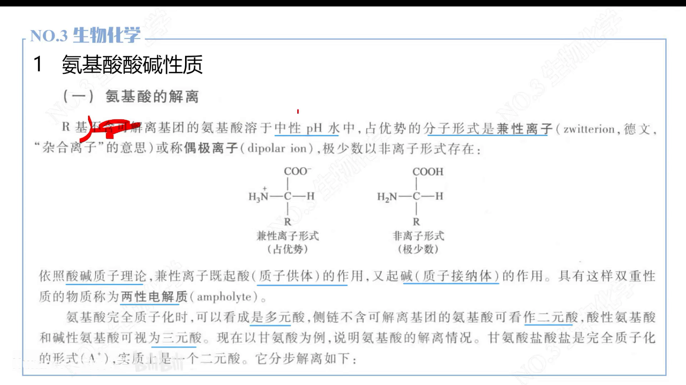

### 1.2 谁是酸、谁是碱：质子供体与受体

按酸碱质子理论：能提供质子的是酸，能接受质子的是碱。

- 氨基（-NH₃⁺）能提供质子 → 是酸；
- 羧酸根（-COO⁻）能接受质子 → 是碱。

同一个分子上既有酸又有碱，所以氨基酸是**两性电解质**——既能当酸，又能当碱。

还要建立一个关键认识：**pH 会影响各基团的带电情况**。溶液里质子多（酸性强），基团就倾向于结合质子；溶液里质子少（碱性强），基团就倾向于失去质子。得到或失去质子，基团所带电荷随之改变。

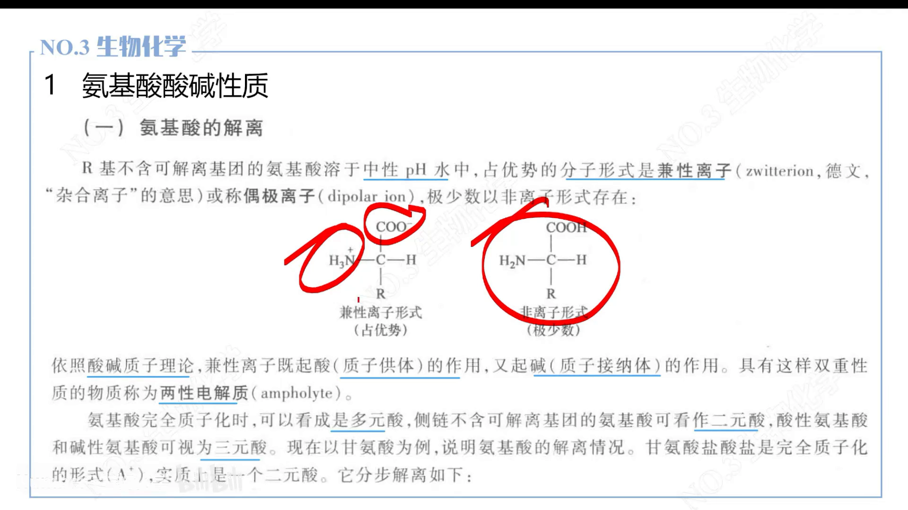

## 二、等电点的定义：静电荷为零时的 pH

有了上面的认识，等电点的定义就水到渠成了：

> 如果某一个 pH 下，氨基酸（或肽段）上所有带电基团的电荷相加，**静电荷恰好为零**，那么这个 pH 就是它的**等电点（pI，isoelectric point）**。[【跳转到 02:30】](https://www.bilibili.com/video/BV1gM411W7xA/?t=150)

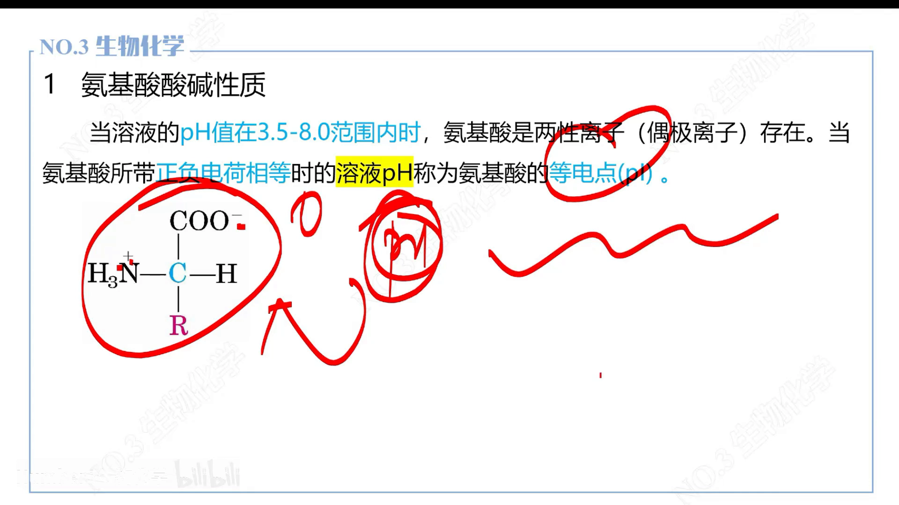

三点说明：

1. 等电点本质是一个 **pH 值**，记住这一点就够。
2. 每个氨基酸的 R 基、氨基、羧基结合质子/提供质子的能力不一样，所以**每个氨基酸的 pI 各不相同**。
3. 定义对肽段同样成立：肽段里所有可解离基团电荷相加为零时的 pH，就是该肽段的 pI。

## 三、滴定全程：从强酸到强碱，净电荷从 +1 走到 -1

### 3.1 起点：强酸环境，全部质子化

把氨基酸放进强酸环境里会怎样？中学化学的"强酸制弱酸"告诉我们：盐酸这类强酸能把碳酸、醋酸里的质子"抢回来"。所以在强酸环境里，羧酸根结合质子变回 -COOH，氨基也结合质子保持 -NH₃⁺——整个分子带 +1 电荷，这就是状态 **A⁺**。

### 3.2 pKa：每个可解离基团的"酸性标尺"

从强酸起点不断加碱，pH 逐渐升高，基团开始解离。谁先被中和？**酸性强的先被中和**。衡量酸性强弱的就是 pKa：

- pKa 由解离常数引申而来，不必深究定义，记住一条：**pKa 越小，酸性越强**。比如羧基 pKa≈3，而盐酸 pKa≈1——从 pKa 上就能比出酸性强弱。[【跳转到 05:50】](https://www.bilibili.com/video/BV1gM411W7xA/?t=350)
- pKa 是针对**每一个可解离基团**而言的：羧基的 pKa 一般 2~3 居多；α-氨基的 pKa 大概在 8~9 左右，有的会更高。

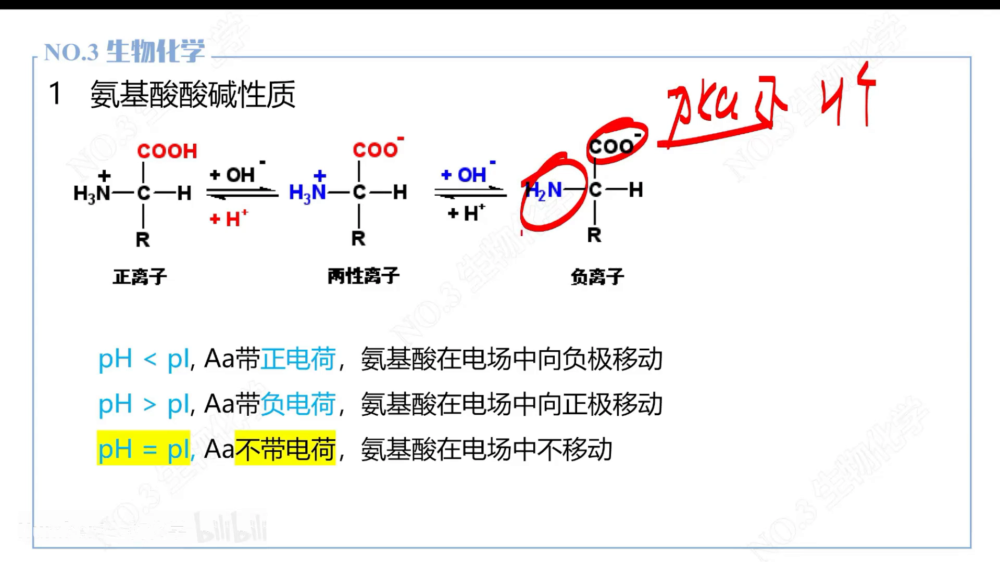

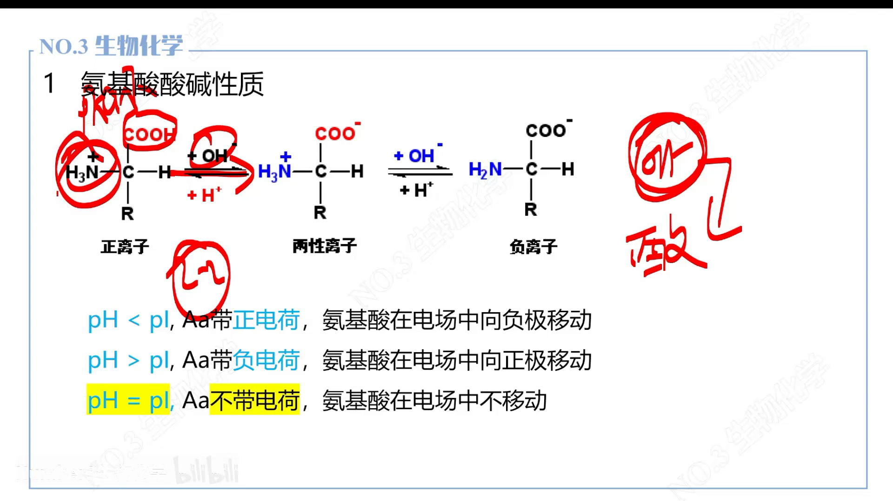

### 3.3 三种状态：A⁺ → A⁰ → A⁻

由于羧基 pKa 小、酸性强，加碱时**最先被中和的是羧基**：

1. 羧基被中和（-COOH → -COO⁻），分子进入正负电荷相抵的**兼性离子状态 A⁰**（R 基不带电时净电荷为 0）；
2. 继续加碱，羧基中和完以后，能提供质子的只剩氨基——氨基也失去质子（-NH₃⁺ → -NH₂），分子变成净电荷 -1 的 **A⁻** 状态。[【跳转到 08:45】](https://www.bilibili.com/video/BV1gM411W7xA/?t=525)

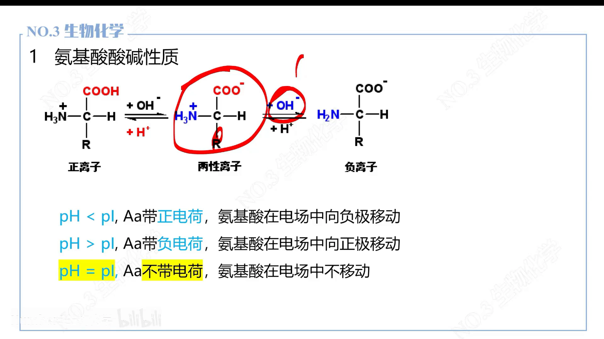

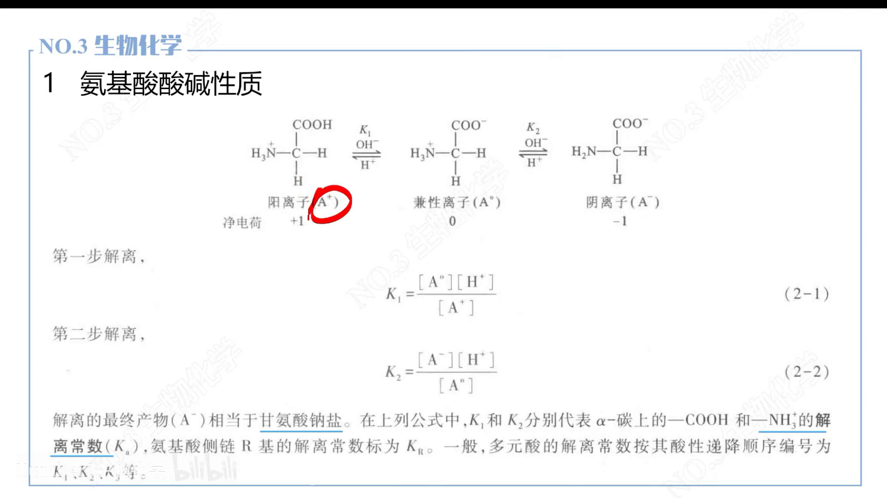

把 pH 与带电的关系总结成一句话：

- **pH < pI**：分子带正电；
- **pH = pI**：静电荷为零；
- **pH > pI**：分子带负电。

## 四、用甘氨酸算一遍：2.34 → 5.97 → 9.6

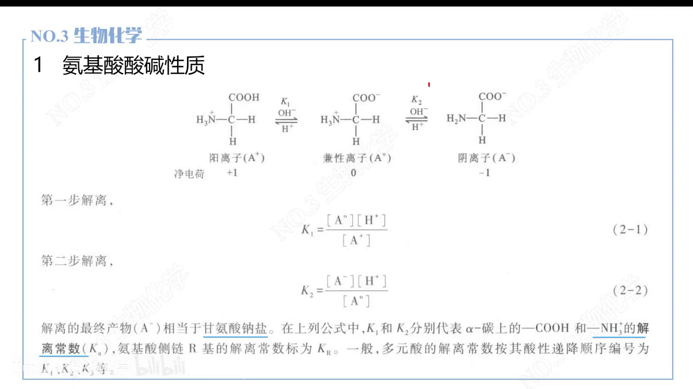

### 4.1 工具：Henderson–Hasselbalch 公式

计算用到的公式是 Henderson–Hasselbalch（亨德森–哈塞尔巴赫）方程，简称 H-H 公式：

```
pH = pKa + log(质子受体 / 质子供体)
```

- **质子受体** = 碱的形式（还没结合质子的一侧，如 -COO⁻）；
- **质子供体** = 酸的形式（还结合着质子的一侧，如 -COOH）。

⚠️ 最容易出错的一点：**质子受体/供体必须取"对应这个 pKa 的那对基团"的形式**。比如算羧基 pKa 对应的 pH 时，分子里虽然有氨基，也不能把氨基代进公式——公式里的 pKa 是谁的，就得用谁的受体和供体。[【跳转到 14:35】](https://www.bilibili.com/video/BV1gM411W7xA/?t=875)

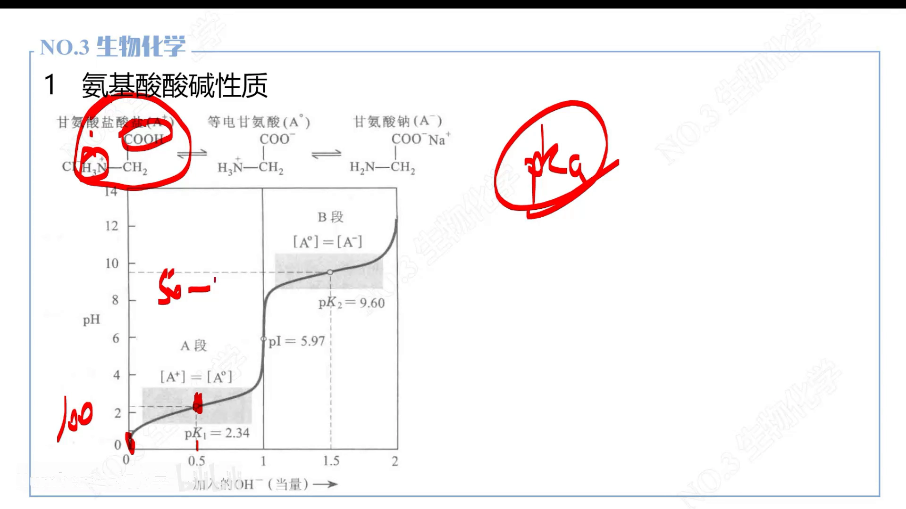

### 4.2 第一个关键点：pK1 = 2.34，一半羧基解离

以教材的例子——100 个甘氨酸——从强酸起点开始滴定：

- 起点全是 A⁺（-COOH + -NH₃⁺）。
- 加碱到第一个"半中和点"：50 个以 -COOH 形式存在，50 个以 -COO⁻ 形式存在，也就是 [A⁺] = [A⁰] = 50 个。

代入 H-H 公式：pH = pK1 + log(50/50) = pK1 + log 1 = pK1 + 0 = **pK1 = 2.34**。[【跳转到 13:45】](https://www.bilibili.com/video/BV1gM411W7xA/?t=825)

**"酸式 = 碱式各一半时，pH 正好等于 pKa"**——这就是滴定曲线上的第一条虚线。

### 4.3 全部 A⁰：pH = 5.97，这就是 pI

继续加碱，100 个甘氨酸的 -COOH 全部变成 -COO⁻，分子全部进入 A⁰ 状态（兼性离子）。这一点的 pH 是 **5.97**——它就是甘氨酸的**等电点**。[【跳转到 17:05】](https://www.bilibili.com/video/BV1gM411W7xA/?t=1025)

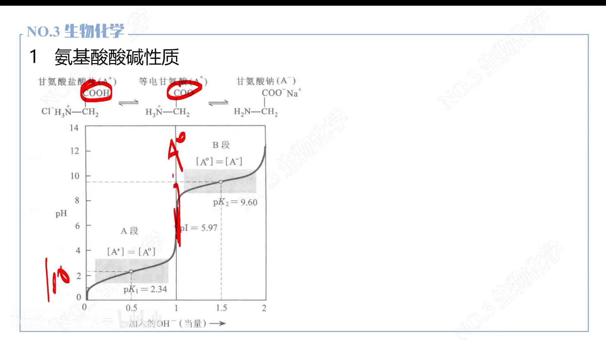

### 4.4 第二个关键点：pK2 = 9.6，一半氨基解离

再继续加碱，氨基开始失去质子（-NH₃⁺ → -NH₂）。到第二个"半中和点"：50 个 A⁰、50 个 A⁻，即 [A⁰] = [A⁻]。代入公式：pH = pK2 + log(50/50) = **pK2 = 9.6**。pH 加到 12 左右时，全部解离完毕。

### 4.5 pI = (pK1 + pK2) / 2

观察甘氨酸的三个数：pK1 = 2.34，pI = 5.97，pK2 = 9.6——**pI 恰好落在两个 pKa 正中间**。所以对这类"只有羧基、氨基两个可解离基团"的氨基酸：

```
pI = (pK1 + pK2) / 2 = (2.34 + 9.6) / 2 = 5.97
```

整个滴定过程复盘一遍：起点全部质子化（A⁺）→ 第一个半中和点酸碱各半（pH=pK1）→ 全部 A⁰ 处达到等电点（pH=pI）→ 氨基开始解离，第二个半中和点（pH=pK2）→ 强碱下全部解离（A⁻）。前半段、后半段都可以用 H-H 公式计算，只要保证受体/供体与对应的 pKa 配对。[【跳转到 19:10】](https://www.bilibili.com/video/BV1gM411W7xA/?t=1150)

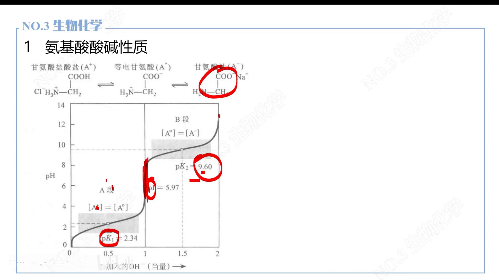

> 注：视频标题带"上"，本集讲的是 R 基不解离的氨基酸。若 R 基也可解离（酸性/碱性氨基酸），还要把 R 基的 pKa 纳入计算，pI 不再是简单取平均——这是"下"集的内容。

## 五、回到 ABDP：为什么 pI 值得用模型预测

pI 决定了抗体在给定 pH（比如血液 pH 7.4、制剂 pH）下带正电还是负电、带多少电，进而影响溶解度、聚集倾向、离子交换层析保留行为等可开发性性质。ABDP 把 pI 作为回归任务（SVM/SVR，见知识体系 4.5.1），从序列直接预测 pI，把湿实验前移到计算阶段。

本集讲的是氨基酸层面的原理。蛋白质/抗体的 pI 由链上所有可解离基团（N 端、C 端与 Asp/Glu/His/Lys/Arg 等侧链）共同决定，但"静电荷为零时的 pH"这一定义、以及 pH 决定带电的机制完全相同。

## 小结

- 氨基酸是**两性电解质**：中性 pH 下以兼性离子（-COO⁻ + -NH₃⁺）形式存在。
- **等电点 pI**：静电荷为零时的 pH；每个氨基酸的 pI 各不相同。
- **pKa 越小酸性越强**：羧基 pKa≈2~3，α-氨基 pKa≈8~9 以上；加碱时 pKa 小的基团先被中和。
- 滴定全程净电荷：A⁺（+1）→ A⁰（0）→ A⁻（-1）；pH<pI 带正电，pH>pI 带负电。
- **H-H 公式**：pH = pKa + log(质子受体/质子供体)；受体/供体必须与对应 pKa 的基团配对。
- 甘氨酸实例：pK1=2.34 → pI=5.97 → pK2=9.6；**pI=(pK1+pK2)/2**。

## 关键术语速查

| 术语 | 一句话解释 |
| --- | --- |
| 兼性离子 | 同一分子上同时带正电与负电的形式（-COO⁻ / -NH₃⁺） |
| 两性电解质 | 既能提供质子（当酸）又能接受质子（当碱）的电解质 |
| 质子供体 / 受体 | 提供质子的一侧是酸（供体），接受质子的一侧是碱（受体） |
| pKa | 酸性强弱的标尺，越小酸性越强；每个可解离基团各有一个 |
| 等电点 pI | 分子静电荷为零时的 pH |
| Henderson–Hasselbalch 公式 | pH = pKa + log(质子受体/质子供体) |
| pK1 / pK2 | 滴定曲线上两个"酸碱各半"点的 pH，分别为羧基/氨基的 pKa |
