# MIC 与 MBC：六根试管讲清"抑菌"与"杀菌"的差别

> 视频来源：[【分子生物学指南】最小抑菌浓度MIC（外八YYDS）](https://www.bilibili.com/video/BV1ho4y1t7X2/)
> 对应知识体系条目：3.4.2 MIC（μM，最小抑菌浓度，越低越好）——APEX

## 本讲要解决的核心问题（SCQA）

**背景**：判断一个抗菌剂强不强，需要一个可测、可比的数——最小抑菌浓度 MIC。知识体系 3.4.2 里 APEX 模型预测的 MIC 以 μM 计、越低越好；本视频则是一堂直观的演示课：用生活中常见的**过氧化氢**（双氧水）当抗菌剂，浓度以百分比表示，原理与标准测定完全一致。

**冲突**：实验里 12.5% 的过氧化氢让试管里的细菌停止了生长——但"停止生长"就等于"被杀死"吗？如果管里其实还藏着活菌，只看 MIC 就会把"抑"误当成"灭"。

**疑问**："抑制生长"到底怎么定义、怎么测出来？想知道"杀没杀死"，又该测什么？

**回答（中心思想）**：**MIC 是抑制细菌可见生长的最低药物浓度**（本实验中为 12.5%）——它只回答"抑不抑制"，不回答"死没死"。想知道后者，把各管菌液点种到**不含药**的营养琼脂平板上培养：**杀死所有细胞的最低药物浓度叫 MBC（最小杀菌浓度）**（本实验中为 25%）。

## 一、实验设置：六管浓度梯度 + 等量接种

### 1.1 MIC 的定义

[【跳转到 00:00】](https://www.bilibili.com/video/BV1ho4y1t7X2/?t=0)

MIC（最小抑菌浓度）就是：能**阻止细菌生长**（即抑制细菌生长）的、某种特定抗菌剂所需的**最低浓度**。

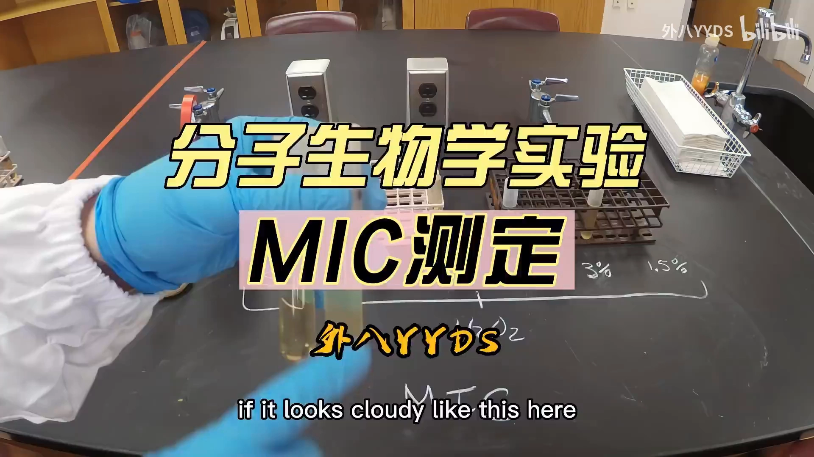

### 1.2 抗菌剂选过氧化氢，六根管子铺出浓度梯度

[【跳转到 00:14】](https://www.bilibili.com/video/BV1ho4y1t7X2/?t=14)

过氧化氢是家庭常用药——皮肤割破、伤口感染时经常用它消毒。这个实验要回答的问题是：**要阻止这种细菌的生长，需要的过氧化氢最低浓度是多少？**

[【跳转到 00:37】](https://www.bilibili.com/video/BV1ho4y1t7X2/?t=37)

六根管子，每根都装有过氧化氢，唯一的区别是浓度：

| 管号 | 1 | 2 | 3 | 4 | 5 | 6 |
| --- | --- | --- | --- | --- | --- | --- |
| 过氧化氢浓度 | 50% | 25% | 12.5% | 6% | 3% | 1.5% |

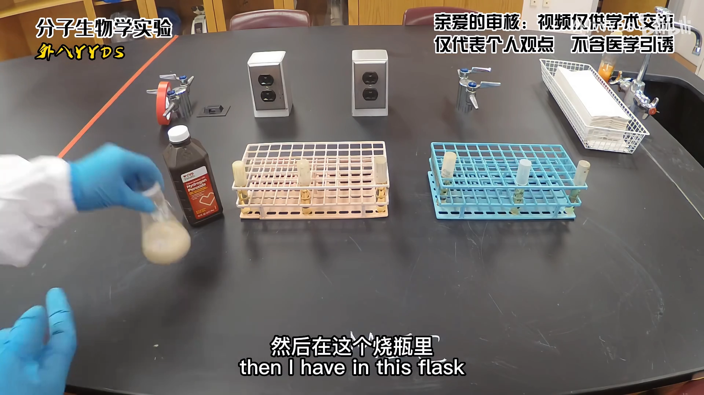

每一管里都有过氧化氢，只是浓度不同——这就是一个手工版的"二倍梯度稀释"。

### 1.3 等量接种，培养一夜

[【跳转到 01:12】](https://www.bilibili.com/video/BV1ho4y1t7X2/?t=72)

接下来往每管中加入**等量的细菌**：从烧瓶里取 **1 mL 菌液**，一管一管地加进去，最后两管也各加 1 mL——这样每根管子都接入了同样多的细菌。之后把它们**培养一夜**，看结果。

## 二、判读的标尺：浑浊/澄清 + 阴性对照

### 2.1 怎么看出细菌"长没长"

[【跳转到 02:02】](https://www.bilibili.com/video/BV1ho4y1t7X2/?t=122)

如果管子看起来**浑浊**，就意味着细菌能够生长；如果看起来**澄清**，就意味着没有生长。

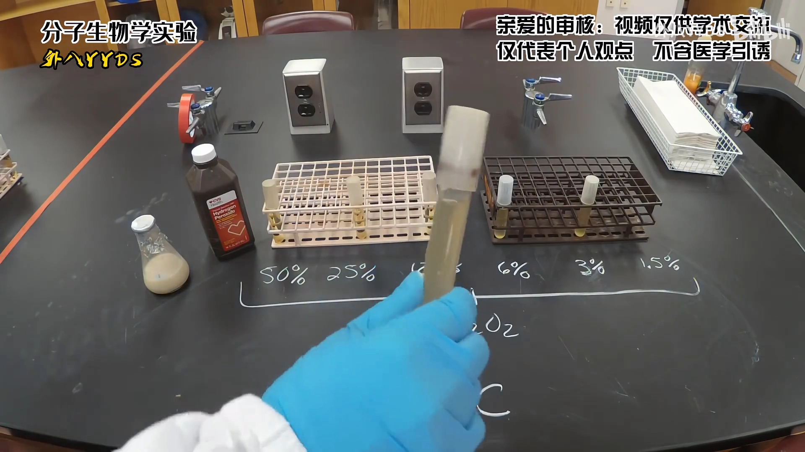

### 2.2 阴性对照：一管"肯定不长"的参照

[【跳转到 02:13】](https://www.bilibili.com/video/BV1ho4y1t7X2/?t=133)

有一根管子是**阴性对照**——里面没有加任何细菌，所以它肯定不会有任何生长，看起来是澄清的。

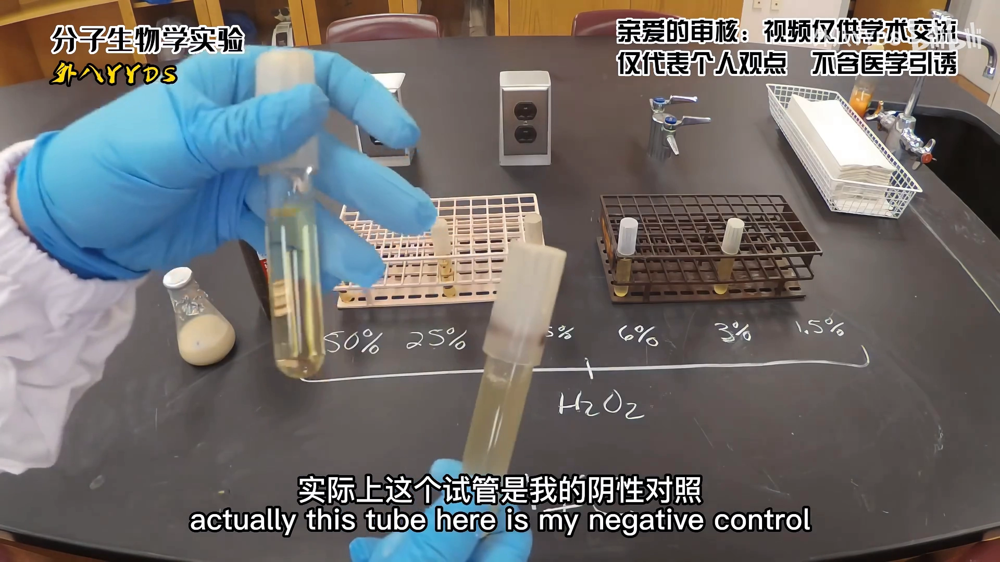

有了这管参照，判读就有了标尺：**浑浊意味着有生长，澄清意味着没有生长**。下面从浓度最低的 1.5% 开始，一管一管看。

## 三、逐管读结果：分界线在 12.5%

### 3.1 低浓度三管：1.5%、3%、6% 都压不住

[【跳转到 02:38】](https://www.bilibili.com/video/BV1ho4y1t7X2/?t=158)

- **1.5% 管**：和阴性对照相比明显浑浊——细菌能够生长，1.5% **不足以**阻止细菌生长；
- **3% 管**：看起来同样浑浊——细菌在这管里也能生长，3% 也不起作用；
- **6% 管**：尽管浓度更高，和阴性对照相比还是相当浑浊——细菌照样能够生长。

也就是说，**6% 的过氧化氢还不够，抑制不了细菌的生长**。

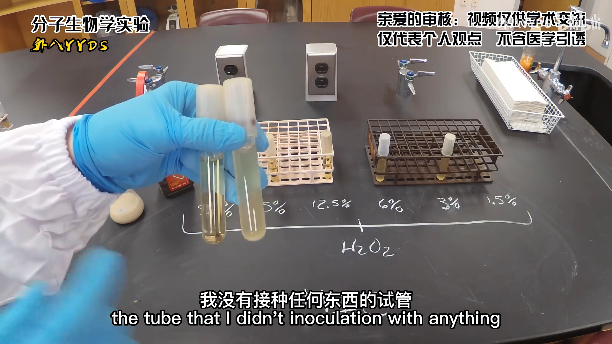

### 3.2 12.5%：第一个澄清的管子

[【跳转到 03:24】](https://www.bilibili.com/video/BV1ho4y1t7X2/?t=204)

到了 **12.5%**，我们得到了一管**和阴性对照一样澄清**的液体——12.5% 抑制了细菌的生长。

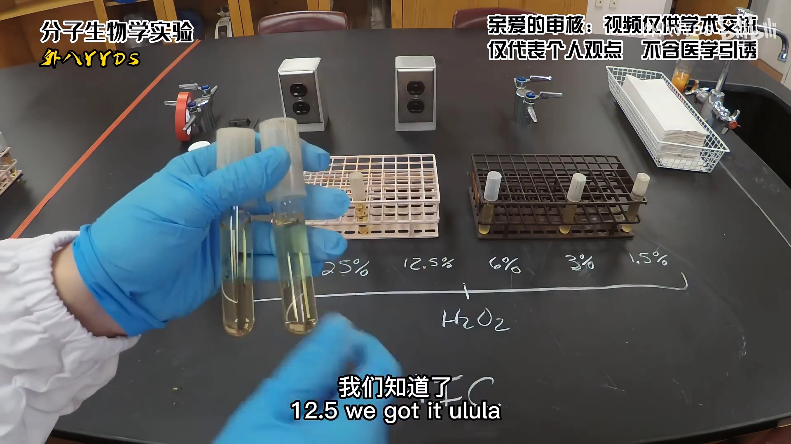

### 3.3 更高的浓度当然也有效：MIC = 12.5%

[【跳转到 04:01】](https://www.bilibili.com/video/BV1ho4y1t7X2/?t=241)

- **25% 管**：起作用了，和阴性对照一样澄清；
- **50% 管**：也起作用了，同样很澄清。

但现在请记住：我们要找的是**阻止细菌生长所需的最低浓度**。更高的 25%、50% 有效并不稀奇，重要的是分界线——所以在这个实验里，能阻止这种细菌生长的最低过氧化氢浓度是 **12.5%**，它就是过氧化氢对这种特定细菌的**最小抑菌浓度（MIC）**。

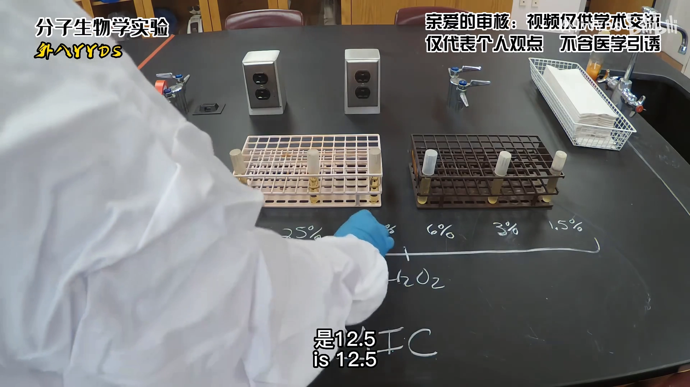

## 四、MIC 不等于"杀死"：引出 MBC

[【跳转到 04:16】](https://www.bilibili.com/video/BV1ho4y1t7X2/?t=256)

有趣的是：仅仅因为 12.5% 的过氧化氢**阻止了细菌生长**，并不意味着管子里的细菌已经**全部死亡**——它们可能只是停止分裂，还活着。

要确定"杀死细菌细胞需要多高浓度的过氧化氢"，就需要引入另一个指标——**最小杀菌浓度（MBC）**（也有人把它叫作最低致死浓度，但通常统一用"最小杀菌浓度"这个叫法）。

下面就来测定 MBC。为了确定最小杀菌浓度，需要用到**培养平板**。

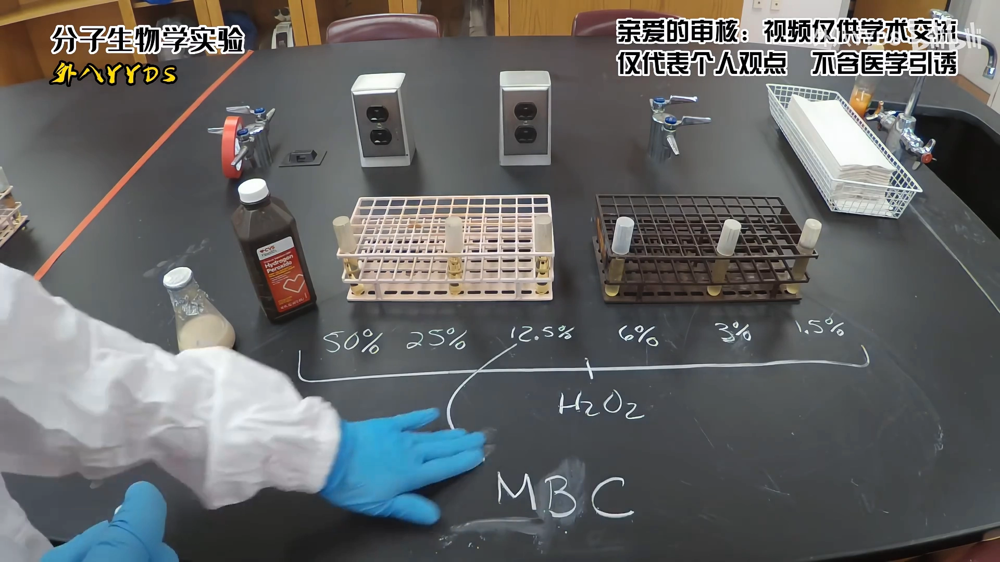

## 五、MBC 的测法：点板到不含药的平板

### 5.1 每管取 100 μL，点到无药平板上

[【跳转到 04:58】](https://www.bilibili.com/video/BV1ho4y1t7X2/?t=298)

做法是：从每根管子里取 **100 μL 菌液**，点到平板上。所有平板都只含**营养琼脂**培养基，里面**没有任何过氧化氢**——也就是不含药。

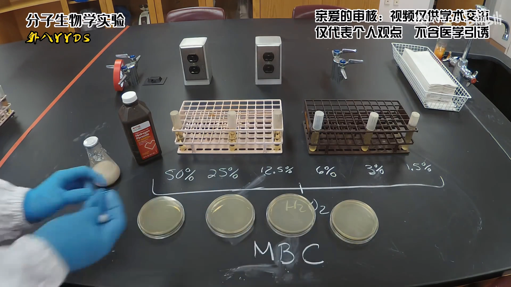

### 5.2 点板逻辑：只要有一个活菌就能长出来

[【跳转到 05:18】](https://www.bilibili.com/video/BV1ho4y1t7X2/?t=318)

这个设计的逻辑是：如果管子里**还有活细菌**，把它们放到没有药、营养充足的平板上，它们就能生长。其他每根管子也做同样操作：各取 100 μL 点到对应平板，再把菌液**涂布开**。

只要至少还有一个细菌细胞活着——哪怕是在 12.5% 过氧化氢里"幸存"的——把它点在没有过氧化氢的平板上，它就能长出来。

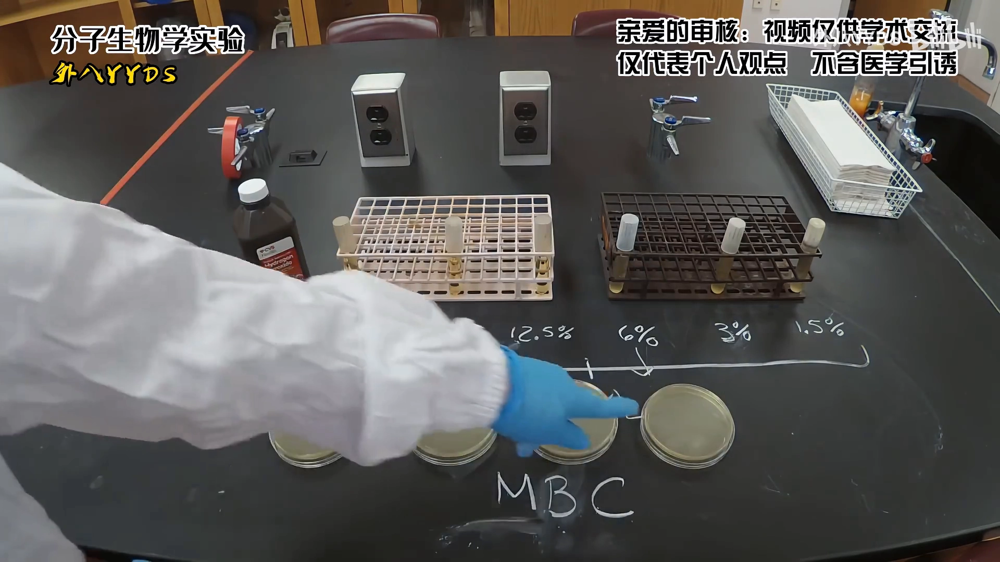

### 5.3 培养：看平板上有没有菌落

[【跳转到 06:02】](https://www.bilibili.com/video/BV1ho4y1t7X2/?t=362)

每根管子的菌液都点好、贴好标签后，把平板培养一夜。看的就是一件事：**这些平板上有没有菌落生长**——如果某张平板上长出了菌落，就意味着对应管子里还有一些细胞**仍然活着**。

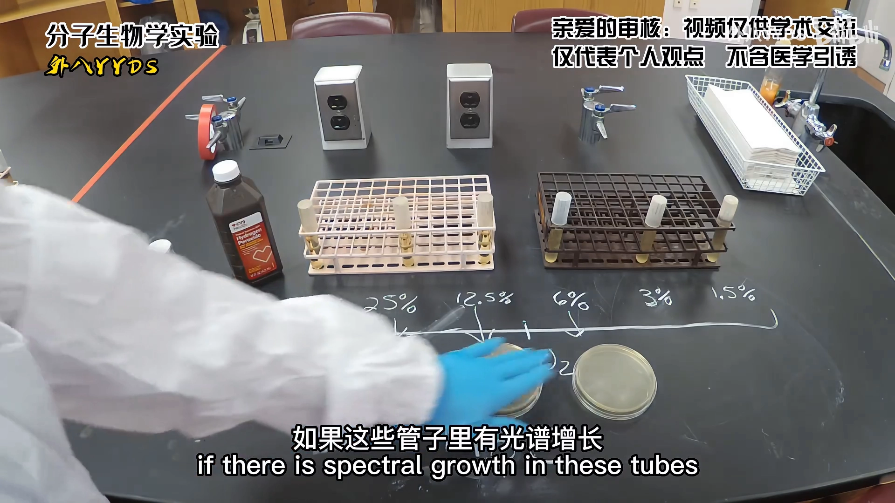

## 六、读 MBC 结果：杀死所有细胞的最低浓度

### 6.1 先看阳性对照：确认操作没问题

[【跳转到 06:22】](https://www.bilibili.com/video/BV1ho4y1t7X2/?t=382)

培养结束后，有一张平板长出了菌落——因为细菌本来就在分裂、生长，点板后能长出来，说明操作和培养条件都没问题。这就像一个**阳性对照**，验证整个流程是可靠的。

### 6.2 12.5% 没杀死，25% 杀死了

[【跳转到 07:07】](https://www.bilibili.com/video/BV1ho4y1t7X2/?t=427)

- **12.5% 那管**：它的平板上**长出了菌落**——说明 12.5% 的过氧化氢虽然**抑制**了细菌生长，但**没有杀死**细胞，管里还有一些细胞活着；
- **25% 那管**：点板后**没有生长**——这意味着 25% 的过氧化氢会**杀死每一个细胞**；
- **50% 那管**：也起作用了，同样杀死了加入的所有细胞。

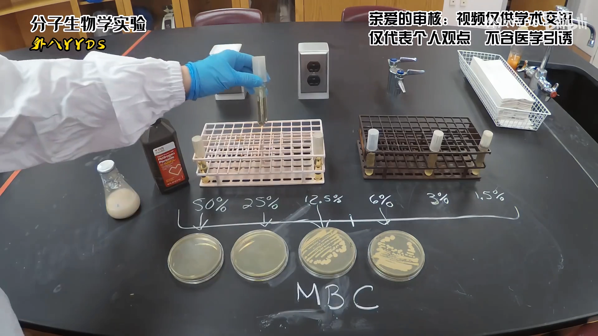

### 6.3 MBC = 25%

回想我们要找的"最低限度"：杀死细胞所需的过氧化氢**最低**浓度是多少？在这个实验里，杀死全部细菌所需的最低过氧化氢浓度就是 **25%**——这就是过氧化氢对这种细菌的**最小杀菌浓度（MBC）**。

## 七、总结：MIC 与 MBC 各自回答什么

[【跳转到 07:50】](https://www.bilibili.com/video/BV1ho4y1t7X2/?t=470)

把两个数字放在一起看：

| 指标 | 回答的问题 | 定义 | 本实验结果 |
| --- | --- | --- | --- |
| MIC | 抑不抑制？ | 阻止细菌生长所需的**最低**药物浓度 | 12.5% |
| MBC | 杀没杀死？ | 杀死每一个细胞（管内全部细菌）所需的**最低**药物浓度 | 25% |

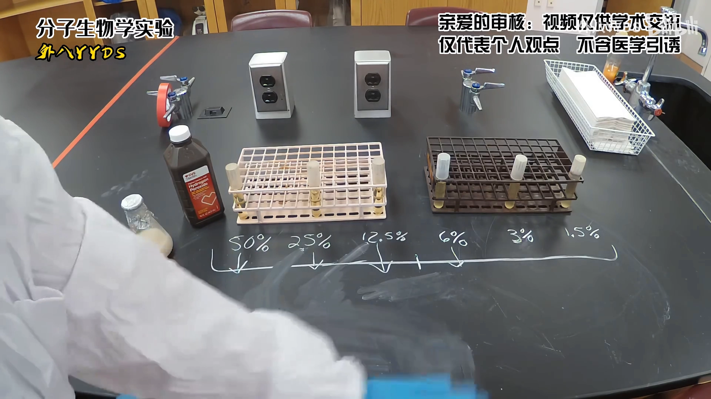

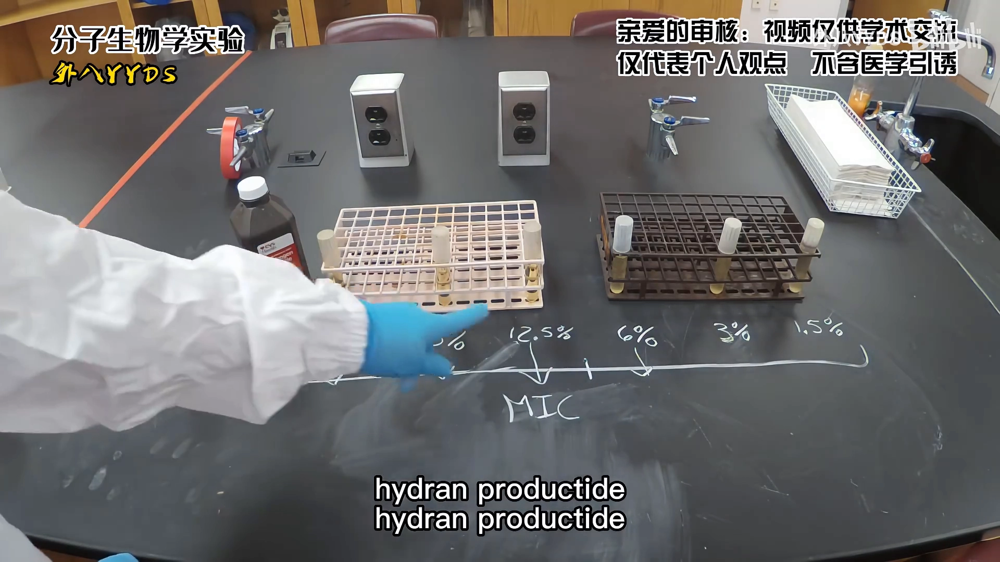

MIC（12.5%）低于 MBC（25%）在本实验中是典型情形：**先抑住，再杀透**——把细菌从"不长"打到"死透"，需要更高的浓度。

## 小结

- MIC = **抑制细菌可见生长**所需的最低药物浓度；本演示中过氧化氢对受试菌的 MIC 是 **12.5%**。
- 判读标尺 = **浑浊/澄清** + **阴性对照**（不加菌、肯定不长的参照管）；从低浓度往高浓度看，第一根澄清管对应的浓度就是 MIC。
- MIC **不等于杀死**：12.5% 抑制了生长，但点板后仍能长出菌落——管里还有活菌。
- MBC = **杀死全部细胞**所需的最低药物浓度；本演示中为 **25%**。
- MBC 的测法：把各管菌液点到**不含药**的营养琼脂平板上，培养过夜，看有没有菌落——长菌 = 还有活细胞，不长 = 被杀透。
- 对照两件套：**阴性对照**验证"不长"长什么样，**阳性对照**验证"能长"与操作可靠。
- 承接知识体系：APEX 模型预测的 MIC（μM，越低越好）正是这里定义的指标——模型给出数字，本讲解释这个数字在实验上是怎么来的、该怎么读。

## 关键术语速查

| 术语 | 一句话解释 |
| --- | --- |
| MIC | 最小抑菌浓度：抑制细菌可见生长所需的最低药物浓度 |
| MBC | 最小杀菌浓度：杀死每一个细胞所需的最低药物浓度 |
| 阴性对照 | 不加细菌的管/孔，肯定不长，作为"澄清"参照 |
| 阳性对照 | 确认细菌能正常生长、操作与培养条件可靠的对照 |
| 营养琼脂 | 不含药的固体培养基，活菌可在其上长成菌落 |
| 点板/涂布 | 取菌液点到平板表面并涂开，让单个活菌长成可见菌落 |
| 浑浊/澄清 | 液体培养判读指标：浑浊 = 有菌生长，澄清 = 生长被抑制 |
