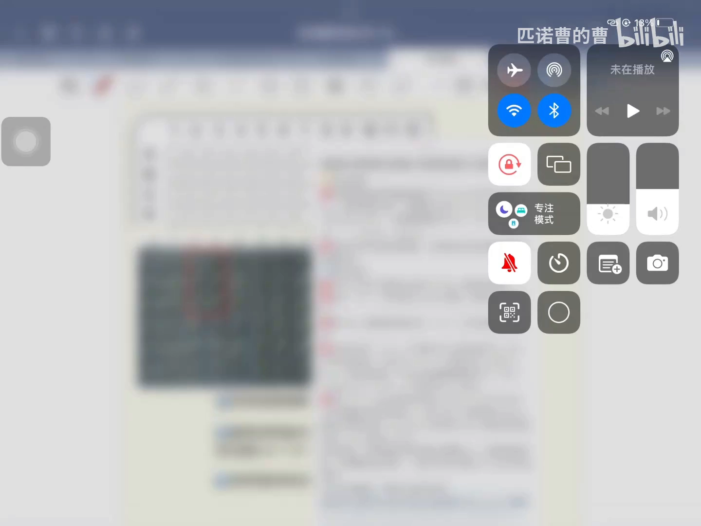
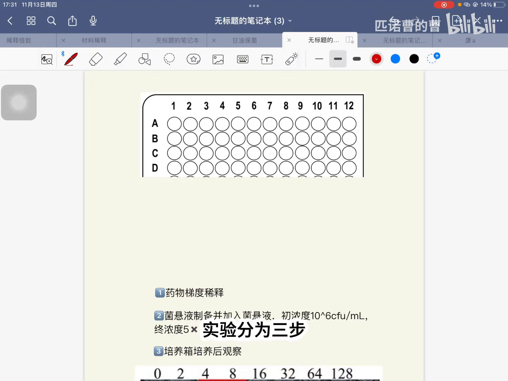
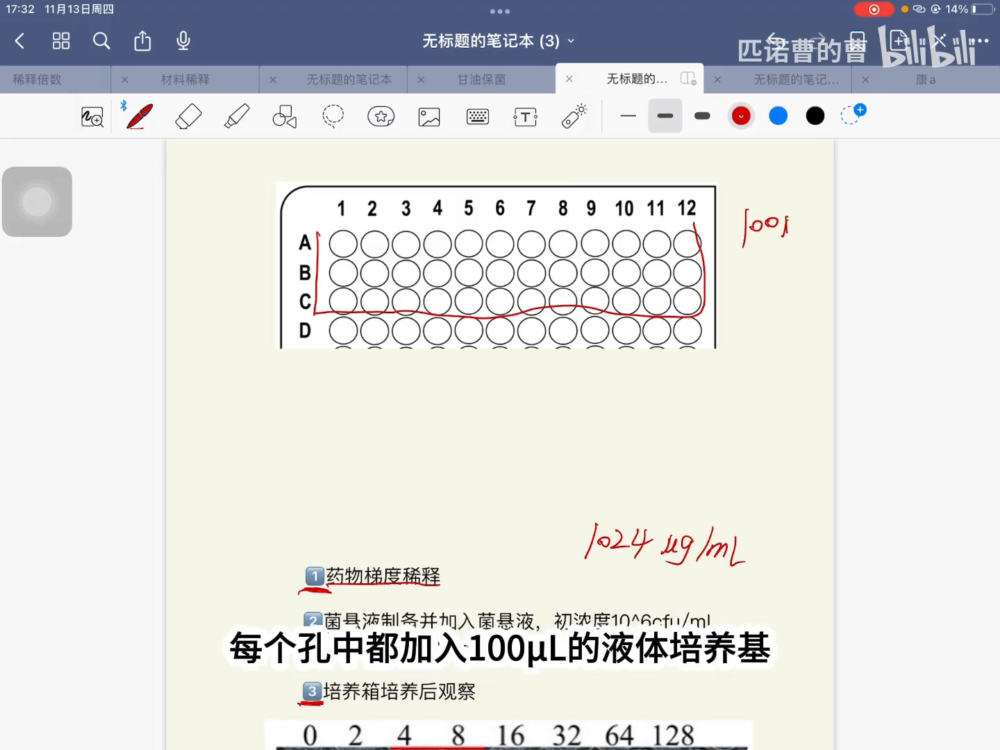
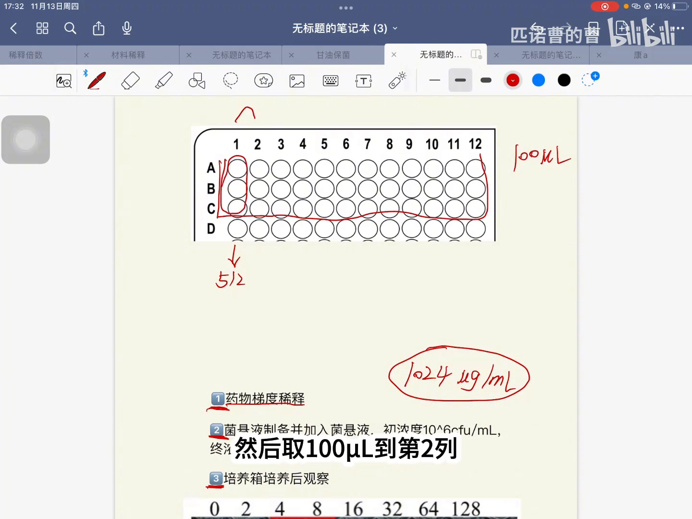
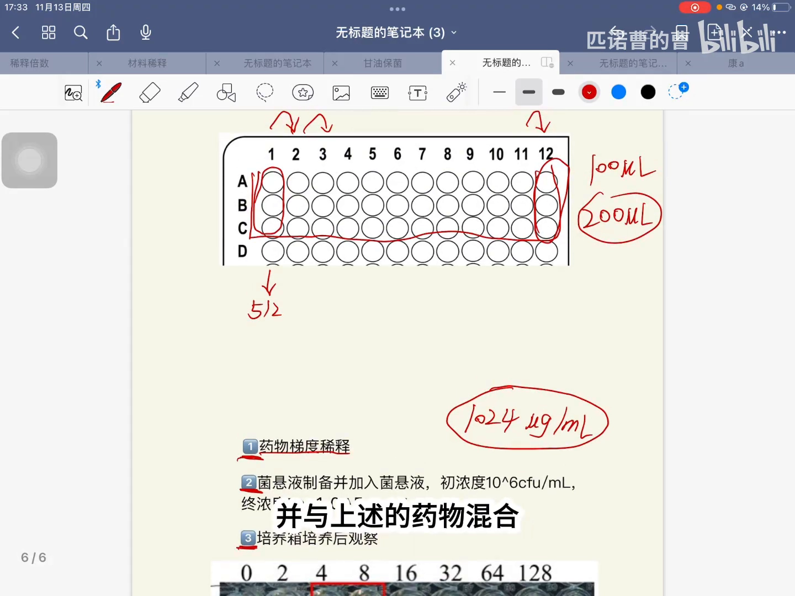
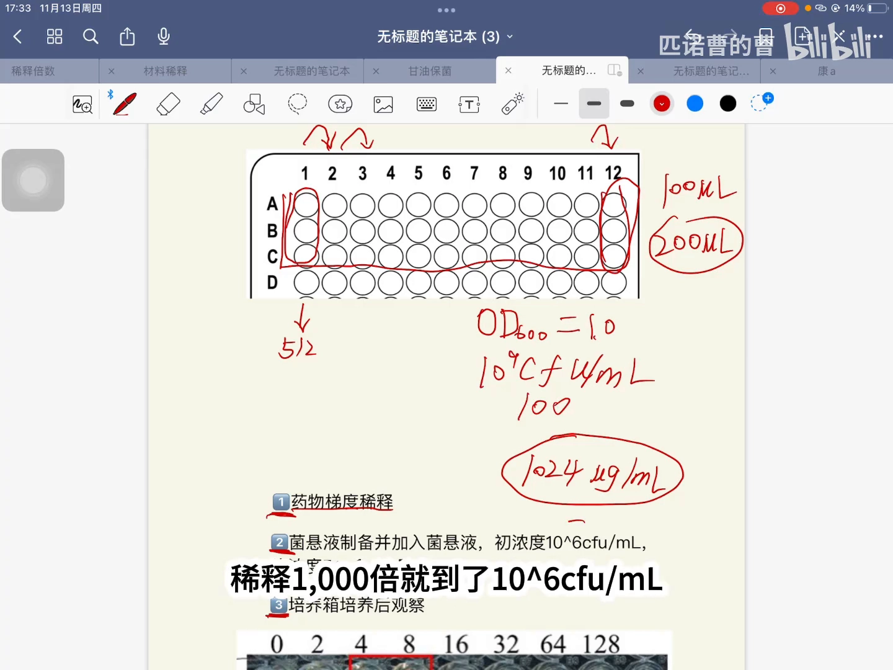
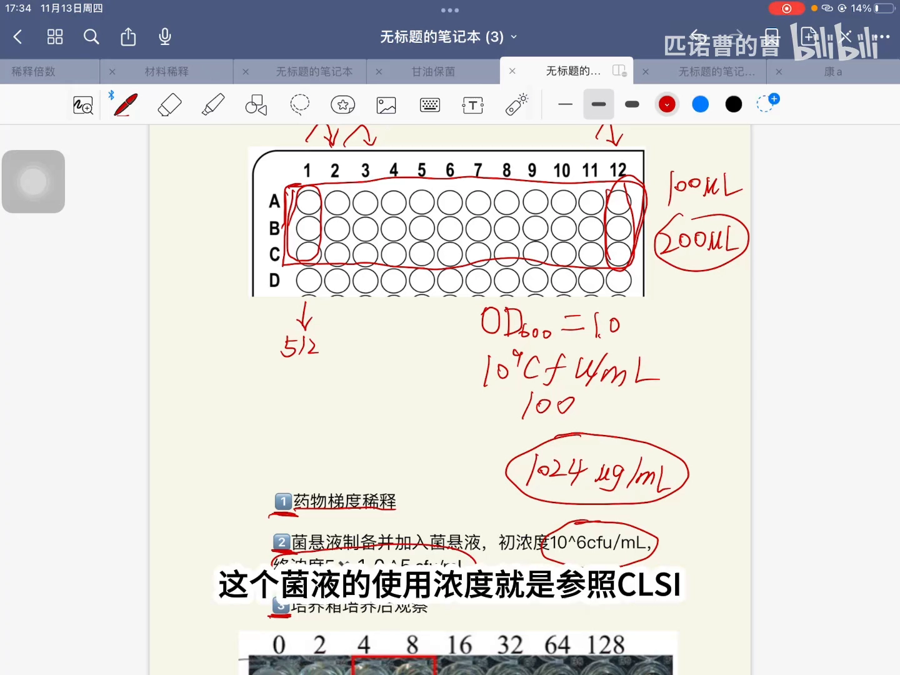
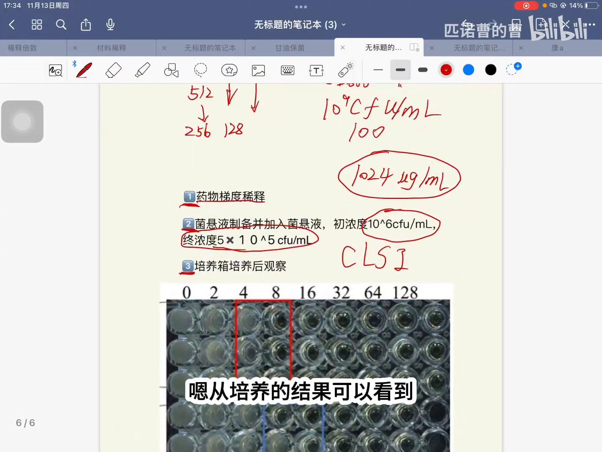

# 最小抑菌浓度（MIC）测定：96 孔板微量肉汤稀释法全流程

> 视频来源：[最小抑菌浓度mic（微量肉汤法）（匹诺曹的曹）](https://www.bilibili.com/video/BV1ZsCxBVE1s/)
> 对应知识体系条目：3.4.2 MIC（μM，最小抑菌浓度，越低越好）——APEX

## 本讲要解决的核心问题（SCQA）

**背景**：在抗菌药物和抗菌肽的研发里，需要用一个数字来比较"哪个药更能抑菌"。这个数字就是**最小抑菌浓度 MIC**（Minimum Inhibitory Concentration）——知识体系 3.4.2 里 APEX 模型预测的 MIC（单位 μM）正是这个指标，数值越低越好。

**冲突**：MIC 的定义只有一句话，可"抑制细菌生长"听起来像有或无的开关，而药物浓度是连续可变的：到底加到多低还算"抑制"？这个数在实验室里是怎么一步步"做"出来的？

**疑问**：药物浓度怎么排？菌要加多少？培养完之后，看什么迹象读出 MIC？

**回答（中心思想）**：用 96 孔板做**二倍梯度稀释**——药物从 1024 μg/mL 备用液起步，浓度一路减半；再按 CLSI 规定的菌量接种（每孔终浓度 5×10⁵ CFU/mL）；培养后看孔内**浑浊还是澄清**，第一个澄清孔对应的药物浓度就是 MIC。

## 一、MIC 是什么：三步实验总览

### 1.1 定义：抑制细菌生长的最低药物浓度

[【跳转到 00:00】](https://www.bilibili.com/video/BV1ZsCxBVE1s/?t=0)

MIC 的定义是：**抑制细菌生长所需的最低药物浓度**。

把这句话拆开看有两个要点：

- 对象是"生长"——细菌有没有长，用肉眼就能判断（孔内浑浊 = 长了，澄清 = 没长）；
- 关键词是"最低"——同一块板上能压住细菌的浓度往往有一串，但只有**最小的那个**才叫 MIC。

### 1.2 全流程三步走

[【跳转到 00:05】](https://www.bilibili.com/video/BV1ZsCxBVE1s/?t=5)

[【跳转到 00:14】](https://www.bilibili.com/video/BV1ZsCxBVE1s/?t=14)

实验分为三步：

1. **药物的稀释**——把药物铺成一列浓度逐级减半的孔；
2. **菌悬液的制备并与药物混合**——按标准浓度把菌加进每个孔；
3. **培养后观察结果**——看哪些孔还浑浊、哪些孔变澄清。

## 二、第一步：把药物铺成二倍梯度

### 2.1 起点：1024 μg/mL 备用液，每孔先垫 100 μL 培养基

[【跳转到 00:14】](https://www.bilibili.com/video/BV1ZsCxBVE1s/?t=14)

一般把药物配成 **1024 μg/mL** 的浓度备用。96 孔板的**每个孔**里先加入 **100 μL 液体培养基**。

### 2.2 从第一列开始，混匀一次浓度减半一次

[【跳转到 00:39】](https://www.bilibili.com/video/BV1ZsCxBVE1s/?t=39)

在 **A1、B1、C1**——也就是第一列的三个孔——里各加入 100 μL 的 1024 μg/mL 药物。混匀后，这三个孔的药物终浓度变成 **512 μg/mL**，正好被稀释了两倍。

接着用 100 μL 的排枪在第一列**吹吸混匀**，取出 100 μL 转移到第二列。

### 2.3 一路稀释到第 12 列，末列弃去 100 μL

[【跳转到 01:04】](https://www.bilibili.com/video/BV1ZsCxBVE1s/?t=64)

到第二列后再吹吸混匀，取 100 μL 到第三列——**中间不用换枪头**——如此依次做二倍梯度稀释，直到第 12 列。

到第 12 列时，这三个孔里的液体总体积是 200 μL，要**取出 100 μL 弃去**，让每孔体积回到 100 μL。至此第一步完成。

## 三、第二步：菌悬液的制备与混合

### 3.1 从 OD600 到接种菌液

[【跳转到 01:29】](https://www.bilibili.com/video/BV1ZsCxBVE1s/?t=89)

菌悬液的制备（UP 主之前有专门视频）：按经验，当菌液的 **OD600 ≈ 1.0** 时，菌浓度约为 **10⁹ CFU/mL**；把这份菌液**再稀释 1000 倍**备用，就得到 **10⁶ CFU/mL** 的接种菌液。

> OD600 是 600 nm 波长下的光密度，反映菌液的浑浊程度，越浑浊菌越多；CFU（菌落形成单位）可以近似理解为"活菌个数"。

### 3.2 每孔加 100 μL 菌液：菌量与药量同时被"再稀释"

[【跳转到 01:54】](https://www.bilibili.com/video/BV1ZsCxBVE1s/?t=114)

取 10⁶ CFU/mL 的菌液 **100 μL**，加入到板上的每一个孔里。加入后菌液又被稀释了两倍，孔内菌的终浓度就是 **5×10⁵ CFU/mL**——这个接种浓度是参照 **CLSI**（美国临床与实验室标准协会）的规定。

同时，因为多加了 100 μL 菌液，**孔内药物浓度也又被稀释了两倍**：第一孔药物的终浓度变成 **256 μg/mL**，第二孔 **128 μg/mL**，往后依次二倍减小。

## 四、第三步：培养与结果判读

[【跳转到 02:19】](https://www.bilibili.com/video/BV1ZsCxBVE1s/?t=139)

之后就是第三步：把板放入培养箱培养，观察结果。

[【跳转到 02:49】](https://www.bilibili.com/video/BV1ZsCxBVE1s/?t=169)

- **药物浓度为 0 的孔**：细菌正常生长，孔内**浑浊**；
- **药物浓度为 8 μg/mL 的孔**：孔内**澄清**，说明细菌的生长被抑制了——这个药物的 **MIC 就是 8 μg/mL**；
- 下一孔的药物浓度是 16 μg/mL（更浓，同样澄清）。

一句话总结读法：**从低浓度往高浓度看，第一个不再浑浊的孔，对应的药物浓度就是 MIC。**

## 小结

- MIC = 抑制细菌生长所需的**最低药物浓度**，是比较抗菌效果的标准指标（数值越低越好）。
- 标准测法是 96 孔板**微量肉汤稀释法**：药物二倍梯度稀释 → 制备菌悬液并混合 → 培养观察。
- 浓度梯度靠"混匀后取一半到下一孔"实现：备用液 1024 μg/mL，加菌后第一孔实际从 256 μg/mL 起步。
- 接种量按 CLSI 规定：孔内终浓度 **5×10⁵ CFU/mL**（10⁶ CFU/mL 菌液取 100 μL 加入后减半）。
- 判读靠**浑浊/澄清**：第一个澄清孔的浓度即 MIC（示例中为 8 μg/mL）。
- MIC 只回答"抑不抑制生长"；"杀没杀死细菌"要用 MBC 来回答，见同目录另一篇《【分子生物学指南】最小抑菌浓度MIC》。

## 关键术语速查

| 术语 | 一句话解释 |
| --- | --- |
| MIC | 最小抑菌浓度：抑制细菌可见生长所需的最低药物浓度 |
| 二倍梯度稀释 | 每一步浓度减半的连续稀释；本例备用液从 1024 μg/mL 起步 |
| OD600 | 600 nm 波长下的光密度，衡量菌液浑浊程度；OD600≈1.0 约对应 10⁹ CFU/mL |
| CFU | 菌落形成单位，可近似理解为"活菌个数" |
| CLSI | 美国临床与实验室标准协会，规定 MIC 测定的接种量等标准 |
| 排枪 | 多道移液器，可一次处理一列孔，保证各孔操作一致 |
| 浑浊/澄清 | 培养后判读指标：浑浊 = 有菌生长，澄清 = 生长被抑制 |
