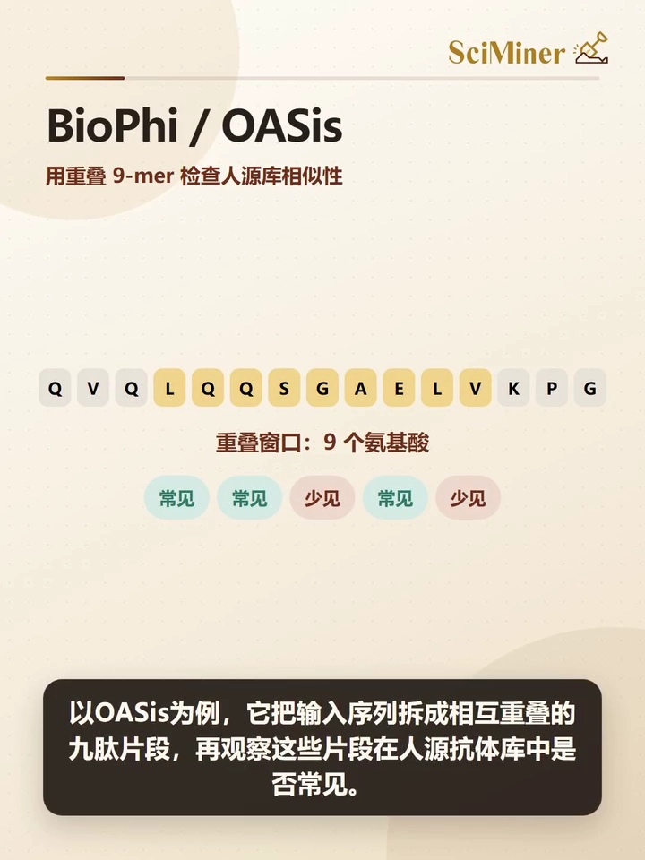
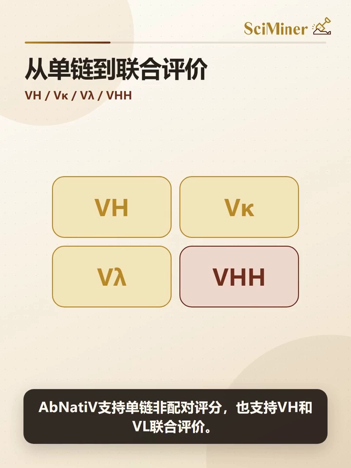
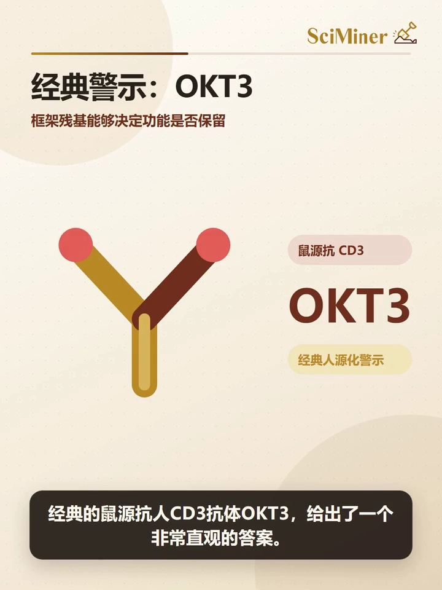
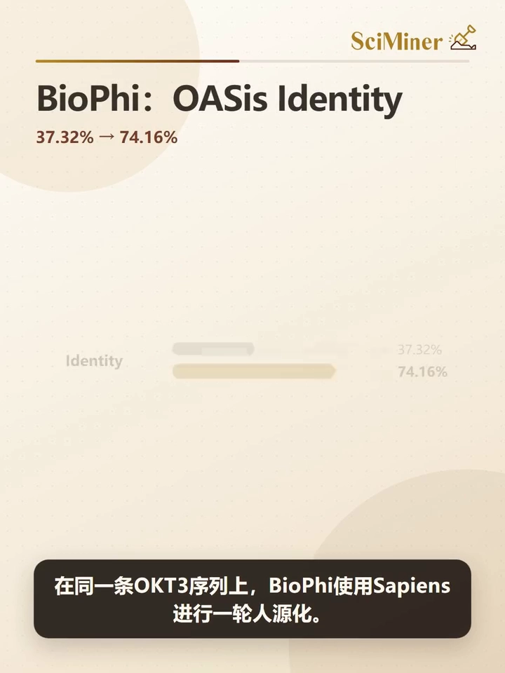
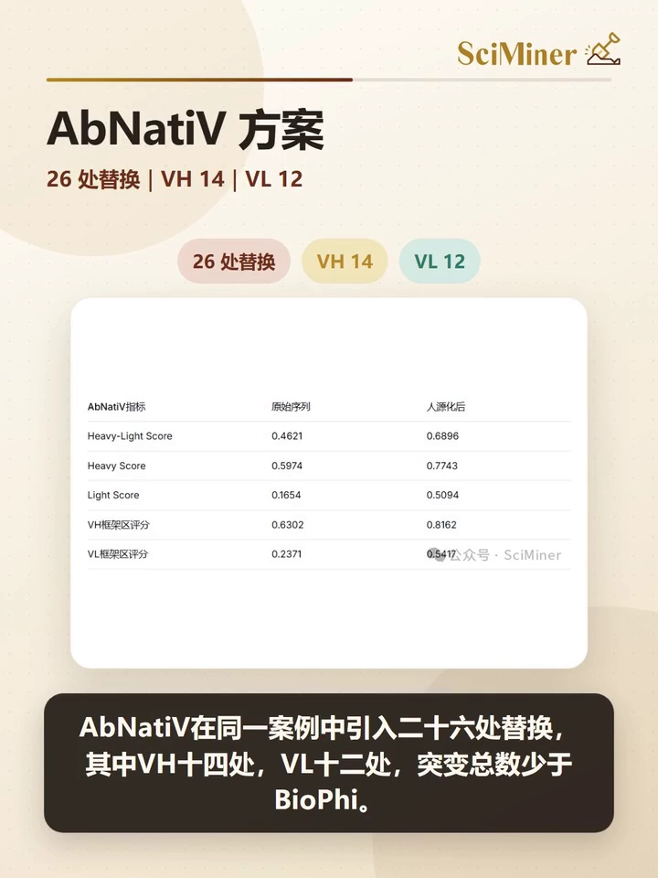
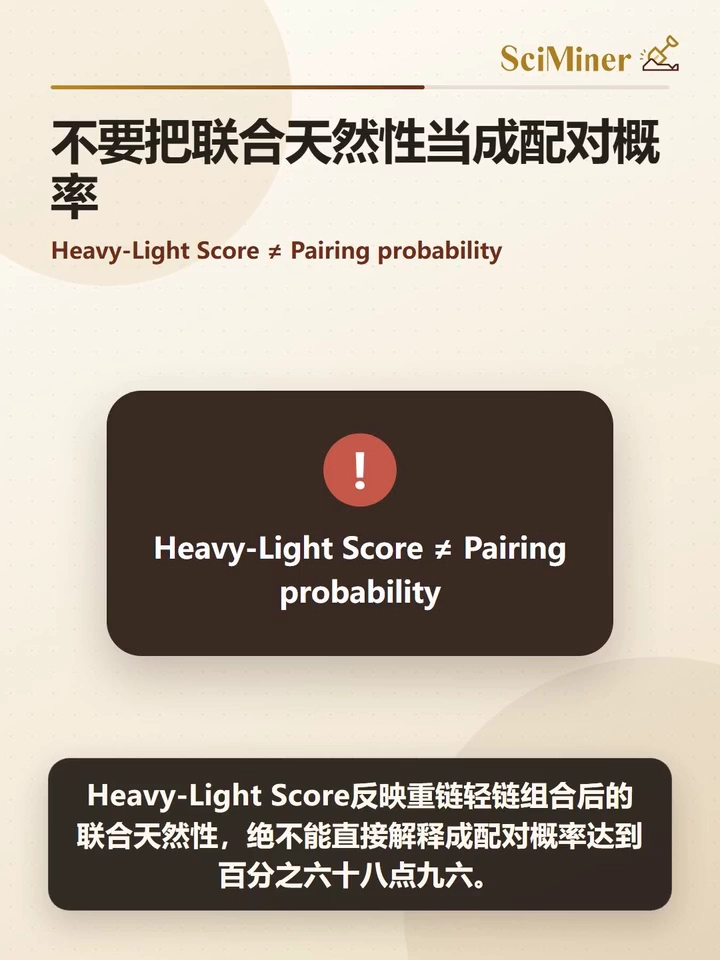
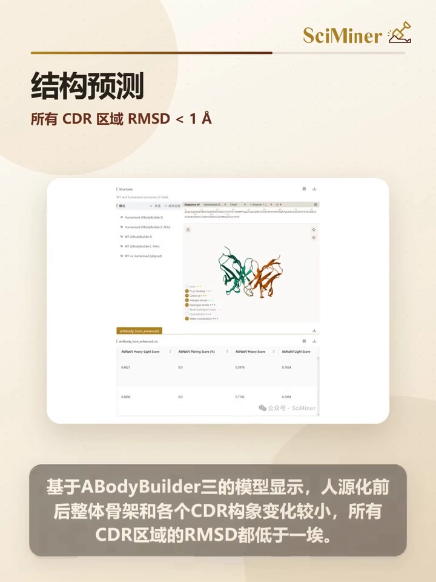
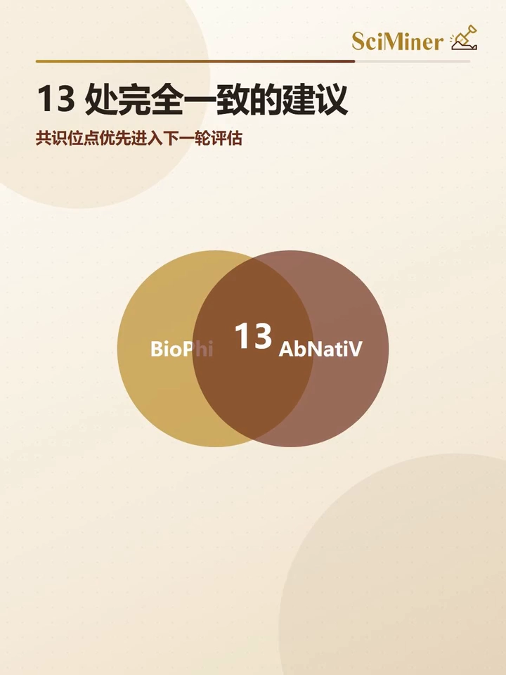
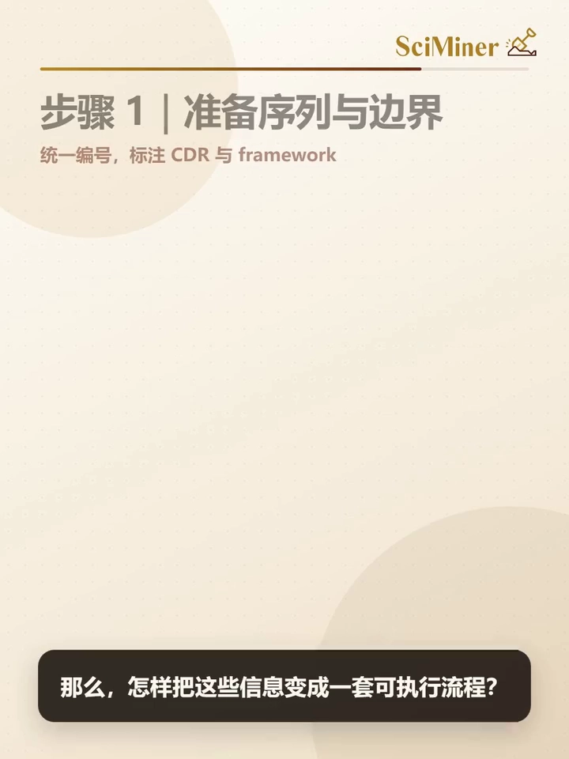
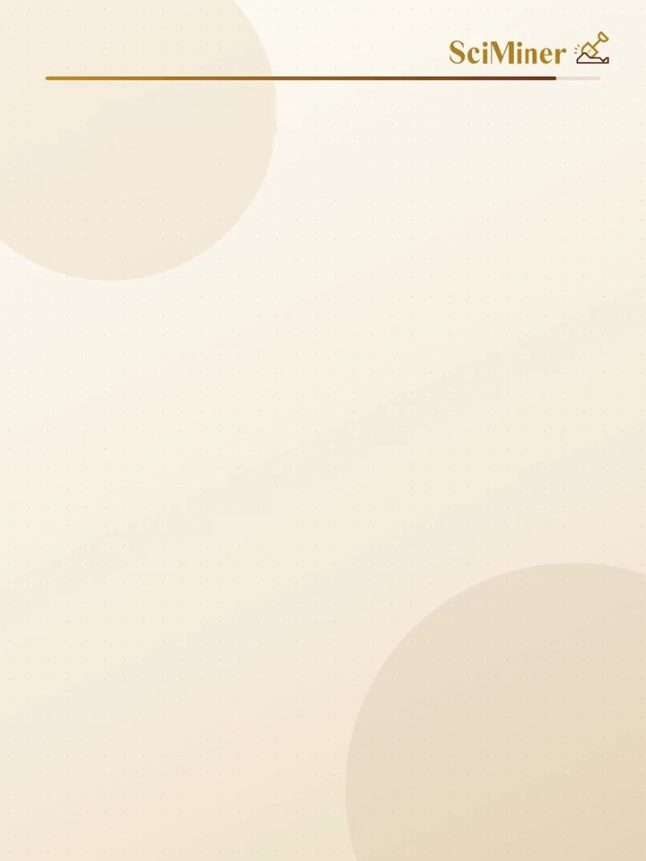

# 人源性评分不是终点：用 OASis 与 AbNatiV 两把尺子，把抗体人源化做成多目标决策

> 来源视频：[AbNatiV抗体人源化科普教程](https://www.bilibili.com/video/BV196K16PE5h) · 时长 9:47 · UP：阿尔脉生物科技
> 本篇基于视频 AI 字幕与画面整理，时间戳可跳转回原视频对应位置。

## 本讲要解决的核心问题（SCQA）

**背景**：鼠源抗体和骆驼科 VHH 纳米抗体进入人体后，可能被免疫系统识别为"外来物"。人源化的目标是降低这种潜在的免疫原性风险，同时为表达、功能评价和成药性优化打好基础 [【跳转到 00:20】](https://www.bilibili.com/video/BV196K16PE5h/?t=20)。

**冲突**：人源化绝不是把鼠源残基一键替换成人源残基那么简单 [【跳转到 00:05】](https://www.bilibili.com/video/BV196K16PE5h/?t=5)——有些框架残基虽然不直接接触抗原，却撑着 CDR 构象、VH/VL 配对、整体稳定性和溶解性；换错一个关键位置，可能出现"评分升高、亲和力反而下降"的结果 [【跳转到 00:43】](https://www.bilibili.com/video/BV196K16PE5h/?t=43)。而 BioPhi 的 OASis 和 AbNatiV 的天然性模型这两套评估工具，给出的分数与推荐的突变并不一致。

**疑问**：这些分数到底该怎么读？哪个工具更可信？换掉的残基靠什么判断安全？

**回答（中心思想）**：分数不是答案，而是证据。可靠的人源化不是"选 BioPhi 还是选 AbNatiV"，而是让不同模型互相质询——模型共识提高候选优先级，模型分歧提醒查看结构与实验，最终由实验裁决 [【跳转到 09:16】](https://www.bilibili.com/video/BV196K16PE5h/?t=556)。

---

## 一、人源化的目标与难点：换错一个残基，评分升高、亲和力反而下降

视频开篇给了一个直观类比：把抗体比作一双精密的手——**CDR**（互补决定区，抗体上直接抓住抗原的环区）是抓住抗原的指尖，**框架区**（framework，支撑 CDR 的骨架部分）则是支撑手型的掌骨 [【跳转到 00:00】](https://www.bilibili.com/video/BV196K16PE5h/?t=0)。

人源化要同时照顾两件事 [【跳转到 00:20】](https://www.bilibili.com/video/BV196K16PE5h/?t=20)：

- **降低潜在免疫原性风险**——让序列不那么"外来"；
- **保住成药的基本盘**——为表达、功能评价和成药性优化打好基础。

难点在于，框架残基并非"无关紧要的背景"：它们维持着 CDR 构象、VH 与 VL 配对（重链、轻链两个可变区的搭配）、整体稳定性和溶解性 [【跳转到 00:32】](https://www.bilibili.com/video/BV196K16PE5h/?t=32)。因此换错一个关键位置，完全可能出现"人源性评分升高、亲和力反而下降"的结果 [【跳转到 00:43】](https://www.bilibili.com/video/BV196K16PE5h/?t=43)。

## 二、VHH 的特殊性：过度人源化会把最有价值的特征一起抹掉

**VHH**（纳米抗体）比常规抗体更特殊：它没有轻链，而一些区别于常规人源 VH 的特征残基，恰恰帮助它保持单域结构（单条链独立折叠成完整抗原结合域）、稳定性和良好溶解性 [【跳转到 00:48】](https://www.bilibili.com/video/BV196K16PE5h/?t=48)。过度人源化，可能把这些最有价值的特征也一起抹掉 [【跳转到 00:53】](https://www.bilibili.com/video/BV196K16PE5h/?t=53)。

所以人源化本质上是一道**多目标优化题**：既希望序列更像人源抗体，又必须保护结构、结合能力和可开发性 [【跳转到 01:07】](https://www.bilibili.com/video/BV196K16PE5h/?t=67)。

## 三、两种评分视角：OASis 查九肽"词组"，AbNatiV 看整条"句子"

**BioPhi 的 OASis：局部视角。** OASis 把输入序列拆成相互重叠的**九肽片段**（连续 9 个氨基酸的滑窗），再观察这些片段在人源抗体库中是否常见——很像用词组频率判断一段话是否像母语表达 [【跳转到 01:24】](https://www.bilibili.com/video/BV196K16PE5h/?t=84)。它擅长识别**局部**的非人源特征，但对远距离残基关系、完整序列上下文的表达相对有限 [【跳转到 00:98】](https://www.bilibili.com/video/BV196K16PE5h/?t=98)。

**AbNatiV：整体视角。** 来自剑桥大学 Sormanni 实验室的 AbNatiV 用深度学习从大规模天然抗体序列中学习"什么样的**完整序列组合**更符合天然抗体分布" [【跳转到 01:43】](https://www.bilibili.com/video/BV196K16PE5h/?t=103)。其原始版本采用向量量化变分自编码器（VQ-VAE，一类先把数据压缩成离散编码、再学习其分布的生成模型）[【跳转到 01:58】](https://www.bilibili.com/video/BV196K16PE5h/?t=118)。

它不仅给出**整链天然性评分**，还能输出**残基级的天然性图谱** [【跳转到 02:08】](https://www.bilibili.com/video/BV196K16PE5h/?t=128)。但要注意：残基级分数并不是互相独立的——单点考察时，每个位置的判断都放在整条序列的上下文中完成 [【跳转到 02:15】](https://www.bilibili.com/video/BV196K16PE5h/?t=135)。

对于单链天然性评分，**分数越接近 1，序列越接近对应的天然抗体分布**；在原始模型设定中，0.8 可作为一个参考阈值——但不能脱离模型版本和链型机械套用 [【跳转到 02:26】](https://www.bilibili.com/video/BV196K16PE5h/?t=146)。

## 四、AbNatiV 的模型族：单链、配对与 VHH 双控策略

AbNatiV 支持单链非配对评分，也支持 VH 和 VL 联合评价 [【跳转到 02:42】](https://www.bilibili.com/video/BV196K16PE5h/?t=162)：

- **链型专属模型**：Lambda 轻链和 VHH 各有专属模型；更新的 **AbNatiV2** 扩大了训练数据，并提供 VH2、VL2 和 VHH2 模型；**PRBRT2** 则用于重链轻链的联合天然性与配对相关评价 [【跳转到 02:47】](https://www.bilibili.com/video/BV196K16PE5h/?t=167)；
- **两种评价模式**：对常规抗体，非配对模式分别优化 VH 和 VL；配对模式则同时观察两条链组合后的天然性 [【跳转到 03:09】](https://www.bilibili.com/video/BV196K16PE5h/?t=189)；
- **VHH 双控策略**：一边提高 VH 人源性，一边限制 VHH 天然性的损失，再通过增强采样或穷举采样搜索候选组合 [【跳转到 03:19】](https://www.bilibili.com/video/BV196K16PE5h/?t=199)。

**所以 AbNatiV 并不是 BioPhi 的替代品**：两者的训练数据、算法和分数范围不同，数值不能直接横向比较 [【跳转到 03:33】](https://www.bilibili.com/video/BV196K16PE5h/?t=213)。更合理的方式是分别观察每套工具在人源化前后的变化，再比较它们推荐的突变位置——**模型共识提高候选优先级，模型分歧则提醒我们查看结构和实验** [【跳转到 03:44】](https://www.bilibili.com/video/BV196K16PE5h/?t=224)。

## 五、KT3 案例：框架区是人源化的隐形承重墙

为什么结构证据如此重要？经典的鼠源抗人 CD3 抗体 **KT3** 给出了非常直观的答案 [【跳转到 03:58】](https://www.bilibili.com/video/BV196K16PE5h/?t=238)：

- 早期研究发现，只把 CDR 移植到人源框架上的 **GOKT31**，结合能力几乎完全丧失 [【跳转到 04:03】](https://www.bilibili.com/video/BV196K16PE5h/?t=243)；
- 保留部分关键鼠源框架残基的 **GOKT37**，亲和力才得以恢复 [【跳转到 04:15】](https://www.bilibili.com/video/BV196K16PE5h/?t=255)。

框架区就像 CDR 下方的垫片：它不一定直接碰到抗原，却可能通过改变 CDR 形状、链间作用和整体稳定性，间接决定抗体是否还能工作 [【跳转到 04:20】](https://www.bilibili.com/video/BV196K16PE5h/?t=260)。

在同一条 KT3 序列上，视频展示了 BioPhi 的一轮人源化数字 [【跳转到 04:36】](https://www.bilibili.com/video/BV196K16PE5h/?t=276)：

| 指标 | 人源化前 | 人源化后 |
| --- | --- | --- |
| OASis identity（九肽在人源库中可找到的比例） | 37.32% | 74.16% |
| OASis percentile（该 identity 在人源抗体分布中的百分位） | 0.4% | 35.4% |
| 非人源九肽数量 | 130 个 | 54 个 |

BioPhi（使用 Sapiens 方法）共引入 **31 处框架区替换**，其中 VH 15 处、VL 16 处，**CDR 序列没有改变**——这套方案更强调全面减少局部非人源片段 [【跳转到 05:00】](https://www.bilibili.com/video/BV196K16PE5h/?t=300)。

## 六、同一案例的 AbNatiV 数字，与一个最容易犯的误读

AbNatiV 在同一案例中引入 **26 处替换**（VH 14 处、VL 12 处），突变总数少于 BioPhi [【跳转到 05:18】](https://www.bilibili.com/video/BV196K16PE5h/?t=313)。它的各项分数变化如下 [【跳转到 05:22】](https://www.bilibili.com/video/BV196K16PE5h/?t=318)：

| AbNatiV 指标 | 人源化前 | 人源化后 |
| --- | --- | --- |
| heavy-light score（重轻链联合天然性） | 0.4621 | 0.6896 |
| 重链评分 | 0.5974 | 0.7743 |
| 轻链评分 | 0.1654 | 0.5094 |
| VH 框架评分 | 0.6302 | 0.8162 |
| VL 框架评分 | 0.2371 | 0.5417 |

其中**轻链的提升尤其明显** [【跳转到 05:38】](https://www.bilibili.com/video/BV196K16PE5h/?t=338)。

这里最容易出现一个误读：heavy-light score 反映的是重链轻链组合后的**联合天然性**，绝不能直接解释成"配对概率达到 68.96%" [【跳转到 05:50】](https://www.bilibili.com/video/BV196K16PE5h/?t=350)。在这次结果显示精度下，heavy-light percentile 和 pairing score 仍然为零 [【跳转到 05:55】](https://www.bilibili.com/video/BV196K16PE5h/?t=355)——也就是说，**联合天然性提高了，但配对相关指标没有显示出同步提升** [【跳转到 06:04】](https://www.bilibili.com/video/BV196K16PE5h/?t=364)。

## 七、结构预测的角色：筛选证据，不是湿实验的替代品

视频进一步用结构预测交叉验证：基于 BodyBuilder3（视频所用的一款抗体结构预测模型）的模拟显示，人源化前后**整体骨架和各个 CDR 构象变化较小，所有 CDR 区域的 RMSD 都低于 1Å**（RMSD，均方根偏差，衡量两组坐标的平均偏离程度）[【跳转到 06:19】](https://www.bilibili.com/video/BV196K16PE5h/?t=379)。

但 RMSD 小于 1Å 只能说明**两套计算预测的结构相近**，不能证明抗原结合能力完全保留——结构预测是筛选证据，不是湿实验的替代品 [【跳转到 06:31】](https://www.bilibili.com/video/BV196K16PE5h/?t=391)。

一个值得注意的细节：AbNatiV 推荐的 VH71、VH76 和 VH91 等位置，与经典 KT3 研究中的关键框架区域存在对应关系 [【跳转到 06:43】](https://www.bilibili.com/video/BV196K16PE5h/?t=403)。这提示天然性模型可能捕捉到了部分与结构稳定相关的特征 [【跳转到 06:48】](https://www.bilibili.com/video/BV196K16PE5h/?t=408)。

## 八、共识优先、分歧深究：13 处一致与 L141 的分歧

两套工具并没有给出完全不同的答案：它们共有 **13 处完全一致的突变**，这些共识位点可以优先进入下一轮评估 [【跳转到 07:01】](https://www.bilibili.com/video/BV196K16PE5h/?t=421)。

但在 VL 的 **L141** 位置，两者都建议修改、目标氨基酸却不同 [【跳转到 07:11】](https://www.bilibili.com/video/BV196K16PE5h/?t=431)：

- **BioPhi 建议**：丝氨酸 → 谷氨酰胺；
- **AbNatiV 建议**：丝氨酸 → 甘氨酸。

这种分歧非常有价值：它说明**同一个低人源性位置可能存在多个合理答案**，需要结合局部结构、稳定性、表达和功能实验进一步选择 [【跳转到 07:24】](https://www.bilibili.com/video/BV196K16PE5h/?t=444)。

## 九、把评分变成流程：七步操作法与五个误区

视频最后把上述思路整理成一套可执行的七步流程 [【跳转到 07:38】](https://www.bilibili.com/video/BV196K16PE5h/?t=458)：

1. **准备序列**：准备 VH、VL 或 VHH 序列，统一编号体系，并准确标注 CDR 和框架区 [【跳转到 07:38】](https://www.bilibili.com/video/BV196K16PE5h/?t=458)；
2. **建立基线**：分别运行 BioPhi 和 AbNatiV，建立人源化前的基线，保存整链、区域、残基级以及配对相关指标 [【跳转到 07:52】](https://www.bilibili.com/video/BV196K16PE5h/?t=472)；
3. **留全证据**：不要只保留最高分结果，把候选序列、突变清单和人源化前后变化全部保存下来 [【跳转到 08:02】](https://www.bilibili.com/video/BV196K16PE5h/?t=482)；
4. **交叉比对**：建立突变交叉矩阵，把位点分成"双方同意""同位点但目标残基不同""仅由单一模型推荐"三类 [【跳转到 08:12】](https://www.bilibili.com/video/BV196K16PE5h/?t=492)；
5. **结构把关**：加入结构证据，重点检查突变是否靠近 CDR、Vernier 区域（支撑 CDR 环构象的框架残基）、VH/VL 界面、核心疏水区或潜在聚集热点 [【跳转到 08:23】](https://www.bilibili.com/video/BV196K16PE5h/?t=503)；
6. **控制规模**：构建保守版、共识版和探索版，而不是一次把所有推荐突变全部堆进同一条序列 [【跳转到 08:36】](https://www.bilibili.com/video/BV196K16PE5h/?t=516)；
7. **实验裁决**：用实验完成最终裁决，至少比较表达量、单体比例、热稳定性、亲和力和细胞活性，并根据项目需要加入免疫原性相关评价 [【跳转到 08:46】](https://www.bilibili.com/video/BV196K16PE5h/?t=526)。

配套的还有五个常见误区 [【跳转到 09:00】](https://www.bilibili.com/video/BV196K16PE5h/?t=540)：

- 分数最高不等于方案最好；
- 不同工具的分数不能直接比较；
- CDR 不变不代表功能一定保留；
- 预测结构相近不等于亲和力不变；
- VHH 也不能完全照搬常规 VH 策略。

## 小结

- **人源化是多目标优化**：降免疫原性的同时，必须保护结构、结合能力和可开发性；VHH 还要额外保护单域特征。
- **两把尺子互补**：OASis 像查词组，擅长发现局部非人源九肽；AbNatiV 像看整句，从完整序列上下文评估天然性，并给出残基级图谱。
- **分数之间不可横比**：训练数据、算法、分数范围都不同；heavy-light score 是联合天然性，不是配对概率。
- **共识与分歧都要用**：13 处共识突变优先进入下一轮；L141 这类分歧位点恰好暴露"多个合理答案"，要靠结构与实验裁决。
- **流程七步走**：统一编号 → 双工具基线 → 留全证据 → 交叉矩阵 → 结构把关 → 保守/共识/探索分版 → 实验裁决。
- **核心心态**：分数是证据不是答案；当局部、整体、配对、VHH、结构与实验的证据在同一候选上汇合，人源化才从追逐单一分数走向多维度辅助决策。

## 关键术语速查

| 术语 | 一句话解释 |
| --- | --- |
| OASis | BioPhi 中的人源性评估方法：把序列拆成九肽片段，在人源抗体库中统计其常见度 |
| OASis identity / percentile | 九肽可找到的比例 / 该比例在人源抗体分布中的百分位 |
| Sapiens | BioPhi 中基于大规模天然抗体库训练的深度学习人源化方法 |
| AbNatiV | 剑桥大学 Sormanni 实验室的天然性评估模型（VQ-VAE），给整链与残基级评分 |
| heavy-light score | AbNatiV 中重链轻链组合后的联合天然性评分，≠ 配对概率 |
| pairing score | AbNatiV 中与 VH/VL 配对相关的评价指标 |
| VHH / 纳米抗体 | 骆驼科动物只有重链的单域抗体，人源化时需保留其特征残基 |
| CDR / 框架区 | 直接结合抗原的环区 / 支撑 CDR 构象与链配对的骨架 |
| Vernier 残基 | 框架中支撑 CDR 环构象的关键位置，突变时需重点检查 |
| 九肽（9-mer） | OASis 滑窗片段长度，9 个连续氨基酸 |
| VQ-VAE | 向量量化变分自编码器，AbNatiV 原始版本的模型骨架 |
| RMSD | 均方根偏差，比较两个结构坐标平均偏离程度的指标 |
