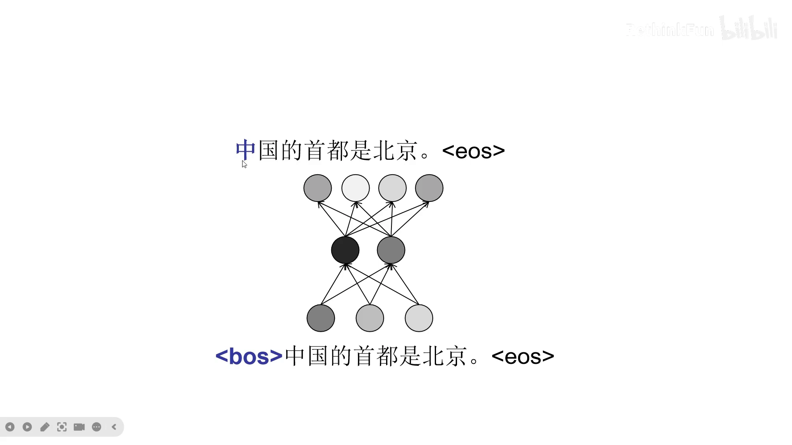
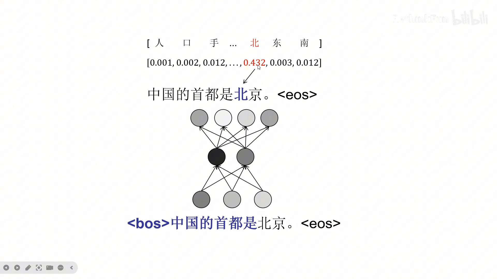
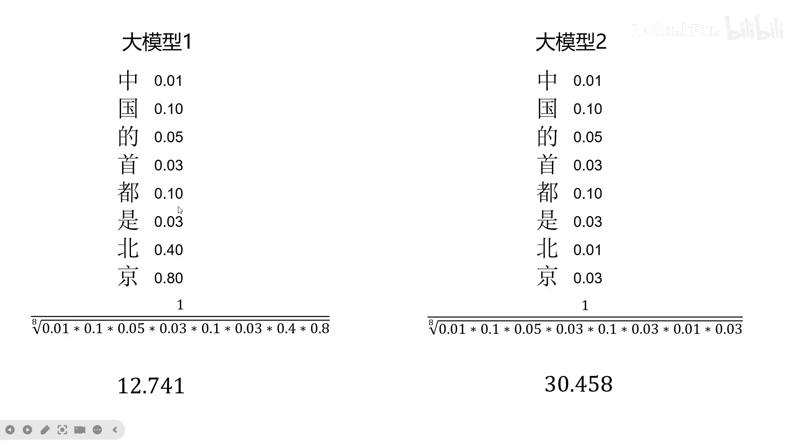
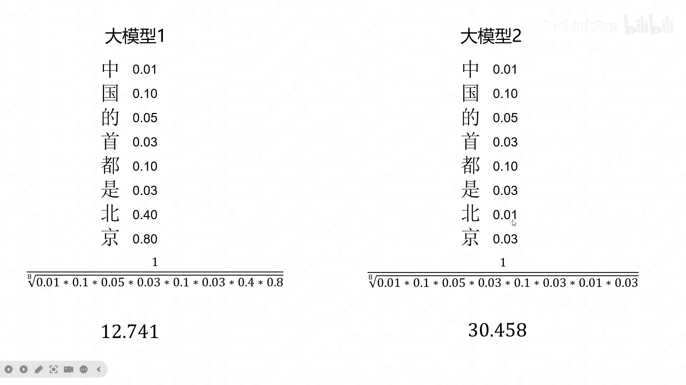
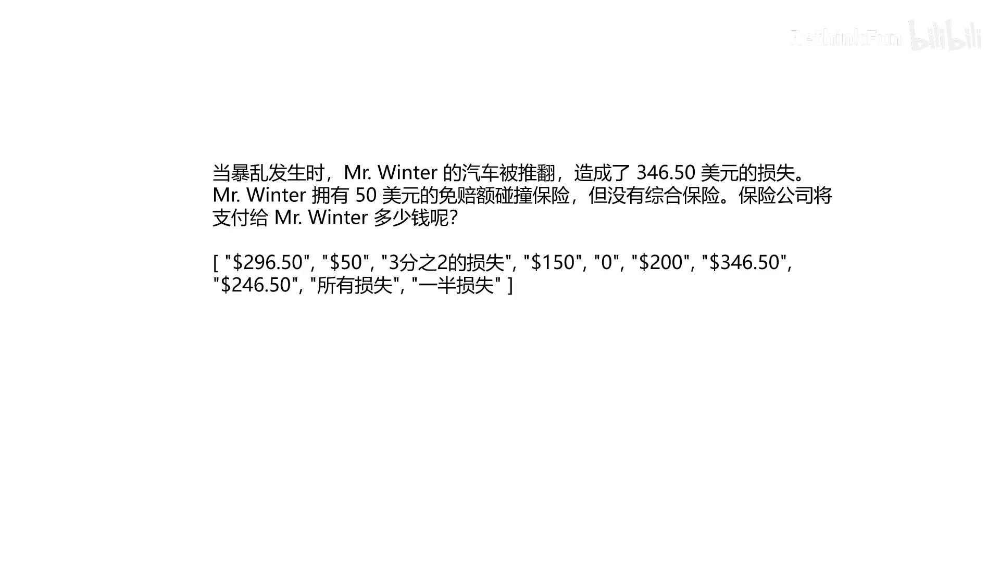
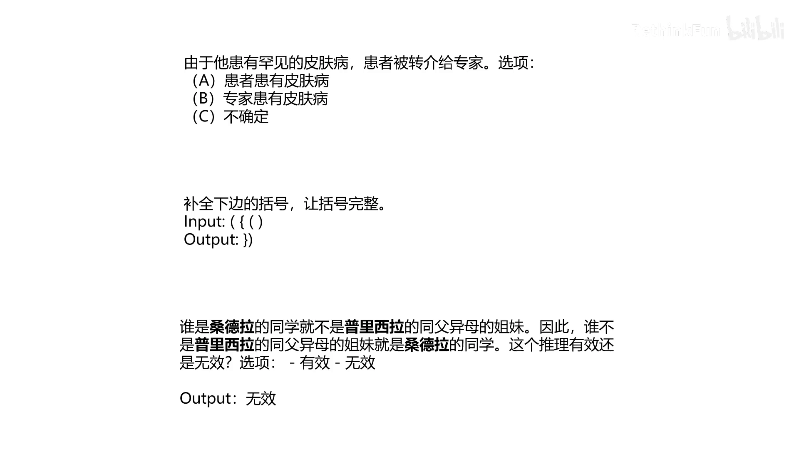
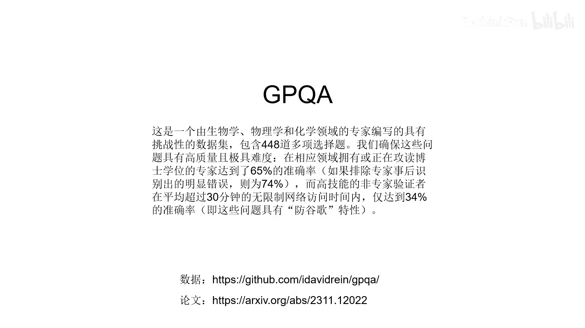
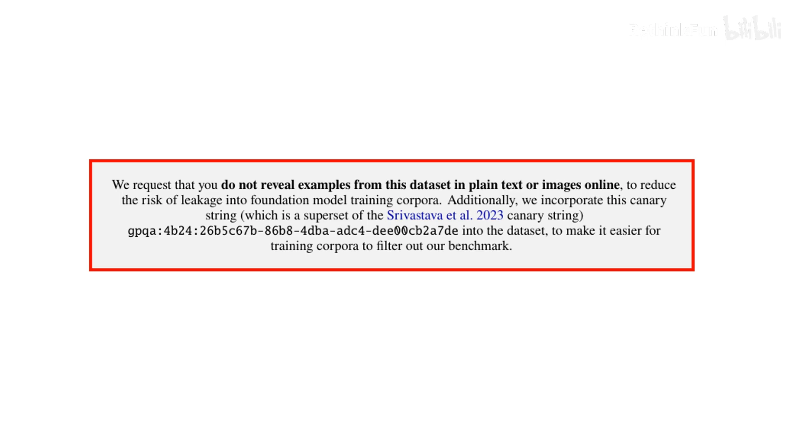

# 如何评价一个大模型：从困惑度到 MMLU、GPQA

> 视频来源：[你知道用什么指标评价一个大模型的好坏吗？PPL，MMLU，MATH，GPQA，BBH，IF-EVAL，MMLU-PRO](https://www.bilibili.com/video/BV1LM4m127wn/)（Bilibili · 09:37）
> 本文基于视频演说图文稿整理，配图截自视频。

## 本讲要解决的核心问题（SCQA）

**背景**：大模型训练完不是直接上线，第一步是测评——但模型输出没有唯一标准答案，"一句话介绍北京"可以有很多种正确说法。

**冲突**：人工逐条判断成本太高、还受个人喜好影响，跟不上迭代节奏。

**疑问**：有哪些能快速计算、稳定复现的测评方法？各大厂商宣传的 MMLU、GPQA 这些指标分别测什么？

**回答（中心思想）**：评价大模型主要有四类方法——**困惑度（PPL）**衡量模型输出分布与测试文本的贴合程度、**人工测评**最真实但成本高、**可解析测评集**让程序自动判分（如 MMLU/IFEval/BBH/MATH/GPQA）、**让大模型当评委**兜底不好量化的任务。PPL 只是第一把尺子，且只反映"像不像测试文本"。 [【跳转到 00:00】](https://www.bilibili.com/video/BV1LM4m127wn/?t=0)

---

## 一、第一把尺子：困惑度（PPL）

### 1.1 从推理过程理解 PPL

回忆一下大模型的推理过程：以"中国的首都是北京"为例，输入句子起始符，模型输出"中"字；输入起始符和"中"字，输出"国"字，以此类推；输入"中国的首都是"，我们希望模型输出"北"字。模型在输出每个字时，实际上会给出字典里**每个字**的概率值——比如"北"字的概率为 0.432。 [【跳转到 00:00】](https://www.bilibili.com/video/BV1LM4m127wn/?t=0)

对整句话就可以计算困惑度：把每个我们期望出现的字当时模型给出的概率值**连乘**，再**开方**（八个字就开八次方），然后**取倒数**。 [【跳转到 00:50】](https://www.bilibili.com/video/BV1LM4m127wn/?t=50)

### 1.2 两模型对比：知识越强，困惑度越低

对比两个模型：第一个模型前面这些字的概率都比较低，但到了"北京"两个字概率很高——因为它根据"中国的首都是"加上自己的知识，推断这里大概率是"北京"。第二个模型内部知识比较差，不知道中国的首都是哪里，"北京"两个字概率也很低。所以第二个模型的困惑度高于第一个。 [【跳转到 01:15】](https://www.bilibili.com/video/BV1LM4m127wn/?t=75)

### 1.3 计算三步拆解：为什么连乘、开方、取倒数

- **概率连乘**：就是联合概率，好理解；
- **为什么开方**：让困惑度不受句子长度的影响——连乘八次就开八次方，把连乘抵消掉；
- **为什么取倒数**：概率连乘表示的是模型的"确信度"，取倒数后就表示"困惑"的程度——困惑度越小，表示模型生成的文本分布和测试文本越一致。 [【跳转到 01:40】](https://www.bilibili.com/video/BV1LM4m127wn/?t=100)

实际计算时用的是"先取对数、再取指数"的公式，看起来多此一举——这是因为很多小概率值连乘会发生数值过小、向下溢出的情况。改为先取对数连加、再取平均、最后取指数，结果一致，只是计算机算起来数值更稳定。 [【跳转到 02:05】](https://www.bilibili.com/video/BV1LM4m127wn/?t=125)

### 1.4 PPL 的局限：只反映"像不像测试文本"

困惑度只能反映模型输出是否**类似**测试文本。比如你训练一个写作模型，测试文本都是网络小说，而模型的写作水平已经达到顶尖作家的水平——其输出分布肯定和网络小说不同，困惑度的值会很高，但此时模型性能却很优秀。 [【跳转到 02:55】](https://www.bilibili.com/video/BV1LM4m127wn/?t=175)

## 二、人工测评：最真实，但贵且主观

第二种方法是人工测评：把不同模型的输出打乱，让测试者选出哪个回答更好，以此决定哪个模型性能更优。但问题是：人力成本太高；而且测试结果受个人喜好影响很大。 [【跳转到 03:20】](https://www.bilibili.com/video/BV1LM4m127wn/?t=200)

## 三、可解析测评集：让程序自动判分

第三种方法是制定**可解析的测评集**：模型输出可以被程序解析、自动判分。最简单的形式是选择题——让模型只能输出 A/B/C/D 中的一个，程序解析答案即可评测。不光是选择题，也可以是其他可解析的结果：比如问大模型"是谁统一了六国"，要求答案必须为人名且以 JSON 格式输出，用程序解析就能做定量评估。 [【跳转到 03:45】](https://www.bilibili.com/video/BV1LM4m127wn/?t=225)

目前用于通用模型能力的公开测评集很多，下面介绍几个最常用、厂商宣传时最常拿出来讲的。 [【跳转到 04:10】](https://www.bilibili.com/video/BV1LM4m127wn/?t=250)

### 3.1 MMLU：57 种学科任务

MMLU 包含人文、社会科学、自然科学里的 **57 种不同任务**——物理题、医学题、税务题、法律题都有。它后来又出了升级版（MMLU-Pro），选项从四个增加到十个，进一步增加了难度——比如一道关于保险理赔的题，选项有十个。 [【跳转到 04:35】](https://www.bilibili.com/video/BV1LM4m127wn/?t=275)

### 3.2 IFEval：指令遵从

IFEval 验证模型的**指令遵从能力**。比如这道题：让模型用非正式的口吻介绍美国的产假制度，写两个部分、最少 25 句话——模型回答后，程序就可以检查回答是否分为两个部分、是否不少于 25 句。再比如：用不带逗号的短句写一首 30 行的诗，每行只包含一个句子、行尾标点正确、回答只能包含这首诗——程序同样可以逐句检查。 [【跳转到 05:25】](https://www.bilibili.com/video/BV1LM4m127wn/?t=325)

### 3.3 BBH：23 种大模型尚未超越人类的任务

BBH 挑选了 **23 种有挑战性的任务**，都是发布时大模型还没有超越人类的任务。举几例感受难度： [【跳转到 06:15】](https://www.bilibili.com/video/BV1LM4m127wn/?t=375)

- **指代问题**："由于他患有罕见的皮肤病，患者被转介给专家。"A. 患者患有皮肤病；B. 专家患有皮肤病；C. 不确定。
- **括号补全**：给出一串括号，模型必须输出一个大括号和一个小括号，才能和前面的括号对称。
- **逻辑推理**：这段代码画出来的是什么图形；一句话里说了多少个物体。 [【跳转到 06:35】](https://www.bilibili.com/video/BV1LM4m127wn/?t=395)

### 3.4 MATH：竞赛数学

数学测试集都是竞赛数学题，每个问题都给出了解决方案和难度等级，判分时看标注的**最终答案**是否正确。 [【跳转到 07:25】](https://www.bilibili.com/video/BV1LM4m127wn/?t=445)

### 3.5 GPQA：博士也只对七成，且严防数据污染

GPQA 就更难了：**相关专业的博士正确率也只有 74%**，而一般人即使可以使用互联网，准确率也只有 34%——也就是说，这些题之前没有在互联网上出现过。为防止题目混进训练数据，数据集打包放在 GitHub 上，论文里请求大家不要把题目以文本或图片的方式暴露到互联网上。 [【跳转到 07:50】](https://www.bilibili.com/video/BV1LM4m127wn/?t=470)

## 四、实测：Llama 3 与千问的表现

看 Llama 3 和千问两个模型在这些测试集上的表现：指令遵从上目前大模型做得还比较好，数学还比较差，而最难的 GPQA 分数就更低了。 [【跳转到 08:15】](https://www.bilibili.com/video/BV1LM4m127wn/?t=495)

## 五、实践建议：自定义测试集 + 让大模型当评委

- 在你自己的项目里，可以**定义自己的可解析测试集**——这是讲者在项目里最常用的方式。 [【跳转到 08:40】](https://www.bilibili.com/video/BV1LM4m127wn/?t=520)
- 对于不好定义可解析测试集的情况（比如训练一个写诗的大模型），可以让**大模型扮演测评人员**。 [【跳转到 08:40】](https://www.bilibili.com/video/BV1LM4m127wn/?t=520)
- 注意：用大模型评价两个模型哪个更好时，最好**打乱被评模型输出的顺序**——有时让 A 放前面、有时让 B 放前面，因为大模型有时更倾向于选择出现在前面的答案。 [【跳转到 09:05】](https://www.bilibili.com/video/BV1LM4m127wn/?t=545)

## 小结

- 评价大模型的四类方法：困惑度、人工测评、可解析测评集、大模型当评委——从全自动到全人工各有取舍。
- PPL = 对每个期望 token 概率连乘 → 开 N 次方 → 取倒数；连乘是联合概率，开方消除长度影响，取倒数把"确信度"变"困惑度"。
- 实际公式"先取对数再取指数"是为了避免小概率连乘的数值下溢，结果不变。
- PPL 只反映"输出分布是否像测试文本"：模型写得太好、和测试集分布不同，PPL 反而会升高。
- 公开基准各有分工：MMLU（57 学科任务）、IFEval（指令遵从）、BBH（23 种困难任务）、MATH（竞赛数学）、GPQA（博士级、防污染）。
- 实测趋势：指令遵从较好，数学较差，GPQA 最低；工程实践中更常用"自定义可解析测试集"，用大模型当评委时要打乱顺序防位置偏好。

## 关键术语速查

| 术语 | 一句话解释 |
| --- | --- |
| 困惑度（PPL） | 期望 token 概率连乘开 N 次方取倒数；越小表示模型分布与测试文本越一致，但只反映"像不像"。 |
| 可解析测评集 | 模型输出可被程序自动判分的测试集（选择题、JSON 格式等）。 |
| MMLU / MMLU-Pro | 57 种学科任务的多选基准；升级版选项从 4 个增至 10 个。 |
| IFEval | 用可机械核验的格式指令（段数、句数、标点）测指令遵从。 |
| BBH | 23 种发布时大模型尚未超越人类的挑战任务（指代、括号补全、逻辑推理等）。 |
| GPQA | 博士级难度基准（博士 74%、普通人+互联网 34%），题目不公开以防训练污染。 |
| LLM 评审 | 让大模型当评委，适合难量化的任务；需打乱顺序以消除位置偏好。 |
