# RFdiffusion 实操：扩散模型"画"出蛋白骨架之后，怎么验收？

> 本文整理自 B 站视频[《深度学习蛋白质设计教程2025最新-使用RFdiffusion进行蛋白质结构和功能的设计实操》](https://www.bilibili.com/video/BV1K5Mjz4EKq/)（生科驿站，约 56 分钟）。视频前半段讲 RFdiffusion 的原理与可控设计能力，后半段带着大家从安装、生成、序列设计到结构验证完整跑一遍，正好回答一个初学者最关心的问题：**模型生成的结构，凭什么敢信？**

## 本讲要解决的核心问题（SCQA）

**背景**：RFdiffusion 这类扩散模型已经成为蛋白质从头设计的旗舰工具——不给任何约束也能生成像模像样的蛋白骨架，给了功能 motif 或靶点还能做可控设计；视频里的 MDM2 binder 设计案例，最好亲和力做到了 0.5 nM。

**冲突**：但扩散模型"画"出来的只是**候选骨架**。它画得好不好、配上序列之后能不能真的折叠成设计的样子，模型自己并不会盖章。如果每个设计都送湿实验验证，一个靶点动辄几千个候选，试错成本根本承受不起。

**疑问**：能不能在计算机里先"验收"一遍，只把高置信度的设计送去合成？

**回答（中心思想）**：靠**回折验证式的置信度过滤**——生成的骨架先用 ProteinMPNN 配序列，再把序列交给 AlphaFold2/ESMFold 重新折叠一遍，用 RMSD（sc-RMSD）、PAE、pLDDT 等指标给设计打分。RFdiffusion 配上 AF2 过滤后，binder 设计的成功率比传统 Rosetta pipeline **高出两个数量级**。这就是"扩散置信度"（如 `plddt_mean`）这类指标的来历。

---

## 一、RFdiffusion 凭什么强：站在 RosettaFold 肩上的扩散模型

### 1.1 对比 hallucination：又准又快

在 RFdiffusion 之前，Baker 实验室从 trRosetta 时代（约 2020 年）就开始用 **hallucination（幻觉法）**做设计：训练好一个结构预测模型后，反复运行它，用蒙特卡洛搜索去搜输入序列，目标是搜出"预测出来很稳定"的序列——序列和结构同时设计。它的思路是"让预测模型自己觉得这个序列能折叠"。

视频把 RFdiffusion 和基于 RosettaFold 的 hallucination 做了对比，指标是 **sc-RMSD**（self-consistency RMSD）：生成的结构设计完序列后，用 AlphaFold2 重新预测一遍，预测结构与原设计结构之间的 RMSD。结论非常一边倒：

- 蛋白越大差距越明显——到 200 个氨基酸，hallucination 生成的结构"基本已经没有什么可折叠性了"；
- 效率也差一个量级：diffusion 推理约 200 次即可，长序列的 hallucination 可能要推理几千次。[【跳转到 03:20】](https://www.bilibili.com/video/BV1K5Mjz4EKq/?t=200)

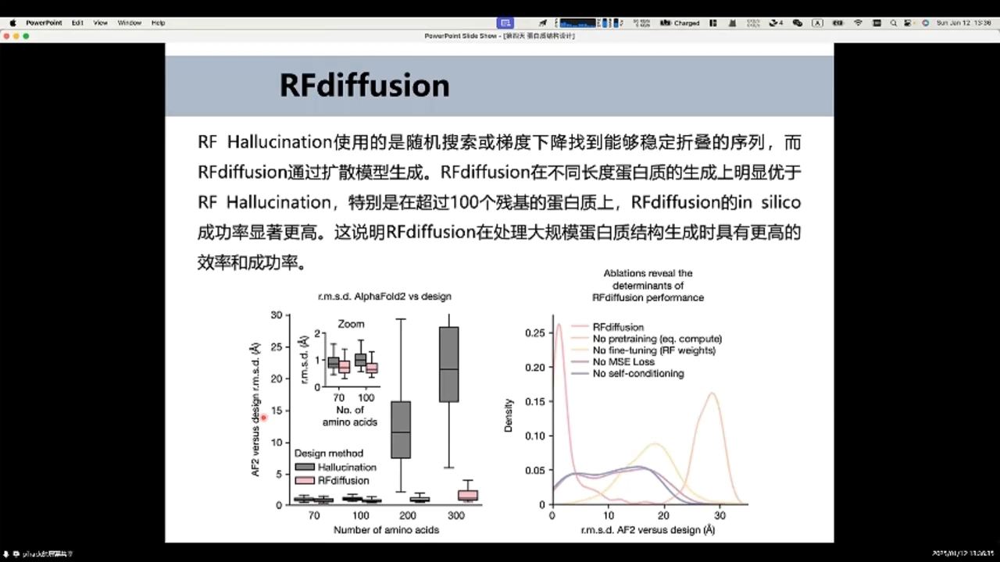

> sc-RMSD 这个指标本身就是"回折验证"：**不是我自夸画得好，而是让独立的结构预测模型来当裁判**。后面所有成功标准都建立在它之上。

### 1.2 消融实验：四个关键组件

机器学习里的**消融实验**就是控制变量，逐个拆掉模块看性能掉多少。RFdiffusion 的拆解结果（横轴为 sc-RMSD，越小越好，分布越靠左越好）：

| 消融项 | 做法 | 结果 |
| --- | --- | --- |
| No pretraining | 不加载 RosettaFold 预训练权重，随机初始化 | 生成能力差，**对 RFdiffusion 影响最大** |
| No finetuning | 拿 RosettaFold 权重直接做 diffusion，不加后训练 | 分布集中在 20 Å 左右，完全不能用 |
| 换损失函数 | 后训练时把 FAPE 换成 MSE loss | MSE 效果更好 |
| 去 self-conditioning | 去掉自条件化机制 | 性能受一定影响 |

[【跳转到 04:35】](https://www.bilibili.com/video/BV1K5Mjz4EKq/?t=275)

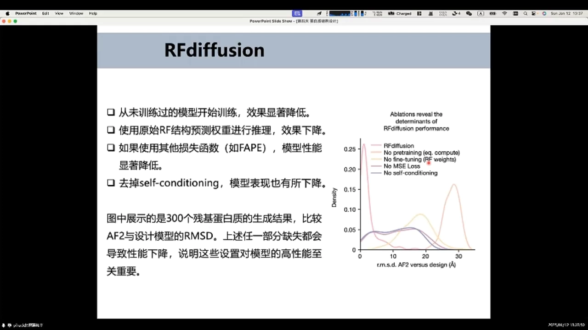

两个细节值得记住：一是 RFdiffusion 的"底座"是结构预测模型 RosettaFold——**先学会预测，再学会生成**，这也是它远胜从零训练的幻觉法的原因；二是 self-conditioning（把上一步预测的 X0 喂回网络）让早期动辄一两千步的 diffusion 压缩到约 200 步，还顺带带来了很多可控性。[【跳转到 05:00】](https://www.bilibili.com/video/BV1K5Mjz4EKq/?t=300)、[【跳转到 06:40】](https://www.bilibili.com/video/BV1K5Mjz4EKq/?t=400)

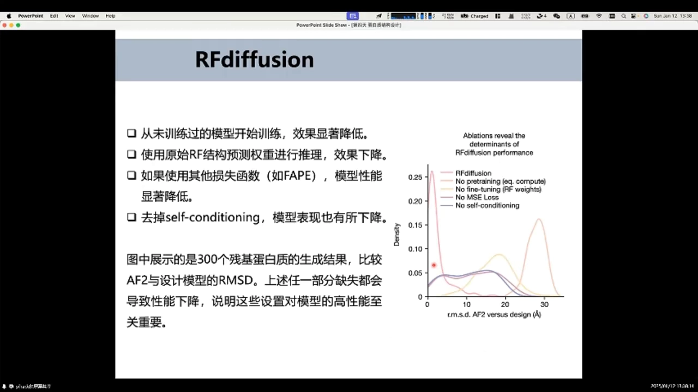

### 1.3 时间步 T：看懂生成过程

实操时终端会一步步打印 timestep（T）：生成就是**反向扩散**——T 从 200 降到 1，每步网络预测"最终样本（X0）应该长什么样"，从纯噪声逐渐显形出正常结构；T=100 时 self-conditioning 就已经基本预测出最终结构了。训练时 T 控制加在原始数据上的噪声幅度：可以理解为"原始数据 + α×噪声"，T 越大 α 越接近 1。[【跳转到 34:46】](https://www.bilibili.com/video/BV1K5Mjz4EKq/?t=2086)

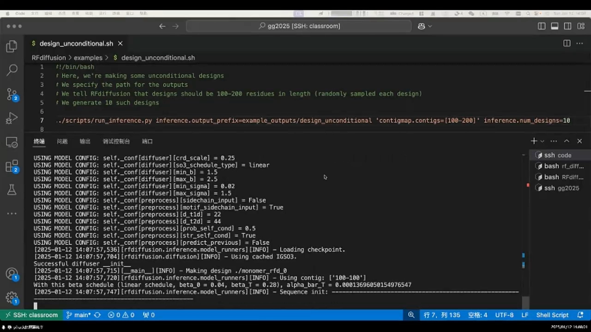

## 二、可控设计：对称结构、motif scaffolding 与 binder

### 2.1 对称结构与实验验证

给不同的对称性约束，RFdiffusion 能生成二聚体、六聚体乃至十个亚基的复合物、球壳状结构。流程是"先生成 → AF2 验证 → 通过后再做实验"：部分设计拿去打冷冻电镜，重构出来的密度图与设计结构大体吻合（清晰度不高、侧链细节看不到，但整体形状对得上）。[【跳转到 07:15】](https://www.bilibili.com/video/BV1K5Mjz4EKq/?t=435)

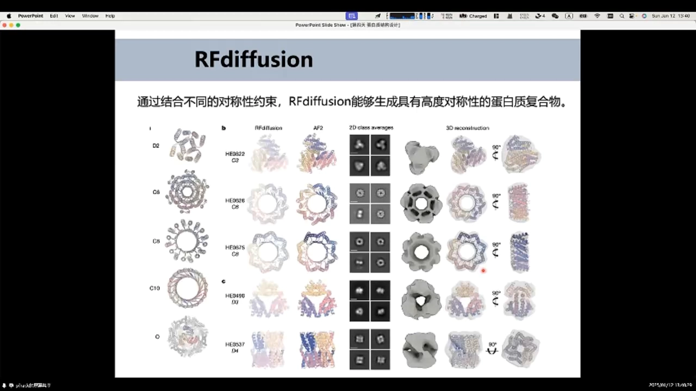

### 2.2 motif scaffolding：从 P53 片段到 MDM2 binder

**motif scaffolding（基序骨架搭建）**：已知一段关键功能 motif（比如 P53 上与 MDM2 结合的表位），让模型在它周围"长出"一个稳定它的骨架。传统工具（如 MaSIF-seed）要先建骨架库再做 motif grafting；RFdiffusion 直接在 motif 周围用 diffusion 生成骨架。

效果有实验背书：设计的 binder 与 MDM2 的结合表面积平均增加 31%；表征的 95 个设计里 55 个能结合 MDM2；亲和力最好的达 **0.5 nM**，而天然 P53 肽片段只有 600 nM——靠的是稳住 motif 之外还"顺手"设计了额外接触区域。[【跳转到 12:34】](https://www.bilibili.com/video/BV1K5Mjz4EKq/?t=754)

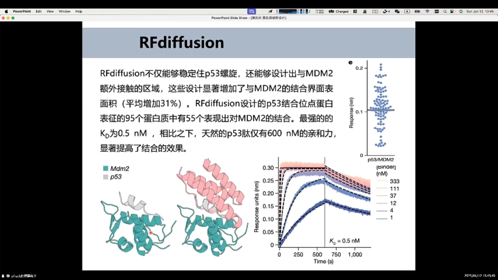

除连续多残基的 motif 外，motif scaffolding 也能处理离散的、只有几个残基的活性位点（酶催化场景要求更苛刻：motif 骨架原子 RMSD<1 Å、全原子<1.5 Å——侧链摆不好，主链再像也没活性），甚至对称排布的 motif：把 ACE2 上的结合片段"拔下来"用蛋白稳住，就能 decoy 新冠 S 蛋白；还有把 Kd 做到极小的镍离子结合位点，用于低浓度环境中富集金属。[【跳转到 14:14】](https://www.bilibili.com/video/BV1K5Mjz4EKq/?t=854)、[【跳转到 15:29】](https://www.bilibili.com/video/BV1K5Mjz4EKq/?t=929)

## 三、扩散置信度：in silico 成功标准（本讲核心）

### 3.1 motif scaffolding 的三重阈值

湿实验太贵，论文里先看 **in silico success rate**。"成功"由三个阈值共同定义：

1. AF2 预测结构与设计模型的**整体 RMSD < 2 Å**；
2. 功能 motif 的**主链原子 RMSD < 1 Å**（酶场景再加全原子 < 1.5 Å）；
3. AF2 的 **PAE < 5**（PAE 衡量两个残基之间相对位置的预测误差，越低越好）。[【跳转到 08:35】](https://www.bilibili.com/video/BV1K5Mjz4EKq/?t=515)、[【跳转到 09:00】](https://www.bilibili.com/video/BV1K5Mjz4EKq/?t=540)

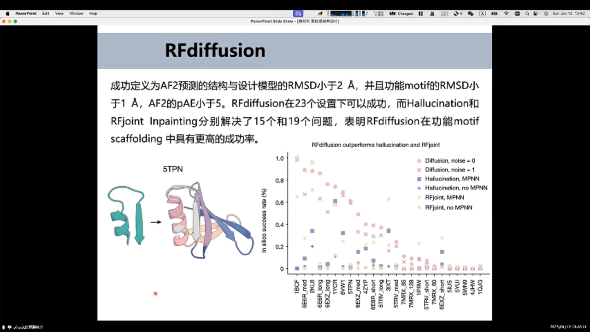

### 3.2 binder 设计："生成 + AF2 过滤"把成功率拉高两个数量级

binder 设计的流程图值得逐帧看：给定**靶标结构**并标出**热点残基（hotspot）**，在 hotspot 附近撒噪声，噪声经过 diffusion 一步步变成能结合靶标的 binder；设计出的序列再用酵母表面展示等方法实测。[【跳转到 18:38】](https://www.bilibili.com/video/BV1K5Mjz4EKq/?t=1118)

关键数字在这里：多个受体的实验中，**"RFdiffusion 生成 + AF2 过滤"这套组合的成功率是百分之几到百分之几十，而传统 Rosetta pipeline 只有千分之几**——提升两个数量级。换句话说，"扩散模型生成候选 + 结构预测模型回折打分"的置信度过滤，正是现代蛋白设计能省钱省到现在的核心竞争力。[【跳转到 19:28】](https://www.bilibili.com/video/BV1K5Mjz4EKq/?t=1168)

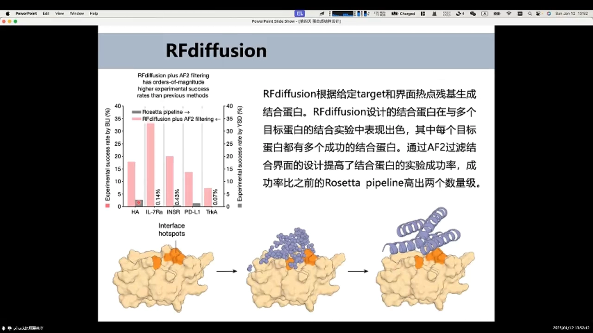

> **背景补充**：在各类管线与配置文件里，这套回折验证的打分常被固化成一个字段——比如 RFdiffusion binder 分析里常见的 `plddt_mean`（AF2 回折预测的逐残基 pLDDT 均值，pLDDT>90 为高置信）。视频本身讲的是 RMSD/PAE 阈值，但它们与 pLDDT 同属一个指标家族：都是"让预测模型给设计打分"的扩散置信度。

## 四、上手实操：从生成到验收的完整闭环

### 4.1 无条件（unconditional）生成

安装三步：拉取 RFdiffusion 仓库；下载权重（`.pt` 文件，不同任务有不同微调版本，如 `Inference_complex_base`；官方链接慢时可用备份）；用仓库自带的 `env/SE3nv.yml` 创建 conda 环境。[【跳转到 20:00】](https://www.bilibili.com/video/BV1K5Mjz4EKq/?t=1200)

然后手写一个最简单的脚本跑 unconditional 生成：

- `inference.output_prefix`：输出前缀（建议带上目录名，否则文件会散在当前目录）；
- `contigmap.contigs=100-100`：两端数字相同的区间 = 固定长度，这里生成 100 个氨基酸；
- `inference.num_designs=3`：生成 3 个设计。

输出三类文件：`.pdb`（标准结构文件，注意 RFdiffusion 生成的主链全用甘氨酸 G）；`.trb`（二进制的元信息文件）；`trajectory/` 目录——里面的 `pX0` 是**每一步最后预测的 X0**（"我觉得最终会长这样"），`Xt-1` 是**每一步真实的扩散状态**，两者合起来就是完整的生成轨迹。[【跳转到 39:13】](https://www.bilibili.com/video/BV1K5Mjz4EKq/?t=2353)

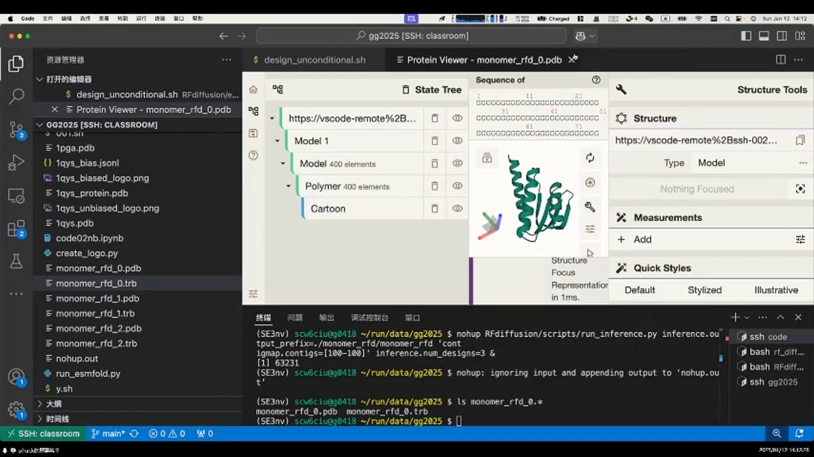

把 `pX0` 序列导入 PyMOL 就是生成动画：默认播放是"结构→噪声"的反向顺序，用 `set_state_order` 把帧序反转（如 `50~0`）就能看到"噪声→结构"的正向生成过程；再配合 `set movie` 降帧率，一帧一帧看得更清楚。[【跳转到 41:22】](https://www.bilibili.com/video/BV1K5Mjz4EKq/?t=2482)

### 4.2 ProteinMPNN 配序列 + ESMFold 回折验证

骨架只是"房型"，还要"装修"——用 **ProteinMPNN** 给骨架配序列：`protein_mpnn_run` 传入 PDB 路径、链 ID（这里只有 A 链）、输出目录，设计 8 条序列并设置 sampling temperature（注意 `--score_only` 是打分用的，设计时不要加）。[【跳转到 50:05】](https://www.bilibili.com/video/BV1K5Mjz4EKq/?t=3005)

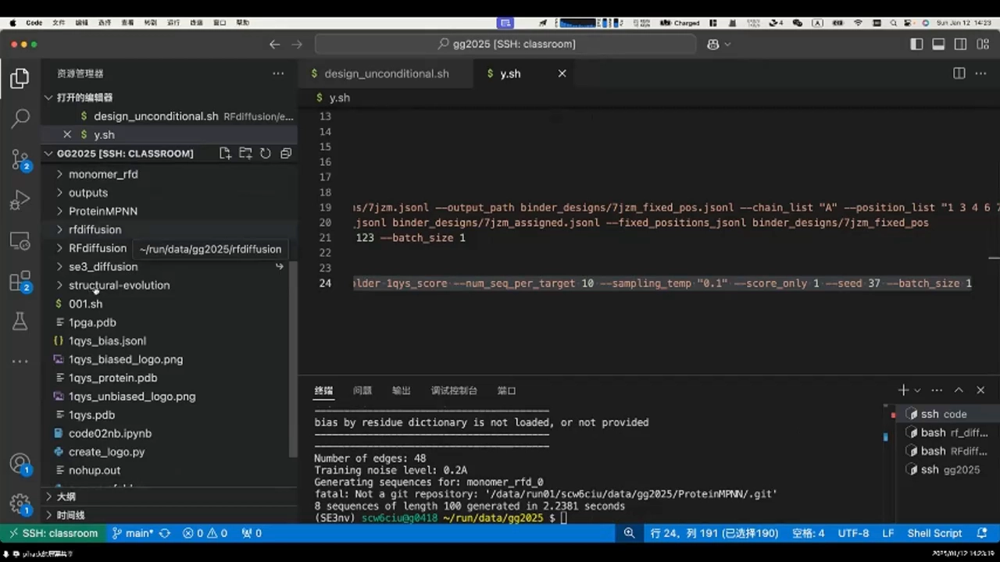

然后验收：把分数最低的设计（0405）丢给 **ESMFold**（在线版，比 AF2 快）重折叠，再与设计模板比对——**RMSD 只有 0.7 Å**，说明这个设计可折叠性非常好。视频顺带演示了用神经网络预测口袋：直接"看"是看不出口袋的，但预测出的黄色区域确实有点像口袋——不过讲者也提醒，直接生成的蛋白常常缺乏口袋，这是后续应用要面对的问题。[【跳转到 51:53】](https://www.bilibili.com/video/BV1K5Mjz4EKq/?t=3113)

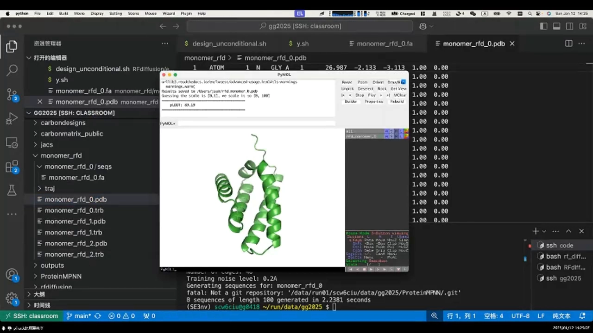

### 4.3 sc-RMSD 流程总结与新颖性检查

视频把这套验收流程画成了闭环：**骨架 → ProteinMPNN 配序列 → ESMFold/AF2 重折叠 → 与设计模板算 RMSD**——这就是 sc-RMSD。[【跳转到 53:59】](https://www.bilibili.com/video/BV1K5Mjz4EKq/?t=3239)

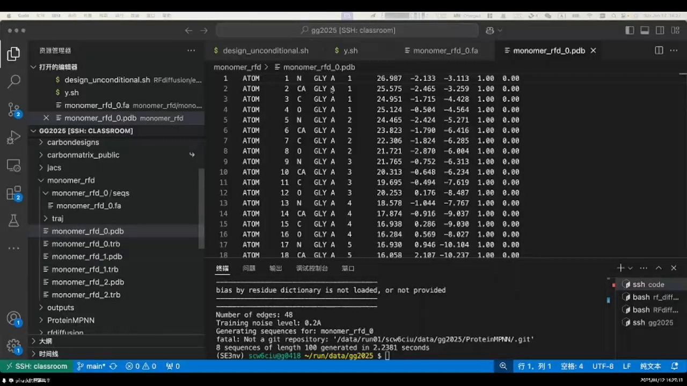

最后一步是查"新不新"：把结构丢进 **Foldseek**，选 `pdb100` 数据库比对，用 TM-score 衡量与已知结构的相似度——分数不高说明折叠比较新颖，不是抄天然蛋白的旧作业。[【跳转到 55:29】](https://www.bilibili.com/video/BV1K5Mjz4EKq/?t=3329)

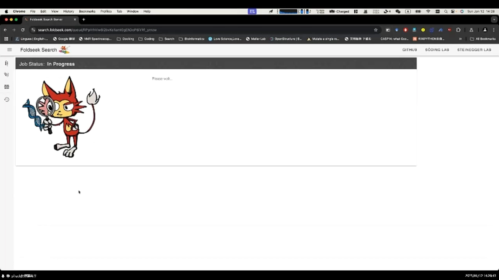

## 小结

- RFdiffusion = RosettaFold（结构预测）改造成的扩散生成模型；消融显示预训练权重、后训练、MSE 损失、self-conditioning 四件套缺一不可。
- 生成 = 反向扩散：T 从 200 降到 1，网络每步预测 X0，逐步从噪声显形出结构。
- 可控能力覆盖对称复合物、motif scaffolding（连续/离散/对称）与 binder 设计；MDM2 案例做到了 0.5 nM，比天然 P53 肽强 1000 倍。
- **设计能不能信，靠回折验证的置信度过滤**：motif 场景要求整体 RMSD<2 Å、motif<1 Å、PAE<5；binder 场景"RFdiffusion+AF2 过滤"把成功率从千分之几拉到百分之几到几十。
- 实操闭环：unconditional 生成（contigmap 定长、num_designs 定个数、trajectory 看过程）→ ProteinMPNN 配序列 → ESMFold/AF2 重折叠算 RMSD（0.7 Å 优秀）→ Foldseek 查新颖性。
- 这套"生成候选 + 独立裁判打分"的思路，正是 `plddt_mean`、`position_confidence` 等扩散置信度指标的共同出身；下一篇 DiffDock 会看到同样的配方如何用在分子对接上。

## 关键术语速查

| 术语 | 一句话解释 |
| --- | --- |
| RFdiffusion | 把结构预测模型 RosettaFold 微调成扩散生成模型，用于蛋白骨架从头设计 |
| hallucination（幻觉法） | 反复跑结构预测模型+搜索序列，直到预测出稳定结构；慢且大蛋白易失败 |
| sc-RMSD | 设计结构经"配序列→重折叠"后与原设计之间的 RMSD，衡量设计自洽性 |
| self-conditioning | 把上一步的 X0 预测喂回网络，加速收敛、缩短 diffusion 步数 |
| timestep（T） | 扩散的时间步；训练时控制加噪幅度，推理时从大到小逐步去噪 |
| X0 / pX0 / Xt-1 | X0=对最终结构的预测；pX0=每步的 X0 预测；Xt-1=每步的真实扩散状态 |
| contigmap | RFdiffusion 定义链长/组件布局的参数，`100-100` 表示固定 100 残基 |
| motif scaffolding | 围绕已知功能基序生成稳定它的骨架 |
| hotspot（热点残基） | 靶标上预计承担主要结合能的残基，binder 设计的起点 |
| PAE | 预测对齐误差，衡量残基对之间相对位置的预测置信度，越低越好 |
| pLDDT / plddt_mean | AF2 逐残基置信度（0–100，>90 高置信）；其均值常作为设计过滤分数 |
| ProteinMPNN | 给定骨架逆折叠出氨基酸序列的工具 |
| Foldseek / TM-score | 结构快速比对工具与相似度分数；对 pdb100 比对可评估设计新颖性 |
