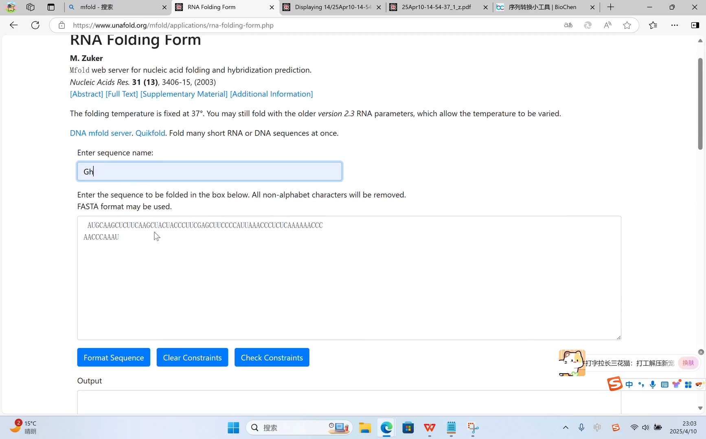
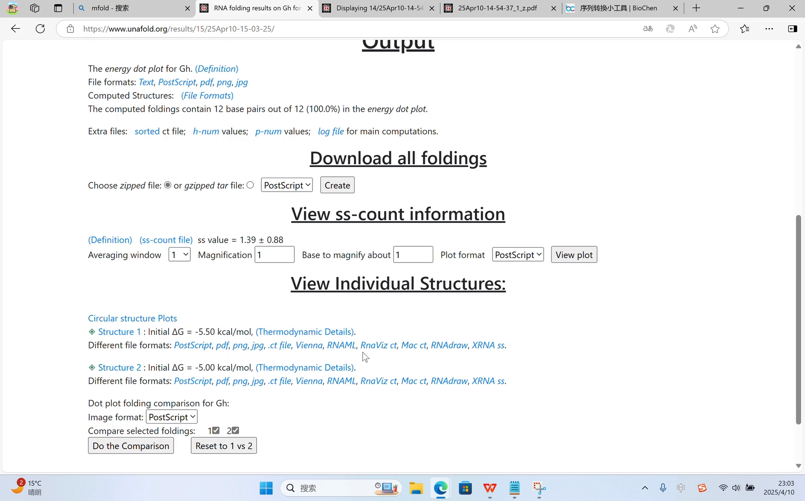
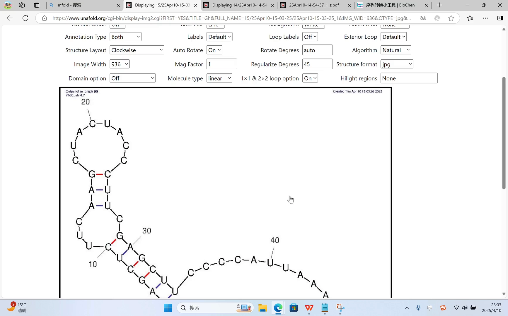
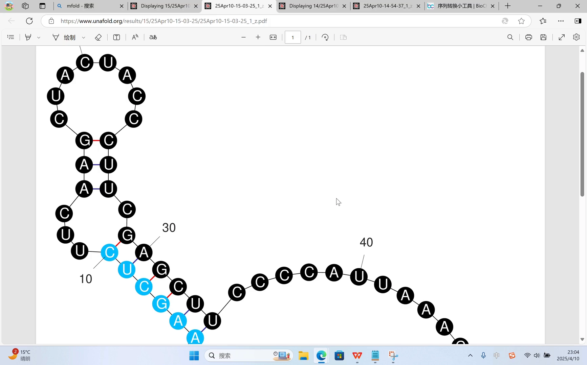
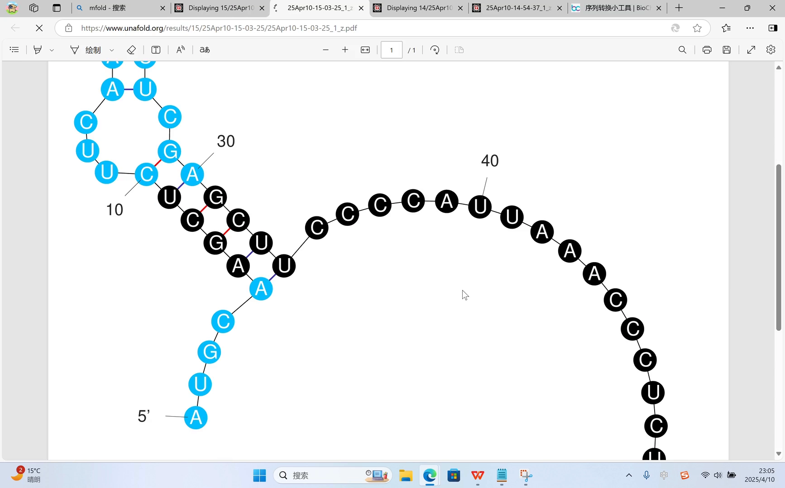
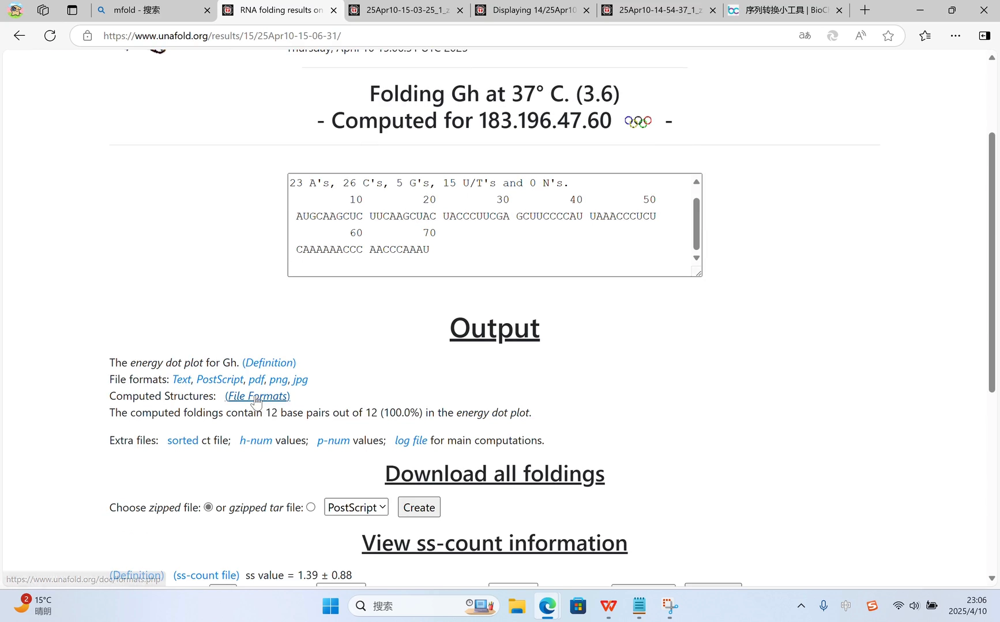

# 用 mfold 预测 RNA 二级结构：一次基于最小自由能的完整实操

> 来源视频：[RNA二级结构的预测](https://www.bilibili.com/video/BV1Tmd5YYEGB)（4:51，UP 主：三三的宝子）。本文基于视频字幕与屏幕演示整理，每一步操作附时间戳，可对照网站实操核对。

## 本篇要解决的核心问题（SCQA）

**背景**：RNA 二级结构的预测有成熟的算法原理——稳定结构的判据是**最小自由能（MFE）**，可用动态规划求最优折叠（算法原理见同目录《[【屈婉玲教授 ｜ 算法设计与分析】06-06 RNA二级结构预测](./【屈婉玲教授 ｜ 算法设计与分析】06-06 RNA二级结构预测.md)》）。

**冲突**：原理归原理，实际做研究时手里往往只有一段 DNA 序列，不可能每个人都自己实现一遍算法，只想马上看到那条链折出来的样子。

**疑问**：有没有现成的网站，把序列贴进去就能出结构图？

**回答（中心思想）**：有——**mfold** 官网。贴入 RNA 序列、点击 format sequence，网站就会输出**基于最小自由能预测**的结构图（还会给出多种候选）；图支持高亮标注、环状分割、ss-count 统计等处理，并能导出 ct file 等格式到其他软件继续加工。

## 一、准备序列：先把 DNA 转成 RNA

如果你拿到的是一段 DNA 序列，第一步是把它转换成 RNA 序列 [【跳转到 00:17】](https://www.bilibili.com/video/BV1Tmd5YYEGB/?t=17)。做法很简单：把序列复制出来，用一个转换网站即可完成（视频中使用的是序列格式转换网站） [【跳转到 00:27】](https://www.bilibili.com/video/BV1Tmd5YYEGB/?t=27)。

转换完成后，把 RNA 序列复制好，就可以去 mfold 的官网了 [【跳转到 00:43】](https://www.bilibili.com/video/BV1Tmd5YYEGB/?t=43)。

## 二、提交预测：贴序列 → 命名 → format sequence

在 mfold 官网上 [【跳转到 00:49】](https://www.bilibili.com/video/BV1Tmd5YYEGB/?t=49)：

1. 点击 **mfold**，进入 **applications** 里的 **RNA 二级结构预测**；
2. 把刚才的 RNA 序列粘贴进来，并给序列起一个名字；
3. 点击 **format sequence**。

页面下方的参数**暂时不用改**，先看默认设置下它预测的结果 [【跳转到 01:07】](https://www.bilibili.com/video/BV1Tmd5YYEGB/?t=67)。

## 三、读结果：两种 MFE 结构，PDF / JPG 任选

结果页会显示**两种结果**——"这两种结果都是基于最小自由能去预测出来的、一个它可能的二级结构" [【跳转到 01:25】](https://www.bilibili.com/video/BV1Tmd5YYEGB/?t=85)。也就是说，自由能最优的折叠未必唯一，mfold 会把多个候选都给出来。

图片格式可以选 PDF 或 JPG，PDF 更清晰一些；这里先看 JPG 格式 [【跳转到 01:25】](https://www.bilibili.com/video/BV1Tmd5YYEGB/?t=85)，点开后就是预测出来的 RNA 二级结构图 [【跳转到 01:55】](https://www.bilibili.com/video/BV1Tmd5YYEGB/?t=115)。

## 四、按需美化：高亮、环状分割、ss-count、label

### 4.1 高亮一段序列

想把某一段序列标注出来，可以加**高亮** [【跳转到 01:55】](https://www.bilibili.com/video/BV1Tmd5YYEGB/?t=115)。比如把第 1 到第 10 位高亮，然后点击图片，它就会按你设置的参数重新生成 [【跳转到 02:27】](https://www.bilibili.com/video/BV1Tmd5YYEGB/?t=147)。得到的就是第 1~10 个核苷酸被高亮标注的图 [【跳转到 02:37】](https://www.bilibili.com/video/BV1Tmd5YYEGB/?t=157)。

### 4.2 环状分割图

还可以根据结构的环状特点，把它**分割**成另一种展示形式的图 [【跳转到 02:52】](https://www.bilibili.com/video/BV1Tmd5YYEGB/?t=172)。分段范围可以自己改，比如第 1~5、第 10~20、第 10~30，再点一下，这些区域就会被高亮出来 [【跳转到 03:29】](https://www.bilibili.com/video/BV1Tmd5YYEGB/?t=209)。

### 4.3 ss-count 统计图

选择 **ss-count** 选项后，它会生成另一种统计性的图 [【跳转到 03:29】](https://www.bilibili.com/video/BV1Tmd5YYEGB/?t=209)。

### 4.4 label 与其他参数

其他设置里的 **label** 控制的是每隔多少个核苷酸标一个序号，可以根据序列长度修改数值 [【跳转到 03:49】](https://www.bilibili.com/video/BV1Tmd5YYEGB/?t=229)。其余参数建议不要动——默认生成的图已经够用了 [【跳转到 04:09】](https://www.bilibili.com/video/BV1Tmd5YYEGB/?t=249)。

## 五、导出：ct file 拿到别的软件继续改

如果想在别的软件里进一步修改这张图，可以下载其他格式——比如 **ct file** 格式，它在其他软件里可以打开、继续编辑 [【跳转到 04:31】](https://www.bilibili.com/video/BV1Tmd5YYEGB/?t=271)。用这个网站做出来的图就是最终的样子 [【跳转到 04:44】](https://www.bilibili.com/video/BV1Tmd5YYEGB/?t=284)。

## 小结

- **一条流水线**：DNA 序列 → 转成 RNA → mfold 官网 → format sequence → 结构图。
- **原理落位**：mfold 输出的是**基于最小自由能（MFE）**的预测结构，且会给出多种候选——这正是 Zuker 算法的经典网页实现。
- **结果可加工**：高亮某段序列、环状分割、ss-count、label 间距都可调。
- **格式可迁移**：下载 PDF/JPG 直接用；要深加工就导出 ct file 到其他软件。

## 关键术语速查

| 术语 | 一句话解释 |
| --- | --- |
| mfold | Zuker 开发的经典 RNA 二级结构预测网站，按最小自由能预测 |
| MFE（最小自由能） | 稳定结构的判据：自由能越低越稳定；mfold 以此输出候选结构 |
| format sequence | mfold 提交序列的按钮，先对输入序列做格式化处理 |
| 高亮（highlight） | 把指定区段的核苷酸在结构图上标色 |
| ss-count | 对预测结果做逐位点统计的选项，生成统计图 |
| ct file | 记录碱基配对关系的文本格式，可导入其他软件继续编辑 |
