# 屈婉玲《算法设计与分析》06-06：RNA 二级结构预测——把"折叠"变成一道动态规划题

> 来源视频：[【屈婉玲教授 | 算法设计与分析】06-06 RNA二级结构预测](https://www.bilibili.com/video/BV1MKTJziEde)（12:59，北京大学《算法设计与分析》课程 06-06 讲）。本文严格基于视频字幕与幻灯片整理，关键内容均附时间戳，可回看核对。

## 本讲要解决的核心问题（SCQA）

**背景**：RNA 的一级结构是一条由 A、U、C、G 四种碱基串起来的长链。在真实环境里，这条链不会伸直躺着——链上不相邻的碱基会两两配对，把链折叠成带"臂"和"环"的二级结构。

**冲突**：要知道它折叠成什么样，传统办法是做生化检测——可行，但费时费力。而手里明明已经有完整的序列，折叠规则又有据可循。

**疑问**：能不能只凭一条序列，用算法把二级结构直接算出来？

**回答（中心思想）**：可以。先把"结构稳定"翻译成数学目标——真实生物判据是**最小自由能（MFE）**，课堂模型把它简化为"**配对数最多**"；在四条配对规则的约束下，用**动态规划**按"最后一个碱基 j 配不配对"把大问题拆成子问题、列递推方程、自底向上填表，就能在 **O(N³)** 时间内求出最优结构。

---

## 一、问题定义：输入一条序列，输出一张折叠平面图

### 1.1 一级结构为什么要折叠

RNA 的一级结构是一条长链，由 A、U、C、G 这样的碱基组成 [【跳转到 00:14】](https://www.bilibili.com/video/BV1MKTJziEde/?t=14)。但这样一条完全伸展的长链，"在实际当中是不能存在的"——它需要折叠成二级结构 [【跳转到 00:34】](https://www.bilibili.com/video/BV1MKTJziEde/?t=34)。


折叠的方式是：链上位置对应的碱基相互匹配，配对后结合到一起，形成一段连续的**臂（stem）** [【跳转到 00:53】](https://www.bilibili.com/video/BV1MKTJziEde/?t=53)。整条序列折叠的结果，就是一个带若干个臂的二级结构 [【跳转到 01:01】](https://www.bilibili.com/video/BV1MKTJziEde/?t=61)。

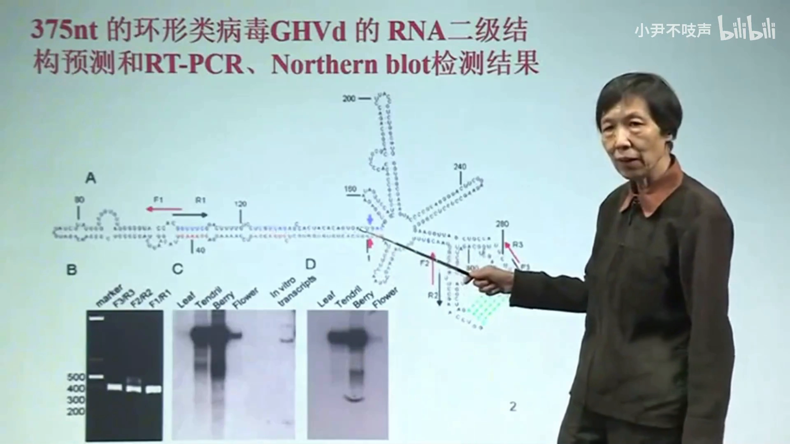

### 1.2 形式化的输入与输出

把问题形式化 [【跳转到 02:02】](https://www.bilibili.com/video/BV1MKTJziEde/?t=122)：

- **输入**：一个一级结构——用 A、C、G、U 标记的核酸序列，排列顺序给定；
- **输出**：折叠后的平面图——序列按顺序排好、全部碱基都在图里，配对的碱基之间用弧线连起来，标明"谁和谁匹配"。

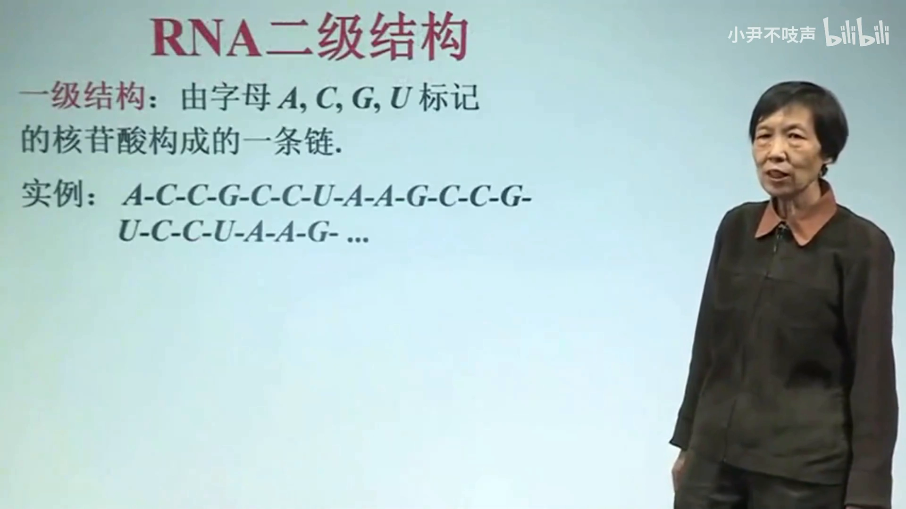

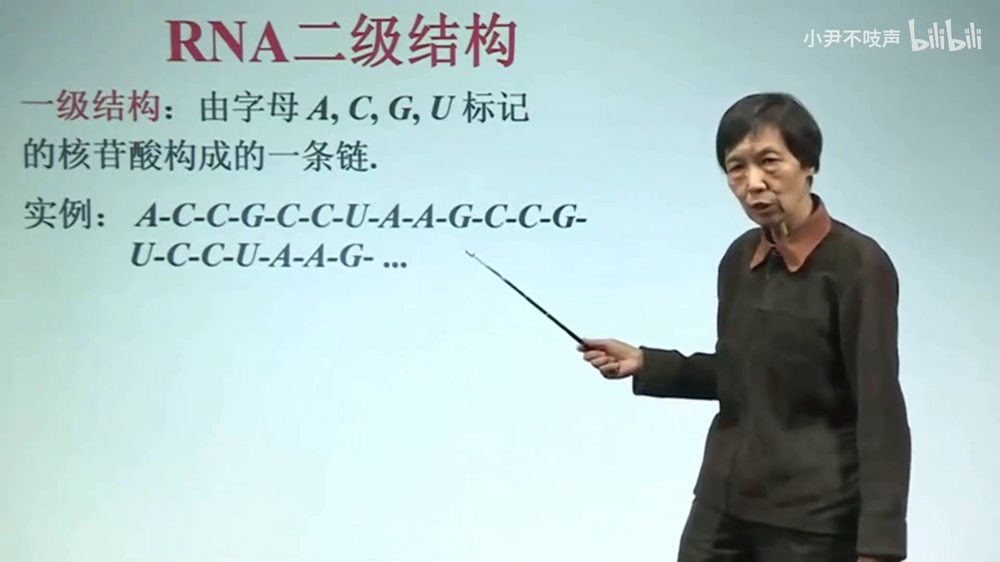

这样的算法在实际中确实可用：下面就是实际预测的结果 [【跳转到 01:40】](https://www.bilibili.com/video/BV1MKTJziEde/?t=100)。预测出结构后，还可以用生化的办法检测它实际是不是这个结构 [【跳转到 01:45】](https://www.bilibili.com/video/BV1MKTJziEde/?t=105)。


---

## 二、折叠必须遵守的四条配对规则

折叠不是随便配。讲义给出四条规则 [【跳转到 03:04】](https://www.bilibili.com/video/BV1MKTJziEde/?t=184)：

### 2.1 规则一：只有 U–A、C–G 能配

"配对按照生物学的性质，只能是 U 和 A 配对、C 和 G 配对；U 和 C、A 和 G 是不能配对的" [【跳转到 03:10】](https://www.bilibili.com/video/BV1MKTJziEde/?t=190)。也就是说模型只认 Watson-Crick 式的标准配对。

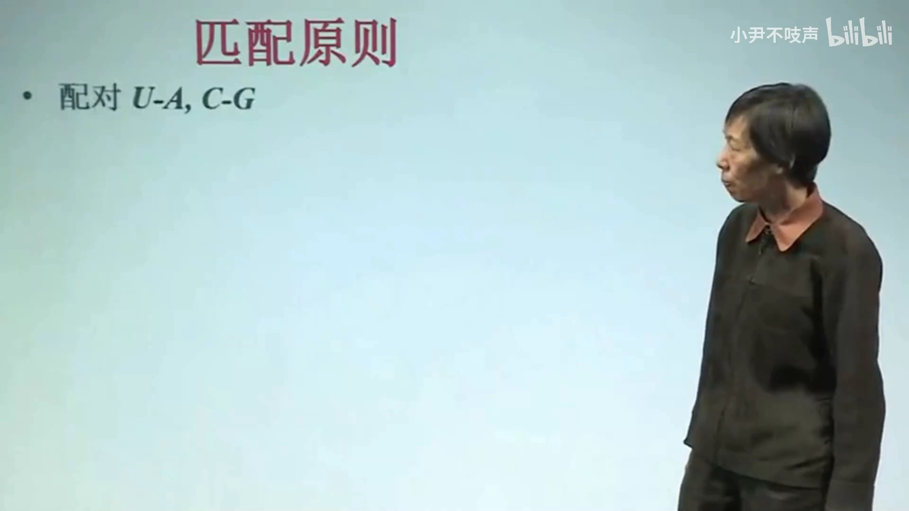

### 2.2 规则二：环不能太小

看从 i 到 j 的一段：如果首尾两个碱基 i、j 配对，中间至少要含有三个元素——三个、四个、五个都可以；只隔一个或两个元素是不允许的 [【跳转到 03:30】](https://www.bilibili.com/video/BV1MKTJziEde/?t=210)。头上这个环不能太小。写成式子就是 **j−4 ≥ i**，即 i、j 之间至少间隔三个碱基 [【跳转到 03:55】](https://www.bilibili.com/video/BV1MKTJziEde/?t=235)。

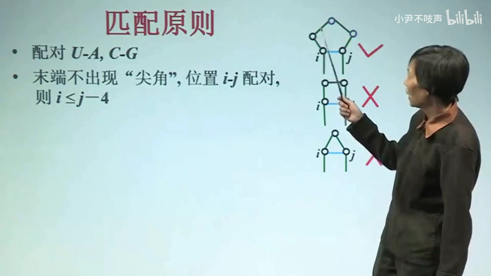

### 2.3 规则三：一个碱基至多参与一个配对

"每个核苷酸只能参与一个配对"——一个碱基既和这个配又和那个配，不允许 [【跳转到 04:05】](https://www.bilibili.com/video/BV1MKTJziEde/?t=245)。

### 2.4 规则四：不允许交叉

平行的配对是允许的——"这样的平行配对正好体现在一条臂上，都是连续的平行配对" [【跳转到 04:19】](https://www.bilibili.com/video/BV1MKTJziEde/?t=259)；但两条配对弧一交叉就不允许了 [【跳转到 04:24】](https://www.bilibili.com/video/BV1MKTJziEde/?t=264)。这条规则在文献里对应"不含假结（pseudoknot）"的假设，也是后面动态规划能成立的关键——正因为不交叉，配对弧才能把链切成互不干扰的子段。


## 三、配对弧拼出的三种基本元件

满足上述规则的折叠，结构上就由几类元件拼成：

- **臂（stem）**：一段连续的平行配对 [【跳转到 04:40】](https://www.bilibili.com/video/BV1MKTJziEde/?t=280)；
- **发夹环（hairpin loop）**：臂的顶端拐回来的那个环 [【跳转到 04:45】](https://www.bilibili.com/video/BV1MKTJziEde/?t=285)；
- **内环（interior loop）**：臂中间鼓出来的小环，两侧各接着一条臂 [【跳转到 04:50】](https://www.bilibili.com/video/BV1MKTJziEde/?t=290)。

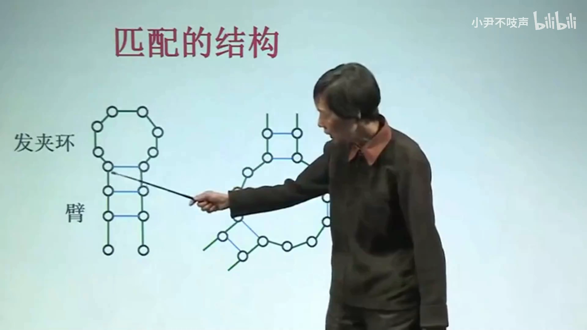

## 四、什么样的结构算"好"？最小自由能，课堂模型简化为配对数最多

给定一条 RNA 链（一级结构），要预测它"可能的、稳定的"二级结构。**稳定在生物学上的条件就是：具有最小的自由能（MFE）** [【跳转到 05:12】](https://www.bilibili.com/video/BV1MKTJziEde/?t=312)——自由能越低，结构越稳定。

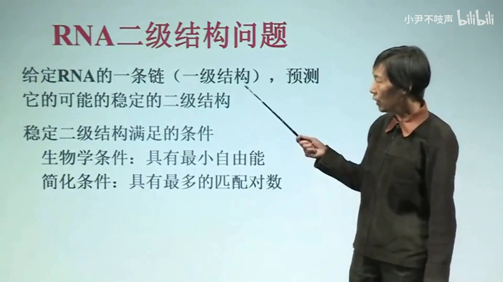

直接把能量模型塞进课堂算法太复杂，于是建立一个**简化的数学模型**：希望匹配的对数达到最多，认为这时结构是稳定的 [【跳转到 05:29】](https://www.bilibili.com/video/BV1MKTJziEde/?t=329)。于是问题变成：

> 给定一条 RNA 链（一级结构），求**配对数最多**的二级结构（最优结构）。采取什么样的匹配方法使配对数最大，那个结构就是问题的解。[【跳转到 05:45】](https://www.bilibili.com/video/BV1MKTJziEde/?t=345)


> 💡 注意这一步的分量：真实的 Zuker / RNAfold 一系方法就是把"配对数最多"换回"自由能最小"（按 Turner 能量参数逐对计分），而"分解成子问题 + 递推"的骨架完全一样。课堂模型是理解 RNAfold 的最短入口。

---

## 五、动态规划建模：从"最后一个碱基 j 配不配对"出发

### 5.1 子问题的边界：i 和 j

动态规划第一步是界定子问题。对这条链来说，一段子链的边界由它的首位置和末位置决定：前边界 i、后边界 j [【跳转到 06:06】](https://www.bilibili.com/video/BV1MKTJziEde/?t=366)。于是"i 到 j 这段链的最优折叠"就是子问题，原始问题就是 i=1、j=N 的特例 [【跳转到 06:27】](https://www.bilibili.com/video/BV1MKTJziEde/?t=387)。

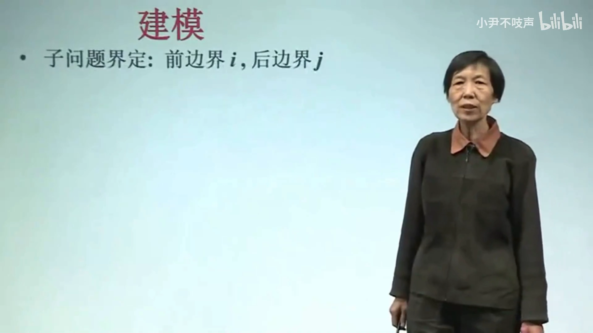

### 5.2 归约：看 j 的两种归宿

怎么把 i–j 的大问题归约成更小的子问题？考察**最后一个碱基 j**，它只有两种可能 [【跳转到 06:37】](https://www.bilibili.com/video/BV1MKTJziEde/?t=397)：

**情况一：j 和某个第 k 位的碱基配对**（k 满足配对规则，i ≤ k ≤ j−4）。由于不允许交叉 [【跳转到 07:00】](https://www.bilibili.com/video/BV1MKTJziEde/?t=420)，这条配对弧把链切成两段互不干扰的区域：k 左边（i 到 k−1）自己内部配对，k 和 j 右边内侧（k+1 到 j−1）自己内部配对 [【跳转到 07:34】](https://www.bilibili.com/video/BV1MKTJziEde/?t=454)。于是产生**两个子问题**。

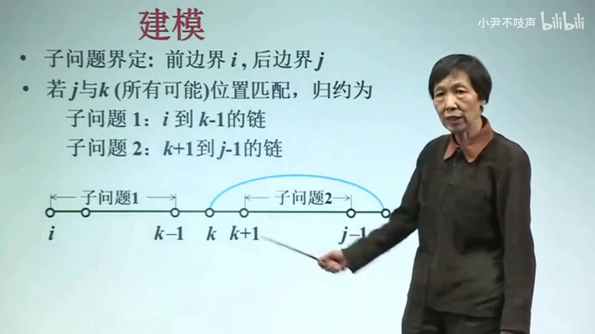

**情况二：j 不参与任何配对**。那就把它"拿掉"，i 到 j 的匹配问题归结为 i 到 j−1 的子问题，长度少一 [【跳转到 07:50】](https://www.bilibili.com/video/BV1MKTJziEde/?t=470)。

### 5.3 递推方程与初值

把 i 到 j 的序列记作 S(i,j)，其最大配对数记作优化函数 **C(i,j)** [【跳转到 08:22】](https://www.bilibili.com/video/BV1MKTJziEde/?t=502)。按上面两种情况写出递推 [【跳转到 08:38】](https://www.bilibili.com/video/BV1MKTJziEde/?t=518)：

- j 不配对：C(i,j) = C(i, j−1)；
- j 与第 k 位配对：C(i,j) = C(i, k−1) + C(k+1, j−1) + 1，其中"+1"就是 j–k 这一对他本身 [【跳转到 08:53】](https://www.bilibili.com/video/BV1MKTJziEde/?t=533)；
- k 有多种选择时，取所有满足配对规则的 k 中**最大**的那个 [【跳转到 09:23】](https://www.bilibili.com/video/BV1MKTJziEde/?t=563)：k 的范围从 i 到 j−4 [【跳转到 09:28】](https://www.bilibili.com/video/BV1MKTJziEde/?t=568)。

合起来：

```
C(i,j) = max{ C(i,j-1),  max_{i ≤ k ≤ j-4, S[k] 与 S[j] 可配对} [ C(i,k-1) + C(k+1,j-1) + 1 ] }
```

**初值**：j−i < 4 时（距离不足，中间放不下三个碱基），不能配对，C(i,j) = 0 [【跳转到 09:55】](https://www.bilibili.com/video/BV1MKTJziEde/?t=595)。

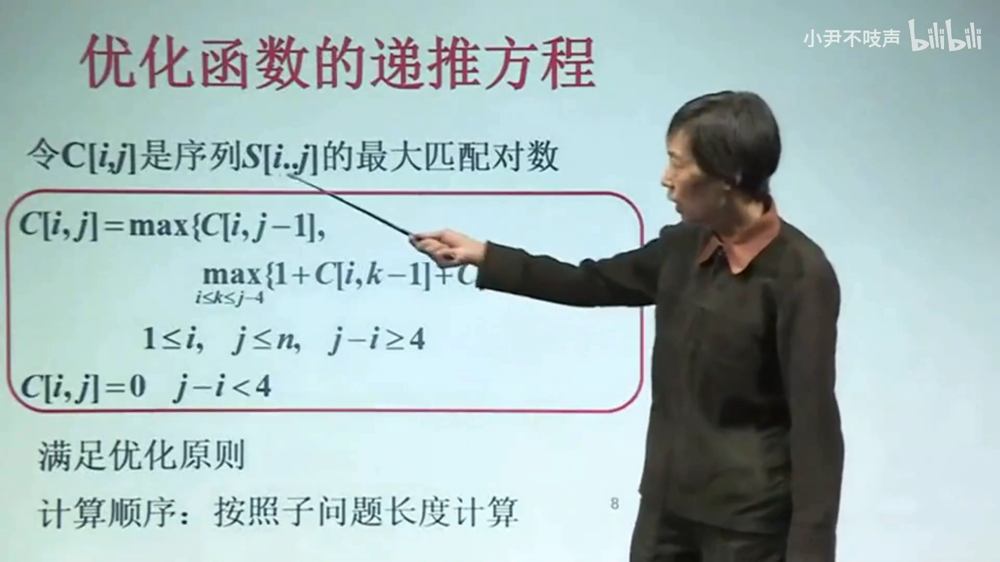

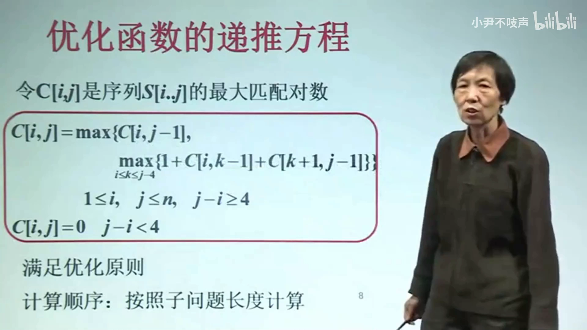

这个问题满足优化原则（最优子结构），计算顺序按**子问题长度从小到大**自底向上迭代即可 [【跳转到 10:15】](https://www.bilibili.com/video/BV1MKTJziEde/?t=615)。

### 5.4 复杂度：O(N³)

- i、j 的组合有 **N²** 种，即子问题个数 O(N²) [【跳转到 10:27】](https://www.bilibili.com/video/BV1MKTJziEde/?t=627)；
- 每个子问题要考察所有可能的 k，k 在 i 到 j−4 之间，量级 O(N) [【跳转到 10:55】](https://www.bilibili.com/video/BV1MKTJziEde/?t=655)；
- 相乘：整个工作量 **O(N³)** [【跳转到 11:06】](https://www.bilibili.com/video/BV1MKTJziEde/?t=666)。

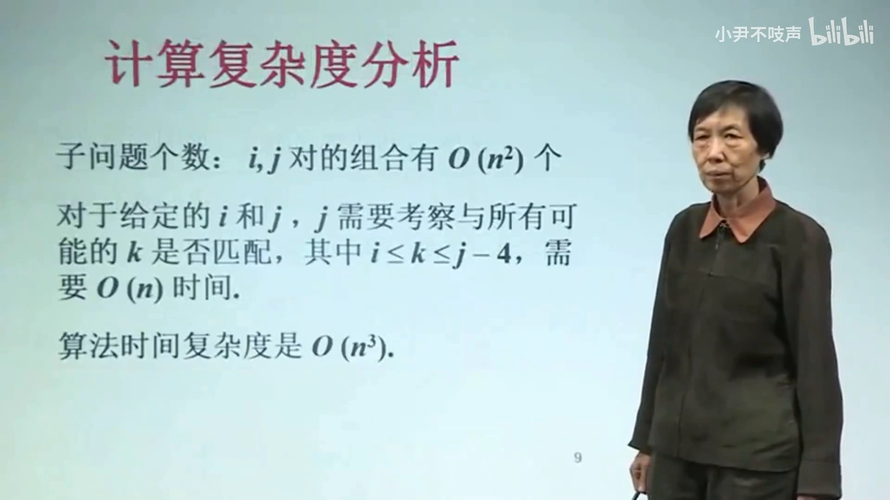

## 六、不只算数，还要能"回溯"出结构：备忘录 + 标记函数

只算出最大配对数还不够，得把具体结构（谁和谁配）还原出来。办法是在填表的同时记录归约方式 [【跳转到 12:05】](https://www.bilibili.com/video/BV1MKTJziEde/?t=725)：

- 记录最优配对数所在的表格——**备忘录**；
- 同时用**标记函数**记下每步的最优划分：j 到底和哪个 k 匹配，还是"j 不参与配对" [【跳转到 12:30】](https://www.bilibili.com/video/BV1MKTJziEde/?t=750)；
- 从 C(1,N) 出发顺着标记回溯，就能把配对弧一条条"捡"出来，得到完整的二级结构。

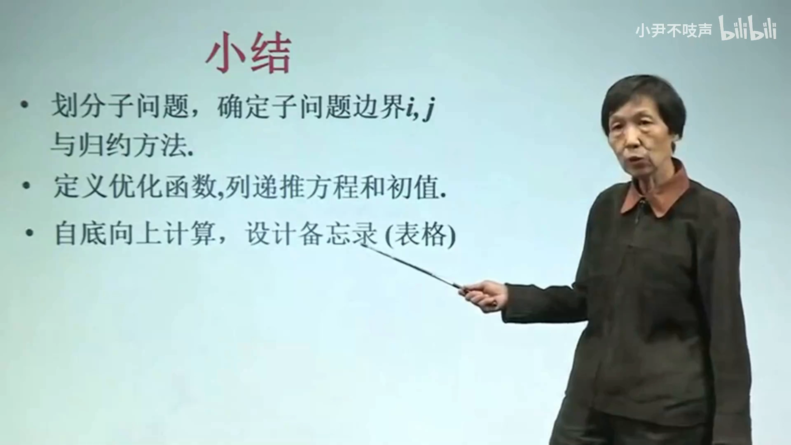

## 小结

- **问题**：由 RNA 一级结构预测二级结构 = 求折叠平面图上"谁和谁配对"。
- **四条规则**：①只有 U–A、C–G 可配；②i、j 配对须 j−4 ≥ i（环不能太小）；③一个碱基至多配一次；④不允许交叉（无假结）。
- **判据**：真实生物判据是最小自由能；课堂简化模型用"配对数最多"，两者共享同一套动态规划骨架。
- **建模**：子问题 = C(i,j)；按"j 配（k）→ 两个子问题 / j 不配 → 一个子问题"归约。
- **递推**：C(i,j) = max{ C(i,j−1), max_k[ C(i,k−1)+C(k+1,j−1)+1 ] }，初值 j−i<4 时为 0。
- **复杂度**：O(N²) 个子问题 × O(N) 个 k = **O(N³)**，自底向上填表。
- **还原结构**：备忘录 + 标记函数记录归约路径，回溯得到配对方案。

## 关键术语速查

| 术语 | 一句话解释 |
| --- | --- |
| 一级结构 | A/U/C/G 排列成的碱基序列本身 |
| 二级结构 | 链内碱基配对折叠出的平面结构（谁和谁配） |
| 臂（stem） | 一段连续的平行配对形成的"茎" |
| 发夹环（hairpin loop） | 臂顶端拐回来的环，环内至少 3 个碱基 |
| 内环（interior loop） | 臂中间鼓出来的小环 |
| MFE（最小自由能） | 稳定结构的真实判据：自由能越低越稳定 |
| C(i,j) | 子链 i–j 的最大配对数（优化函数） |
| 备忘录 / 标记函数 | 记录最优值的表 + 记录归约方式供回溯的表 |
| 假结（pseudoknot） | 交叉的配对，本模型不允许 |

> 延伸：本讲的"配对数最多"模型对应 Nussinov 式动态规划；把目标换成真实自由能、配上 Turner 能量参数，就是 **Zuker 算法**，其代表实现为 mfold 与 ViennaRNA 的 RNAfold——实操演示见同目录《[RNA二级结构的预测](./RNA二级结构的预测.md)》（mfold 网站实操）。
