# LinearPartition：线性时间近似 RNA 折叠配分函数与碱基配对概率

> 来源视频：[LinearPartition: linear-time approx. of RNA folding partition function & base-pair probs (ISMB 2020)](https://www.youtube.com/watch?v=nKaYyQGKsm4)（Liang Huang · Baidu Research USA & Oregon State University，约 13 分钟）。
> 本文是条目「4.1.2 配分函数与系综」的第二篇（RNA 应用）。配分函数的统计力学定义见姊妹篇《[玻尔兹曼因子与配分函数：统计力学入门](玻尔兹曼因子与配分函数：统计力学入门.md)》；系综自由能与 RNAcentroid（从系综中挑代表结构）见 3.2.2 的博客《[Ivo Hofacker：RNA secondary structures](../../3.2_能量类/Ivo%20Hofacker：RNA%20secondary%20structures.md)》。

## 本讲要解决的核心问题（SCQA）

**背景**：经典 RNA 二级结构预测（4.1.1 的 Zuker 算法与 MFE）只输出**一条**最小自由能结构。

**冲突**：但 RNA 在平衡态并非只折叠成一条结构——它同时「住」在一个由指数多条结构组成的**系综**里，MFE 只是其中概率较大的一员。想拿到系综的全貌（每条结构的概率、每个碱基对的配对概率），经典工具是 30 年前的 McCaskill 配分函数算法：渐近复杂度同为 O(n³)，实际却比 MFE 慢约 20 倍，长序列根本跑不动。

**疑问**：能不能像前作 LinearFold 把 MFE 折叠线性化那样，把配分函数也做到线性时间？

**回答（中心思想）**：可以。**LinearPartition** 用「从左到右的 inside + 从右到左的 outside + beam 剪枝」把配分函数与碱基配对概率的计算降到线性时间与线性空间——在 CONTRAfold 最长可跑长度处快约 3000 倍、自己能跑到 10 万核苷酸，而且碱基配对概率反而**更准**。这是配分函数 30 年来的第一次大提速。

## 一、RNA 的真面目：不是一条结构，而是一个系综

视频开篇用一个具体例子破题：同一条 RNA，在平衡态会「掉进」至少两种不同结构，而且实验能告诉我们哪条概率大、哪条概率小。

[【跳转到 00:00】](https://www.youtube.com/watch?v=nKaYyQGKsm4&t=0) · [【跳转到 00:18】](https://www.youtube.com/watch?v=nKaYyQGKsm4&t=18)

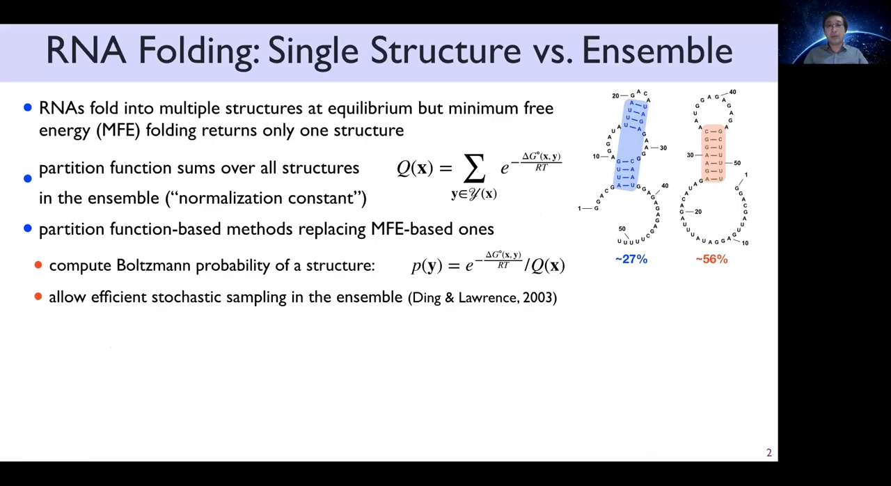

如果只用 MFE（最小自由能）投票，等于只看概率最大的那一条，把整个系综的信息全丢掉了。要「捕捉指数多条结构组成的整个系综」，就需要**配分函数**——统计力学里给每个状态分配概率的标准机器。

## 二、配分函数 Q：给每条结构算概率

配分函数是热力学/统计力学的概念（定义与直觉见姊妹篇）：它是一个**归一化常数 Q**，把每条结构的能量权重（玻尔兹曼权重 `e^(−ΔG/kT)`）加总起来——求和对象是指数多条备选结构。

[【跳转到 00:43】](https://www.youtube.com/watch?v=nKaYyQGKsm4&t=43)

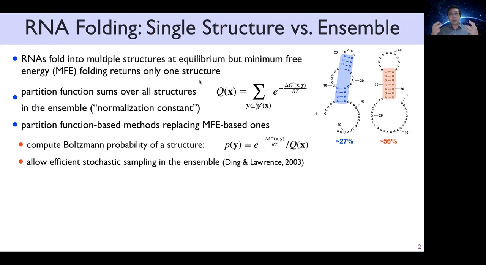

有了 Q 就有了分布：结构 y 的概率 `p(y) = 玻尔兹曼权重 / Q`，还可以据此对结构做高效采样。

[【跳转到 01:08】](https://www.youtube.com/watch?v=nKaYyQGKsm4&t=68)

## 三、碱基配对概率 p(i,j)：点阵图里看全局

比单条结构概率更有用的是**边际概率**：配对 (i,j) 的概率 `p(i,j) = 所有包含该配对的结构概率之和`——仍然是对指数多备选的求和。把 p(i,j) 排成 L×L 矩阵（点阵图），一眼看出哪些配对「稳」、哪些「摇摆」。

[【跳转到 01:33】](https://www.youtube.com/watch?v=nKaYyQGKsm4&t=93)

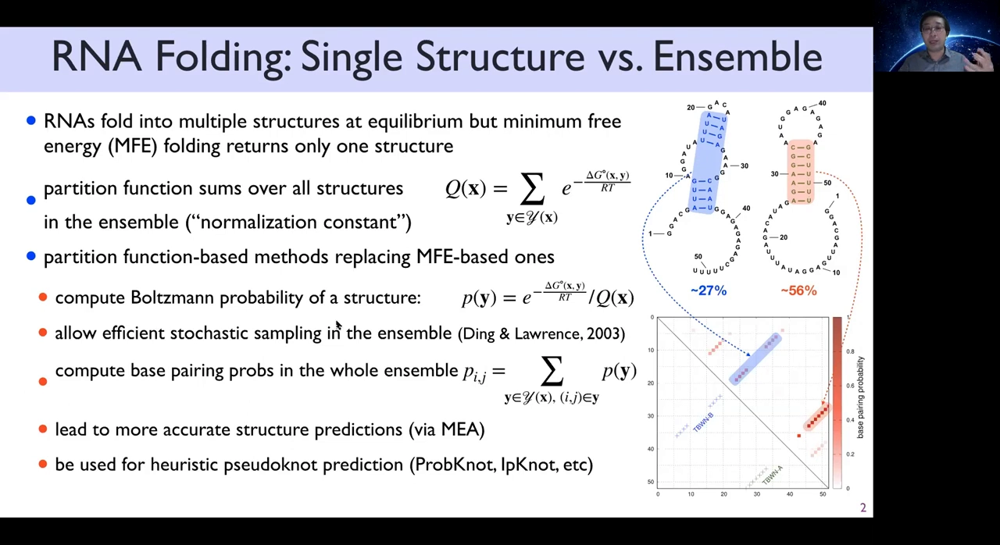

p(i,j) 有两个下游用途：

- **MEA（最大期望准确度）结构预测**：把配对概率当分数，动态规划挑出期望准确度最高的结构；
- 为结构预测提供**启发式置信度**。

[【跳转到 01:58】](https://www.youtube.com/watch?v=nKaYyQGKsm4&t=118)

问题只有一个：算出它们的经典算法太慢。

## 四、经典 McCaskill 算法：把 min 换成 plus 的代价

30 年前的 McCaskill 算法，骨架与 MFE 折叠（Zuker 算法）几乎一样——**把递推里的 min 换成 +（求和）**，就从「找最优」变成了「算配分函数」。另有一处不同：它需要 inside 和 outside **两遍**动态规划，而不只是 inside 一遍。

[【跳转到 02:23】](https://www.youtube.com/watch?v=nKaYyQGKsm4&t=143)

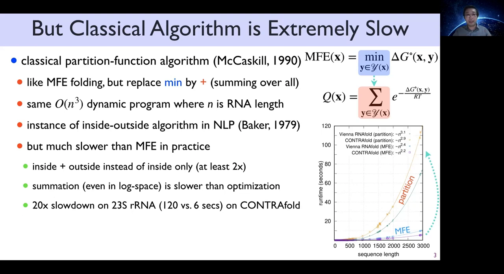

渐近复杂度同为 O(n³)，实际却慢得多，原因有二：

1. inside + outside 两遍，至少慢 2 倍；
2. **求和天然比最小化慢**：得在 exp 空间里累加（就算换到 log 空间也慢）。

结果：在最长的序列（如 16S/23S 核糖体 RNA）上，配分函数比 MFE 慢约 **20 倍**。

[【跳转到 03:13】](https://www.youtube.com/watch?v=nKaYyQGKsm4&t=193)

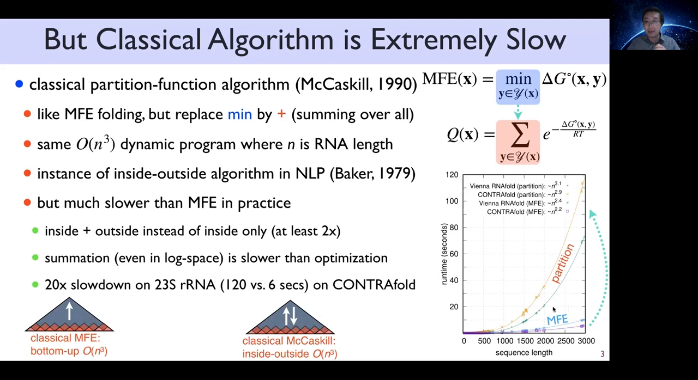

## 五、前作 LinearFold：beam search 的启示

LinearFold（ISMB 2019，同一团队）是第一个线性时间近似 MFE 折叠的算法：把自底向上的动态规划改成**从左到右**推进，每一步用 **beam search** 只保留概率最高的 top-k 个状态、剪掉其余——最坏情形仍是 O(n³)，但实际输出接近线性时间，而且近似版**反而比 O(n³) 基线更准**。

[【跳转到 03:21】](https://www.youtube.com/watch?v=nKaYyQGKsm4&t=201) · [【跳转到 03:46】](https://www.youtube.com/watch?v=nKaYyQGKsm4&t=226)

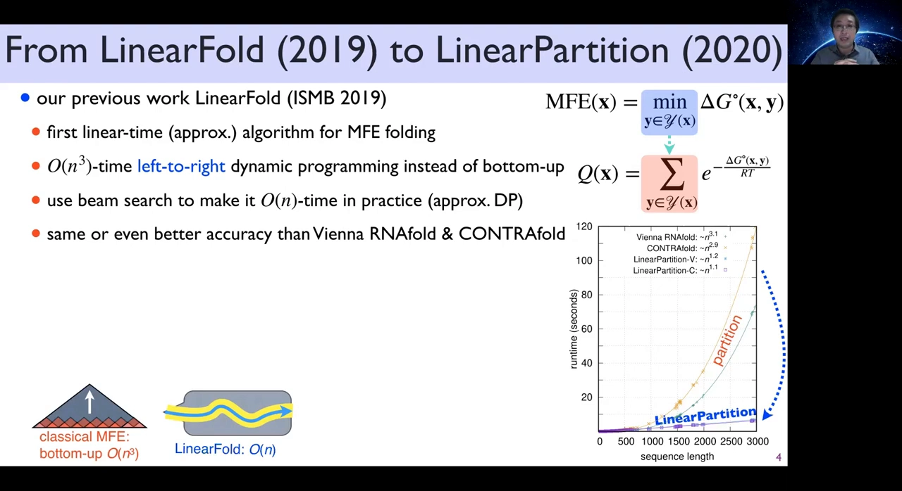

LinearPartition 就是把同一套思路搬到配分函数上。

## 六、LinearPartition：left-to-right inside + right-to-left outside

改造方式分两步：

- **inside（算 Q）**：从左到右扫到序列末尾——只要配分函数，到这里就能停；
- **outside（算 p(i,j)）**：从右到左再扫一遍，得到每个配对的边际概率。

[【跳转到 04:11】](https://www.youtube.com/watch?v=nKaYyQGKsm4&t=251) · [【跳转到 04:36】](https://www.youtube.com/watch?v=nKaYyQGKsm4&t=276)

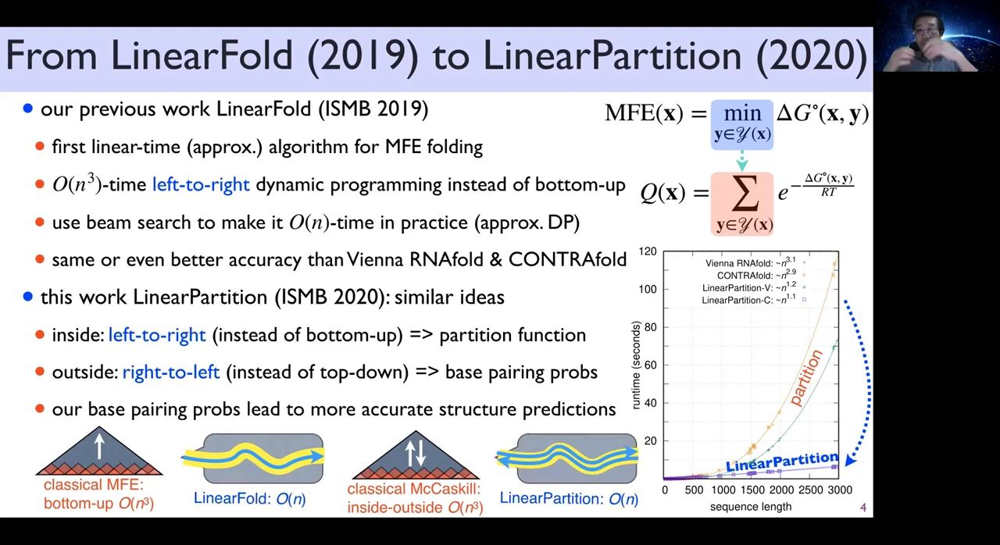

与 LinearFold 一样，得到的碱基配对概率能带来更准的结构预测；速度上比基线快 3~7 倍（在基线还能跑得动的最长序列上测得）。

## 七、为什么「求和」也能剪枝：尖峰分布是关键

这里有个疑点：**求和比最小化更难剪枝**——优化时可以丢掉大量候选、只留 top-1；求和时丢掉一大片结构，概率质量就算错了。那 beam search 凭什么还 work？

[【跳转到 05:01】](https://www.youtube.com/watch?v=nKaYyQGKsm4&t=301)

答案：**碱基配对概率分布是尖峰的（低熵）**。画出全部配对概率：绝大多数接近 0、少数接近 1、中间值极少；全序列 n² 个候选配对里，非零（概率 >0.001）的选项只有线性多个。每个位置 i 实际只有常数个（约 5~6 个）像样的配对伙伴——真实分布远不是「和谁都能配」的平摊。

[【跳转到 05:26】](https://www.youtube.com/watch?v=nKaYyQGKsm4&t=326) · [【跳转到 05:51】](https://www.youtube.com/watch?v=nKaYyQGKsm4&t=351)

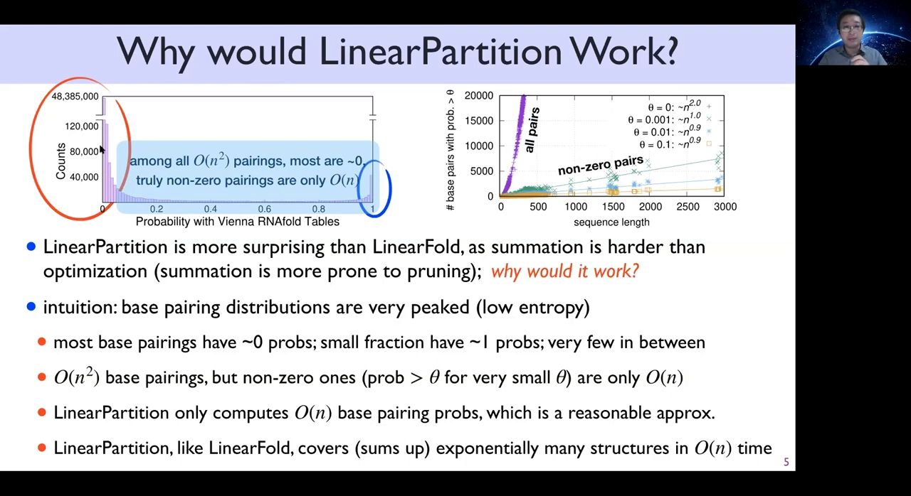

这带来两层意义：

- LinearPartition 只算少量配对，是从一个合理近似出发；
- 它**仍然求和了指数多条结构**——线性时间不等于只看线性多条结构，它加总的是玻尔兹曼系综里那几百万、几十亿条高概率结构。

[【跳转到 07:06】](https://www.youtube.com/watch?v=nKaYyQGKsm4&t=426)

## 八、实验结果：更快，而且配对概率更好

两个版本：**V 版**（LinearVienna 能量模型）与 **C 版**（CONTRAfold 模型），都是线性时间 + 线性空间；在 CONTRAfold 还能跑的最长长度上快约 **3000 倍**，自己则能跑到 1 万甚至 10 万核苷酸。

[【跳转到 07:16】](https://www.youtube.com/watch?v=nKaYyQGKsm4&t=436)

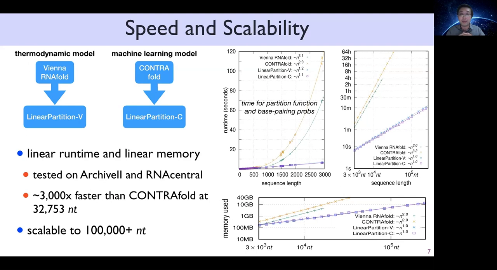

**质量指标 1：ensemble defect（系综缺陷）**——系综里平均「配错」的核苷酸数（配对位置对上、或预测与真值两边都未配对，才算「配对正确」）。结果：16S/23S 等长家族上正确配对的核苷酸明显更多（23S 多 56 个；全部家族平均多 8 个）。

[【跳转到 07:41】](https://www.youtube.com/watch?v=nKaYyQGKsm4&t=461)

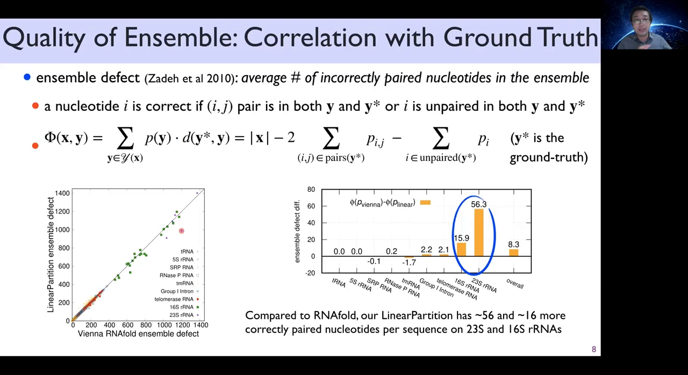

点阵图对比（group I intron 一例）：RNAfold 的分布有大量长距假阳性（红），LinearPartition 恢复出正确配对（蓝）、错误更少——该例多出 47 个正确配对核苷酸（约 9%），且分布更尖锐（熵更低）。

[【跳转到 08:31】](https://www.youtube.com/watch?v=nKaYyQGKsm4&t=511) · [【跳转到 08:56】](https://www.youtube.com/watch?v=nKaYyQGKsm4&t=536)

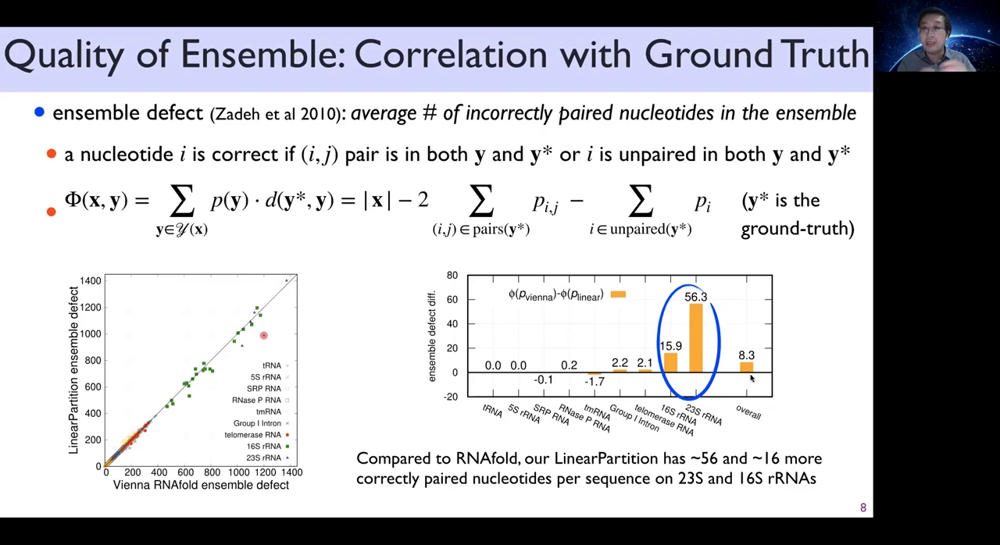

**质量指标 2：MEA 精度**——LinearPartition-V + MEA 比 RNAfold + MEA 略准；优势在长家族（16S/23S）与长距配对（间隔 >500 核苷酸）上更明显；C 版结论相同。

[【跳转到 09:09】](https://www.youtube.com/watch?v=nKaYyQGKsm4&t=549)

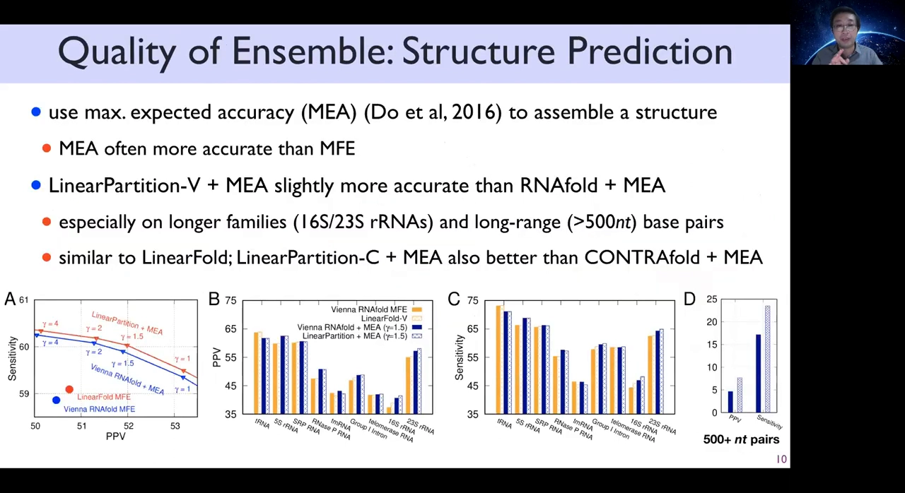

**近似质量**：系综自由能（ensemble free energy，粗略说是「整个系综的自由能」）与基线只差约 2%，且不随序列变长而增大；两套分布的 RMSD 平均仅 0.005。随机/人工设计的 RNA 误差偏高——它们的分布熵更高，这本身就说得通；把 beam 调大，近似误差会迅速趋近于零（beam 取几百、未做调参即够用）。

[【跳转到 09:34】](https://www.youtube.com/watch?v=nKaYyQGKsm4&t=574) · [【跳转到 09:59】](https://www.youtube.com/watch?v=nKaYyQGKsm4&t=599)

## 九、边界与对比：局部折叠算法为什么不够

线性时间的**局部**折叠算法（RNAplfold、LocalFold）也存在，但只能在窗口内考虑**局部配对**——RNAplfold 默认窗口只有 70，长距配对一律看不到；而定义 RNA 全局结构的恰恰是长距配对，所以结果差别巨大。

[【跳转到 10:24】](https://www.youtube.com/watch?v=nKaYyQGKsm4&t=624)

## 十、结论与资源

- **LinearPartition**：第一个不带配对距离约束的 RNA 折叠配分函数 + 碱基配对概率线性时间近似；**配分函数 30 年来的第一次大提速**，数量级加速。
- 更重要的是配对概率**更好**：下游 MEA 结构预测略准；对生物学家/从业者，优势在更难的问题上（长家族、长距配对）最明显——现有模型在这些地方本来就做得很差。
- 它比 LinearFold 的成功更令人惊讶：求和比优化难，能成是因为分布尖峰、低熵；算法在天然 RNA 上比随机/人工序列表现更好——或许演化偏爱低熵，尚无定论。
- 资源：论文（附补充材料，含复杂度分析与更多结果）、web server（输入任意长序列即输出配对概率分布，颜色越深概率越高）、代码在 GitHub。

[【跳转到 10:49】](https://www.youtube.com/watch?v=nKaYyQGKsm4&t=649) · [【跳转到 12:27】](https://www.youtube.com/watch?v=nKaYyQGKsm4&t=747)

## 小结

- RNA 平衡态是一个**系综**：指数多条结构各有概率，MFE 只见其一。
- **配分函数 Q**（玻尔兹曼权重求和）给出每条结构的概率；**p(i,j)** 给出每个碱基对的配对概率，点阵图一图看全局。
- 经典 **McCaskill** 算法 = Zuker 的 min 换 plus + inside/outside 两遍，O(n³) 且实测比 MFE 慢约 20 倍。
- **LinearPartition**：左→右 inside（Q）+ 右→左 outside（p(i,j)）+ beam 剪枝 → 线性时间/空间，比 CONTRAfold 快约 3000 倍，可跑到 10 万核苷酸。
- 可行性源于**尖峰分布**：每位置约 5~6 个像样的配对伙伴、非零选项只有线性多个；但仍求和了系综中全部高概率结构。
- 质量不降反升：ensemble defect 更低、MEA 略准（长家族/长距更明显）、系综自由能差约 2%、RMSD ≈ 0.005。
- 与本条目主线的关系：配分函数与系综是「热力学/动态规划」流派的核心机器（4.1.2）；从系综里挑代表结构（centroid / RNAcentroid）的操作见 3.2.2；本条目第一篇统计力学底座见姊妹篇。

## 关键术语速查

| 术语 | 一句话解释 |
|---|---|
| MFE | 最小自由能结构：能量最低的那一条结构 |
| 系综 ensemble | 平衡态下所有可能结构及其玻尔兹曼概率的集合 |
| 配分函数 Q | 全部结构玻尔兹曼权重之和；归一化常数，决定概率分布 |
| 玻尔兹曼权重 | `e^(−ΔG/kT)`：自由能越低的结构权重越大 |
| 碱基配对概率 p(i,j) | 含配对 (i,j) 的所有结构概率之和（边际概率） |
| McCaskill 算法 | 经典 O(n³) 配分函数算法：min 换 plus + inside/outside |
| beam search | 每步只保留 top-k 状态的剪枝搜索 |
| MEA | 最大期望准确度：按配对概率挑期望最准的结构 |
| ensemble defect | 系综平均「配错」核苷酸数，衡量概率分布质量 |
| LinearPartition | 本文主角：线性时间近似配分函数/配对概率（V/C 两版） |
