# 玻尔兹曼因子与配分函数：统计力学入门

> 来源视频：[Statistical Mechanics #1: Boltzmann Factors and Partition Functions](https://www.youtube.com/watch?v=J-qTchJh4Ok)（WWU CHEM 462 · Rob Berger，约 15 分钟）。
> 本文是条目「4.1.2 配分函数与系综」的第一篇（概念底座）；它在 RNA 二级结构预测中的应用见姊妹篇《[LinearPartition：线性时间近似RNA配分函数与碱基配对概率](LinearPartition：线性时间近似RNA配分函数与碱基配对概率.md)》。

## 本讲要解决的核心问题（SCQA）

**背景**：量子力学告诉我们，电子、原子、分子的能量不是连续的，而是一格一格的「能级」；电子倾向于先占满低能级轨道（构造原理，Aufbau principle）。

**冲突**：可真实世界有温度。温度一高，粒子并不只待在最低能级，而是按一定概率分布在多个能级上；温度越高，占据高能级的可能性越大。只靠量子力学算不出这个分布——它还依赖温度。

**疑问**：给定温度 T，一个粒子占据某个能态 εⱼ 的概率到底是多少？

**回答（中心思想）**：占据概率正比于**玻尔兹曼因子** `e^(−εⱼ/kBT)`；把所有能态的玻尔兹曼因子加起来做归一化，这个归一化常数就是**配分函数** `q`。两个概念合起来，第一次把「温度」和「概率」定量地连在一起——它也是后面 RNA 折叠配分函数（把「能态」换成「二级结构」）的直接源头。

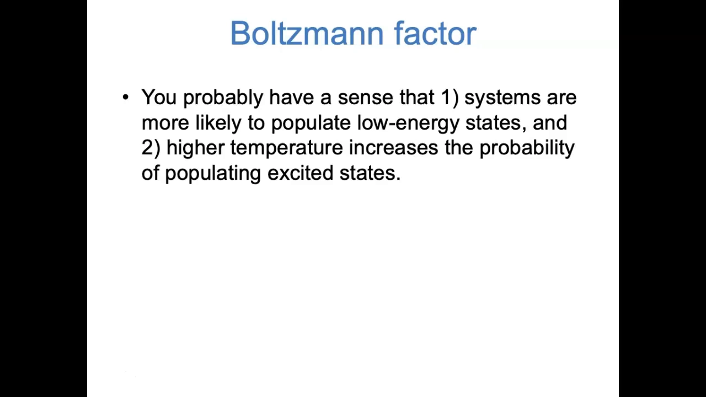

## 一、统计力学：量子能级与宏观温度之间的桥

统计力学的定位很清楚：它是**量子力学**（离散能级）与**热力学**（宏观定律）之间的桥梁，研究「这些量子化能级在温度 T 下各有多大概率被占据」。

[【跳转到 00:00】](https://www.youtube.com/watch?v=J-qTchJh4Ok&t=0)

视频开场先用你已有的直觉铺垫两条事实：

- **低能态更稳定**：系统更倾向于占据低能态。电子先填最低能量轨道、再填高轨道（Aufbau principle）就是例子。
- **温度助推激发**：温度越高，粒子越容易跑到激发态——比如高温让反应更容易跨过过渡态势垒。

[【跳转到 00:25】](https://www.youtube.com/watch?v=J-qTchJh4Ok&t=25)

接下来要做的就是把这两条直觉**定量化**：低能级「更」可能多少？温度「怎么」影响概率？答案就是玻尔兹曼因子。

## 二、玻尔兹曼因子：一条公式分配概率

定义只有一行：

```text
p_j ∝ e^(−ε_j / k_B T)
```

- `p_j`：能态 j 被占据的概率
- `ε_j`：该能态的能量
- `k_B`：玻尔兹曼常数 = R / N_A = 1.38×10⁻²³ J/K（气体常数的「单粒子版」）
- `T`：绝对温度（K）

[【跳转到 01:15】](https://www.youtube.com/watch?v=J-qTchJh4Ok&t=75) · [【跳转到 01:40】](https://www.youtube.com/watch?v=J-qTchJh4Ok&t=100)

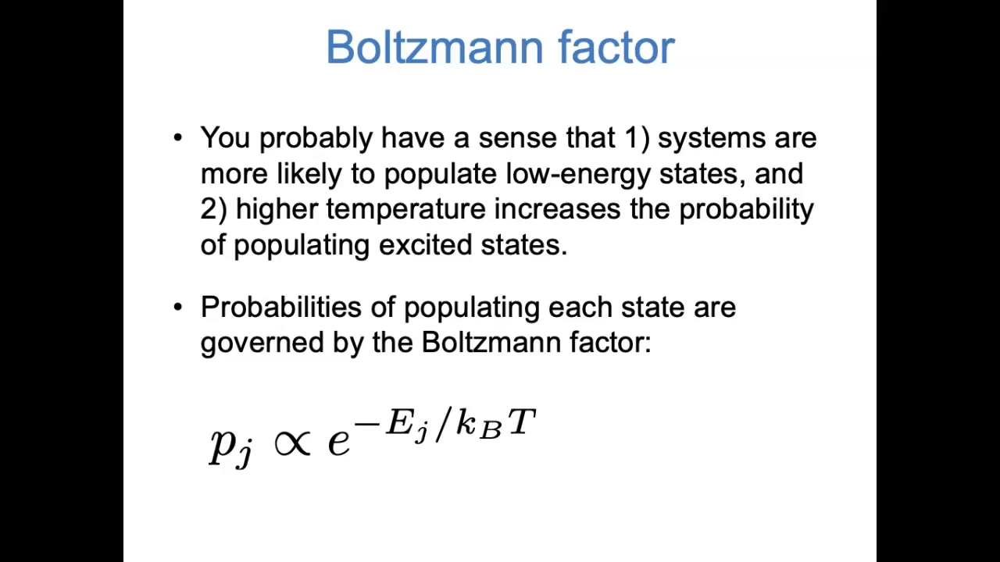

**量纲自检**：能量(J) ÷ (J/K × K) → 单位全部消掉，指数是无量纲的纯数。统计力学里 `kBT` 出现得太多，习惯记 `β = 1/kBT`，玻尔兹曼因子就写成 `e^(−βε)`。

[【跳转到 02:05】](https://www.youtube.com/watch?v=J-qTchJh4Ok&t=125)

读这条公式抓住两点：

1. **能量越高，概率越低**——指数上的负号保证这一点；
2. **不是线性下降，而是指数式暴跌**——能量稍高一点，概率就掉一大截。

[【跳转到 02:30】](https://www.youtube.com/watch?v=J-qTchJh4Ok&t=150)

## 三、kBT 有多小：为什么室温下多数粒子待在基态

`k_B ≈ 10⁻²³ J/K`，室温 `T ≈ 300 K`，所以 `kBT ≈ 10⁻²¹ J`——数值极小。

[【跳转到 03:11】](https://www.youtube.com/watch?v=J-qTchJh4Ok&t=191)

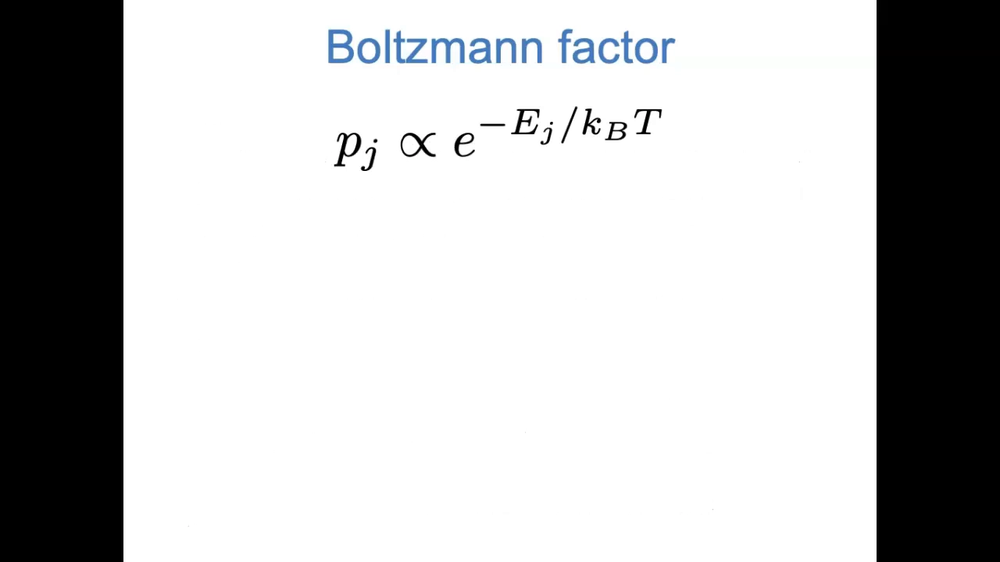

由此得到一条实用的判据：

- 能级间距**远大于** kBT → 只有基态有显著占据，激发态形同虚设；
- 能级间距**接近或小于** kBT → 激发态也会有可观的占据概率。

[【跳转到 03:36】](https://www.youtube.com/watch?v=J-qTchJh4Ok&t=216)

这条判据直接预示了第六节算例的三种情形。

## 四、能量零点是任意的：概率比只看能量差

物理上只有**能量差**有意义——把零点选在哪里是人为约定。所以两个能态的占据概率之比必须只依赖能量差，用玻尔兹曼因子一除便知：

```text
p_i / p_j = e^(−ε_i/kBT) / e^(−ε_j/kBT) = e^(−(ε_i − ε_j)/kBT)
```

[【跳转到 04:01】](https://www.youtube.com/watch?v=J-qTchJh4Ok&t=241)

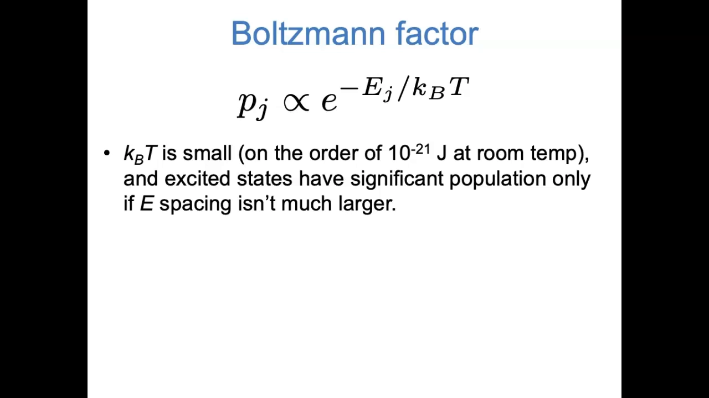

同底指数相除等于指数相减，能量零点的公共部分被自动消掉——公式恰好满足「只依赖能量差」的物理要求。

[【跳转到 04:26】](https://www.youtube.com/watch?v=J-qTchJh4Ok&t=266)

## 五、配分函数：从「正比」到「概率」

玻尔兹曼因子只给出**正比**关系；要得到真正的概率，还差归一化——所有可能结果的概率加起来必须等于 1。做法：把每个玻尔兹曼因子除以「所有玻尔兹曼因子之和」：

```text
p_j = e^(−ε_j/kBT) / q ，  q = Σ_j e^(−ε_j/kBT)
```

这个归一化常数就是**配分函数**（partition function），习惯用字母 `q` 表示。

[【跳转到 04:46】](https://www.youtube.com/watch?v=J-qTchJh4Ok&t=286) · [【跳转到 05:11】](https://www.youtube.com/watch?v=J-qTchJh4Ok&t=311) · [【跳转到 05:36】](https://www.youtube.com/watch?v=J-qTchJh4Ok&t=336)

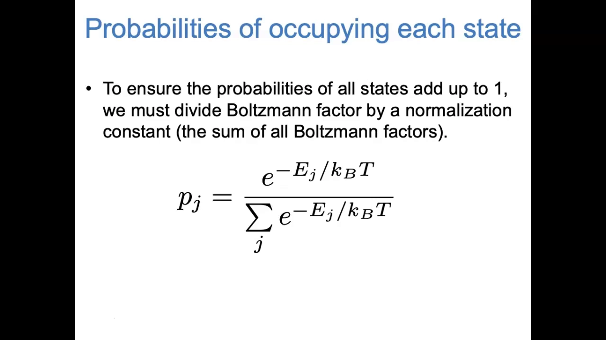

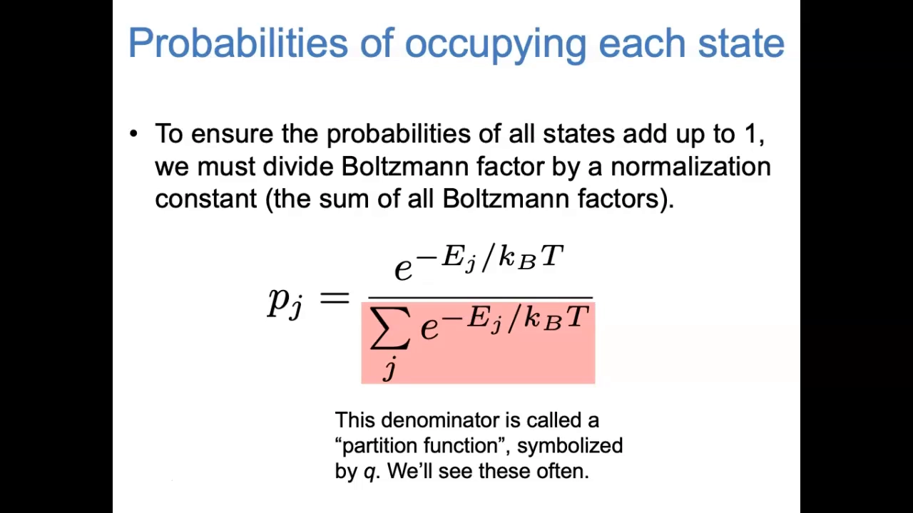

它看似只是个归一化常数，下一节会看到 q 本身就携带大量信息。在 RNA 折叠里，把 j 遍历的「能态」换成「所有可能二级结构」，q 就是 McCaskill / LinearPartition 计算的对象（见姊妹篇）。

## 六、算例：三种能级间距下的 q 与占据概率

设一个粒子有 3 个能态 ε₀ < ε₁ < ε₂，固定 T = 300 K，比较三种能级间距：

| 情形 | 能级间距 | 与 kBT 的关系 | 预期 |
|---|---|---|---|
| Case #1 | 1 J | 远大于 | 几乎 100% 占据基态 |
| Case #2 | 10⁻²⁰ J | 与 kBT 相当 | 基态为主，激发态少量 |
| Case #3 | 10⁻⁴⁰ J | 远小于 | 三态几乎均分 |

[【跳转到 06:00】](https://www.youtube.com/watch?v=J-qTchJh4Ok&t=360) · [【跳转到 06:25】](https://www.youtube.com/watch?v=J-qTchJh4Ok&t=385)

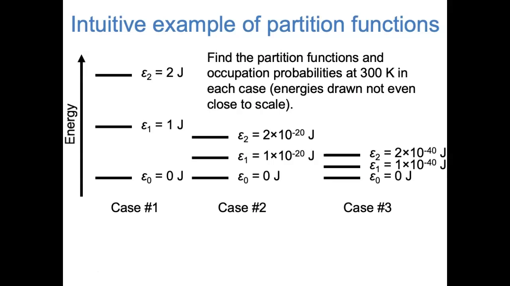

**Case #1（间距 1 J）**：ε₀ = 0 → 第一项 `e⁰ = 1`；ε₁、ε₂ 相对 kBT 极高 → `e^(−超大数) ≈ 0`。于是 `q = 1 + 0 + 0 = 1`；每个态的概率 = 玻尔兹曼因子 ÷ q，基态 = 1/1 = 100%，两个激发态 ≈ 0——与预期一致。

[【跳转到 08:39】](https://www.youtube.com/watch?v=J-qTchJh4Ok&t=519) · [【跳转到 09:04】](https://www.youtube.com/watch?v=J-qTchJh4Ok&t=544)

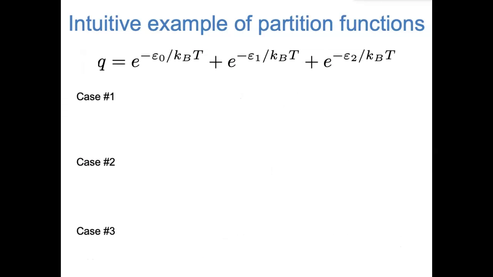

**Case #3（间距 10⁻⁴⁰ J）**：三个 ε 相对 kBT 都几乎为零，三项都 ≈ `e⁰ = 1`，于是 `q ≈ 3`；每个态的概率都 ≈ 1/3——能级几乎简并时，占据被摊平。

[【跳转到 09:54】](https://www.youtube.com/watch?v=J-qTchJh4Ok&t=594) · [【跳转到 10:19】](https://www.youtube.com/watch?v=J-qTchJh4Ok&t=619)

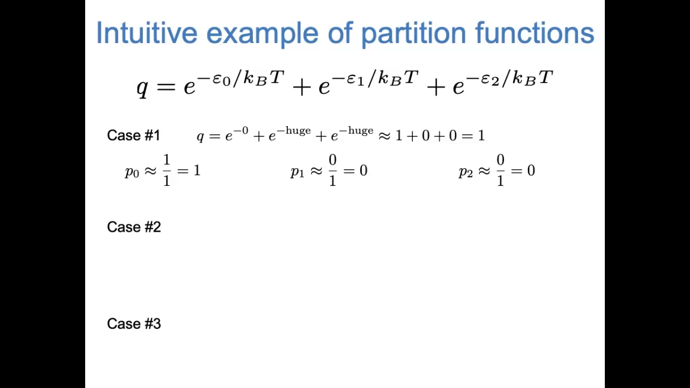

**Case #2（间距 10⁻²⁰ J，中间情形）**：第二、三项要认真代入数字，算得 `q ≈ 1.1`；基态概率 = 1/q ≈ **91%**，第一激发态 ≈ **8%**，第二激发态 **<1%**——基态为主、激发态沾边，正是「间距与 kBT 相当」的写照。

[【跳转到 11:09】](https://www.youtube.com/watch?v=J-qTchJh4Ok&t=669)

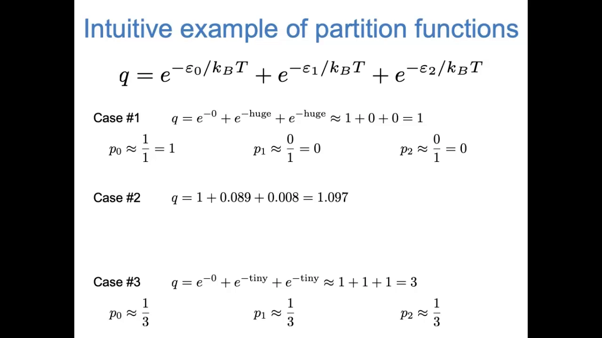

三种情形的计算结果与第六节开头的直觉预期完全一致。

## 七、q 的直觉含义：有效占据态的数目

把三个 q 值排在一起看：

- Case #1：只有 1 个态被显著占据 → **q = 1**
- Case #2：1 个为主、其他沾一点 → **q 略大于 1**（≈1.1）
- Case #3：3 个态平分秋色 → **q = 3**

[【跳转到 11:59】](https://www.youtube.com/watch?v=J-qTchJh4Ok&t=719)

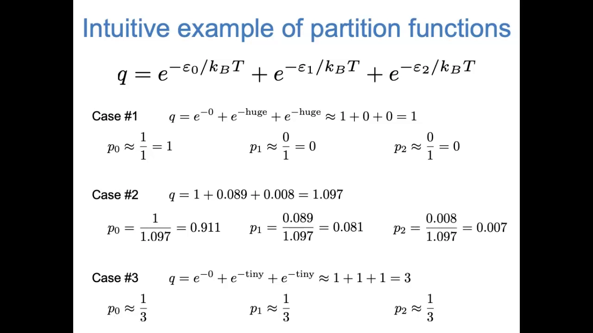

这给出配分函数最直观的读法：在「基态能量记为 0」的约定下，**q 大致等于有多少个能态被显著占据**——一个「有效占据态数目」。

[【跳转到 12:23】](https://www.youtube.com/watch?v=J-qTchJh4Ok&t=743)

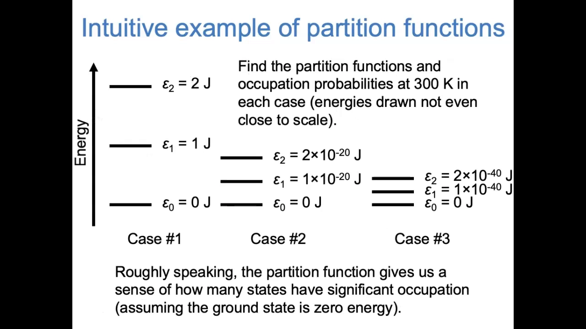

## 八、带简并的紧凑形式：q = Σ g_j · e^(−βε_j)

有时按「能级」而不是「能态」求和更方便：若同一能级上有 `g_j` 个态（**简并度**，degeneracy），不必把同一个玻尔兹曼因子加 g_j 次，直接写成：

```text
q = Σ_j g_j · e^(−ε_j / kBT)
```

[【跳转到 12:53】](https://www.youtube.com/watch?v=J-qTchJh4Ok&t=773) · [【跳转到 13:18】](https://www.youtube.com/watch?v=J-qTchJh4Ok&t=798)

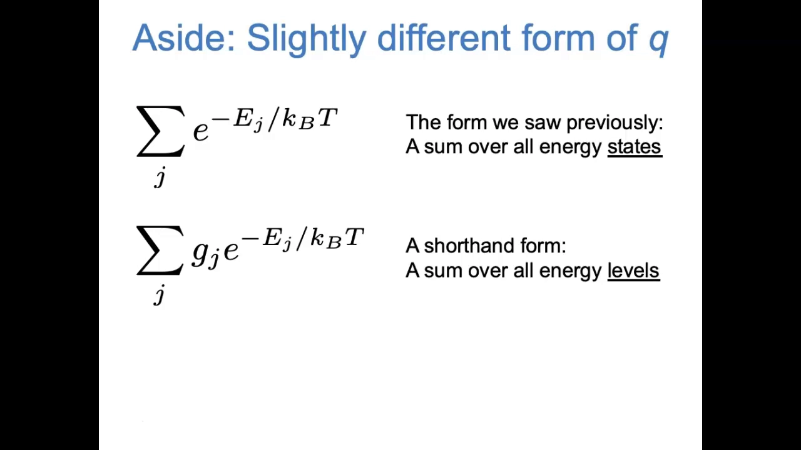

量子系统里简并很常见（三维势箱中的粒子、原子轨道），给真实原子/分子搭统计力学模型时，普遍使用这种带简并的形式。

[【跳转到 13:43】](https://www.youtube.com/watch?v=J-qTchJh4Ok&t=823)

## 小结

- 统计力学回答的问题是：温度 T 下，粒子占据各能态的概率是多少。答案：`p_j = e^(−ε_j/kBT) / q`。
- **玻尔兹曼因子** `e^(−ε_j/kBT)`：能量越高概率越低，且是指数式下降；指数无量纲。
- `kBT ≈ 10⁻²¹ J`（室温）非常小：能级间距与 kBT 的相对大小，决定激发态有没有可观占据。
- 能量零点是任意约定 → 概率比只依赖能量差。
- **配分函数 q** = 所有玻尔兹曼因子之和（归一化常数）；直觉上 q ≈ 有效占据态数目。
- 带简并的紧凑形式：`q = Σ g_j·e^(−βε_j)`。
- 迁移到 RNA：把「能态」换成「二级结构」、能量换成折叠自由能，q 就是配分函数与系综（RNAcentroid）研究的核心对象——数值算法见姊妹篇《LinearPartition》。

## 关键术语速查

| 术语 | 一句话解释 |
|---|---|
| 能级 / 能态 | 量子系统允许的分立能量取值；同一能量上可有多个态 |
| 玻尔兹曼因子 | `e^(−ε_j/kBT)`，能态 j 的相对占据权重 |
| 玻尔兹曼常数 k_B | 1.38×10⁻²³ J/K，把温度换算成能量尺度的常数 |
| β | `1/kBT` 的简写 |
| 配分函数 q | 所有玻尔兹曼因子之和；归一化常数，直觉上≈有效占据态数目 |
| 简并度 g_j | 同一能级上能态的个数 |
| 系综 | 所有可能微观状态（如 RNA 的所有二级结构）及其概率的集合 |
