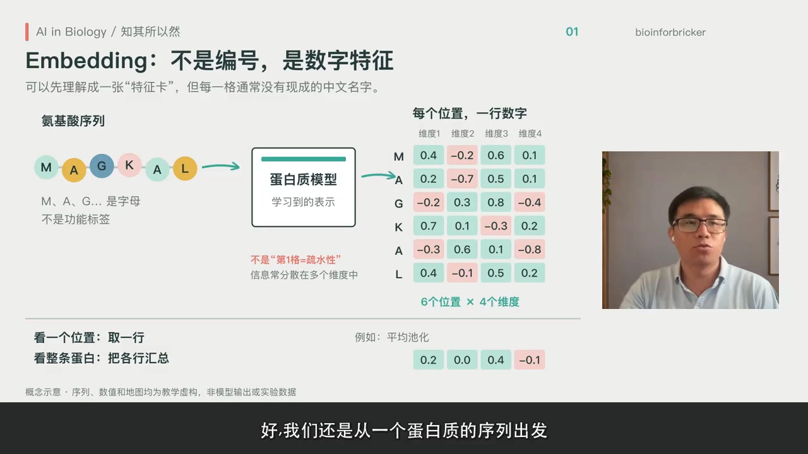
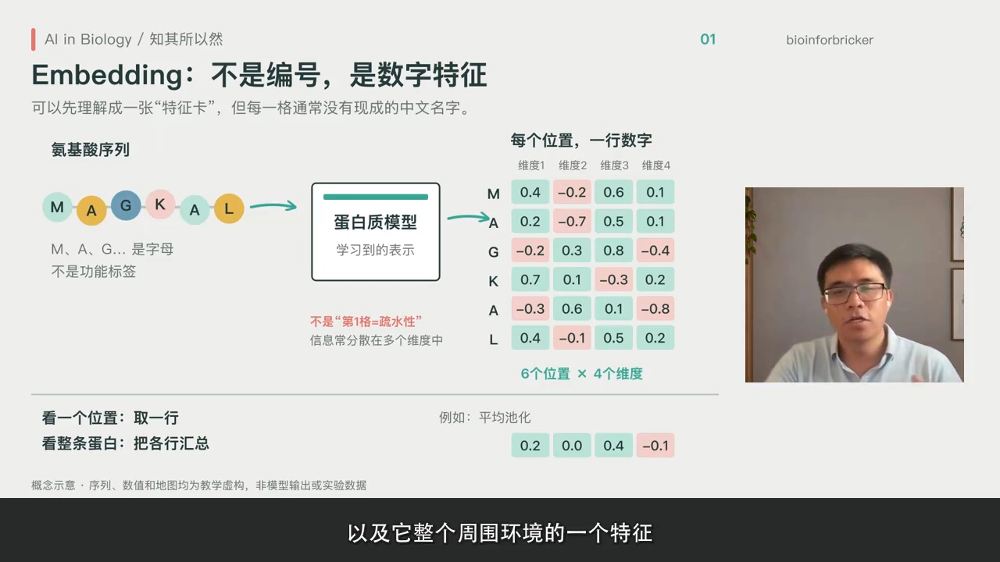
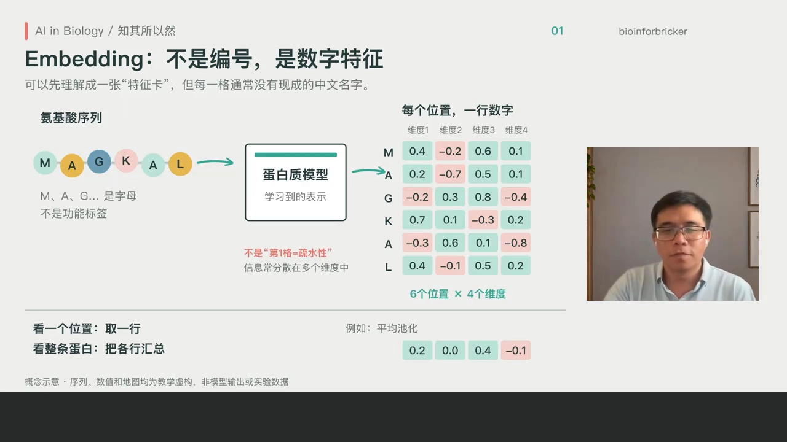
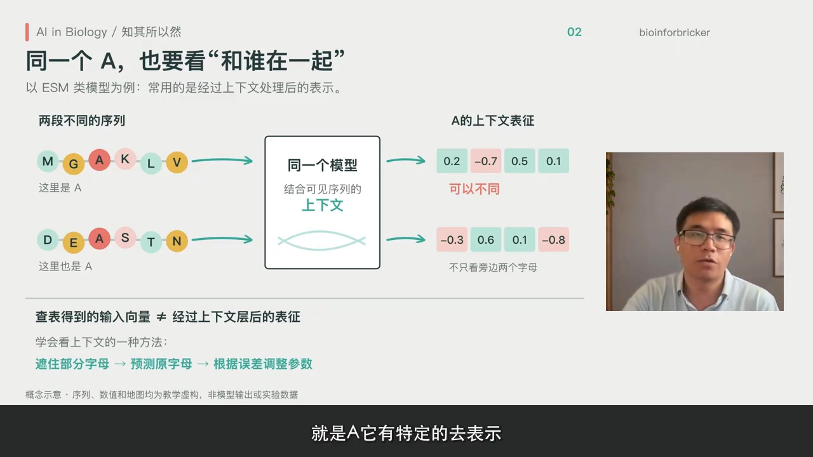
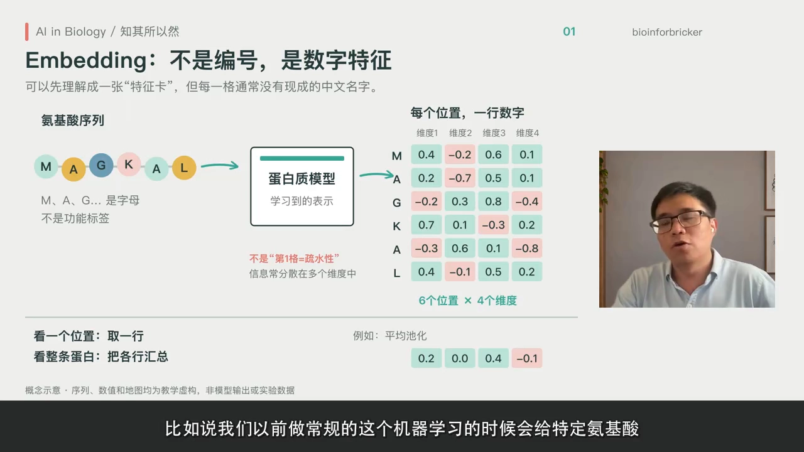
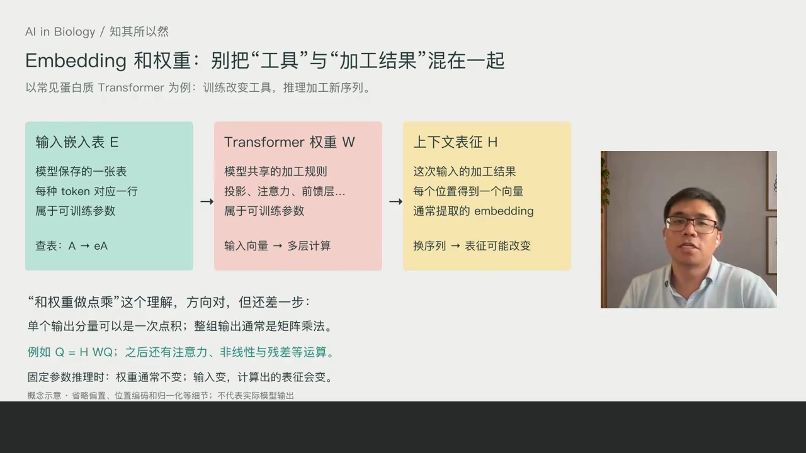
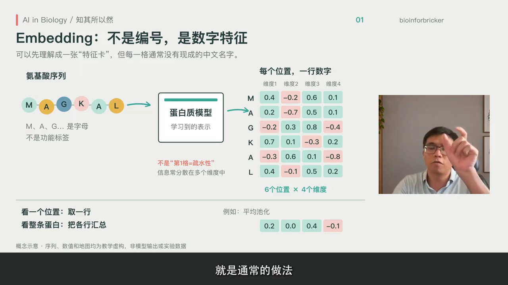
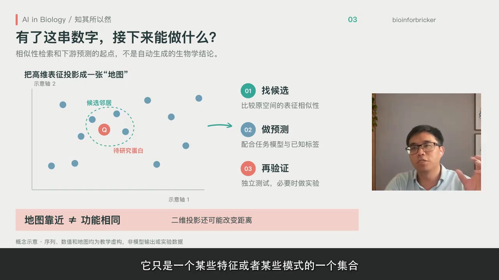

# Embedding 到底是什么：从氨基酸序列到数字向量

> 来源：Bilibili 视频《Embedding到底是什么？从氨基酸到数字特征｜AI in biology 知其所以然EP02》（主讲人：何老师，栏目「AI in Biology 知其所以然」，[BV1D4p66xEFQ](https://www.bilibili.com/video/BV1D4p66xEFQ/)，时长 08:02）。
> 本文基于视频字幕与画面逐窗口整理而成，配图取自视频截图，时间戳可跳回原视频对应位置核对。这一讲专门把「embedding」这个天天在用、却常常讲不清楚的概念，从底层讲透。

## 本讲要解决的核心问题（SCQA）

**背景**：做蛋白质模型的人，几乎每天都在用 embedding：拿它比对序列相似性、把它当模型输入输出。

**冲突**：会用不等于懂。主讲人在上一期视频里试着向观众解释 embedding 时，发现很难讲清楚——它真的只是一组「表征蛋白的向量」吗？它从哪来、为什么能表征特征？

**疑问**：embedding 到底是怎么从一串氨基酸变成一组向量的？它和模型权重是什么关系？凭什么说它「表征」了蛋白质的特征？

**回答（中心思想）**：embedding 是**模型的数值表示**：蛋白质序列先被表征成一个矩阵（每个位置一组向量，初始表征可以相同），再经过模型权重的各种运算（点乘、attention 等），最终得到**携带上下文信息**的向量——同一个氨基酸在不同序列里的表征并不相同。它**不是**人工设计的透明特征，**不是**模型权重，也**不是**神秘的生物密码；它只是供模型计算和分析使用的数值表示，但功能相似的蛋白质 embedding 更相似，这为注释与分类打下基础。

## 一、从序列到矩阵：embedding 怎么来的

[【跳转到 01:50】](https://www.bilibili.com/video/BV1D4p66xEFQ/?t=110)

在蛋白质语言模型中，一条蛋白质序列被表征成一个**矩阵**：每一个位置是一组向量。一个 sequence，比如有 200 个氨基酸，那就是「200 × 每个位置向量维度」的矩阵。

训练开始时，它会有一个**初始的表征**；然后再经过大语言模型的各种各样的运算——点乘它的权重、attention 模型等等。这个中间过程比较复杂（想深入了解要学 Transformer），最终得到的这组向量，是在训练过程中学习到了它的**上下氨基酸以及整个周围环境的特征**。

[【跳转到 03:05】](https://www.bilibili.com/video/BV1D4p66xEFQ/?t=185)

可以这样理解：最终这组向量，是大语言模型学习之后，**给这个特定氨基酸的一个特征表示**。

### 1.1 同一个 A，在不同序列里表征不一样

[【跳转到 03:30】](https://www.bilibili.com/video/BV1D4p66xEFQ/?t=210)

embedding 不仅仅取决于「你是什么氨基酸」——是疏水的还是亲水的。同样是一个 A（丙氨酸），它在不同的 sequence 里面，表征是不一样的：初始的时候，每个 A 拿到的初始向量可能一样，但经过大语言模型的处理，它们的表征就不同了。

视频里给了一个类比：**同一个人在不同的团队里，可能承担不同的角色**。这不是说氨基酸有自己的思想、A 变成了另一个氨基酸，只是说它在特定的序列环境、特定的 context 下，承担了那个角色。

## 二、三个常见误解，逐个澄清

### 2.1 它不是「透明」的特征

[【跳转到 04:20】](https://www.bilibili.com/video/BV1D4p66xEFQ/?t=260)

embedding 并不是「透明的」——**并不是向量的某一个位置就对应某种特定特征**。对比一下传统机器学习的做法：那时我们会给氨基酸把特征列得清清楚楚——疏水/亲水/芳香族、电荷是多少等等，每个特征怎么来的都知道。但大语言模型某种程度上是个**黑箱**：可能有一些维度能对应到特定蛋白质特征上，但那只是一种推测，并不是确定学到了什么。

### 2.2 它不是模型权重

[【跳转到 05:35】](https://www.bilibili.com/video/BV1D4p66xEFQ/?t=335)

embedding 和大模型的**权重（weights）**不是同一个概念：权重是参数，通过大量喂数据（蛋白质训练集）训练出来；embedding 是**运算结果**——初始的输入经过 weights 的运算得到的一组向量，用来表征氨基酸的特征。

### 2.3 它不是神秘的生物密码

[【跳转到 07:10】](https://www.bilibili.com/video/BV1D4p66xEFQ/?t=430)

跟别人解释 embedding 时，可以从容地说：它不是什么神秘的生物密码，**它只是提供模型计算和分析使用的数值表示**。而且要会追问三个问题：是**哪个模型**？在**哪一层**？是**某个位置**还是**整条蛋白**？——这些都是有区分的。把这些问题讲清楚，这个概念就没有那么玄乎了。

## 三、两个层面：氨基酸级与蛋白质级

[【跳转到 06:00】](https://www.bilibili.com/video/BV1D4p66xEFQ/?t=360)

embedding 可以在两个层面理解：

- **氨基酸层面**：每个氨基酸（每个位置）有自己的 embedding，是一个向量；
- **蛋白质层面**：也可以得到整条蛋白的 embedding——通常的做法是**取均值**（对每个位置的向量取均值），得到一组向量，就是这个蛋白的 embedding。

[【跳转到 06:25】](https://www.bilibili.com/video/BV1D4p66xEFQ/?t=385)

蛋白层面的 embedding 可以表征这个蛋白质本身的一些特征，但这个特征可能**没法直接表述出来**——它只是某些特征或某些模式的一个集合。不过我们通过**相似性**可以知道：那些具有相同功能或相似功能的蛋白质，它们的 embedding 更加相似——**这就是为蛋白质做注释或分类的基础**。

## 小结

- 序列 → 矩阵：一条 L 个氨基酸的序列被表征为 L × d 的矩阵，每个位置一组向量；经模型权重运算后，向量携带上下文特征。
- **同一个氨基酸在不同序列里表征不同**（初始向量相同，经过处理后不同）——类比「同一个人在不同团队承担不同角色」。
- 三个「不是」：不是透明特征（对比传统 ML 的人工特征表）、不是模型权重（权重是参数，embedding 是运算结果）、不是神秘生物密码（只是数值表示）。
- 两个层面：氨基酸级向量；蛋白级向量（均值池化）。
- 功能相似的蛋白质，embedding 更相似——这是注释、分类等下游任务的基础。
- 解释 embedding 时要能回答：哪个模型？哪一层？某个位置还是整条蛋白？

## 关键术语速查

| 术语 | 一句话解释 |
| --- | --- |
| embedding（嵌入/表征） | 序列/氨基酸经过模型运算后得到的一组数值向量 |
| 初始表征 | 序列刚进入模型时的向量表示（可由查表得到），尚未携带上下文 |
| context（上下文） | 氨基酸所在的序列环境；同一氨基酸在不同 context 下表征不同 |
| 权重（weights） | 模型中通过训练学到的参数；embedding 是输入经权重运算的输出 |
| 均值池化 | 把每个位置的向量取平均，得到整条蛋白质的一个向量 |
| 黑箱表征 | 无法逐维解释每个数字含义的向量表示，与人工特征表相对 |
