# BERT 原理详解：掩码预训练 + 下一句预测——双向语言模型的入门第一课

> 来源：Bilibili 视频《小白也能听懂的 bert模型原理解读 预训练语言模型》（[BV1Km41117VG](https://www.bilibili.com/video/BV1Km41117VG/)，时长 25:54）。
> 本文基于视频字幕与画面逐窗口整理而成，配图取自视频截图，时间戳可跳回原视频对应位置核对。这一讲从 BERT 的名字拆解讲到输入表示、两大预训练任务（MLM / NSP）与总结，是「BERT 式掩码预训练 → 嵌入」这条知识线的系统入门。

## 本讲要解决的核心问题（SCQA）

**背景**：在大模型时代，预训练语言模型是一切下游任务的基础。上一讲（Transformer）说明它由 Encoder 和 Decoder 组成。

**冲突**：更早的 RNN、LSTM 只能串行处理、难以并行；word2vec 这类词向量方法是「静态」的——一个词只有一个向量，无法结合上下文。模型怎么才能既高效又「懂上下文」地学到语言表示？

**疑问**：BERT 是怎么做到「双向」的？它在没有任何人工标注的情况下，靠什么任务完成预训练？

**回答（中心思想）**：BERT（Bidirectional Encoder Representations from Transformers）就是 **Transformer Encoder 部分的代表**，整体是一个**自编码（双向）语言模型**。它分**预训练**与**微调**两步：预训练用两个任务——**MLM**（掩码语言模型，随机遮住 15% 的词做「完形填空」，并按 80/10/10 规则处理被遮词）和 **NSP**（下一句预测，二分类判断两句话是否连续）；输入由 **token、segment、position 三种嵌入相加**而成，配合 WordPiece 分词与 [CLS]/[SEP] 标记。预训练好的参数再用于微调，让下游任务又快又好。

## 一、BERT 是什么：从名字拆解开始

[【跳转到 00:00】](https://www.bilibili.com/video/BV1Km41117VG/?t=0)

BERT 的英文全称是 **Bidirectional Encoder Representations from Transformers**，三个关键词：

- **Bidirectional（双向）**：它同时从左到右、从右到左地「读」文本；
- **Encoder**：它就是 Transformer 模型里 **Encoder（编码器）这一部分**的代表；
- **Representations from Transformers**：它产出的是基于 Transformer 的表示。

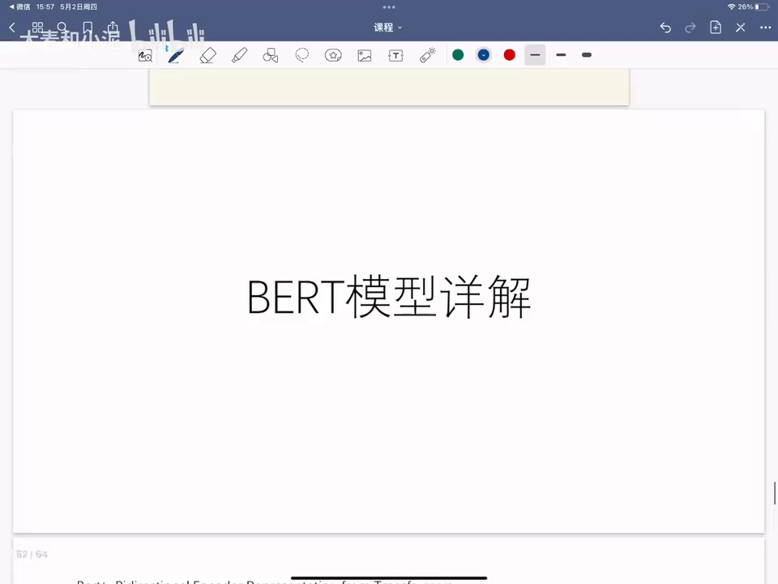

[【跳转到 00:50】](https://www.bilibili.com/video/BV1Km41117VG/?t=50)

另外要注意：BERT 整体是一个**自编码（Autoencoding）语言模型**。「自编码」与「自回归」的区别、以及它和「双向」的关系，后文用例子细讲。

## 二、两阶段结构：预训练 + 微调

[【跳转到 01:15】](https://www.bilibili.com/video/BV1Km41117VG/?t=75)

BERT 大体分为两部分：

1. **Pre-training（预训练）**：包含两个任务——**MLM（Masked Language Model，掩码语言模型）**与 **NSP（Next Sentence Prediction，下一句预测）**；
2. **Fine-tuning（微调）**：在预训练好的模型上，用少量标注数据适配具体下游任务。

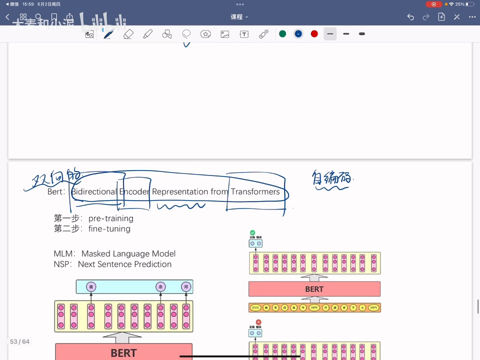

### 2.1 任务一 MLM：完形填空

[【跳转到 01:40】](https://www.bilibili.com/video/BV1Km41117VG/?t=100)

MLM 的通俗理解：输入一句话（比如「凉凉夜色为你思念成河」），**随机选一些要预测的词，用特殊符号 （遮掩）代替**，让模型根据上下文学习这个位置应该填的词——像做完形填空。

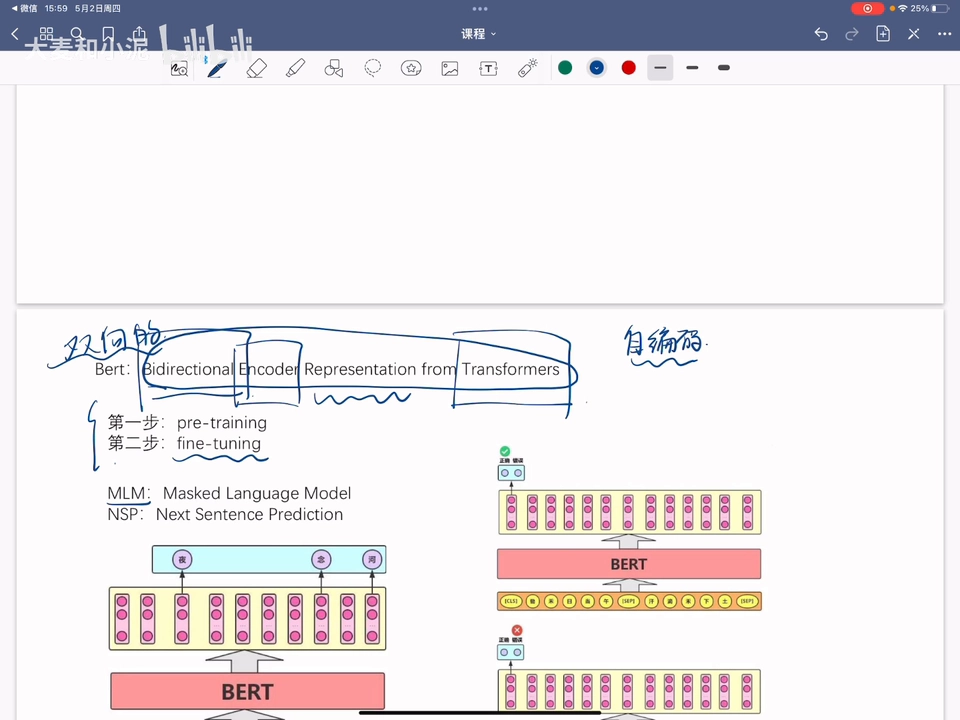

### 2.2 任务二 NSP：判断两句话是否连续

[【跳转到 02:30】](https://www.bilibili.com/video/BV1Km41117VG/?t=150)

NSP 在双向语言模型的基础上，额外增加一个**句子级别的连续性预测任务**：比如「锄禾日当午」的下一句是「汗滴禾下土」，搭配正确标签就是 **IsNext**；如果下一句换成「粒粒皆辛苦」这种不连续的搭配，标签就是 **NotNext**。引入这个任务，就能判断两段文本是否连续，让模型学到片段之间的关系。

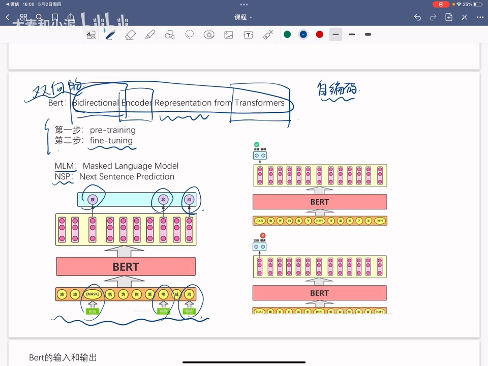

### 2.3 相比旧方法的优劣

[【跳转到 02:55】](https://www.bilibili.com/video/BV1Km41117VG/?t=175)

- 相比 **RNN / LSTM**：BERT 可以**并行执行**，同时提取词在句子中的关系特征，并能在多个不同层次中提取关系特征，更全面地反映句子语义；
- 相比 **word2vec**（仅做 embedding 的静态词向量）：BERT 能**结合上下文词义**——这正是上下文表示的好处；
- 缺点：**参数量过大、模型过于复杂**。

## 三、输入怎么表示：三种嵌入相加

[【跳转到 04:05】](https://www.bilibili.com/video/BV1Km41117VG/?t=245)

先看宏观结构：输入文本 → 向量表示 → 进入 BERT 模型（由很多个 Transformer Encoder 层组成）→ 得到输出。

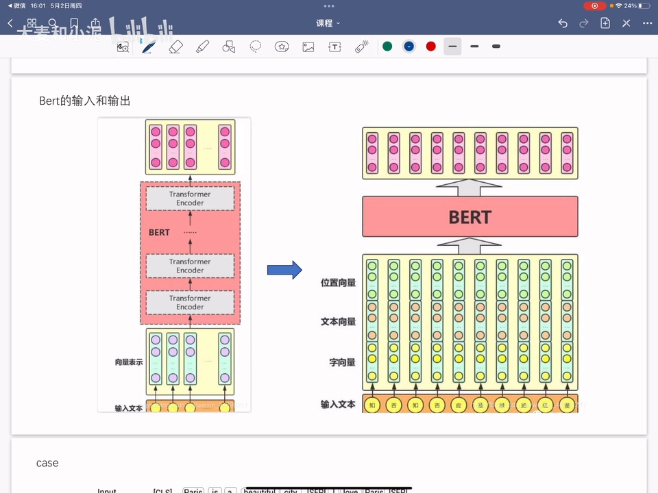

### 3.1 三种嵌入

[【跳转到 06:54】](https://www.bilibili.com/video/BV1Km41117VG/?t=414)

以句子 A「Paris is a beautiful city」、句子 B「I love Paris」为例，BERT 的输入由三部分嵌入（embedding）相加：

1. **Token embedding（字向量）**：细粒度的词/字级别嵌入；可以随机初始化，也可以用 word2vec 等算法的预训练结果作为初始值。这是区别于原始 Transformer 输入的一个点——有了它，BERT 能考虑更细粒度的 token 级信息；
2. **Segment embedding（片段嵌入）**：区分词来自句子 A 还是句子 B；
3. **Position embedding（位置嵌入）**：0、1、2……10，每个词一个位置编号。

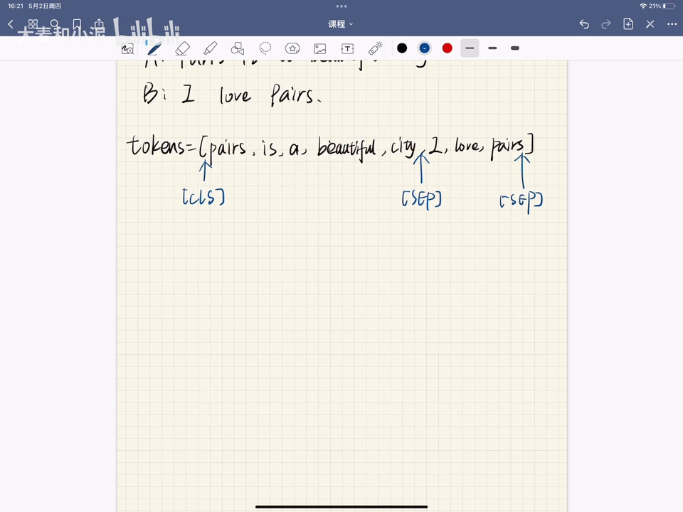

### 3.2 特殊标记与 WordPiece 分词

[【跳转到 07:44】](https://www.bilibili.com/video/BV1Km41117VG/?t=464)

分词后还要增加两个特殊标记：**[CLS]** 放在第一个句子前面；**[SEP]** 加在每个句子的句尾（A、B 两个句子就标两下）。在把所有标记喂给 BERT 之前，用一个嵌入层把标记转化为嵌入向量，这些嵌入在训练过程中学习。

![增加 [CLS] 与 [SEP] 标记：句首放 [CLS]，句尾加 [SEP]（视频讲解画面）](assets/小白也能听懂的 bert模型原理解读 预训练语言模型/00464.webp)

[【跳转到 05:45】](https://www.bilibili.com/video/BV1Km41117VG/?t=345)

英文方面，BERT 论文用 **WordPiece** 分词法进一步切分词汇：比如 I'm playing basketball 中的 playing 会被拆成 **play + ##ing** 两部分，更细地体现语义。我们熟悉的结巴（jieba）分词是整词切分，而 WordPiece 是子词切分。中文方面，作者并未对输入文本分词，而是直接**将单个字作为构成文本的基本单位**。

### 3.3 三种嵌入长什么样

[【跳转到 08:34】](https://www.bilibili.com/video/BV1Km41117VG/?t=514)

- **Segment embedding** 只返回两种嵌入：**E_A** 与 **E_B**，表示这个词属于句子 A 还是句子 B——Paris is a beautiful city 部分都嵌入到句子 A，I love Paris 部分嵌入到句子 B；

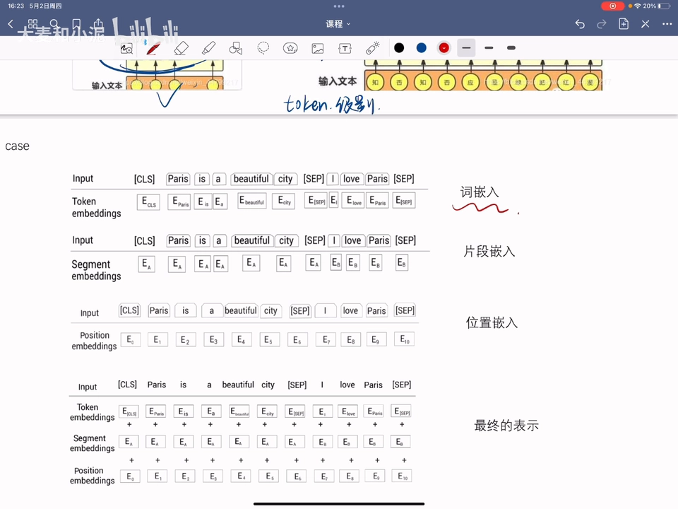

- **Position embedding**：每个位置一个编号，0～10；

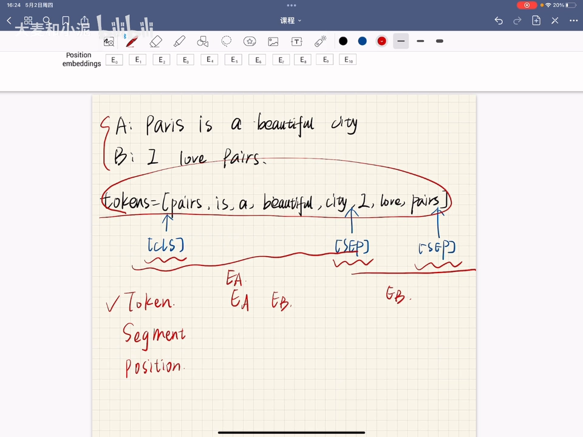

- **最终的输入 = 三者相加**：比如位置嵌入 E0 + 片段嵌入 E_A + 词嵌入 E_[CLS] 相加，得到的还是这个 [CLS] 标记位置的输入表示。

## 四、语言建模的两种思想：自回归 vs 自编码

[【跳转到 11:04】](https://www.bilibili.com/video/BV1Km41117VG/?t=664)

语言建模的基础思想分两类：

- **自回归语言建模**：分前向（从左到右逐词预测）与反向（从右到左）两种，**天然是单向的**——只会以一个方向阅读输入序列；
- **自编码语言建模**：**同时利用前向和反向**，预测时同时读入两个方向的序列——天生就是双向的。这正是 BERT「双向」的来源。

[【跳转到 11:54】](https://www.bilibili.com/video/BV1Km41117VG/?t=714)

例子：Paris is a beautiful ___，我们都知道空格处应该填 **city**。把 city 替换成空白符后：前向预测只看左边部分、从左到右预测到空白符；反向预测只看右边部分、从右到左预测到空白符；而自编码（BERT）则**同时**从左到右、从右到左地预测这个空白符。

## 五、MLM 细节：15% 遮盖与 80/10/10 规则

### 5.1 随机遮 15%

[【跳转到 13:59】](https://www.bilibili.com/video/BV1Km41117VG/?t=839)

还是 Paris is a beautiful city / I love Paris 的例子：分词处理得到 Tokens 后，**随机屏蔽 15% 的单词**——比如要屏蔽 city，就用一个特殊的  编码替换它，然后训练 BERT 去预测被屏蔽的标记。

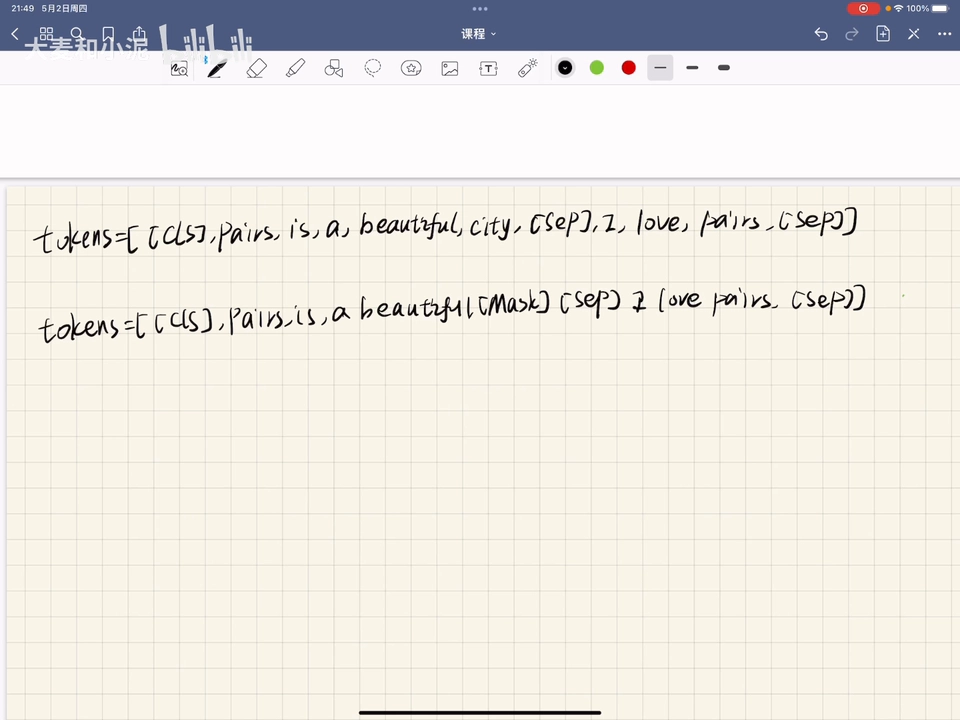

### 5.2 为什么要 80/10/10

[【跳转到 14:49】](https://www.bilibili.com/video/BV1Km41117VG/?t=889)

问题在于：预训练时输入有  标记，而**微调时输入不会有任何  标记**——这会让预训练与微调方式不匹配。解决办法就是有名的「**80/10/10**」规则，对这 15% 被选中的标记：

- **80%**：用  替换；
- **10%**：用随机的单词（比如 love）替换；
- **10%**：不做任何替换，保持原来的词（city）。

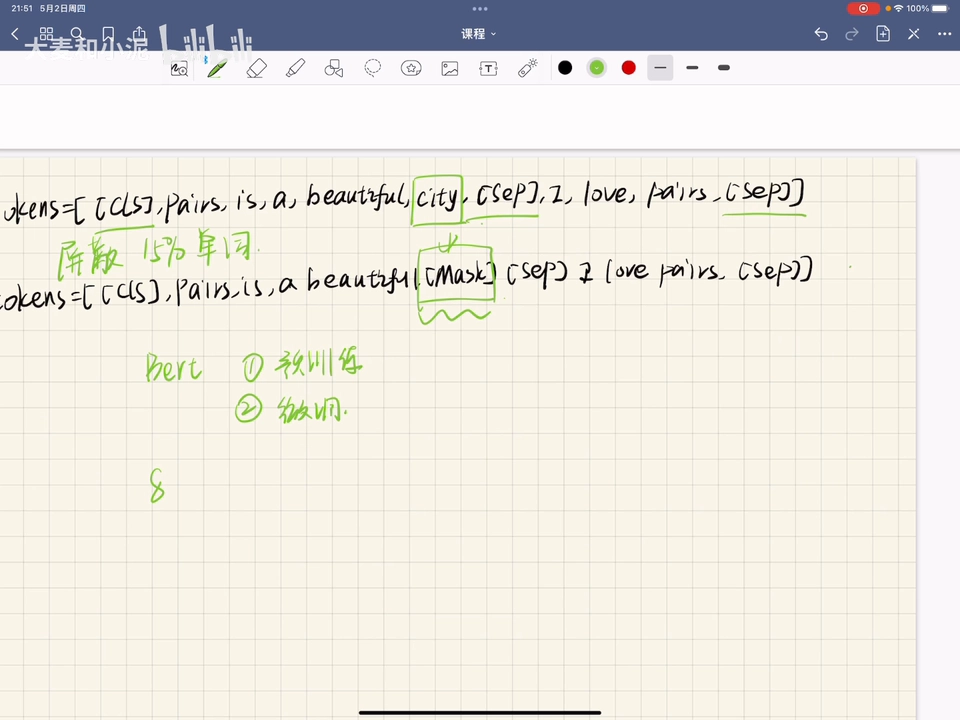

### 5.3 预测怎么完成

[【跳转到 16:29】](https://www.bilibili.com/video/BV1Km41117VG/?t=989)

分词和屏蔽之后，输入标记分别经过标记嵌入、片段嵌入、位置嵌入得到输入嵌入，三者相加后喂给 BERT；BERT 返回每个标记的嵌入表示。为了预测被屏蔽的标记，把对应输出喂给一个**带 softmax 激活函数的前馈神经网络**，输出词表中每个单词是该被屏蔽词的概率。例子里 **city 的概率 0.9 最高**，于是预测  处就是 city。

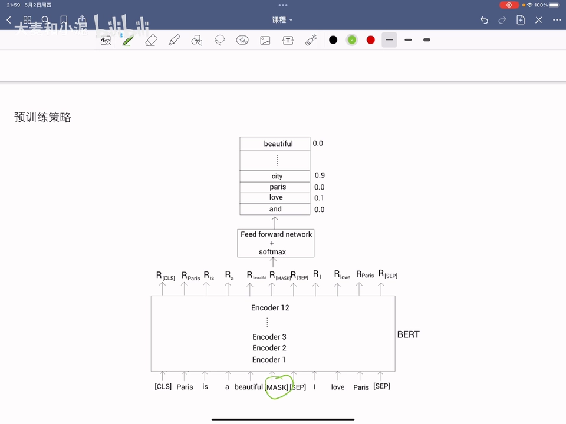

[【跳转到 17:44】](https://www.bilibili.com/video/BV1Km41117VG/?t=1064)

注意：**初始迭代时模型不会输出正确的概率**——前馈网络和 BERT 编码器的参数还是随机设定的；经过一系列迭代、不断更新前馈网络与 BERT 编码层的参数，模型才会输出比较正确的概率。

## 六、为什么要预训练？

[【跳转到 18:34】](https://www.bilibili.com/video/BV1Km41117VG/?t=1114)

用一个思想实验理解预训练的价值：假设先用**大规模语料库**为某种任务训练了模型 M；现在来了一个新任务、要建一个新模型，就用已经训练好的 M 的参数来**初始化**这个新模型——它就能训练得更快、预测效果更好。反之，如果随机初始化参数再从头迭代，就慢得多。预训练的意义正在于此：**用大语料学到的通用参数作为起点**。

## 七、NSP 细节：二分类、正负样本与训练

### 7.1 任务定义与两个 case

[【跳转到 19:54】](https://www.bilibili.com/video/BV1Km41117VG/?t=1194)

NSP 是一个**二分类任务**，分类结果是 IsNext / NotNext：输入两个句子，BERT 判断第二个句子是否为第一个句子的下一句。两个例子：

- 句子 A「She cooked pasta」，B「It was delicious」——B 显然是 A 的下一句，标记 **IsNext**；
- 句子 A「He turned the radio on」，B「She bought a new hat」——两个句子没有关系，标记 **NotNext**。

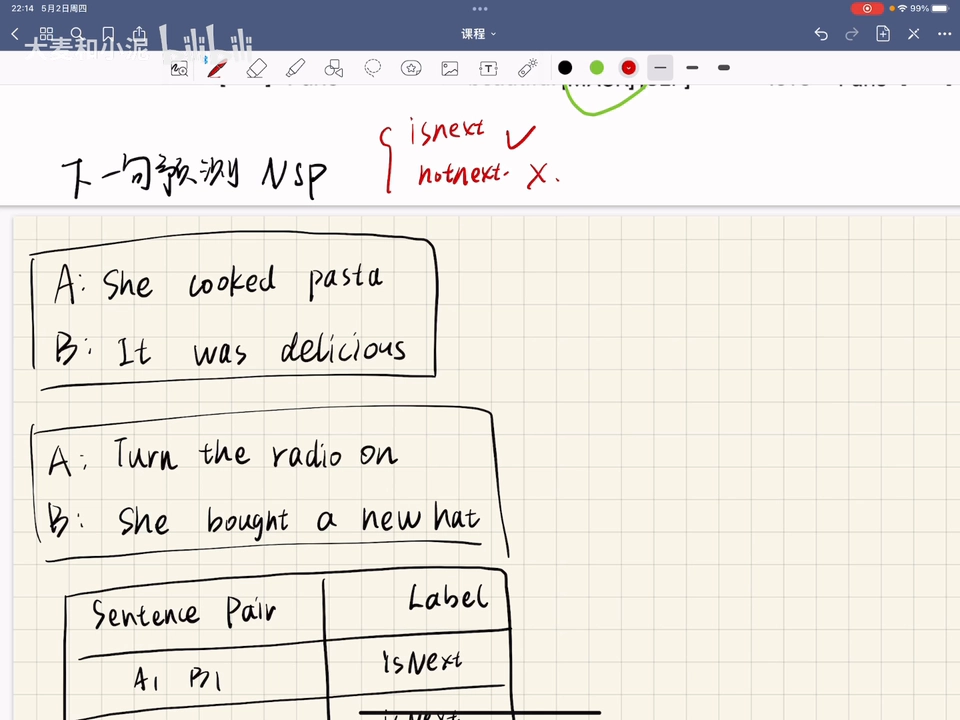

[【跳转到 20:19】](https://www.bilibili.com/video/BV1Km41117VG/?t=1219)

这个任务让模型理解**两个句子之间的关系**，有利于问答、文本生成等下游任务。

### 7.2 数据集怎么造

[【跳转到 20:44】](https://www.bilibili.com/video/BV1Km41117VG/?t=1244)

NSP 数据集可以从任何**单语语料**生成：从文档中任意抽取**相连的句子对**标记为 IsNext；NotNext 则从一个文档取一个句子、另一个句子**随机从所有文档中取**，标记为 NotNext。同时保证数据集 **50% IsNext、50% NotNext**——数据要平衡。

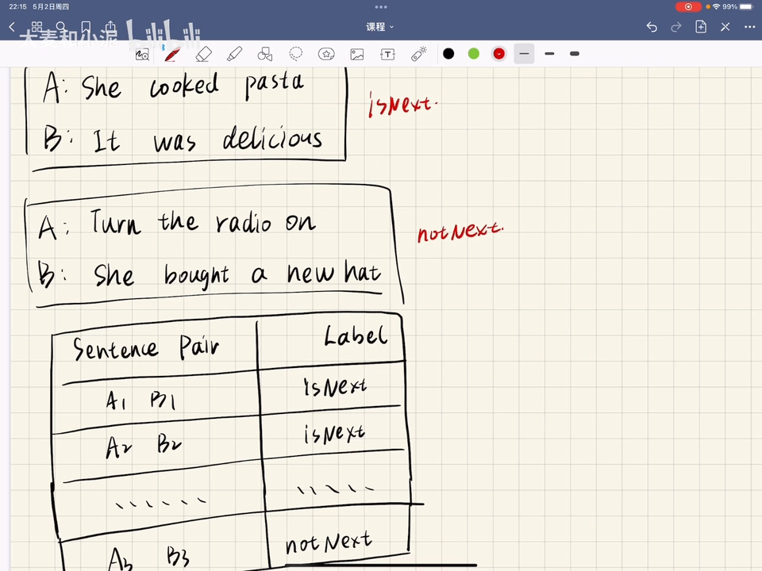

### 7.3 训练流程

[【跳转到 21:42】](https://www.bilibili.com/video/BV1Km41117VG/?t=1302)

输入是两个句子拼接的形式，喂进 BERT 后经过 **12 层 Encoder**，再通过一个前馈神经网络加 softmax，得到「是下一句」与「不是下一句」的概率：哪个概率高，就输出哪种关系。

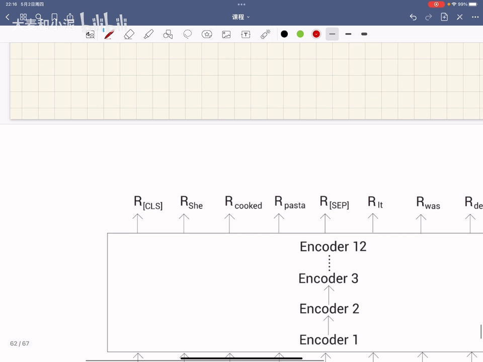

## 八、视频自己的总结

[【跳转到 22:32】](https://www.bilibili.com/video/BV1Km41117VG/?t=1352)

- **双向（Bidirectional）**的来源：BERT 是自编码模型，从左到右、从右往左同时预测空值；
- **Encoder**：它是 Transformer 里编码器部分的代表；
- **两步骤**：预训练 + 微调；
- **输入 = 三种 embedding 相加**：位置编码、片段嵌入、token 级嵌入（细粒度）；
- **掩码方式**：随机选 15% 的单词用  替代，模型用 softmax + 前馈神经网络预测  处概率最高的词；为了让掩码与微调一致，被选中的 15% 再按 **80%（MASK）/ 10%（随机词）/ 10%（保持原词）**处理；
- **NSP**：从大语料构造 IsNext / NotNext 标签训练，预测 IsNext 概率大于 NotNext 时，判定两句相关联。

## 小结

- BERT = **Transformer Encoder 的代表 + 自编码（双向）语言模型**：双向来自自编码建模「同时读入两个方向」。
- 两阶段：**预训练**（MLM + NSP，无监督）→ **微调**（少量标注数据适配下游任务）。
- **MLM**：随机遮 15% 的词做完形填空；被遮词按 **80/10/10** 处理（MASK / 随机词 / 原词），缓解预训练与微调的输入不一致。
- **NSP**：二分类判断句子对是否连续（IsNext / NotNext），数据集从单语语料构造、正负各 50%，有利于问答与文本生成。
- 输入表示 = **token + segment + position 三种嵌入相加**，配 [CLS]（句首，存全局表示）与 [SEP]（句尾分隔）；英文用 WordPiece 子词切分（playing → play + ##ing），中文按单字。
- 预测出口：被 MASK 位置的表示经**前馈网络 + softmax** 输出词表概率，取最高者为预测词；训练初期参数随机，靠迭代收敛。
- 预训练的意义：用大规模语料训练出的参数初始化新任务模型，训练更快、效果更好。
- 相比 RNN/LSTM 可并行、多层提取特征；相比 word2vec 能结合上下文；代价是参数量大、模型复杂。

## 关键术语速查

| 术语 | 一句话解释 |
| --- | --- |
| BERT | Bidirectional Encoder Representations from Transformers，双向编码器语言模型 |
| 预训练（pre-training） | 在大规模无标注语料上用 MLM + NSP 两个任务训练通用表示 |
| 微调（fine-tuning） | 用预训练参数初始化后，在小规模标注数据上适配具体下游任务 |
| MLM（掩码语言模型） | 随机遮住 15% 的词，让模型根据上下文预测被遮的词 |
| 80/10/10 规则 | 被选中的 15% 词：80% 换 MASK、10% 换随机词、10% 保持原词 |
| NSP（下一句预测） | 二分类判断句子 B 是否为句子 A 的下一句（IsNext / NotNext） |
| [CLS] / [SEP] | 特殊标记：[CLS] 放句首（其输出作句级表示），[SEP] 分隔句子 |
| WordPiece | 子词切分：playing → play + ##ing；中文按单字切分 |
| Token / Segment / Position embedding | 字向量 / 片段向量（E_A、E_B）/ 位置向量，三者相加作为输入 |
| 自回归（autoregressive） | 只按一个方向（前向或反向）逐词预测，天然单向 |
| 自编码（autoencoding） | 同时利用两个方向的信息预测被遮内容，天生双向 |
