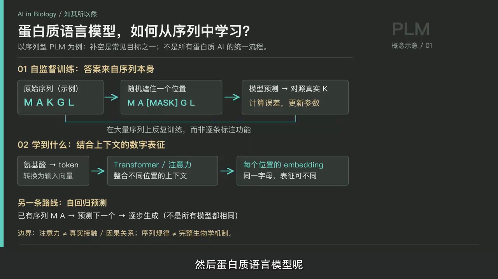
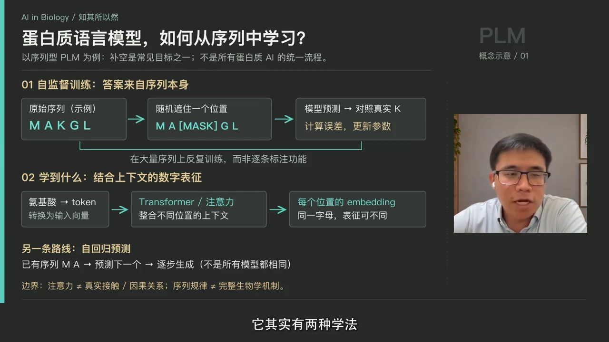
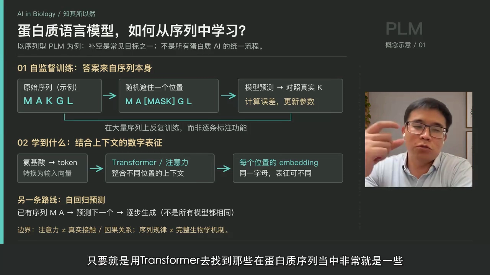
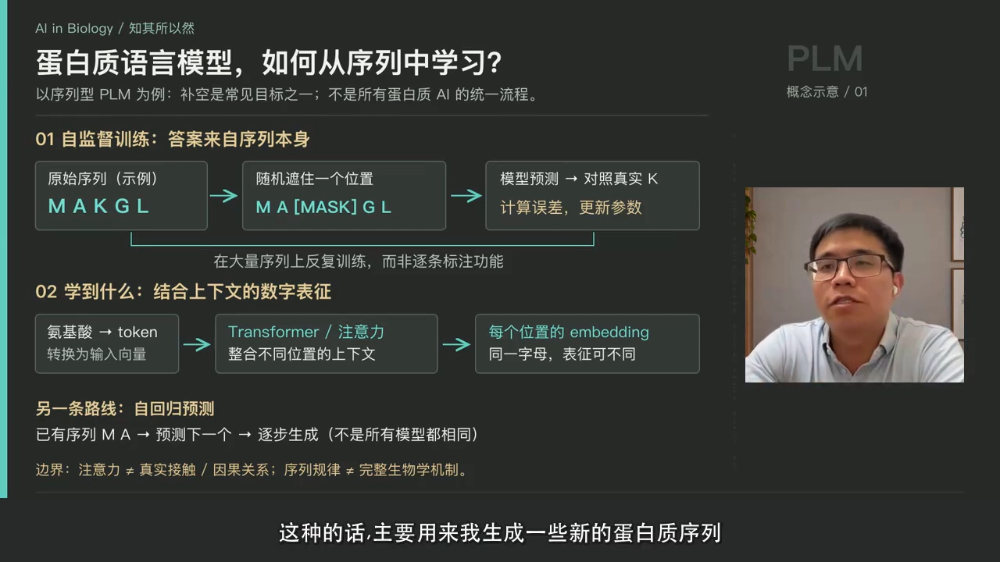
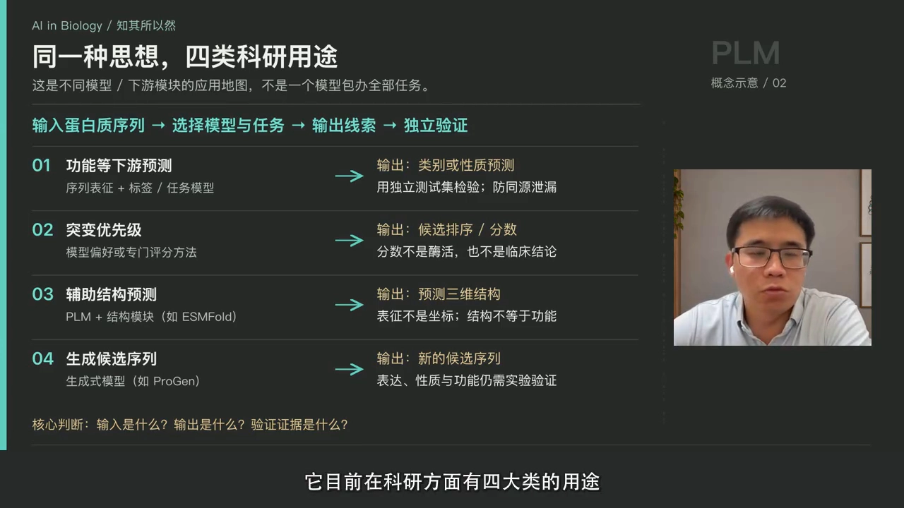
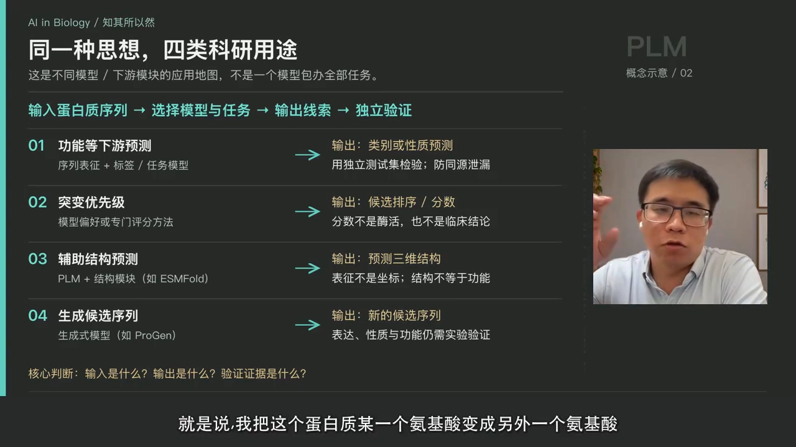
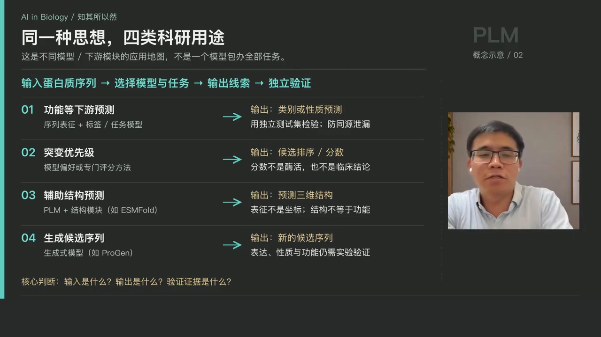
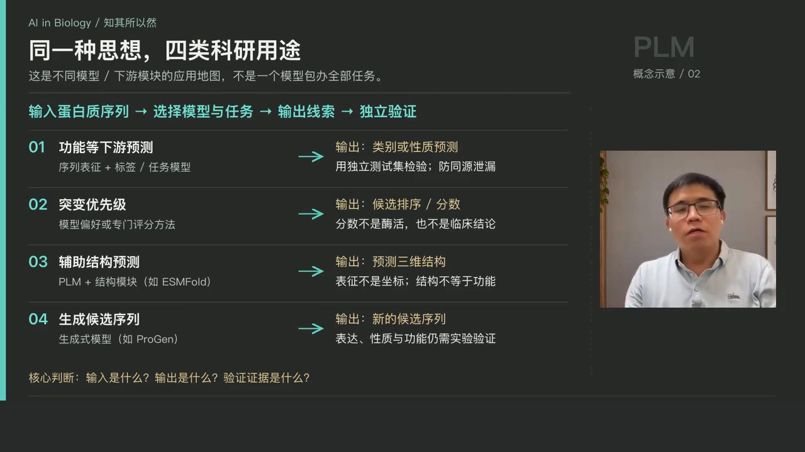
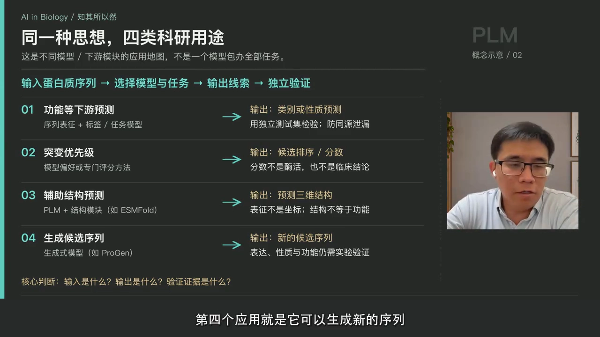

# 蛋白质语言模型（PLM）：遮位猜氨基酸的预训练，与它的四大应用

> 来源：Bilibili 视频《蛋白质语言模型（PLM）的基本原理与四大应用｜AI in biology 知其所以然EP01》（主讲人：何老师，栏目「AI in Biology 知其所以然」，[BV1xBWA67EJn](https://www.bilibili.com/video/BV1xBWA67EJn/)，时长 08:54）。
> 本文基于视频字幕与画面逐窗口整理而成，配图取自视频截图，时间戳可跳回原视频对应位置核对。这一讲回答两个问题：蛋白质语言模型是怎么训练的？训练好之后能干什么？

## 本讲要解决的核心问题（SCQA）

**背景**：蛋白质由 20 种氨基酸组成，一条蛋白质序列可以写成单字母串（比如 A、M、A、K、L 这样的字母）。生物信息学里，我们经常要回答：这条新序列有什么功能？这个位点突变了会怎样？

**冲突**：传统方法要么靠人工设计的特征，要么靠昂贵的实验，面对海量的蛋白质序列力不从心。而 NLP 领域的 BERT 证明了：让模型在海量文本上「自学」，能学到强大的语言表示。

**疑问**：把氨基酸序列当作一门「语言」，模型要怎么自学？自学到的东西又怎么用在实际科研里？

**回答（中心思想）**：蛋白质语言模型（Protein Language Model, PLM）用**掩码式自监督训练**——随机遮住序列里的一个位置，让模型预测该位置出现的氨基酸，再与真实序列比对、算误差、更新参数——在超大规模蛋白质序列上学会氨基酸之间的组合规律。学到的向量表征（embedding）可直接支撑四大类应用：**功能预测与注释、突变效应评估、辅助结构预测、新序列生成**。但要分清：模型学到的注意力与规律，不等于真实的生物学机制。

## 一、PLM 怎么训练：遮住一个位置，猜它是谁

[【跳转到 01:19】](https://www.bilibili.com/video/BV1xBWA67EJn/?t=79)

蛋白质语言模型的做法，与 BERT 的掩码预训练同出一辙：**随机遮住序列中的某一个位置，让模型预测这个位置出现某种特定氨基酸的概率**；再和真实蛋白质上该位置的氨基酸做比对，计算出误差，然后更新参数，让模型更准确地预测某个特定位置上的氨基酸。

这里有一个关键要点：**蛋白质的数目要非常非常多**。模型是靠 Transformer 在海量序列中找 pattern——哪些氨基酸可以同时出现、哪些氨基酸会形成特定的结构。数据越多，pattern 学得越准。

### 1.1 两种学法：掩码式与自回归式

[【跳转到 02:59】](https://www.bilibili.com/video/BV1xBWA67EJn/?t=179)

蛋白质语言模型有两种学法，对应 BERT 与 GPT 两条路线：

- **掩码式（Masked）**：前后氨基酸是已知的，把中间某个位置 mask 掉，去预测这个位置——像做完形填空；
- **自回归式（Autoregressive）**：只知道前面的氨基酸，然后预测下一个氨基酸是什么——像文字接龙，主要用来生成新的蛋白质序列。

两者主要是**应用方向不同**：掩码式擅长「理解」（预测、评估），自回归式擅长「生成」。

## 二、两个必须分清的界限

[【跳转到 02:09】](https://www.bilibili.com/video/BV1xBWA67EJn/?t=129)

用 PLM 时要警惕两类「画等号」的误读：

- **注意力 ≠ 真实接触**：模型学到的注意力（attention），并不代表两个氨基酸在三维结构里真的有接触；
- **序列规律 ≠ 生物学机制**：模型从序列中得到的规律，也不直接等于对应的生物学机制。这是两个概念——它可以**推断出**一些可能的接触或蛋白质功能，但不能画等号。

## 三、四大类应用

[【跳转到 03:24】](https://www.bilibili.com/video/BV1xBWA67EJn/?t=204)

四大类用途可以按「理解 → 评估 → 预测结构 → 生成」的逻辑排列：

### 3.1 功能预测与注释：用 embedding 做比对和分类

[【跳转到 03:49】](https://www.bilibili.com/video/BV1xBWA67EJn/?t=229)

给定一个新的蛋白质序列，先得到它的 **embedding**（中文叫「嵌入」或「表征」，即一组数值向量）。具有相似功能的蛋白质，它们的 embedding 更相似——所以可以把新序列的 embedding 和已有蛋白质做比对，或用一批蛋白质的 embedding 训练分类器，判断哪些蛋白质具有某些特定功能。这就是下游的**分类与注释**。

### 3.2 突变效应评估：比较突变前后的概率

[【跳转到 05:04】](https://www.bilibili.com/video/BV1xBWA67EJn/?t=304)

很多疾病相关突变发生在蛋白质上。PLM 提供了一种评估办法：把某个氨基酸换成另一个氨基酸，比较**新氨基酸出现的概率**与**原本野生型（wild type）氨基酸的概率**，通常用 **LLR score**（对数似然比）衡量。它更多反映的是一种**保守性（conservation）**——重要位置上的氨基酸通常在演化上高度保守，被替换后概率会明显下降。

不过，很多人认为从一维序列上学到的只是序列层面的保守性，学不到三维结构的关系；实际上，**只要数目足够大，结构上的信息也是可以学到的**——很多文献已经指出了这一点。

### 3.3 辅助结构预测：ESMFold 与 MSA

[【跳转到 05:54】](https://www.bilibili.com/video/BV1xBWA67EJn/?t=354)

PLM 也可以辅助三维结构预测。比如 **ESMFold**：用 ESM 这个语言模型接上结构预测模块，就能更好地预测蛋白质三维结构。此前的 **AlphaFold** 实际上也用了大量的 **MSA（Multi-Sequence Alignment，多序列比对）** 数据，显著提升了预测能力。蛋白质在序列上的保守性信息，正是 PLM 学得最好的部分。

### 3.4 生成新序列：从接龙到「造酶」

[【跳转到 06:44】](https://www.bilibili.com/video/BV1xBWA67EJn/?t=404)

PLM 是生成式模型：知道一个序列前面的氨基酸，就可以一直生成后面的氨基酸。生成出来的蛋白质序列**可能在自然中并不存在**，但因为模型学到的是自然界中蛋白质形成所需的架构与规律，所以它也可以有功能。还可以根据特定标签，生成某种类型、某种功能的蛋白质——比如具有催化功能的。

[【跳转到 07:34】](https://www.bilibili.com/video/BV1xBWA67EJn/?t=454)

视频里举的例子是上一期讲到的 de novo（从头设计）蛋白质生成模型——直接生成可以用来催化的酶。

## 四、下一步：各大模型家族如何工作

[【跳转到 08:22】](https://www.bilibili.com/video/BV1xBWA67EJn/?t=502)

这期主要理清两个概念：蛋白质模型**怎么训练**、**有哪些用途**。系列后续会讲蛋白质模型的几个主要大类——以 ESM、ProtTrans 这些为代表的模型究竟是怎么工作的、怎么发展出来的。

## 小结

- 蛋白质语言模型把氨基酸序列当「语言」，用**遮位预测**的自监督方式在超大规模数据上预训练：随机遮住一个位置 → 预测该位置氨基酸 → 与真实序列比对 → 更新参数。
- 两种学法：**掩码式**（完形填空，擅长理解）与**自回归式**（文字接龙，擅长生成）。
- 两条底线：注意力 ≠ 真实接触；序列规律 ≠ 生物学机制——可以推断，不能画等号。
- 四大应用：**功能预测与注释**（embedding 比对/分类）、**突变效应评估**（LLR score，反映保守性）、**辅助结构预测**（ESMFold；AlphaFold 借助 MSA）、**新序列生成**（可生成自然界不存在的、有功能的蛋白质）。
- 预训练需要的数据规模非常大；数据足够多时，序列层面的模型也能学到结构层面的信息。

## 关键术语速查

| 术语 | 一句话解释 |
| --- | --- |
| 蛋白质语言模型（PLM） | 把氨基酸序列当语言、在海量序列上自监督预训练的 Transformer 模型 |
| 掩码式训练（Masked） | 遮住中间位置让模型猜：前后已知，预测被遮的氨基酸 |
| 自回归（Autoregressive） | 只看前文、逐个预测下一个氨基酸，用于序列生成 |
| embedding（嵌入/表征） | 模型给序列或氨基酸生成的一组数值向量，用于比对、分类等下游任务 |
| 野生型（wild type） | 自然界中原本存在的氨基酸/序列形态 |
| LLR score | 对数似然比：比较突变氨基酸与野生型氨基酸出现概率的得分 |
| MSA（多序列比对） | 把同源蛋白质序列排在一起看保守位置的比对数据 |
| ESMFold | ESM 语言模型 + 结构预测模块的组合，可预测蛋白质三维结构 |
