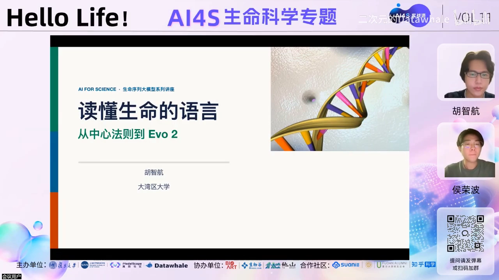
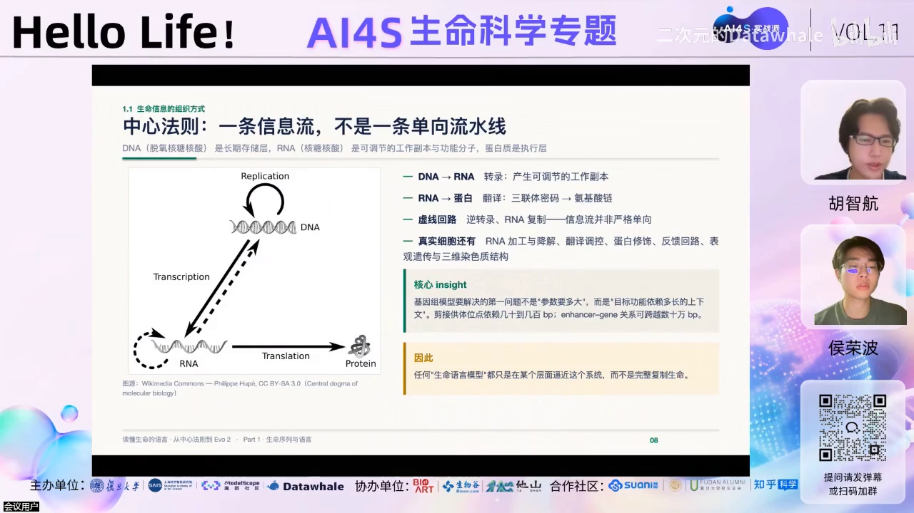
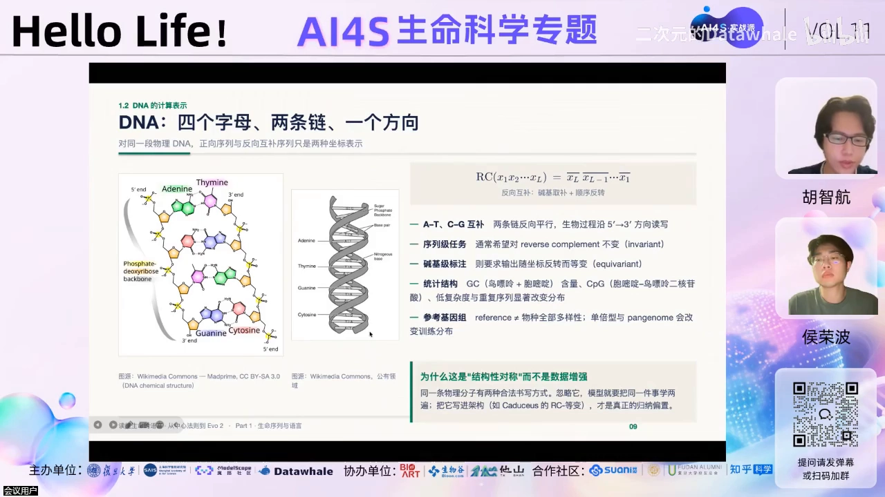
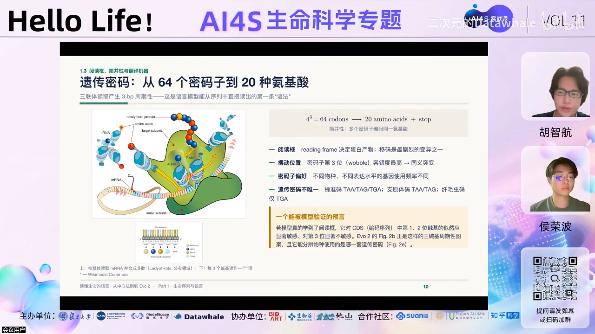
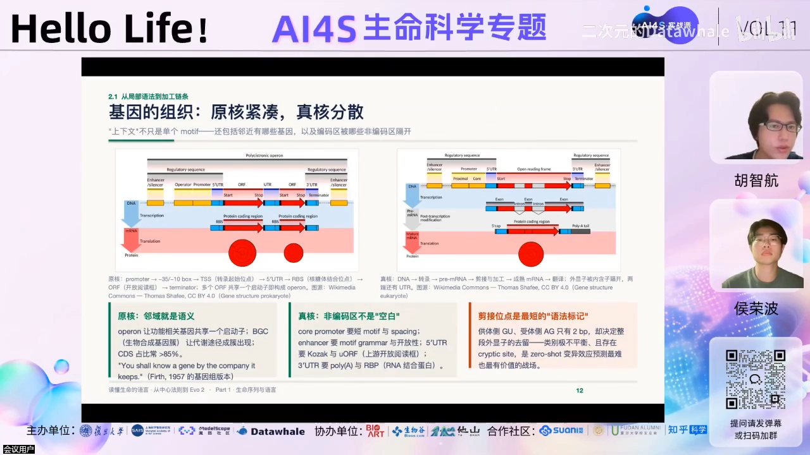
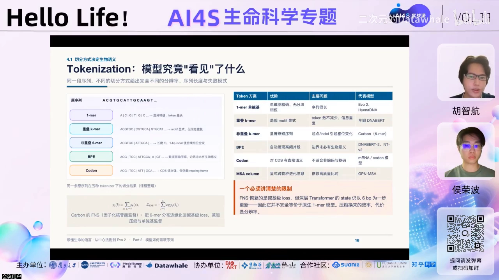
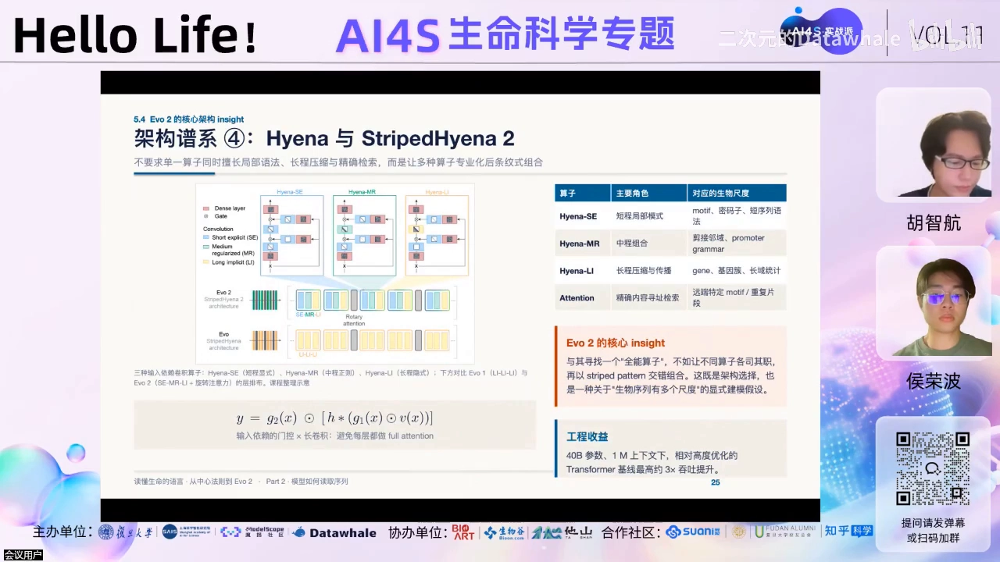
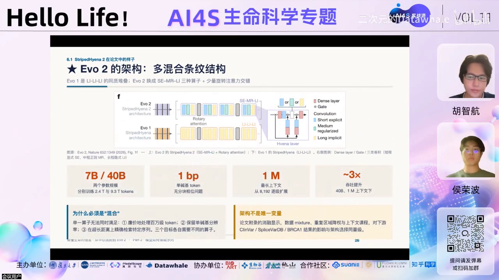
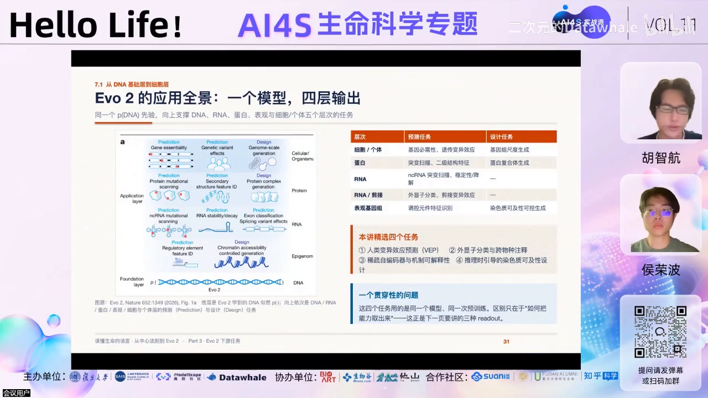
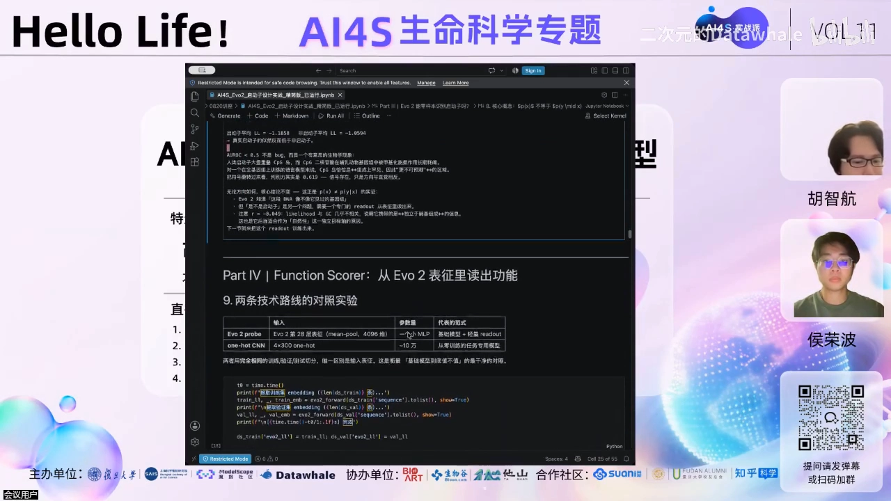

# DNA、RNA也能有自己的“大模型”？——AI 驱动生命序列大模型

> 来源：[DNA、RNA也能有自己的“大模型”？大湾区大学胡智航教授带你走进生命序列大模型](https://www.bilibili.com/video/BV1vj8K6DE49/)（Bilibili，AI for Science 实战派第 11 期，约 91 分钟）。本博客由视频演说图文稿整理而成，内容可核查。

## 本讲要解决的核心问题（SCQA）

**背景**：蛋白质领域的大模型已经彻底改变了生物学——AlphaFold 把蛋白结构预测做到实验精度，RFdiffusion 能从头设计蛋白、酶和抗体；2024 年诺贝尔化学奖一半授予蛋白质预测、一半授予蛋白质设计。

**冲突**：那么 DNA、RNA 这类生命序列呢？它们能不能也像自然语言一样，被大模型「读懂」？要读懂，模型得先回答三个问题：序列怎么切（tokenizer）、模型怎么训（训练目标与架构）、读懂之后信息怎么取出来（readout）？

**疑问**：这些选择分别意味着什么？一个真正读懂了生命序列的大模型，又能干哪些实际的事？

**回答（中心思想）**：生命序列**可以在特定意义上当语言来建模**：tokenizer、训练目标、架构三个选择各自向模型注入不同的「归纳偏置」；得到 Evo 2 这样的大模型后，有**对数似然、embedding、稀疏特征**三种 readout，分别支撑变异效应预测（零样本）、基因注释（接分类头）和可解释性/序列设计。本讲末尾的实操用 Evo 2-7B 展示：一套 notebook 完成「识别启动子（AUROC 0.94）+ 引导生成启动子（通过率与真实启动子几乎持平）」。

## 一、背景：AI for Science 走到哪一步了

### 1.1 三个阶段

讲者把 AI for Science 的发展概括为三个阶段 [【跳转到 07:55】](https://www.bilibili.com/video/BV1vj8K6DE49/?t=475)：

1. **分析工具**：早期 AI 只是更好的统计学方法，代替人工特征——分析图像、EEG 等信号数据；
2. **科学仪器**（约 2018–2024）：更大的算力、数据与更好的算法，让 AI 能给出以前只能靠实验测量的量或结构。代表是 AlphaFold——预测了数以亿计的未知蛋白结构，做成 AlphaFold DB 公共基础设施；
3. **生成引擎**（2024 至今）：从「读懂、预测」走向「参与设计、生成」——代表如 Baker 组的 RFdiffusion，成功设计了大量蛋白质、酶和抗体，形成「模型设计 → 实验验证」的闭环。

### 1.2 为什么生命科学走得最快

讲者给出三个条件 [【跳转到 10:25】](https://www.bilibili.com/video/BV1vj8K6DE49/?t=625)：一是**数据量本来就庞大**——测序数据与语言模型的形态天然对齐；二是部分**高通量实验体系可以闭环**；三是**算力爆发**。2024 年诺贝尔奖一年内两次授予 AI（物理学奖：Hopfield 与 Hinton；化学奖：蛋白质预测与设计），正是这一趋势的标志 [【跳转到 11:28】](https://www.bilibili.com/video/BV1vj8K6DE49/?t=688)。

## 二、生命序列为什么可以当语言（中心法则基础）

### 2.1 中心法则：存储、副本、执行

中心法则连接 DNA、RNA 和蛋白质 [【跳转到 15:16】](https://www.bilibili.com/video/BV1vj8K6DE49/?t=916)：

- **DNA** 是长期的**存储介质**；
- **RNA** 是可调节的**工作副本**——读取 DNA；
- **蛋白质** 是**执行层**，实际执行人体功能。

注意：图中 DNA→RNA、RNA→DNA 画成虚线——真实细胞里信息流并不完全单向：RNA 会被加工、降解、参与翻译调控，反馈回路甚至可能修改 DNA 本身。

### 2.2 DNA 的读写规则与「双链」建模差异

DNA 只有 4 个字母（A/T/C/G，RNA 是 A/U/C/G），但这四个字母不是孤立字符 [【跳转到 17:21】](https://www.bilibili.com/video/BV1vj8K6DE49/?t=1041)：

- DNA 是**两条链反向平行**，生命过程沿 5' 端到 3' 端读写；
- 同一段物理 DNA 的正向、反向互补读法只是两种坐标表示——**正链和反链**。

于是建模分两派：**Evo 2 把正链和反链都放进训练集**；而 DNABERT、Caduceus 等模型只建模其中一条链。这是不同大模型对 DNA 的不同「看法」，会影响下游任务 [【跳转到 17:46】](https://www.bilibili.com/video/BV1vj8K6DE49/?t=1066)。

### 2.3 密码子的简并与阅读框

DNA 怎么翻译成蛋白？**三个碱基为一组（密码子）**，对应 20 种氨基酸和终止信号 [【跳转到 18:36】](https://www.bilibili.com/video/BV1vj8K6DE49/?t=1116)。两个关键事实：

1. **简并**：多个密码子可以编码同一个氨基酸——决定氨基酸的主要是第一、二位，第三位并不特别敏感；
2. **阅读框（reading frame）**：同一段 DNA，从不同位置开始读，会翻译出完全不同的蛋白。

### 2.4 RNA：编码与非编码，结构与调控

RNA 不只是中间体。它分两大类 [【跳转到 20:16】](https://www.bilibili.com/video/BV1vj8K6DE49/?t=1216)：**编码 RNA（mRNA）**负责把 DNA 的信息翻译成蛋白质，结构上是「非翻译区（UTR）+ 编码区（CDS）」；**非编码 RNA** 不翻译成蛋白，但参与大量调控。RNA 与 DNA 的一个重要差别：DNA 在体内更多是线性读取，而 **RNA 的结构影响更大**——它会折叠出茎环（stem-loop）、假结（pseudoknot）等二级结构，远距离碱基之间的关系直接影响调控功能。

### 2.5 基因长什么样（原核示例）

一个原核基因从左到右大致是：**启动子**（含 -30、-10 保守 box、TSS 转录起始位点）、5'UTR、**CDS（密码子所在编码区）**等 [【跳转到 21:56】](https://www.bilibili.com/video/BV1vj8K6DE49/?t=1316)。

### 2.6 为什么「序列像语言」：三个理由

- **上下文定义语义**：自然语言里一个词由周围语义定义；原核基因里，一个基因的功能由它的 operon（操纵子）归属和通路表达 [【跳转到 22:21】](https://www.bilibili.com/video/BV1vj8K6DE49/?t=1341)；
- **无标签也能学到功能**：碱基的保守位点、选择压力在几十万年进化中留下统计痕迹——大规模统计让模型隐式学到保守区域的「语法与语义」，不需要人工标注 [【跳转到 24:26】](https://www.bilibili.com/video/BV1vj8K6DE49/?t=1466)；
- **层级组合与长上下文**：碱基 → motif → 调控元件，像词 → 短语 → 句子；enhancer 这类元件因三维折叠可以影响很远处的基因，正如自然语言里相隔很远的句子成分互相呼应 [【跳转到 25:56】](https://www.bilibili.com/video/BV1vj8K6DE49/?t=1556)。

但「像」不等于「是」：DNA 没有**明确的词边界**，motif 甚至可以互相重叠；DNA 有双链；更重要的是，生物序列的「语义」由**三维结构与能量**决定，不是线性文本关系——比如增强子通过 DNA 成环被拉到远处的启动子旁边（远端调控），纯序列模型（sequence-only）因此有天花板 [【跳转到 23:11】](https://www.bilibili.com/video/BV1vj8K6DE49/?t=1391)。讲者的结论：生命序列**可以在特定意义上用语言模型建模**，但不能完全替代生物机制。

## 三、大模型如何读取生物序列：五个要素

一条 DNA 进入大模型，要经过五个步骤 [【跳转到 28:43】](https://www.bilibili.com/video/BV1vj8K6DE49/?t=1723)：**数据准备 → tokenizer → 训练目标 → 架构 → readout**。前四步的每个选择，都会向模型注入「归纳偏置」。

### 3.1 数据：OpenGenome 等开源数据集

Evo 2 训练用的是 OpenGenome 这类开源数据集，RNA 也有对应的开源数据集。

### 3.2 tokenizer：模型怎么「看」序列

自然语言以词为 token；生物序列则有多种切法 [【跳转到 30:23】](https://www.bilibili.com/video/BV1vj8K6DE49/?t=1823)：

| 切法 | 代表模型 | 特点 |
| --- | --- | --- |
| 单碱基（1-mer） | **Evo 2** | 天然适配 SNV/单碱基插入等任务 |
| 三碱基（密码子） | 部分 RNA/mRNA 模型 | 与「三碱基翻译一个氨基酸」对齐 |
| 六碱基（6-mer，非重叠） | Caduceus | 单核苷酸任务需用边缘概率等方式适配，更麻烦 |
| BPE 高频片段 | 数据驱动 | 片段长度不固定 |

tokenizer 的选择直接决定下游任务的适配难度——这就是一种先验的归纳偏置。

### 3.3 训练目标：GPT 式自回归 vs BERT 式掩码

两种主流训练方式 [【跳转到 34:33】](https://www.bilibili.com/video/BV1vj8K6DE49/?t=2073)：

- **causal LLM 自回归**（GPT 式，decoder-only）：代表 Evo 2、dGPT，大多基于 LLaMA；
- **masked LM**（BERT 式，encoder-only、双向上下文）：代表 **DNABERT、RNA-FM** 等。

与 tokenizer 一样，训练目标也是归纳偏置，会影响下游任务。讲者还给出一张按「tokenizer × 训练目标」组织的模型总结表（RNA 侧有 CaLM、iGPT 等，讲者说明未列全）；此外 LucaOne 统一了 RNA/DNA/protein 三种模态的 tokenizer，可训练统一大模型 [【跳转到 35:56】](https://www.bilibili.com/video/BV1vj8K6DE49/?t=2156)。

> 呼应本系列上一篇：RNA-FM 正是 RNA 侧 masked-LM（encoder-only）路线的代表——它输出 L×640 嵌入的用法，见《RNA大型语言模型代码教程》。

### 3.4 架构：从 HMM/CNN 到 Transformer、Mamba 与 Evo 混合架构

- **早期**：隐马尔可夫模型（转移矩阵）；**CNN** 至今仍有用武之地——200bp 的 promoter 这类短序列，CNN 叠几层就有几百碱基视野，完全够用 [【跳转到 37:53】](https://www.bilibili.com/video/BV1vj8K6DE49/?t=2273)；
- **Transformer attention**：大模型的基础，但 time/memory 消耗**正比于序列长度平方**——百万级 token 上下文时开销不可接受（Evo 2 不用 attention 的主要原因）；改进有 block attention、sparse attention [【跳转到 39:08】](https://www.bilibili.com/video/BV1vj8K6DE49/?t=2348)；
- **state space model / Mamba**：解决 RNN 不能并行的问题，推理线性、可并行，表达力介于 RNN 与 Transformer 之间；代表 Caduceus 等 DNA Mamba 模型，可处理几十万到百万级序列 [【跳转到 40:23】](https://www.bilibili.com/video/BV1vj8K6DE49/?t=2423)；
- **Evo 混合架构**：基于卷积，但用三种 block 组合——**SC（StripedConv 条带卷积）与 M2（Mamba-2）视野固定**，**LI 能看到全长序列**。Evo 1 全部用 LI 堆叠；Evo 2 的 ablation 发现**不同视野的堆叠比全部全长更好** [【跳转到 43:18】](https://www.bilibili.com/video/BV1vj8K6DE49/?t=2598)。

## 四、Evo 2 实例：怎么把大模型「喂」出来

Evo 2 训练了 **7B 和 40B** 两个模型，分别用 2.4T 和 9.3T tokens 训练；tokenizer 是**单碱基**；最长上下文 **1M token** [【跳转到 45:48】](https://www.bilibili.com/video/BV1vj8K6DE49/?t=2748)。训练数据 OpenGenome2 共 8.8T tokens，加上 data sampling / regularization 后训练规模约 9.3T。两个值得记住的训练细节：

- **重复区域降重**：基因组里大量重复序列会污染训练，让模型「自以为学得很自信」却没学到功能上下文——降重后更聚焦功能/保守区域 [【跳转到 47:03】](https://www.bilibili.com/video/BV1vj8K6DE49/?t=2823)；
- **两阶段扩上下文**：stage 1 用约八千 token 的上下文，stage 2 用 **RoPE 位置编码拉长**扩展到百万级 [【跳转到 47:53】](https://www.bilibili.com/video/BV1vj8K6DE49/?t=2873)。

## 五、三种 readout：把模型的能力「读」出来

模型训完，信息怎么取？Evo 2 有三种 readout [【跳转到 48:51】](https://www.bilibili.com/video/BV1vj8K6DE49/?t=2931)，对应三类下游任务：

### 5.1 对数似然（likelihood）：零样本预测变异有害性

把突变序列与参考序列的**对数似然相减**——概率来自 next-token prediction 各位置概率相乘再取 log，**全程无需训练** [【跳转到 49:16】](https://www.bilibili.com/video/BV1vj8K6DE49/?t=2956)。直觉：如果突变序列「更不可能出现」，突变位点可能有害、与疾病相关。

实测（ClinVar 数据集，zero-shot）[【跳转到 53:01】](https://www.bilibili.com/video/BV1vj8K6DE49/?t=3181)：**coding SNV** 上 Evo 2 有竞争力但落后 ESM-1b 等专用模型；**non-coding SNV 上超过所有对比方法**（包括 Caduceus 等 6-mer 模型）——因为它是单碱基自回归模型，天然适配单核苷酸变异场景，tokenizer 与任务对齐了。

### 5.2 embedding + 分类头：跨物种基因注释

用 Evo 2 表征加 MLP/分类器做**八个物种**（可可、大麦、葡萄等）的基因注释分类，基本超过单独在这些数据集上 fine-tune 的模型 [【跳转到 56:21】](https://www.bilibili.com/video/BV1vj8K6DE49/?t=3381)。

### 5.3 稀疏特征：中间层可解释性

用 VAE 重建 Evo 2 第 26 层的激活（10 亿 token、无监督 reconstruction）[【跳转到 57:36】](https://www.bilibili.com/video/BV1vj8K6DE49/?t=3456)。结果：大肠杆菌 K12 上激活的 neuron **集中在已注释的隐性前噬菌体区域**，人工打乱序列后激活消失——说明中间层不是「背下某段基因组」，而是学到了**抽象的功能概念**。

### 5.4 推理时引导生成：边生成、边打分

让 GPT 式的 Evo 2 每次生成 128bp 片段，由可及性打分器 accept/reject，循环直到通过 [【跳转到 59:16】](https://www.bilibili.com/video/BV1vj8K6DE49/?t=3556)。论文用 **ATAC-seq 实验验证**，AUROC 大于 0.9；且采样 token 越多、只保留 guidance 最好的前两个片段，效果越好。

## 六、实操：用 Evo 2-7B 识别与设计启动子

实操环节用 notebook 演示完整流程（7B 模型，消费级显卡如 4090 也能跑；讲者用 80G 的 H100）[【跳转到 1:05:19】](https://www.bilibili.com/video/BV1vj8K6DE49/?t=3919)。

### 6.1 数据与基线

数据用 Nucleotide Transformer downstream benchmark 的 **promoter_all** 任务：3 万多条、每条 300bp、覆盖 23 条染色体；正负样本（启动子/非启动子）各 1.5 万多个，按**染色体切分** train/test（test 是 CHR8、CHR21）避免同源泄漏 [【跳转到 1:08:56】](https://www.bilibili.com/video/BV1vj8K6DE49/?t=4136)。关键基线：**只用 GC 含量就有 AUROC 0.89**——所以任何模型必须显著超过 0.9 才算真本事。

### 6.2 三个接口与两个实验

Evo 2 的三个核心接口 [【跳转到 1:13:47】](https://www.bilibili.com/video/BV1vj8K6DE49/?t=4427)：**logits**（算对数似然）、**embedding**（取第几层表征）、**generation**（给 prompt 续写，max len 120）。

- **零样本 likelihood 分类启动子：失败**——比 GC 基线还差。原因不是没学到东西：Evo 2 建模的是完整基因组，它并不「天然」会判断「这是不是启动子」这类任务；
- **embedding + 一层 CNN（取第 28 层表征）：AUROC 0.94**，高于 one-hot CNN 的 0.92（两者结构同构）和 GC 基线 0.88——证明 **embedding 确实有贡献** [【跳转到 1:17:31】](https://www.bilibili.com/video/BV1vj8K6DE49/?t=4651)。

### 6.3 引导生成启动子：三种 mode

生成候选分三种 mode [【跳转到 1:18:34】](https://www.bilibili.com/video/BV1vj8K6DE49/?t=4714)：

1. **只给真实启动子上游 20bp**：模型能自发续写出 TATA box 等启动子「语法」；
2. **context 模式**（给一部分启动子作为 prompt）：生成序列被判为真实启动子的通过率 **0.75**，与真实启动子的 0.767 几乎持平——生成物和真启动子一个水平；
3. **de novo（无 prompt 从头生成）**：通过率断崖下降——没有拿到启动子上下文，模型会生成别的东西。

## 七、QA 摘录

- **生物安全**：训练时已把病毒序列数据摘除，模型对致病序列「无知识」；设计时可用 logits + 下游 score function 引导 [【跳转到 1:23:10】](https://www.bilibili.com/video/BV1vj8K6DE49/?t=4990)；
- **真核 vs 原核**：Evo 2 两类数据都有（9.3T tokens），原核可能更好；Evo 1 有数据 bias；
- **超过 1M 的序列**：用移动窗口计算，窗口一般取重合 [【跳转到 1:25:40】](https://www.bilibili.com/video/BV1vj8K6DE49/?t=5140)；
- **未来方向**：赋能制药（最热）与合成生物学；
- **为什么蛋白模型比小分子成熟**：蛋白质有**同源序列**——同源本身自带一部分语义；小分子是纯化学实体，没有同源信息，语义更难学。

## 小结

- 生命序列**可以在特定意义上当语言建模**：小词表、顺序依赖、层级组合、长上下文都像语言；但没有词边界、语义受三维结构影响，不能替代生物机制。
- 大模型读取序列的三个关键选择——**tokenizer、训练目标、架构**——各自注入归纳偏置：单碱基 tokenizer（Evo 2）天然适配 SNV；BERT 式 masked LM（含 RNA-FM）与 GPT 式自回归（Evo 2、dGPT）各有侧重；架构从 CNN、Transformer 到 Mamba、Evo 混合 block 各有取舍。
- Evo 2：7B/40B 双版本、单碱基 tokenizer、OpenGenome2 8.8T→9.3T tokens、重复区域降重、RoPE 两阶段拉长到 1M 上下文。
- 三种 readout 支撑三类任务：likelihood 零样本预测变异（non-coding SNV 超过所有对比）、embedding+分类头做基因注释、稀疏特征做可解释性；推理时引导可做序列设计（ATAC-seq 验证 AUROC>0.9）。
- 实操证明：识别任务上 embedding（0.94）> 序列 one-hot（0.92）> GC 基线（0.89）；生成任务上带 context 的引导生成通过率与真实启动子几乎持平，de novo 则大幅下降。

## 关键术语速查

| 术语 | 一句话解释 |
| --- | --- |
| 中心法则 | DNA（存储）→ RNA（副本）→ 蛋白质（执行）的信息流 |
| 密码子 | 三个碱基一组，对应一个氨基酸；有简并性 |
| 阅读框 | 从哪个位置开始三三分组读密码子，决定翻译产物 |
| UTR / CDS | 非翻译区 / 编码区，mRNA 的两大组成部分 |
| tokenizer | 把序列切成 token 的方式；决定模型「怎么看」序列 |
| masked LM | BERT 式双向预训练，encoder-only（如 DNA BERT、RNA-FM） |
| causal LM | GPT 式自回归预训练，decoder-only（如 Evo 2、dGPT） |
| SSM / Mamba | 线性推理、可并行的序列架构，表达力介于 RNN 与 Transformer 之间 |
| StripedConv / Mamba-2 / LI | Evo 架构的三种 block：条带卷积 / Mamba-2 / 全长视野 |
| 对数似然差 | 突变序列与参考序列 likelihood 之差，零样本评估变异影响 |
| readout | 从训练好的模型中取出信息的方式（似然 / embedding / 中间层激活） |
| 推理时引导 | 生成-打分-接受/拒绝循环的引导式序列设计 |
| AUROC | 分类模型 ROC 曲线下面积，越大越好 |
| promoter / enhancer | 启动子（基因起点）/ 增强子（可远距离增强表达） |
| TSS | 转录起始位点 |
