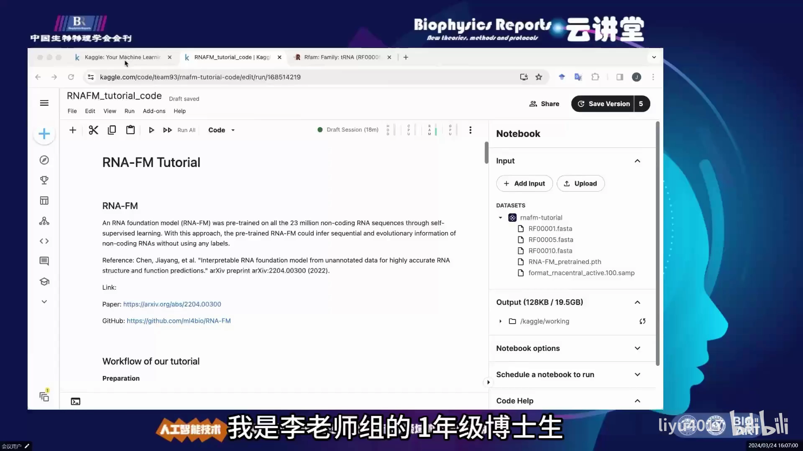
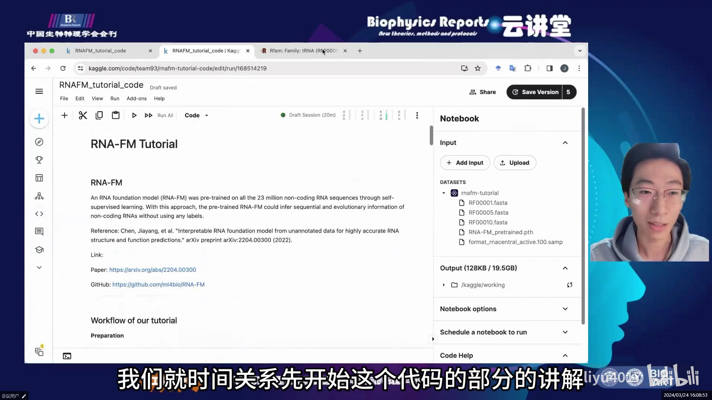
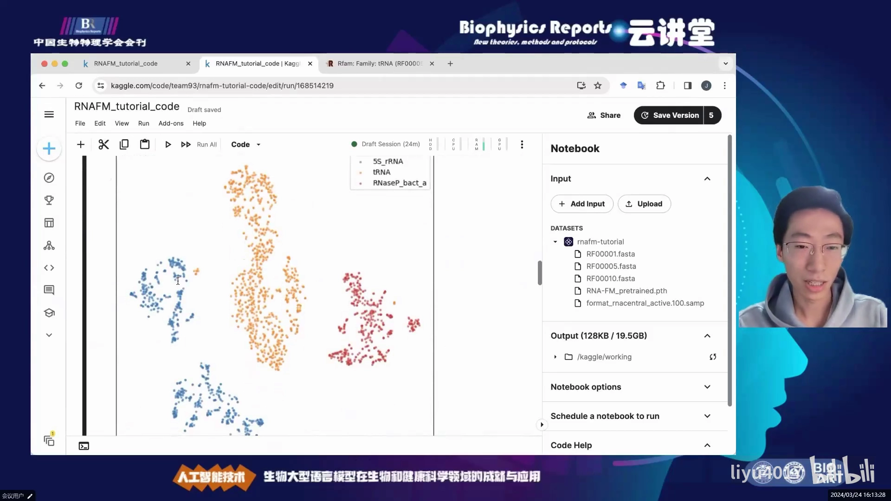
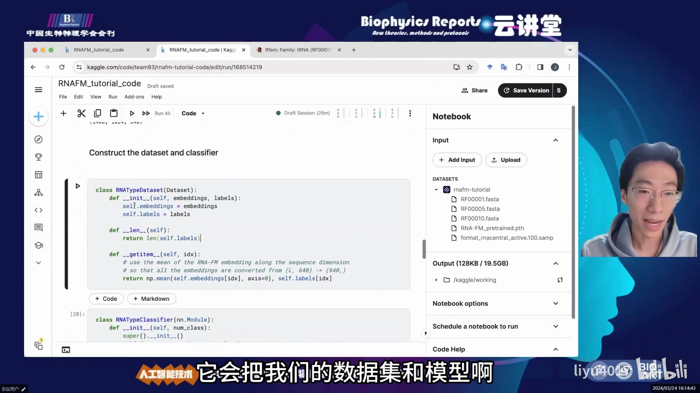
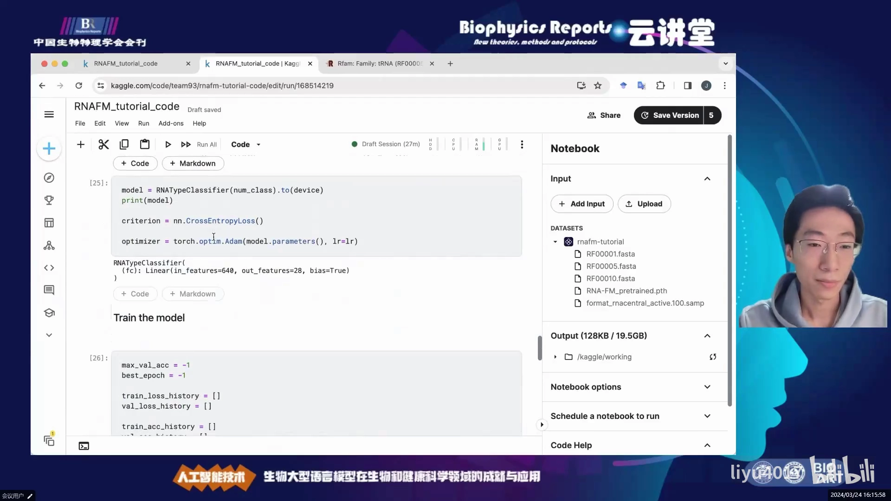
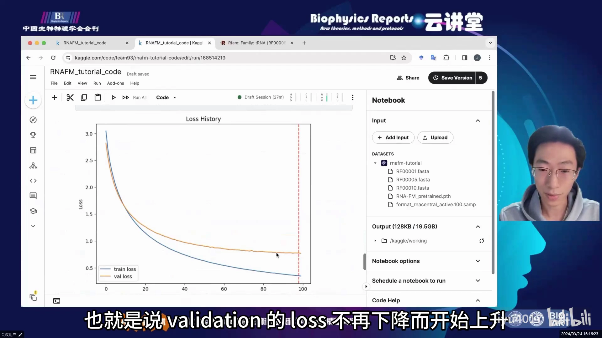

# RNA大型语言模型代码教程

> 来源：[RNA大型语言模型代码教程](https://www.bilibili.com/video/BV11D4215795/)（Bilibili，李煜老师组，约 10 分钟）。本博客由视频演说图文稿整理而成，内容可核查。

## 本讲要解决的核心问题（SCQA）

**背景**：蛋白质领域已经有 ESM2 这类序列语言模型：海量序列上自监督预训练，把序列变成向量（嵌入），再接下游任务。RNA 领域也有对应的基础模型 **RNA-FM**，由清华大学李煜老师团队发布。

**冲突**：对初学者来说，「预训练模型」四个字听着很玄：模型权重拿到手之后，RNA 序列到底怎么变成向量？变成了向量又能干什么？

**疑问**：能不能用几行代码，把 RNA 序列变成嵌入，并立刻做出两个看得见效果的真实任务？

**回答（中心思想）**：可以。本讲是 RNA-FM 团队成员的官方代码教程：`pip` 安装 → 载入预训练权重 → 长度为 L 的 RNA 序列变成 **L×640 的嵌入** → 接下游模型。教程用两个任务演示这套标准流程——RNA family 聚类与 RNA 类型分类，并证明 RNA-FM 的嵌入**自带生物学含义**：聚类自然分开，分类用最简单的全连接层就能到约 80% 准确率。

## 一、RNA-FM 是什么：2300 万条非编码 RNA 上自监督预训练

### 1.1 预训练设定

RNA-FM 是在 **2300 万条非编码 RNA（non-coding RNA）** 序列上做过**自监督预训练**的基础模型。所谓自监督，就是不需要人工标注——模型从海量序列里自己学习「什么样的序列片段像什么样的序列片段」，这和蛋白质语言模型的预训练思路一致。

### 1.2 输入与输出：长度 L 的 RNA → L×640 嵌入

预训练之后，RNA-FM 的用法非常直接：

- **输入**：一条长度为 L 的 RNA 序列（由 A/U/C/G 四种碱基组成）；
- **输出**：一个 **L×640 的编码**——序列上每个位置（每个碱基）对应一个 640 维的向量。

这个 L×640 的矩阵就是「嵌入（embedding）」。拿到嵌入后，后面的任务就可以用各种普通模型或神经网络来处理，**不需要再动 RNA-FM 本身** [【跳转到 01:42】](https://www.bilibili.com/video/BV11D4215795/?t=102)。

### 1.3 如何安装与调用

教程在 Kaggle 平台上演示（新用户可白嫖 30 小时免费 GPU）。RNA-FM 已经打包成了 Python 包：

- 安装：`pip install` 一行命令（教程作者的 Kaggle notebook 叫 `rafm-tutorial`，可直接 Copy & Edit）；
- 备选：遇到安装问题可以直接从 GitHub 把代码库下载下来 `install from source`；
- 调用：`import fm` 之后即可在 Python 程序里加载预训练权重、做后续研发 [【跳转到 03:22】](https://www.bilibili.com/video/BV11D4215795/?t=202)。

## 二、任务一：RNA family 聚类——嵌入自带生物学含义

### 2.1 数据与流程

第一个演示任务：对 RNA family（RNA 家族）做聚类。数据从 **Rfam 数据库**选了三个 RNA family（编号 1、5 和 10），取回三个 family 下的全部序列，共 **2124 条** [【跳转到 02:32】](https://www.bilibili.com/video/BV11D4215795/?t=152)。

流程分三步：

1. 用 RNA-FM 把 2124 条序列全部转成 L×640 的嵌入；
2. 用 **t-SNE**（一种把高维向量压缩到 2 维画图的降维算法）把每个家族的嵌入降到二维；
3. 画在 2D 平面上看分布。

这里有个实现细节：RNA-FM 接受的输入是一个**二元组组成的 list**——每个二元组的第一项是序列名字，第二项是序列本身 [【跳转到 05:02】](https://www.bilibili.com/video/BV11D4215795/?t=302)。

### 2.2 结果：三个家族自然聚成三个簇

t-SNE 降维后画在平面上，效果一目了然：**三个不同 family 的 RNA 序列，自然而然聚成了三个 cluster（簇）** [【跳转到 05:52】](https://www.bilibili.com/video/BV11D4215795/?t=352)。

注意：聚类前没有人告诉模型「哪些序列属于哪个家族」——嵌入本身就把同家族序列拉到了一起。这从侧面证明 **RNA-FM 学到的表征具有真实的生物学含义** [【跳转到 06:17】](https://www.bilibili.com/video/BV11D4215795/?t=377)。

## 三、任务二：RNA 类型分类——640 维向量接一个全连接层

### 3.1 数据：28 类 RNA、1400 条序列

第二个演示任务：RNA **类型分类（type classification）**。RNA 不止一种：tRNA 负责搬运氨基酸、rRNA 是核糖体的组成部分，还有其他各种行使不同功能的类别。给定一条 RNA 序列，如何判断它是什么类型、行使什么功能？

数据从另一个 FASTA 文件加载：**28 类**不同的 RNA（包括常见的 rRNA、tRNA 等），共 **1400 条**序列 [【跳转到 06:42】](https://www.bilibili.com/video/BV11D4215795/?t=402)。

### 3.2 模型：单个全连接层 640 → 28

和任务一同理：加载预训练好的 RNA-FM，把 1400 条序列全部转成 L×640 的嵌入。分类器本身简单得惊人——**一个全连接层**，把 640 维的表征直接映射到 28 维输出，每个输出单元对应一类的 probability（概率）[【跳转到 07:32】](https://www.bilibili.com/video/BV11D4215795/?t=452)。

### 3.3 训练与结果：接近 80% 测试准确率

教程用 PyTorch 组织数据与模型，划分训练/验证/测试集：训练集约 800 条、验证集约 200 条、测试集约 280 条（三类里 RNA 类别分布一致）。标准训练流程：定义超参数 → 初始化数据集与 DataLoader → 损失函数与优化器 → 训练 100 个 epoch。

训练中能看到典型现象：loss 一路下降，接近第 100 个 epoch 时 **early stopping** 触发——验证集 loss 不再下降反而开始上升，说明模型开始**过拟合** [【跳转到 08:47】](https://www.bilibili.com/video/BV11D4215795/?t=527)。

最终，模型在**训练时从未见过的测试集**上达到**接近 80% 的准确率** [【跳转到 09:12】](https://www.bilibili.com/video/BV11D4215795/?t=552)——而这只是一个单个全连接层。教程作者指出：换成更复杂的网络、用更多数据，测试准确率还可以有大幅提升。

## 小结

- RNA-FM 是在 2300 万条非编码 RNA 上**自监督预训练**的 RNA 基础模型；输入长度 L 的 RNA，输出 **L×640 嵌入**（每个碱基一个 640 维向量）。
- 嵌入是「通用底座」：接 t-SNE 可做聚类，接全连接层可做分类，不需要动预训练权重。
- 聚类任务：Rfam 三个 family、2124 条序列，t-SNE 后自然聚成三簇——嵌入自带生物学含义。
- 分类任务：28 类 RNA、1400 条序列，单个全连接层即达**约 80% 测试准确率**。
- 工程侧：`pip install` 或 GitHub 源码安装，`import fm` 即用；Kaggle 免费 30 小时 GPU 足够复现。

## 关键术语速查

| 术语 | 一句话解释 |
| --- | --- |
| RNA-FM | 清华李煜团队发布的 RNA 基础模型（预训练语言模型） |
| 自监督预训练 | 不用人工标注，模型从海量序列中自行学习规律 |
| 嵌入（embedding） | 序列被模型映射成的向量；RNA-FM 输出 L×640 |
| t-SNE | 把高维向量降到 2 维以便画图聚类的算法 |
| Rfam | 收录 RNA 家族（family）序列的公共数据库 |
| FASTA | `>名字` + 序列行的常见序列文件格式 |
| epoch | 训练时完整过一遍训练集称为一个 epoch |
| early stopping | 验证集 loss 开始上升时提前停止训练，防过拟合 |
| 过拟合 | 训练集越学越好、验证/测试集表现反而变差的现象 |
