# SBERT：在 BERT 后面加一层池化，把逐词向量变成句子向量

> 来源：Bilibili 视频《SBERT（Sentence-BERT）模型介绍》（[BV1gZECzMEpU](https://www.bilibili.com/video/BV1gZECzMEpU/)，时长 17:31）。
> 本文基于视频字幕与画面逐窗口整理而成，配图取自视频截图，时间戳可跳回原视频对应位置核对。
> 系列定位：上一讲（4.2.1）讲了嵌入（embedding）是什么；本讲回答一个更具体的问题——BERT 这类编码器输出的是**每个 token 一个向量**，而相似度计算、检索、聚类这些任务需要的是**整个句子一个向量**，中间这一步怎么做？答案就是「池化（pooling）」。视频介绍的 Mean Pooling（均值池化）与 [CLS] 向量，正是把逐 token 嵌入压缩成序列级向量最常用的两种方案——这也是各类模型平台 API 里 `return_per_token` 这类开关（逐 token 返回还是池化后返回）背后的取舍。

## 本讲要解决的核心问题（SCQA）

**背景**：BERT 等预训练模型已经能输出每个词的上下文相关向量表示（词嵌入），在语义理解类任务上表现很好。

**冲突**：要判断句子之间的语义相似度，原始 BERT 的做法是把两个句子拼在一起做**联合编码**——要比较 1000 个句子对，就得做 1000 次联合编码，计算量随句子数急剧增长。小规模任务还能应付，但搜索引擎实时查询、海量文本这类场景就捉襟见肘了。

**疑问**：能不能每个句子只编码一次，就得到一个能代表整句语义、可反复使用的向量？

**回答（中心思想）**：SBERT 在 BERT 后面加了一个**池化层**，把逐词向量整合成固定长度的句子向量——常用 **Mean Pooling（对所有词向量取平均）**或 **[CLS] 标记向量**两种方案；每个句子独立编码一次、多次使用。再通过 NLI、STS、对比学习等任务微调，让「语义相近的句子，向量也相近」。

[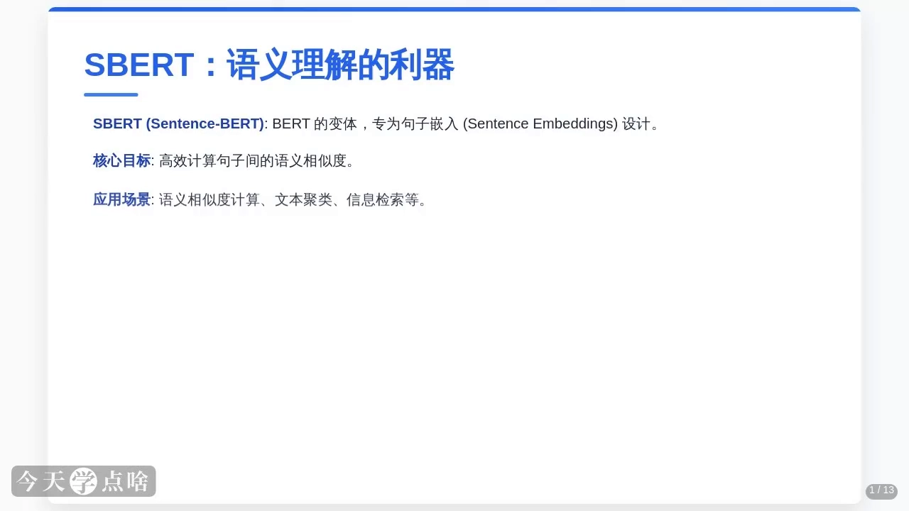](https://www.bilibili.com/video/BV1gZECzMEpU/?t=0)

## 一、为什么需要 SBERT：BERT 的效率瓶颈

[【跳转到 00:50】](https://www.bilibili.com/video/BV1gZECzMEpU/?t=50)

原始 BERT 处理句子对的方式，是把两个句子**拼接后联合编码**。想判断 1000 个句子对的相似度，就要做 1000 次联合编码，计算量随句子数急剧增长，效率低得让人头疼。这种「一对一对算」的方式，在小规模任务上还能应付；但面对搜索引擎实时查询、海量文本处理等大规模场景，就显得捉襟见肘了。

[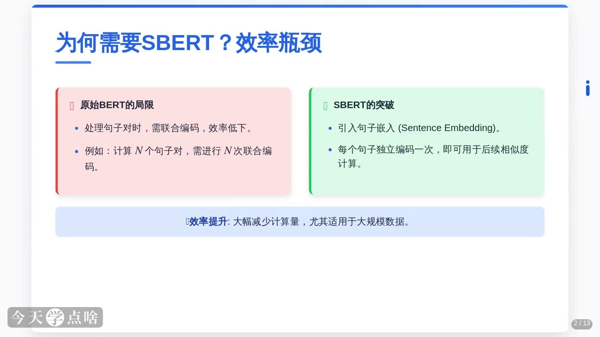](https://www.bilibili.com/video/BV1gZECzMEpU/?t=100)

SBERT 的解法是引入**句子嵌入（sentence embedding）**：把每个句子独立编码成一个固定长度的向量。这样无论有多少句子对，每个句子只需编码一次，之后相似度就只是向量之间的快速计算。这种「一次编码、多次使用」的设计大幅降低了计算复杂度，在大规模数据集上的效率提升几乎是革命性的。

## 二、SBERT 的四个核心特性

[【跳转到 02:55】](https://www.bilibili.com/video/BV1gZECzMEpU/?t=175)

1. **句子嵌入**：把一个句子转换成一个固定长度的向量。这个向量蕴含句子的深层语义——比如「我今天很开心」和「我今天心情愉悦」表达方式不同，但语义非常接近，SBERT 就会为它们生成相近的向量。
2. **高效性**：句子独立编码、避免重复计算，处理大规模数据游刃有余。
3. **多任务适用性**：语义相似度、自然语言推理 NLI、信息检索、问答系统都能胜任。
4. **可微调性**：可以按具体任务需求，在 NLI 或 STS 数据集上微调，进一步优化性能。

[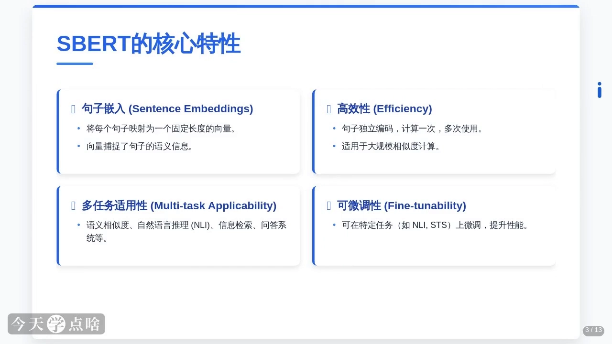](https://www.bilibili.com/video/BV1gZECzMEpU/?t=200)

## 三、工作流程：从逐词向量到句子向量（本讲核心）

### 3.1 输入处理与句子编码

[【跳转到 04:35】](https://www.bilibili.com/video/BV1gZECzMEpU/?t=275)

SBERT 可以接受单个句子，也可以处理句子对（训练时会将两个句子拼接成一个输入）。句子编码阶段用预训练好的 BERT 或其变体（如 RoBERTa、DistilBERT）处理输入：**BERT 会把输入中的每个词都转换成一个上下文相关的向量表示，也就是所谓的词嵌入（token embeddings）**。

这里的关键改进是**句子独立编码**——每个句子单独编码，而不是像传统方法那样把句子对作为整体处理。这不仅简化了计算，也为后续的池化操作奠定了基础。

[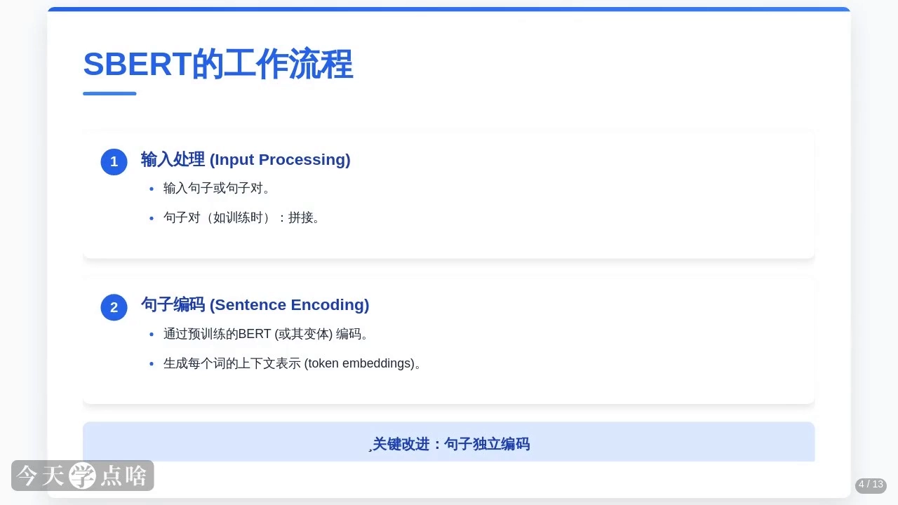](https://www.bilibili.com/video/BV1gZECzMEpU/?t=275)

### 3.2 池化层：Mean Pooling 与 [CLS] 两种方案

[【跳转到 05:50】](https://www.bilibili.com/video/BV1gZECzMEpU/?t=350)

BERT 的输出是**每个词的词向量**，而句子级任务需要的是**整个句子的表示**——池化层就像一个提炼器，把多个词向量整合成一个固定长度的句子向量。常用的池化方法有两种：

- **Mean Pooling（均值池化）**：对所有词的词向量取平均值，得到一个代表整个句子的向量；
- **[CLS] Token**：直接使用 BERT 输出中特殊标记 [CLS] 的词向量。[CLS] 标记通常用于分类任务，它的向量被认为能捕捉到句子的整体信息。

这两种方法各有优劣，但都能有效地将词向量转化为句子的全局表示。

[![池化层的两种常用方法：Mean Pooling 对所有词向量取平均；[CLS] Token 直接取特殊标记的词向量](assets/SBERT（Sentence-BERT）模型介绍/00350.webp)](https://www.bilibili.com/video/BV1gZECzMEpU/?t=350)

> **迁移到生物序列模型**：蛋白质/核酸语言模型同理——PLM 输出的是**每个残基一个向量**（逐 token 嵌入）。做序列级任务（相似度、分类、回归）时对它们取均值池化；做残基级任务（如位点效应预测）时则保留逐 token 向量。`return_per_token` 这类参数控制的就是返回哪一种。

## 四、训练目标：让语义相近的句子向量相近

[【跳转到 06:40】](https://www.bilibili.com/video/BV1gZECzMEpU/?t=400)

SBERT 的训练目标是优化生成的句子嵌入，使其更好地反映句子语义。主要有三类任务：

1. **NLI（自然语言推理）**：判断句子对的关系——推导（entailment，如「小明是学生」可推出「小明是人」）、矛盾（如「今天是晴天」与「今天是雨天」）或中性（既不推导也不矛盾）。通过这种任务，SBERT 学会区分语义的细微差别，比如理解「苹果很甜」和「苹果很酸」之间的不同。
2. **STS（语义文本相似度）**：预测两个句子的相似度分数（如 0 到 5 分），分数越高语义越接近，让嵌入向量能反映句子间的相似程度。
3. **对比学习**：用 anchor–positive–negative 三元组训练——把相似句子（positive）的嵌入拉近，把不相似句子（negative）的嵌入推远，显著提升模型对语义相似性的敏感度。

[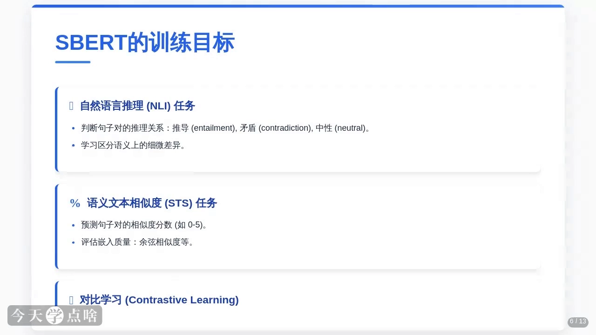](https://www.bilibili.com/video/BV1gZECzMEpU/?t=450)

## 五、架构与训练数据

[【跳转到 09:10】](https://www.bilibili.com/video/BV1gZECzMEpU/?t=550)

从架构上看，SBERT 基于 BERT，但针对句子嵌入任务做了细节优化：

- **输入层**：单个句子或句子对；句子对的格式通常是 `[CLS] Sentence1 [SEP] Sentence2 [SEP]`，其中 [CLS] 和 [SEP] 是 BERT 的特殊标记；
- **编码层**：流程的核心，用预训练 BERT（或变体）**独立编码**每个句子，生成上下文相关的词向量；
- **池化层**：把词向量整合成固定长度的句子向量（Mean Pooling 或 [CLS]）；
- **训练方式**：通常采用微调，用 NLI、STS 等特定任务数据优化模型。

[![SBERT 架构：输入层支持 [CLS] 句1 [SEP] 句2 [SEP] 格式，编码层独立编码，池化层用 Mean Pooling 或 [CLS]](assets/SBERT（Sentence-BERT）模型介绍/00550.webp)](https://www.bilibili.com/video/BV1gZECzMEpU/?t=550)

训练数据方面：NLI 任务常用 SNLI（斯坦福自然语言推理数据集）、MultiNLI 等数据集，提供大量句子对，覆盖推导、矛盾、中性三种关系；STS 任务的数据集则提供句子对及其相似度评分。无论哪种任务，**高质量的训练数据都是微调成功的关键**——数据的质量和多样性直接影响模型的泛化能力。

[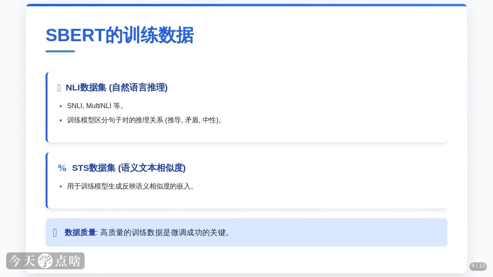](https://www.bilibili.com/video/BV1gZECzMEpU/?t=625)

## 六、主要应用场景

[【跳转到 11:15】](https://www.bilibili.com/video/BV1gZECzMEpU/?t=675)

- **语义相似度计算**（核心应用）：通过计算两个句子向量之间（通常是余弦相似度）的相似度，快速判断语义是否相近。比如聊天机器人中判断用户的新回复与之前的对话是否一致。
- **信息检索**：把用户查询和文档都转成向量，再通过最近邻搜索（KNN）快速找到最相关的文档——检索速度与结果准确性都得到提升。
- **问答系统**：把用户问题和候选答案都转成向量，按相似度找到最匹配的答案，常见于智能客服和知识库问答。

[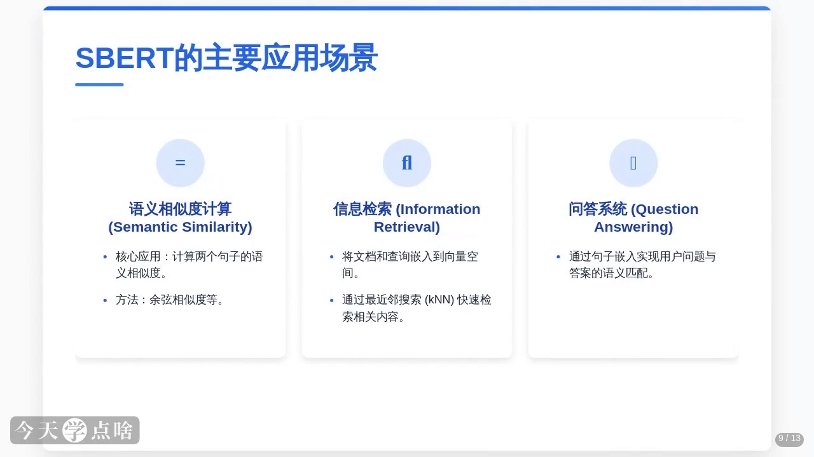](https://www.bilibili.com/video/BV1gZECzMEpU/?t=700)

此外还有两类延伸场景：

- **文本聚类**：把文本转成向量后自动将相似主题的文本聚成一组，可用于新闻分类、社交媒体分析等。
- **跨语言表示**：多语言预训练模型支持跨语言语义相似度任务，比如比较中文和英文句子是否表达相似的意思。

[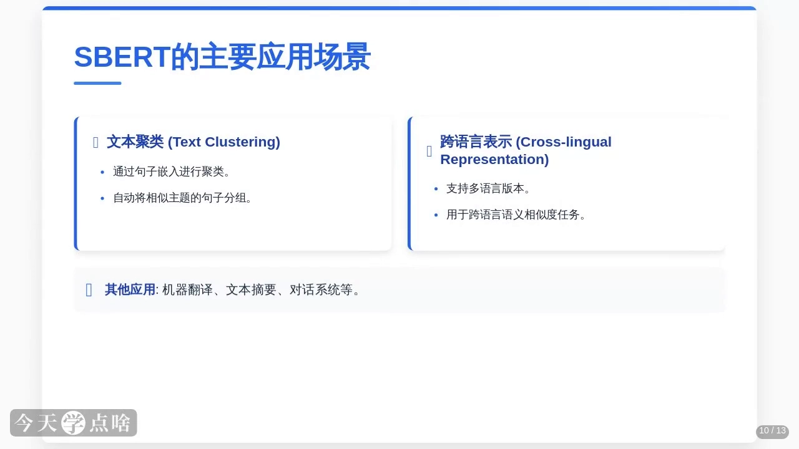](https://www.bilibili.com/video/BV1gZECzMEpU/?t=775)

## 七、优缺点

[【跳转到 14:10】](https://www.bilibili.com/video/BV1gZECzMEpU/?t=850)

**优点**：

- 高效——句子独立编码，大规模数据下计算效率优势明显；
- 易用——社区提供大量预训练模型，可直接加载，开发门槛低；
- 广泛适用——语义相似度、检索、聚类等多任务都能表现出色；
- 跨语言支持——多语言模型满足不同场景需求。

**缺点**：

- 微调时非常依赖高质量训练数据，数据质量不高会拖累性能；
- 长句子或段落的表现可能下降，需要切分或分块处理；
- 嵌入向量维度固定，需要更低维度时要额外的降维操作。

[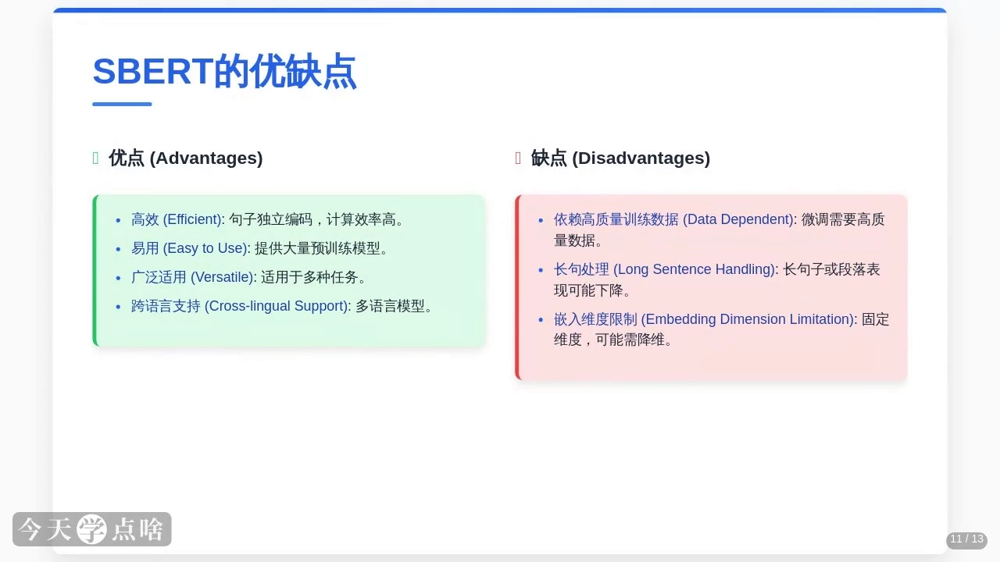](https://www.bilibili.com/video/BV1gZECzMEpU/?t=850)

## 八、常用预训练模型

[【跳转到 15:25】](https://www.bilibili.com/video/BV1gZECzMEpU/?t=925)

- **all-MiniLM-L6-v2**：轻量级模型，性能与效率平衡，适合资源有限的场景；
- **paraphrase-MPNet-base-v2**：更强大、精度更高，适合对结果要求高的任务；
- **distiluse-base-multilingual-cased**：支持多种语言，适合跨语言应用。

这些模型都可以通过开源 Python 库 **sentence-transformers** 直接加载——该库还提供丰富的接口和工具，把 SBERT 用到自己的项目里非常方便。

[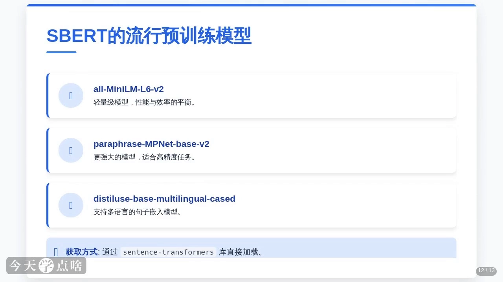](https://www.bilibili.com/video/BV1gZECzMEpU/?t=950)

## 小结

[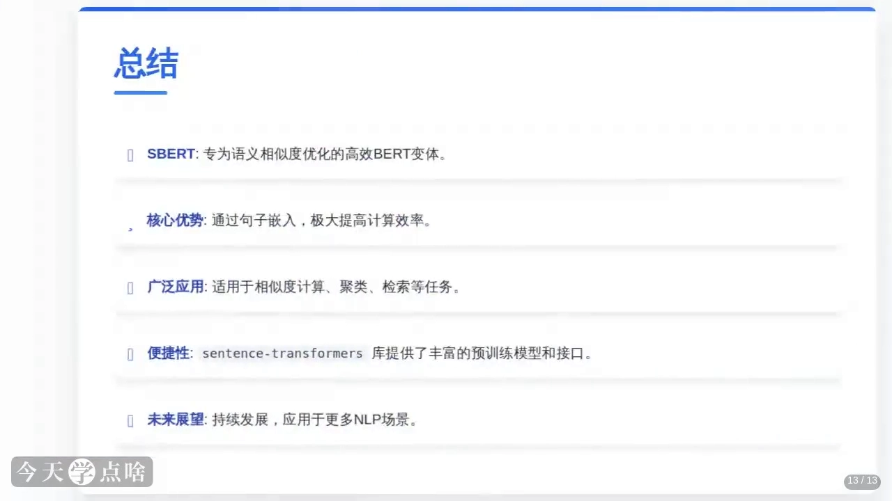](https://www.bilibili.com/video/BV1gZECzMEpU/?t=1000)

- 原始 BERT 判断句子相似度要**逐对联合编码**，N 个句子对编 N 次，大规模场景扛不住；
- SBERT 用**句子嵌入**破局：每个句子独立编码**一次**，得到固定长度向量后反复使用；
- BERT 输出的是逐词向量，**池化层**负责把它压缩成句子向量——**Mean Pooling（取平均）**与 **[CLS] 标记向量**是两种常用方案，各有优劣；
- 训练靠 **NLI（推导/矛盾/中性）、STS（0~5 相似度打分）、对比学习（anchor–positive–negative）**三类任务微调，让「语义近 → 向量近」；
- 应用覆盖相似度计算、检索（KNN）、问答、聚类、跨语言表示等；
- 常用模型 all-MiniLM-L6-v2 / paraphrase-MPNet-base-v2 / distiluse-base-multilingual-cased，均可用 sentence-transformers 库直接加载；
- 同样的取舍也存在于生物序列模型：**逐 token 嵌入留给残基级任务，均值池化后的序列向量留给序列级任务**。

## 关键术语速查

| 术语 | 一句话解释 |
| --- | --- |
| token embedding（词/标记向量） | 模型给输入序列中每个 token 输出的上下文相关向量，BERT 的原生输出形式 |
| 句子嵌入（sentence embedding） | 把整个句子压缩成一个固定长度向量，蕴含整句语义 |
| 池化（pooling） | 把多个 token 向量整合成一个固定长度向量的操作 |
| Mean Pooling（均值池化） | 对所有词向量取平均，得到句子级向量的池化方法 |
| [CLS] Token | BERT 输入开头的特殊标记，其输出向量常被用作整句表示（尤其分类任务） |
| NLI（自然语言推理） | 判断句子对是推导、矛盾还是中性关系的任务 |
| STS（语义文本相似度） | 给句子对打 0~5 相似度分数的任务 |
| 对比学习 | 用 anchor–positive–negative 三元组把相似句拉近、不相似句推远的训练方式 |
| sentence-transformers | 提供大量句子嵌入预训练模型与便捷接口的开源 Python 库 |
