# DDPM 大白话：把图片一步步加噪成噪声，再让神经网络一步步去噪「画」回来

> 来源：Bilibili 视频《大白话AI | 图像生成模型DDPM | 扩散模型 | 生成模型 | 概率扩散去噪生成模型》（[BV1tz4y1h7q1](https://www.bilibili.com/video/BV1tz4y1h7q1/)，时长 27:39）。
> 本文基于视频字幕与画面逐窗口整理而成，配图取自视频截图，时间戳可跳回原视频对应位置核对。视频只用中学数学，就讲清了 DDPM 的完整故事：正态分布 → 前向加噪 → 重参数化合并随机数 → 贝叶斯定理推反向条件分布 → 训练网络预测噪声 → 从纯噪声迭代采样出图片。

## 本讲要解决的核心问题（SCQA）

**背景**：打开一个 AI 生成头像的网页，它能在 Chrome 桌面浏览器中运行，点一下就生成一张全新的二次元美少女头像——这些图片全部是 AI 随机生成的，所有源代码都能在 GitHub 上找到。[【跳转到 00:00】](https://www.bilibili.com/video/BV1tz4y1h7q1/?t=0)

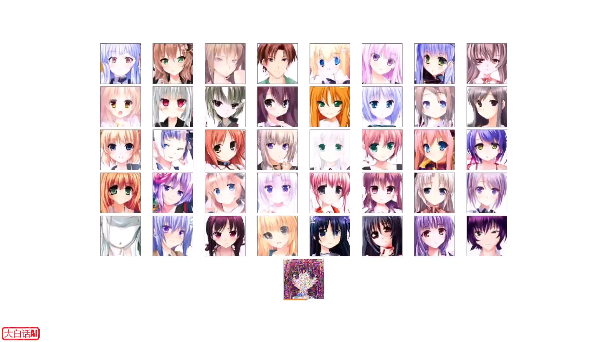

**冲突**：计算机最擅长生成的是随机数，而一张有意义的图片（五官、发型、构图）结构精密。让计算机「凭空画一张脸」看似无从下手：从一堆随机像素直接跳到一张好图，跨度太大，一步到位几乎不可能。

**疑问**：纯噪声怎么可能一步步变成有意义的图片？中间到底发生了什么，要「走」多少步？

**回答（中心思想）**：这类模型叫**概率扩散去噪模型**，代表作就是 DDPM。思路分两步：训练时，把真实图片按固定公式一步步加高斯噪声，直到变成纯噪声（前向过程）；同时训练一个神经网络，学会在每一步预测「图里混了多少噪声」。生成时从一张纯噪声出发，用这个网络迭代去噪 N 步，就能「采样」出一张图片。[【跳转到 00:25】](https://www.bilibili.com/video/BV1tz4y1h7q1/?t=25)

## 一、预备知识：正态分布（高斯分布）

DDPM 里的「噪声」全部来自正态分布，所以视频先用一节把正态分布讲透。

### 1.1 从骰子到钟形曲线

扔一颗骰子并记录点数：每扔一次叫一次**采样**，直方图记录各点数出现的概率。采样次数够多时，六个点数等可能，直方图顶点连成一条水平直线。换两颗骰子，记录「点数之和」：采样几万次后，直方图变成中间高、两边低的折线——和为 7 的组合最多，向两边递减；再用三颗、五颗骰子重复实验，骰子越多，折线越接近一条平滑曲线。[【跳转到 00:42】](https://www.bilibili.com/video/BV1tz4y1h7q1/?t=42)

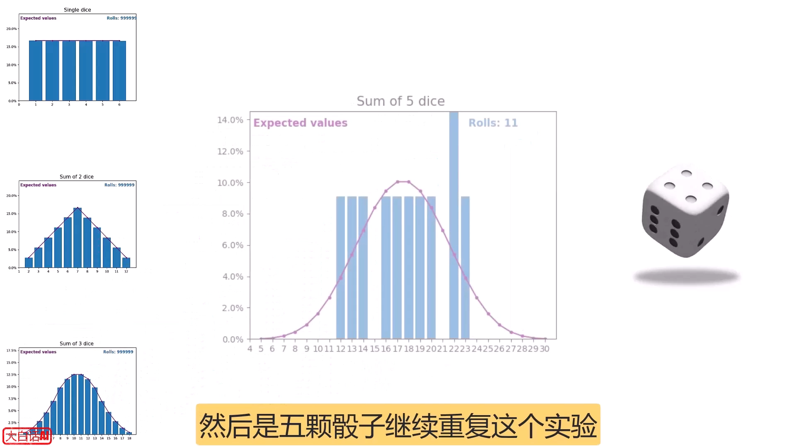

这条曲线外形像一口大钟，所以叫**钟形曲线**；把 x 轴上的点看成随机变量，它就是**概率密度曲线**。经验规律：一个随机变量若受很多因素共同影响、且没有任何一个因素起决定性作用，它的概率密度曲线一般都接近钟形——成绩、身高、诺贝尔奖得主年龄都是例子。这样的概率分布称为 Normal Distribution，normal 本意是「普通、常见」，中文译作**正态分布**。[【跳转到 01:49】](https://www.bilibili.com/video/BV1tz4y1h7q1/?t=109)

### 1.2 概率密度函数：π、e、μ、σ 各管什么

正态分布的数学表达式初看复杂，其实不难。函数的输入是 x 轴上的点（随机变量的值），输出是该点在 y 轴上的位置（概率密度）。式子里的 π（圆周率）和 e（自然常数）只是常数；真正决定曲线形状与位置的是 μ 和 σ：对称轴位于 x = μ 处，代表分布的中心趋势，即**数学期望**；σ 是**标准差**，刻画离散程度。[【跳转到 02:26】](https://www.bilibili.com/video/BV1tz4y1h7q1/?t=146)

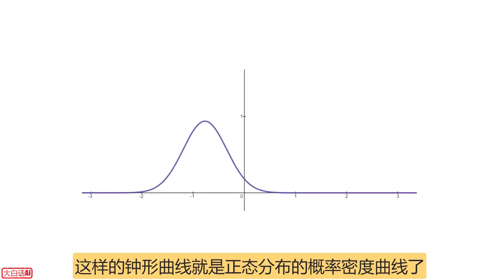

曲线与 x 轴之间**围合区域的面积表示概率**，总面积恒为 1（所有取值概率总和 100%）。围绕对称轴 ±1 个标准差的区间面积约为 0.68，±2 个标准差约为 0.95——这些区间叫正态分布的**标准差界限**，帮助我们对随机变量取值范围有大致了解。由此能直观感受到：σ 越小曲线越陡峭（取值越集中），σ 越大曲线越平缓。[【跳转到 03:16】](https://www.bilibili.com/video/BV1tz4y1h7q1/?t=196)

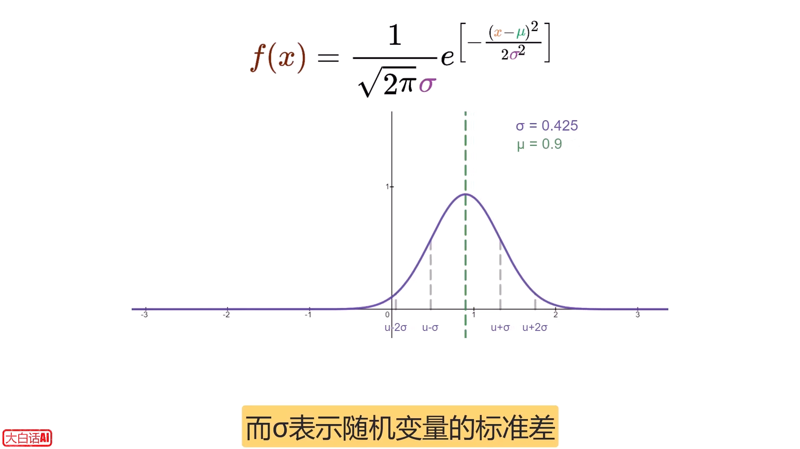

于是记号可以简化为 **N(μ, σ²)**：N 是 Normal 的首字母，σ 是标准差，σ² 是方差（标准差的平方）。当 μ = 0、σ = 1 时，称为**标准正态分布**；正态分布的概率密度函数也叫高斯函数，所以正态分布又叫**高斯分布**。[【跳转到 04:31】](https://www.bilibili.com/video/BV1tz4y1h7q1/?t=271)

### 1.3 高斯噪声：生成图片的原料

从标准正态分布 N(0,1) 中随机抽取样本，得到一组随机变量：大部分接近均值 0，只有小部分超出 ±1 个标准差的范围。这组数将在后面的模型中**作为高斯噪声**使用——全讲所有「噪声 ε」都指它。[【跳转到 04:53】](https://www.bilibili.com/video/BV1tz4y1h7q1/?t=293)

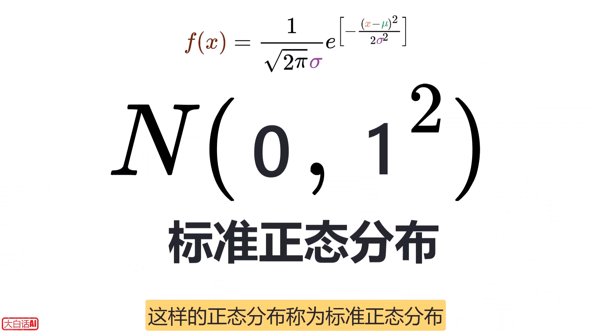

## 二、扩散现象与核心思想：先学会加噪，再学逆操作

**扩散现象**指物质粒子从高浓度区域向低浓度区域移动的过程：一杯水中加入一颗糖、或滴一滴墨水，都能观察到。扩散模型正是受它启发：对图片而言，「加噪声」就是从有序走向无序。[【跳转到 05:33】](https://www.bilibili.com/video/BV1tz4y1h7q1/?t=333)

核心思想两句话：

1. 计算机学不会「人类绘画」这种没有公式的过程，但**加噪声有精确公式**，计算机完全学得会——加噪过程架起了从图片到噪声的桥梁；
2. 只要神经网络学会**加噪的逆过程（去噪）**，就能从噪声一步步还原出图片。

## 三、前向过程：按公式一步步把图片加噪成纯噪声

### 3.1 像素归一化与噪声图

对一张彩色图片，以常见的 RGB24 格式为例：每个像素用 RGB 三个通道表示，每通道取值 0~255，分别代表红绿蓝三原色的比重。先把图片各通道数值**归一化**映射到 [−1, +1] 区间；再随机采样生成一张同样大小的**噪声图片**，其中所有像素通道的数值都遵从标准正态分布。[【跳转到 06:05】](https://www.bilibili.com/video/BV1tz4y1h7q1/?t=365)

### 3.2 混合公式与勾股定理直觉

接下来把噪声图与待加噪的图按同一位置的像素逐通道混合。相邻两步的关系式是：

> x_t = √(1−β) · x_{t−1} + √β · ε

其中 ε 是高斯噪声，x 是输入图片，β 是 0~1 之间的数字，控制这一步「掺多少噪声」。[【跳转到 06:26】](https://www.bilibili.com/video/BV1tz4y1h7q1/?t=386)

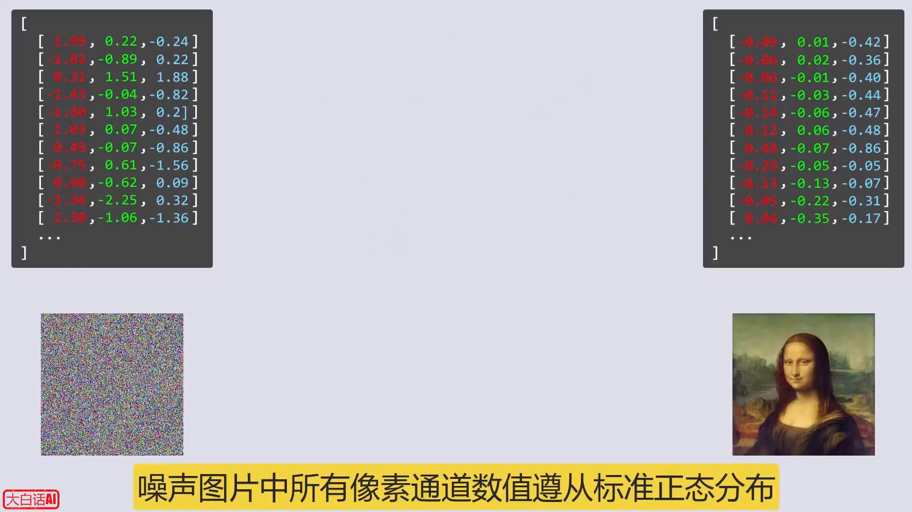

这对系数有个漂亮的几何直觉：√β 与 √(1−β) 的**平方和恒等于 1**，满足勾股定理——可以把它们看成直径为 1 的半圆中内接直角三角形的两条直角边，而 β 和 1−β 恰是两条直角边相邻正方形的面积。噪声与原图在混合中所占的比例**此消彼长**：β 越大，x 的系数越小，原图成分越少。[【跳转到 07:01】](https://www.bilibili.com/video/BV1tz4y1h7q1/?t=421)

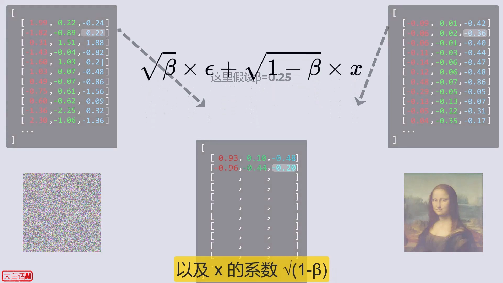

### 3.3 逐步迭代与 β 调度

从原图 x₀ 出发：套用公式得到 x₁；把 x₁ 再代入公式得到 x₂；再把 x₂ 代入得到 x₃……对任意 x_{t−1} 代入公式就得到 x_t，不断迭代直到 x_T。于是可以用一个式子表达「前一时刻 → 后一时刻」的关系。[【跳转到 07:39】](https://www.bilibili.com/video/BV1tz4y1h7q1/?t=459)

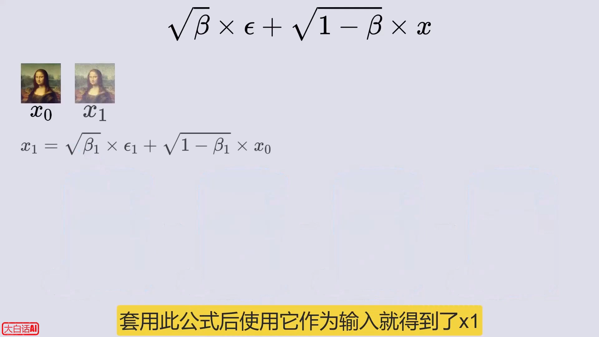

两点关键注意：

- 每一步加噪用到的 ε 都是**基于标准正态分布重新采样**的随机数；
- 每一步的 β 并不相同：β_t 从最开始接近 0 的数逐步递增到接近 1，因为**扩散速度越来越快**。[【跳转到 08:04】](https://www.bilibili.com/video/BV1tz4y1h7q1/?t=484)

为了简化后续推导，引入新变量 **α_t = 1 − β_t**，前向公式也随之改写。

## 四、少走弯路：把两次随机数合并成一次（重参数化）

### 4.1 两颗骰子的启示：卷积

现在思考：能否**直接从 x₀ 得到 x_t**，避免多次迭代？先看从 x_{t−2} 到 x_t：把两个相邻步的公式嵌套后代数化简，式子里出现了两个**相互独立的**随机数 ε_t 和 ε_{t−1}——好比掷了两次骰子、把点数相加。

但如果有两颗骰子，一起掷一次就等价于一颗骰子掷两次：两颗骰子同掷所得点数的概率分布，等同于一颗骰子掷两次叠加后的分布。骰子和的分布可以列表枚举，也可以用**卷积**计算：把一个分布翻转后逐格平移对齐，对应位置的值相乘再求和，就得到叠加后的分布。[【跳转到 11:18】](https://www.bilibili.com/video/BV1tz4y1h7q1/?t=678)

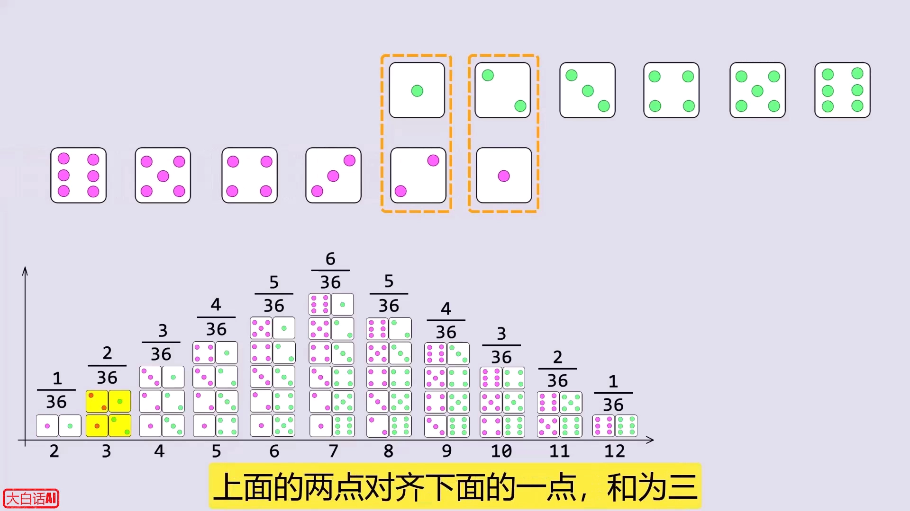

推广到连续情形：把求和换成积分（红色填充曲线与 x 轴围成的面积即当前位置的概率密度，累加起来就是叠加后的总概率密度）。核心结论：**均值为 μ₁、方差为 σ₁² 的正态分布，与均值为 μ₂、方差为 σ₂² 的正态分布做卷积，结果仍是正态分布，且均值、方差分别为二者之和**。[【跳转到 12:00】](https://www.bilibili.com/video/BV1tz4y1h7q1/?t=720)

### 4.2 重参数化技巧：两个 ε 合并成一个 ε

回到推导：ε_t 服从标准正态分布，乘以常数系数后仍是正态分布（均值、标准差都变为原来的 c 倍；对标准正态即均值仍为 0、标准差变为 c）。于是「√(1−α_t·α_{t−1}) 之下的两个独立 ε 之和」可以用**一个新采样的标准正态随机数**替代——分布完全不变，采样从两次变一次。这种改写称为**重参数化技巧**。[【跳转到 15:10】](https://www.bilibili.com/video/BV1tz4y1h7q1/?t=910)

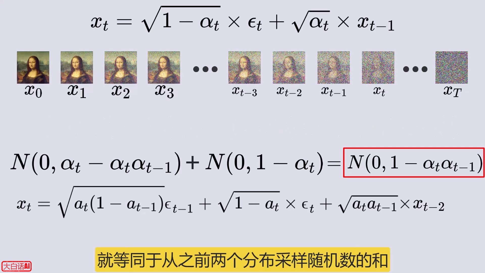

### 4.3 数学归纳：从 x₀ 一步直达 x_t

对 x_{t−3}、x_{t−4}……不断重复「合并随机数」，再用**数学归纳法**，可以猜想并得到从 x_{t−k} 到 x_t 的一般关系式（证明过程略）。令 k = t，就得到从 x₀ 直达 x_t 的闭式：系数是 α_t·α_{t−1}⋯α₁ 的连乘，为书写方便记作 **ᾱ_t**。[【跳转到 16:00】](https://www.bilibili.com/video/BV1tz4y1h7q1/?t=960)

这就是「**任意时间步一步直达、无需逐级迭代**」的原理，前向过程到此完整。视频作者还提供了一个用 JavaScript 编写、在浏览器中执行的 demo 程序，可以在其中查看每一步计算的具体过程，源码很简单、可自行查阅。[【跳转到 16:43】](https://www.bilibili.com/video/BV1tz4y1h7q1/?t=1003)

## 五、反向过程的数学地基：贝叶斯定理

### 5.1 先验、后验、似然：小明抓娃娃

反向过程要回答的问题是：**已知加噪后的 x_t，求前一步的 x_{t−1}**。因为加噪是随机过程，反向同样只能是随机过程，所以要用条件概率来描述。工具是贝叶斯定理，视频先用「小明回家抓娃娃」的例子铺垫：[【跳转到 17:38】](https://www.bilibili.com/video/BV1tz4y1h7q1/?t=1058)

小明回家要么坐地铁、要么坐公交：以往经验 80% 坐地铁（记 y）、20% 坐公交（记 x）。坐公交会经过车站旁的抓娃娃机，80% 概率抓到娃娃；坐地铁会经过地下商城的抓娃娃机，30% 概率抓到。今天小明**带了一只娃娃**回家——问他今天坐哪种交通工具的概率各是多少？[【跳转到 18:12】](https://www.bilibili.com/video/BV1tz4y1h7q1/?t=1092)

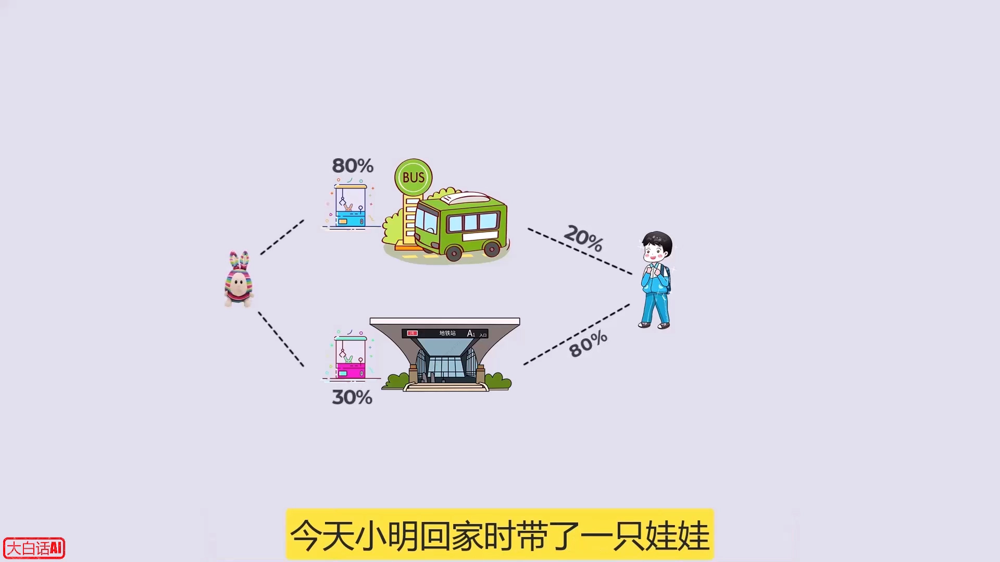

画一个边长为 1 的正方形表示所有可能：P(x) = 0.2、P(y) = 0.8；再把 P(W|x) = 0.8、P(W|y) = 0.3 画成两块小矩形。抓到娃娃的概率 P(W) = P(W|x)·P(x) + P(W|y)·P(y) = 0.4；而「带娃娃回家时是坐公交」的概率 P(x|W) = P(W|x)·P(x) / P(W)，同理可得 P(y|W)。

一般化就是**贝叶斯定理**：P(A|B) = P(B|A) · P(A) / P(B)。其中：P(A) 是**先验概率**（基于以往经验）；P(A|B) 是**后验概率**（见到证据 B 之后更新的概率），B 称为**证据**；P(B|A) 是**似然**——B 事件对 A 事件的归因力度/证据强度，P(B|A) 越大，B 提供的证据越支持 A。[【跳转到 20:01】](https://www.bilibili.com/video/BV1tz4y1h7q1/?t=1201)

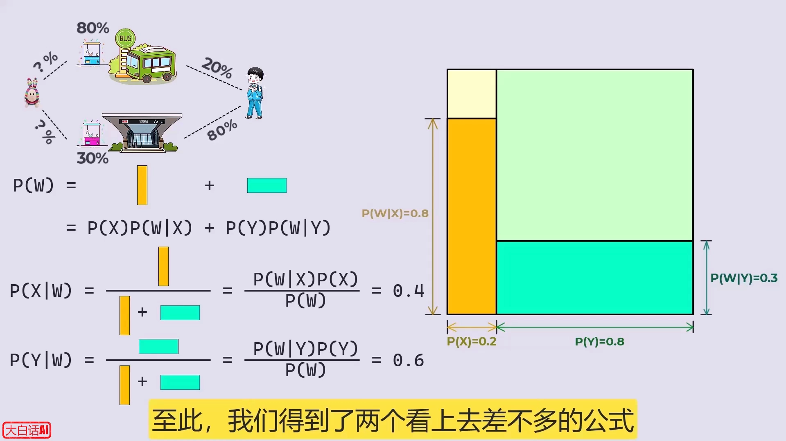

### 5.2 反向条件分布的推导

现在套用贝叶斯定理。在给定 x₀ 的条件下（这个条件实际上可以忽视），有：

> p(x_{t−1} | x_t) = p(x_t | x_{t−1}) · p(x_{t−1}) / p(x_t)

右边每一项都是**正态分布**，可以逐个写出均值与方差：[【跳转到 21:40】](https://www.bilibili.com/video/BV1tz4y1h7q1/?t=1300)

- p(x_t | x_{t−1})：由前向一步公式，均值是 √α_t·x_{t−1}，方差是 1−α_t；
- p(x_t | x₀) 与 p(x_{t−1} | x₀)：由前向闭式（ᾱ_t）给出。

把三个概率密度函数代入贝叶斯公式，目标是把它重新整理成「x_{t−1} 的概率密度函数」形式——这一步只用中学数学，过程略。[【跳转到 22:55】](https://www.bilibili.com/video/BV1tz4y1h7q1/?t=1375)

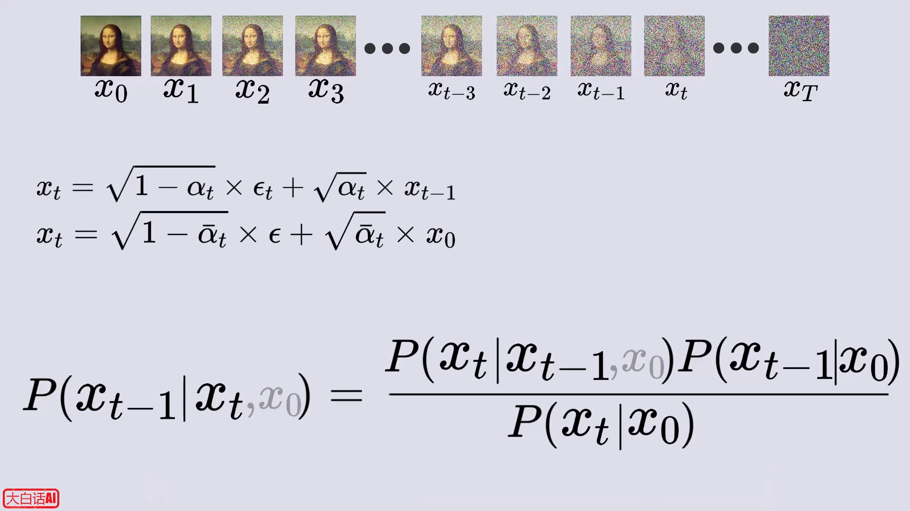

最终结论：**给定 x_t 时，x_{t−1} 服从一个正态分布**，其均值和方差都有封闭形式的表达式。反向过程的数学框架就绪。

## 六、从噪声到图片：采样循环（本讲核心）

### 6.1 x₀ 死循环与消元

最终目标是得到 x₀：从 x_T 开始，不断使用反向关系迭代，直到 x₀。但麻烦来了——x₀ 是**待求的结果**，却出现在 x_{t−1} 的概率分布公式里，这不是死循环吗？[【跳转到 24:47】](https://www.bilibili.com/video/BV1tz4y1h7q1/?t=1487)

别急：之前已经求得从 x₀ 到 x_t 的闭式，稍加变换就能解出 x₀ 的等式；把它代回反向分布，就得到一个**不含 x₀** 的式子。它的含义是：任意时刻的 x_t 都可以看作「从某张原图 x₀ 直接加噪得来」；只要知晓当时加入的噪声 ε，就能得到前一时刻 x_{t−1} 的概率分布。[【跳转到 25:12】](https://www.bilibili.com/video/BV1tz4y1h7q1/?t=1512)

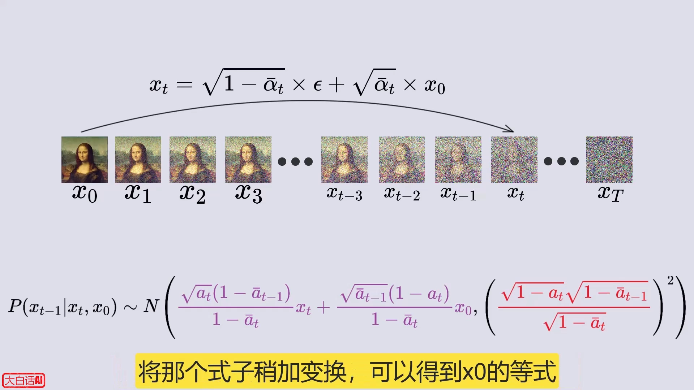

### 6.2 神经网络登场：预测每一步的噪声

可 ε 是加噪时随机采的，谁也不知道它是什么——那就**训练一个神经网络来预测它**：输入 x_t 时刻的图像，输出该图像相对于某个 x₀ 原图所加的噪声。有了预测的噪声，就能得到 x_{t−1} 的概率分布；从分布中随机采样得到 x_{t−1} 的图像，再把它喂给网络预测下一步的噪声……**不断重复，直到得到 x₀**。[【跳转到 25:37】](https://www.bilibili.com/video/BV1tz4y1h7q1/?t=1537)

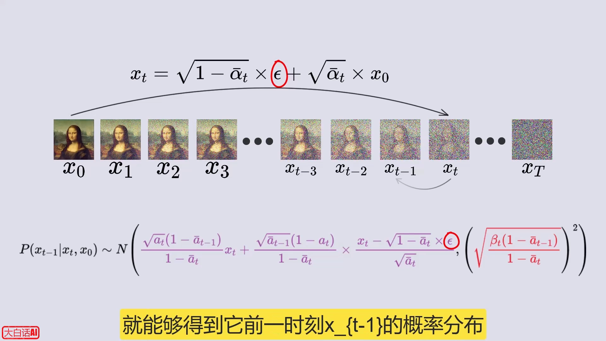

除了图像本身，网络还同时接收时间步 t 作为输入——这是为了让网络更好地学习「这张图在整个加噪过程中所处的位置」。[【跳转到 27:07】](https://www.bilibili.com/video/BV1tz4y1h7q1/?t=1627)

### 6.3 起点：x_T 就是一张纯噪声

那迭代最初的 x_T 从哪里来？观察前向闭式：当 T 足够大时 ᾱ_T → 0，于是 **x_T ≈ ε**，即 x_T 的图像近似于标准正态分布。换句话说，任何一张标准正态分布的噪声图片，都可以认为「是某张 x₀ 原图加噪到底的结果」。所以生成时只需从 N(0,1) 随机采样，就能得到起点 x_T。[【跳转到 26:42】](https://www.bilibili.com/video/BV1tz4y1h7q1/?t=1602)

### 6.4 步数的意义：越走越确定

从大 T 时刻向 0 时刻递减的过程中可以看到：前一时刻图像分布的**标准差越来越小、逐渐接近 0**——也就是说每往前走一步，「下一步的图像」就越来越确定。这就是 DDPM 模型反向过程生成图片的原理。[【跳转到 27:23】](https://www.bilibili.com/video/BV1tz4y1h7q1/?t=1643)

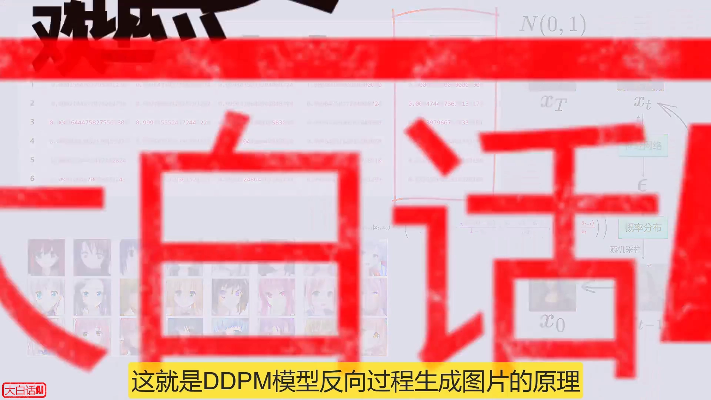

本讲把神经网络当作黑盒，只关注它的输入输出；网络内部结构（如何训练、用什么架构）将在该系列的下一个视频中分享。

## 小结

- DDPM = 概率扩散去噪模型：训练时把真实图片一步步加噪到纯噪声（前向过程），再学它的逆过程；生成时从纯噪声「倒放」回图片。
- 全部噪声来自标准正态分布 N(0,1)：正态分布由 μ、σ 决定，曲线下面积即概率，±1σ 约覆盖 68%、±2σ 约 95%。
- 前向一步公式 x_t = √(1−β_t)·x_{t−1} + √β_t·ε；β_t 随步数递增；α_t = 1−β_t，连乘记 ᾱ_t，给出 x₀ → x_t 的闭式，**任意时间步可一步直达**。
- 多个独立高斯随机数可以合并成一个（卷积性质 + 重参数化技巧），这是闭式推导的关键。
- 反向条件分布 p(x_{t−1}|x_t) 由贝叶斯定理推出，仍是正态分布；借助前向闭式消去未知的 x₀，公式里只依赖 x_t 与噪声 ε。
- 训练一个网络预测每一步的噪声 ε（输入 x_t 与 t）；生成时从 x_T ≈ 纯噪声开始，迭代 N 步采样出 x₀——步数越往后，分布标准差越小，结果越确定。

## 关键术语速查

| 术语 | 一句话解释 |
| --- | --- |
| 正态 / 高斯分布 N(μ, σ²) | 钟形概率分布；μ 定对称轴位置，σ 定胖瘦；曲线下面积 = 概率 |
| 标准正态分布 | μ = 0、σ = 1 的正态分布，DDPM 中噪声的来源 |
| 高斯噪声 ε | 服从 N(0,1) 的随机数（组），「原料」 |
| 采样 | 从某个概率分布中随机抽取一个值/样本 |
| 概率扩散去噪模型 | 通过「加噪—学去噪」来学习数据分布、并能从噪声生成样本的模型 |
| 前向过程 | 按固定公式逐步向图片加噪，T 步后变成纯噪声 |
| β_t / α_t / ᾱ_t | 每步噪声量 / 1−β_t / α 的连乘；ᾱ_t 让任意步一步直达 |
| 卷积 | 分布叠加的运算；两个正态分布卷积仍是正态分布（均值、方差相加） |
| 重参数化技巧 | 把两个独立高斯随机数合并为一个，分布不变、采样一次完成 |
| 贝叶斯定理 | P(A|B) = P(B|A)·P(A)/P(B)：后验 = 先验 × 似然 / 证据 |
| 先验 / 后验 / 似然 | 经验概率 / 见到证据后的概率 / 证据对假设的支持强度 |
| 去噪网络 | 输入 x_t 与 t、输出预测噪声 ε 的神经网络（本讲视为黑盒） |
| 反向过程 | 从 x_T 出发逐步求 x_{t−1} 的条件分布；由贝叶斯定理导出闭式 |
| 采样循环 | 从 x_T ~ N(0,1) 开始，用反向分布迭代 N 步得到 x₀（最终样本） |
