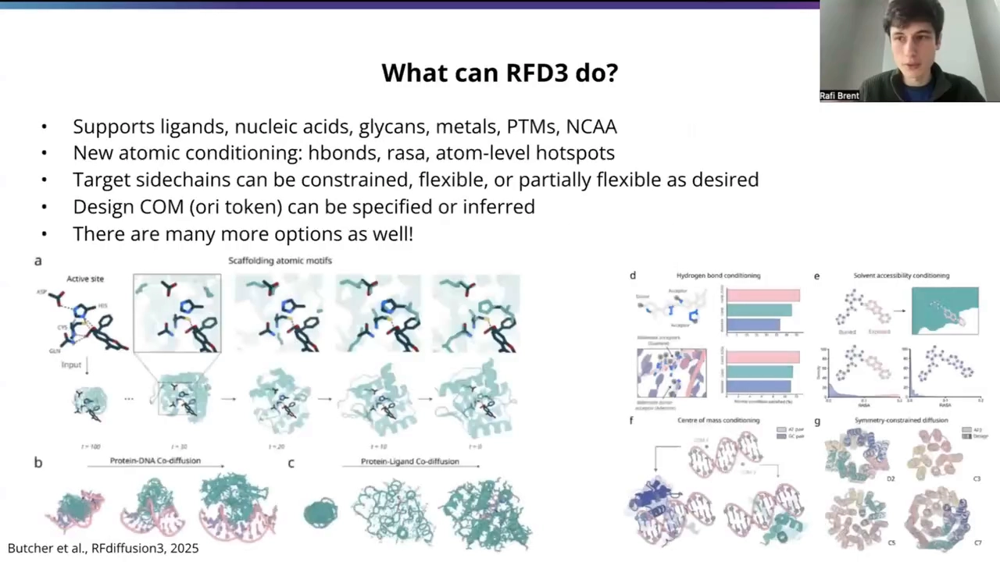
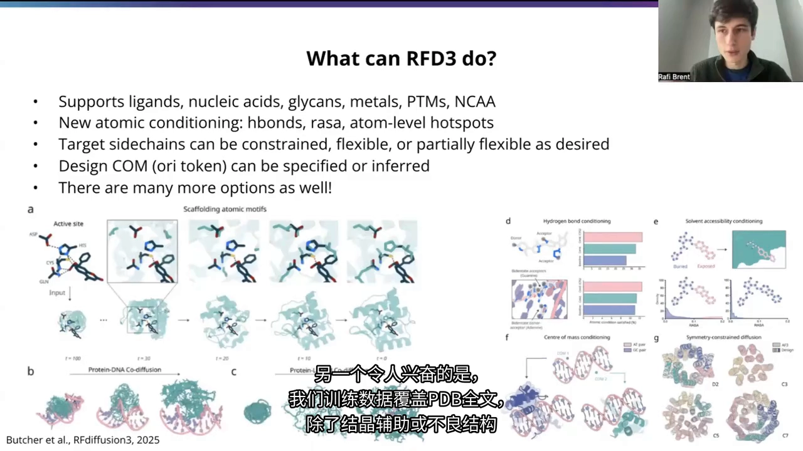
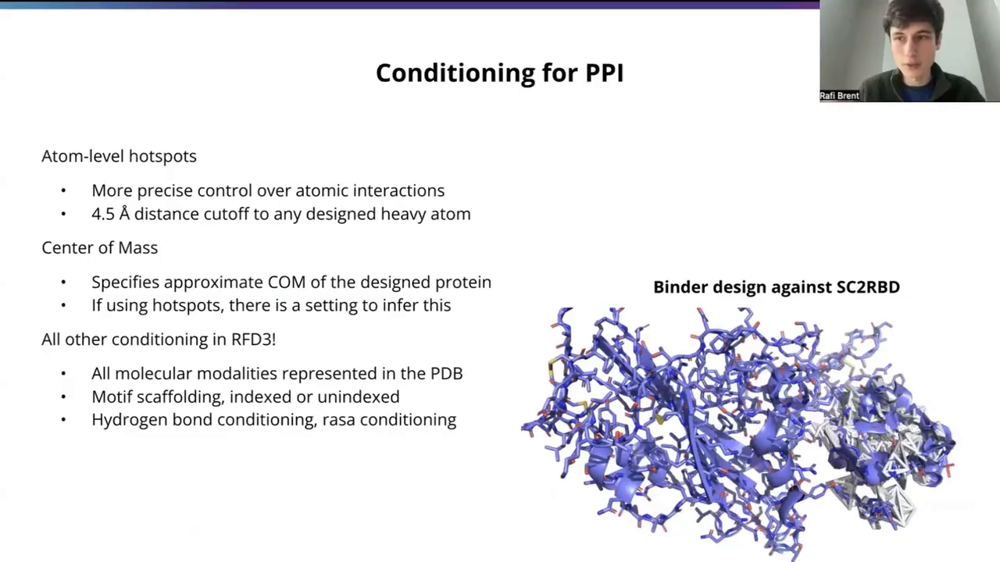
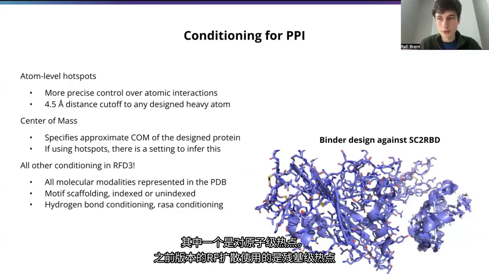
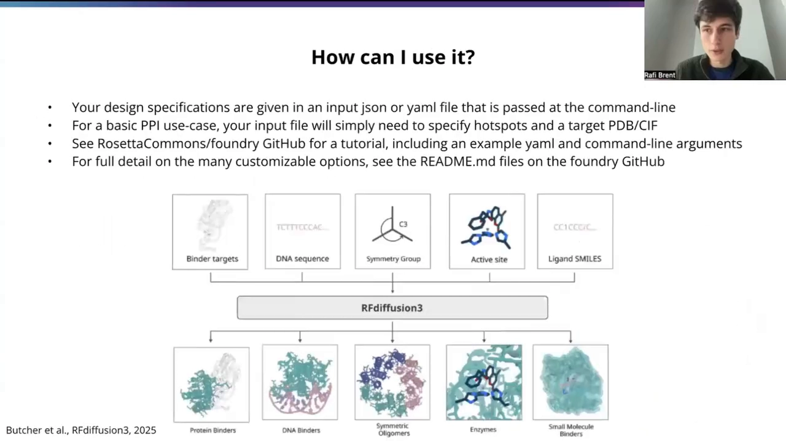
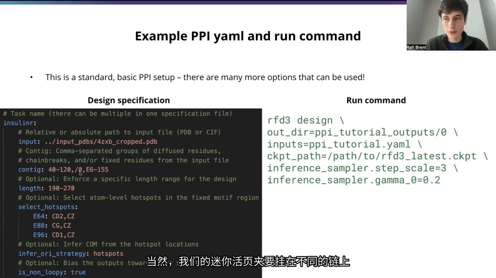
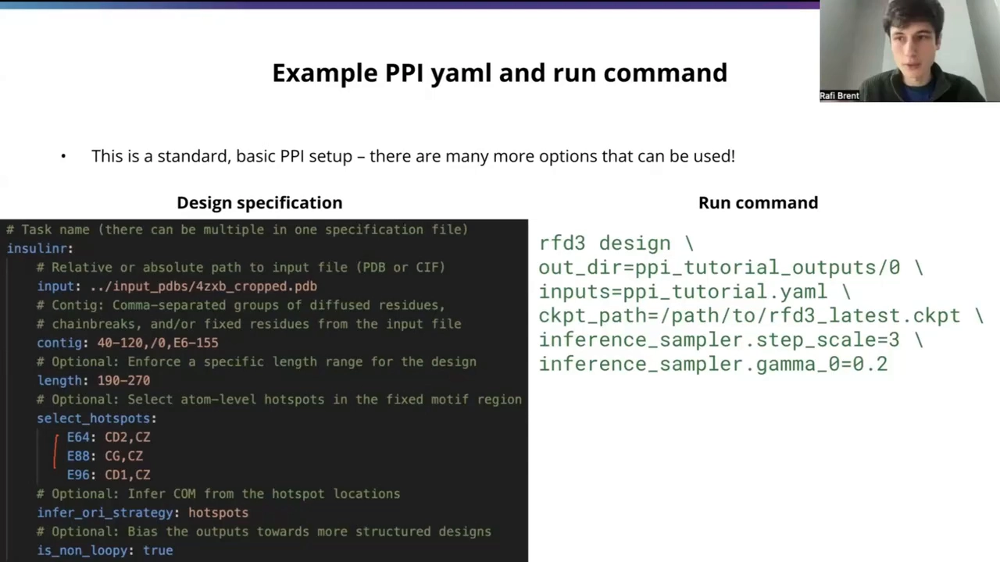
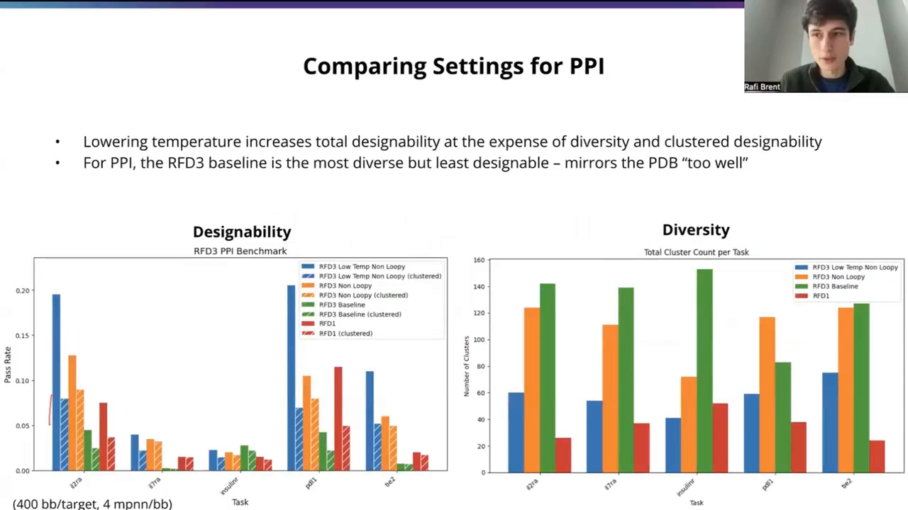
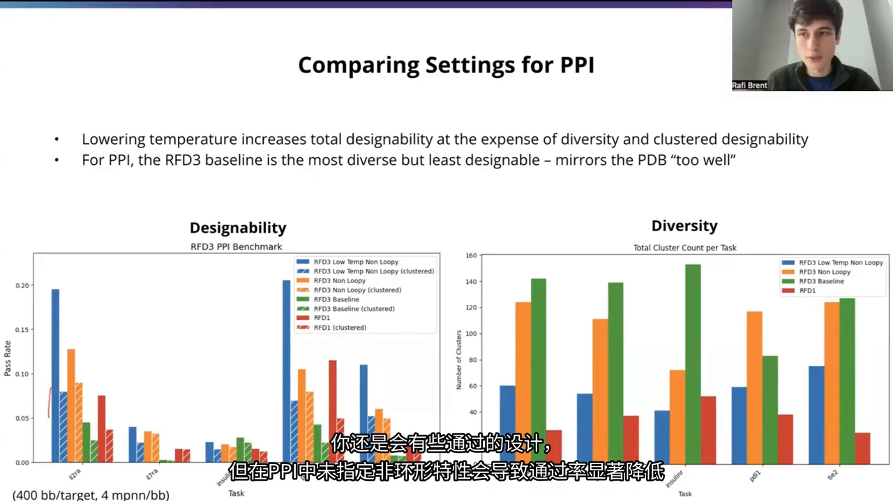
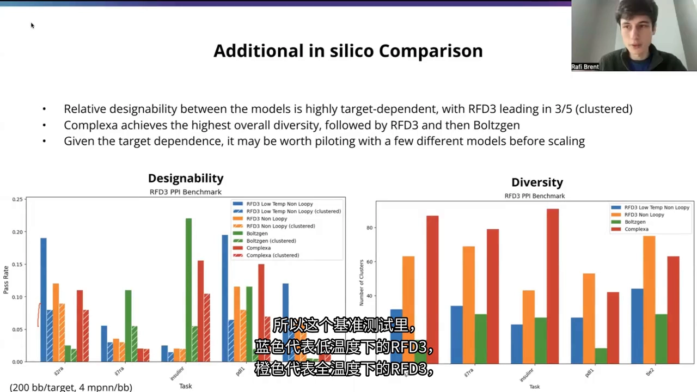

# RFdiffusion3 上手：全原子时代的 binder 设计（Baker 官方教程）

> 视频来源：[Baker实验室官方教程：用RFDiffusion3设计蛋白质Binder](https://www.bilibili.com/video/BV16RQDBuEyu/?p=1)（Bilibili · 29:29，p01 中配）
> 本文基于视频演说图文稿整理，配图截自视频。主讲人 Raffi 为 Baker 实验室博士生、RFdiffusion3 研发人员。

## 本讲要解决的核心问题（SCQA）

**背景**：RFdiffusion 用「骨架扩散」打开了从头设计蛋白的大门——想要一个能结合某靶点的蛋白（binder），它可以凭空生成主链骨架。但上一代 RFdiffusion 只输出主链坐标，序列要交给 ProteinMPNN 补。

**冲突**：真实的蛋白质相互作用界面是由**侧链原子**决定的——氢键、原子级热点、精确的接触距离。只设计到骨架，设计结果与「能不能真的结合」之间始终隔着一层。

**疑问**：能不能直接在原子层面做设计？RFD3 具体怎么用——条件怎么写、命令怎么跑、结果怎么评估？

**回答（中心思想）**：RFdiffusion3（RFD3）是**全原子**蛋白设计模型：主链、侧链、序列、旋转异构体一起出，训练数据覆盖 PDB 全部常见模态，支持氢键/原子热点/质心等原子级条件；速度比前代快约 10 倍，让「复杂约束 + 重折叠筛选」的闭环真正可行。一条 YAML/JSON 输入文件加一个靶点 PDB，就能跑 binder 设计。 [【跳转到 00:00】](https://www.bilibili.com/video/BV16RQDBuEyu/?p=1&t=0)

## 一、RFD3 是什么：从骨架扩散到全原子扩散

### 1.1 全原子输出：主链、侧链、序列一次到位

与之前的 RFdiffusion 版本不同，RFD3 是一个**原子级别**的蛋白设计模型：不仅能获得主链坐标，还能得到**所有侧链原子的精确坐标**，以及序列和旋转异构体（rotamer）。 [【跳转到 00:14】](https://www.bilibili.com/video/BV16RQDBuEyu/?p=1&t=14)

### 1.2 训练数据覆盖 PDB 全文：各种模态都支持

训练数据覆盖 PDB 全文（结晶辅助或质量不良的结构除外），因此支持 PDB 中常见的各种模态：**配体、核酸、糖基、金属、PTM（翻译后修饰）以及非典型结构**。当然，PDB 里出现较少的东西模型更难处理——训练数据不足。 [【跳转到 00:39】](https://www.bilibili.com/video/BV16RQDBuEyu/?p=1&t=39)

### 1.3 原子级条件：氢键、热点、侧链刚柔性

另一个好处是可以做**原子级条件设置**： [【跳转到 01:04】](https://www.bilibili.com/video/BV16RQDBuEyu/?p=1&t=64)

- **氢键**：指定目标分子中某个特定原子充当供体或受体；
- **原子热点**：对蛋白质互作（PPI）最相关，下文详述；
- **侧链处理**：靶点侧链可以完全固定、完全灵活或部分灵活——按需求更好地镜像溶液状态，甚至比刚性晶体结构更好。

还可以指定结合蛋白的**质心**（与之前版本类似的近似质心）：不用精确到 Å 级，给一个大致位置范围即可。此外还能玩对称性、柔性配体和 DNA——鼓励查阅论文与文档。 [【跳转到 01:29】](https://www.bilibili.com/video/BV16RQDBuEyu/?p=1&t=89)

## 二、实战设定：binder 设计的「约束 + 筛选」闭环

### 2.1 原子级热点：2/3 情况严格命中 4.5 Å

演讲的示例是一条真实轨迹：用 RFD3 设计并对 **COVID RBD** 做重折叠筛选得到的 binder。要补的细节是**原子级热点**——之前版本的 RFdiffusion 用的是残基级热点，RFD3 可以更精准地指定原子间交互。 [【跳转到 02:15】](https://www.bilibili.com/video/BV16RQDBuEyu/?p=1&t=135)

这是更严格的约束，模型不一定每次都完美：经验上约 **2/3 的情况会严格遵守距指定原子 4.5 Å 处结合**，并且几乎总会有某个原子在该精确距离发生互动、产生近距离接触——大多数时候就在你指定的位置附近。 [【跳转到 02:40】](https://www.bilibili.com/video/BV16RQDBuEyu/?p=1&t=160)

### 2.2 快 10 倍：复杂约束变得可用

RFD3 比之前的 RFdiffusion **快约 10 倍**（取决于系统长度），与 RFD1、RFD2 相比优势明显。这带来的工作流红利是：可以先设定很复杂的限制条件，在重折叠模拟前**根据约束过滤掉不符合的部分**——即使模型并非每次都成功，靠高效的设计-筛选流程也能满足更多复杂约束。 [【跳转到 03:05】](https://www.bilibili.com/video/BV16RQDBuEyu/?p=1&t=185)

### 2.3 没有热点时：用质心引导

如果目标没有明确热点、只想把 binder 大致引导到靶点某一侧，**质心调节**很有用。案例中通常有热点，这时可以从热点推断质心标记：从热点质心**向外移动约 10 Å**。内部测试效果不错，推荐给初学者——没有精确质心时，这是大多数 mini binder 设计的好起点。 [【跳转到 03:30】](https://www.bilibili.com/video/BV16RQDBuEyu/?p=1&t=210)

### 2.4 一个全功能模型，没有隐藏适配器

RFD3 **没有任何检查点或隐藏适配器之分**——就是一个全功能模型。不用担心偏离 PPI 分布：想让系统里有配体、附近有 DNA？完全支持；还能做较少见的 PPI 工作流条件处理，比如在凹槽内做支架构建、构建发夹 motif 支架、做氢键与 RSA（相对溶剂可及面积）条件处理。当然，约束越复杂，最终通过的设计会越少——但原则上这些都开放给模型。 [【跳转到 03:55】](https://www.bilibili.com/video/BV16RQDBuEyu/?p=1&t=235)

## 三、输入怎么写：一个 YAML 讲清楚

### 3.1 设计规范文件：JSON 或 YAML，一个文件可装多个任务

RFD3 的输入是一个文件：**JSON 或 YAML 格式**，在命令行传给 RFD3，包含研究系统的全部信息和要解决的问题。对标准的基本 PPI 场景，主要就是指定热点位置；另外还需要一个 **PDB 或 CIF 文件**包含目标结构——模型得知道靶点长什么样。 [【跳转到 04:57】](https://www.bilibili.com/video/BV16RQDBuEyu/?p=1&t=297)

两种格式都是嵌套数据结构，文件格式略不同，但嵌套方式和传给 RFD3 的所有参数名称完全一致，选顺手的即可。YAML 的嵌套层级用制表符表示。顶层是一个任务名称——一个输入文件里可以放多个任务，让 RFD3 在同一命令中依次设计。 [【跳转到 05:57】](https://www.bilibili.com/video/BV16RQDBuEyu/?p=1&t=357)

示例以**胰岛素受体**为靶点：输入文件用相对或绝对路径指向一个来自 RCSB PDB 的裁剪文件。核心是**上下文字符串（Contig）**——向 RFD3 指定输入的方式，里面会出现三种主要组件。 [【跳转到 06:47】](https://www.bilibili.com/video/BV16RQDBuEyu/?p=1&t=407)

### 3.2 Contig 里的三种组件

1. **扩散残基**：模型完全重新设计的区域，左侧没有链 ID（新实例化的残基）；长度写成 `40-120`，表示模型会在该区间为这批设计采样长度； [【跳转到 07:12】](https://www.bilibili.com/video/BV16RQDBuEyu/?p=1&t=432)
2. **链断开**：用 `/0` 表示——mini binder 要挂在靶蛋白之外的不同链上； [【跳转到 07:37】](https://www.bilibili.com/video/BV16RQDBuEyu/?p=1&t=457)
3. **从输入加载**：写链 ID + 残基编号（如 `A` 链的 `6-155`，含端点），这些残基从输入 PDB 加载，是设计要结合的固定部分。 [【跳转到 07:37】](https://www.bilibili.com/video/BV16RQDBuEyu/?p=1&t=457)

### 3.3 可选长度约束：给 motif 支架场景用

最基本的 PPI 工作流用不到长度标志，但做 motif 支架构建时会用到：motif 两边各有一个扩散区段（比如各 80 或 60~80），希望整个 mini binder 总长小于 150——用长度约束即可实现：其中一个扩散区段最长可达 80，但不会同时都顶到最大值。 [【跳转到 08:02】](https://www.bilibili.com/video/BV16RQDBuEyu/?p=1&t=482)

### 3.4 热点原子：嵌套指定到具体原子名

热点部分是稍复杂的嵌套结构：顶层一个「选择热点」块，先指定固定区域中的特定残基（如链 A 的残基 64，从输入文件加载），再为该残基**指定具体的原子名称**，以获得 **4.5 Å 级别**的热点条件。 [【跳转到 08:52】](https://www.bilibili.com/video/BV16RQDBuEyu/?p=1&t=532)

### 3.5 质心与非环标志

**质心**部分可以直接给定三维坐标（文档与 GitHub 上有示例），但官方建议先根据热点推断质心——示例代码做的就是这件事。 [【跳转到 09:17】](https://www.bilibili.com/video/BV16RQDBuEyu/?p=1&t=557)

还有一个很有趣的**非环标志**：它使输出更倾向于**有序的二级结构**。这在 PDB 中很有用——很多形成蛋白相互作用界面的蛋白质确实很「弯曲」，而 AlphaFold3、RoseTTAFold3 这类重折叠验证模型对非常弯曲和无序的结构信心不足，通过率会低得多。一般建议启用，除非你想覆盖所有二级结构类型。 [【跳转到 09:42】](https://www.bilibili.com/video/BV16RQDBuEyu/?p=1&t=582)

### 3.6 运行命令与采样温度

克隆仓库、安装好并按文档下载检查点（checkpoint）后，运行类似 `rfd3 design` 的命令：指定输出目录（保存设计文件与元数据）、输入（指向 JSON/YAML 配置）、检查点路径。可选标志里最常用的是**降低采样温度**——直观讲，就是少从模型学习到的概率分布的边缘取样，更偏向蛋白质空间的中心区域，得到更有序、更「正常」的蛋白样本。 [【跳转到 10:32】](https://www.bilibili.com/video/BV16RQDBuEyu/?p=1&t=632)

## 四、数据说话：采样温度、非环特征与多样性

### 4.1 两个指标：总通过率与聚类通过率

结果图要先看懂两个指标：**实心柱 = 总通过率**（经过 MPNN 后的骨架数量），**斜纹柱 = 聚类通过率**（按折叠序列聚类后，有多少「簇」被代表的比例——衡量多样性）。图中四组颜色：蓝色 = 低温采样 + 非环特征；橙色 = 默认温度 + 非环特征；绿色 = 基准（默认温度、无非环特征）；红色 = 熟悉的 RFD1 基线。 [【跳转到 11:16】](https://www.bilibili.com/video/BV16RQDBuEyu/?p=1&t=676)

### 4.2 低温采样：通过率升、多样性降

不出所料：低温采样的**总通过率更高**——你更多地抽取了正常结构；但从标准温度降到低温时，很多任务的**聚类通过率略有下降**——标准温度下多样性大大增加，边缘取样得到的设计与其他设计的差异更大。右图（各模型的集群总数）显示：默认选项能大幅增加多样性。 [【跳转到 12:06】](https://www.bilibili.com/video/BV16RQDBuEyu/?p=1&t=726)

### 4.3 非环特征：PPI 里强烈建议开启

在 PPI 任务中**不指定非环特征会导致通过率显著降低**。看二级结构分布图（虚线 = 折叠层，实线 = α 螺旋）：采样温度对二级结构分布影响不大，但**移除非环特征后分布大幅变化**——折叠层略增、螺旋骤减，还出现更多环状结构。对比之下，RFD1 基本上是一台「螺旋机器」。总之这只是二级结构分布的差异，设计师可按需决定，但一般建议先开启非环标志。 [【跳转到 13:21】](https://www.bilibili.com/video/BV16RQDBuEyu/?p=1&t=801)

## 五、Q&A 精华：选型、评估与「为什么还要 ProteinMPNN」

### 5.1 indexed / unindexed motif 支架：Contig 语法照旧

有观众问「索引/非索引模式的 motif 支架」：讲者没有 benchmark 过两者的 PPI 性能差异（觉得值得研究），但语法是可以说的——用相同的 Contig 语法，对 unindexed motif 支架加一个名为 `unindexed` 的额外参数，指定哪些加载区域作为**未索引**约束而非索引约束（详细文档在 GitHub）。 [【跳转到 15:16】](https://www.bilibili.com/video/BV16RQDBuEyu/?p=1&t=916)

### 5.2 RFD1 vs RFD3 的实验成功率：注意「甘氨酸 bug」

被问到最重要的实验数据：讲者手头的数据来自六个月前开发中的一个较旧版本（当时组织实验室多人做基准测试的设计活动）。后来发现那个模型有个严重 bug——**它从不生成甘氨酸**（公众版本没有这个 bug，无需担心）。骨架若不适合甘氨酸，MPNN 重设计时也补不回来，所以展示的阳性数据都带「甘氨酸模型」的大问号： [【跳转到 16:32】](https://www.bilibili.com/video/BV16RQDBuEyu/?p=1&t=992)

通常大多数情况下得到的是**微摩尔或高纳摩尔级的弱阳性**；他们也攻击了一些 hard 靶点。PD-L1 项目是最容易的目标之一——用最新模型迅速验证后，确认可以强结合 PD-L1（很多模型也能做到）。目前实验室正在用 RFD3 推进项目，更系统的湿实验数据很快会有；但现在还没有很好的头对头对比数据。 [【跳转到 17:40】](https://www.bilibili.com/video/BV16RQDBuEyu/?p=1&t=1060)

### 5.3 步长尺度 vs 噪声：两种「降温」手段

不更改推理采样器的步长尺度（step scale）与噪声时，多样性会受什么影响？两者其实是**达到同一目标的两种方法**：都能直观地导致较低温度的采样——步长表示向分布中心推进的程度，噪声表示每次采样步骤中添加多少噪声。讲者通常把它们一起调整。噪声有最小值 0：即不加噪声、每一步都按模型偏好采样；想进一步降温就调步长尺度，两者确实类似。 [【跳转到 18:30】](https://www.bilibili.com/video/BV16RQDBuEyu/?p=1&t=1110)

### 5.4 热点必须指定到原子层面

做 PPI 时，在原子层面还是残基层面限制更好？现状是：**热点必须在原子层面上指定**——目前还没有针对热点的残基层面约束。实际操作中指定「所有原子」未必最佳（要考虑特定旋转异构体），**瞄准末端原子更合理**。好处是：你会非常接近指定残基上的某个原子，这比残基级热点更具通用性。 [【跳转到 19:45】](https://www.bilibili.com/video/BV16RQDBuEyu/?p=1&t=1185)

### 5.5 为什么 RFD3 之后还要用 ProteinMPNN？

好问题：RFD3 已经出序列了，为什么还要 MPNN 重设计？原因在**Atom14 表征**：每个残基固定 14 个原子槽位（对应原子数最多的色氨酸），其中一部分是**虚拟原子**——模型决定它们「不存在」，把它们放在已知位置（如 Cβ）最后清理。 [【跳转到 20:35】](https://www.bilibili.com/video/BV16RQDBuEyu/?p=1&t=1235)

这个公式对人类很直观（能看到原子在空间中移动的漂亮轨迹），但对模型很难：**侧链类型是离散的**，不同氨基酸在三维坐标空间和原子数量上差异大。模型想改变序列，就得在充满无用信息的空间里做巨大移动——在谷氨酰胺和谷氨酸之间插值，一半得到的是垃圾数据；连续空间里也很难实现不同氨基酸类型之间的平滑过渡。所以序列设计还离不开 MPNN 这一步，实验室也在改进。 [【跳转到 21:25】](https://www.bilibili.com/video/BV16RQDBuEyu/?p=1&t=1285)

提问者问：latent 扩散是不是同时考虑所有可能的侧链再插值？讲者回应：文献中确有其他方法——来自英伟达小组的 Lapina 与 Complexor，使用与 Atom14 不同的形式，在**潜空间**嵌入后再投影出来，侧链表示更平滑（论文图表显示化学相似的残基在潜空间中彼此靠近）。但 Atom14 对他们的流程行之有效，用的人也多。 [【跳转到 22:40】](https://www.bilibili.com/video/BV16RQDBuEyu/?p=1&t=1360)

### 5.6 工具箱怎么选：快而需筛，还是慢而准？

如果有个普通靶标想设计 binder，该用 RFD3 还是 BindCraft 这类工具？讲者的回答是**两类模型各有取舍**：RFD3 这类比较快，但命中率不是特别接近完美；BoltzGen、BindCraft 这类基于幻觉/反向传播的模型命中率非常高，但运行非常慢。想让所有结果都通过 AlphaFold 验证，可能要用 BindCraft（设计时间更长）；RFD3 快速生成更多方案，但要过滤输出。 [【跳转到 23:55】](https://www.bilibili.com/video/BV16RQDBuEyu/?p=1&t=1435)

讲者给了一组基准：对比低温 RFD3、全温度 RFD3、BoltzGen 与 Complexa（含聚簇/非聚簇）——**五个任务中三个任务 RFD3 表现最好**，但在胰岛素受体任务上另外两个模型明显更好，BoltzGen 在 L7 受体亚基上表现最佳。主要收获是**多样性的重要性**：不同模型各有所长，设置不麻烦的话值得一试几种方法，找出最适合自己情况的那种。 [【跳转到 25:06】](https://www.bilibili.com/video/BV16RQDBuEyu/?p=1&t=1506)

### 5.7 实验前的虚拟评估：AF3 重折叠基准

实验前怎么虚拟评估？讲者的做法是一个**标准的重折叠基准测试**：用 AF3（公开、易复现）。阈值采用与 AlphaProteo 论文相同的严格标准：**最小自由能（MFE）小于 1.5、配体自身的 pLDDT 超过 0.8、配体对齐到靶标的 RMSD 低于 2.5 Å**；再用 Foldseek 做聚类。 [【跳转到 26:46】](https://www.bilibili.com/video/BV16RQDBuEyu/?p=1&t=1606)

### 5.8 AtomWorks 里的 MPNN 与原版 MPNN 有区别吗？

差别不大：AtomWorks 包里的 MPNN 是重新实现（目标就是与原版无差异），不是改进版或下一代。讲者一直用旧版 MPNN 以保持与之前基准一致。 [【跳转到 28:01】](https://www.bilibili.com/video/BV16RQDBuEyu/?p=1&t=1681)

## 小结

- RFD3 是**全原子**扩散设计模型：主链、侧链、序列、旋转异构体一起输出，支持配体/核酸/糖基/金属/PTM 等模态；
- **原子级热点**是 PPI 设计的核心条件：指定残基 + 具体原子名，约 2/3 严格命中 4.5 Å；热点无法指定时用「热点质心外移 10 Å」的质心引导；
- 输入 = 一份 JSON/YAML 设计规范 + 靶点 PDB/CIF；Contig 三组件（扩散残基 / 链断开 `/0` / 加载输入链）是核心语法；非环标志让输出偏向有序二级结构、显著提高 PPI 通过率；
- 速度比前代快约 10 倍，支撑「复杂约束 + 重折叠筛选」闭环；评估常用 AF3 重折叠（MFE、pLDDT、RMSD 阈值沿用 AlphaProteo 标准）+ Foldseek 聚类；
- 工具选型看需求：RFD3 快而灵活、需过滤；BindCraft/BoltzGen 慢而命中率高；Atom14 表征直观但侧链离散，序列设计仍建议过一遍 MPNN。

## 关键术语速查

| 术语 | 一句话解释 |
| --- | --- |
| RFD3 / RFdiffusion3 | Baker 实验室的全原子蛋白设计扩散模型，本讲主角 |
| 全原子输出 | 同时给出主链坐标、侧链原子坐标、序列与旋转异构体 |
| Contig 语法 | 用「扩散残基 / 链断开 /0 / 加载输入链」描述设计任务的字符串 |
| 原子级热点 | 指定靶点某残基的具体原子为结合热点，约束精度达 4.5 Å |
| 质心条件 | 给 binder 一个大致的位置引导；可从热点质心外移约 10 Å 推断 |
| 非环标志 | 让输出偏向有序二级结构、远离柔性环区的采样偏好 |
| 采样温度 | 控制取样偏离分布中心的程度；低温通过率高、多样性低 |
| Atom14 | 每残基固定 14 个原子槽位的全原子表征，多余槽位为虚拟原子 |
| 重折叠（refolding） | 把设计的序列喂给 AF3 等预测模型，看是否折回预期结构 |
| AlphaProteo 阈值 | 公开的虚拟筛选标准：MFE、pLDDT、RMSD 三项硬指标 |
