# RFdiffusion 是什么：把图像扩散模型搬到蛋白质设计的开山之作

> 视频来源：[知识分享丨RFdiffusion介绍丨26/7/23](https://www.bilibili.com/video/BV12jgQ6UEo2/)（Bilibili · 55:09）
> 本文基于视频演说图文稿整理，配图截自视频。

## 本讲要解决的核心问题（SCQA）

**背景**：AlphaFold 回答的是「给定氨基酸序列，结构是什么」；但药物开发和材料设计真正想要的是反过来——先有功能需求，再造出一个全新的蛋白质来满足它。

**冲突**：生成「前所未有的图像」这件事，2020 年后已经由扩散模型（diffusion）在计算机视觉领域做到了，但它处理的是二维像素；蛋白质却是三维空间里带朝向的刚体结构，表征方式完全不同，扩散模型不能直接照搬。

**疑问**：扩散模型到底是怎么工作的？David Baker 团队是怎么把它「本土化」到蛋白质设计上的？RFdiffusion 又凭什么成为这一领域的标志性工作？

**回答（中心思想）**：RFdiffusion = **RoseTTAFold 网络 + 扩散生成范式**。它把「图像去噪」换成「蛋白质骨架去噪」，靠 SE(3) 等变的三维表征、逐步生成 + self-conditioning 的连续微调，以及 RoseTTAFold 的预训练权重，在 binder 设计、motif scaffolding、对称装配体等任务上全面超越前辈模型。 [【跳转到 00:05】](https://www.bilibili.com/video/BV12jgQ6UEo2/?t=5)

## 一、五分钟看懂扩散模型：加噪之后学去噪

### 1.1 从 GAN 到 diffusion：两代生成范式的交替

Diffusion 这个架构其实源于计算机视觉领域。大概 2020 年左右的一篇文章正式把 diffusion 带入公众视野，让它取代了上一代的主流生成模型——对抗式生成模型 GAN（Generative Adversarial Network）。 [【跳转到 01:25】](https://www.bilibili.com/video/BV12jgQ6UEo2/?t=85)

GAN 的思想可以理解成：把团队分成两拨人去竞争同一个项目——「生成一张我想要的、逼真的、但这个世界上还没有的图像」。两个人都想赢，算法设计让双方都想赢、都想让对方的损失最大，在竞争中互相促进。 [【跳转到 04:39】](https://www.bilibili.com/video/BV12jgQ6UEo2/?t=279)

Diffusion 就很不一样了：**它把图像生成问题看作「加噪之后的去噪过程」**。把真实图像一步步加噪，让架构学习去噪；要生成新图像时，就从一团初始化的噪点出发，把图像一点点「还原」出来。 [【跳转到 04:14】](https://www.bilibili.com/video/BV12jgQ6UEo2/?t=254)

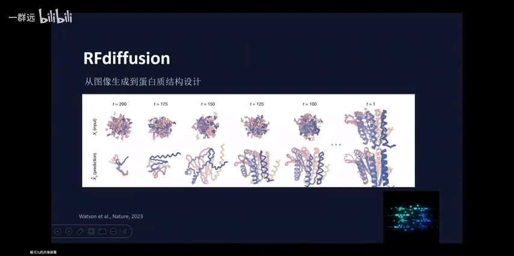

讲者给了一个很好懂的比喻——**雕雕塑**：加噪像把石膏配方弄成规规整整的立方体；去噪则像雕一个掷铁饼者——大概知道要雕出人形、手部、头发和各种细节，一点点把多余的石膏剔除掉。 [【跳转到 06:19】](https://www.bilibili.com/video/BV12jgQ6UEo2/?t=379)

### 1.2 加噪与去噪：时间步与高斯分布

从左往右：从一张清晰图像开始，逐步给像素加噪（服从高斯分布——「随机」其实并不随便，而是均值 0、方差 1 的概率分布），最终整张图变成一团混沌；从右往左就是去噪。从 X0 到 X(T-1) 到 XT 的每一步，我们叫**时间步（timestep）**。 [【跳转到 07:09】](https://www.bilibili.com/video/BV12jgQ6UEo2/?t=429)

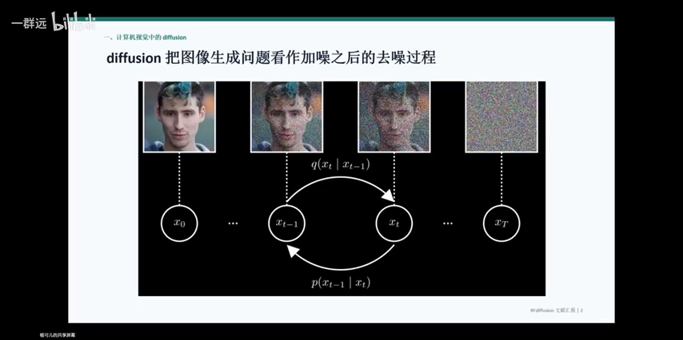

Diffusion 模型学习的目标，就是**让去噪过程的每一步，都更贴近加噪过程的逆过程**。 [【跳转到 08:49】](https://www.bilibili.com/video/BV12jgQ6UEo2/?t=529)

### 1.3 模型到底在学什么：标准答案 Q、考生 P_θ、KL 散度

训练时手里有真实样本 X0（可以理解成图像上任意一个像素点的数值），逐渐加噪得到 XT。已知起点 X0 和终点 XT，可以推导出中间某一步 X(T-1) 的**后验分布 Q**——这就是「标准答案」：知道起点和终点时，中间出现某张图的概率。 [【跳转到 10:09】](https://www.bilibili.com/video/BV12jgQ6UEo2/?t=609)

而反向过程只有初始的 X_T，并不知道 X0——**X0 是要模型自己学出来的**。模型只看最终这团噪点，不断更新权重，猜出后验分布，给出自己的答案 P_θ。这就形成了一个「标准答案—试卷—考生」的关系：怎么设计目标函数，让考生尽量贴合标准答案？ [【跳转到 10:50】](https://www.bilibili.com/video/BV12jgQ6UEo2/?t=650)

这时用到的数学工具是 **KL 散度**——衡量两个概率分布的差异：两个分布的均值和方差越接近，KL 散度越小。所以整个 diffusion 模型核心目标就是**最小化 KL 散度**：让模型预测的「上一步更干净的样本」，尽量接近正向加噪过程推导出的标准答案。 [【跳转到 11:51】](https://www.bilibili.com/video/BV12jgQ6UEo2/?t=711)

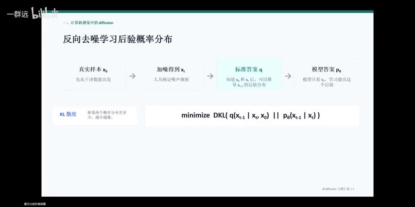

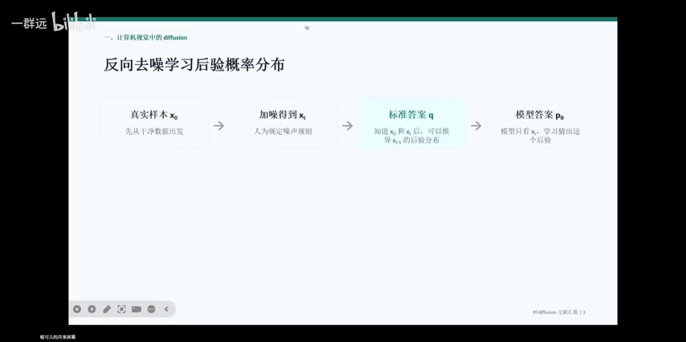

## 二、把扩散搬到蛋白质：RFdiffusion 的身份与它在大流程中的位置

### 2.1 RoseTTAFold：Baker 团队的「开源版 AlphaFold」

一句话概括 RFdiffusion：**它是 RoseTTAFold 的神经网络 + 扩散模型的生成架构，得到的一个 AI 模型**。 [【跳转到 13:29】](https://www.bilibili.com/video/BV12jgQ6UEo2/?t=809)

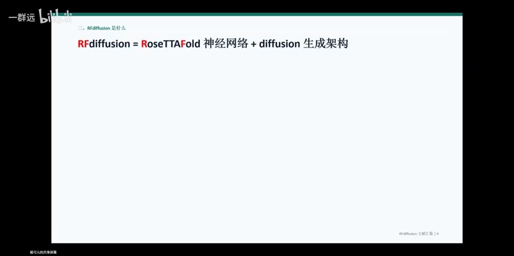

那 RoseTTAFold 是什么？它是 David Baker 团队自己研发的、对标 AlphaFold 的一个网络，功能约等于 AlphaFold。为什么 AlphaFold 出来后他们还要再做一个？因为当时 AlphaFold 被 DeepMind 推出后**并没有开源**，而 Baker 是一个极具开源精神的人：你不开源，那我自己研发一个，然后我开源。有意思的是，RoseTTAFold 开源之后，AlphaFold 紧跟着也开源了。 [【跳转到 13:54】](https://www.bilibili.com/video/BV12jgQ6UEo2/?t=834)

### 2.2 任务反转：从「序列→结构」到「功能→骨架」

RoseTTAFold 和 AlphaFold 原本的任务是：输入氨基酸序列，模型告诉你这个一维序列对应的三维结构可能是什么样——**根据序列预测结构**。 [【跳转到 14:44】](https://www.bilibili.com/video/BV12jgQ6UEo2/?t=884)

RFdiffusion 把任务反转了过来：我们有功能上或结构上的需求，**它生成一个蛋白质骨架**。所谓蛋白质骨架，可以大致理解为蛋白质的二级和三级结构；至于具体每个氨基酸残基的序列是什么，它不管——那是其他模型的任务。 [【跳转到 15:34】](https://www.bilibili.com/video/BV12jgQ6UEo2/?t=934)

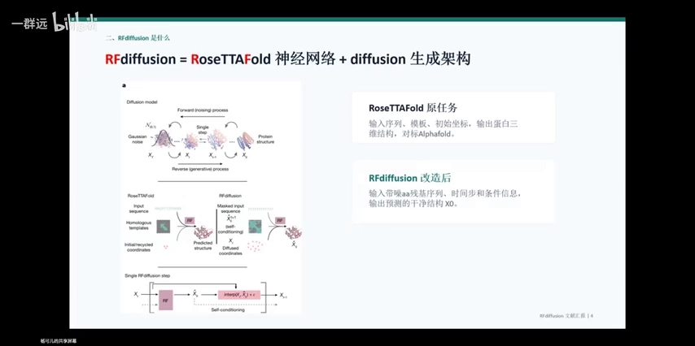

值得注意的一点：RFdiffusion 对蛋白质的表征——比如氨基酸残基的位置、蛋白质应具备的平移和旋转不变性等等——很多模块都延续了 RoseTTAFold 里的设计，一脉相承；但两个模型的任务和功能完全不同。 [【跳转到 15:59】](https://www.bilibili.com/video/BV12jgQ6UEo2/?t=959)

### 2.3 一张 pipeline 图看懂 AI 蛋白设计四部曲

RFdiffusion、AlphaFold、RoseTTAFold……这些模型的功能容易混淆。讲者搬出 Baker 提出的一张**完全 in silico（计算机内完成，不涉及实验）的 pipeline**，把不同模型放回它们该在的位置： [【跳转到 16:49】](https://www.bilibili.com/video/BV12jgQ6UEo2/?t=1009)

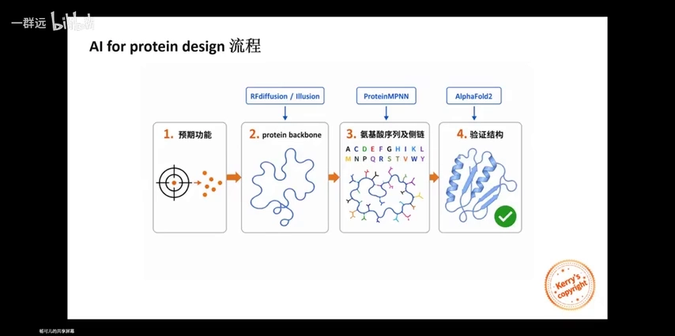

1. **明确需求**：有预期功能或预期结构——比如手里有一个靶蛋白，想设计一个能结合它的蛋白（binder）；
2. **生成骨架**：设计蛋白质的二级、三级结构——这是 RFdiffusion 的活儿（如今也有不少「幻觉模型」做同样的事）； [【跳转到 17:39】](https://www.bilibili.com/video/BV12jgQ6UEo2/?t=1059)
3. **填充序列**：骨架上每个残基具体是哪种氨基酸还不知道，请出 **ProteinMPNN**，把每个残基的侧链填上——到此已经有一个完整的 AI 设计蛋白质； [【跳转到 18:29】](https://www.bilibili.com/video/BV12jgQ6UEo2/?t=1109)
4. **回折验证**：把一级序列喂给 AlphaFold2，让它预测结构，看与最初预期的三维结构是否一致——头尾对得上，设计才算成功。 [【跳转到 19:19】](https://www.bilibili.com/video/BV12jgQ6UEo2/?t=1159)

这四步全在计算机里完成，不涉及实验，所以是完全 in silico 的流程。

## 三、三维蛋白质怎么「去噪」：SE(3) 表征与连续微调

### 3.1 最大的难点：像素是二维的，蛋白质是三维刚体

把 diffusion 落地到 protein design，最大的困难在于：扩散模型原本适用于**二维图像生成**，而我们要建模的是**具有空间立体构型的三维蛋白质**——两者的 representation（表征，即如何把对象翻译成计算机能运算的数字或矩阵）完全不同，而且翻译要「充分且必要」。 [【跳转到 20:09】](https://www.bilibili.com/video/BV12jgQ6UEo2/?t=1209)

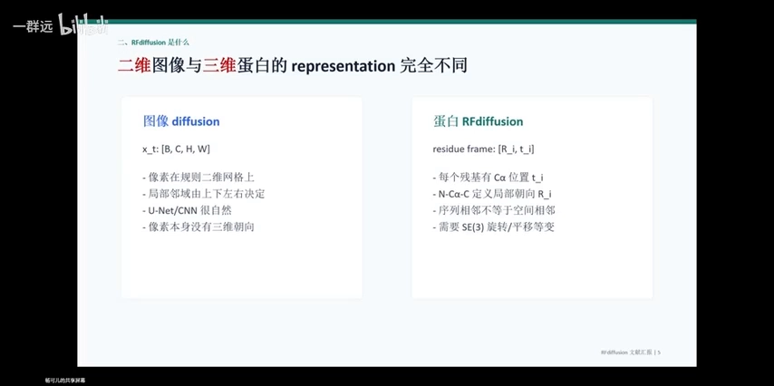

核心区别在于：蛋白质有**空间朝向**。想象手上有个球棍模型，从各个角度看样子不太一样，但它还是同一个蛋白质——所以模型需要**旋转和平移的等变模块**。幻灯片上写的 **SE(3)**，就是保证蛋白质具有旋转等变性、平移等变性的功能模块。于是建模问题从「像素值的去噪」变成了「**带位置和带朝向的氨基酸残基刚体结构的去噪**」。 [【跳转到 21:49】](https://www.bilibili.com/video/BV12jgQ6UEo2/?t=1309)

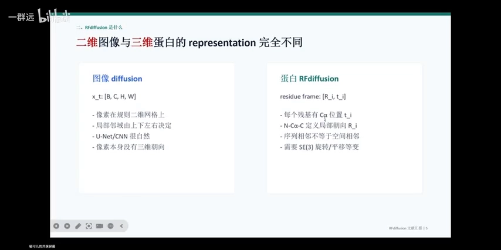

### 3.2 平移好办，旋转难办

David Baker 团队主要抓两件事：蛋白质在空间中的**平移**，和每个氨基酸的**旋转**。平移问题基本可以延续图像生成那边的处理方式——对它做连续的高斯扰动。 [【跳转到 22:39】](https://www.bilibili.com/video/BV12jgQ6UEo2/?t=1359)

旋转就有点小困难了。看一张氨基酸的球棍模型：中间黑球是 α 碳，右边黑球是 α 碳上连的羧基碳，红球是双键氧；左边蓝球是氮原子，白色是氢原子，α 碳上还连着 R 基。 [【跳转到 23:54】](https://www.bilibili.com/video/BV12jgQ6UEo2/?t=1434)

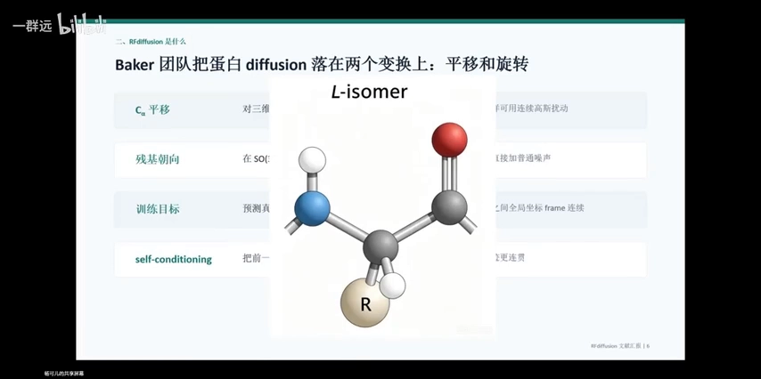

关键有两点：其一，在氨基酸残基中，**N、α 碳、羧基碳三者之间的键长和夹角基本不变**——不管 R 基是什么、蛋白质整体是什么立体结构；其二，根据几何知识，**不相同的三个点在空间中确定一个平面**。Baker 团队就把这三点确定的平面的**法向量**（垂直于该平面的向量）定义为这个氨基酸的**朝向**。朝向有了明确定义，量化成数字就容易了。 [【跳转到 24:44】](https://www.bilibili.com/video/BV12jgQ6UEo2/?t=1484)

这样处理后，蛋白质上所有残基在 diffusion 模型中不只有绝对坐标的编码，还有**相对位置的编码**——这才保证了旋转不变性、平移不变性。 [【跳转到 25:59】](https://www.bilibili.com/video/BV12jgQ6UEo2/?t=1559)

### 3.3 self-conditioning：让每一步都连续

另一个很有 AI 特色的设计是 **self-conditioning**（讲者也表示没有很贴切的中文翻译）：前面说过去噪有很多时间步（X0、X1、X2……XT），每个 X 其实都是上一轮计算的输出；把上一轮的 output 放进下一轮当 input，就是 self-conditioning。 [【跳转到 26:49】](https://www.bilibili.com/video/BV12jgQ6UEo2/?t=1609)

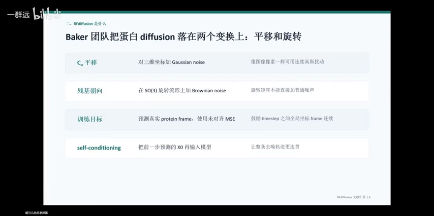

好处是：每次变换都基于上一步的结果，形成**马尔可夫性**——不用过问输入之前怎么来的，当前输入本身就蕴含了以往所有信息。这不仅让计算更便捷，更让每一步微调是**连续**的：否则去噪过程东一下西一下、原子位置的改变没有连续性，蛋白质很容易就被改乱了。 [【跳转到 27:39】](https://www.bilibili.com/video/BV12jgQ6UEo2/?t=1659)

## 四、RFdiffusion 能干什么：四大任务与「边走边预报」

### 4.1 一套架构通吃四类设计任务

RFdiffusion 适用的功能场景很多，论文里介绍了这么几类： [【跳转到 28:54】](https://www.bilibili.com/video/BV12jgQ6UEo2/?t=1734)

- **无条件设计（unconditional protein design）**：不给任何约束，只指定比如「我要 300 个残基」，模型就从初始化出发生成一个骨架； [【跳转到 28:54】](https://www.bilibili.com/video/BV12jgQ6UEo2/?t=1734)
- **对称装配体**：想生成具有对称结构的蛋白质，就对最小的单元做加噪去噪，最后把单元旋转、复制、粘贴，拼成对称单体； [【跳转到 29:19】](https://www.bilibili.com/video/BV12jgQ6UEo2/?t=1759)
- **binder design（结合剂设计）**：有一个靶蛋白、或一些想结合的热点残基，初始化时把这团噪声和靶蛋白一起输进去；靶蛋白在加噪去噪全程保持不变，参与运算的是那团粉色噪点，噪点逐渐变清晰，最终得到一个能结合靶蛋白的 binder； [【跳转到 29:44】](https://www.bilibili.com/video/BV12jgQ6UEo2/?t=1784)
- **motif scaffolding（功能位点支架）**：知道功能对应的局部结构（比如一个 beta sheet 连一个 alpha helix），但这个功能模块单独存在不稳定，需要周围的序列给它做支撑（scaffold）。做法与 binder design 类似：把预期结构固定住，让模型在它周围生成噪点再去噪。 [【跳转到 30:34】](https://www.bilibili.com/video/BV12jgQ6UEo2/?t=1834)

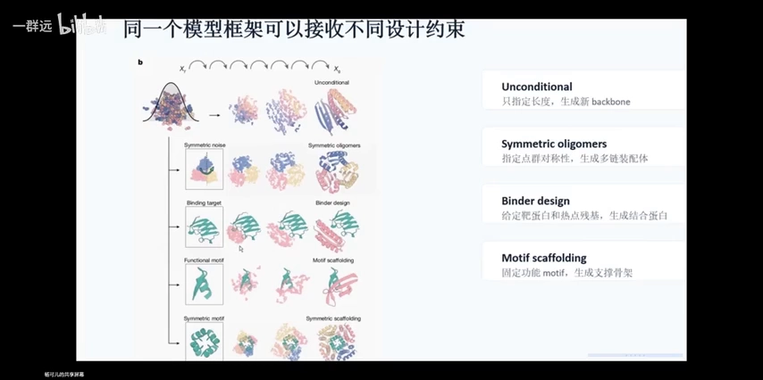

「以往一个应用场景配一个好用的架构，没有一个架构能一揽子实现所有需求——但 RFdiffusion 做到了」，这一点与以往模型很不一样。 [【跳转到 31:43】](https://www.bilibili.com/video/BV12jgQ6UEo2/?t=1903)

### 4.2 每个时间步都在「预报」：函数切线的比喻

RFdiffusion 有一个很有 AI 特色的地方：加噪过程的时间步是一点一点增加的（1→50→100→200，具体数值可以人为规定），而去噪过程——diffusion 真正运算的过程——时间步是逐渐减少的（200→175→150→…→1）。 [【跳转到 32:13】](https://www.bilibili.com/video/BV12jgQ6UEo2/?t=1933)

它在**每一个时间步运算之后都会给出一个预期**：目前噪点是这样，接着这么算下去，最终的蛋白质会长什么样。幻灯片里上面一行是该时间步下的噪点分布，下面一行是根据噪点给出的蛋白质预期结构。 [【跳转到 32:38】](https://www.bilibili.com/video/BV12jgQ6UEo2/?t=1958)

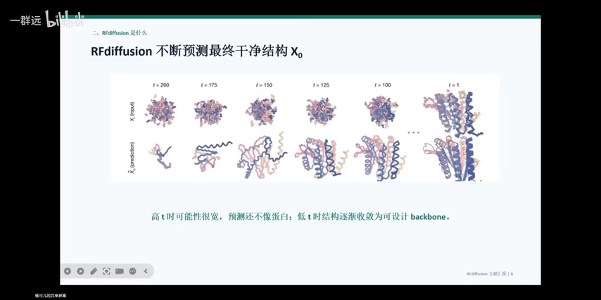

这个「预报」像什么？讲者画了一张函数与切线的图：沿着一条指数函数从左往右滑动，选三个点，每点的函数值就像当前的噪点；从该点做切线，切线与「X=4」的交点就像模型的预期——「按现在这个速度继续去噪，最后可能得到什么样的 protein backbone」。 [【跳转到 33:42】](https://www.bilibili.com/video/BV12jgQ6UEo2/?t=2022)

但切线并不能完全代表函数走势：它只是根据这一点的速度做的预期。所以预期值与实际函数值的关系，就像上面一行（预期）与下面一行（实际）的关系。 [【跳转到 34:32】](https://www.bilibili.com/video/BV12jgQ6UEo2/?t=2072)

时间步 T 还很大时，去噪刚开始，预测肯定不像蛋白质；随着 T 越来越小、去噪进行得越来越多，模型预测出的蛋白质骨架就越来越接近一个合理可用的架构。 [【跳转到 35:07】](https://www.bilibili.com/video/BV12jgQ6UEo2/?t=2107)

## 五、凭什么说它强：三个验收指标与横向对比

### 5.1 三个「干实验」验收指标

RFdiffusion 能设计出很多骨架，但怎么评判骨架质量？讲者介绍了三个指标（都用 AlphaFold2 当 benchmark——即「对照组」，取历史上在该任务上表现最佳的模型来对比）： [【跳转到 35:59】](https://www.bilibili.com/video/BV12jgQ6UEo2/?t=2159)

1. **PAE < 5**：把骨架喂给 ProteinMPNN 设计出序列，再把序列喂回 AlphaFold2 生成三维构型。AlphaFold2 对自己生成的形状有多大信心，就是 PAE 指标——越小信心越高。小于 5 说明 AlphaFold2「相信自己生成的东西合理、能发挥相应功能」； [【跳转到 36:24】](https://www.bilibili.com/video/BV12jgQ6UEo2/?t=2184)
2. **折回误差 < 2 Å**：AlphaFold2 预测的三维结构有 α 碳、氮原子等主链原子的位置（R 基部分未知），拿它与 RFdiffusion 的骨架逐原子比对，误差小于 2 Å（一个微观长度单位）就说明两个结构整体很像； [【跳转到 37:14】](https://www.bilibili.com/video/BV12jgQ6UEo2/?t=2234)
3. **motif 原子误差 < 1 Å**：对最核心发挥功能的 motif（实现核心功能的那段序列/结构），要求原子位置精度极高——距离误差小于 1 Å。 [【跳转到 38:04】](https://www.bilibili.com/video/BV12jgQ6UEo2/?t=2284)

敢跟 SOTA 级别模型在不同场景下对比并胜出，一方面说明评测严谨，一方面说明这个架构确实厉害。 [【跳转到 39:44】](https://www.bilibili.com/video/BV12jgQ6UEo2/?t=2384)

在 unconditional generation 上，RFdiffusion 还与 AF2 的一个逆过程模型做了对比：结论是它在**更长的氨基酸序列**、以及**约束条件较少**时表现更优异——以往模型在序列一长、限制太少时容易「幻想」出实际不合理的结构，RFdiffusion 完成得还不错。 [【跳转到 40:09】](https://www.bilibili.com/video/BV12jgQ6UEo2/?t=2409)

### 5.2 25 个 motif scaffolding 任务：23 对 19 对 15

横向对比最有说服力：在 25 个 motif scaffolding 任务上，**RFdiffusion 完成了 23 个**；RFjoint Inpainting 完成 19 个；Hallucination（幻想模型）完成 15 个。 [【跳转到 43:29】](https://www.bilibili.com/video/BV12jgQ6UEo2/?t=2609)

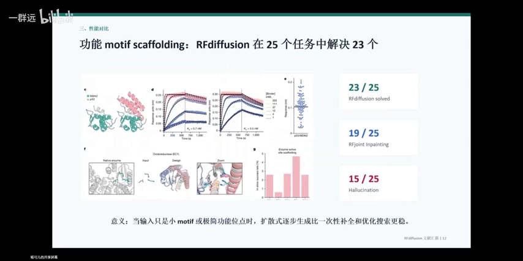

为什么输入是很小的 motif、约束条件很少时，扩散式生成更稳？讲者用蒙特卡洛搜索、一次性补全的逻辑来对比：如果一开始就估计错了方向，后面只能沿着错的走下去，不能回头；而扩散式逐步生成是一点一点逼近、一点一点优化，不存在「先定全局、再优化细节」的赌博。回到雕雕塑的比喻：**剔除多余石膏，比只能加不能减地捏造型，成功率更高**。 [【跳转到 44:19】](https://www.bilibili.com/video/BV12jgQ6UEo2/?t=2659)

### 5.3 消融实验：成功不止靠 diffusion

论文还做了**消融实验（ablation）**——跟生物实验里的 knockout（敲除）差不多：敲掉一个部件，结果变差就说明它重要。结论是：diffusion 架构确实是 RFdiffusion 表现好的原因，但**预训练权重、损失函数的选择（MSE loss）、self-conditioning** 同样关键。 [【跳转到 40:59】](https://www.bilibili.com/video/BV12jgQ6UEo2/?t=2459)

作者想说的是：不要以为「模型的进步」单独带来了蛋白质设计的进步——**团队此前在蛋白质表征上的积淀、预训练与调参的能力，结合生物学/生化知识精简高效地建模蛋白质，比模型本身更重要**。 [【跳转到 42:14】](https://www.bilibili.com/video/BV12jgQ6UEo2/?t=2534)

## 六、展望：离「输入需求即得药物」还有多远

### 6.1 端到端的愿景与精准医疗

蛋白质设计很火，商业化未来也有很大的市场价值。这个领域的人最终想做的事是完全的 **end-to-end（端到端）**：我有一个需求——最好这个需求对应一种疾病——喂给模型，模型输出一个非常合适的药物。做到这种程度，「具体到个体的精准化医疗」似乎就有了实现的趋势。 [【跳转到 46:54】](https://www.bilibili.com/video/BV12jgQ6UEo2/?t=2814)

这是一个很美好的想象，但目前的蛋白质设计模型**远远达不到「输入需求即得药物」的程度**。 [【跳转到 47:44】](https://www.bilibili.com/video/BV12jgQ6UEo2/?t=2864)

### 6.2 四道坎

讲者列出了几方面具体的困难： [【跳转到 48:00】](https://www.bilibili.com/video/BV12jgQ6UEo2/?t=2880)

1. **湿实验闭环**：全流程都是干实验（in silico）难免「显得不靠谱」，所以肯定还是需要细胞内的、湿的实验来完成实验闭环；
2. **缺少「通用分子语言」**：无论 AlphaFold 还是 RFdiffusion，目前能表征的都是与氨基酸相关的语言；还没有一种表征能把小分子、金属离子、各种辅因子与氨基酸放到一起、让它们彼此理解。但生物体内很多重要蛋白的功能恰恰是结合金属离子、小分子——这类蛋白怎么设计和改造，还是难题； [【跳转到 48:25】](https://www.bilibili.com/video/BV12jgQ6UEo2/?t=2905)
3. **动态构象**：这些模型嵌入的都是静止的蛋白质结构，而生物体内很多蛋白质有构象变化，比如离子通道的变化是极快的。动态对蛋白质非常重要，但目前的模型没有能很好描述动态过程的方式——这是一个很掣肘的地方； [【跳转到 49:40】](https://www.bilibili.com/video/BV12jgQ6UEo2/?t=2980)
4. **安全边界**：人体内的蛋白质并不总在「全开」或「全关」状态，而常常是稳态平衡——有时需要它强一点、有时弱一点。比如离子通道「想让它开就开、想让它关就关」的多重调控，目前还比较难；体内安全性验证也是单纯 in silico 实验无法实现的。 [【跳转到 50:30】](https://www.bilibili.com/video/BV12jgQ6UEo2/?t=3030)

总结：**RFdiffusion 是一个根据需求设计蛋白质骨架的模型——从功能出发、到 protein backbone 的模型**。 [【跳转到 50:55】](https://www.bilibili.com/video/BV12jgQ6UEo2/?t=3055)

## 小结：四点 recap

1. **Diffusion 是一种生成范式，不代表神经网络结构**。神经网络结构目前的主流还是 transformer 注意力机制；RoseTTAFold 是蛋白质结构去噪的网络骨干，它的核心也是 transformer——只不过是和蛋白质语言结合了的一种 transformer。 [【跳转到 51:20】](https://www.bilibili.com/video/BV12jgQ6UEo2/?t=3080)
2. **蛋白质不是二维像素，而是三维结构**。嵌入与表征时要处理旋转、平移的等变性，与图像的加噪去噪有不少不同——这正是 Baker 团队最主要攻克的难点。 [【跳转到 52:10】](https://www.bilibili.com/video/BV12jgQ6UEo2/?t=3130)
3. **Diffusion 的优势来自逐步生成**：不会一开始就莽撞地定死方向、把后面所有步骤带偏；加上 self-conditioning，每一步之间连续、流畅，在计算量上也相对有优势。再加上预训练——Baker 实验室在数据、模型、权重上有很好的底子，对蛋白质结构有非常好的编码方式。 [【跳转到 52:35】](https://www.bilibili.com/video/BV12jgQ6UEo2/?t=3155)
4. **RFdiffusion 在对称蛋白质设计上格外优秀**，相关骨架经 ProteinMPNN 填充序列后进入了湿实验验证（对称装配体的实验验证）。对称装配体可以做成「蛋白质笼」，大胆想象一下，可以用来固定二氧化碳——它的用处在医药健康之外，在环境治理上也可能有重要意义，为未来的市场开拓铺路。 [【跳转到 53:50】](https://www.bilibili.com/video/BV12jgQ6UEo2/?t=3230)

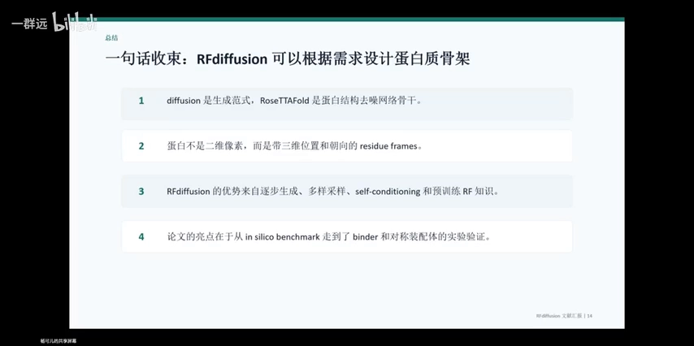

## 关键术语速查

| 术语 | 一句话解释 |
| --- | --- |
| diffusion / 扩散模型 | 把图像生成看作「加噪之后学去噪」的生成范式，生成时从纯噪点逐步还原 |
| GAN | 上一代生成范式：两个网络互相竞争、共同进步 |
| 时间步 timestep | 加噪/去噪的步数编号：X0（干净）→ XT（全噪） |
| 后验分布 Q / P_θ | Q 是已知起点终点时的「标准答案」分布；P_θ 是模型（考生）猜出的分布 |
| KL 散度 | 衡量两个概率分布差异的量，训练目标就是把它最小化 |
| RoseTTAFold | Baker 团队对标 AlphaFold 的结构预测网络，RFdiffusion 的网络骨干 |
| 蛋白质骨架 backbone | 蛋白质的二级/三级结构（主链），不含具体序列信息 |
| ProteinMPNN | 给骨架填充具体氨基酸序列的模型 |
| SE(3) 等变 | 保证网络对旋转、平移正确响应的功能模块 |
| 法向量朝向 | 用 N—αC—C 三点确定的平面法向量定义残基朝向 |
| self-conditioning | 把上一时间步的输出作为下一步的输入，让去噪连续 |
| PAE | AlphaFold2 对自身预测的信心指标，越小越有信心（验收线 <5） |
| motif scaffolding | 固定功能位点结构，让模型在周围生成稳定的支架 |
| ablation 消融实验 | 敲掉模型某个部件看性能变化，类似生物学 knockout |
