# Boltz-2：实现准确高效的结合亲和力预测

> 本文整理自 Bilibili 视频 [Boltz-2：实现准确高效的结合亲和力预测](https://www.bilibili.com/video/BV1XfNJzGEJK/)（约 59 分钟，MIT Boltz-2 团队论文阅读小组，作者 Gabriele、Jeremy、Sara 亲讲；中文为 B 站 AI 翻译字幕，已逐窗口校正）。内容以视频字幕与画面为依据整理，可溯源。

## 本讲要解决的核心问题（SCQA）

**背景**：AlphaFold2 的突破（2020 年实现、后获诺贝尔奖）解决了单链蛋白结构预测；AlphaFold 3 把能力扩展到"任意生物分子"，却选择闭源、仅限学术非商业使用。MIT 团队于是做了 **Boltz-1**——第一个开源、达到同等准确率水平的复现模型，获得学术界与工业界的大量采用。

**冲突**：但药物开发里最贵的环节不是"知道结构"，而是**测结合亲和力**——它是临床前开发的最大瓶颈。而亲和力公开数据少、噪声大、还带系统性偏差；另外，结构模型本身也有自己的老毛病：手性翻转、原子碰撞、对局部动力学无能为力。

**疑问**：能不能在开源结构模型之上，做一个**通用的结合亲和力预测模块**？结构模块本身的采样机制（多重性采样、多粒子、重采样、去噪步数——即各类 AF3 类模型配置里的 `N_sample` / `N_step` 参数族）又该如何理解？

**回答（中心思想）**：Boltz-2 = **改进的开源结构模块**（方法条件化、多链模板、口袋条件、分子动力学条件、势函数引导、NVIDIA 内核加速）+ **全新的亲和力头**（输入 trunk 表征、屏蔽蛋白内部表示、对结构模型的 5 次扩散采样取最优坐标后在 pair 表征上做注意力预测）。在 FEP+ 基准、CASP16 亲和力挑战、MF-PCBA 苗头发现与前瞻性虚拟筛选上，Boltz-2 用"比物理方法快 1000 倍以上"的成本逼近自由能微扰（FEP）的精度。

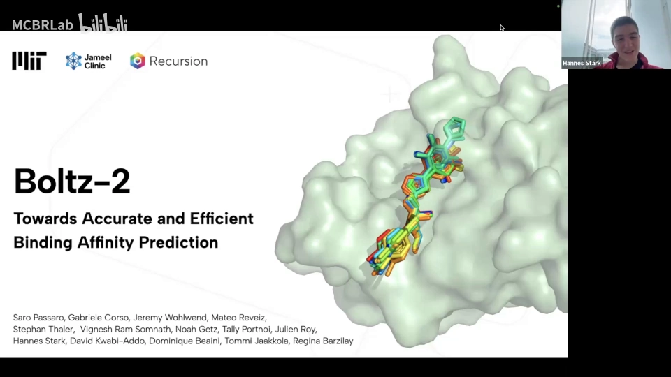

## 一、背景：为什么要做亲和力

### 1.1 一切生物学都发生在"相互作用"里（[【跳转到 00:50】](https://www.bilibili.com/video/BV1XfNJzGEJK/?t=50)）

从 CRISPR-Cas9 到酶反应，从抗新冠药 Paxlovid 结合 SARS-CoV-2 蛋白，到工程一个 G 蛋白去触发特定效果——我们理解生物学的窗口就是**生物分子相互作用**及其强度（亲和力）。

### 1.2 时间线：AF2 → AF3 → Boltz（[【跳转到 02:18】](https://www.bilibili.com/video/BV1XfNJzGEJK/?t=138)）

- **2020**：AlphaFold2 突破，单链蛋白质结构预测达到高精度（后获诺贝尔奖）；
- **2024 年 5 月**：AlphaFold 3 发布，统一预测任意生物分子（蛋白、核酸、小分子、离子、修饰残基）复合物结构，但**不发权重**，约半年后只放出仅限非商业用途的推理代码；
- **2024 年 11 月**：Boltz-1 发表——第一个完全开源、达到同等准确率水平的模型；社区在 GitHub 与 Slack 上贡献活跃。

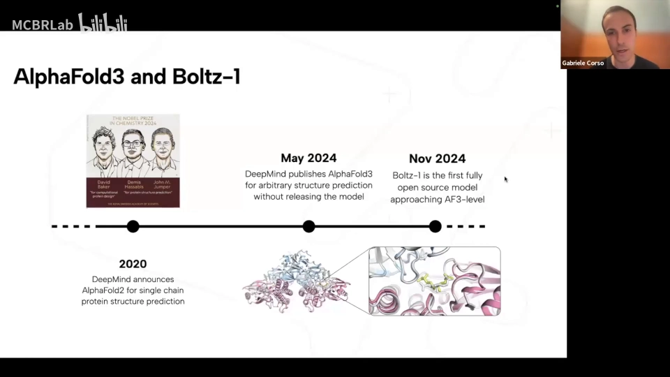

### 1.3 亲和力：临床前的最大瓶颈（[【跳转到 04:23】](https://www.bilibili.com/video/BV1XfNJzGEJK/?t=263)）

小分子与蛋白质药物的开发流程里，**靶点验证**（为疾病找对靶点）、**苗头化合物发现**（hit discovery，找能结合靶标的初始小分子）、**hit-to-lead 与先导物优化**（lead optimization，减活性、减脱靶）每个阶段都要做大量亲和力实验，而实验室能测的分子和蛋白总是有限的——这就是要用模型去啃的地方。

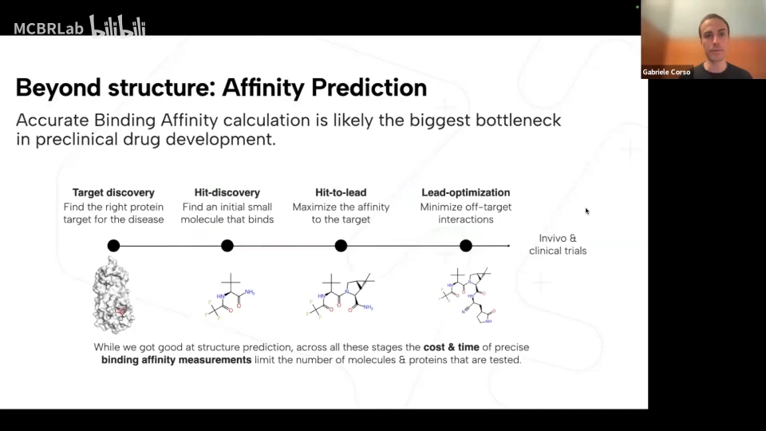

## 二、Boltz-2 结构模块总览（[【跳转到 06:29】](https://www.bilibili.com/video/BV1XfNJzGEJK/?t=389)）

架构沿袭 AF3 范式，一条数据流走完：

1. **主干（trunk）**：从原子级信息（含同分异构体编码）、侧链处理、各种条件输入开始，处理模板与 MSA；
2. **Pairformer 式大操作器**：在 token 两两之间更新"边"（pair）表示，利用三角运算，重复多次；
3. **结构模块 = 扩散模型**：从**随机原子坐标**开始，用 pair 嵌入作偏置，经若干 Transformer 架构逐步去噪，得到正确结构；
4. **两个头**：置信度头（沿用 Boltz-1 的较小模型，**没有**为它微调主干）+ 全新的**亲和力头**（用主干全部信息预测蛋白-小分子亲和力）。

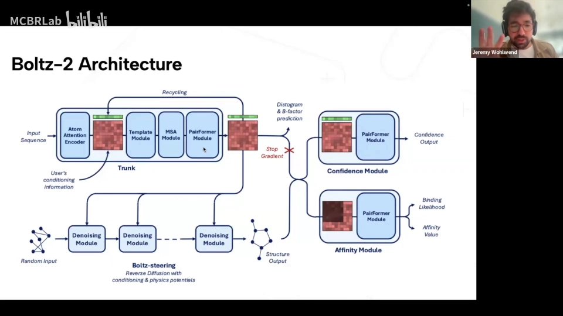

## 三、结构模块的四大改进（社区反馈驱动）

团队这次收到了四类反馈并逐一回应：**控制（条件）、局部动力学、pose 物理质量、速度与内存**。

### 3.1 控制之一：方法条件化（method conditioning，[【跳转到 09:30】](https://www.bilibili.com/video/BV1XfNJzGEJK/?t=570)）

PDB 中结构的测量方式五花八门：大部分是 X 射线，也有 cryo-EM、核磁共振；再加上蒸馏数据与分子动力学（MD）数据。Boltz-2 把**数据来源类型**输入模型做条件设定，让模型学一个条件分布——例如 MD 条件可以引导模型探索更多**局部构象空间**。

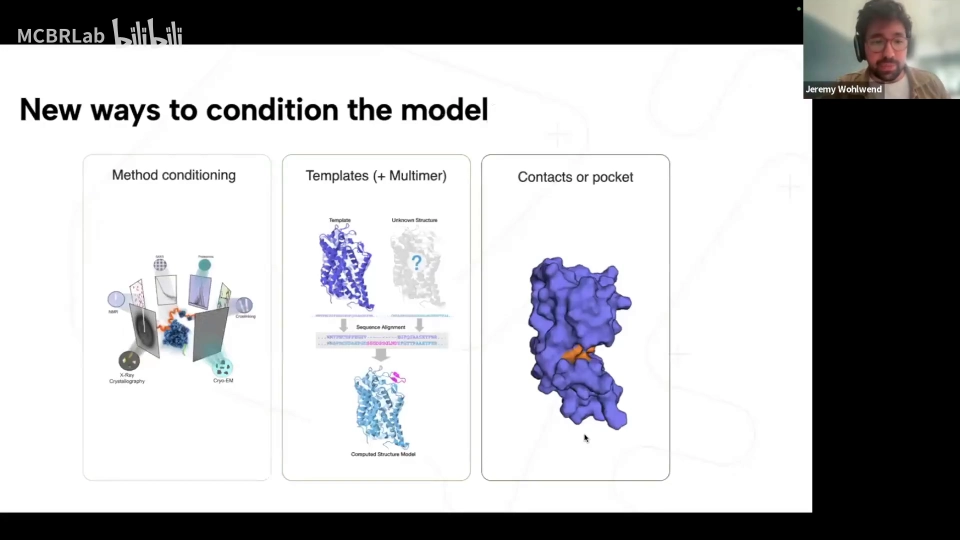

### 3.2 控制之二：模板与口袋条件（[【跳转到 10:45】](https://www.bilibili.com/video/BV1XfNJzGEJK/?t=645)）

- **模板**：AF3 只支持单链蛋白的模板，Boltz-2 扩展到**多链蛋白模板**（算法见论文）；
- **口袋条件**：可指定 binder，并在口袋中指定一个或多个特定残基；还可指定**任意接触**——当你手里有非三维结构意义上的测量信息时特别有用。

### 3.3 控制之三：分子动力学数据（[【跳转到 11:46】](https://www.bilibili.com/video/BV1XfNJzGEJK/?t=706)）

引入大量公开 MD 数据（ATLAS——纯蛋白质；MISATO——蛋白-配体动力学；以及第三组数据），并用三种方式监督：

- **构象分布**：不再对单一真实构象做回归，而是让模型预测的构象**分布**去匹配 MD 轨迹的分布（KL 散度损失），还可以监督"采样构象对的成对距离分布"；
- **B 因子预测**：mmCIF/PDB 里的 B 因子本身反映每个原子的柔性（来自结晶实验），拿来做额外的预测目标；
- **多重性（multiplicity）采样**：这是扩散模型训练方式的关键——同一输入分子**采样不同取向的构象副本，全部共用同一套嵌入，但各自加不同噪声**，去噪后**分别**与各自的构象做监督。一次前向相当于并行训练多个噪声版本，这正对应开源配置里 `N_sample`（采样/副本数）这一族参数（[【跳转到 13:01】](https://www.bilibili.com/video/BV1XfNJzGEJK/?t=781)）。

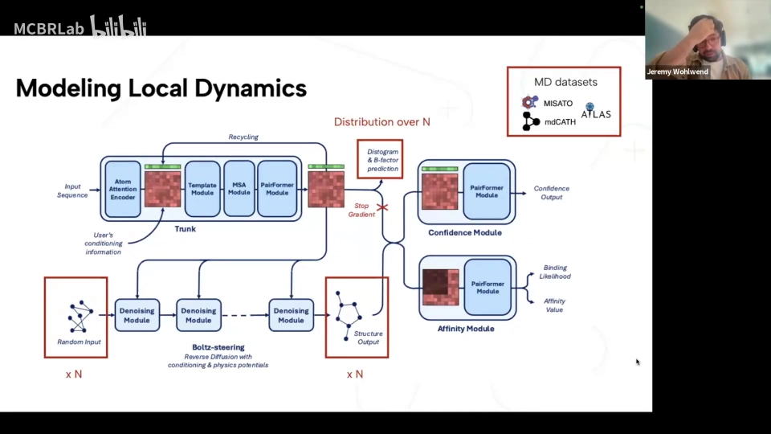

### 3.4 pose 物理合理性：势函数引导的扩散采样（[【跳转到 16:03】](https://www.bilibili.com/video/BV1XfNJzGEJK/?t=963)）

模型输出常有的毛病：输入分子的手性中心被翻转、键距不精确、出现立体碰撞，模型很不确定时甚至链会重叠（AlphaFold 3 也有类似报告）。Boltz-2 的解法是**用（物理）势引导扩散**：

1. **势函数**：在坐标空间定义任意可微函数，引导扩散路径走向势能更优的区域；
2. **多粒子**：不再只走一条采样路径，默认并行 **3 个粒子**探索，途中**重采样**，偏向看起来更可接受的路径；
3. **x0 调整**：每预测一次 x0，就在"势函数减小"的梯度方向上对 x0 做微调。

效果：开启势引导后，Boltz-1x/2 的**物理有效性**跃升到近乎完美；但 **RMSD 基本不变**——它不是让你更准，而是让你**没有冲突**，从而对下游的基于物理的测量与模拟更实用（[【跳转到 17:18】](https://www.bilibili.com/video/BV1XfNJzGEJK/?t=1038)）。

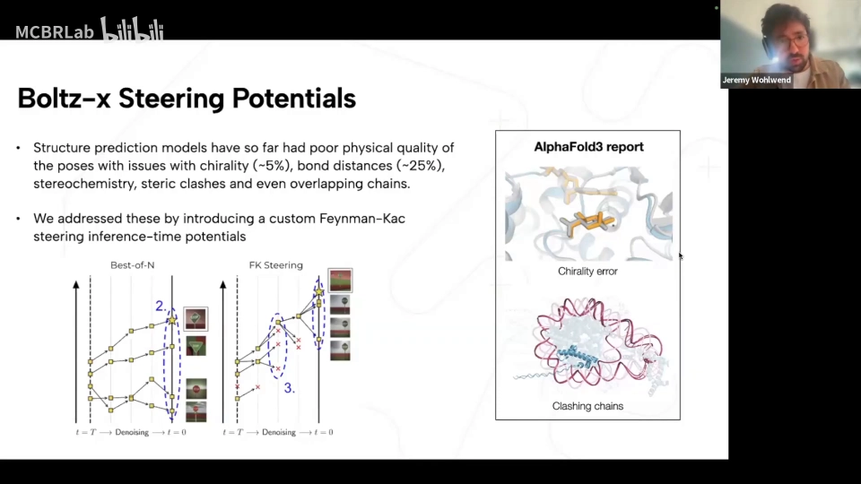

### 3.5 局部动力学的验证：RMSF 与 B 因子（[【跳转到 14:23】](https://www.bilibili.com/video/BV1XfNJzGEJK/?t=863)）

用 RMSF（均方根涨落）衡量"原子位置有多灵活"：包含 MD 条件的模型显著更好，与专用模型相当甚至更好——模型确实学到了"局部柔韧性"。

### 3.6 速度与内存：NVIDIA 合作（[【跳转到 18:13】](https://www.bilibili.com/video/BV1XfNJzGEJK/?t=1093)）

NVIDIA 决定将 Boltz 作为主要支持的结构预测模型（GTC 欧洲大会宣布）。发布当天仓库加入两个半精度内核：**三角注意力**与**三角乘法**——后者据称是首个加速三角乘法层的内核。按蛋白大小可获得 **2–4 倍**加速，前向与反向传播都有类似提升。

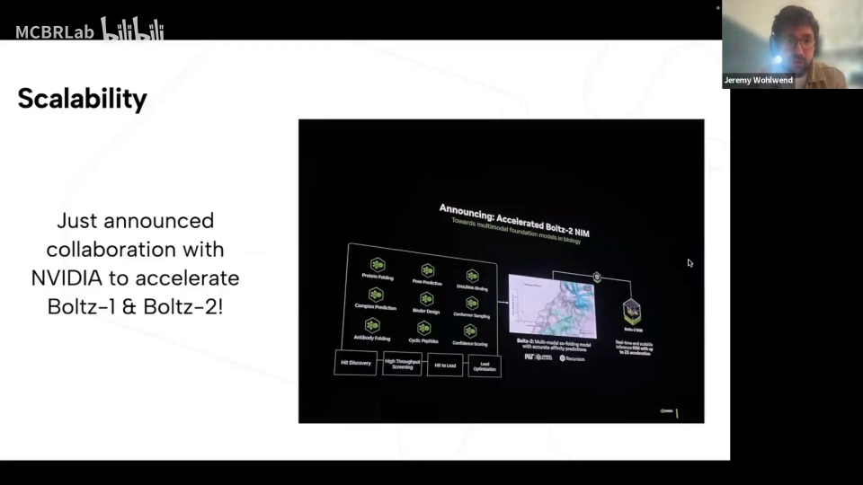

### 3.7 结构模块的成绩单（[【跳转到 20:06】](https://www.bilibili.com/video/BV1XfNJzGEJK/?t=1206)）

整体上各模态与同类模型相当；放大到更难的模态：**抗体**在 Boltz-1 → Boltz-2 之间提升明显，但与 AlphaFold 3 仍有差距（原因尚不完全清楚，团队有若干假设）；蛋白-DNA、蛋白-RNA 也有提升。

## 四、为什么说亲和力预测比结构预测更难（[【跳转到 21:30】](https://www.bilibili.com/video/BV1XfNJzGEJK/?t=1290)）

这不是"数据点数量"的问题——公开的亲和力数据点其实比结构还多。难在**每个数据点的信息量**与**质量**：

- **信息量低**：一个复合物结构里有约 n² 个数据点（n 为 token/原子数）；而亲和力是**一个复合物一个值**；
- **噪声大**：很多数据点带假阳性甚至假阴性；不同实验条件、不同实验室之间变异很大；
- **系统性偏差**：例如结合亲和力与分子量相关——这可能是药物开发流程（hit-to-lead、优化）留下的人为因素（[【跳转到 22:20】](https://www.bilibili.com/video/BV1XfNJzGEJK/?t=1340)）。

解法路径：**先从好的结构表示开始**——用大规模结构数据训练的大模型给亲和力头提供起点；然后清洗数据、消除偏差，并精心设计采样方式、损失函数与监督框架。

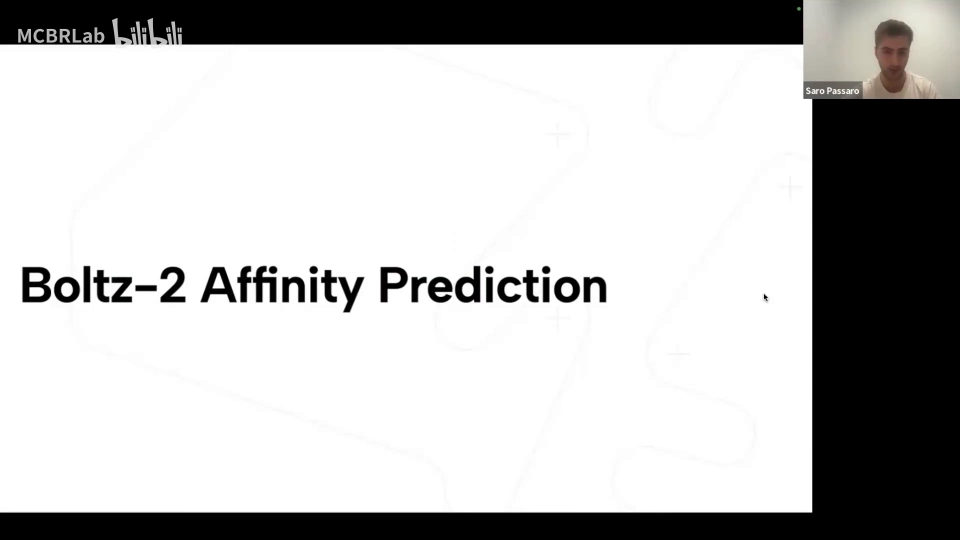

## 五、亲和力模块架构（[【跳转到 23:35】](https://www.bilibili.com/video/BV1XfNJzGEJK/?t=1415)）

架构非常简单，但处处针对上面三个难点：

1. **输入**：主干（trunk）的表征；结构模型在 5 次循环/采样后输出 token 坐标，**从 5 次扩散采样中提取最佳质量的坐标**——这里的"采样 5 次取最优"就是 `N_sample` 类参数在推理侧的直观体现；
2. **屏蔽蛋白内部表示**：在 Pairformer 中屏蔽掉纯粹的蛋白内部 pair 项，只关注蛋白-配体与相互作用界面；
3. **两个输出头**：
   - **苗头化合物发现**：输出"结合可能性"（0–1 之间的概率，配体结合靶标的可能性）；
   - **hit-to-lead / 先导优化**：输出 **IC50** 亲和力值，指导优化分子。

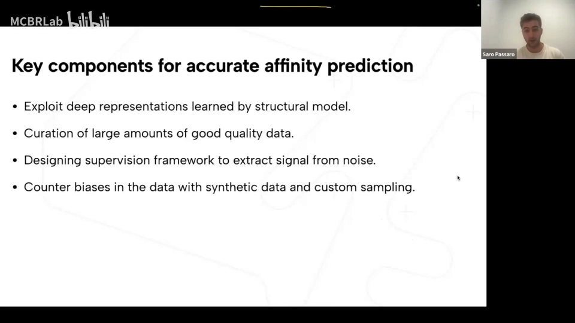

## 六、数据工程：把脏数据洗成教科书（[【跳转到 25:15】](https://www.bilibili.com/video/BV1XfNJzGEJK/?t=1515)）

- **数据来源**：PDBbind-CN、BindingDB 等公开库，加片段筛选数据；一家合作方提供约 **150 万个数据点、覆盖约 2500 个靶点**的亲和力值；另有约 **500 万个二分类数据点**和 **5000 万个诱饵（decoy）**；
- **HTS 假阳性**：高通量筛选平均约 **50%** 被报告为阳性的化合物其实是诱饵——处理方式是为每个真 binder 匹配诱饵、小心平衡正负样本；
- **结构质量过滤**：用置信度模型筛掉平均 **ipTM < 0.75** 的低质量结构数据点，避免模型把结构误差误学成规律（[【跳转到 27:20】](https://www.bilibili.com/video/BV1XfNJzGEJK/?t=1640)）；
- **合成诱饵**：把数据集中的 binder 互相混合生成合成诱饵，进一步去偏；
- **焦点损失（focal loss）**：二分类任务数据不多，模型容易在正样本上过拟合；当模型对正/负样本非常有信心时降低损失权重，显著缓解过拟合（[【跳转到 26:55】](https://www.bilibili.com/video/BV1XfNJzGEJK/?t=1615)）；
- **亲和力差值损失**：IC50 换算 Ki 需要依赖底物浓度与 Km 的线性校正；**在同一测定内取两个亲和力值的差**，正好抵消该校正——于是 IC50 与 Ki 可以同样处理（[【跳转到 28:35】](https://www.bilibili.com/video/BV1XfNJzGEJK/?t=1715)）；
- **匹配采样**：优化分子时关心的不是绝对值而是"改一下结构、活性变几个数量级"，因此专门采样同一化合物系列内活性差异大/小的测定对，逼模型聚焦系列内差异（[【跳转到 29:00】](https://www.bilibili.com/video/BV1XfNJzGEJK/?t=1740)）。

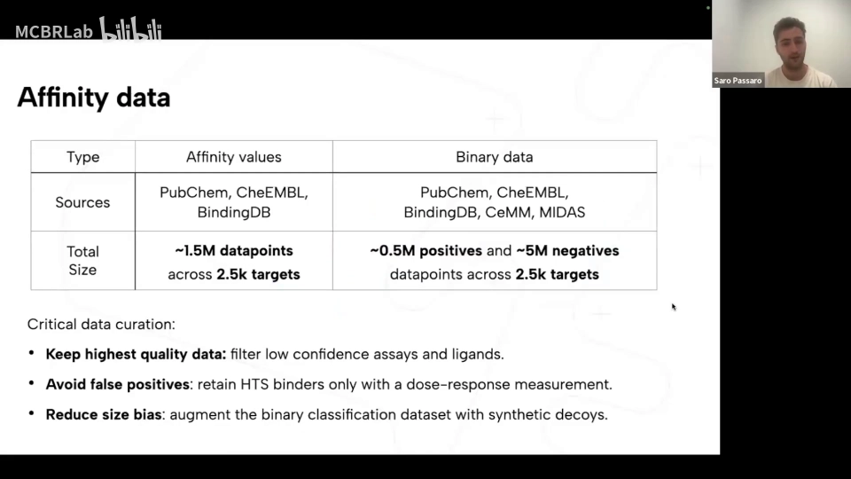

### 效果速览：预测 vs 实验

用二分类亲和力模型对两个靶点做虚拟筛选：预测亲和力与实验亲和力高度吻合，强 binder 被正确识别。如果 hit-to-lead 能被模型替代、只保留少量湿实验验证，将节省大量时间和金钱（[【跳转到 29:55】](https://www.bilibili.com/video/BV1XfNJzGEJK/?t=1795)）。

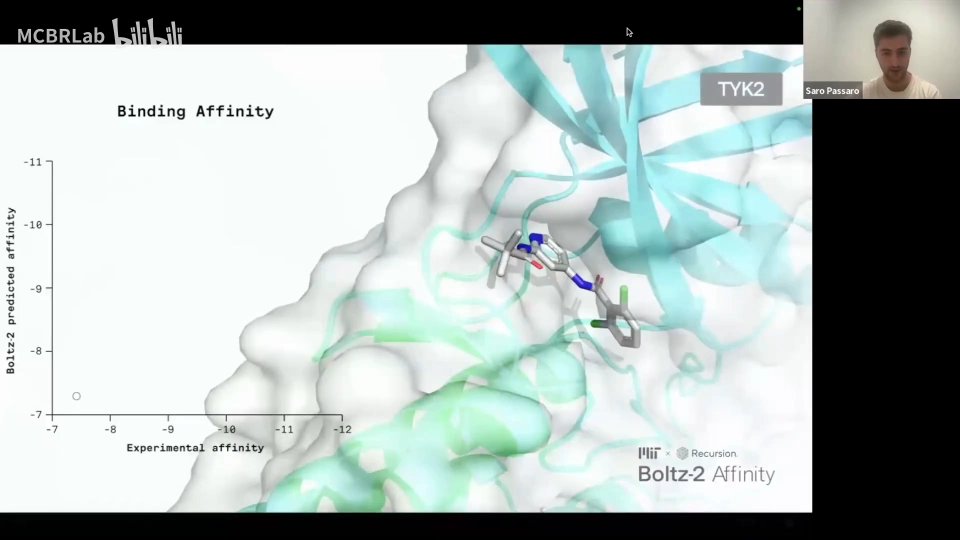

## 七、结果：三层验证

### 7.1 FEP+ 公开基准（[【跳转到 31:42】](https://www.bilibili.com/video/BV1XfNJzGEJK/?t=1902)）

- 数据集：Schrödinger 开发的 **FEP+ 基准**（计算化学的黄金标准）的公开部分，约 **900 个复合物、4 个特定靶点**，以便与各种物理基线公平比较；
- 结果：二分类模型击败机器学习基线（GNN+CNN 类基础模型等）与基于物理的基线，逼近**自由能微扰（FEP）**；对这 4 个靶点与开源 FEP 协议达到相同的 **Pearson 相关 0.66**，完整集略低一点。

### 7.2 帕累托曲线：20 秒 vs 一天（[【跳转到 32:32】](https://www.bilibili.com/video/BV1XfNJzGEJK/?t=1952)）

横轴是运行时间、纵轴是平均 Pearson 相关：绝对 FEP 模拟约 **1 天**且扩展成本极高；基于片段的方法约 **15 分钟**；纯对接快但性能差。Boltz-2 平均 **20 秒**，把"精度-速度"权衡推到了接近 FEP 精度、快 **1000 倍以上**的位置。

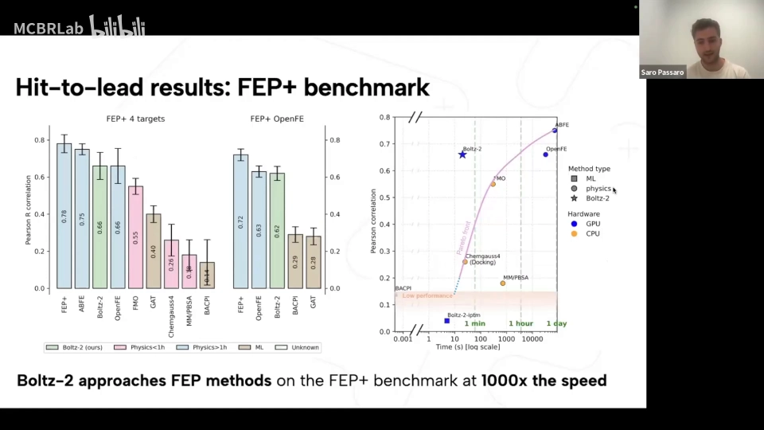

### 7.3 CASP16 亲和力挑战（[【跳转到 33:47】](https://www.bilibili.com/video/BV1XfNJzGEJK/?t=2027)）

约 **140 个蛋白-配体对**、顶尖实验室 **31 个项目**，靶点陆续披露。Boltz-2 在两个评估靶点上均为**最佳模型**。另外 Recursive 在 8 个内部（非常有挑战的）测定上评估：**3 个**取得好成绩（Pearson > 0.55）——考虑到即使 FEP 也只适用于约一半的靶点家族，这是重要的一步。

### 7.4 苗头发现基准 MF-PCBA（[【跳转到 35:52】](https://www.bilibili.com/video/BV1XfNJzGEJK/?t=2152)）

MF-PCBA 是高优先级的回顾性筛选试验基准：看富集因子（enrichment factor）随"前 k%"的变化，**0.5% 处的富集是对比 ML 基线的两倍**。

### 7.5 前瞻性筛选：真刀真枪地"找药"（[【跳转到 36:17】](https://www.bilibili.com/video/BV1XfNJzGEJK/?t=2177)）

选一个靶点做**预测性筛选**（选定原因：该靶点在 FEP+ 基准中出现过且训练集无简单关联；其绝对 FEP 模拟验证充分，可信任）：

- 化合物来源：**Hit Locator Library**（约 4600 个化合物）、**ChemBridge 库**，以及一个通过优化奖励生成分子的生成模型；
- **理性检查**：在随机分子上跑绝对 FEP——如预期全部为诱饵；
- **验证**：对 Hit Locator 库得分最高的 **10 个化合物**做实验测定，模型打分与绝对 FEP 结果一致；令人惊讶的是，找到的 binder **比公开已知的更强**；
- **新颖性**：新 binder 与公开已知 binder 相似度很低——模型在结合模式上做了泛化，而不是"背答案"（[【跳转到 38:22】](https://www.bilibili.com/video/BV1XfNJzGEJK/?t=2302)）。

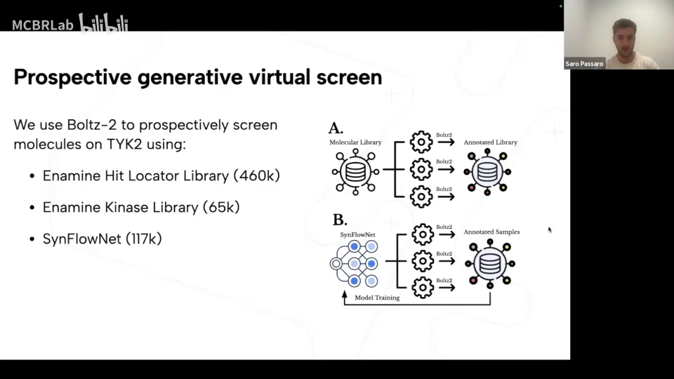

## 八、局限与问答要点（[【跳转到 39:12】](https://www.bilibili.com/video/BV1XfNJzGEJK/?t=2352)）

- **大构象变化仍是难题**：RMSF/B 因子只是**局部**柔性；无论 AF3 还是 Boltz-2，大规模构象变化的大多数情况仍然预测不好；
- **结构差 → 亲和力必差**：亲和力预测依赖结构预测质量；结构不对时，先用条件技术/模板救结构，再看亲和力输出；
- **单点突变**：模型对由单残基变化引起的大构象变化不敏感；置信度输出与突变有一定相关性，但亲和力对单点突变的敏感性尚未系统评估；
- **为什么用 IC50 而非 Kd**：大多数现成数据是 IC50；配合差值损失可抵消 IC50→Ki 的线性校正，共同训练效果最好；
- **扩散随机性的影响**：信息主要来自主干表征，单个 pose 间的变异性预期不大，但团队给不出量化估计；
- **速度**：亲和力预测约 **20 秒**（限定口袋、口袋内最多 **256 个 token**）；整个蛋白跑一遍可能要几分钟；
- **置信度指标**：AF3 与 Boltz 的置信度在"从随机样本中恢复 oracle 最优样本"上表现相当；选 **Pearson** 是因为与排名表现更相关、对误报更稳健；
- **过渡态亲和力**：暂无明确数据，团队表示感兴趣；
- **结构好 ≠ 亲和力一定好**：还取决于靶点与化合物系列，需要社区基准测试来刻画模型的能力边界。

## 小结

- Boltz-2 在开源结构模型上补齐了**通用亲和力预测**：hit discovery 输出结合概率，hit-to-lead/优化输出 IC50；
- 结构模块的四项改进——方法条件化、多链模板与口袋/接触条件、MD 数据（KL 散度分布监督 + B 因子）、势函数引导的**多粒子重采样 + x0 梯度调整**——分别解决"条件利用、数据丰度、物理合理性"；
- **多重性采样**（同一嵌入、多噪声构象、分别监督）与**5 次扩散采样取最优坐标**，是理解 AF3 类模型 `N_sample` 参数的活例子；扩散去噪循环则对应 `N_step`，回收循环对应 `N_cycle`（见同系列《AlphaFold 3 论文精讲》篇）；
- 数据工程是亲和力模型成败的另一半：HTS 五成假阳性、ipTM<0.75 过滤、合成诱饵、焦点损失、同测定差值损失、系列内匹配采样；
- 结果上：FEP+ 基准逼近 FEP（快 1000 倍）、CASP16 最佳、MF-PCBA 富集翻倍、前瞻性筛选找到比已知更强的 binder 且模式新颖。

## 关键术语速查

| 术语 | 一句话解释 |
| --- | --- |
| 亲和力（affinity） | 配体与靶标结合的强度；本文语境下常以 IC50/Ki/Kd 衡量 |
| hit discovery / hit-to-lead / lead optimization | 苗头化合物发现 / 命中到先导 / 先导物优化——药物开发三个以亲和力实验为瓶颈的阶段 |
| 方法条件化（method conditioning） | 把 X-ray / cryo-EM / NMR / 蒸馏 / MD 数据的来源类型作为条件输入模型 |
| 多重性（multiplicity）采样 | 同一输入采样多个构象副本、共用嵌入、各加不同噪声并分别监督——对应 `N_sample` |
| 势函数引导 | 用可微物理势引导扩散路径：多粒子 + 重采样 + x0 梯度调整 |
| 焦点损失（focal loss） | 对高置信样本降低损失权重，缓解二分类过拟合 |
| 差值损失 | 同一测定内取亲和力差值，抵消 IC50→Ki 的线性校正与测定间变异 |
| ipTM 过滤 | 剔除平均 ipTM < 0.75 的低质量结构数据点 |
| FEP / FEP+ | 自由能微扰；Schrödinger 的商业实现与基准，精度高但单次约一天 |
| MF-PCBA | 基于 PubChem BioAssay 的苗头发现回顾性基准，看富集因子 |
| Pearson 相关 | 与排名更相关、抗误报的指标，Boltz-2 亲和力评估的默认选择 |
