# 【机器学习】AlphaFold 3 论文精讲 + 模型介绍

> 本文整理自 Bilibili 视频 [【机器学习】AlphaFold 3 论文精讲 + 模型介绍](https://www.bilibili.com/video/BV142K6eBEWN/)（约 36 分钟，UP 主"标准小型超强台风"），内容以视频字幕与画面为依据逐窗口核对整理，可溯源。

## 本讲要解决的核心问题（SCQA）

**背景**：AlphaFold 2（下文简称 AF2）在**单链蛋白质**结构预测上已经达到很高的精度——输入一条氨基酸序列，就能预测它折叠成的三维结构。

**冲突**：但真实的生物学场景大多是**复合物**：蛋白质会和小分子配体、离子、DNA/RNA、带修饰的残基结合在一起工作。在 AF3 出现之前，通用型方法精度参差不齐，专用型方法又互不通用；而 2024 年 5 月发布的 AlphaFold 3（下文简称 AF3）虽然效果惊人，却**没有开源权重**，想读懂它、乃至在开源社区复现它（如 Protenix、OpenFold3、Boltz 系列），都必须先吃透它的结构。

**疑问**：AF3 究竟在架构上改了什么，才能在**一个统一的深度学习框架**里预测"几乎所有分子类型"的复合物？它引以为傲的**扩散解码器**是怎么工作的？

**回答（中心思想）**：AF3 = **特征提取 + Pairformer 编码器（带 4 次回收循环）+ 扩散解码器 + 置信度头**。与 AF2 相比它做了两处关键替换——编码器 Evoformer 换成 Pairformer、解码器 structure module 换成**扩散模块**；结构不再是"一次性回归"出来的，而是**从噪声出发、按多个噪声级别一步步去噪采样**出来的。理解了这条数据流，也就理解了各类 AF3 复刻模型中 `N_cycle`（回收循环次数）、`N_step`（去噪步数）这些采样参数的来源。

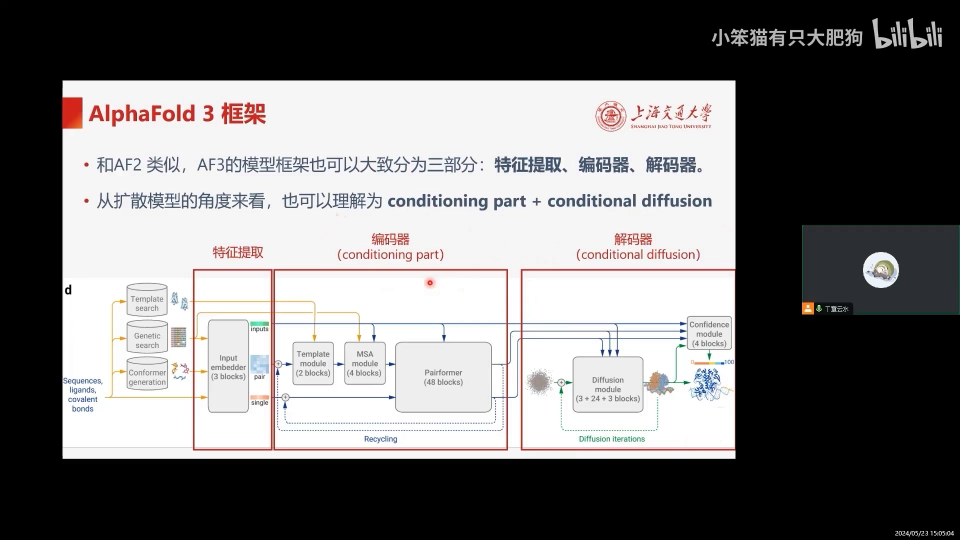

## 一、总体框架：一部"条件生成模型"

### 1.1 三段式结构

AF3 和 AF2 一样，大致分为三部分（[【跳转到 01:50】](https://www.bilibili.com/video/BV142K6eBEWN/?t=110)）：

1. **特征提取**：从输入序列出发，搜索并整理 MSA（多序列比对）特征、模板特征、参考构象等；
2. **编码器**：反复更新两种表征，把结构与 MSA 信息注入其中；
3. **解码器**：AF3 在这里换成**扩散模型**的结构。

如果从**生成模型**的角度看，前两部分合起来就是条件扩散模型的 **conditioning part**（条件部分），解码器本身则是一个 **conditional diffusion**（条件扩散模型）。

### 1.2 与 AF2 相比的两处关键替换

- 编码器：**Evoformer → Pairformer**，大幅减少 MSA 相关的计算量；
- 解码器：**structure module → 扩散模块**——不再直接回归坐标，而是给原子坐标"降噪"。

接下来结合伪代码（[【跳转到 02:40】](https://www.bilibili.com/video/BV142K6eBEWN/?t=160)）逐段拆解。

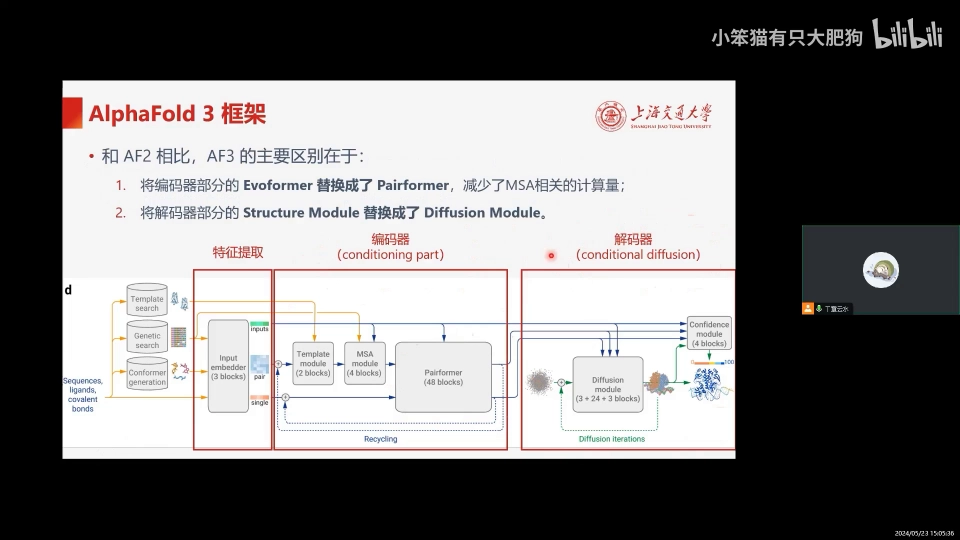

## 二、输入侧：token 化与三种 embedding

### 2.1 怎么把分子切成 token（[【跳转到 02:56】](https://www.bilibili.com/video/BV142K6eBEWN/?t=176)）

AF3 是为"不同类型分子"设计的统一框架，所以 token 的粒度按分子类型区别对待：

- **标准氨基酸残基、标准核苷酸**：整体算 **1 个 token**；
- **其他分子**（修饰过的残基、小分子配体等）：**每个原子算 1 个 token**。

### 2.2 三个 embedding

特征提取部分输出三个 embedding（[【跳转到 03:21】](https://www.bilibili.com/video/BV142K6eBEWN/?t=201)）：

| embedding | 颜色 | 形状 | 作用 |
| --- | --- | --- | --- |
| input embedding | 绿 | (token 数, 384) | token 级表征，**后续不更新**，作为"原始输入"参与每个模块计算 |
| single embedding | 红 | (token 数, 384) | token 级表征，在编码器中参与信息传递 |
| pair embedding | 蓝 | (token 数, token 数, 128) | 两两 token 的关系矩阵；由两个 token 表征投影相加，再加**相对位置编码**与**化学键信息**，引入顺序与位置概念 |

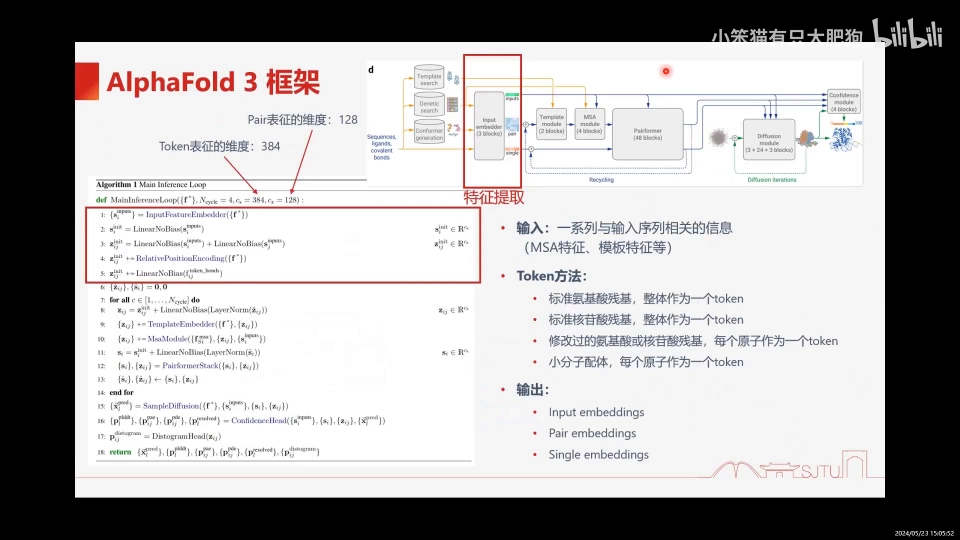

## 三、编码器：Template + MSA + Pairformer，外加 4 次回收循环

### 3.1 三个模块与回收机制（[【跳转到 04:11】](https://www.bilibili.com/video/BV142K6eBEWN/?t=251)）

编码器的输入就是上面的三个 embedding，目标是反复更新 pair / single 表征。它由三个模块组成：

1. **Template 模块**：把结构数据库中搜到的模板信息嵌入 pair 表征（循环整合 **7 个模板**，[【跳转到 12:52】](https://www.bilibili.com/video/BV142K6eBEWN/?t=772)）；
2. **MSA 模块**：把多序列比对信息嵌入 pair 表征；
3. **Pairformer**：整合上述两部分信息。

此外，这一部分带**回收（recycling）机制：总共循环 4 次**——这就是各类 AF3 复刻模型中 `N_cycle` 参数的出处。

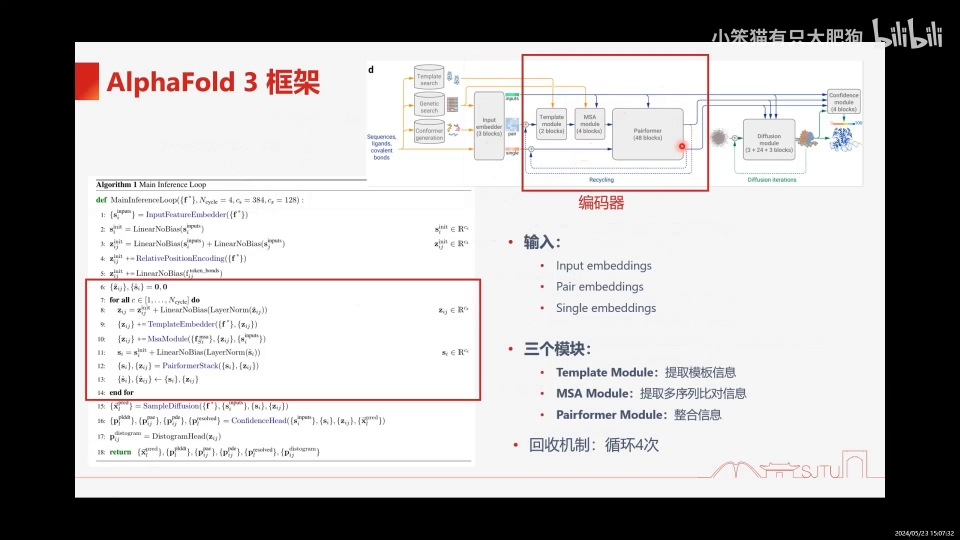

### 3.2 与 AF2 编码器的两点区别（[【跳转到 07:56】](https://www.bilibili.com/video/BV142K6eBEWN/?t=476)）

- **模板信息的切入位置不同**：AF2 在特征提取阶段就把模板嵌入 pair 表征，之后**不参与回收**；AF3 在编码器阶段才切入，模板信息**也参与回收循环**，被反复增改；
- **MSA 的使用深度不同**：AF2 的 MSA 表征贯穿 Evoformer 全部 **48 个 block** 反复更新；AF3 只在 MSA 模块的 **4 个 block** 里更新，之后 MSA 信息就"并入" pair 表征。这大幅降低了对 MSA 的依赖和计算开销。

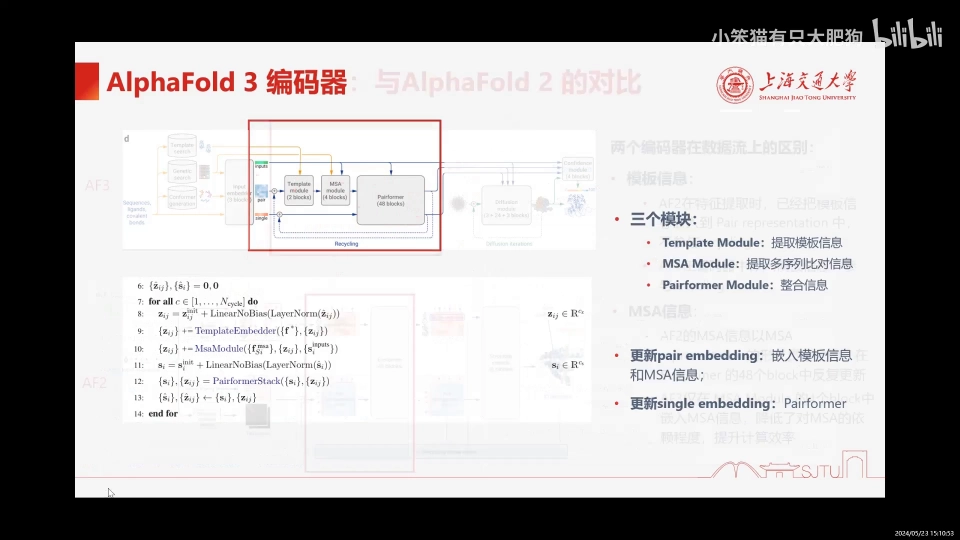

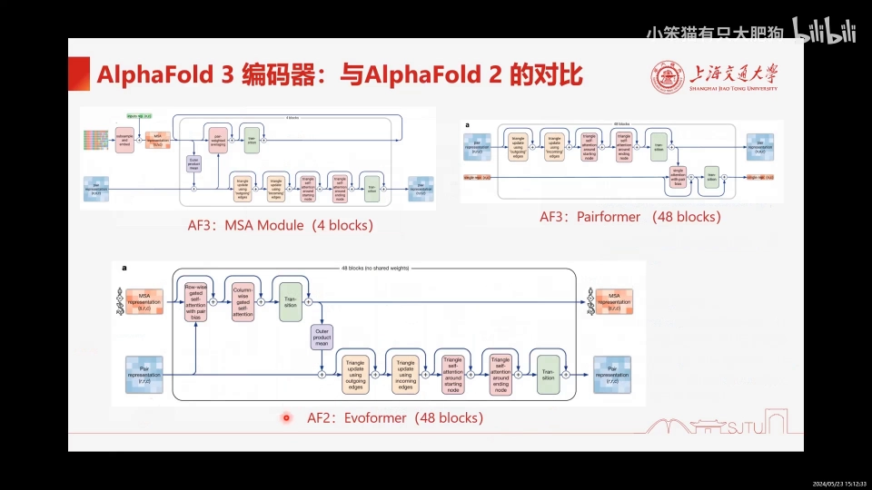

### 3.3 MSA 模块的三步（[【跳转到 13:42】](https://www.bilibili.com/video/BV142K6eBEWN/?t=822)）

1. **随机采样 N 条 MSA 序列**，与初始 input representation 一起编码成 MSA 表征（伪代码中的 `g`）；
2. 进入循环：MSA 表征与 pair 表征交替更新，**共循环 4 次**；
3. 更新 MSA 表征的两个块合称 **MSA stack**，更新 pair 表征的五个块合称 **pair stack**——两者都是 AF2 Evoformer 的变体与简化（pair stack 与 AF2 完全一致）。

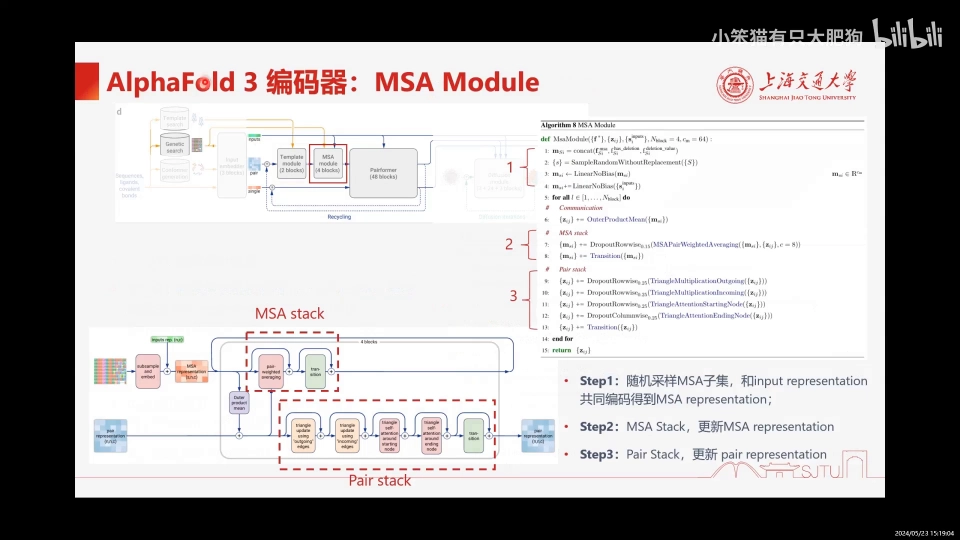

### 3.4 pair stack 的关键块：从"门控注意力"到"加权平均"（[【跳转到 15:22】](https://www.bilibili.com/video/BV142K6eBEWN/?t=922)）

- **outer product mean**：取 MSA 的第 i、j 两列，经线性层求外积、求平均，加到 pair 表征上——一次 MSA → pair 的信息传递；
- **pair weighted average**：AF2 在这个位置是 MSA 的逐行门控注意力；AF3 换成**逐行加权平均**。直觉：注意力本来就是"按相似性加权平均"，AF3 干脆用 pair 表征的投影当权重矩阵，省掉了每行算自注意力的开销；
- **三角更新 ×2 与逐行/逐列三角注意力**：把 pair 表征理解为完全图，i→j 的边遍历所有中间节点 k 传递信息，几何上等价于考虑 i、j、k 三个氨基酸构成的**三角形约束**（两边之和大于第三边）；
- **transition**：全连接 → 4 倍宽 → 激活 → 投回，激活函数从 ReLU 换成 **SwiGLU**。

### 3.5 Pairformer：单向的"pair → single"信息流（[【跳转到 19:32】](https://www.bilibili.com/video/BV142K6eBEWN/?t=1172)）

进入 Pairformer 时，模板与 MSA 信息已完全融入 pair 表征，所以这里**只有 pair 对 single 的单向传递**（没有反向交互）。对 pair 的更新与前面的 pair stack 完全一样；真正的区别在于更新 single 的块——**single attention with pair bias**：它本质是 AF2 逐行门控注意力的"单行版"（single 只有一行，不用再逐行），Q/K/V 自注意力加上 pair 表征作为偏移量，再过门控。

## 四、解码器之扩散模块：从噪声到结构（`N_step` 的来源）

### 4.1 伪代码三步（[【跳转到 21:12】](https://www.bilibili.com/video/BV142K6eBEWN/?t=1272)）

扩散的整个过程在伪代码里大致分三步：

1. **初始化**：从"原点周围的高斯分布"生成初始原子位置——结构预测的起点是**一团噪声**，不是某个参考构象；
2. **for 循环遍历不同噪声级别**：不同噪声级别有助于在不同尺度上学习结构——**低噪声侧重局部细节，高噪声侧重全局轮廓**（这就是扩散采样步数 `N_step` 的概念来源：循环多少次、每次对应哪个噪声强度）；
3. **去噪更新**：把加噪后的原子位置送入扩散模块（伪代码第 8 行），更新出降噪后的原子位置。

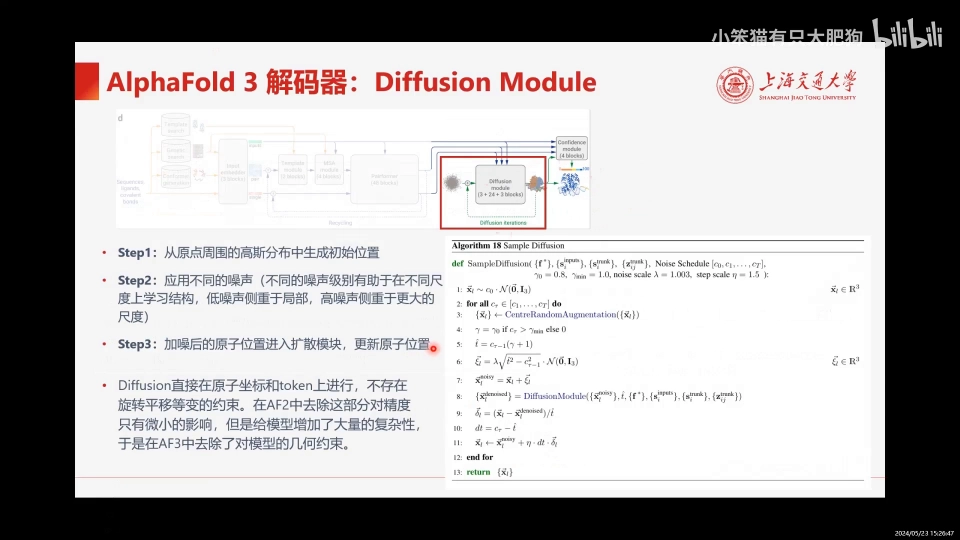

### 4.2 一个大胆的简化：扔掉旋转平移等变约束

论文特别强调：这个 diffusion 过程**直接在原子坐标和 token 上进行，不存在旋转平移等变的约束**。原因：作者发现 AF2 里去掉这部分约束，对精度只有微小影响，却给模型增加了大量复杂性——所以 AF3 干脆去掉了几何约束（[【跳转到 21:37】](https://www.bilibili.com/video/BV142K6eBEWN/?t=1297)）。

### 4.3 两个层级的交替（[【跳转到 22:27】](https://www.bilibili.com/video/BV142K6eBEWN/?t=1347)）

扩散模块内部是一个**两个层级交替**的结构：

- **原子级 encoder**：在单个原子层面做注意力，关注**局部**信息；
- **token 级 Diffusion Transformer**：关注 token 级别，偏向**全局**信息。

交互形式是"先原子 → 再 token → 又回到原子"，总体呈 3+2、4+3 个 block 的交替堆叠——整个 diffusion module 就是很多个 Transformer 堆叠在一起。

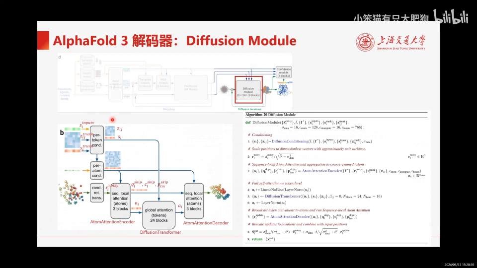

### 4.4 token 级坐标更新：AdaptiveLayerNorm 注入条件（[【跳转到 24:07】](https://www.bilibili.com/video/BV142K6eBEWN/?t=1447)）

条件化阶段先用投影和激活处理主干表征，并用 **Fourier embedding** 把扩散过程（时间步/噪声级）编码为连续且可微的表征。token 级更新的一个 block = **attention + transition**，两者都和前文的自注意力/transition 很像，关键区别是在做 attention 之前加了 **AdaptiveLayerNorm**，把 single conditioning 融合进来作为条件。attention + transition 这两个 block 合起来是**一次 Diffusion Transformer，循环 24 次**，完成一轮 token 级坐标更新。

### 4.5 原子级更新（[【跳转到 25:22】](https://www.bilibili.com/video/BV142K6eBEWN/?t=1522)）

原子级做的是"同样的事情、更细的颗粒"：先做针对每个原子的局部标准化，然后调用 **AtomTransformer**（3 个 block、4 个头的多头注意力），内部又调用 Diffusion Transformer——执行条件扩散的步骤就在这里。之后另一个原子层面的坐标更新调用 **AttentionDecoder**，接收来自 encoder 的数据，同样经由 AtomTransformer 再做一次原子级扩展。

## 五、置信度模块：四个指标（[【跳转到 26:37】](https://www.bilibili.com/video/BV142K6eBEWN/?t=1597)）

置信度模块预测"预测结构 vs ground truth"的差距，即模型对自己预测有多大把握：

| 指标 | 粒度 | 含义 |
| --- | --- | --- |
| **pLDDT** | 原子级 | 逐原子的预测置信度 |
| **PAE** | token 对 | token 之间（对齐后）的相对位置误差 |
| **PDE** | token 对 | token 之间的绝对距离误差 |
| **实验解析预测** | 原子 | 预测每个原子是否已被实验方法解析——帮助区分"实验测到的部分"与"模型推断出来的部分" |

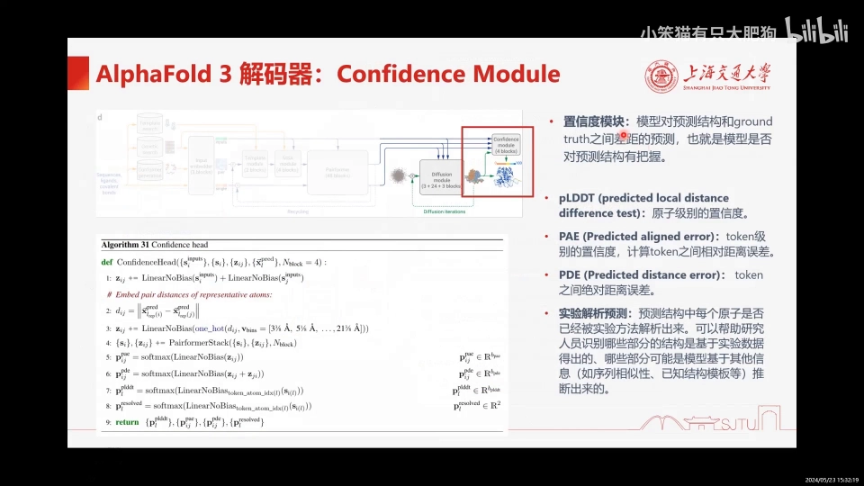

## 六、训练技巧：让扩散模型"更快、更诚实"

### 6.1 扩散模块用大 batch（[【跳转到 27:56】](https://www.bilibili.com/video/BV142K6eBEWN/?t=1676)）

主干（编码器）开销大，扩散模块相对轻量。为了提高训练效率，AF3 对每个输入结构**随机平移旋转出 48 个副本、各加独立噪声**，多路并行——相当于给扩散模块做出了更大的 batch size。

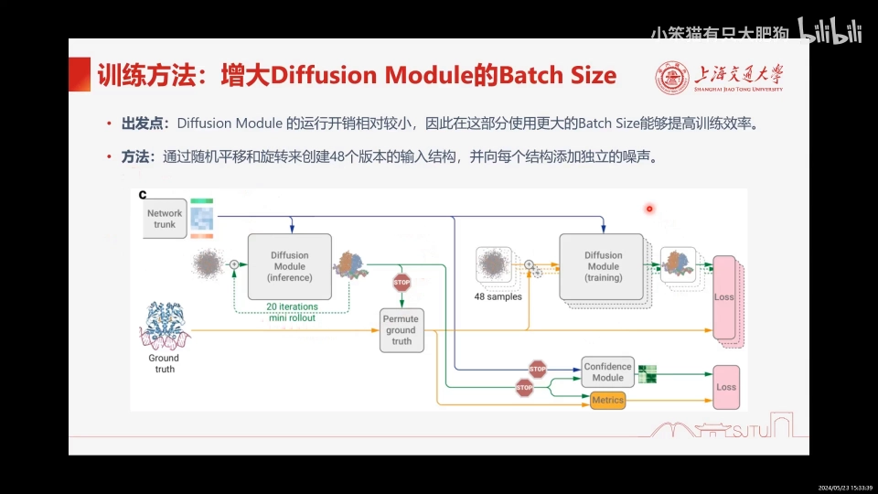

### 6.2 rollout：给置信度模块造"真误差"

扩散结构下没法像 AF2 那样直接对结构模块输出回归误差。AF3 用 **rollout 机制**：把模型预测出的结构与真实结构**对齐**后计算真实误差，用来训练置信度模块（[【跳转到 28:21】](https://www.bilibili.com/video/BV142K6eBEWN/?t=1701)）。

### 6.3 交叉蒸馏：对抗"幻觉"（[【跳转到 28:46】](https://www.bilibili.com/video/BV142K6eBEWN/?t=1726)）

生成模型都有"幻觉"问题——像 ChatGPT 不懂装懂。AF3 也会生成生物学上不存在的结构：比如 ground truth 只有一小块灰色区域是有序结构（其余部分本无稳定构象），AF3 却倾向于把无序区也折叠成漂亮的螺旋。对策是**交叉蒸馏（cross-distillation）**：训练集中加入大量含无序 loop 的结构，其来源是 **AlphaFold-Multimer 的预测结构**。加上交叉蒸馏后，无序区域的输出合理了很多。

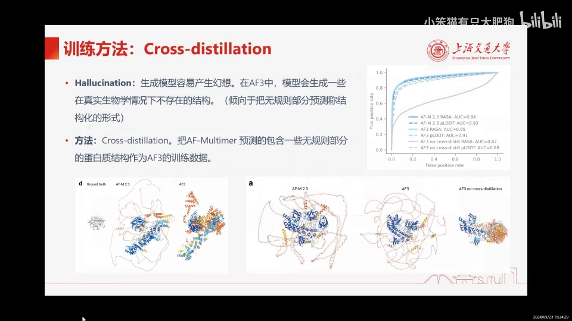

## 七、实验结果：AF3 到底强在哪

### 7.1 蛋白质-小分子：PoseBusters 基准（[【跳转到 30:23】](https://www.bilibili.com/video/BV142K6eBEWN/?t=1823)）

- 数据集：**PoseBusters benchmark**，428 个蛋白-小分子复合物；
- 评价方式：把预测结构与真实结构的**蛋白口袋对齐**后，比较小分子之间的 **RMSD**（均方根偏差）；
- 基线两类：**盲对接**（只需蛋白序列 + 小分子 SMILES，无额外结构信息）与**传统对接**（需要蛋白结构或指定口袋）；
- 结果：AF3 作为**盲对接**方法已超过绝大多数方法；作者还额外训练了一个**接受口袋信息**的 AF3 变体，成功率直接达到 **90.2%**，遥遥领先。

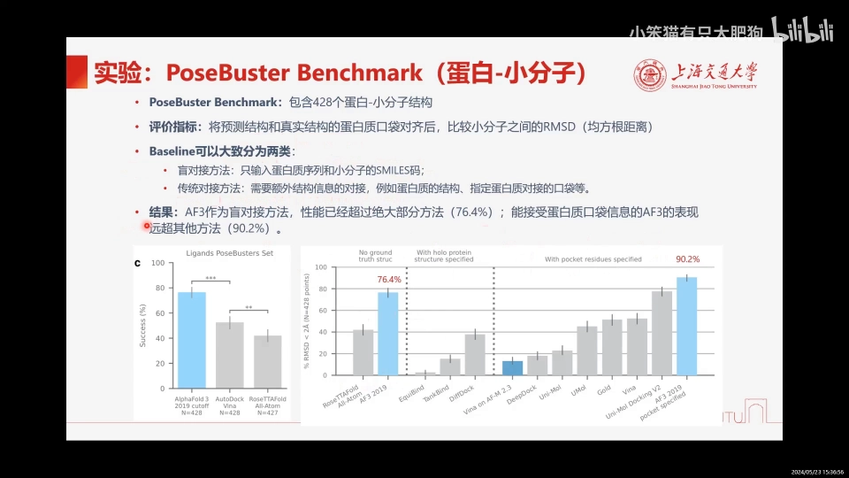

### 7.2 蛋白质-核酸复合物（[【跳转到 31:38】](https://www.bilibili.com/video/BV142K6eBEWN/?t=1898)）

基线是 David Baker 团队的 **RoseTTAFold All-Atom**。无论蛋白-RNA、蛋白-DNA 复合物，还是 RNA/DNA 单体预测，AF3 全面领先。唯一输掉的测试集是 **CASP15 RNA**：当时最好的方法是 AIchemy_RNA，但它依赖人类专家知识辅助，无法推广到其他测试集。

### 7.3 共价修饰（[【跳转到 32:28】](https://www.bilibili.com/video/BV142K6eBEWN/?t=1948)）

共价修饰 = 通过共价键把小分子或化学基团连接到生物大分子（蛋白、核酸、脂质）上，可改变其性质、功能与稳定性。实验覆盖**结合配体、糖基化、蛋白残基修饰、DNA/RNA 碱基修饰**等五个方面，AF3 都能预测。

### 7.4 蛋白质复合物：老本行的升级（[【跳转到 33:18】](https://www.bilibili.com/video/BV142K6eBEWN/?t=1998)）

基线是专为蛋白质复合物设计的 **AlphaFold-Multimer**。结果：蛋白复合物预测准确率显著提升，其中**蛋白-抗体复合物**提升最大；蛋白质单体（最右列）本已做得很好，换扩散解码器也没有牺牲精度。

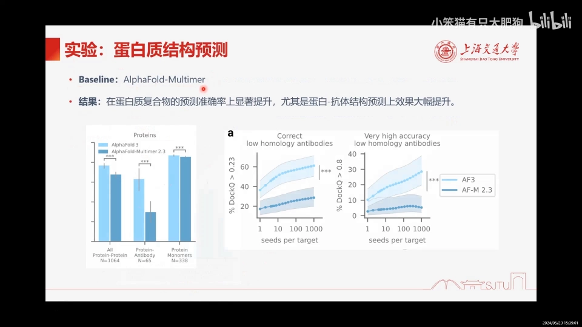

### 7.5 置信度确实"靠得住"（[【跳转到 34:08】](https://www.bilibili.com/video/BV142K6eBEWN/?t=2048)）

成功率与置信度呈强正相关：复合物预测以 **ipTM**（界面局部 TM-score，可由 PAE 算出）为横坐标，单体以 **pLDDT** 为横坐标——模型确实能给预测得好的地方更高的置信度。

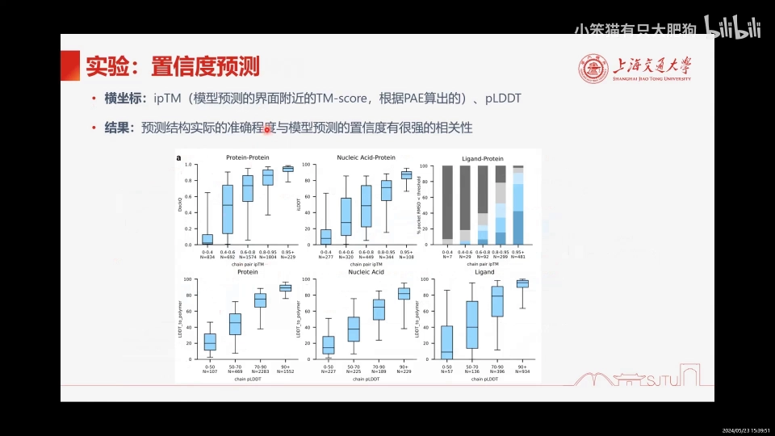

### 7.6 Web Server

视频发布时 AF3 权重未开源（官方称半年内公开），实际使用走 **AlphaFold Server**：结果页把各位置 pLDDT 用颜色标出（蓝色把握大、橙色把握小），pair 维度的信息也有可视化（[【跳转到 34:38】](https://www.bilibili.com/video/BV142K6eBEWN/?t=2078)）。

## 小结

- AF3 用"**条件生成模型**"的视角重构了结构预测：特征提取 + 编码器是 conditioning，解码器是 conditional diffusion；
- 编码器从 Evoformer 换成 **Pairformer**：模板信息后移到编码器并参与回收，MSA 从"贯穿 48 block"降为"4 个 block"，配合逐行加权平均替代逐行门控注意力，算力大减；
- **回收循环 4 次**（`N_cycle` 的出处）让表征被反复精修；
- 解码器扩散模块**从原点高斯噪声出发**，按**多个噪声级别**循环去噪（`N_step` 的出处），在**原子级 + token 级**两个层级交替更新，token 级 Diffusion Transformer 循环 24 次；
- 扔掉旋转平移等变约束、扩散模块 48 副本大 batch、rollout 训练置信度、交叉蒸馏对抗幻觉，是它"更快更好"的四个工程秘诀；
- 置信度四指标（pLDDT / PAE / PDE / 实验解析预测）与成功率强相关，是使用输出时的第一道判断依据。

## 关键术语速查

| 术语 | 一句话解释 |
| --- | --- |
| token 化 | 标准残基/核苷酸整体 1 个 token；修饰残基、配体等每原子 1 个 token |
| pair / single 表征 | token 两两关系矩阵（128 维）/ token 级表征（384 维） |
| 回收（recycling） | 编码器整体循环 4 次，模板、MSA 信息反复精修——对应 `N_cycle` |
| Pairformer | AF3 编码器主模块，pair→single 单向传递 |
| 扩散模块 | 从高斯噪声出发、按多个噪声级别循环去噪出坐标——对应 `N_step` |
| Diffusion Transformer | token 级条件扩散块（attention + transition + AdaptiveLayerNorm），循环 24 次 |
| AtomTransformer | 原子级条件扩散块（3 block、4 头），负责局部细节 |
| pLDDT / PAE / PDE | 原子级置信度 / token 对相对（对齐后）距离误差 / token 对绝对距离误差 |
| PoseBusters | 蛋白-小分子对接合理性基准，428 个复合物 |
| 交叉蒸馏 | 用 AlphaFold-Multimer 预测的无序区结构训练，抑制"无序区幻觉" |
