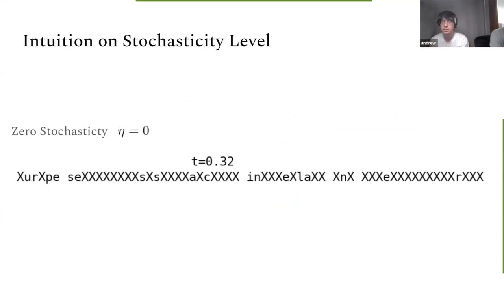
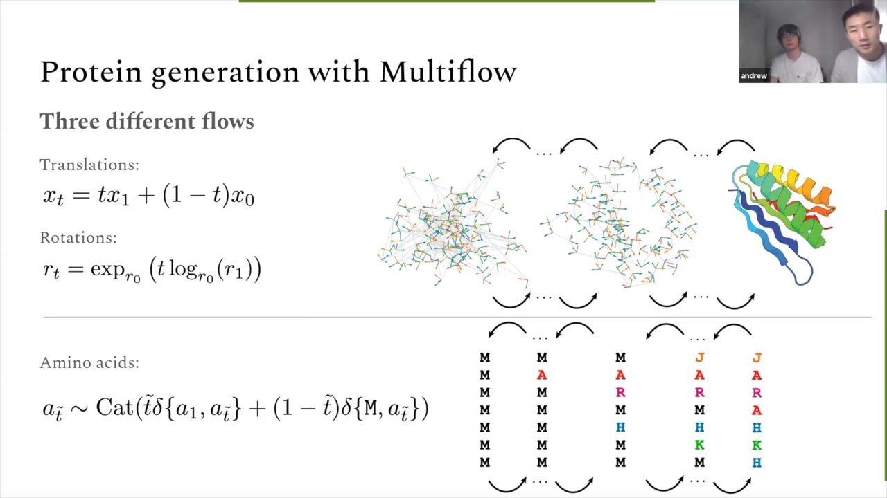
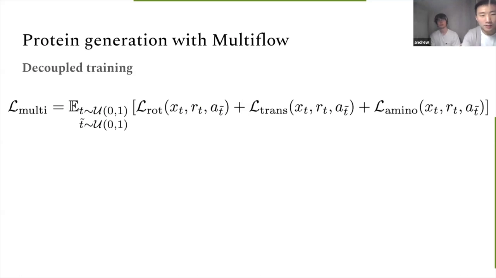
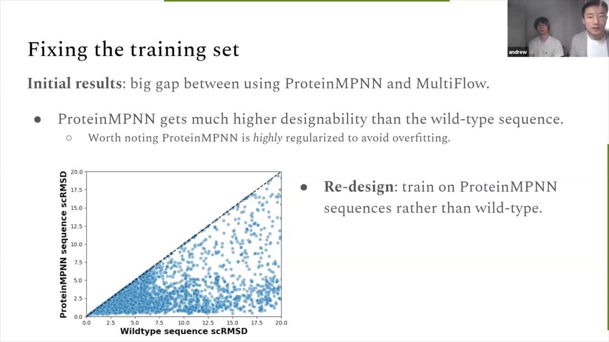

# Multiflow：一个模型同时生成蛋白质的序列与结构（离散-连续流匹配）

> 来源：YouTube 视频《Multiflow: protein structure and sequence co-generation | Jason Yim & Andrew Campbell》（[yzc29vhM2Aw](https://www.youtube.com/watch?v=yzc29vhM2Aw)，时长 54:54）。
> 讲者：Jason Yim（MIT，Tommi Jaakkola / Regina Barzilay 组）与 Andrew Campbell（牛津，Tom Rainforth 组），MD2 研讨会报告。本文基于视频字幕与画面逐窗口整理而成，配图取自视频截图，时间戳可跳回原视频对应位置核对。
> 这篇报告把「序列-结构共设计」推到了通用蛋白质层面：同一个模型用流匹配同时去噪三维结构与离散序列，训练时靠"两个时钟"的解耦技巧支持共生成、逆折叠、正折叠三种任务。[【跳转到 00:00】](https://www.youtube.com/watch?v=yzc29vhM2Aw&t=0)

## 本讲要解决的核心问题（SCQA）

**背景**：蛋白质从头设计的经典流程是"先设计结构，再按结构配序列"——结构用 RFdiffusion/FrameFlow 这类生成模型，序列交给 ProteinMPNN 逆折叠，最后虚拟筛选送湿实验。[【跳转到 00:44】](https://www.youtube.com/watch?v=yzc29vhM2Aw&t=44)

**冲突**：为什么要死守"结构→序列"的单向流水线？序列可能反过来影响结构，两者该相互塑造；而且结构生成（SE(3) 扩散/流）已经成熟，**序列怎么生成才最优却悬而未决**，序列与结构各用一套模型也无法相互"感知"对方在做什么。[【跳转到 01:34】](https://www.youtube.com/watch?v=yzc29vhM2Aw&t=94)

**疑问**：能不能让一个模型同时生成序列与结构——既支持"两头从噪声一起出来"的共生成，也支持"固定一头、生成另一头"的逆/正折叠？

**回答（中心思想）**：Multiflow——在**欧氏空间（平移）+ SO(3) 流形（旋转）+ 离散空间（氨基酸类别）**上同时跑三条流，用两个解耦的时间尺度 T 与 T-tilde 控制结构与序列各自的去噪进度；训练时在一个二维时间网格上均匀采样，使一个模型能以任意组合完成三种范式。重设计与蒸馏后，共设计可设计性从 0.41 升到 0.88，比肩 ProteinMPNN。[【跳转到 22:06】](https://www.youtube.com/watch?v=yzc29vhM2Aw&t=1326)

## 一、问题设定：三种生成范式

### 1.1 共生成（co-generation / co-denaturation）

结构与序列**同时从噪声生成**，两者互相影响的机制交给模型自己学。这是与"两步法"最本质的区别：不再是"生成器 + 条件预测器"两个模型，而是一个模型同时输出两个模态。[【跳转到 01:34】](https://www.youtube.com/watch?v=yzc29vhM2Aw&t=94)

### 1.2 逆折叠（inverse folding）与正折叠（forward folding）

同一个模型还应该会：**逆折叠**——结构固定为数据、序列从噪声去噪；**正折叠**——序列固定、结构从噪声去噪。顺带也能单独生成序列或单独生成结构（虽然单独用途较少）。三种范式合起来，才是"蛋白质生成通用机"该有的样子。[【跳转到 02:24】](https://www.youtube.com/watch?v=yzc29vhM2Aw&t=144)

### 1.3 技术路线的选择

序列侧的候选方案里：自回归（NLP 最流行）难以与连续模态同步；连续时间离散扩散可行但实现繁琐。团队选择了**流匹配（flow matching）**——它在连续空间已证明能简化生成建模且不掉性能，问题是：**怎么把它搬到离散状态空间？**这就是 Andrew 上半场要解决的问题。[【跳转到 03:14】](https://www.youtube.com/watch?v=yzc29vhM2Aw&t=194)

## 二、预备知识：离散状态空间上的流匹配

### 2.1 从噪声到数据：两条可选的插值路

流匹配的第一步是定义"从噪声到数据"的插值过程。对离散数据，做法是以数据点 X₁ 为条件定义简单过程，再对数据分布取期望得到无条件的插值流：**均匀插值**——t=0 时所有 token 独立均匀随机，随时间逐渐"聚焦"到 X₁ 的 one-hot；**掩码插值**——t=0 时全是 [MASK]，随时间逐渐把 X₁ 的真实 token"揭示"出来。选哪条路，取决于数据形态。[【跳转到 07:24】](https://www.youtube.com/watch?v=yzc29vhM2Aw&t=444)

### 2.2 CTMC 与速率矩阵

要真正"走"这条插值路，需要一个可模拟的随机过程：**连续时间马尔可夫链（CTMC）**——状态离散、时间连续，粒子停在某状态一段时间后跳到随机选中的另一状态。刻画其动力学的是**速率矩阵**：A→B 的速率 × 时间步 δt = 转移到 B 的概率。有速率矩阵就能做欧拉积分逐步模拟。[【跳转到 09:04】](https://www.youtube.com/watch?v=yzc29vhM2Aw&t=544)

### 2.3 Kolmogorov 方程与条件速率矩阵

速率矩阵与边际分布由 **Kolmogorov 方程**联系——离散版的连续性方程：状态 Xₜ 的概率变化率 = 流入质量 − 流出质量。直接求满足方程的无条件速率矩阵很难，解法是先写出**以 X₁ 为条件的速率矩阵**（对条件边际分布满足方程，有解析解），再对**去噪分布**（网络预测的"由 Xₜ 反推干净数据 X₁"的分布）取期望，就得到可用的无条件速率矩阵。[【跳转到 12:05】](https://www.youtube.com/watch?v=yzc29vhM2Aw&t=725)

## 三、训练与采样：交叉熵 + 随机性参数 ε

### 3.1 训练与采样循环

训练就是语言模型式的交叉熵：采数据点 → 采时间 t∈[0,1] → 按条件边际分布把数据"腐蚀"到 t 时刻 → 网络从腐蚀态预测干净数据的 logits → 交叉熵。采样则从纯噪声出发，每步算无条件速率矩阵、按"速率×δt"的跳转概率采样、迭代——与扩散模型的欧拉积分如出一辙。[【跳转到 15:02】](https://www.youtube.com/watch?v=yzc29vhM2Aw&t=902)

### 3.2 ε 的直觉：让模型学会"反悔"

解析解速率矩阵对应的动力学"跳跃极少"（掩码一旦揭开就不再变）。给过程额外注入一个与边际分布处于细致平衡的速率项，用参数 **ε 控制随机性**：ε=0 时 token 揭示后一锤定音；ε>0 时 token 会**被掩回、再揭示**——模型在生成途中可以"反悔"，发现某个词不合语境就重新掩掉、换个更一致的词。报告展示了"hill"后来改成"will"的例子。[【跳转到 19:11】](https://www.youtube.com/watch?v=yzc29vhM2Aw&t=1151)

### 3.3 文本实验：非零随机性确实更好

在无条件文本生成上用大语言模型给生成句子打 NLL（越低越好）+ 句内 token 熵（贴近数据分布才不算复读）。两者兼顾的"好区域"在右下角，实验显示**非零随机性的离散流模型最接近该区域**，明显优于 ε=0 及自回归/吸收态扩散基线——这些可玩的"额外动力学"在采样期能带来实打实的性能提升。[【跳转到 20:51】](https://www.youtube.com/watch?v=yzc29vhM2Aw&t=1251)

## 四、Multiflow：三条流 + 两个时间尺度

### 4.1 平移、旋转、离散——三流并行

蛋白质生成被拆成三条并行的流（结构部分沿用团队的 FrameFlow）：**平移**走欧氏空间的标准流匹配；**旋转**是向 SO(3) 流形的推广；**氨基酸类别**则用上半场的离散流（逐步从类别分布采样、线性时间表）。三条流合起来完整刻画一个蛋白质的生成。[【跳转到 22:06】](https://www.youtube.com/watch?v=yzc29vhM2Aw&t=1326)

### 4.2 两个时钟：T 与 T-tilde

关键设计是**两个解耦的时间尺度**：T 控制结构的去噪进度，T-tilde 控制序列的去噪进度。两者可以同速（共生成），也可以一个停在数据、另一个从噪声出发（逆/正折叠），甚至一快一慢（部分去噪再让另一头"追上来"）。动画演示中两者同步推进，t=1 时同时落成数据样本。[【跳转到 23:46】](https://www.youtube.com/watch?v=yzc29vhM2Aw&t=1426)

### 4.3 一个模型玩转三种范式：解耦训练

要让单模型支持任意组合，训练时就得让它见过**二维时间网格的每个格子**：结构时间 T 与序列时间 T-tilde 各自从均匀分布独立采样（即"解耦时间"），损失为结构项 + 序列项的联合。实操配比为：80% 联合训练 + 10% 逆折叠（固定 T=1）+ 10% 正折叠（固定 T-tilde=1）。问答确认：解耦训练的模型在"两时钟同步"的共生成采样下依然保持结构-序列一致——灵活性与一致性经验上都成立。[【跳转到 24:36】](https://www.youtube.com/watch?v=yzc29vhM2Aw&t=1476)

## 五、实验：可设计性、重设计与蒸馏

### 5.1 数据集与可设计性指标

蛋白质实验用 FrameFlow 策展的数据集：单体、高质量（loop 占比 <50%）、长度 60~384，约 2 万条。生成质量用**可设计性（designability）**衡量：生成的骨架 → ProteinMPNN 出序列 → ESMFold 折叠 → 对齐后全局 RMSD（SC-RMSD）< 0.2 nm（2 Å）算成功。逆折叠看设计性，正折叠看 RMSD。[【跳转到 29:36】](https://www.youtube.com/watch?v=yzc29vhM2Aw&t=1776)

序列设计算三种场景：**co-design-1**（直接用 Multiflow 自己生成的序列）、**MPNN-1**（丢掉自产序列、ProteinMPNN 出 1 条）、**MPNN-8**（ProteinMPNN 出 8 条取最优——业界默认协议）。

### 5.2 野生型只有 70% 可设计：ProteinMPNN 重设计

初版模型与 ProteinMPNN 差距近一倍。排查发现惊人事实：**PDB 野生型序列本身只有 70% 能通过可设计性指标**——30% 的训练数据永远过不了关。而 ProteinMPNN（小而强正则化、刻意防过拟合）给出的序列稳定性远超野生型。解法叫**重设计（redesign）**：对每条结构跑 ProteinMPNN，与野生型比较 SC-RMSD、择优保留，数据集可设计率升到 90%+。[【跳转到 32:06】](https://www.youtube.com/watch?v=yzc29vhM2Aw&t=1926)

### 5.3 合成数据蒸馏：0.41 → 0.88

重设计后更进一步：**自蒸馏**——用训练好的 Multiflow 采样约 2 万条、按长度均匀取，过滤出过可设计性关卡的，聚类后得到约 4.2 万条合成蛋白并入训练集。双管齐下后，co-design-1 从 **0.41 → 0.88**，与 ProteinMPNN-1 相当——等于把 ProteinMPNN 的序列能力蒸馏进了一个**同时生成结构与序列**的单模型，还换来多模态训练/推理的灵活性。[【跳转到 35:51】](https://www.youtube.com/watch?v=yzc29vhM2Aw&t=2151)

### 5.4 横向对比与折叠短板

与 ProteinSolver（斯坦福）、ProteinGenerator（Baker 组）等共设计方法比，Multiflow 的 co-design-1 更高、**结构多样性也远高**。与 RFdiffusion 只能在 MPNN 协议下比（RFdiffusion 不产序列）：MPNN-8 与 MPNN-1 两个口径都超过。逆折叠上与 ProteinMPNN 打平（2.2 Å vs 1.9 Å，作者认为不显著）；**正折叠明显落后 ESMFold**——作者归因于 ESMFold 见过更多数据且有进化信息，这是模型当前的短板与后续方向。全部结果为无条件生成；条件生成（motif scaffolding 等）是后续工作。[【跳转到 37:56】](https://www.youtube.com/watch?v=yzc29vhM2Aw&t=2276)

## 六、问答精华

- **谁先收敛？**结构先定、序列随后——旋转上的指数缩放（Joey Bose / Mila 同行的技巧）让结构提前稳定。
- **ProteinMPNN 为什么这么强？**它只有约 20 万参数、重度正则化，学的是"归纳偏置"而非数据分布，因此生成比野生型更稳定；Multiflow 用注意力+IPA 全局建模，分布学得更真，但要靠蒸馏补齐"可设计性"。
- **离散空间能做 minibatch 最优传输吗？**难：全掩码噪声下所有点共享同一噪声向量，离散空间的"耦合"天然崎岖，只能靠随机性——这是有趣的开放方向。
- **是蛋白质特有问题吗？**是：训练数据分布与设计者目标错位（进化不选稳定性、de novo 又想要稳定）；NLP 里 ChatGPT 靠人类反馈对齐也类似。框架本身在纯文本实验上并无短板。
- **可设计性指标会不会被"刷爆"？**会。作者用 AlphaFold（而非 ESMFold）独立验证仍高，但坦承全社区正把 90%+ 的指标刷到饱和，需要新指标、更需要湿实验闭环。
- **还能干什么？**构象生成（正折叠可看作多样性构象生成，参见同组 AlphaFlow）；多聚物结合设计的可设计性可借 AlphaFold-Multimer 的 PAE 置信度（Baker 组 Nate Bennett 的工作），但预测模型本身还需更强。[【跳转到 52:31】](https://www.youtube.com/watch?v=yzc29vhM2Aw&t=3151)

## 小结

- 序列-结构共设计的通用形态：**一个模型、三个流**（欧氏平移 + SO(3) 旋转 + 离散类别）。
- 离散流匹配三件套：插值过程（均匀/掩码）→ CTMC 速率矩阵 → Kolmogorov 方程的解析条件解。
- **ε 随机性**让模型能"反悔"重写已生成 token，文本实验证明非零随机性更优。
- **两个时间尺度**（T / T-tilde）+ 二维时间网格解耦训练，单模型通吃共生成、逆折叠、正折叠。
- 数据侧两板斧：ProteinMPNN **重设计**修掉野生型里 30% 不可设计数据；**合成数据蒸馏**再上一台阶。
- 结果：co-design-1 0.41→0.88、比肩 ProteinMPNN；多样性更高；逆折叠持平；正折叠待加强。

## 关键术语速查

| 术语 | 一句话解释 |
| --- | --- |
| 共生成（co-generation） | 序列与结构同时从噪声生成并相互塑造的范式 |
| 逆折叠 / 正折叠 | 固定结构生成序列 / 固定序列生成结构 |
| CTMC | 连续时间马尔可夫链：离散状态 + 连续时间的跳变过程 |
| 速率矩阵 | 刻画 CTMC 动力学的矩阵，"速率×δt"即转移概率 |
| Kolmogorov 方程 | 联系速率矩阵与边际分布的连续性方程（流入−流出） |
| 去噪分布 | 由噪声态反推干净数据 X₁ 的分布，由网络学习 |
| ε（随机性参数） | 控制掩码-去掩码动力学的强度，让模型可修改已生成内容 |
| FrameFlow | 团队此前的 SE(3) 流匹配结构生成工作，Multiflow 的结构侧基座 |
| T / T-tilde | 结构与序列各自独立的去噪时钟，可同速也可一停一动 |
| 解耦训练 | 在 T×T-tilde 网格上独立采样两个时间，使单模型支持任意采样组合 |
| 可设计性（designability） | 生成骨架→ProteinMPNN 出序列→ESMFold 折叠→SC-RMSD<2 Å 的成功率 |
| 重设计（redesign） | 用 ProteinMPNN 重出序列并与野生型按 SC-RMSD 择优的数据清洗法 |
| 合成数据蒸馏 | 用自产的可设计合成蛋白扩充训练集的自举方法 |
| SC-RMSD | 折叠结构与生成结构对齐后的均方根偏差 |
