# AI 驱动的分子对接新范式：DiffDock 把对接变成"生成 + 挑选"

> 本文整理自 B 站视频[《AI驱动的分子对接新范式：DiffDock云工具》](https://www.bilibili.com/video/BV1dT9cYvEMn/)（微科盟生信云网研会，约 22 分钟）。上半场讲清 DiffDock 凭什么取代 AutoDock 式的"搜索 + 打分"：把对接重构为三维空间的生成任务，靠扩散模型直接预测配体的**平移、旋转、扭转角**，再用**置信度模型**排序；下半场以云工具为例，完整走一遍"准备输入 → 提交任务 → 解读结果 → 可视化"。对接基础概念（pose、口袋、盲对接）见[《五分钟搞清分子对接底层原理》](../../1.5_分子相互作用/1.5.2_分子对接pose口袋盲对接/五分钟搞清分子对接底层原理.md)；DiffDock 论文级深讲（R³ × SO(3) × T^m 乘积空间扩散、置信度模型训练）见[《DiffDock：把分子对接变成"生成 + 挑选"》](../../3.5_生成质量/3.5.2_扩散置信度/DiffDock_%20Diffusion%20Steps,%20Twists,%20and%20Turns%20for%20Molecular%20Docking.md)。

## 本讲要解决的核心问题（SCQA）

**背景**：分子对接是药物研发的核心手段——已知靶蛋白结构和小分子，预测它们**如何结合**（结合模式）与**结合多强**。虚拟筛选、先导化合物优化、毒性预警都依赖它。[【跳转到 00:25】](https://www.bilibili.com/video/BV1dT9cYvEMn/?t=25)

**冲突**：传统对接（AutoDock 一族）流程又长又繁：受体去水加氢、配体检查、对接盒子定位、格点文件生成、能量参数计算，最后用构象搜索算法评估数以万亿计的位姿。粗采样可能漏掉真实结合构象，经验打分函数带来能量误差，参数设置门槛还高。[【跳转到 01:32】](https://www.bilibili.com/video/BV1dT9cYvEMn/?t=92)

**疑问**：有没有一种方法，又快又准，还能告诉用户"哪个结果最可信"，最好点点鼠标就能跑？

**回答（中心思想）**：DiffDock 把对接重构为**三维空间的生成任务**——借鉴图像生成领域的扩散模型思想，对真实结合构象注入结构化噪声、训练深度网络逆向恢复，直接预测配体最优空间姿态的**完整自由度（平移、旋转、扭转角）**，再由**置信度模型**给候选位姿排序。本讲以云工具形式走完全流程。[【跳转到 02:47】](https://www.bilibili.com/video/BV1dT9cYvEMn/?t=167)

---

## 一、分子对接：药物研发里的"试钥匙"

### 1.1 它解决什么问题

分子对接通过模拟药物分子与靶蛋白的三维结合过程，预测两者的**结合模式**（结合在哪里、怎么摆）与**结合强度**。视频给了三个典型应用：新冠药物开发中用虚拟筛选锁定候选药物；药物研发阶段用结合位点分析指导分子结构的精准改造；安全性评估中用毒性预测识别药物与非目标蛋白的交叉反应风险。[【跳转到 00:42】](https://www.bilibili.com/video/BV1dT9cYvEMn/?t=42)

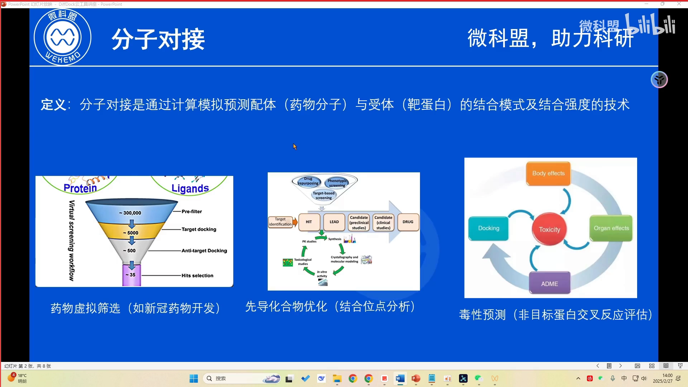

### 1.2 传统对接的流程与三大痛点

传统工具（AutoDock 等）的典型流程：受体蛋白先**去除水分子、添加氢原子、格式转换**；配体分子要做检查与复杂参数设置；然后是**对接盒子的空间定位、格点文件生成、能量参数计算**；最后由构象搜索算法评估数以万亿计的分子姿态。[【跳转到 01:32】](https://www.bilibili.com/video/BV1dT9cYvEMn/?t=92)

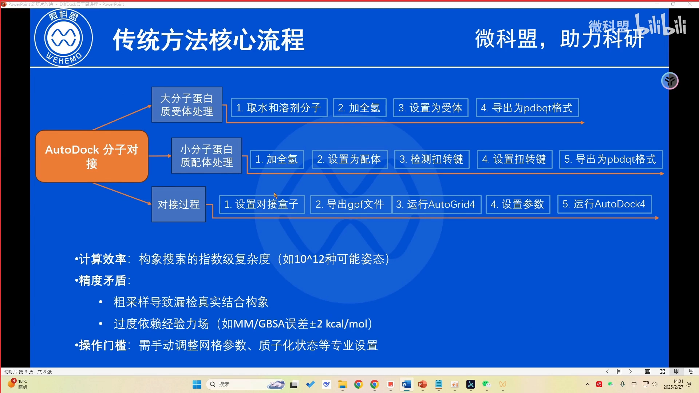

痛点有三：①**计算效率与精度难以兼得**，粗采样可能漏掉真实结合构象；②打分基于**经验立场**（经验性评分函数），能量评估有误差；③参数繁琐，对操作者专业门槛高。[【跳转到 02:22】](https://www.bilibili.com/video/BV1dT9cYvEMn/?t=142)

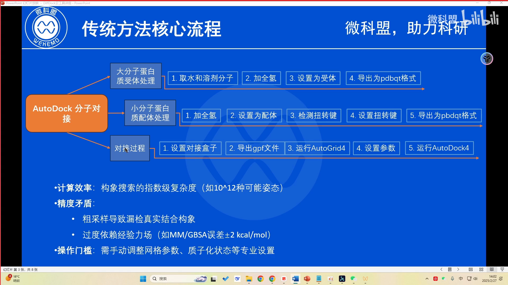

## 二、DiffDock 的方法思路：生成 + 挑选（一页速览）

DiffDock 把对接任务重构为**三维空间的生成任务**：借鉴图像生成领域扩散模型的思想——**正向扩散**对真实结合构象注入结构化噪声，训练深度神经网络学会**逆向恢复**原始构象；推理时从噪声出发生成大量候选位姿。它的网络直接预测配体的完整自由度：**平移、旋转、扭转角**；最后由**置信度评分模型**给所有候选打分排序。这套范式特别适合在复杂蛋白体系的药物筛选中快速锁定高置信度结合构象。[【跳转到 02:47】](https://www.bilibili.com/video/BV1dT9cYvEMn/?t=167)、[【跳转到 03:17】](https://www.bilibili.com/video/BV1dT9cYvEMn/?t=197)

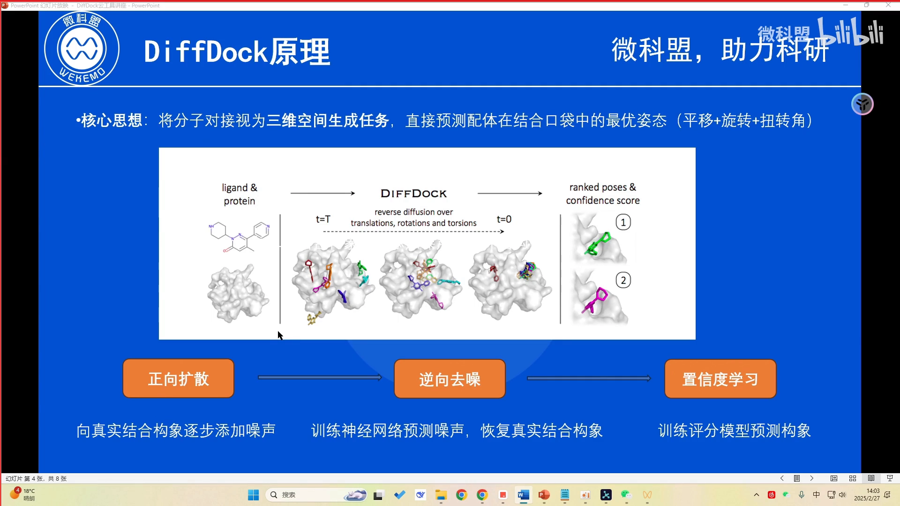

> 想深入 DiffDock 的理论细节（位姿在 R³ × SO(3) × T^m 乘积空间上的扩散、"纯扭转"约定、置信度模型的训练方式），见[《DiffDock：把分子对接变成"生成 + 挑选"——置信度模型是怎么给位姿打分的》](../../3.5_生成质量/3.5.2_扩散置信度/DiffDock_%20Diffusion%20Steps,%20Twists,%20and%20Turns%20for%20Molecular%20Docking.md)。各类管线结果里的 `position_confidence`，出处就是这里说的置信度。

## 三、四种输入文件：受体 1 种、配体 3 种

云工具共支持四种蛋白质与配体文件输入。[【跳转到 05:04】](https://www.bilibili.com/video/BV1dT9cYvEMn/?t=304)

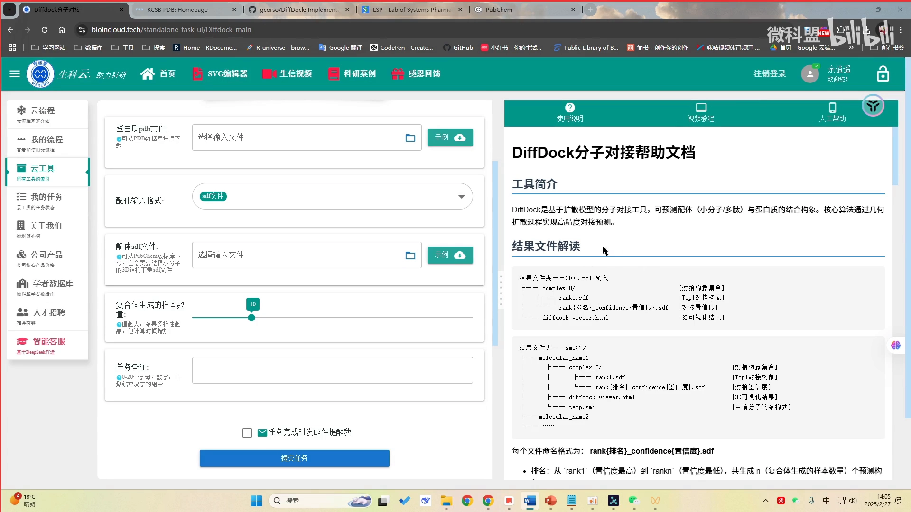

### 3.1 受体：PDB 文件

PDB 是存储蛋白质、核酸等大分子三维结构的标准格式，包含原子坐标、化学信息与相互作用等数据。判断"PDB 里装的是不是蛋白质"有两个抓手：文件开头的 **HEADER** 记录（如 `VIRAL PROTEIN` 是病毒蛋白，`DNA/RNA HYBRID` 则是核酸混合物）；以及原子记录类型——**ATOM** 表示标准氨基酸/核苷酸原子，**HETATM** 表示非标准原子（金属离子、水分子等）。示例蛋白文件直接从 PDB 数据库（RCSB PDB）下载即可。[【跳转到 05:29】](https://www.bilibili.com/video/BV1dT9cYvEMn/?t=329)、[【跳转到 08:42】](https://www.bilibili.com/video/BV1dT9cYvEMn/?t=522)

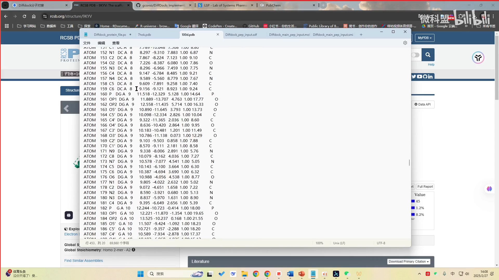

### 3.2 配体格式一：SDF

SDF 用于存储化学分子结构及属性：原子的 3D 坐标 + 键连接信息。文件分几段：**头部**（由哪个软件生成、化合物名称，可自定义也可留空）；**计数行**（前两个数字 = 原子数与键数，例如 45 个原子、45 个键，氢原子一般不计入）；**原子区**（每行一个原子的元素名与 XYZ 坐标）与键区；可选**属性区**（以 `> 属性名` 起头，逐条记录属性）。[【跳转到 09:50】](https://www.bilibili.com/video/BV1dT9cYvEMn/?t=590)

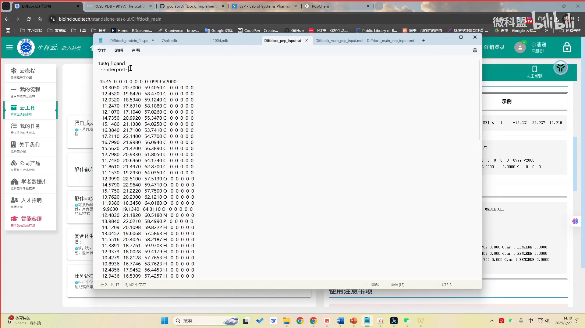

### 3.3 配体格式二：MOL2

分子建模中常用，比 SDF 更复杂，能携带更多化学与物理属性数据；文件按 `@<TRIPOS>` 模块化组织，头部包含分子名、原子/键数量统计与分子类型等基础信息。对接中有较大的应用价值。[【跳转到 11:30】](https://www.bilibili.com/video/BV1dT9cYvEMn/?t=690)

### 3.4 配体格式三：SMI（SMILES 列表）

结构最简单、对用户最直观：**第一列 SMILES 结构字符串、第二列名字**，一行一个配体——适合"一个蛋白对接多个配体"的场景，输出结果文件里也会带上这个名字。注意 SMILES **必须正确**，否则提交必报错，排错要首先从结构正确性查起。[【跳转到 12:45】](https://www.bilibili.com/video/BV1dT9cYvEMn/?t=765)

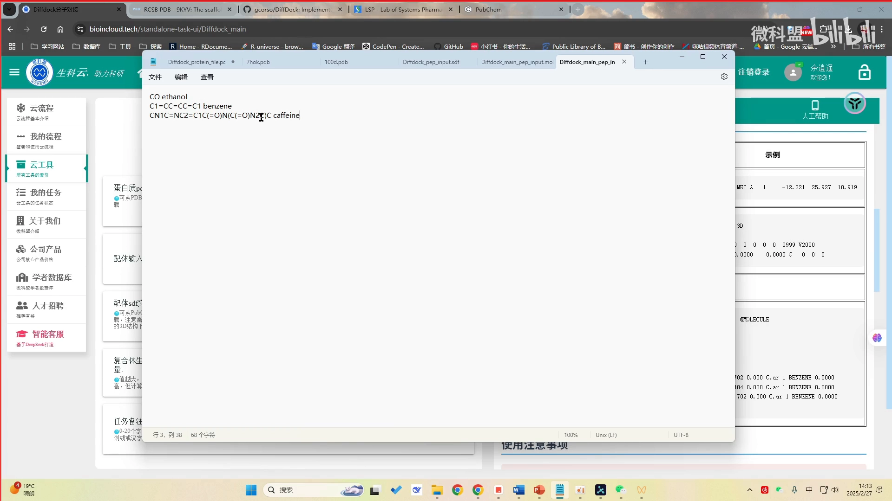

正确的 SMILES 哪里找？去 NIH 旗下的 **PubChem** 化合物数据库检索——能查到的基本没问题，化合物页面可直接下载所需 SDF 文件。[【跳转到 14:10】](https://www.bilibili.com/video/BV1dT9cYvEMn/?t=850)

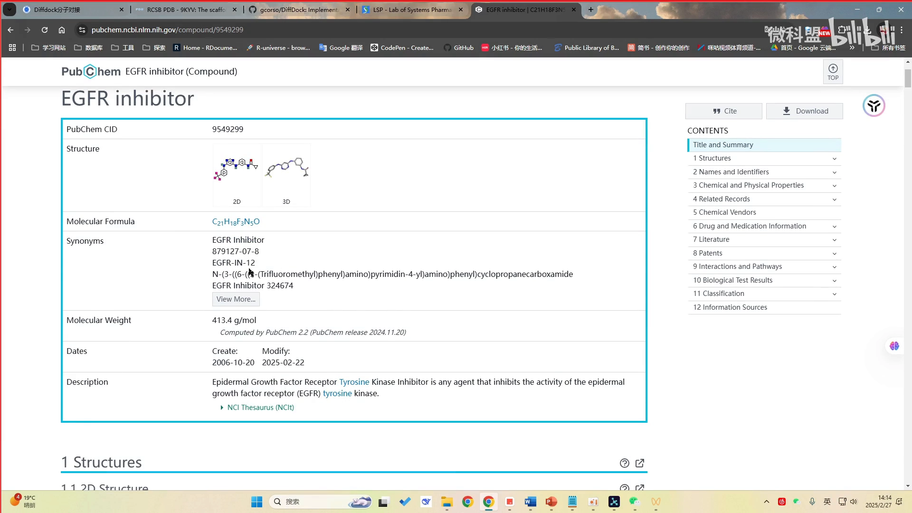

## 四、云工具实操：提交任务

DiffDock 已部署在微科盟生信云平台（"AI for Science"分类标签下）。操作四步：

1. 上传受体 PDB 文件；选择配体文件（SDF / MOL2 / SMI 三选一）；
2. 设置参数——关键是"**复合体生成的样本数量**"（生成多少个候选结合构象）：构象越多越费计算时间，平台目前主要靠 CPU 运行，建议设小（视频里设 2）；后续平台引入 GPU 服务器后可以放宽；[【跳转到 15:23】](https://www.bilibili.com/video/BV1dT9cYvEMn/?t=923)
3. **输入格式必须与所选文件对应**（选 SDF 文件就选 SDF 选项），不对应提交后必报错；[【跳转到 16:13】](https://www.bilibili.com/video/BV1dT9cYvEMn/?t=973)
4. 提交任务后在"我的任务"里等待计算完成。

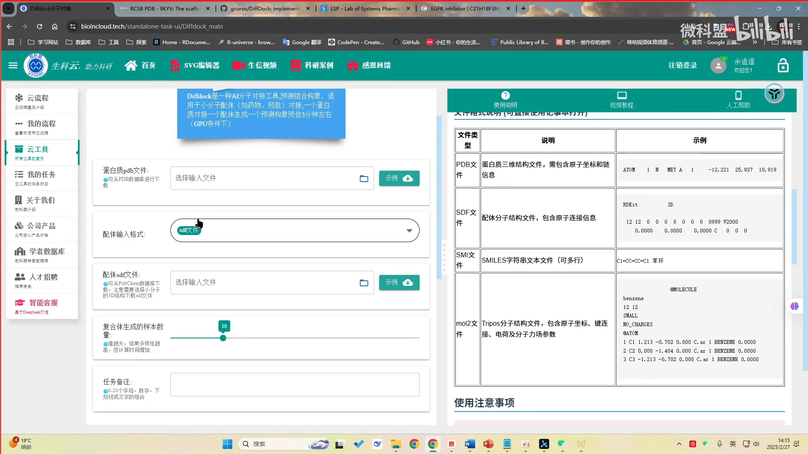

## 五、结果解读：置信度、rank 与 SDF

结果按复合体组织（complex0、complex1……一个 complex 对应一个"蛋白-配体"复合体）：

- 每个 complex 里的 SDF 结果**按置信度排名**（rank1、rank2……）；置信度预测值**很多时候是负值，越接近正数 / 越大越可信**；[【跳转到 17:26】](https://www.bilibili.com/video/BV1dT9cYvEMn/?t=1046)
- 输出的 SDF 是**优化之后的配体与蛋白质的相对位置**——也就是 AI 计算预测出的合理结合构象，而不是简单回显输入文件；[【跳转到 18:21】](https://www.bilibili.com/video/BV1dT9cYvEMn/?t=1101)
- rank1 附带一个 HTML 交互可视化：彩色卡通为蛋白（**红色是 C 端、蓝色是 N 端**），球棍模型为预测的小分子配体，可缩放旋转，帮助快速识别结合位点；其余 rank 的构象可用 **PyMOL** 查看（把构象 SDF 与受体 PDB 一起拖入即可整体可视化），也可以把多个构象一起拖入，观察预测构象的空间分布。[【跳转到 18:46】](https://www.bilibili.com/video/BV1dT9cYvEMn/?t=1126)、[【跳转到 19:53】](https://www.bilibili.com/video/BV1dT9cYvEMn/?t=1193)

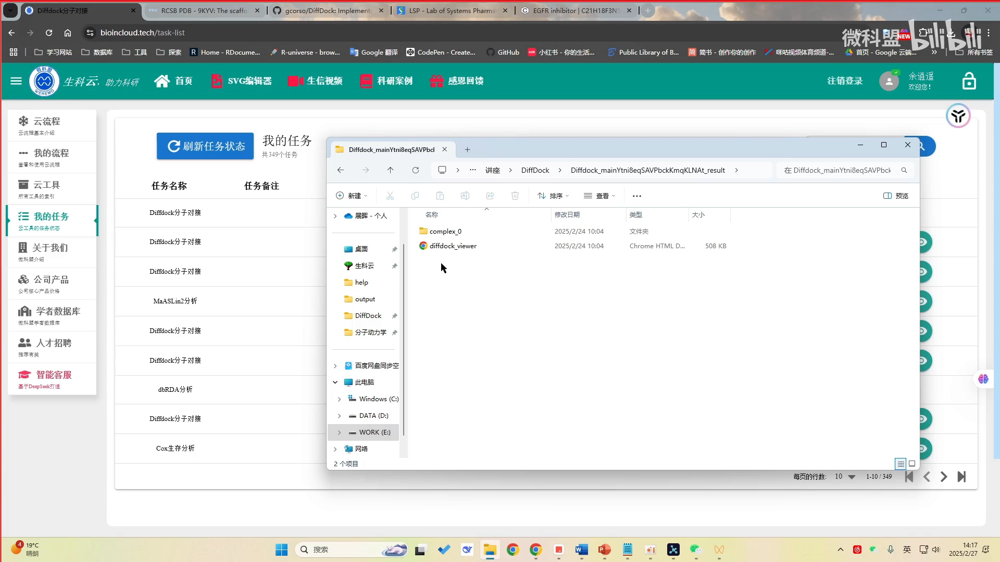

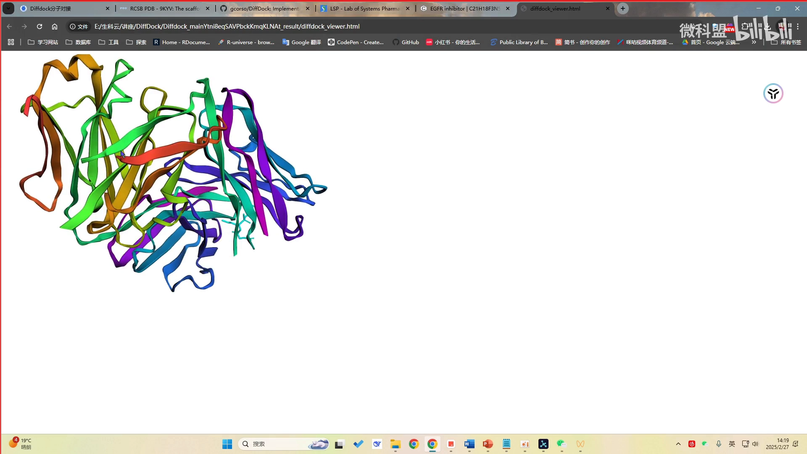

## 六、为什么要生成一堆构象，而不是只看 rank1？

一个常见疑问：直接取置信度最高的那个构象不就行了？视频的回答是"多数情况下不行"：

- 各候选构象的置信度常常**彼此接近**，预测出的结合位置也相近，rank1 未必显著优于其它；[【跳转到 20:48】](https://www.bilibili.com/video/BV1dT9cYvEMn/?t=1248)
- 多构象提供**构象集合多样性**，能**降低假阴性风险**——做药物设计不能只押一个构象：如果一个构象后续实验失败了，还得参考其它构象。[【跳转到 21:13】](https://www.bilibili.com/video/BV1dT9cYvEMn/?t=1273)

这与 DiffDock 的生成式本性一脉相承：对接的"正确答案"是多峰分布，生成模型负责把每个峰都采出来（详见上面推荐的深讲文章）。实战中如何把 DiffDock 与 Vina 结合、做到"既找得准又修得对"，见姊妹篇[《分子对接实例1-小分子和蛋白全盲对接（diffdock-L+vina）》](分子对接实例1-小分子和蛋白全盲对接（diffdock-L+vina）.md)。

## 小结

- 分子对接预测药物与靶蛋白的**结合模式与结合强度**，广泛用于虚拟筛选、先导优化与毒性预警。
- 传统对接 = "搜索 + 打分"：流程繁琐、粗采样易漏解、经验打分有误差、参数门槛高。
- DiffDock 把对接重构为**生成任务**：扩散模型在平移 × 旋转 × 扭转角空间生成候选，置信度模型排序——`position_confidence` 的出处。
- 输入四件套：受体 **PDB**（看 HEADER 与 ATOM/HETATM），配体 **SDF / MOL2 / SMI**（SMILES 用 PubChem 核对）。
- 结果按复合体组织、按置信度排名；**多构象的意义是集合多样性、降低假阴性**。

## 关键术语速查

| 术语 | 一句话解释 |
| --- | --- |
| 分子对接 | 预测小分子配体与靶蛋白三维结合模式与强度的计算方法 |
| 盲对接 | 不预先给定口袋位置的对接，DiffDock 的强项 |
| PDB | 大分子三维结构文本格式；ATOM=标准残基原子，HETATM=非标准原子 |
| SDF | 带三维坐标的分子文件：计数行 → 原子区 → 键区 → 属性区 |
| MOL2 | 分子建模常用格式，按 `@<TRIPOS>` 模块化组织 |
| SMILES / SMI | 分子的线性文本表示；SMI 文件一行一个配体（SMILES + 名字） |
| 置信度（confidence） | DiffDock 对"RMSD<2 Å"的打分，越大越可信；对应输出列 position_confidence |
| 扭转角 | 可旋转键的二面角；DiffDock 只扩散"平移 / 旋转 / 扭转"三类自由度 |
